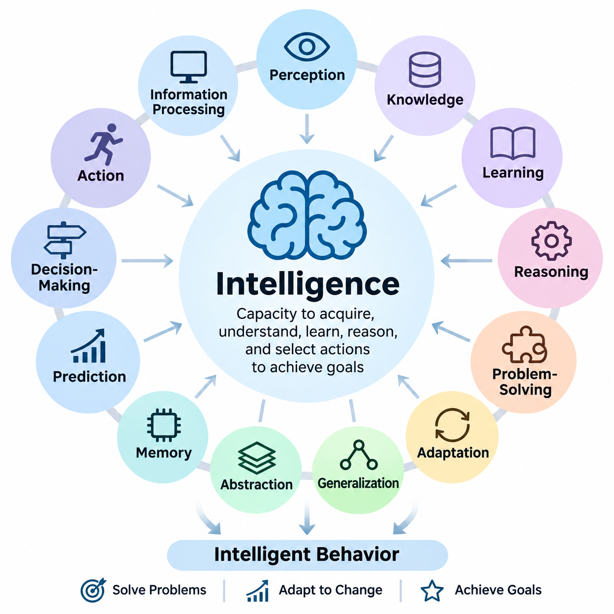
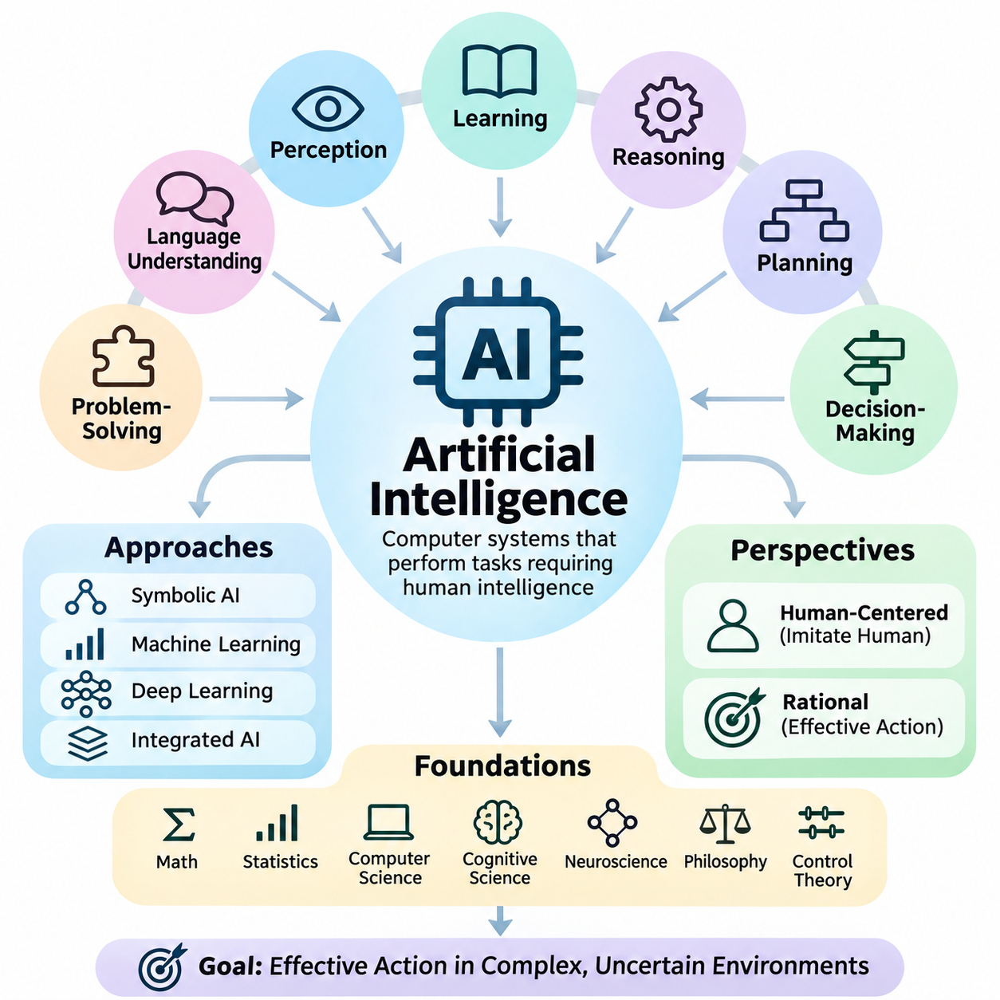
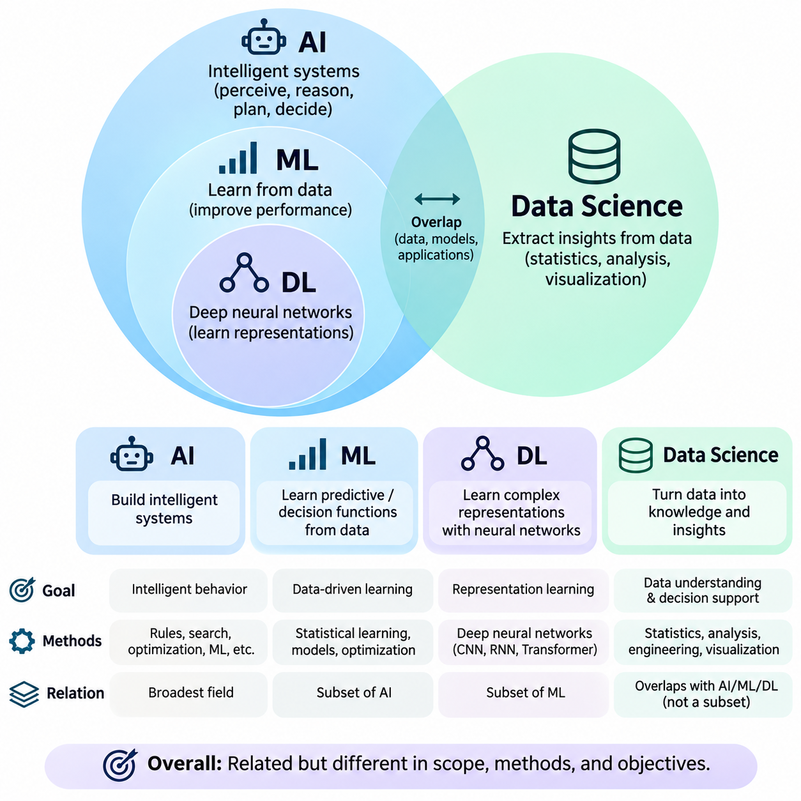
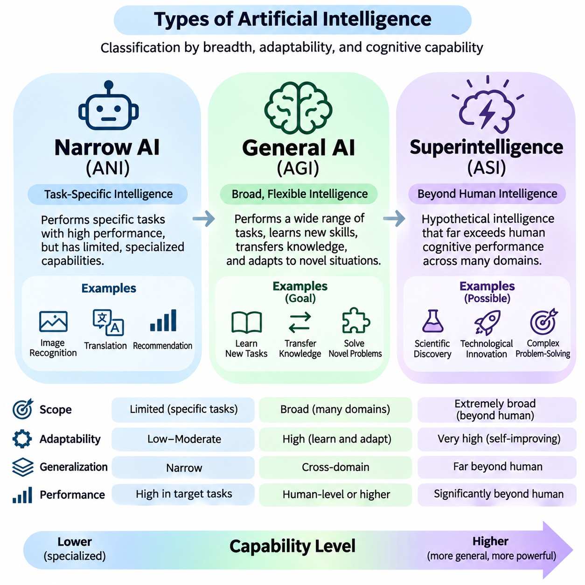
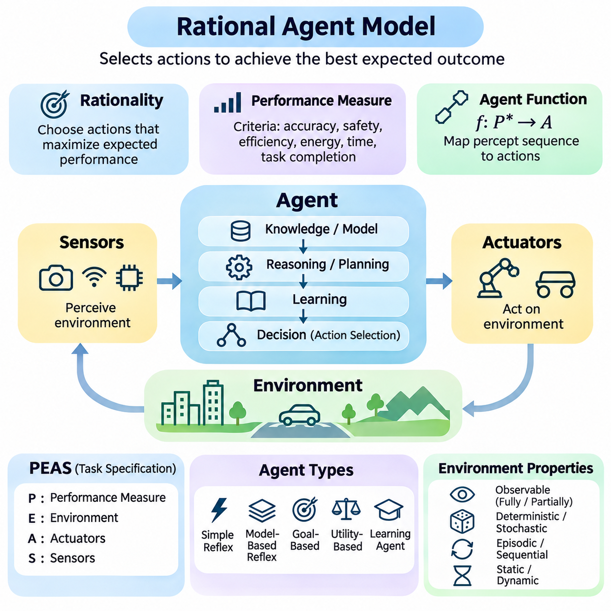
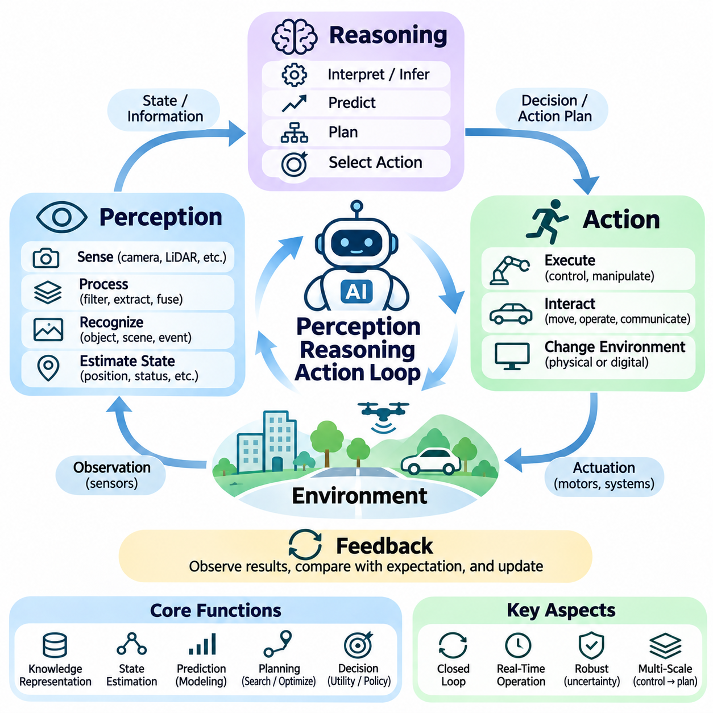
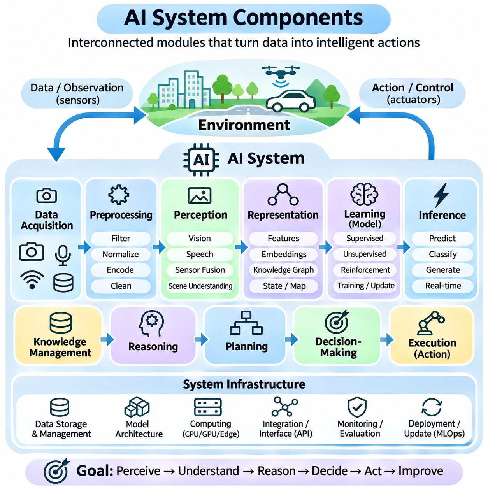
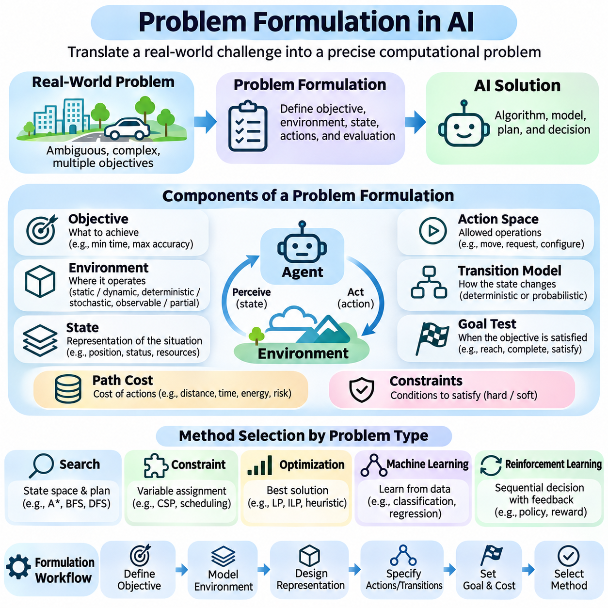
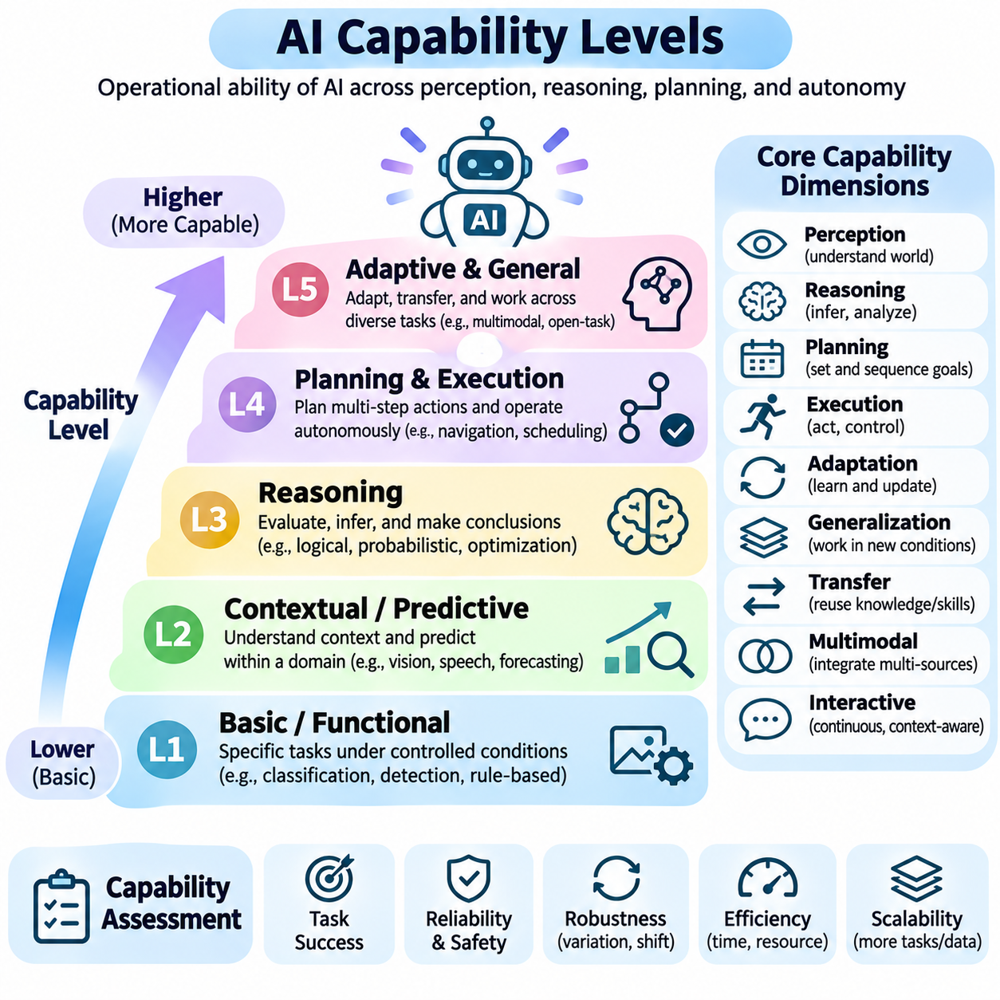
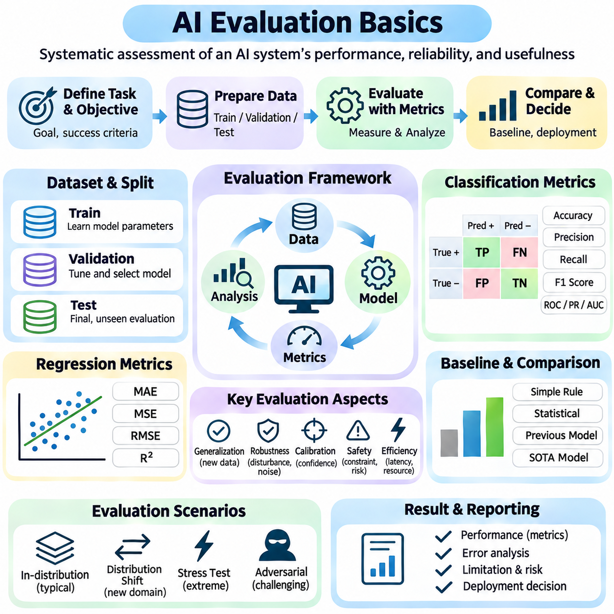

**Volume 04. Artificial Intelligence**


# 01. Foundations and Definitions

## 01.00 What is Intelligence

{width="7.268055555555556in" height="7.268055555555556in"}

Intelligence is the capacity of an individual or system to acquire information, understand its environment, learn from experience, reason about situations, and select actions that achieve meaningful objectives. It involves more than possessing knowledge or performing calculations. Intelligence becomes evident when an entity can use available information to solve problems, respond to changing conditions, and improve its behavior through experience.

The concept of intelligence has been examined across philosophy, psychology, neuroscience, biology, and computer science. Each discipline emphasizes different characteristics. Psychology investigates cognitive abilities, neuroscience examines biological mechanisms, and computer science explores computational processes. These perspectives suggest that intelligence is a multidimensional phenomenon rather than a single measurable property.

A fundamental characteristic of intelligence is the ability to process information and transform it into useful representations. Information may originate from sensory observations, language, numerical measurements, or interactions with the environment. An intelligent system must identify relevant patterns, distinguish meaningful signals from noise, and organize information into structures that support understanding and decision-making.

Perception provides an important foundation for intelligent behavior because an entity must obtain information about its surroundings before responding appropriately. Biological organisms use sensory systems, while artificial systems employ cameras, microphones, radar, LiDAR, and other sensors. Perception transforms raw observations into meaningful descriptions of objects, events, relationships, and environmental conditions.

Knowledge represents information that has been organized into concepts, facts, relationships, procedures, or models. Intelligence depends not only on acquiring knowledge but also on applying it appropriately. A system may store enormous quantities of information without demonstrating sophisticated intelligence if it cannot interpret relationships, recognize relevant contexts, or use that information to solve unfamiliar problems.

Learning is another essential dimension of intelligence. It enables an individual or system to modify its internal representations or behavior based on observations, feedback, and experience. Learning may involve recognizing statistical patterns, discovering relationships, refining strategies, or developing new skills. Its importance lies in reducing dependence on fixed instructions and enabling adaptation to previously unseen circumstances.

Reasoning allows intelligent entities to derive conclusions from available knowledge and evidence. Deductive reasoning applies established principles to specific situations, while inductive reasoning identifies general patterns from observations. Abductive reasoning seeks plausible explanations for incomplete evidence. These processes support interpretation, prediction, diagnosis, and problem-solving under different degrees of uncertainty.

Problem-solving demonstrates intelligence through the identification of objectives, constraints, available resources, and possible actions. An intelligent entity must evaluate alternative solutions and select an appropriate strategy. Some problems can be solved through established procedures, whereas others require exploration, abstraction, experimentation, or creative combinations of existing knowledge.

Adaptation distinguishes flexible intelligence from rigid behavior. Environments frequently change because of uncertainty, disturbances, unexpected events, or evolving objectives. Intelligent systems must recognize when existing strategies become ineffective and adjust their responses accordingly. Adaptation may occur through learning, planning, feedback control, or the reorganization of internal knowledge and behavioral policies.

Generalization refers to the ability to apply previously acquired knowledge to new situations that differ from earlier experiences. A system that memorizes examples without recognizing underlying relationships may perform well on familiar tasks but fail when conditions change. Strong generalization requires representations that capture useful regularities while remaining sufficiently flexible to accommodate unfamiliar combinations of circumstances.

Abstraction enables intelligence to represent complex situations using simplified concepts that preserve essential relationships. Instead of processing every detail independently, an intelligent entity can identify categories, principles, and higher-level structures. Abstraction supports efficient reasoning, knowledge transfer, and planning because similar problems can be understood through shared representations.

Memory contributes to intelligence by preserving information across time. Short-term memory supports immediate reasoning and ongoing activities, while long-term memory retains knowledge, experiences, and learned skills. Effective intelligence requires mechanisms for storing, retrieving, updating, and selectively forgetting information. Memory becomes especially valuable when current decisions depend on events or observations from the past.

Prediction is closely associated with intelligent behavior because effective decisions often require anticipating future conditions. Humans predict consequences through experience and mental models, while artificial systems may employ statistical forecasting, simulation, or learned predictive models. Accurate prediction supports planning and risk reduction, although uncertainty prevents complete knowledge of future events.

Decision-making transforms perception, knowledge, reasoning, and prediction into the selection of actions. Intelligent decisions involve comparing alternatives according to objectives, constraints, expected outcomes, and available evidence. In uncertain environments, decisions may require balancing potential rewards against risks. Rational decision-making seeks actions that are appropriate given the information and resources available.

Goal-directed behavior provides an operational perspective on intelligence. An entity demonstrates purposeful behavior when its actions contribute to achieving defined objectives. Goals may involve survival, resource acquisition, task completion, communication, or environmental improvement. However, goal achievement alone does not establish general intelligence because simple automated mechanisms can also accomplish narrowly specified objectives.

The relationship between intelligence and rationality is important in artificial intelligence. Rationality concerns selecting actions expected to produce desirable outcomes according to a performance criterion. Intelligence includes broader capabilities such as learning, understanding, and adaptation. A rational agent may operate with limited knowledge, while an intelligent system may still make imperfect decisions because of uncertainty or computational constraints.

Intelligence should also be distinguished from consciousness and subjective experience. Consciousness generally concerns awareness and phenomenal experience, whereas intelligence concerns capacities such as reasoning, learning, and effective behavior. These concepts may interact in biological organisms, but they are not equivalent. Whether artificial systems can possess subjective experience remains an unresolved philosophical and scientific question.

Human intelligence combines perception, language, memory, reasoning, social understanding, creativity, and physical interaction. These capabilities operate together rather than as completely independent modules. Human cognition also depends on biological constraints, emotions, motivation, and cultural experience. Consequently, human intelligence cannot be adequately described through computational speed or factual knowledge alone.

Animal intelligence illustrates that sophisticated cognition is not exclusive to humans. Different species demonstrate navigation, communication, cooperation, tool use, memory, and adaptive problem-solving. Their abilities reflect evolutionary pressures and ecological requirements. Comparing intelligence across species reveals that cognitive capabilities may develop in different combinations rather than along a single universal hierarchy.

Collective intelligence emerges when multiple individuals or agents coordinate information, knowledge, and decisions to achieve outcomes beyond their isolated capabilities. Human organizations, biological colonies, and distributed computational systems provide different examples. Effective collective intelligence depends on communication, coordination, information sharing, and mechanisms for resolving conflicting observations or objectives.

Artificial intelligence approaches intelligence through computational mechanisms that perform tasks associated with intelligent behavior. These mechanisms may use symbolic reasoning, statistical learning, neural networks, optimization, or combinations of several approaches. Artificial systems need not reproduce biological cognition exactly. Their intelligence is generally evaluated through observable capabilities, task performance, adaptability, and reliability.

An important distinction exists between intelligence and computational power. Faster processors and larger memory capacities can support more sophisticated algorithms, but hardware resources alone do not guarantee intelligent behavior. Intelligence depends on how computational resources are organized to represent information, learn relationships, evaluate alternatives, and produce effective responses to environmental conditions.

Intelligence is also constrained by available information and computational resources. No individual or artificial system can evaluate every possible situation or consequence. Practical intelligence therefore requires approximation, selective attention, heuristics, and efficient allocation of resources. These mechanisms enable useful decisions despite incomplete knowledge, limited processing capacity, and strict time constraints.

The embodiment perspective emphasizes that intelligence may develop through interaction between an agent\'s body and its environment. Physical characteristics, sensory capabilities, and available actions influence what an agent can learn and accomplish. In robotics, intelligent behavior emerges through coordinated perception, reasoning, planning, and control, continuously influenced by feedback from the physical world.

Social intelligence involves interpreting the intentions, emotions, behaviors, and expectations of other agents. It supports communication, cooperation, negotiation, and coordinated activities. For artificial systems interacting with humans, social intelligence also requires sensitivity to context, ambiguity, and individual preferences. Effective interaction depends on more than generating grammatically correct language or recognizing predefined expressions.

Creativity represents another dimension of intelligence through the generation of ideas, explanations, or solutions that are both novel and useful within a particular context. Creative processes often combine existing knowledge in unfamiliar ways. Computational systems can support creativity through generative modeling, exploration, and optimization, although evaluating originality and practical value remains challenging.

Measuring intelligence is difficult because different tasks emphasize different cognitive capabilities. Standardized tests, problem-solving benchmarks, learning efficiency, and behavioral evaluations provide partial evidence. A system may demonstrate exceptional performance in mathematics while struggling with physical interaction or social reasoning. Consequently, intelligence assessment should consider multiple dimensions rather than relying on a single score.

Robust intelligence requires maintaining useful performance when conditions differ from expectations. Environmental noise, incomplete observations, distribution shifts, and unexpected disturbances can expose limitations in learned behavior. An intelligent system should recognize uncertainty, avoid unjustified confidence, and recover from errors when possible. Robustness is particularly important when decisions affect safety-critical operations.

The relationship between intelligence and autonomy requires careful interpretation. Autonomy describes the degree to which a system can operate without continuous external intervention, whereas intelligence concerns its cognitive and adaptive capabilities. A highly automated machine may follow fixed procedures without sophisticated reasoning. Conversely, an intelligent decision-support system may demonstrate advanced reasoning while remaining under human supervision.

Intelligence can therefore be understood as an integrated capacity involving information processing, learning, reasoning, adaptation, prediction, and goal-directed action. Its expression depends on the environment, available resources, and the problems being addressed. This functional perspective provides a foundation for examining artificial intelligence as the engineering of systems capable of increasingly sophisticated and adaptive behavior.

Understanding intelligence requires recognizing both its observable achievements and its limitations. Successful task execution does not necessarily imply understanding across unrelated domains, and advanced language performance does not automatically establish reliable physical reasoning. A rigorous definition must distinguish demonstrated capabilities from assumed abilities while accounting for uncertainty, generalization, and the boundaries of evaluation.

Ultimately, intelligence is best approached as a collection of interacting capabilities that enable an entity to transform information and experience into effective behavior. No single mechanism fully explains every form of intelligence. This broader understanding establishes the conceptual foundation for studying artificial intelligence, rational agents, computational reasoning, learning systems, and the development of increasingly capable autonomous technologies.

지능(Intelligence)은 개체 또는 시스템이 정보를 획득하고, 환경을 이해하며, 경험을 통해 학습하고, 상황을 추론하며, 의미 있는 목표를 달성하기 위한 행동을 선택하는 능력이다. 지능은 단순히 지식을 보유하거나 계산을 수행하는 것 이상의 개념이다. 지능은 이용 가능한 정보를 활용하여 문제를 해결하고, 변화하는 조건에 대응하며, 경험을 통해 자신의 행동을 개선할 수 있을 때 나타난다.

지능의 개념은 철학(Philosophy), 심리학(Psychology), 신경과학(Neuroscience), 생물학(Biology), 컴퓨터 과학(Computer Science) 등 다양한 학문 분야에서 연구되어 왔다. 각 분야는 서로 다른 특성을 강조한다. 심리학은 인지 능력(Cognitive Abilities)을 연구하고, 신경과학은 생물학적 메커니즘(Biological Mechanisms)을 분석하며, 컴퓨터 과학은 계산 과정(Computational Processes)을 탐구한다. 이러한 관점은 지능이 단일한 측정 속성이 아니라 다차원적 현상(Multidimensional Phenomenon)임을 보여준다.

지능의 근본적인 특성 중 하나는 정보를 처리하고 이를 유용한 표현(Representation)으로 변환하는 능력이다. 정보는 감각 관측(Sensory Observations), 언어(Language), 수치 측정(Numerical Measurements), 환경과의 상호작용(Interaction) 등에서 얻어진다. 지능형 시스템(Intelligent System)은 관련성 있는 패턴(Pattern)을 식별하고, 의미 있는 신호(Signal)와 잡음(Noise)을 구분하며, 이해와 의사결정을 지원하는 구조로 정보를 조직할 수 있어야 한다.

지각(Perception)은 지능적 행동(Intelligent Behavior)의 중요한 기반을 제공한다. 개체가 주변 환경에 적절하게 대응하려면 먼저 환경에 관한 정보를 획득해야 하기 때문이다. 생물학적 유기체는 감각 시스템(Sensory Systems)을 사용하고, 인공 시스템(Artificial Systems)은 카메라(Camera), 마이크(Microphone), 레이더(Radar), 라이다(LiDAR) 등의 센서를 활용한다. 지각은 원시 관측 데이터(Raw Observations)를 객체, 사건, 관계 및 환경 조건에 대한 의미 있는 설명으로 변환한다.

지식(Knowledge)은 개념(Concepts), 사실(Facts), 관계(Relationships), 절차(Procedures), 모델(Models) 등의 형태로 조직된 정보를 의미한다. 지능은 지식을 획득하는 것뿐만 아니라 이를 적절하게 적용하는 능력에도 의존한다. 시스템이 방대한 정보를 저장하고 있더라도 관계를 해석하거나 관련 맥락(Context)을 인식하고, 익숙하지 않은 문제를 해결하는 데 정보를 활용하지 못한다면 높은 수준의 지능을 보여준다고 평가하기 어렵다.

학습(Learning)은 지능의 또 다른 핵심 차원이다. 학습은 관측(Observation), 피드백(Feedback), 경험(Experience)을 기반으로 내부 표현(Internal Representations)이나 행동을 수정할 수 있도록 한다. 학습에는 통계적 패턴(Statistical Patterns)의 인식, 관계의 발견, 전략의 개선, 새로운 기술의 습득 등이 포함된다. 학습의 중요성은 고정된 명령에 대한 의존성을 줄이고, 이전에 경험하지 못한 상황에 적응할 수 있도록 한다는 점에 있다.

추론(Reasoning)은 지능형 개체가 이용 가능한 지식과 증거(Evidence)를 바탕으로 결론을 도출하도록 한다. 연역적 추론(Deductive Reasoning)은 확립된 원리를 구체적인 상황에 적용하고, 귀납적 추론(Inductive Reasoning)은 관측에서 일반적인 패턴을 식별한다. 가설적 추론(Abductive Reasoning)은 불완전한 증거에 대한 그럴듯한 설명을 탐색한다. 이러한 과정은 다양한 불확실성(Uncertainty) 수준에서 해석, 예측, 진단 및 문제 해결을 지원한다.

문제 해결(Problem-Solving)은 목표(Objectives), 제약 조건(Constraints), 이용 가능한 자원(Resources), 가능한 행동(Actions)을 식별하는 과정을 통해 지능을 보여준다. 지능형 개체는 대안적 해결책(Alternative Solutions)을 평가하고 적절한 전략(Strategy)을 선택해야 한다. 일부 문제는 확립된 절차를 통해 해결할 수 있지만, 다른 문제는 탐색(Exploration), 추상화(Abstraction), 실험(Experimentation), 기존 지식의 창의적인 조합을 필요로 한다.

적응(Adaptation)은 유연한 지능(Flexible Intelligence)과 경직된 행동(Rigid Behavior)을 구분하는 중요한 특성이다. 환경은 불확실성, 교란(Disturbances), 예상하지 못한 사건, 변화하는 목표로 인해 지속적으로 달라진다. 지능형 시스템은 기존 전략이 효과적이지 않은 상황을 인식하고 그에 따라 대응 방식을 조정해야 한다. 적응은 학습, 계획(Planning), 피드백 제어(Feedback Control), 내부 지식 및 행동 정책(Behavioral Policies)의 재구성을 통해 이루어질 수 있다.

일반화(Generalization)는 이전에 획득한 지식을 과거 경험과 다른 새로운 상황에 적용하는 능력이다. 기본적인 관계를 이해하지 못한 채 사례만 암기하는 시스템은 익숙한 작업에서는 우수한 성능을 보이지만 조건이 변화하면 실패할 수 있다. 강력한 일반화 능력을 확보하려면 유용한 규칙성(Regularities)을 포착하면서도 익숙하지 않은 상황의 조합을 수용할 수 있을 만큼 유연한 표현(Representations)이 필요하다.

추상화(Abstraction)는 복잡한 상황에서 핵심적인 관계를 유지하면서 단순화된 개념으로 표현할 수 있도록 한다. 지능형 개체는 모든 세부 사항을 독립적으로 처리하는 대신 범주(Categories), 원리(Principles), 상위 수준 구조(Higher-Level Structures)를 식별할 수 있다. 추상화는 유사한 문제를 공통된 표현을 통해 이해하도록 하므로 효율적인 추론, 지식 전이(Knowledge Transfer), 계획 수립을 지원한다.

기억(Memory)은 시간에 걸쳐 정보를 보존함으로써 지능에 기여한다. 단기 기억(Short-Term Memory)은 즉각적인 추론과 진행 중인 활동을 지원하고, 장기 기억(Long-Term Memory)은 지식, 경험, 학습된 기술을 유지한다. 효과적인 지능을 구현하려면 정보를 저장(Storage), 검색(Retrieval), 갱신(Update)하고 선택적으로 망각(Forgetting)하는 메커니즘이 필요하다. 기억은 현재의 의사결정이 과거 사건이나 관측에 의존할 때 특히 중요하다.

예측(Prediction)은 효과적인 의사결정이 미래의 조건을 예상하는 능력을 요구한다는 점에서 지능적 행동과 밀접하게 관련된다. 인간은 경험과 정신 모델(Mental Models)을 통해 결과를 예측하고, 인공 시스템은 통계적 예측(Statistical Forecasting), 시뮬레이션(Simulation), 학습된 예측 모델(Predictive Models)을 활용할 수 있다. 정확한 예측은 계획 수립과 위험 감소(Risk Reduction)를 지원하지만, 불확실성으로 인해 미래 사건에 대한 완전한 지식은 확보하기 어렵다.

의사결정(Decision-Making)은 지각, 지식, 추론, 예측을 행동 선택(Action Selection)으로 전환하는 과정이다. 지능적인 의사결정에는 목표, 제약 조건, 예상 결과(Expected Outcomes), 이용 가능한 증거를 기준으로 대안을 비교하는 과정이 포함된다. 불확실한 환경에서는 잠재적 보상(Potential Rewards)과 위험(Risks) 사이의 균형을 고려해야 한다. 합리적 의사결정(Rational Decision-Making)은 주어진 정보와 자원에 비추어 적절한 행동을 선택하는 것을 목표로 한다.

목표 지향적 행동(Goal-Directed Behavior)은 지능을 이해하기 위한 작동적 관점(Operational Perspective)을 제공한다. 개체의 행동이 정의된 목표 달성에 기여할 때 목적성 있는 행동(Purposeful Behavior)을 보여준다고 할 수 있다. 목표에는 생존(Survival), 자원 획득(Resource Acquisition), 작업 완료(Task Completion), 의사소통(Communication), 환경 개선 등이 포함될 수 있다. 그러나 단순한 자동화 메커니즘도 제한적으로 정의된 목표를 달성할 수 있으므로 목표 달성만으로 일반 지능(General Intelligence)을 입증할 수는 없다.

지능과 합리성(Rationality)의 관계는 인공지능(Artificial Intelligence)에서 중요하다. 합리성은 성능 기준(Performance Criterion)에 따라 바람직한 결과를 만들어낼 것으로 예상되는 행동을 선택하는 것과 관련된다. 반면 지능은 학습, 이해, 적응 등 더욱 폭넓은 능력을 포함한다. 합리적 에이전트(Rational Agent)는 제한된 지식으로 작동할 수 있으며, 지능형 시스템 역시 불확실성이나 계산 자원의 제약으로 인해 불완전한 결정을 내릴 수 있다.

지능은 의식(Consciousness) 및 주관적 경험(Subjective Experience)과도 구분되어야 한다. 의식은 일반적으로 자각(Awareness)과 현상적 경험(Phenomenal Experience)에 관한 개념인 반면, 지능은 추론, 학습, 효과적인 행동과 같은 능력에 관한 개념이다. 이러한 개념들은 생물학적 유기체에서 상호작용할 수 있지만 서로 동일하지는 않다. 인공 시스템이 주관적 경험을 가질 수 있는지는 여전히 해결되지 않은 철학적·과학적 문제이다.

인간 지능(Human Intelligence)은 지각, 언어, 기억, 추론, 사회적 이해(Social Understanding), 창의성(Creativity), 물리적 상호작용(Physical Interaction)을 결합한다. 이러한 능력들은 완전히 독립된 모듈이 아니라 서로 연결되어 작동한다. 인간 인지(Human Cognition)는 생물학적 제약(Biological Constraints), 감정(Emotions), 동기(Motivation), 문화적 경험(Cultural Experience)의 영향도 받는다. 따라서 인간 지능은 계산 속도나 사실적 지식만으로 충분히 설명할 수 없다.

동물 지능(Animal Intelligence)은 정교한 인지 능력이 인간에게만 존재하는 것이 아님을 보여준다. 다양한 종은 항법(Navigation), 의사소통, 협력(Cooperation), 도구 사용(Tool Use), 기억, 적응적 문제 해결(Adaptive Problem-Solving) 능력을 나타낸다. 이러한 능력은 진화적 압력(Evolutionary Pressures)과 생태적 요구(Ecological Requirements)를 반영한다. 종 사이의 지능 비교는 인지 능력이 단일한 보편적 계층 구조가 아니라 서로 다른 조합으로 발달할 수 있음을 보여준다.

집단 지능(Collective Intelligence)은 여러 개체나 에이전트(Agents)가 정보, 지식, 의사결정을 조정하여 개별적으로 수행할 때보다 뛰어난 결과를 만들어낼 때 나타난다. 인간 조직(Human Organizations), 생물학적 군집(Biological Colonies), 분산 컴퓨팅 시스템(Distributed Computational Systems)이 서로 다른 사례를 제공한다. 효과적인 집단 지능은 의사소통, 조정(Coordination), 정보 공유(Information Sharing), 상충하는 관측이나 목표를 해결하기 위한 메커니즘에 의존한다.

인공지능(Artificial Intelligence)은 지능적 행동과 관련된 작업을 수행하는 계산 메커니즘(Computational Mechanisms)을 통해 지능에 접근한다. 이러한 메커니즘은 기호적 추론(Symbolic Reasoning), 통계적 학습(Statistical Learning), 신경망(Neural Networks), 최적화(Optimization), 또는 여러 접근법의 조합을 활용할 수 있다. 인공 시스템이 생물학적 인지를 정확하게 재현할 필요는 없다. 일반적으로 인공지능의 지능은 관측 가능한 능력, 작업 성능, 적응성(Adaptability), 신뢰성(Reliability)을 통해 평가된다.

지능과 계산 능력(Computational Power) 사이에는 중요한 차이가 존재한다. 더 빠른 프로세서(Processors)와 더 큰 메모리 용량(Memory Capacity)은 정교한 알고리즘(Algorithms)을 지원할 수 있지만, 하드웨어 자원(Hardware Resources)만으로 지능적 행동이 보장되지는 않는다. 지능은 계산 자원을 어떻게 조직하여 정보를 표현하고, 관계를 학습하며, 대안을 평가하고, 환경 조건에 효과적으로 대응하는지를 통해 결정된다.

지능은 이용 가능한 정보와 계산 자원에 의해서도 제약을 받는다. 어떤 개체나 인공 시스템도 가능한 모든 상황과 결과를 평가할 수는 없다. 따라서 실용적 지능(Practical Intelligence)은 근사(Approximation), 선택적 주의(Selective Attention), 휴리스틱(Heuristics), 효율적인 자원 할당(Resource Allocation)을 필요로 한다. 이러한 메커니즘은 불완전한 지식, 제한된 처리 능력, 엄격한 시간 제약(Time Constraints) 속에서도 유용한 결정을 내릴 수 있도록 한다.

체화 관점(Embodiment Perspective)은 지능이 에이전트의 신체(Body)와 환경(Environment) 사이의 상호작용을 통해 발달할 수 있음을 강조한다. 물리적 특성(Physical Characteristics), 감각 능력(Sensory Capabilities), 수행 가능한 행동은 에이전트가 학습하고 달성할 수 있는 범위에 영향을 준다. 로보틱스(Robotics)에서는 지각, 추론, 계획, 제어(Control)가 조정되어 지능적 행동이 나타나며, 이러한 과정은 물리적 세계에서 얻는 피드백의 영향을 지속적으로 받는다.

사회적 지능(Social Intelligence)은 다른 에이전트의 의도(Intentions), 감정(Emotions), 행동(Behaviors), 기대(Expectations)를 해석하는 능력을 포함한다. 이는 의사소통, 협력, 협상(Negotiation), 조정된 활동을 지원한다. 인간과 상호작용하는 인공 시스템에서는 사회적 지능이 맥락, 모호성(Ambiguity), 개인적 선호(Individual Preferences)에 대한 민감성도 요구한다. 효과적인 상호작용은 문법적으로 올바른 언어를 생성하거나 미리 정의된 표현을 인식하는 것 이상의 능력에 의존한다.

창의성(Creativity)은 특정 맥락에서 새로우면서도 유용한 아이디어, 설명, 해결책을 생성하는 능력을 통해 지능의 또 다른 차원을 나타낸다. 창의적 과정(Creative Processes)은 기존 지식을 익숙하지 않은 방식으로 결합하는 경우가 많다. 계산 시스템(Computational Systems)은 생성 모델링(Generative Modeling), 탐색(Exploration), 최적화(Optimization)를 통해 창의성을 지원할 수 있지만, 독창성(Originality)과 실용적 가치(Practical Value)를 평가하는 것은 여전히 어려운 과제이다.

지능 측정(Intelligence Measurement)은 서로 다른 작업이 서로 다른 인지 능력을 강조하기 때문에 어렵다. 표준화 검사(Standardized Tests), 문제 해결 벤치마크(Problem-Solving Benchmarks), 학습 효율성(Learning Efficiency), 행동 평가(Behavioral Evaluations)는 부분적인 증거를 제공한다. 어떤 시스템은 수학에서 탁월한 성능을 보이면서도 물리적 상호작용이나 사회적 추론에 어려움을 겪을 수 있다. 따라서 지능 평가는 단일 점수에 의존하기보다 여러 차원을 고려해야 한다.

강건한 지능(Robust Intelligence)은 조건이 예상과 달라지더라도 유용한 성능을 유지할 수 있어야 한다. 환경 잡음(Environmental Noise), 불완전한 관측(Incomplete Observations), 분포 변화(Distribution Shifts), 예상하지 못한 교란은 학습된 행동의 한계를 드러낼 수 있다. 지능형 시스템은 불확실성을 인식하고, 정당화되지 않은 과도한 확신(Unjustified Confidence)을 피하며, 가능한 경우 오류에서 복구(Recovery)할 수 있어야 한다. 강건성(Robustness)은 특히 안전 필수 운영(Safety-Critical Operations)에서 중요하다.

지능과 자율성(Autonomy)의 관계는 신중하게 해석해야 한다. 자율성은 시스템이 지속적인 외부 개입(External Intervention) 없이 작동할 수 있는 정도를 나타내며, 지능은 인지 및 적응 능력(Cognitive and Adaptive Capabilities)을 의미한다. 고도로 자동화된 기계(Automated Machine)는 정교한 추론 없이 고정된 절차를 수행할 수 있다. 반대로 지능형 의사결정 지원 시스템(Intelligent Decision-Support System)은 인간의 감독(Human Supervision) 아래에서 작동하면서도 고급 추론 능력을 보여줄 수 있다.

따라서 지능은 정보 처리(Information Processing), 학습, 추론, 적응, 예측, 목표 지향적 행동을 포함하는 통합적 능력(Integrated Capacity)으로 이해할 수 있다. 지능이 발현되는 방식은 환경, 이용 가능한 자원, 해결해야 하는 문제에 따라 달라진다. 이러한 기능적 관점(Functional Perspective)은 점점 더 정교하고 적응적인 행동을 수행할 수 있는 시스템을 공학적으로 구현하는 분야로서 인공지능을 이해하기 위한 기반을 제공한다.

지능을 이해하려면 관측 가능한 성과(Observable Achievements)와 한계(Limitations)를 모두 인식해야 한다. 특정 작업을 성공적으로 수행했다고 해서 관련 없는 영역에서도 이해 능력이 존재한다고 볼 수는 없으며, 뛰어난 언어 처리 성능(Language Performance)이 신뢰할 수 있는 물리적 추론(Physical Reasoning)을 자동으로 보장하지도 않는다. 엄밀한 정의(Rigorous Definition)는 입증된 능력(Demonstrated Capabilities)과 가정된 능력(Assumed Abilities)을 구분하고, 불확실성, 일반화, 평가의 경계를 고려해야 한다.

궁극적으로 지능은 정보와 경험을 효과적인 행동으로 전환할 수 있도록 하는 상호작용적 능력들의 집합(Collection of Interacting Capabilities)으로 이해하는 것이 적절하다. 어떤 단일 메커니즘도 모든 형태의 지능을 완전하게 설명하지는 못한다. 이러한 폭넓은 이해는 인공지능, 합리적 에이전트(Rational Agents), 계산적 추론(Computational Reasoning), 학습 시스템(Learning Systems), 그리고 점점 더 높은 능력을 갖추는 자율 기술(Autonomous Technologies)의 발전을 연구하기 위한 개념적 토대(Conceptual Foundation)를 형성한다.

## 01.01 What is Artificial Intelligence

{width="7.268055555555556in" height="7.268055555555556in"}

Artificial Intelligence (AI) is a field of computer science concerned with designing systems capable of performing tasks that ordinarily require human intelligence. These tasks include perception, learning, reasoning, problem-solving, language understanding, planning, and decision-making. AI seeks to develop computational mechanisms that transform information into meaningful predictions, decisions, and actions within defined environments.

The concept of artificial intelligence extends beyond reproducing human behavior. An AI system may achieve intelligent outcomes through computational processes that differ substantially from biological cognition. Rather than requiring machines to think exactly like humans, AI research investigates how information processing, mathematical models, and algorithms can produce effective behavior under different objectives and environmental conditions.

Artificial intelligence can be understood from several complementary perspectives. The human-centered perspective emphasizes systems that imitate human thinking or behavior, while the rational perspective focuses on systems that reason correctly or select effective actions. These perspectives influence how researchers define intelligence, construct computational models, and evaluate the capabilities of artificial systems.

A central objective of AI is to create systems that operate effectively in complex environments where complete information may not be available. Such systems must interpret observations, identify relevant relationships, evaluate alternatives, and respond appropriately. Their performance depends on how successfully they combine knowledge, computation, learning, and decision-making under uncertainty and resource constraints.

The foundations of artificial intelligence draw upon mathematics, statistics, computer science, cognitive science, neuroscience, philosophy, and control theory. Mathematics provides formal representations and optimization techniques, while statistics supports inference from uncertain observations. Cognitive science and neuroscience offer insights into intelligence, and control theory contributes methods for dynamic decision-making and feedback.

Early AI research emphasized symbolic representations, logical inference, and explicit rules. Symbolic AI systems represent knowledge using structured expressions that can be manipulated through reasoning procedures. This approach is particularly useful when problems contain clearly defined concepts, constraints, and logical relationships. However, constructing comprehensive symbolic models becomes difficult in uncertain or continuously changing environments.

Machine learning introduced another major approach by enabling systems to acquire useful patterns from data rather than relying exclusively on manually specified rules. Learning algorithms adjust model parameters according to examples, observations, or feedback. This approach supports classification, prediction, recognition, and decision-making, although successful learning depends on data quality, model assumptions, and appropriate evaluation procedures.

Deep learning extends machine learning through neural networks containing multiple computational layers. These networks learn hierarchical representations that transform raw inputs into increasingly abstract features. Deep learning has contributed significantly to computer vision, speech recognition, natural language processing, and generative modeling. Nevertheless, deep neural networks remain subject to limitations involving reliability, interpretability, and generalization.

Modern AI increasingly combines learning, reasoning, knowledge representation, and computational tools within integrated systems. Foundation models can support multiple tasks through representations learned from large datasets, while specialized components provide retrieval, planning, verification, or external execution. Such integration allows AI systems to address complex workflows that cannot be handled reliably through a single isolated algorithm.

Perception is a fundamental AI capability because intelligent systems frequently operate on incomplete or noisy observations. Computer vision extracts information from images and videos, while speech processing interprets acoustic signals. Multimodal AI combines different information sources to construct richer representations. Effective perception provides the contextual information required for subsequent reasoning, planning, and action.

Knowledge representation enables AI systems to organize information into structures suitable for computation. Logical statements, rules, graphs, probabilistic models, and numerical embeddings provide different methods for encoding knowledge. Each representation offers distinct advantages depending on the problem. Structured knowledge supports explicit relationships, while distributed representations can capture complex statistical similarities.

Reasoning in artificial intelligence involves deriving conclusions, evaluating evidence, and identifying relationships between facts or observations. Logical reasoning applies formal inference rules, while probabilistic reasoning handles uncertainty through mathematical models. Causal reasoning investigates how interventions influence outcomes. These approaches help AI systems move beyond pattern recognition toward more structured forms of problem-solving.

Planning enables an AI system to determine sequences of actions that may achieve specified objectives. A planning problem typically involves an initial state, available actions, constraints, and desired outcomes. Planning algorithms explore possible transitions and evaluate candidate strategies. In dynamic environments, plans must often be revised as new observations become available or previously assumed conditions change.

Decision-making connects information processing with action selection. AI systems may choose actions using predefined policies, optimization methods, probabilistic models, or learned strategies. Rational decision-making aims to select actions that maximize expected performance according to a defined objective. However, uncertainty, computational limitations, and imperfect models can prevent an AI system from identifying the theoretically optimal action.

The intelligent agent provides a useful conceptual framework for understanding AI systems. An agent receives observations from its environment and produces actions that influence subsequent conditions. Its behavior is evaluated according to performance measures and operational constraints. Agents may be purely reactive, model-based, goal-directed, utility-based, or learning-enabled, depending on their internal mechanisms and required capabilities.

Learning agents improve their behavior by incorporating information obtained through interaction or training. Supervised learning uses labeled examples, unsupervised learning discovers patterns without explicit target labels, and reinforcement learning improves action policies through rewards and environmental feedback. These learning paradigms address different problem structures and may be combined within practical AI architectures.

Artificial intelligence is not synonymous with automation. Conventional automation executes predefined procedures under specified conditions, whereas AI can introduce capabilities such as statistical inference, adaptive learning, and context-dependent decision-making. Nevertheless, many AI applications contain substantial conventional software components, and not every automated system requires intelligence. The distinction depends on system functionality rather than marketing terminology.

AI systems also differ in their degree of autonomy. Some operate as decision-support tools that provide recommendations to human operators, while others execute actions with limited supervision. Autonomous vehicles, industrial robots, and intelligent software agents illustrate different operational arrangements. Greater autonomy increases the importance of environmental awareness, reliable decision-making, safety constraints, and human oversight.

Artificial intelligence can be categorized according to the breadth of its capabilities. Narrow AI is designed to perform particular tasks or operate within defined domains. Artificial General Intelligence refers to a proposed level of broad cognitive competence across diverse tasks, while artificial superintelligence describes hypothetical capabilities substantially exceeding human performance across relevant intellectual domains. These categories should not be confused with demonstrated technological maturity.

The development of AI requires distinguishing model capability from complete system capability. A model may generate accurate predictions under controlled conditions but fail when integrated into an operational environment. Real-world performance depends on data pipelines, hardware resources, software interfaces, monitoring, security, and feedback mechanisms. Reliable AI engineering therefore requires a system-level perspective rather than exclusive attention to algorithms.

Evaluation is essential because intelligent behavior cannot be established through isolated demonstrations. AI performance must be examined using appropriate metrics, representative datasets, controlled experiments, and operational tests. Accuracy, robustness, efficiency, latency, calibration, and safety may all be relevant. Evaluation should also investigate how performance changes under unfamiliar conditions, corrupted inputs, and distribution shifts.

Generalization represents a major challenge in artificial intelligence. Models trained on historical examples may perform poorly when deployed in environments with different characteristics. Robust generalization requires suitable training data, appropriate inductive assumptions, regularization, and systematic testing. Transfer learning and adaptation techniques can improve performance across related tasks, but they do not eliminate uncertainty about unfamiliar situations.

The relationship between artificial intelligence and human intelligence remains an important research question. Human cognition integrates biological perception, memory, emotion, reasoning, embodiment, and social interaction. Artificial systems may reproduce selected functional capabilities without sharing the same underlying mechanisms. Consequently, impressive AI performance on specific tasks does not establish equivalence with the full range of human cognitive abilities.

Generative AI has expanded the practical scope of artificial intelligence by enabling systems to produce text, images, audio, software code, and other structured outputs. Generative models learn statistical relationships from training data and use these relationships to construct new outputs. Although these systems can demonstrate remarkable flexibility, generated content may contain factual errors, unsupported conclusions, or inconsistencies.

AI safety and responsible development are fundamental considerations because intelligent systems increasingly influence consequential decisions. Bias, privacy violations, security vulnerabilities, unreliable predictions, and inappropriate autonomous actions can produce significant harm. Responsible AI development requires risk assessment, transparency, monitoring, human accountability, and safeguards appropriate to the intended application and deployment environment.

Artificial intelligence ultimately represents an interdisciplinary engineering and scientific effort to understand and construct computational systems capable of intelligent behavior. Its methods range from explicit logical reasoning to statistical learning and integrated autonomous architectures. Understanding AI requires examining not only what systems can accomplish, but also how they operate, why they succeed or fail, and under which conditions their capabilities remain reliable.

인공지능(Artificial Intelligence, AI)은 일반적으로 인간의 지능(Human Intelligence)이 필요한 작업을 수행할 수 있는 시스템을 설계하는 컴퓨터 과학(Computer Science)의 한 분야이다. 이러한 작업에는 지각(Perception), 학습(Learning), 추론(Reasoning), 문제 해결(Problem-Solving), 언어 이해(Language Understanding), 계획(Planning), 의사결정(Decision-Making)이 포함된다. 인공지능은 정보를 의미 있는 예측(Predictions), 결정(Decisions), 행동(Actions)으로 변환하는 계산 메커니즘(Computational Mechanisms)을 개발하는 것을 목표로 한다.

인공지능의 개념은 인간의 행동(Human Behavior)을 재현하는 것 이상으로 확장된다. 인공지능 시스템(AI System)은 생물학적 인지(Biological Cognition)와 상당히 다른 계산 과정(Computational Processes)을 통해 지능적인 결과를 달성할 수 있다. 인공지능 연구(AI Research)는 기계가 인간과 정확히 동일한 방식으로 사고하도록 요구하기보다, 정보 처리(Information Processing), 수학적 모델(Mathematical Models), 알고리즘(Algorithms)이 다양한 목표와 환경 조건에서 효과적인 행동을 어떻게 만들어낼 수 있는지 탐구한다.

인공지능은 상호 보완적인 여러 관점에서 이해할 수 있다. 인간 중심 관점(Human-Centered Perspective)은 인간의 사고나 행동을 모방하는 시스템을 강조하는 반면, 합리적 관점(Rational Perspective)은 올바르게 추론하거나 효과적인 행동을 선택하는 시스템에 초점을 맞춘다. 이러한 관점은 연구자들이 지능을 정의하고, 계산 모델(Computational Models)을 구성하며, 인공 시스템(Artificial Systems)의 능력을 평가하는 방식에 영향을 미친다.

인공지능의 핵심 목표 중 하나는 완전한 정보(Complete Information)를 확보하기 어려운 복잡한 환경(Complex Environments)에서도 효과적으로 작동하는 시스템을 개발하는 것이다. 이러한 시스템은 관측(Observations)을 해석하고, 관련된 관계(Relationships)를 식별하며, 대안(Alternatives)을 평가하고, 적절하게 대응해야 한다. 시스템의 성능은 불확실성(Uncertainty)과 자원 제약(Resource Constraints) 속에서 지식, 계산, 학습, 의사결정을 얼마나 성공적으로 결합하는지에 따라 결정된다.

인공지능의 기초는 수학(Mathematics), 통계학(Statistics), 컴퓨터 과학(Computer Science), 인지과학(Cognitive Science), 신경과학(Neuroscience), 철학(Philosophy), 제어 이론(Control Theory)에 기반한다. 수학은 형식적 표현(Formal Representations)과 최적화 기법(Optimization Techniques)을 제공하며, 통계학은 불확실한 관측으로부터 추론하는 방법을 지원한다. 인지과학과 신경과학은 지능에 관한 통찰을 제공하고, 제어 이론은 동적 의사결정(Dynamic Decision-Making)과 피드백(Feedback)을 위한 방법을 제공한다.

초기 인공지능 연구는 기호적 표현(Symbolic Representations), 논리적 추론(Logical Inference), 명시적 규칙(Explicit Rules)을 강조하였다. 기호 인공지능(Symbolic AI) 시스템은 추론 절차(Reasoning Procedures)를 통해 조작할 수 있는 구조화된 표현(Structured Expressions)을 사용하여 지식을 나타낸다. 이러한 접근법은 명확하게 정의된 개념, 제약 조건(Constraints), 논리적 관계(Logical Relationships)를 포함하는 문제에 특히 유용하다. 그러나 불확실하거나 지속적으로 변화하는 환경에서는 포괄적인 기호 모델(Symbolic Models)을 구성하기 어렵다.

기계학습(Machine Learning, ML)은 수작업으로 정의된 규칙에만 의존하지 않고 데이터(Data)로부터 유용한 패턴(Patterns)을 획득할 수 있도록 하는 또 다른 주요 접근법을 도입하였다. 학습 알고리즘(Learning Algorithms)은 사례(Examples), 관측(Observations), 피드백(Feedback)에 따라 모델 매개변수(Model Parameters)를 조정한다. 이러한 접근법은 분류(Classification), 예측(Prediction), 인식(Recognition), 의사결정을 지원하지만, 성공적인 학습은 데이터 품질(Data Quality), 모델 가정(Model Assumptions), 적절한 평가 절차(Evaluation Procedures)에 의존한다.

딥러닝(Deep Learning, DL)은 여러 계산 계층(Computational Layers)을 포함하는 신경망(Neural Networks)을 통해 기계학습을 확장한다. 이러한 신경망은 원시 입력(Raw Inputs)을 점점 더 추상적인 특징(Abstract Features)으로 변환하는 계층적 표현(Hierarchical Representations)을 학습한다. 딥러닝은 컴퓨터 비전(Computer Vision), 음성 인식(Speech Recognition), 자연어 처리(Natural Language Processing), 생성 모델링(Generative Modeling)의 발전에 크게 기여하였다. 그러나 심층 신경망(Deep Neural Networks)은 신뢰성(Reliability), 해석 가능성(Interpretability), 일반화(Generalization)와 관련된 한계를 여전히 가지고 있다.

현대 인공지능(Modern AI)은 학습, 추론, 지식 표현(Knowledge Representation), 계산 도구(Computational Tools)를 통합 시스템(Integrated Systems) 내에서 결합하는 방향으로 발전하고 있다. 파운데이션 모델(Foundation Models)은 대규모 데이터셋(Large Datasets)에서 학습한 표현을 통해 다양한 작업을 지원하며, 특화된 구성요소(Specialized Components)는 검색(Retrieval), 계획, 검증(Verification), 외부 실행(External Execution)을 제공한다. 이러한 통합을 통해 단일 알고리즘만으로 안정적으로 처리하기 어려운 복잡한 작업 흐름(Complex Workflows)을 해결할 수 있다.

지각(Perception)은 지능형 시스템이 불완전하거나 잡음이 포함된 관측(Noisy Observations)을 처리하는 경우가 많기 때문에 인공지능의 기본적인 능력이다. 컴퓨터 비전(Computer Vision)은 이미지와 비디오에서 정보를 추출하며, 음성 처리(Speech Processing)는 음향 신호(Acoustic Signals)를 해석한다. 멀티모달 인공지능(Multimodal AI)은 서로 다른 정보원을 결합하여 더욱 풍부한 표현(Richer Representations)을 구성한다. 효과적인 지각은 이후의 추론, 계획, 행동에 필요한 맥락 정보(Contextual Information)를 제공한다.

지식 표현(Knowledge Representation)은 인공지능 시스템이 정보를 계산에 적합한 구조로 조직할 수 있도록 한다. 논리 명제(Logical Statements), 규칙(Rules), 그래프(Graphs), 확률 모델(Probabilistic Models), 수치 임베딩(Numerical Embeddings)은 지식을 인코딩(Encoding)하는 서로 다른 방법을 제공한다. 각 표현 방식은 문제의 특성에 따라 서로 다른 장점을 가진다. 구조화된 지식(Structured Knowledge)은 명시적인 관계를 지원하는 반면, 분산 표현(Distributed Representations)은 복잡한 통계적 유사성(Statistical Similarities)을 포착할 수 있다.

인공지능에서 추론(Reasoning)은 결론을 도출하고, 증거(Evidence)를 평가하며, 사실이나 관측 사이의 관계를 식별하는 과정을 포함한다. 논리적 추론(Logical Reasoning)은 형식적 추론 규칙(Formal Inference Rules)을 적용하고, 확률적 추론(Probabilistic Reasoning)은 수학적 모델을 통해 불확실성을 처리한다. 인과적 추론(Causal Reasoning)은 개입(Interventions)이 결과(Outcomes)에 어떤 영향을 미치는지 조사한다. 이러한 접근법은 인공지능 시스템이 패턴 인식(Pattern Recognition)을 넘어 더욱 구조화된 문제 해결(Structured Problem-Solving)을 수행하도록 지원한다.

계획(Planning)은 인공지능 시스템이 지정된 목표(Objectives)를 달성할 수 있는 일련의 행동(Action Sequences)을 결정하도록 한다. 계획 문제(Planning Problem)는 일반적으로 초기 상태(Initial State), 수행 가능한 행동(Available Actions), 제약 조건(Constraints), 목표 결과(Desired Outcomes)를 포함한다. 계획 알고리즘(Planning Algorithms)은 가능한 상태 전이(State Transitions)를 탐색하고 후보 전략(Candidate Strategies)을 평가한다. 동적 환경(Dynamic Environments)에서는 새로운 관측이 확보되거나 기존에 가정했던 조건이 변화함에 따라 계획을 수정해야 하는 경우가 많다.

의사결정(Decision-Making)은 정보 처리(Information Processing)와 행동 선택(Action Selection)을 연결한다. 인공지능 시스템은 사전에 정의된 정책(Predefined Policies), 최적화 방법(Optimization Methods), 확률 모델(Probabilistic Models), 학습된 전략(Learned Strategies)을 사용하여 행동을 선택할 수 있다. 합리적 의사결정(Rational Decision-Making)은 정의된 목표에 따라 기대 성능(Expected Performance)을 최대화하는 행동을 선택하는 것을 목표로 한다. 그러나 불확실성, 계산상의 한계(Computational Limitations), 불완전한 모델(Imperfect Models)은 이론적으로 최적인 행동을 식별하는 것을 방해할 수 있다.

지능형 에이전트(Intelligent Agent)는 인공지능 시스템을 이해하기 위한 유용한 개념적 프레임워크(Conceptual Framework)를 제공한다. 에이전트(Agent)는 환경(Environment)으로부터 관측을 수신하고, 이후의 환경 조건에 영향을 미치는 행동을 생성한다. 에이전트의 행동은 성능 측정 기준(Performance Measures)과 운영 제약 조건(Operational Constraints)에 따라 평가된다. 에이전트는 내부 메커니즘과 요구되는 능력에 따라 순수 반응형(Purely Reactive), 모델 기반(Model-Based), 목표 지향형(Goal-Directed), 효용 기반(Utility-Based), 학습 기반(Learning-Enabled)으로 구분될 수 있다.

학습 에이전트(Learning Agents)는 상호작용이나 훈련(Training)을 통해 획득한 정보를 반영하여 자신의 행동을 개선한다. 지도학습(Supervised Learning)은 레이블이 지정된 사례(Labeled Examples)를 사용하고, 비지도학습(Unsupervised Learning)은 명시적인 목표 레이블(Target Labels) 없이 패턴을 발견한다. 강화학습(Reinforcement Learning)은 보상(Rewards)과 환경 피드백(Environmental Feedback)을 통해 행동 정책(Action Policies)을 개선한다. 이러한 학습 패러다임(Learning Paradigms)은 서로 다른 문제 구조를 다루며, 실제 인공지능 아키텍처(AI Architectures)에서 결합될 수 있다.

인공지능은 자동화(Automation)와 동일한 개념이 아니다. 기존 자동화(Conventional Automation)는 지정된 조건에서 사전에 정의된 절차를 실행하는 반면, 인공지능은 통계적 추론(Statistical Inference), 적응적 학습(Adaptive Learning), 맥락 의존적 의사결정(Context-Dependent Decision-Making)과 같은 능력을 도입할 수 있다. 그러나 많은 인공지능 응용 시스템에는 상당한 수준의 기존 소프트웨어 구성요소(Conventional Software Components)가 포함되며, 모든 자동화 시스템에 지능이 필요한 것은 아니다. 이러한 구분은 마케팅 용어가 아니라 시스템의 기능(System Functionality)에 따라 결정된다.

인공지능 시스템은 자율성(Autonomy)의 수준에서도 차이를 보인다. 일부 시스템은 인간 운영자(Human Operators)에게 권고 사항(Recommendations)을 제공하는 의사결정 지원 도구(Decision-Support Tools)로 작동하는 반면, 다른 시스템은 제한된 감독(Limited Supervision) 아래에서 행동을 실행한다. 자율주행 차량(Autonomous Vehicles), 산업용 로봇(Industrial Robots), 지능형 소프트웨어 에이전트(Intelligent Software Agents)는 서로 다른 운영 구조(Operational Arrangements)를 보여준다. 자율성이 높아질수록 환경 인식(Environmental Awareness), 신뢰할 수 있는 의사결정, 안전 제약 조건(Safety Constraints), 인간 감독(Human Oversight)의 중요성이 증가한다.

인공지능은 능력의 범위(Breadth of Capabilities)에 따라 분류할 수 있다. 좁은 인공지능(Narrow AI)은 특정 작업을 수행하거나 정의된 영역(Domains)에서 작동하도록 설계된다. 범용 인공지능(Artificial General Intelligence, AGI)은 다양한 작업에 걸친 폭넓은 인지적 역량(Broad Cognitive Competence)을 의미하는 제안된 수준이며, 초인공지능(Artificial Superintelligence, ASI)은 관련 지적 영역 전반에서 인간의 수행 능력을 상당히 초월하는 가설적 능력(Hypothetical Capabilities)을 설명한다. 이러한 범주를 실제로 입증된 기술적 성숙도(Technological Maturity)와 혼동해서는 안 된다.

인공지능 개발에서는 모델 능력(Model Capability)과 전체 시스템 능력(Complete System Capability)을 구분해야 한다. 모델은 통제된 조건(Controlled Conditions)에서 정확한 예측을 생성하더라도 실제 운영 환경(Operational Environment)에 통합되면 실패할 수 있다. 실제 성능(Real-World Performance)은 데이터 파이프라인(Data Pipelines), 하드웨어 자원(Hardware Resources), 소프트웨어 인터페이스(Software Interfaces), 모니터링(Monitoring), 보안(Security), 피드백 메커니즘(Feedback Mechanisms)에 의존한다. 따라서 신뢰할 수 있는 인공지능 엔지니어링(Reliable AI Engineering)은 알고리즘에만 집중하기보다 시스템 수준의 관점(System-Level Perspective)을 요구한다.

평가(Evaluation)는 개별적인 시연(Isolated Demonstrations)만으로 지능적 행동을 입증할 수 없기 때문에 필수적이다. 인공지능 성능(AI Performance)은 적절한 평가 지표(Metrics), 대표성 있는 데이터셋(Representative Datasets), 통제된 실험(Controlled Experiments), 운영 시험(Operational Tests)을 통해 검토해야 한다. 정확도(Accuracy), 강건성(Robustness), 효율성(Efficiency), 지연시간(Latency), 확률 보정(Calibration), 안전성(Safety)이 모두 중요한 평가 요소가 될 수 있다. 또한 익숙하지 않은 조건, 손상된 입력(Corrupted Inputs), 분포 변화(Distribution Shifts)에서 성능이 어떻게 달라지는지도 조사해야 한다.

일반화(Generalization)는 인공지능의 주요 과제 중 하나이다. 과거 사례(Historical Examples)로 훈련된 모델은 특성이 다른 환경에 배포(Deployment)될 경우 성능이 저하될 수 있다. 강력한 일반화를 위해서는 적절한 훈련 데이터(Training Data), 타당한 귀납적 가정(Inductive Assumptions), 정규화(Regularization), 체계적인 시험(Systematic Testing)이 필요하다. 전이학습(Transfer Learning)과 적응 기법(Adaptation Techniques)은 관련 작업 사이의 성능을 개선할 수 있지만, 익숙하지 않은 상황에 대한 불확실성을 완전히 제거하지는 못한다.

인공지능과 인간 지능(Human Intelligence)의 관계는 여전히 중요한 연구 주제이다. 인간 인지(Human Cognition)는 생물학적 지각(Biological Perception), 기억(Memory), 감정(Emotion), 추론(Reasoning), 체화(Embodiment), 사회적 상호작용(Social Interaction)을 통합한다. 인공 시스템은 동일한 내부 메커니즘(Underlying Mechanisms)을 공유하지 않더라도 선택된 기능적 능력(Functional Capabilities)을 재현할 수 있다. 따라서 특정 작업에서 뛰어난 인공지능 성능을 보인다고 해서 인간의 전체 인지 능력(Full Range of Human Cognitive Abilities)과 동등하다는 것을 입증하는 것은 아니다.

생성형 인공지능(Generative AI)은 텍스트(Text), 이미지(Images), 오디오(Audio), 소프트웨어 코드(Software Code), 기타 구조화된 출력(Structured Outputs)을 생성할 수 있도록 함으로써 인공지능의 실용적 범위를 확장하였다. 생성 모델(Generative Models)은 훈련 데이터(Training Data)에서 통계적 관계(Statistical Relationships)를 학습하고, 이를 활용하여 새로운 출력을 구성한다. 이러한 시스템은 뛰어난 유연성(Flexibility)을 보여줄 수 있지만, 생성된 콘텐츠(Generated Content)에는 사실적 오류(Factual Errors), 근거가 부족한 결론(Unsupported Conclusions), 불일치(Inconsistencies)가 포함될 수 있다.

인공지능 안전(AI Safety)과 책임 있는 개발(Responsible Development)은 지능형 시스템이 중요한 의사결정(Consequential Decisions)에 점점 더 큰 영향을 미치기 때문에 근본적인 고려 사항이다. 편향(Bias), 개인정보 침해(Privacy Violations), 보안 취약점(Security Vulnerabilities), 신뢰할 수 없는 예측(Unreliable Predictions), 부적절한 자율 행동(Inappropriate Autonomous Actions)은 심각한 피해를 초래할 수 있다. 책임 있는 인공지능 개발(Responsible AI Development)은 위험 평가(Risk Assessment), 투명성(Transparency), 모니터링(Monitoring), 인간의 책임성(Human Accountability), 의도된 응용 분야와 배포 환경에 적합한 안전장치(Safeguards)를 요구한다.

궁극적으로 인공지능(Artificial Intelligence)은 지능적 행동(Intelligent Behavior)을 수행할 수 있는 계산 시스템(Computational Systems)을 이해하고 구축하기 위한 학제 간 공학적·과학적 노력(Interdisciplinary Engineering and Scientific Effort)을 의미한다. 인공지능의 방법론은 명시적인 논리적 추론(Explicit Logical Reasoning)에서 통계적 학습(Statistical Learning), 통합 자율 아키텍처(Integrated Autonomous Architectures)에 이르기까지 다양하다. 인공지능을 이해하려면 시스템이 무엇을 달성할 수 있는지뿐만 아니라 어떻게 작동하는지, 왜 성공하거나 실패하는지, 어떤 조건에서 그 능력이 신뢰성을 유지하는지도 함께 검토해야 한다.

## 01.02 AI vs ML vs DL vs Data Science

{width="7.268055555555556in" height="7.268055555555556in"}

Artificial Intelligence (AI), Machine Learning (ML), Deep Learning (DL), and Data Science are closely related disciplines, but they represent different objectives, methods, and levels of abstraction. Although these terms are frequently used interchangeably, understanding their distinctions is essential for designing intelligent systems, selecting appropriate algorithms, and establishing realistic expectations about technological capabilities.

Artificial Intelligence is the broadest concept among these fields when considering the development of intelligent computational systems. AI focuses on enabling machines to perceive environments, represent knowledge, reason about situations, plan actions, and make decisions. Its methods include symbolic reasoning, search algorithms, optimization, probabilistic inference, machine learning, and combinations of these techniques.

Machine Learning is a major subfield of Artificial Intelligence that develops algorithms capable of improving task performance through data and experience. Instead of requiring programmers to specify every decision rule explicitly, ML systems learn statistical relationships from examples. Their effectiveness depends on training data, model assumptions, optimization procedures, and the ability to generalize beyond observed examples.

Deep Learning is a specialized branch of Machine Learning that employs artificial neural networks with multiple computational layers. These networks learn representations through successive transformations of input data. Deep learning is particularly effective for complex, high-dimensional information such as images, speech, language, and video, where manually designing useful features can be difficult.

Data Science is an interdisciplinary field concerned with extracting meaningful information, patterns, and insights from data. It combines statistics, programming, data engineering, visualization, domain expertise, and analytical reasoning. Unlike AI, which primarily emphasizes intelligent behavior and decision-making, Data Science frequently emphasizes understanding data, explaining relationships, supporting decisions, and communicating findings.

The relationship between AI, ML, and DL can be understood as a hierarchy of increasingly specialized approaches. Machine Learning belongs within the broader field of Artificial Intelligence, while Deep Learning represents a subset of Machine Learning. Data Science overlaps with these disciplines but is not simply another nested category because many data science activities do not require intelligent algorithms.

A fundamental distinction concerns the objectives of each discipline. Artificial Intelligence seeks to construct systems that exhibit intelligent behavior. Machine Learning focuses on learning predictive or decision-making functions from data. Deep Learning emphasizes learning complex representations through neural architectures. Data Science seeks to transform raw data into reliable knowledge, explanations, and actionable insights.

Traditional AI systems may operate without machine learning. A rule-based expert system can apply explicitly defined knowledge to diagnose equipment faults, while a search algorithm can identify a route through a graph using predefined transition rules. Such systems demonstrate that intelligent computation does not necessarily require training datasets or neural networks.

Machine Learning differs from conventional rule-based programming because its behavior is partially determined through optimization over observed examples. A classification model may learn to distinguish defective products from acceptable products using labeled images. Rather than encoding every possible visual condition manually, developers define a learning procedure that estimates useful decision boundaries from training data.

Deep Learning extends this principle by reducing the need for manually engineered features in many applications. Earlier image recognition systems often relied on explicitly designed descriptors, whereas convolutional neural networks can learn spatial features directly from image data. Transformer architectures similarly learn contextual representations through attention mechanisms, supporting language modeling and multimodal information processing.

Data Science often begins before any machine learning model is developed. Analysts must identify relevant data sources, assess data quality, investigate missing values, examine distributions, and understand relationships among variables. These activities establish whether available information is suitable for statistical analysis, predictive modeling, or operational decision-making.

Statistical analysis occupies an important position within Data Science and Machine Learning. Descriptive statistics summarize observed data, while inferential statistics support conclusions about populations and uncertainty. Machine learning often prioritizes predictive performance, although many statistical methods also make predictions. The distinction therefore concerns research objectives and modeling practices rather than completely separate mathematical foundations.

Feature engineering illustrates another relationship between these fields. In conventional machine learning, developers transform raw variables into representations that improve model performance. Data scientists may use domain knowledge to construct meaningful indicators, while deep learning systems can automatically learn many intermediate features. However, data preparation and domain understanding remain important even when neural networks perform representation learning.

The computational requirements of these approaches vary considerably. Symbolic AI algorithms may operate efficiently on structured knowledge, while conventional machine learning models can often be trained using moderate computational resources. Deep learning frequently requires substantial memory, parallel computation, and specialized accelerators. Data Science workloads range from simple statistical summaries to large-scale distributed processing.

Interpretability also differs across methods and applications. Rule-based AI systems can provide explicit reasoning paths, while linear models and decision trees often offer relatively understandable relationships between inputs and outputs. Deep neural networks may contain millions or billions of parameters, making their internal decision processes difficult to explain. Nevertheless, interpretability depends on model design, complexity, and the explanation method used.

The role of data differs across these disciplines. Machine Learning and Deep Learning generally depend heavily on representative training examples, whereas symbolic AI may rely primarily on human-defined knowledge and logical structures. Data Science treats data as the central subject of investigation, including its origin, quality, organization, statistical properties, and relevance to practical questions.

Generalization is particularly important in Machine Learning and Deep Learning. A model must perform effectively on observations that were not included in its training data. Overfitting occurs when a model captures training-specific patterns that do not transfer reliably to new examples. Data Science contributes to generalization by supporting careful sampling, validation design, exploratory analysis, and identification of data leakage.

The evaluation criteria also reflect different objectives. AI systems may be assessed through goal achievement, reasoning correctness, planning efficiency, safety, and operational reliability. Machine Learning commonly uses predictive metrics such as accuracy, precision, recall, and error. Deep Learning adds considerations involving computational efficiency and robustness, while Data Science emphasizes analytical validity and the usefulness of conclusions.

Real-world applications frequently combine all four disciplines within a single workflow. An industrial inspection system may use Data Science to analyze production records, Machine Learning to predict equipment failures, and Deep Learning to detect visual defects. Artificial Intelligence integrates these capabilities with decision rules, planning mechanisms, and operational controls to support intelligent production management.

Autonomous robotics provides another example of their complementary roles. Data Science supports sensor-data analysis and performance monitoring, while Machine Learning estimates environmental relationships and operational patterns. Deep Learning processes camera images or other high-dimensional observations. Artificial Intelligence combines perception, reasoning, planning, and action selection to guide robotic behavior.

Modern language-based systems further demonstrate these relationships. Large language models are primarily developed using Deep Learning, which is a branch of Machine Learning within the broader AI field. Data Science contributes to dataset preparation, quality analysis, evaluation, and monitoring. Additional AI components may provide knowledge retrieval, logical verification, tool execution, and multi-step planning.

Choosing between these approaches requires understanding the actual problem rather than automatically selecting the most complex technology. A deterministic scheduling problem may be solved effectively through mathematical optimization or symbolic planning. A structured prediction problem may require conventional machine learning, while image understanding may benefit from deep learning. Data Science helps determine which approach is justified by available evidence.

These disciplines also differ in their typical development workflows. AI engineering begins by defining objectives, environments, constraints, and desired system behavior. Machine Learning emphasizes dataset construction, model training, validation, and deployment. Deep Learning adds architecture selection and intensive optimization, while Data Science emphasizes data investigation, statistical reasoning, and communication of analytical results.

Despite their differences, the boundaries between these fields continue to evolve. Modern AI systems increasingly integrate statistical learning with symbolic reasoning, external knowledge, and autonomous tools. Deep learning models support general-purpose representations, while data science methodologies improve the quality and reliability of their development. This convergence encourages integrated engineering practices rather than isolated disciplinary approaches.

Understanding AI, ML, DL, and Data Science as complementary but distinct fields provides a foundation for responsible technology selection. Artificial Intelligence defines the broader objective of intelligent computation, Machine Learning supplies data-driven learning mechanisms, Deep Learning provides powerful neural representation methods, and Data Science establishes the analytical processes needed to extract trustworthy value from data. Their effective integration enables practical, reliable, and increasingly sophisticated intelligent systems.

인공지능(Artificial Intelligence, AI), 기계학습(Machine Learning, ML), 딥러닝(Deep Learning, DL), 데이터 과학(Data Science)은 서로 밀접하게 관련된 학문 분야이지만, 각각 서로 다른 목표(Objectives), 방법론(Methods), 추상화 수준(Levels of Abstraction)을 나타낸다. 이러한 용어들은 자주 혼용되지만, 각 분야의 차이를 이해하는 것은 지능형 시스템(Intelligent Systems)을 설계하고, 적절한 알고리즘(Algorithms)을 선택하며, 기술적 능력(Technological Capabilities)에 대한 현실적인 기대를 설정하는 데 필수적이다.

인공지능(Artificial Intelligence)은 지능형 계산 시스템(Intelligent Computational Systems)의 개발이라는 관점에서 이들 분야 중 가장 포괄적인 개념이다. 인공지능은 기계가 환경을 지각(Perception)하고, 지식을 표현(Knowledge Representation)하며, 상황을 추론(Reasoning)하고, 행동을 계획(Planning)하며, 의사결정(Decision-Making)을 수행하도록 하는 데 초점을 맞춘다. 인공지능의 방법론에는 기호적 추론(Symbolic Reasoning), 탐색 알고리즘(Search Algorithms), 최적화(Optimization), 확률적 추론(Probabilistic Inference), 기계학습 및 이러한 기술의 조합이 포함된다.

기계학습(Machine Learning)은 데이터(Data)와 경험(Experience)을 통해 작업 성능(Task Performance)을 개선할 수 있는 알고리즘을 개발하는 인공지능의 주요 하위 분야(Subfield)이다. 프로그래머가 모든 의사결정 규칙(Decision Rules)을 명시적으로 정의하도록 요구하는 대신, 기계학습 시스템은 사례(Examples)로부터 통계적 관계(Statistical Relationships)를 학습한다. 기계학습의 효과는 훈련 데이터(Training Data), 모델 가정(Model Assumptions), 최적화 절차(Optimization Procedures), 관측된 사례를 넘어 일반화(Generalization)할 수 있는 능력에 따라 결정된다.

딥러닝(Deep Learning)은 여러 계산 계층(Computational Layers)을 가진 인공 신경망(Artificial Neural Networks)을 활용하는 기계학습의 특화된 분야이다. 이러한 신경망은 입력 데이터(Input Data)를 연속적으로 변환하는 과정을 통해 표현(Representations)을 학습한다. 딥러닝은 수작업으로 유용한 특징(Features)을 설계하기 어려운 이미지(Images), 음성(Speech), 언어(Language), 비디오(Video)와 같은 복잡한 고차원 정보(High-Dimensional Information)를 처리하는 데 특히 효과적이다.

데이터 과학(Data Science)은 데이터로부터 의미 있는 정보(Information), 패턴(Patterns), 통찰(Insights)을 추출하는 데 중점을 두는 학제 간 분야(Interdisciplinary Field)이다. 데이터 과학은 통계학(Statistics), 프로그래밍(Programming), 데이터 엔지니어링(Data Engineering), 시각화(Visualization), 도메인 전문지식(Domain Expertise), 분석적 추론(Analytical Reasoning)을 결합한다. 인공지능이 주로 지능적 행동(Intelligent Behavior)과 의사결정을 강조하는 반면, 데이터 과학은 데이터 이해, 관계 설명, 의사결정 지원, 분석 결과 전달에 중점을 두는 경우가 많다.

인공지능, 기계학습, 딥러닝의 관계는 점점 더 특화되는 접근법의 계층 구조(Hierarchy)로 이해할 수 있다. 기계학습은 인공지능이라는 더 넓은 분야에 포함되며, 딥러닝은 기계학습의 하위 집합(Subset)에 해당한다. 데이터 과학은 이러한 분야들과 중첩(Overlap)되지만, 단순히 또 다른 하위 범주(Nested Category)는 아니다. 많은 데이터 과학 활동은 지능형 알고리즘(Intelligent Algorithms)을 필요로 하지 않기 때문이다.

각 분야의 근본적인 차이 중 하나는 목표(Objectives)에 있다. 인공지능은 지능적 행동을 나타내는 시스템을 구축하는 것을 목표로 한다. 기계학습은 데이터로부터 예측 함수(Predictive Functions)나 의사결정 함수(Decision-Making Functions)를 학습하는 데 초점을 맞춘다. 딥러닝은 신경망 아키텍처(Neural Architectures)를 통한 복잡한 표현 학습(Representation Learning)을 강조한다. 데이터 과학은 원시 데이터(Raw Data)를 신뢰할 수 있는 지식(Knowledge), 설명(Explanations), 실행 가능한 통찰(Actionable Insights)로 변환하는 것을 목표로 한다.

전통적인 인공지능 시스템(Traditional AI Systems)은 기계학습 없이도 작동할 수 있다. 규칙 기반 전문가 시스템(Rule-Based Expert System)은 명시적으로 정의된 지식을 적용하여 장비 결함(Equipment Faults)을 진단할 수 있으며, 탐색 알고리즘(Search Algorithm)은 사전에 정의된 상태 전이 규칙(Transition Rules)을 사용하여 그래프(Graph)에서 경로(Route)를 찾을 수 있다. 이러한 시스템은 지능적 계산(Intelligent Computation)이 반드시 훈련 데이터셋(Training Datasets)이나 신경망을 필요로 하는 것은 아님을 보여준다.

기계학습은 관측된 사례를 대상으로 수행하는 최적화(Optimization)를 통해 시스템의 행동이 부분적으로 결정된다는 점에서 기존의 규칙 기반 프로그래밍(Rule-Based Programming)과 다르다. 분류 모델(Classification Model)은 레이블이 지정된 이미지(Labeled Images)를 사용하여 불량 제품(Defective Products)과 정상 제품(Acceptable Products)을 구분하도록 학습할 수 있다. 개발자는 가능한 모든 시각적 조건(Visual Conditions)을 수작업으로 인코딩(Encoding)하는 대신, 훈련 데이터로부터 유용한 결정 경계(Decision Boundaries)를 추정하는 학습 절차(Learning Procedure)를 정의한다.

딥러닝은 많은 응용 분야에서 수작업 특징 설계(Manually Engineered Features)의 필요성을 줄임으로써 이러한 원리를 확장한다. 초기 이미지 인식 시스템(Image Recognition Systems)은 명시적으로 설계된 특징 기술자(Descriptors)에 의존하는 경우가 많았지만, 합성곱 신경망(Convolutional Neural Networks, CNNs)은 이미지 데이터에서 공간적 특징(Spatial Features)을 직접 학습할 수 있다. 마찬가지로 트랜스포머 아키텍처(Transformer Architectures)는 어텐션 메커니즘(Attention Mechanisms)을 통해 문맥적 표현(Contextual Representations)을 학습하며, 언어 모델링(Language Modeling)과 멀티모달 정보 처리(Multimodal Information Processing)를 지원한다.

데이터 과학은 기계학습 모델이 개발되기 전부터 시작되는 경우가 많다. 분석가(Analysts)는 관련 데이터 소스(Data Sources)를 식별하고, 데이터 품질(Data Quality)을 평가하며, 결측값(Missing Values)을 조사하고, 분포(Distributions)를 검토하며, 변수(Variables) 사이의 관계를 이해해야 한다. 이러한 활동은 이용 가능한 정보가 통계 분석(Statistical Analysis), 예측 모델링(Predictive Modeling), 운영 의사결정(Operational Decision-Making)에 적합한지를 판단하는 기반을 마련한다.

통계 분석(Statistical Analysis)은 데이터 과학과 기계학습에서 중요한 위치를 차지한다. 기술통계(Descriptive Statistics)는 관측된 데이터를 요약하며, 추론통계(Inferential Statistics)는 모집단(Populations)과 불확실성(Uncertainty)에 관한 결론을 도출하도록 지원한다. 기계학습은 예측 성능(Predictive Performance)을 우선시하는 경우가 많지만, 많은 통계적 방법(Statistical Methods) 역시 예측을 수행한다. 따라서 두 분야의 차이는 완전히 분리된 수학적 기반(Mathematical Foundations)이 아니라 연구 목표(Research Objectives)와 모델링 관행(Modeling Practices)에 있다.

특징 공학(Feature Engineering)은 이러한 분야 사이의 또 다른 관계를 보여준다. 전통적인 기계학습(Conventional Machine Learning)에서 개발자는 원시 변수(Raw Variables)를 모델 성능(Model Performance)을 개선하는 표현으로 변환한다. 데이터 과학자는 도메인 지식(Domain Knowledge)을 활용하여 의미 있는 지표(Indicators)를 구성할 수 있으며, 딥러닝 시스템은 많은 중간 특징(Intermediate Features)을 자동으로 학습할 수 있다. 그러나 신경망이 표현 학습을 수행하더라도 데이터 준비(Data Preparation)와 도메인 이해(Domain Understanding)는 여전히 중요하다.

이러한 접근법의 계산 요구사항(Computational Requirements)은 상당히 다르다. 기호 인공지능 알고리즘(Symbolic AI Algorithms)은 구조화된 지식(Structured Knowledge)을 대상으로 효율적으로 작동할 수 있으며, 전통적인 기계학습 모델(Conventional Machine Learning Models)은 비교적 적당한 계산 자원(Computational Resources)으로 훈련할 수 있는 경우가 많다. 딥러닝은 대용량 메모리(Large Memory), 병렬 계산(Parallel Computation), 특수 가속기(Specialized Accelerators)를 필요로 하는 경우가 많다. 데이터 과학의 작업 부하(Workloads)는 단순한 통계 요약부터 대규모 분산 처리(Large-Scale Distributed Processing)까지 다양하다.

해석 가능성(Interpretability) 역시 방법론과 응용 분야에 따라 차이가 있다. 규칙 기반 인공지능 시스템은 명시적인 추론 경로(Reasoning Paths)를 제공할 수 있으며, 선형 모델(Linear Models)과 결정 트리(Decision Trees)는 입력(Inputs)과 출력(Outputs) 사이의 관계를 비교적 이해하기 쉽게 나타내는 경우가 많다. 심층 신경망(Deep Neural Networks)은 수백만 또는 수십억 개의 매개변수(Parameters)를 포함할 수 있어 내부 의사결정 과정(Internal Decision Processes)을 설명하기 어렵다. 그러나 해석 가능성은 모델 설계(Model Design), 복잡도(Complexity), 사용되는 설명 방법(Explanation Method)에 따라 달라진다.

데이터의 역할(Role of Data)은 이러한 분야마다 다르다. 기계학습과 딥러닝은 일반적으로 대표성 있는 훈련 사례(Representative Training Examples)에 크게 의존하는 반면, 기호 인공지능은 주로 인간이 정의한 지식(Human-Defined Knowledge)과 논리적 구조(Logical Structures)에 의존할 수 있다. 데이터 과학은 데이터 자체를 핵심적인 연구 대상(Central Subject of Investigation)으로 다루며, 데이터의 출처(Origin), 품질(Quality), 조직(Organization), 통계적 특성(Statistical Properties), 실제 문제와의 관련성(Relevance)을 조사한다.

일반화(Generalization)는 기계학습과 딥러닝에서 특히 중요하다. 모델은 훈련 데이터(Training Data)에 포함되지 않았던 관측에 대해서도 효과적으로 작동해야 한다. 과적합(Overfitting)은 모델이 새로운 사례로 안정적으로 전이되지 않는 훈련 데이터 특유의 패턴(Training-Specific Patterns)을 학습할 때 발생한다. 데이터 과학은 신중한 표본 추출(Sampling), 검증 설계(Validation Design), 탐색적 데이터 분석(Exploratory Data Analysis), 데이터 누출(Data Leakage)의 식별을 통해 일반화 성능을 지원한다.

평가 기준(Evaluation Criteria) 역시 서로 다른 목표를 반영한다. 인공지능 시스템은 목표 달성(Goal Achievement), 추론 정확성(Reasoning Correctness), 계획 효율성(Planning Efficiency), 안전성(Safety), 운영 신뢰성(Operational Reliability)을 통해 평가할 수 있다. 기계학습은 일반적으로 정확도(Accuracy), 정밀도(Precision), 재현율(Recall), 오차(Error)와 같은 예측 지표(Predictive Metrics)를 사용한다. 딥러닝은 계산 효율성(Computational Efficiency)과 강건성(Robustness)을 추가로 고려하며, 데이터 과학은 분석적 타당성(Analytical Validity)과 결론의 유용성(Usefulness of Conclusions)을 강조한다.

실제 응용 분야(Real-World Applications)에서는 하나의 작업 흐름(Workflow) 안에서 네 가지 분야를 모두 결합하는 경우가 많다. 산업 검사 시스템(Industrial Inspection System)은 데이터 과학을 활용하여 생산 기록(Production Records)을 분석하고, 기계학습으로 장비 고장(Equipment Failures)을 예측하며, 딥러닝으로 시각적 결함(Visual Defects)을 탐지할 수 있다. 인공지능은 이러한 능력을 의사결정 규칙(Decision Rules), 계획 메커니즘(Planning Mechanisms), 운영 제어(Operational Controls)와 통합하여 지능형 생산 관리(Intelligent Production Management)를 지원한다.

자율 로보틱스(Autonomous Robotics)는 이러한 분야들이 상호 보완적으로 작동하는 또 다른 사례이다. 데이터 과학은 센서 데이터 분석(Sensor-Data Analysis)과 성능 모니터링(Performance Monitoring)을 지원하며, 기계학습은 환경 관계(Environmental Relationships)와 운영 패턴(Operational Patterns)을 추정한다. 딥러닝은 카메라 이미지(Camera Images)나 기타 고차원 관측(High-Dimensional Observations)을 처리한다. 인공지능은 지각, 추론, 계획, 행동 선택(Action Selection)을 결합하여 로봇의 행동(Robotic Behavior)을 안내한다.

현대의 언어 기반 시스템(Language-Based Systems)은 이러한 관계를 더욱 명확하게 보여준다. 대규모 언어 모델(Large Language Models, LLMs)은 주로 딥러닝을 사용하여 개발되며, 딥러닝은 더 넓은 인공지능 분야에 속하는 기계학습의 한 분야이다. 데이터 과학은 데이터셋 준비(Dataset Preparation), 품질 분석(Quality Analysis), 평가(Evaluation), 모니터링(Monitoring)에 기여한다. 추가적인 인공지능 구성요소(AI Components)는 지식 검색(Knowledge Retrieval), 논리적 검증(Logical Verification), 도구 실행(Tool Execution), 다단계 계획(Multi-Step Planning)을 제공할 수 있다.

이러한 접근법 중 하나를 선택하려면 가장 복잡한 기술을 자동으로 선택하기보다 실제 문제(Actual Problem)를 이해해야 한다. 결정론적 일정 계획 문제(Deterministic Scheduling Problem)는 수학적 최적화(Mathematical Optimization)나 기호적 계획(Symbolic Planning)을 통해 효과적으로 해결할 수 있다. 구조화된 예측 문제(Structured Prediction Problem)에는 전통적인 기계학습이 적합할 수 있으며, 이미지 이해(Image Understanding)에는 딥러닝이 유리할 수 있다. 데이터 과학은 이용 가능한 증거(Available Evidence)를 바탕으로 어떤 접근법이 타당한지 판단하도록 지원한다.

이러한 분야들은 일반적인 개발 작업 흐름(Development Workflows)에서도 차이를 보인다. 인공지능 엔지니어링(AI Engineering)은 목표(Objectives), 환경(Environments), 제약 조건(Constraints), 원하는 시스템 행동(Desired System Behavior)을 정의하는 것에서 시작한다. 기계학습은 데이터셋 구축(Dataset Construction), 모델 훈련(Model Training), 검증(Validation), 배포(Deployment)를 강조한다. 딥러닝은 아키텍처 선택(Architecture Selection)과 집중적인 최적화(Intensive Optimization)를 추가하며, 데이터 과학은 데이터 조사(Data Investigation), 통계적 추론(Statistical Reasoning), 분석 결과 전달(Communication of Analytical Results)을 강조한다.

이러한 차이에도 불구하고 각 분야 사이의 경계(Boundaries)는 계속 발전하고 있다. 현대 인공지능 시스템은 통계적 학습(Statistical Learning)을 기호적 추론(Symbolic Reasoning), 외부 지식(External Knowledge), 자율 도구(Autonomous Tools)와 점점 더 통합하고 있다. 딥러닝 모델은 범용 표현(General-Purpose Representations)을 지원하며, 데이터 과학 방법론(Data Science Methodologies)은 개발 과정의 품질과 신뢰성을 개선한다. 이러한 융합(Convergence)은 분리된 학문적 접근보다 통합적인 엔지니어링 관행(Integrated Engineering Practices)을 장려한다.

인공지능, 기계학습, 딥러닝, 데이터 과학을 상호 보완적이면서도 구별되는 분야로 이해하는 것은 책임 있는 기술 선택(Responsible Technology Selection)의 기반을 제공한다. 인공지능은 지능적 계산(Intelligent Computation)이라는 포괄적인 목표를 정의하고, 기계학습은 데이터 기반 학습 메커니즘(Data-Driven Learning Mechanisms)을 제공하며, 딥러닝은 강력한 신경망 표현 방법(Neural Representation Methods)을 제공한다. 데이터 과학은 데이터로부터 신뢰할 수 있는 가치(Trustworthy Value)를 추출하는 데 필요한 분석 과정(Analytical Processes)을 확립한다. 이러한 분야의 효과적인 통합은 실용적이고 신뢰할 수 있으며 점점 더 정교해지는 지능형 시스템(Intelligent Systems)의 구현을 가능하게 한다.

## 01.03 Narrow AI General AI and Superintelligence

{width="7.268055555555556in" height="7.268055555555556in"}

Artificial Intelligence can be classified according to the breadth, adaptability, and sophistication of its cognitive capabilities. Three commonly discussed categories are Narrow Artificial Intelligence, Artificial General Intelligence, and Artificial Superintelligence. These categories describe different levels of potential competence rather than a universally established progression, providing a conceptual framework for examining present technologies and possible future systems.

Narrow Artificial Intelligence, also called Artificial Narrow Intelligence (ANI), refers to systems designed to perform specific tasks or operate within limited domains. Such systems may demonstrate exceptional performance in image recognition, language translation, recommendation, or industrial inspection. However, their capabilities are generally constrained by their training, architecture, available tools, and operational environments.

The defining characteristic of Narrow AI is specialization rather than necessarily limited computational sophistication. A system may outperform human experts in a particular task while remaining unable to perform unrelated activities reliably. For example, an AI model optimized for medical image classification cannot automatically operate industrial machinery or develop scientific hypotheses without additional capabilities and appropriate integration.

Modern Narrow AI encompasses a wide range of computational approaches, including symbolic reasoning, conventional machine learning, deep neural networks, and foundation models deployed for specific applications. Even systems capable of performing multiple related tasks may remain narrow when their competence does not generalize reliably across unfamiliar domains, objectives, and environmental conditions.

The success of Narrow AI depends heavily on clear problem definitions, representative data, appropriate evaluation criteria, and reliable system integration. Applications such as fraud detection, autonomous navigation, predictive maintenance, and document analysis demonstrate its practical value. Nevertheless, strong benchmark performance does not guarantee robust behavior when environmental conditions or task requirements change.

Artificial General Intelligence (AGI) refers to a proposed form of artificial intelligence capable of performing a broad range of intellectual tasks with flexible learning, reasoning, and adaptation. Unlike specialized systems, AGI would be expected to transfer knowledge between domains, acquire unfamiliar skills, and solve novel problems without requiring extensive task-specific redesign or retraining.

There is no universally accepted operational definition of AGI. Some frameworks emphasize human-level performance across diverse cognitive tasks, while others prioritize autonomous learning, general problem-solving, or adaptability in unfamiliar environments. Consequently, claims about achieving AGI depend strongly on the evaluation criteria, task distributions, and assumptions used to define general intelligence.

A central requirement associated with AGI is cross-domain generalization. An intelligent system should apply knowledge acquired in one context to substantially different situations when relevant relationships exist. This ability involves abstraction, compositional reasoning, causal understanding, and flexible knowledge transfer. Merely combining numerous specialized models does not necessarily produce genuine general intelligence.

AGI is also associated with continual learning and adaptive problem-solving. A broadly capable system would need to acquire new knowledge, revise incorrect assumptions, and respond effectively to unfamiliar circumstances. Continual learning introduces challenges involving catastrophic forgetting, knowledge consistency, changing objectives, and the preservation of previously acquired capabilities.

Reasoning and planning represent additional dimensions of general intelligence. An AGI system would be expected to analyze complex situations, construct multi-step solutions, evaluate alternative strategies, and revise plans when circumstances change. These capabilities would need to operate across different domains rather than being restricted to predefined problem structures or narrowly optimized benchmarks.

Language understanding alone is insufficient to establish general intelligence. Although advanced language models can perform diverse reasoning and knowledge-intensive tasks, their performance may vary across unfamiliar environments, extended activities, and situations requiring reliable physical interaction. Evaluating general intelligence therefore requires examining multiple capabilities under controlled and realistic conditions.

Embodied intelligence introduces another perspective on AGI by emphasizing interaction with the physical environment. A general-purpose robotic agent would need to integrate perception, spatial reasoning, manipulation, navigation, planning, and adaptive control. However, physical embodiment is not universally considered a necessary condition for AGI, and researchers disagree about its role in achieving broad cognitive competence.

Artificial Superintelligence (ASI) describes a hypothetical form of intelligence that substantially exceeds human cognitive performance across a broad range of important intellectual domains. These domains may include scientific reasoning, strategic planning, technological innovation, and complex problem-solving. ASI remains a theoretical concept, and its feasibility, development pathways, and potential characteristics are uncertain.

The distinction between AGI and ASI concerns the level of capability rather than merely the number of tasks performed. AGI is generally associated with broad, flexible competence, whereas ASI implies capabilities significantly beyond human performance across relevant domains. However, no universally accepted measurement framework establishes a precise boundary between these proposed categories.

Superintelligence could theoretically arise through improvements in computational efficiency, learning algorithms, reasoning architectures, memory systems, or coordinated computational resources. Some hypotheses emphasize recursive self-improvement, in which increasingly capable systems contribute to improving their own designs. Such scenarios remain speculative and depend on substantial technical, physical, and organizational constraints.

Computational scale alone does not establish superintelligence. Increasing model parameters, training data, or processing power may improve certain capabilities, but performance gains depend on architecture, optimization, data quality, and evaluation conditions. Furthermore, greater computational capability does not automatically guarantee accurate reasoning, reliable decision-making, or competence across unrelated domains.

The transition from Narrow AI toward more general capabilities is not necessarily linear. Systems may demonstrate advanced reasoning in some areas while retaining significant weaknesses in others. Intelligence is multidimensional, involving learning efficiency, adaptability, abstraction, memory, planning, social understanding, and environmental interaction. Consequently, capability development may proceed unevenly across these dimensions.

Evaluating these categories requires distinguishing observed performance from hypothetical potential. Narrow AI can be assessed through domain-specific benchmarks and operational testing. Proposed AGI evaluations require diverse tasks, unfamiliar situations, transfer learning, and sustained adaptation. ASI would require even broader comparative criteria, although no established empirical evaluation standard currently defines its achievement.

Autonomy should not be confused with intelligence level. A Narrow AI system may operate autonomously within a restricted environment, while a broadly capable system may remain under human supervision. Autonomy describes operational independence, whereas generality describes the breadth and transferability of cognitive competence. These dimensions should be evaluated separately when characterizing advanced AI systems.

The relationship between intelligence and consciousness also requires careful distinction. Neither AGI nor ASI necessarily implies subjective awareness, emotions, or human-like experience. These categories primarily concern functional capabilities and cognitive performance. Whether artificial systems can possess consciousness remains an unresolved question involving philosophy, neuroscience, cognitive science, and computational theory.

Safety requirements become increasingly important as AI systems acquire broader capabilities and greater operational independence. Narrow AI presents risks involving bias, reliability, security, and inappropriate deployment. More general systems could introduce additional challenges related to unpredictable behavior, complex objectives, oversight, and the difficulty of evaluating performance across unfamiliar situations.

Alignment refers to the challenge of ensuring that AI behavior remains consistent with intended human objectives, constraints, and values. For advanced systems, alignment involves more than maximizing task performance. It requires attention to uncertainty, conflicting instructions, harmful outcomes, and the preservation of meaningful human control. Greater capability does not inherently guarantee safer or more beneficial behavior.

Governance and accountability must evolve alongside advances in artificial intelligence. Organizations developing or deploying advanced systems need evaluation procedures, monitoring mechanisms, operational safeguards, and clearly assigned responsibilities. Potentially more capable systems may require stronger oversight and independent assessment, particularly when their decisions influence critical infrastructure, public safety, or other consequential activities.

Economic and societal implications also differ across these categories. Narrow AI already supports automation, productivity improvements, and specialized decision-making. Broadly general systems could potentially affect a wider range of intellectual occupations and scientific activities. Hypothetical superintelligence raises additional questions about institutional control, economic concentration, technological dependence, and long-term societal stability.

Understanding Narrow AI, AGI, and ASI requires avoiding both exaggerated expectations and unjustified assumptions about technological limits. Demonstrated competence should be evaluated through reproducible evidence, while future possibilities should be discussed with explicit uncertainty. Distinguishing current capabilities from proposed intelligence levels supports more rigorous research, responsible engineering, and informed decisions about the future development of artificial intelligence.

인공지능(Artificial Intelligence, AI)은 인지 능력(Cognitive Capabilities)의 범위(Breadth), 적응성(Adaptability), 정교함(Sophistication)에 따라 분류할 수 있다. 일반적으로 논의되는 세 가지 범주는 좁은 인공지능(Narrow Artificial Intelligence), 범용 인공지능(Artificial General Intelligence), 초인공지능(Artificial Superintelligence)이다. 이러한 범주는 보편적으로 확립된 발전 단계라기보다 잠재적 역량(Potential Competence)의 서로 다른 수준을 설명하며, 현재 기술과 미래에 등장할 수 있는 시스템을 검토하기 위한 개념적 프레임워크(Conceptual Framework)를 제공한다.

좁은 인공지능(Narrow Artificial Intelligence)은 약한 인공지능(Artificial Narrow Intelligence, ANI)이라고도 하며, 특정 작업(Specific Tasks)을 수행하거나 제한된 영역(Limited Domains)에서 작동하도록 설계된 시스템을 의미한다. 이러한 시스템은 이미지 인식(Image Recognition), 언어 번역(Language Translation), 추천(Recommendation), 산업 검사(Industrial Inspection)에서 뛰어난 성능을 보여줄 수 있다. 그러나 그 능력은 일반적으로 훈련(Training), 아키텍처(Architecture), 이용 가능한 도구(Available Tools), 운영 환경(Operational Environments)에 의해 제한된다.

좁은 인공지능의 핵심적인 특징은 계산적 정교함(Computational Sophistication)이 반드시 낮다는 것이 아니라 전문화(Specialization)되어 있다는 점이다. 특정 작업에서는 인간 전문가(Human Experts)보다 뛰어난 성능을 보이더라도 관련 없는 활동을 안정적으로 수행하지 못할 수 있다. 예를 들어 의료 영상 분류(Medical Image Classification)에 최적화된 인공지능 모델은 추가적인 능력과 적절한 시스템 통합(System Integration) 없이 산업용 기계(Industrial Machinery)를 조작하거나 과학적 가설(Scientific Hypotheses)을 개발할 수 없다.

현대의 좁은 인공지능(Modern Narrow AI)은 기호적 추론(Symbolic Reasoning), 전통적인 기계학습(Conventional Machine Learning), 심층 신경망(Deep Neural Networks), 특정 응용 분야에 배포된 파운데이션 모델(Foundation Models) 등 광범위한 계산적 접근법(Computational Approaches)을 포함한다. 여러 관련 작업을 수행할 수 있는 시스템이라도 익숙하지 않은 영역, 목표, 환경 조건 전반에 걸쳐 역량을 안정적으로 일반화(Generalization)하지 못한다면 여전히 좁은 인공지능에 해당할 수 있다.

좁은 인공지능의 성공은 명확한 문제 정의(Problem Definitions), 대표성 있는 데이터(Representative Data), 적절한 평가 기준(Evaluation Criteria), 신뢰할 수 있는 시스템 통합(Reliable System Integration)에 크게 의존한다. 사기 탐지(Fraud Detection), 자율 항법(Autonomous Navigation), 예지보전(Predictive Maintenance), 문서 분석(Document Analysis)과 같은 응용 분야는 좁은 인공지능의 실용적 가치를 보여준다. 그러나 벤치마크(Benchmark)에서 높은 성능을 보였다고 해서 환경 조건이나 작업 요구사항(Task Requirements)이 변화했을 때 강건한 행동(Robust Behavior)이 보장되는 것은 아니다.

범용 인공지능(Artificial General Intelligence, AGI)은 유연한 학습(Flexible Learning), 추론(Reasoning), 적응(Adaptation)을 통해 광범위한 지적 작업(Intellectual Tasks)을 수행할 수 있는 인공지능의 제안된 형태를 의미한다. 특화된 시스템과 달리 범용 인공지능은 영역 간 지식 전이(Knowledge Transfer Between Domains), 익숙하지 않은 기술의 습득(Skill Acquisition), 새로운 문제 해결(Novel Problem-Solving)을 수행하면서도 작업별 대규모 재설계(Task-Specific Redesign)나 재훈련(Retraining)에 크게 의존하지 않을 것으로 기대된다.

범용 인공지능에 대해서는 보편적으로 합의된 운영적 정의(Operational Definition)가 존재하지 않는다. 일부 프레임워크(Frameworks)는 다양한 인지 작업(Cognitive Tasks)에서 인간 수준의 성능(Human-Level Performance)을 강조하는 반면, 다른 접근법은 자율 학습(Autonomous Learning), 일반적 문제 해결(General Problem-Solving), 익숙하지 않은 환경에서의 적응성(Adaptability)을 우선시한다. 따라서 범용 인공지능을 달성했다는 주장은 일반 지능(General Intelligence)을 정의하는 데 사용된 평가 기준, 작업 분포(Task Distributions), 가정(Assumptions)에 크게 좌우된다.

범용 인공지능과 관련된 핵심 요구사항 중 하나는 영역 간 일반화(Cross-Domain Generalization)이다. 지능형 시스템은 관련된 관계가 존재할 경우 한 맥락(Context)에서 획득한 지식을 상당히 다른 상황에 적용할 수 있어야 한다. 이러한 능력에는 추상화(Abstraction), 조합적 추론(Compositional Reasoning), 인과적 이해(Causal Understanding), 유연한 지식 전이(Flexible Knowledge Transfer)가 포함된다. 단순히 여러 특화 모델(Specialized Models)을 결합한다고 해서 반드시 진정한 일반 지능(Genuine General Intelligence)이 형성되는 것은 아니다.

범용 인공지능은 지속학습(Continual Learning)과 적응적 문제 해결(Adaptive Problem-Solving)과도 관련된다. 폭넓은 능력을 갖춘 시스템은 새로운 지식을 획득하고, 잘못된 가정(Incorrect Assumptions)을 수정하며, 익숙하지 않은 상황에 효과적으로 대응할 수 있어야 한다. 지속학습은 치명적 망각(Catastrophic Forgetting), 지식 일관성(Knowledge Consistency), 변화하는 목표(Changing Objectives), 기존에 획득한 능력의 유지(Preservation of Previously Acquired Capabilities)와 관련된 과제를 수반한다.

추론(Reasoning)과 계획(Planning)은 일반 지능의 또 다른 차원을 나타낸다. 범용 인공지능 시스템은 복잡한 상황(Complex Situations)을 분석하고, 다단계 해결책(Multi-Step Solutions)을 구성하며, 대안적 전략(Alternative Strategies)을 평가하고, 상황이 변화할 때 계획을 수정할 수 있을 것으로 기대된다. 이러한 능력은 사전에 정의된 문제 구조(Predefined Problem Structures)나 좁게 최적화된 벤치마크(Narrowly Optimized Benchmarks)에 제한되지 않고 서로 다른 영역에서 작동해야 한다.

언어 이해(Language Understanding)만으로는 일반 지능(General Intelligence)을 입증하기에 충분하지 않다. 고급 언어 모델(Advanced Language Models)은 다양한 추론 작업과 지식 집약적 작업(Knowledge-Intensive Tasks)을 수행할 수 있지만, 익숙하지 않은 환경, 장기간 지속되는 활동(Extended Activities), 신뢰할 수 있는 물리적 상호작용(Physical Interaction)이 필요한 상황에서는 성능이 달라질 수 있다. 따라서 일반 지능을 평가하려면 통제된 조건(Controlled Conditions)과 현실적인 조건(Realistic Conditions)에서 여러 능력을 검토해야 한다.

체화 지능(Embodied Intelligence)은 물리적 환경(Physical Environment)과의 상호작용을 강조함으로써 범용 인공지능에 대한 또 다른 관점을 제공한다. 범용 로봇 에이전트(General-Purpose Robotic Agent)는 지각(Perception), 공간 추론(Spatial Reasoning), 조작(Manipulation), 항법(Navigation), 계획(Planning), 적응 제어(Adaptive Control)를 통합해야 한다. 그러나 물리적 체화(Physical Embodiment)가 범용 인공지능의 필수 조건(Necessary Condition)이라는 데에는 보편적인 합의가 없으며, 폭넓은 인지적 역량(Broad Cognitive Competence)을 달성하는 과정에서 체화가 수행하는 역할에 대해서도 연구자들의 견해가 다르다.

초인공지능(Artificial Superintelligence, ASI)은 광범위하고 중요한 지적 영역(Intellectual Domains)에서 인간의 인지적 수행 능력(Human Cognitive Performance)을 상당히 초월하는 가설적 지능(Hypothetical Intelligence)을 의미한다. 이러한 영역에는 과학적 추론(Scientific Reasoning), 전략적 계획(Strategic Planning), 기술 혁신(Technological Innovation), 복잡한 문제 해결(Complex Problem-Solving)이 포함될 수 있다. 초인공지능은 여전히 이론적 개념(Theoretical Concept)이며, 실현 가능성(Feasibility), 개발 경로(Development Pathways), 잠재적 특성(Potential Characteristics)은 불확실하다.

범용 인공지능과 초인공지능의 차이는 단순히 수행할 수 있는 작업의 수(Number of Tasks)가 아니라 능력 수준(Level of Capability)에 있다. 범용 인공지능은 일반적으로 폭넓고 유연한 역량(Broad and Flexible Competence)과 관련되지만, 초인공지능은 관련 영역 전반에서 인간의 수행 능력을 상당히 뛰어넘는 역량을 의미한다. 그러나 이러한 제안된 범주 사이의 정확한 경계(Precise Boundary)를 확립하는 보편적으로 인정된 측정 프레임워크(Measurement Framework)는 존재하지 않는다.

초인공지능은 이론적으로 계산 효율성(Computational Efficiency), 학습 알고리즘(Learning Algorithms), 추론 아키텍처(Reasoning Architectures), 메모리 시스템(Memory Systems), 협력적 계산 자원(Coordinated Computational Resources)의 개선을 통해 등장할 수 있다. 일부 가설(Hypotheses)은 점점 더 높은 능력을 갖춘 시스템이 자신의 설계(Design)를 개선하는 데 기여하는 재귀적 자기 개선(Recursive Self-Improvement)을 강조한다. 그러나 이러한 시나리오(Scenarios)는 여전히 추측적(Speculative)이며, 상당한 기술적(Technical), 물리적(Physical), 조직적 제약(Organizational Constraints)에 의존한다.

계산 규모(Computational Scale)만으로는 초인공지능을 입증할 수 없다. 모델 매개변수(Model Parameters), 훈련 데이터(Training Data), 처리 능력(Processing Power)을 증가시키면 특정 능력이 향상될 수 있지만, 성능 개선(Performance Gains)은 아키텍처(Architecture), 최적화(Optimization), 데이터 품질(Data Quality), 평가 조건(Evaluation Conditions)에 따라 달라진다. 또한 더 높은 계산 능력(Computational Capability)이 정확한 추론(Accurate Reasoning), 신뢰할 수 있는 의사결정(Reliable Decision-Making), 서로 관련 없는 영역 전반의 역량을 자동으로 보장하는 것은 아니다.

좁은 인공지능에서 더욱 일반적인 능력(General Capabilities)으로의 전환은 반드시 선형적(Linear)으로 이루어지는 것은 아니다. 시스템은 일부 영역에서 고급 추론(Advanced Reasoning)을 보여주면서도 다른 영역에서는 상당한 약점(Weaknesses)을 유지할 수 있다. 지능은 학습 효율성(Learning Efficiency), 적응성(Adaptability), 추상화(Abstraction), 기억(Memory), 계획(Planning), 사회적 이해(Social Understanding), 환경과의 상호작용(Environmental Interaction)을 포함하는 다차원적 개념(Multidimensional Concept)이다. 따라서 능력의 발전(Capability Development)은 이러한 차원에 걸쳐 불균등하게 진행될 수 있다.

이러한 범주를 평가하려면 관측된 성능(Observed Performance)과 가설적 잠재력(Hypothetical Potential)을 구분해야 한다. 좁은 인공지능은 영역별 벤치마크(Domain-Specific Benchmarks)와 운영 시험(Operational Testing)을 통해 평가할 수 있다. 제안된 범용 인공지능 평가(AGI Evaluations)는 다양한 작업(Diverse Tasks), 익숙하지 않은 상황(Unfamiliar Situations), 전이학습(Transfer Learning), 지속적인 적응(Sustained Adaptation)을 필요로 한다. 초인공지능은 더욱 광범위한 비교 기준(Comparative Criteria)을 요구하겠지만, 현재 그 달성을 정의하는 확립된 실증적 평가 표준(Empirical Evaluation Standard)은 존재하지 않는다.

자율성(Autonomy)을 지능 수준(Intelligence Level)과 혼동해서는 안 된다. 좁은 인공지능 시스템은 제한된 환경(Restricted Environment)에서 자율적으로 작동할 수 있는 반면, 폭넓은 능력을 갖춘 시스템은 인간의 감독(Human Supervision) 아래에서 작동할 수 있다. 자율성은 운영상의 독립성(Operational Independence)을 의미하며, 일반성(Generality)은 인지적 역량(Cognitive Competence)의 범위와 전이 가능성(Transferability)을 의미한다. 이러한 차원은 고급 인공지능 시스템(Advanced AI Systems)을 특성화할 때 별도로 평가해야 한다.

지능(Intelligence)과 의식(Consciousness)의 관계 역시 신중하게 구분해야 한다. 범용 인공지능이나 초인공지능이 반드시 주관적 자각(Subjective Awareness), 감정(Emotions), 인간과 유사한 경험(Human-Like Experience)을 의미하는 것은 아니다. 이러한 범주는 주로 기능적 능력(Functional Capabilities)과 인지적 수행 능력(Cognitive Performance)에 관한 것이다. 인공 시스템이 의식을 가질 수 있는지는 철학(Philosophy), 신경과학(Neuroscience), 인지과학(Cognitive Science), 계산 이론(Computational Theory)이 관련된 미해결 문제(Unresolved Question)로 남아 있다.

인공지능 시스템이 더 폭넓은 능력(Broader Capabilities)과 높은 운영상 독립성(Operational Independence)을 획득할수록 안전 요구사항(Safety Requirements)의 중요성은 증가한다. 좁은 인공지능은 편향(Bias), 신뢰성(Reliability), 보안(Security), 부적절한 배포(Inappropriate Deployment)와 관련된 위험을 가진다. 더욱 일반적인 시스템은 예측하기 어려운 행동(Unpredictable Behavior), 복잡한 목표(Complex Objectives), 감독(Oversight), 익숙하지 않은 상황에서의 성능 평가 어려움과 관련된 추가적인 과제를 초래할 수 있다.

정렬(Alignment)은 인공지능의 행동이 의도된 인간의 목표(Human Objectives), 제약 조건(Constraints), 가치(Values)와 일치하도록 보장하는 과제를 의미한다. 고급 시스템(Advanced Systems)에서 정렬은 단순히 작업 성능(Task Performance)을 최대화하는 것 이상의 문제이다. 불확실성(Uncertainty), 상충하는 지시(Conflicting Instructions), 유해한 결과(Harmful Outcomes), 의미 있는 인간 통제(Meaningful Human Control)의 유지에 주의를 기울여야 한다. 능력이 향상된다고 해서 더 안전하거나 유익한 행동(Safer or More Beneficial Behavior)이 본질적으로 보장되는 것은 아니다.

거버넌스(Governance)와 책임성(Accountability)은 인공지능의 발전과 함께 진화해야 한다. 고급 시스템을 개발하거나 배포하는 조직은 평가 절차(Evaluation Procedures), 모니터링 메커니즘(Monitoring Mechanisms), 운영 안전장치(Operational Safeguards), 명확하게 할당된 책임(Clearly Assigned Responsibilities)을 갖추어야 한다. 특히 시스템의 결정이 핵심 기반시설(Critical Infrastructure), 공공안전(Public Safety), 기타 중대한 활동(Consequential Activities)에 영향을 미치는 경우, 잠재적으로 더 높은 능력을 갖춘 시스템에는 강화된 감독(Stronger Oversight)과 독립적 평가(Independent Assessment)가 필요할 수 있다.

경제적·사회적 영향(Economic and Societal Implications) 역시 이러한 범주에 따라 달라진다. 좁은 인공지능은 이미 자동화(Automation), 생산성 향상(Productivity Improvements), 특화된 의사결정(Specialized Decision-Making)을 지원하고 있다. 폭넓은 일반성을 갖춘 시스템(Broadly General Systems)은 잠재적으로 더 다양한 지적 직업(Intellectual Occupations)과 과학 활동(Scientific Activities)에 영향을 미칠 수 있다. 가설적인 초인공지능은 제도적 통제(Institutional Control), 경제적 집중(Economic Concentration), 기술 의존성(Technological Dependence), 장기적인 사회적 안정성(Long-Term Societal Stability)에 관한 추가적인 질문을 제기한다.

좁은 인공지능, 범용 인공지능, 초인공지능을 이해하려면 과장된 기대(Exaggerated Expectations)와 기술적 한계(Technological Limits)에 대한 정당화되지 않은 가정(Unjustified Assumptions)을 모두 피해야 한다. 입증된 역량(Demonstrated Competence)은 재현 가능한 증거(Reproducible Evidence)를 통해 평가해야 하며, 미래의 가능성(Future Possibilities)은 불확실성을 명시적으로 인정하면서 논의해야 한다. 현재의 능력(Current Capabilities)과 제안된 지능 수준(Proposed Intelligence Levels)을 구분하는 것은 더욱 엄밀한 연구(Rigorous Research), 책임 있는 엔지니어링(Responsible Engineering), 인공지능의 미래 발전에 관한 정보에 기반한 의사결정(Informed Decisions)을 지원한다.

## 01.04 Rational Agent Model

{width="7.268055555555556in" height="7.268055555555556in"}

The Rational Agent Model provides a fundamental framework for understanding intelligent behavior in Artificial Intelligence. A rational agent is a computational entity that perceives its environment and selects actions expected to achieve the best outcome according to a defined performance measure. This model emphasizes effective decision-making rather than imitation of human thought, providing a systematic foundation for designing autonomous and intelligent systems.

An agent interacts with its environment through sensors and actuators. Sensors collect observations about external conditions, while actuators execute actions that influence the environment. A robotic agent may use cameras, LiDAR, and inertial sensors to perceive its surroundings, while motors and steering mechanisms perform physical actions. Software agents similarly receive digital inputs and produce computational outputs.

Rationality refers to selecting actions that maximize expected performance based on available information. A rational agent does not necessarily possess complete knowledge or unlimited computational resources. Instead, it chooses actions using its percept history, prior knowledge, available actions, and performance objectives. Rational behavior therefore depends on what the agent can reasonably know and accomplish at the time of decision-making.

The performance measure defines the criteria used to evaluate an agent\'s behavior. Depending on the application, these criteria may include accuracy, safety, efficiency, energy consumption, response time, or task completion. A rational agent seeks to maximize expected performance over relevant outcomes rather than simply execute predefined commands. Poorly designed measures may encourage undesirable behavior even when optimization succeeds.

An agent function describes the mapping from percept sequences to actions. Conceptually, this relationship can be expressed as f: P\\\* → A, where P\\\* represents all finite percept sequences and A represents the available actions. The agent program implements this function within a computational architecture. Different implementations may produce similar behavior while using different reasoning, learning, or control mechanisms.

The agent\'s percept sequence contains the history of observations received during interaction with its environment. This history can provide information that is unavailable from the current observation alone. For example, a mobile robot may estimate motion by comparing consecutive sensor readings. Maintaining relevant historical information allows an agent to reason about changes, infer hidden conditions, and improve subsequent decisions.

The task environment determines the conditions under which an agent operates. A common specification method is PEAS, representing Performance Measure, Environment, Actuators, and Sensors. PEAS helps developers identify what successful behavior means, which external conditions matter, how the agent can influence those conditions, and what information it can observe. This specification provides a practical starting point for agent design.

Task environments can be classified according to observability, determinism, temporal structure, and other properties. Fully observable environments provide the information required for decision-making, while partially observable environments contain hidden or uncertain states. Deterministic environments have predictable transitions, whereas stochastic environments involve uncertainty. These characteristics strongly influence the selection of agent architectures.

Environments may also be episodic or sequential. In episodic environments, individual decisions can be evaluated independently, whereas sequential environments require consideration of how current actions affect future situations. Static environments remain unchanged during deliberation, while dynamic environments may evolve continuously. Rational agents must account for these differences when selecting decision-making strategies.

A simple reflex agent selects actions using predefined condition-action rules. Its decisions depend primarily on the current percept rather than an explicit representation of historical information. Such agents can operate efficiently in predictable environments with sufficient observability. However, their limited internal representation makes them less suitable for complex situations involving hidden states or long-term dependencies.

A model-based reflex agent maintains an internal representation of environmental conditions. This internal state is updated using new observations and knowledge about how the environment changes. By estimating information that cannot be observed directly, the agent can respond more effectively under partial observability. Model-based reasoning is particularly useful in robotics, navigation, and dynamic monitoring systems.

A goal-based agent selects actions by considering whether they contribute to achieving specified objectives. Unlike purely reactive agents, goal-based agents may evaluate future states and construct action sequences through search or planning. This capability supports flexible behavior when several possible routes lead toward a desired outcome. However, achieving a goal does not necessarily distinguish between outcomes of different quality.

A utility-based agent evaluates alternative outcomes using a utility function. Utility represents the relative desirability of possible states or results, allowing the agent to compare tradeoffs among competing objectives. For example, an autonomous vehicle may balance travel time, safety, and energy efficiency. Under uncertainty, the agent can select actions that maximize expected utility according to its probability estimates.

Learning agents improve their behavior through experience rather than relying exclusively on fixed knowledge or rules. A learning component updates internal models or policies using observations and feedback. A performance component selects actions, while evaluation mechanisms assess outcomes. Exploration may also be necessary to discover better strategies, although unsafe exploration must be constrained in critical applications.

The distinction between rationality and omniscience is essential. An omniscient agent would know the actual consequences of every possible action, whereas a rational agent operates using incomplete information. An action may be rational when selected yet produce an unfavorable outcome because of uncertainty. Rationality therefore concerns the quality of the decision process relative to available evidence, not guaranteed success.

Bounded rationality recognizes that real agents have limited memory, processing capacity, and decision time. Computing an optimal action may be impractical in complex environments, particularly when decisions must be made in real time. Practical agents therefore use approximations, heuristics, learned policies, or hierarchical planning. These methods seek satisfactory performance while respecting computational and operational constraints.

Uncertainty is commonly represented through probabilistic models that describe possible environmental states and outcomes. A rational agent can maintain beliefs about hidden conditions and update them as new observations arrive. Bayesian inference provides one approach to belief updating, while decision-theoretic methods connect these beliefs with action selection. Such mechanisms support rational behavior under incomplete information.

The Markov Decision Process provides a mathematical framework for sequential decision-making when relevant states are observable. It describes states, actions, transition probabilities, rewards, and policies. When states are only partially observable, the Partially Observable Markov Decision Process extends this framework using belief states. These models formalize how rational agents evaluate actions under uncertainty.

Rational agent architectures frequently combine perception, state estimation, reasoning, planning, and control. Perception transforms sensor measurements into useful observations, while state estimation maintains an internal environmental representation. Planning evaluates possible actions, and control executes selected decisions. Feedback allows the agent to monitor consequences and revise its behavior as environmental conditions change.

Multi-agent environments introduce additional complexity because other agents influence the consequences of actions. Agents may cooperate, compete, negotiate, or operate independently while sharing resources. Rational behavior must therefore account for other agents\' possible objectives and strategies. Game theory, distributed planning, and multi-agent reinforcement learning provide methods for studying these interactions.

Safety constraints are particularly important when rational agents interact with physical systems or consequential decisions. Maximizing performance without appropriate restrictions may produce unacceptable outcomes. Practical architectures incorporate collision avoidance, operational boundaries, emergency procedures, and human intervention mechanisms. Rationality must therefore be evaluated within explicitly defined safety and ethical constraints.

The Rational Agent Model also provides a foundation for evaluating intelligent systems. Performance should be measured across representative environments, uncertain conditions, and realistic operational scenarios. Evaluation must consider not only successful task completion but also robustness, adaptability, computational efficiency, and constraint satisfaction. These criteria help determine whether an agent behaves rationally under practical limitations.

In autonomous robotics, rational agents integrate sensor observations with navigation, obstacle avoidance, and mission planning. An autonomous mobile robot may estimate its position, identify obstacles, evaluate alternative routes, and select actions that balance safety and efficiency. Continuous feedback enables adaptation to changing environments, illustrating how perception and decision-making form an integrated operational process.

The Rational Agent Model ultimately defines intelligence through goal-directed interaction between an agent and its environment. Its central principle is that appropriate actions should be selected according to available information, expected outcomes, and performance objectives. By connecting perception, knowledge, reasoning, learning, and action, the model provides a unified conceptual foundation for both conventional AI algorithms and advanced autonomous systems.

합리적 에이전트 모델(Rational Agent Model)은 인공지능(Artificial Intelligence)에서 지능적 행동(Intelligent Behavior)을 이해하기 위한 기본적인 프레임워크(Framework)를 제공한다. 합리적 에이전트(Rational Agent)는 환경(Environment)을 지각하고, 정의된 성능 척도(Performance Measure)에 따라 최상의 결과를 달성할 것으로 기대되는 행동(Actions)을 선택하는 계산적 개체(Computational Entity)이다. 이 모델은 인간의 사고(Human Thought)를 모방하는 것보다 효과적인 의사결정(Effective Decision-Making)을 강조하며, 자율 시스템(Autonomous Systems)과 지능형 시스템(Intelligent Systems)을 설계하기 위한 체계적인 기반을 제공한다.

에이전트(Agent)는 센서(Sensors)와 액추에이터(Actuators)를 통해 환경과 상호작용한다. 센서는 외부 조건(External Conditions)에 관한 관측(Observations)을 수집하고, 액추에이터는 환경에 영향을 미치는 행동을 실행한다. 로봇 에이전트(Robotic Agent)는 카메라(Cameras), 라이다(LiDAR), 관성 센서(Inertial Sensors)를 사용하여 주변 환경을 지각할 수 있으며, 모터(Motors)와 조향 장치(Steering Mechanisms)를 통해 물리적 행동(Physical Actions)을 수행한다. 마찬가지로 소프트웨어 에이전트(Software Agents)는 디지털 입력(Digital Inputs)을 수신하고 계산적 출력(Computational Outputs)을 생성한다.

합리성(Rationality)은 이용 가능한 정보(Available Information)를 바탕으로 기대 성능(Expected Performance)을 최대화하는 행동을 선택하는 것을 의미한다. 합리적 에이전트가 반드시 완전한 지식(Complete Knowledge)이나 무제한의 계산 자원(Unlimited Computational Resources)을 보유해야 하는 것은 아니다. 대신 에이전트는 지각 이력(Percept History), 사전 지식(Prior Knowledge), 수행 가능한 행동(Available Actions), 성능 목표(Performance Objectives)를 활용하여 행동을 선택한다. 따라서 합리적 행동(Rational Behavior)은 의사결정 시점에 에이전트가 합리적으로 파악하고 수행할 수 있는 범위에 따라 결정된다.

성능 척도(Performance Measure)는 에이전트의 행동을 평가하는 데 사용되는 기준(Criteria)을 정의한다. 응용 분야에 따라 이러한 기준에는 정확도(Accuracy), 안전성(Safety), 효율성(Efficiency), 에너지 소비(Energy Consumption), 응답 시간(Response Time), 작업 완료(Task Completion)가 포함될 수 있다. 합리적 에이전트는 단순히 사전에 정의된 명령(Predefined Commands)을 실행하는 것이 아니라 관련된 결과(Outcomes)에 대한 기대 성능을 최대화하려고 한다. 잘못 설계된 성능 척도는 최적화(Optimization)가 성공하더라도 바람직하지 않은 행동(Undesirable Behavior)을 유발할 수 있다.

에이전트 함수(Agent Function)는 지각 시퀀스(Percept Sequences)에서 행동(Actions)으로의 매핑(Mapping)을 설명한다. 개념적으로 이러한 관계는 f: P\\\* → A로 표현할 수 있으며, 여기서 P\\\*는 가능한 모든 유한 지각 시퀀스(Finite Percept Sequences)를 나타내고 A는 수행 가능한 행동(Available Actions)을 나타낸다. 에이전트 프로그램(Agent Program)은 계산 아키텍처(Computational Architecture) 내에서 이 함수를 구현한다. 서로 다른 구현 방식은 각기 다른 추론(Reasoning), 학습(Learning), 제어 메커니즘(Control Mechanisms)을 사용하면서도 유사한 행동을 생성할 수 있다.

에이전트의 지각 시퀀스(Percept Sequence)는 환경과 상호작용하는 동안 수신한 관측의 이력(History of Observations)을 포함한다. 이러한 이력은 현재 관측(Current Observation)만으로는 얻을 수 없는 정보를 제공할 수 있다. 예를 들어 이동 로봇(Mobile Robot)은 연속적인 센서 측정값(Consecutive Sensor Readings)을 비교하여 움직임(Motion)을 추정할 수 있다. 관련된 과거 정보(Historical Information)를 유지하면 에이전트가 변화(Changes)를 추론하고, 숨겨진 조건(Hidden Conditions)을 추정하며, 이후의 의사결정을 개선할 수 있다.

작업 환경(Task Environment)은 에이전트가 작동하는 조건(Conditions)을 결정한다. 일반적인 명세 방법(Specification Method)으로는 성능 척도(Performance Measure), 환경(Environment), 액추에이터(Actuators), 센서(Sensors)를 나타내는 PEAS가 있다. PEAS는 개발자가 성공적인 행동(Successful Behavior)의 의미, 중요한 외부 조건(External Conditions), 에이전트가 해당 조건에 영향을 미치는 방법, 관측할 수 있는 정보가 무엇인지를 식별하도록 돕는다. 이러한 명세는 에이전트 설계(Agent Design)를 위한 실용적인 출발점을 제공한다.

작업 환경은 관측 가능성(Observability), 결정성(Determinism), 시간적 구조(Temporal Structure), 기타 속성(Properties)에 따라 분류할 수 있다. 완전 관측 가능 환경(Fully Observable Environment)은 의사결정에 필요한 정보를 제공하는 반면, 부분 관측 가능 환경(Partially Observable Environment)은 숨겨져 있거나 불확실한 상태(Hidden or Uncertain States)를 포함한다. 결정론적 환경(Deterministic Environment)은 예측 가능한 상태 전이(Predictable Transitions)를 가지지만, 확률적 환경(Stochastic Environment)은 불확실성을 포함한다. 이러한 특성은 에이전트 아키텍처(Agent Architectures)의 선택에 큰 영향을 미친다.

환경은 에피소드형(Episodic) 또는 순차형(Sequential)으로도 구분할 수 있다. 에피소드형 환경(Episodic Environment)에서는 개별 의사결정(Individual Decisions)을 독립적으로 평가할 수 있지만, 순차형 환경(Sequential Environment)에서는 현재 행동(Current Actions)이 미래 상황(Future Situations)에 미치는 영향을 고려해야 한다. 정적 환경(Static Environment)은 숙고(Deliberation)하는 동안 변화하지 않지만, 동적 환경(Dynamic Environment)은 지속적으로 변화할 수 있다. 합리적 에이전트는 의사결정 전략(Decision-Making Strategies)을 선택할 때 이러한 차이를 고려해야 한다.

단순 반사 에이전트(Simple Reflex Agent)는 사전에 정의된 조건-행동 규칙(Condition-Action Rules)을 사용하여 행동을 선택한다. 의사결정은 과거 정보(Historical Information)의 명시적 표현(Explicit Representation)보다 주로 현재 지각(Current Percept)에 의존한다. 이러한 에이전트는 충분한 관측 가능성(Sufficient Observability)을 갖춘 예측 가능한 환경(Predictable Environments)에서 효율적으로 작동할 수 있다. 그러나 제한된 내부 표현(Internal Representation)으로 인해 숨겨진 상태(Hidden States)나 장기적 의존성(Long-Term Dependencies)이 포함된 복잡한 상황에는 적합하지 않을 수 있다.

모델 기반 반사 에이전트(Model-Based Reflex Agent)는 환경 조건(Environmental Conditions)에 대한 내부 표현(Internal Representation)을 유지한다. 이러한 내부 상태(Internal State)는 새로운 관측과 환경 변화 방식에 관한 지식(Knowledge)을 사용하여 갱신된다. 에이전트는 직접 관측할 수 없는 정보를 추정함으로써 부분 관측 가능성(Partial Observability) 아래에서도 더욱 효과적으로 대응할 수 있다. 모델 기반 추론(Model-Based Reasoning)은 특히 로보틱스(Robotics), 항법(Navigation), 동적 모니터링 시스템(Dynamic Monitoring Systems)에 유용하다.

목표 기반 에이전트(Goal-Based Agent)는 특정 목표(Objectives)의 달성에 기여하는지를 고려하여 행동을 선택한다. 순수 반응형 에이전트(Purely Reactive Agent)와 달리 목표 기반 에이전트는 미래 상태(Future States)를 평가하고 탐색(Search)이나 계획(Planning)을 통해 행동 시퀀스(Action Sequences)를 구성할 수 있다. 이러한 능력은 원하는 결과(Desired Outcome)에 도달하는 여러 경로가 존재할 때 유연한 행동(Flexible Behavior)을 지원한다. 그러나 목표를 달성하는 것만으로는 서로 다른 품질(Quality)의 결과를 구분할 수 없는 경우가 있다.

효용 기반 에이전트(Utility-Based Agent)는 효용 함수(Utility Function)를 사용하여 대안적 결과(Alternative Outcomes)를 평가한다. 효용(Utility)은 가능한 상태나 결과의 상대적인 바람직함(Relative Desirability)을 나타내며, 에이전트가 경쟁하는 목표(Competing Objectives) 사이의 상충관계(Tradeoffs)를 비교할 수 있도록 한다. 예를 들어 자율주행 차량(Autonomous Vehicle)은 이동 시간(Travel Time), 안전성(Safety), 에너지 효율성(Energy Efficiency)의 균형을 고려할 수 있다. 불확실성 아래에서 에이전트는 확률 추정(Probability Estimates)에 따라 기대 효용(Expected Utility)을 최대화하는 행동을 선택할 수 있다.

학습 에이전트(Learning Agent)는 고정된 지식(Fixed Knowledge)이나 규칙(Rules)에만 의존하지 않고 경험(Experience)을 통해 행동을 개선한다. 학습 구성요소(Learning Component)는 관측과 피드백을 사용하여 내부 모델(Internal Models)이나 정책(Policies)을 갱신한다. 성능 구성요소(Performance Component)는 행동을 선택하며, 평가 메커니즘(Evaluation Mechanisms)은 결과를 평가한다. 더 나은 전략(Strategies)을 발견하기 위해 탐색(Exploration)이 필요할 수도 있지만, 안전이 중요한 응용 분야(Critical Applications)에서는 위험한 탐색(Unsafe Exploration)을 제한해야 한다.

합리성(Rationality)과 전지성(Omniscience)의 차이를 이해하는 것은 필수적이다. 전지적 에이전트(Omniscient Agent)는 가능한 모든 행동의 실제 결과(Actual Consequences)를 알고 있지만, 합리적 에이전트는 불완전한 정보(Incomplete Information)를 바탕으로 작동한다. 어떤 행동은 선택 당시에는 합리적이었더라도 불확실성(Uncertainty) 때문에 불리한 결과(Unfavorable Outcome)를 초래할 수 있다. 따라서 합리성은 성공의 보장(Guaranteed Success)이 아니라 이용 가능한 증거(Available Evidence)에 비추어 의사결정 과정(Decision Process)이 얼마나 적절했는지에 관한 개념이다.

제한된 합리성(Bounded Rationality)은 실제 에이전트가 제한된 메모리(Limited Memory), 처리 능력(Processing Capacity), 의사결정 시간(Decision Time)을 가진다는 사실을 인정한다. 복잡한 환경에서는 최적 행동(Optimal Action)을 계산하는 것이 비현실적일 수 있으며, 특히 실시간(Real Time)으로 결정을 내려야 할 때 더욱 그렇다. 따라서 실제 에이전트는 근사 기법(Approximations), 휴리스틱(Heuristics), 학습된 정책(Learned Policies), 계층적 계획(Hierarchical Planning)을 활용한다. 이러한 방법은 계산적 제약(Computational Constraints)과 운영 제약(Operational Constraints)을 준수하면서 만족할 만한 성능(Satisfactory Performance)을 달성하는 것을 목표로 한다.

불확실성(Uncertainty)은 일반적으로 가능한 환경 상태(Environmental States)와 결과(Outcomes)를 설명하는 확률 모델(Probabilistic Models)을 통해 표현된다. 합리적 에이전트는 숨겨진 조건(Hidden Conditions)에 관한 믿음(Beliefs)을 유지하고 새로운 관측이 도착할 때 이를 갱신할 수 있다. 베이즈 추론(Bayesian Inference)은 믿음 갱신(Belief Updating)을 위한 한 가지 접근법이며, 의사결정 이론적 방법(Decision-Theoretic Methods)은 이러한 믿음을 행동 선택(Action Selection)과 연결한다. 이러한 메커니즘은 불완전한 정보 아래에서 합리적 행동을 지원한다.

마르코프 의사결정 과정(Markov Decision Process, MDP)은 관련 상태(Relevant States)를 관측할 수 있는 경우 순차적 의사결정(Sequential Decision-Making)을 위한 수학적 프레임워크(Mathematical Framework)를 제공한다. 이 모델은 상태(States), 행동(Actions), 전이 확률(Transition Probabilities), 보상(Rewards), 정책(Policies)을 설명한다. 상태를 부분적으로만 관측할 수 있는 경우, 부분 관측 마르코프 의사결정 과정(Partially Observable Markov Decision Process, POMDP)은 믿음 상태(Belief States)를 사용하여 이 프레임워크를 확장한다. 이러한 모델은 합리적 에이전트가 불확실성 아래에서 행동을 평가하는 방식을 형식화(Formalization)한다.

합리적 에이전트 아키텍처(Rational Agent Architectures)는 지각(Perception), 상태 추정(State Estimation), 추론(Reasoning), 계획(Planning), 제어(Control)를 결합하는 경우가 많다. 지각은 센서 측정값(Sensor Measurements)을 유용한 관측(Observations)으로 변환하고, 상태 추정은 내부 환경 표현(Internal Environmental Representation)을 유지한다. 계획은 가능한 행동을 평가하며, 제어는 선택된 결정을 실행한다. 피드백(Feedback)을 통해 에이전트는 결과를 모니터링하고 환경 조건이 변화함에 따라 행동을 수정할 수 있다.

다중 에이전트 환경(Multi-Agent Environments)은 다른 에이전트가 행동의 결과에 영향을 미치기 때문에 추가적인 복잡성(Complexity)을 발생시킨다. 에이전트들은 자원(Resources)을 공유하면서 협력(Cooperation), 경쟁(Competition), 협상(Negotiation)을 수행하거나 독립적으로 작동할 수 있다. 따라서 합리적 행동은 다른 에이전트의 가능한 목표(Objectives)와 전략(Strategies)을 고려해야 한다. 게임 이론(Game Theory), 분산 계획(Distributed Planning), 다중 에이전트 강화학습(Multi-Agent Reinforcement Learning)은 이러한 상호작용을 연구하기 위한 방법을 제공한다.

안전 제약 조건(Safety Constraints)은 합리적 에이전트가 물리적 시스템(Physical Systems)과 상호작용하거나 중대한 의사결정(Consequential Decisions)을 수행할 때 특히 중요하다. 적절한 제한 없이 성능을 최대화하면 수용할 수 없는 결과(Unacceptable Outcomes)가 발생할 수 있다. 실제 아키텍처(Practical Architectures)는 충돌 회피(Collision Avoidance), 운영 경계(Operational Boundaries), 비상 절차(Emergency Procedures), 인간 개입 메커니즘(Human Intervention Mechanisms)을 포함한다. 따라서 합리성은 명시적으로 정의된 안전 및 윤리적 제약 조건(Safety and Ethical Constraints) 내에서 평가되어야 한다.

합리적 에이전트 모델(Rational Agent Model)은 지능형 시스템(Intelligent Systems)을 평가하기 위한 기반도 제공한다. 성능은 대표성 있는 환경(Representative Environments), 불확실한 조건(Uncertain Conditions), 현실적인 운영 시나리오(Realistic Operational Scenarios) 전반에서 측정해야 한다. 평가는 성공적인 작업 완료(Successful Task Completion)뿐만 아니라 강건성(Robustness), 적응성(Adaptability), 계산 효율성(Computational Efficiency), 제약 조건 충족(Constraint Satisfaction)도 고려해야 한다. 이러한 기준은 실제적인 한계(Practical Limitations) 아래에서 에이전트가 합리적으로 행동하는지를 판단하는 데 도움이 된다.

자율 로보틱스(Autonomous Robotics)에서 합리적 에이전트는 센서 관측(Sensor Observations)을 항법(Navigation), 장애물 회피(Obstacle Avoidance), 임무 계획(Mission Planning)과 통합한다. 자율 이동 로봇(Autonomous Mobile Robot, AMR)은 자신의 위치(Position)를 추정하고, 장애물(Obstacles)을 식별하며, 대안 경로(Alternative Routes)를 평가하고, 안전성과 효율성 사이의 균형을 고려하여 행동을 선택할 수 있다. 지속적인 피드백(Continuous Feedback)은 변화하는 환경(Changing Environments)에 대한 적응을 가능하게 하며, 지각과 의사결정이 통합된 운영 과정(Integrated Operational Process)을 형성하는 방식을 보여준다.

궁극적으로 합리적 에이전트 모델(Rational Agent Model)은 에이전트와 환경 사이의 목표 지향적 상호작용(Goal-Directed Interaction)을 통해 지능(Intelligence)을 정의한다. 이 모델의 핵심 원리(Central Principle)는 이용 가능한 정보(Available Information), 기대 결과(Expected Outcomes), 성능 목표(Performance Objectives)에 따라 적절한 행동을 선택해야 한다는 것이다. 지각(Perception), 지식(Knowledge), 추론(Reasoning), 학습(Learning), 행동(Action)을 연결함으로써 합리적 에이전트 모델은 전통적인 인공지능 알고리즘(Conventional AI Algorithms)과 고급 자율 시스템(Advanced Autonomous Systems) 모두를 위한 통합된 개념적 기반(Unified Conceptual Foundation)을 제공한다.

## 01.05 Perception Reasoning Action Loop

{width="7.268055555555556in" height="7.268055555555556in"}

The Perception--Reasoning--Action Loop is a fundamental architectural principle in Artificial Intelligence that explains how intelligent agents interact continuously with their environments. Perception acquires information about external conditions, reasoning interprets observations and determines appropriate responses, and action changes the environment. The resulting feedback enables the agent to update its understanding and adapt its behavior over time.

The loop establishes a closed relationship between sensing, computation, and execution. Unlike open-loop systems that execute predetermined commands without considering subsequent results, closed-loop intelligent systems observe the consequences of their actions. This feedback structure allows agents to correct errors, respond to disturbances, and maintain effective behavior even when environmental conditions change unexpectedly.

Perception begins when sensors or information interfaces collect observations from the environment. Physical agents may employ cameras, LiDAR, radar, microphones, and inertial sensors, while software agents receive documents, database records, messages, or application events. These inputs provide partial evidence about the current situation and must be processed before they can support reliable reasoning or decision-making.

Raw observations rarely provide a complete description of environmental conditions. Sensor measurements may contain noise, missing information, calibration errors, or conflicting signals. Perception systems therefore apply filtering, feature extraction, recognition, and sensor fusion to construct useful representations. The objective is to transform uncertain measurements into information that supports subsequent reasoning and action selection.

State estimation connects perception with reasoning by maintaining an internal representation of the environment. An agent may estimate object positions, movement, system status, or hidden conditions from successive observations. This representation can incorporate historical information and uncertainty estimates. By updating its internal state continuously, the agent can make decisions using more than the most recent sensor measurement.

Reasoning transforms perceived information into interpretations, predictions, and decisions. Depending on the application, reasoning may involve logical inference, probabilistic estimation, causal analysis, search, or learned decision policies. An intelligent agent evaluates the relationship between its current state, desired objectives, and available actions. Effective reasoning must also account for uncertainty and computational limitations.

Knowledge representation plays an important role in the reasoning stage. Agents may organize information using symbolic rules, knowledge graphs, probabilistic models, geometric maps, or learned embeddings. These representations encode different aspects of the environment and support different forms of inference. Selecting an appropriate representation is essential because the structure of knowledge influences the efficiency and reliability of reasoning.

Prediction extends reasoning beyond the current situation by estimating how environmental conditions may evolve. An autonomous robot may predict the movement of nearby objects, while an industrial AI system may estimate future equipment conditions. Predictive models allow agents to anticipate potential consequences before executing actions. However, predictions remain uncertain and should be revised when new evidence becomes available.

Planning converts objectives into sequences of actions that may achieve desired outcomes. A planning system evaluates possible future states, available operations, and operational constraints. It may use graph search, mathematical optimization, or learned policies to identify suitable strategies. In changing environments, plans must be updated when observations reveal obstacles, unexpected events, or differences between predicted and actual outcomes.

Action selection determines which operation should be executed at a particular moment. The selected action depends on the agent\'s current state estimate, goals, predicted outcomes, and performance criteria. Rational agents seek actions that maximize expected utility or satisfy specified objectives. Practical systems must additionally respect safety constraints, execution deadlines, and available computational or physical resources.

The action stage converts decisions into commands that influence the environment. In robotics, actions may involve motor control, steering, manipulation, or communication with other machines. In software systems, actions may include executing programs, retrieving information, modifying records, or sending messages. Successful action execution requires reliable interfaces between high-level decisions and lower-level operational mechanisms.

Feedback closes the Perception--Reasoning--Action Loop by allowing the agent to observe the results of its actions. The actual outcome may differ from the predicted outcome because of environmental disturbances, model inaccuracies, or execution errors. By comparing observations with expectations, the system can identify deviations and adjust subsequent decisions. This process supports adaptive behavior and operational robustness.

The loop operates across multiple temporal scales in practical AI systems. Low-level control may execute at high frequencies to maintain stability, while perception and state estimation operate at rates determined by sensor characteristics. Higher-level reasoning and mission planning may update less frequently. Coordinating these processes requires appropriate scheduling, synchronization, and communication between computational components.

Real-time constraints are especially important in autonomous systems interacting with dynamic environments. Delayed perception or reasoning can cause decisions to rely on outdated information. Processing latency, communication delays, and actuator response times therefore influence overall system performance. Designers must balance computational complexity with deadlines to ensure that selected actions remain relevant when executed.

Uncertainty propagates through the entire loop. Imperfect perception produces uncertain state estimates, which affect predictions and action decisions. Probabilistic reasoning and belief-state representations can help agents account for these uncertainties. Robust systems also consider confidence levels and alternative hypotheses, reducing the risk of treating incomplete observations as unquestionable facts.

Learning improves the loop by modifying perception models, reasoning mechanisms, or action policies through experience. Supervised learning may improve object recognition, while reinforcement learning can optimize action selection using rewards and environmental feedback. Online adaptation may update models during operation. However, learning mechanisms must be controlled to prevent unstable behavior or unsafe modifications.

Hierarchical architectures organize the loop into multiple levels of abstraction. Strategic reasoning determines long-term objectives, tactical planning selects intermediate actions, and reactive control handles immediate environmental changes. Each level may contain its own perception, decision, and feedback mechanisms. This hierarchy supports complex tasks while preserving responsiveness to time-critical events.

The Perception--Reasoning--Action Loop also applies to multi-agent systems. Each agent observes its local environment, reasons about available information, and executes actions that may influence other agents. Communication and coordination allow agents to share observations, negotiate objectives, and synchronize activities. Distributed operation introduces challenges involving inconsistent knowledge, communication delays, and conflicting decisions.

Safety mechanisms must operate throughout the loop rather than only during final action execution. Perception should identify hazardous conditions, reasoning should evaluate operational risks, and action selection should enforce constraints. Independent monitoring or emergency control mechanisms may override unsafe decisions. This layered approach is particularly important in robotics, autonomous vehicles, and industrial automation.

System evaluation should examine the complete loop rather than isolated algorithmic components. Accurate perception does not guarantee effective action if reasoning is unreliable or execution is delayed. Relevant metrics include perception accuracy, decision quality, end-to-end latency, task completion, safety, and recovery performance. Integrated testing reveals interactions that component-level benchmarks may fail to capture.

An autonomous mobile robot illustrates the complete process. Cameras and LiDAR detect obstacles, localization estimates the robot\'s position, and reasoning determines whether its planned route remains feasible. The planner selects an alternative trajectory when necessary, and the controller executes steering and velocity commands. New sensor observations then reveal whether the selected actions achieved the intended result.

In intelligent software agents, the same loop operates through digital interactions. The agent receives user requests or system events, interprets their meaning, reasons about available tools, and selects operations. Execution results become new observations that guide subsequent decisions. This structure supports iterative problem-solving, tool use, workflow automation, and adaptive responses without requiring physical embodiment.

The Perception--Reasoning--Action Loop ultimately provides a unified foundation for intelligent system behavior. Its effectiveness depends on the continuous integration of observation, internal representation, reasoning, planning, execution, and feedback. By repeatedly updating its understanding and adapting its actions, an intelligent agent can pursue objectives in environments characterized by uncertainty, complexity, and continuous change.

지각--추론--행동 루프(Perception--Reasoning--Action Loop)는 지능형 에이전트(Intelligent Agents)가 환경(Environment)과 지속적으로 상호작용하는 방식을 설명하는 인공지능(Artificial Intelligence)의 기본적인 아키텍처 원리(Architectural Principle)이다. 지각(Perception)은 외부 조건(External Conditions)에 관한 정보를 획득하고, 추론(Reasoning)은 관측(Observations)을 해석하여 적절한 대응을 결정하며, 행동(Action)은 환경을 변화시킨다. 그 결과 발생하는 피드백(Feedback)을 통해 에이전트는 자신의 이해를 갱신하고 시간에 따라 행동을 적응시킬 수 있다.

이 루프는 감지(Sensing), 계산(Computation), 실행(Execution) 사이에 폐쇄적인 관계(Closed Relationship)를 형성한다. 이후의 결과를 고려하지 않고 사전에 결정된 명령을 실행하는 개방 루프 시스템(Open-Loop Systems)과 달리, 폐루프 지능형 시스템(Closed-Loop Intelligent Systems)은 자신의 행동이 초래한 결과를 관측한다. 이러한 피드백 구조(Feedback Structure)는 에이전트가 오류를 수정하고, 외란(Disturbances)에 대응하며, 환경 조건이 예기치 않게 변화하더라도 효과적인 행동을 유지할 수 있도록 한다.

지각(Perception)은 센서(Sensors) 또는 정보 인터페이스(Information Interfaces)가 환경으로부터 관측 정보를 수집하면서 시작된다. 물리적 에이전트(Physical Agents)는 카메라(Cameras), 라이다(LiDAR), 레이더(Radar), 마이크(Microphones), 관성 센서(Inertial Sensors)를 사용할 수 있으며, 소프트웨어 에이전트(Software Agents)는 문서(Documents), 데이터베이스 기록(Database Records), 메시지(Messages), 애플리케이션 이벤트(Application Events)를 수신한다. 이러한 입력은 현재 상황(Current Situation)에 관한 부분적인 증거(Partial Evidence)를 제공하며, 신뢰할 수 있는 추론이나 의사결정을 지원하기 전에 처리되어야 한다.

원시 관측(Raw Observations)은 환경 조건(Environmental Conditions)에 대한 완전한 설명을 제공하는 경우가 드물다. 센서 측정값(Sensor Measurements)에는 잡음(Noise), 누락된 정보(Missing Information), 보정 오류(Calibration Errors), 상충하는 신호(Conflicting Signals)가 포함될 수 있다. 따라서 지각 시스템(Perception Systems)은 필터링(Filtering), 특징 추출(Feature Extraction), 인식(Recognition), 센서 융합(Sensor Fusion)을 적용하여 유용한 표현(Representations)을 구성한다. 그 목적은 불확실한 측정값을 이후의 추론과 행동 선택(Action Selection)을 지원하는 정보로 변환하는 것이다.

상태 추정(State Estimation)은 환경에 대한 내부 표현(Internal Representation)을 유지함으로써 지각과 추론을 연결한다. 에이전트는 연속적인 관측(Successive Observations)을 통해 객체 위치(Object Positions), 움직임(Movement), 시스템 상태(System Status), 숨겨진 조건(Hidden Conditions)을 추정할 수 있다. 이러한 표현에는 과거 정보(Historical Information)와 불확실성 추정값(Uncertainty Estimates)이 포함될 수 있다. 내부 상태(Internal State)를 지속적으로 갱신함으로써 에이전트는 가장 최근의 센서 측정값뿐만 아니라 축적된 정보를 활용하여 의사결정을 수행할 수 있다.

추론(Reasoning)은 지각된 정보를 해석(Interpretations), 예측(Predictions), 결정(Decisions)으로 변환한다. 응용 분야에 따라 추론에는 논리적 추론(Logical Inference), 확률적 추정(Probabilistic Estimation), 인과 분석(Causal Analysis), 탐색(Search), 학습된 의사결정 정책(Learned Decision Policies)이 포함될 수 있다. 지능형 에이전트는 현재 상태(Current State), 원하는 목표(Desired Objectives), 수행 가능한 행동(Available Actions) 사이의 관계를 평가한다. 효과적인 추론은 불확실성(Uncertainty)과 계산적 한계(Computational Limitations)도 고려해야 한다.

지식 표현(Knowledge Representation)은 추론 단계(Reasoning Stage)에서 중요한 역할을 수행한다. 에이전트는 기호적 규칙(Symbolic Rules), 지식 그래프(Knowledge Graphs), 확률 모델(Probabilistic Models), 기하학적 지도(Geometric Maps), 학습된 임베딩(Learned Embeddings)을 사용하여 정보를 조직할 수 있다. 이러한 표현은 환경의 서로 다른 측면을 인코딩(Encoding)하며 다양한 형태의 추론을 지원한다. 지식의 구조(Knowledge Structure)는 추론의 효율성(Efficiency)과 신뢰성(Reliability)에 영향을 미치므로 적절한 표현 방식을 선택하는 것이 필수적이다.

예측(Prediction)은 환경 조건이 앞으로 어떻게 변화할지를 추정함으로써 추론을 현재 상황 너머로 확장한다. 자율 로봇(Autonomous Robot)은 주변 객체(Nearby Objects)의 움직임을 예측할 수 있으며, 산업용 인공지능 시스템(Industrial AI System)은 미래의 장비 상태(Future Equipment Conditions)를 추정할 수 있다. 예측 모델(Predictive Models)은 에이전트가 행동을 실행하기 전에 잠재적인 결과(Potential Consequences)를 예상하도록 한다. 그러나 예측에는 불확실성이 존재하므로 새로운 증거(New Evidence)가 확보되면 수정되어야 한다.

계획(Planning)은 목표(Objectives)를 원하는 결과(Desired Outcomes)를 달성할 수 있는 일련의 행동(Action Sequences)으로 변환한다. 계획 시스템(Planning System)은 가능한 미래 상태(Future States), 수행 가능한 작업(Available Operations), 운영 제약 조건(Operational Constraints)을 평가한다. 적절한 전략(Strategies)을 식별하기 위해 그래프 탐색(Graph Search), 수학적 최적화(Mathematical Optimization), 학습된 정책(Learned Policies)을 사용할 수 있다. 변화하는 환경에서는 관측을 통해 장애물(Obstacles), 예상하지 못한 사건(Unexpected Events), 예측 결과와 실제 결과 사이의 차이가 드러날 때 계획을 갱신해야 한다.

행동 선택(Action Selection)은 특정 시점에 어떤 작업(Operation)을 실행할 것인지를 결정한다. 선택되는 행동은 에이전트의 현재 상태 추정(Current State Estimate), 목표(Goals), 예측 결과(Predicted Outcomes), 성능 기준(Performance Criteria)에 따라 달라진다. 합리적 에이전트(Rational Agents)는 기대 효용(Expected Utility)을 최대화하거나 지정된 목표를 충족하는 행동을 추구한다. 실제 시스템은 추가적으로 안전 제약 조건(Safety Constraints), 실행 기한(Execution Deadlines), 이용 가능한 계산 자원(Computational Resources) 또는 물리적 자원(Physical Resources)을 준수해야 한다.

행동 단계(Action Stage)는 의사결정을 환경에 영향을 미치는 명령(Commands)으로 변환한다. 로보틱스(Robotics)에서 행동에는 모터 제어(Motor Control), 조향(Steering), 조작(Manipulation), 다른 기계와의 통신(Communication)이 포함될 수 있다. 소프트웨어 시스템(Software Systems)에서는 프로그램 실행(Program Execution), 정보 검색(Information Retrieval), 기록 수정(Record Modification), 메시지 전송(Message Transmission)이 행동에 해당할 수 있다. 성공적인 행동 실행(Successful Action Execution)을 위해서는 상위 수준의 의사결정(High-Level Decisions)과 하위 수준의 운영 메커니즘(Lower-Level Operational Mechanisms) 사이에 신뢰할 수 있는 인터페이스(Reliable Interfaces)가 필요하다.

피드백(Feedback)은 에이전트가 자신의 행동 결과(Action Results)를 관측할 수 있도록 함으로써 지각--추론--행동 루프(Perception--Reasoning--Action Loop)를 완성한다. 실제 결과(Actual Outcome)는 환경 외란(Environmental Disturbances), 모델 부정확성(Model Inaccuracies), 실행 오류(Execution Errors)로 인해 예측 결과(Predicted Outcome)와 다를 수 있다. 시스템은 관측 결과를 예상 결과(Expectations)와 비교하여 편차(Deviations)를 식별하고 이후의 의사결정을 조정할 수 있다. 이러한 과정은 적응적 행동(Adaptive Behavior)과 운영 강건성(Operational Robustness)을 지원한다.

실제 인공지능 시스템에서 이 루프는 여러 시간 척도(Temporal Scales)에 걸쳐 작동한다. 하위 수준 제어(Low-Level Control)는 안정성(Stability)을 유지하기 위해 높은 주파수(High Frequencies)로 실행될 수 있으며, 지각과 상태 추정은 센서 특성(Sensor Characteristics)에 따라 결정되는 주기로 작동한다. 상위 수준 추론(Higher-Level Reasoning)과 임무 계획(Mission Planning)은 상대적으로 낮은 빈도로 갱신될 수 있다. 이러한 과정의 조정을 위해서는 계산 구성요소(Computational Components) 사이의 적절한 스케줄링(Scheduling), 동기화(Synchronization), 통신(Communication)이 필요하다.

실시간 제약 조건(Real-Time Constraints)은 동적 환경(Dynamic Environments)과 상호작용하는 자율 시스템(Autonomous Systems)에서 특히 중요하다. 지각이나 추론이 지연되면 오래된 정보(Outdated Information)에 기반한 의사결정이 이루어질 수 있다. 따라서 처리 지연시간(Processing Latency), 통신 지연(Communication Delays), 액추에이터 응답 시간(Actuator Response Times)은 전체 시스템 성능(Overall System Performance)에 영향을 미친다. 설계자는 선택된 행동이 실제 실행 시점에도 유효하도록 계산 복잡도(Computational Complexity)와 처리 기한(Deadlines) 사이의 균형을 유지해야 한다.

불확실성(Uncertainty)은 전체 루프를 통해 전파된다. 불완전한 지각(Imperfect Perception)은 불확실한 상태 추정(Uncertain State Estimates)을 생성하며, 이는 예측과 행동 결정(Action Decisions)에 영향을 미친다. 확률적 추론(Probabilistic Reasoning)과 믿음 상태 표현(Belief-State Representations)은 에이전트가 이러한 불확실성을 고려하도록 지원할 수 있다. 강건한 시스템(Robust Systems)은 신뢰도 수준(Confidence Levels)과 대안적 가설(Alternative Hypotheses)도 고려하여 불완전한 관측을 의심의 여지가 없는 사실(Unquestionable Facts)로 취급할 위험을 줄인다.

학습(Learning)은 경험(Experience)을 통해 지각 모델(Perception Models), 추론 메커니즘(Reasoning Mechanisms), 행동 정책(Action Policies)을 수정함으로써 루프를 개선한다. 지도학습(Supervised Learning)은 객체 인식(Object Recognition)을 개선할 수 있으며, 강화학습(Reinforcement Learning)은 보상(Rewards)과 환경 피드백(Environmental Feedback)을 사용하여 행동 선택을 최적화할 수 있다. 온라인 적응(Online Adaptation)은 운영 중에 모델을 갱신할 수 있다. 그러나 불안정한 행동(Unstable Behavior)이나 안전하지 않은 수정(Unsafe Modifications)을 방지하기 위해 학습 메커니즘을 통제해야 한다.

계층적 아키텍처(Hierarchical Architectures)는 루프를 여러 추상화 수준(Levels of Abstraction)으로 조직한다. 전략적 추론(Strategic Reasoning)은 장기 목표(Long-Term Objectives)를 결정하고, 전술적 계획(Tactical Planning)은 중간 단계의 행동(Intermediate Actions)을 선택하며, 반응형 제어(Reactive Control)는 즉각적인 환경 변화(Immediate Environmental Changes)를 처리한다. 각 수준은 자체적인 지각, 의사결정, 피드백 메커니즘을 포함할 수 있다. 이러한 계층 구조(Hierarchy)는 시간에 민감한 사건(Time-Critical Events)에 대한 대응성을 유지하면서 복잡한 작업을 지원한다.

지각--추론--행동 루프(Perception--Reasoning--Action Loop)는 다중 에이전트 시스템(Multi-Agent Systems)에도 적용된다. 각 에이전트는 자신의 지역 환경(Local Environment)을 관측하고, 이용 가능한 정보를 추론하며, 다른 에이전트에 영향을 미칠 수 있는 행동을 실행한다. 통신(Communication)과 협력 조정(Coordination)을 통해 에이전트들은 관측 정보를 공유하고, 목표를 협상(Negotiation)하며, 활동을 동기화(Synchronization)할 수 있다. 분산 운영(Distributed Operation)은 지식 불일치(Inconsistent Knowledge), 통신 지연(Communication Delays), 상충하는 결정(Conflicting Decisions)과 관련된 과제를 발생시킨다.

안전 메커니즘(Safety Mechanisms)은 최종 행동 실행(Final Action Execution) 단계뿐만 아니라 루프 전체에서 작동해야 한다. 지각은 위험한 조건(Hazardous Conditions)을 식별해야 하고, 추론은 운영 위험(Operational Risks)을 평가해야 하며, 행동 선택은 제약 조건(Constraints)을 강제해야 한다. 독립적인 모니터링(Independent Monitoring)이나 비상 제어 메커니즘(Emergency Control Mechanisms)은 안전하지 않은 결정(Unsafe Decisions)을 무효화하거나 대체할 수 있다. 이러한 계층적 안전 접근법(Layered Safety Approach)은 특히 로보틱스, 자율주행 차량(Autonomous Vehicles), 산업 자동화(Industrial Automation)에서 중요하다.

시스템 평가(System Evaluation)는 개별 알고리즘 구성요소(Isolated Algorithmic Components)가 아니라 전체 루프를 검토해야 한다. 지각 정확도(Perception Accuracy)가 높더라도 추론이 신뢰할 수 없거나 실행이 지연된다면 효과적인 행동(Effective Action)을 보장할 수 없다. 관련 평가 지표(Metrics)에는 지각 정확도, 의사결정 품질(Decision Quality), 종단 간 지연시간(End-to-End Latency), 작업 완료(Task Completion), 안전성(Safety), 복구 성능(Recovery Performance)이 포함된다. 통합 시험(Integrated Testing)은 구성요소 수준 벤치마크(Component-Level Benchmarks)에서 발견하지 못할 수 있는 상호작용을 드러낸다.

자율 이동 로봇(Autonomous Mobile Robot, AMR)은 전체 과정을 보여주는 사례이다. 카메라와 라이다(LiDAR)는 장애물(Obstacles)을 탐지하고, 위치 추정(Localization)은 로봇의 위치(Position)를 추정하며, 추론은 계획된 경로(Planned Route)가 여전히 실행 가능한지 판단한다. 필요한 경우 계획기(Planner)는 대안 궤적(Alternative Trajectory)을 선택하고, 제어기(Controller)는 조향 및 속도 명령(Steering and Velocity Commands)을 실행한다. 이후 새로운 센서 관측(New Sensor Observations)을 통해 선택된 행동이 의도한 결과(Intended Result)를 달성했는지 확인한다.

지능형 소프트웨어 에이전트(Intelligent Software Agents)에서도 동일한 루프가 디지털 상호작용(Digital Interactions)을 통해 작동한다. 에이전트는 사용자 요청(User Requests)이나 시스템 이벤트(System Events)를 수신하고, 그 의미를 해석하며, 이용 가능한 도구(Available Tools)에 대해 추론하고, 수행할 작업(Operations)을 선택한다. 실행 결과(Execution Results)는 이후의 의사결정을 안내하는 새로운 관측이 된다. 이러한 구조는 물리적 체화(Physical Embodiment) 없이도 반복적 문제 해결(Iterative Problem-Solving), 도구 사용(Tool Use), 작업 흐름 자동화(Workflow Automation), 적응적 대응(Adaptive Responses)을 지원한다.

궁극적으로 지각--추론--행동 루프(Perception--Reasoning--Action Loop)는 지능형 시스템의 행동(Intelligent System Behavior)을 위한 통합된 기반(Unified Foundation)을 제공한다. 그 효과는 관측(Observation), 내부 표현(Internal Representation), 추론(Reasoning), 계획(Planning), 실행(Execution), 피드백(Feedback)의 지속적인 통합에 달려 있다. 지능형 에이전트는 자신의 이해를 반복적으로 갱신하고 행동을 적응시킴으로써 불확실성(Uncertainty), 복잡성(Complexity), 지속적인 변화(Continuous Change)를 특징으로 하는 환경에서 목표(Objectives)를 추구할 수 있다.

## 01.06 AI System Components

{width="7.268055555555556in" height="7.268055555555556in"}

An Artificial Intelligence system consists of interconnected components that transform data into intelligent decisions and actions. Although architectures vary across applications, most AI systems include data acquisition, preprocessing, representation, learning, inference, reasoning, decision-making, and execution mechanisms. These components operate together to support reliable behavior under changing environmental and operational conditions.

The system architecture defines how individual components exchange information and coordinate their operations. A modular architecture separates responsibilities into functional units, allowing independent development, testing, and maintenance. However, overall performance depends on the interactions between modules. Poorly designed interfaces or inconsistent assumptions can undermine even highly accurate individual algorithms.

Data acquisition provides the information required for intelligent computation. AI systems may collect inputs from cameras, microphones, industrial sensors, databases, documents, network services, or user interactions. The acquisition layer must consider sampling rates, data formats, synchronization, and source reliability. In physical systems, measurement quality directly influences subsequent perception and decision-making.

Data preprocessing transforms raw inputs into forms suitable for computational analysis. Common operations include normalization, filtering, resizing, encoding, missing-value handling, and noise reduction. Preprocessing may also involve timestamp alignment and sensor calibration. Consistent preprocessing is essential because differences between training and deployment pipelines can significantly reduce model performance.

Data storage and management preserve the information required for training, inference, and system monitoring. Structured databases, object storage, distributed file systems, and streaming platforms support different workloads. Effective management requires data versioning, access control, retention policies, and traceability. These mechanisms help maintain reproducibility and prevent inconsistencies across system components.

The perception component extracts meaningful information from incoming observations. Computer vision systems identify objects, estimate spatial relationships, and interpret visual scenes. Speech processing converts acoustic signals into linguistic or semantic representations. In robotics, sensor fusion combines measurements from multiple devices to improve environmental understanding and reduce dependence on individual sensors.

Representation mechanisms organize perceived information into structures suitable for reasoning and computation. These structures may include feature vectors, embeddings, symbolic facts, knowledge graphs, spatial maps, or probabilistic state estimates. The choice of representation determines which relationships can be expressed efficiently. Effective representations preserve task-relevant information while reducing unnecessary complexity.

The learning component develops models from data or experience. Supervised learning estimates relationships using labeled examples, while unsupervised learning identifies patterns without explicit targets. Reinforcement learning improves action policies through interaction and feedback. Training procedures typically involve objective functions, optimization algorithms, validation methods, and mechanisms for controlling overfitting.

Model architecture determines how information is processed internally. Decision trees, probabilistic models, neural networks, and transformer architectures provide different computational structures. Architecture selection depends on data characteristics, accuracy requirements, interpretability, memory capacity, and computational resources. No single model architecture is universally optimal for every AI application.

The inference component applies trained models or predefined computational rules to new inputs. During inference, an AI system may classify observations, estimate numerical values, generate text, or predict future conditions. Inference performance depends on model quality, input consistency, computational efficiency, and runtime configuration. Real-time applications must also satisfy strict latency and resource constraints.

Knowledge management provides access to information that may not be contained within model parameters. Symbolic databases, knowledge graphs, document repositories, and retrieval systems can supply relevant facts and relationships. Retrieval-augmented approaches combine external information with model outputs. However, retrieved information must be evaluated for relevance, accuracy, freshness, and access permissions.

Reasoning components derive conclusions and evaluate relationships among observations, knowledge, and objectives. Logical inference supports rule-based deductions, probabilistic reasoning addresses uncertainty, and causal reasoning examines potential consequences. Some architectures combine symbolic reasoning with learned models. Reliable reasoning requires explicit assumptions, appropriate representations, and mechanisms for identifying inconsistent evidence.

Planning components determine sequences of operations needed to achieve defined goals. Search algorithms, optimization methods, and learned planning policies evaluate alternative actions and future states. Planning must account for operational constraints, resource availability, and environmental uncertainty. In dynamic environments, replanning mechanisms update strategies when observations differ from expected conditions.

Decision-making components select actions according to goals, performance measures, and available information. Utility functions, decision policies, and constraint-based optimization provide different selection mechanisms. A decision module may balance accuracy, efficiency, cost, and safety. Rational action selection requires evaluating expected outcomes while respecting operational limitations and explicitly defined restrictions.

Execution components convert selected decisions into operational results. Software agents may call external services, execute programs, or modify authorized records. Physical agents use controllers and actuators to perform movement, manipulation, or communication. Execution interfaces must verify command validity, manage failures, and report results. Reliable execution is essential because correct decisions do not guarantee successful actions.

Feedback and monitoring components observe system behavior after execution. They compare actual outcomes with expected results and identify deviations, errors, or performance degradation. Monitoring may include logs, telemetry, confidence estimates, and operational metrics. Feedback supports corrective action, model evaluation, and controlled adaptation, allowing the system to respond to changing conditions.

The orchestration component coordinates the timing and dependencies of system operations. It manages workflows, communication between modules, task scheduling, and resource allocation. Distributed AI systems may require message queues, service interfaces, and synchronization mechanisms. Effective orchestration prevents bottlenecks and ensures that information reaches the appropriate components when needed.

Computational infrastructure provides the hardware and software resources supporting AI workloads. CPUs handle general-purpose operations, while GPUs and specialized accelerators support parallel numerical computation. Memory, storage, networking, and operating systems influence throughput and responsiveness. Infrastructure design must balance computational performance, energy consumption, reliability, scalability, and deployment cost.

Security and safety mechanisms protect the system against unauthorized access, harmful outputs, and unsafe actions. Authentication, authorization, encryption, input validation, and audit logging address security concerns. Safety mechanisms enforce operational boundaries and may include independent monitoring or emergency intervention. These controls should operate across the architecture rather than being confined to one component.

Evaluation and validation components determine whether the integrated system meets its intended requirements. Model-level metrics measure predictive performance, while system-level tests examine latency, robustness, reliability, and task completion. Testing should include representative operating conditions and foreseeable failure scenarios. Continuous evaluation is necessary because performance can change after deployment.

Deployment and lifecycle management support the transition from development to operational use. Model registries, version control, configuration management, and automated testing help maintain consistency. Monitoring detects data drift and performance degradation, while controlled updates introduce improvements. Rollback mechanisms provide recovery when newly deployed components fail to satisfy operational requirements.

Human interaction components enable users and operators to provide instructions, review results, and intervene when necessary. Interfaces may include dashboards, conversational systems, alerts, and approval workflows. Human oversight is particularly important when AI decisions affect safety or consequential outcomes. Clear explanations and traceable actions improve accountability and operational trust.

An autonomous robot illustrates how these components form a complete system. Sensors acquire environmental data, perception identifies obstacles, and state estimation maintains localization information. Reasoning and planning select suitable trajectories, while controllers execute movement commands. Monitoring evaluates outcomes, and feedback updates subsequent decisions, creating a continuous intelligent control process.

An AI system should therefore be understood as an integrated engineering architecture rather than an isolated model or algorithm. Its effectiveness depends on coordinated data processing, representation, learning, reasoning, execution, infrastructure, and governance. Reliable intelligence emerges when these components operate consistently within defined objectives, constraints, and environmental conditions.

인공지능 시스템(Artificial Intelligence System)은 데이터를 지능적인 의사결정(Intelligent Decisions)과 행동(Actions)으로 변환하는 상호 연결된 구성요소(Interconnected Components)로 이루어진다. 아키텍처(Architecture)는 응용 분야에 따라 다르지만, 대부분의 인공지능 시스템은 데이터 수집(Data Acquisition), 전처리(Preprocessing), 표현(Representation), 학습(Learning), 추론(Inference), 논리적 추론(Reasoning), 의사결정(Decision-Making), 실행(Execution) 메커니즘을 포함한다. 이러한 구성요소들은 변화하는 환경 및 운영 조건(Environmental and Operational Conditions)에서도 신뢰할 수 있는 행동을 지원하기 위해 함께 작동한다.

시스템 아키텍처(System Architecture)는 개별 구성요소들이 정보를 교환하고 작업을 조정하는 방식을 정의한다. 모듈형 아키텍처(Modular Architecture)는 책임을 기능 단위(Functional Units)로 분리하여 독립적인 개발(Development), 시험(Testing), 유지보수(Maintenance)를 가능하게 한다. 그러나 전체 성능(Overall Performance)은 모듈 사이의 상호작용(Interactions)에 따라 결정된다. 잘못 설계된 인터페이스(Interfaces)나 일관되지 않은 가정(Inconsistent Assumptions)은 개별 알고리즘의 정확도가 매우 높더라도 전체 시스템의 성능을 저하시킬 수 있다.

데이터 수집(Data Acquisition)은 지능적 계산(Intelligent Computation)에 필요한 정보를 제공한다. 인공지능 시스템은 카메라(Cameras), 마이크(Microphones), 산업용 센서(Industrial Sensors), 데이터베이스(Databases), 문서(Documents), 네트워크 서비스(Network Services), 사용자 상호작용(User Interactions)으로부터 입력을 수집할 수 있다. 데이터 수집 계층(Acquisition Layer)은 샘플링 속도(Sampling Rates), 데이터 형식(Data Formats), 동기화(Synchronization), 데이터 소스의 신뢰성(Source Reliability)을 고려해야 한다. 물리적 시스템(Physical Systems)에서는 측정 품질(Measurement Quality)이 이후의 지각(Perception)과 의사결정에 직접적인 영향을 미친다.

데이터 전처리(Data Preprocessing)는 원시 입력(Raw Inputs)을 계산 분석(Computational Analysis)에 적합한 형태로 변환한다. 일반적인 작업에는 정규화(Normalization), 필터링(Filtering), 크기 조정(Resizing), 인코딩(Encoding), 결측값 처리(Missing-Value Handling), 잡음 감소(Noise Reduction)가 포함된다. 전처리에는 타임스탬프 정렬(Timestamp Alignment)과 센서 보정(Sensor Calibration)도 포함될 수 있다. 훈련 파이프라인(Training Pipeline)과 배포 파이프라인(Deployment Pipeline) 사이의 차이는 모델 성능(Model Performance)을 크게 저하시킬 수 있으므로 일관된 전처리가 필수적이다.

데이터 저장 및 관리(Data Storage and Management)는 훈련(Training), 추론(Inference), 시스템 모니터링(System Monitoring)에 필요한 정보를 보존한다. 구조화된 데이터베이스(Structured Databases), 객체 스토리지(Object Storage), 분산 파일 시스템(Distributed File Systems), 스트리밍 플랫폼(Streaming Platforms)은 서로 다른 작업 부하(Workloads)를 지원한다. 효과적인 데이터 관리에는 데이터 버전 관리(Data Versioning), 접근 제어(Access Control), 보존 정책(Retention Policies), 추적 가능성(Traceability)이 필요하다. 이러한 메커니즘은 재현성(Reproducibility)을 유지하고 시스템 구성요소 사이의 불일치(Inconsistencies)를 방지하는 데 도움이 된다.

지각 구성요소(Perception Component)는 입력되는 관측(Incoming Observations)으로부터 의미 있는 정보를 추출한다. 컴퓨터 비전 시스템(Computer Vision Systems)은 객체(Objects)를 식별하고, 공간적 관계(Spatial Relationships)를 추정하며, 시각적 장면(Visual Scenes)을 해석한다. 음성 처리(Speech Processing)는 음향 신호(Acoustic Signals)를 언어적 표현(Linguistic Representations)이나 의미적 표현(Semantic Representations)으로 변환한다. 로보틱스(Robotics)에서는 센서 융합(Sensor Fusion)을 통해 여러 장치의 측정값을 결합하여 환경 이해(Environmental Understanding)를 개선하고 개별 센서에 대한 의존도를 줄인다.

표현 메커니즘(Representation Mechanisms)은 지각된 정보를 추론과 계산에 적합한 구조로 조직한다. 이러한 구조에는 특징 벡터(Feature Vectors), 임베딩(Embeddings), 기호적 사실(Symbolic Facts), 지식 그래프(Knowledge Graphs), 공간 지도(Spatial Maps), 확률적 상태 추정(Probabilistic State Estimates)이 포함될 수 있다. 표현 방식의 선택은 어떤 관계를 효율적으로 나타낼 수 있는지를 결정한다. 효과적인 표현(Effective Representations)은 불필요한 복잡성(Unnecessary Complexity)을 줄이면서 작업과 관련된 정보(Task-Relevant Information)를 보존한다.

학습 구성요소(Learning Component)는 데이터나 경험(Experience)으로부터 모델(Models)을 개발한다. 지도학습(Supervised Learning)은 레이블이 지정된 사례(Labeled Examples)를 사용하여 관계를 추정하고, 비지도학습(Unsupervised Learning)은 명시적인 목표(Explicit Targets) 없이 패턴(Patterns)을 식별한다. 강화학습(Reinforcement Learning)은 상호작용(Interaction)과 피드백(Feedback)을 통해 행동 정책(Action Policies)을 개선한다. 훈련 절차(Training Procedures)에는 일반적으로 목적 함수(Objective Functions), 최적화 알고리즘(Optimization Algorithms), 검증 방법(Validation Methods), 과적합(Overfitting)을 제어하기 위한 메커니즘이 포함된다.

모델 아키텍처(Model Architecture)는 정보가 내부적으로 처리되는 방식을 결정한다. 결정 트리(Decision Trees), 확률 모델(Probabilistic Models), 신경망(Neural Networks), 트랜스포머 아키텍처(Transformer Architectures)는 서로 다른 계산 구조(Computational Structures)를 제공한다. 아키텍처 선택(Architecture Selection)은 데이터 특성(Data Characteristics), 정확도 요구사항(Accuracy Requirements), 해석 가능성(Interpretability), 메모리 용량(Memory Capacity), 계산 자원(Computational Resources)에 따라 달라진다. 모든 인공지능 응용 분야에 보편적으로 최적인 단일 모델 아키텍처는 존재하지 않는다.

추론 구성요소(Inference Component)는 훈련된 모델(Trained Models)이나 사전에 정의된 계산 규칙(Predefined Computational Rules)을 새로운 입력(New Inputs)에 적용한다. 추론 과정에서 인공지능 시스템은 관측을 분류(Classification)하고, 수치 값을 추정(Numerical Estimation)하며, 텍스트를 생성(Text Generation)하거나 미래 조건(Future Conditions)을 예측할 수 있다. 추론 성능(Inference Performance)은 모델 품질(Model Quality), 입력 일관성(Input Consistency), 계산 효율성(Computational Efficiency), 런타임 구성(Runtime Configuration)에 따라 결정된다. 실시간 응용 분야(Real-Time Applications)에서는 엄격한 지연시간(Latency)과 자원 제약(Resource Constraints)도 충족해야 한다.

지식 관리(Knowledge Management)는 모델 매개변수(Model Parameters)에 포함되지 않은 정보에 접근할 수 있도록 한다. 기호적 데이터베이스(Symbolic Databases), 지식 그래프(Knowledge Graphs), 문서 저장소(Document Repositories), 검색 시스템(Retrieval Systems)은 관련된 사실(Facts)과 관계(Relationships)를 제공할 수 있다. 검색 증강 접근법(Retrieval-Augmented Approaches)은 외부 정보(External Information)를 모델 출력(Model Outputs)과 결합한다. 그러나 검색된 정보(Retrieved Information)는 관련성(Relevance), 정확성(Accuracy), 최신성(Freshness), 접근 권한(Access Permissions)을 기준으로 평가해야 한다.

추론 구성요소(Reasoning Components)는 관측(Observations), 지식(Knowledge), 목표(Objectives) 사이의 관계를 평가하고 결론(Conclusions)을 도출한다. 논리적 추론(Logical Inference)은 규칙 기반 연역(Rule-Based Deductions)을 지원하고, 확률적 추론(Probabilistic Reasoning)은 불확실성(Uncertainty)을 처리하며, 인과적 추론(Causal Reasoning)은 잠재적인 결과(Potential Consequences)를 검토한다. 일부 아키텍처는 기호적 추론(Symbolic Reasoning)과 학습된 모델(Learned Models)을 결합한다. 신뢰할 수 있는 추론(Reliable Reasoning)을 위해서는 명시적인 가정(Explicit Assumptions), 적절한 표현(Appropriate Representations), 일관되지 않은 증거(Inconsistent Evidence)를 식별하는 메커니즘이 필요하다.

계획 구성요소(Planning Components)는 정의된 목표(Defined Goals)를 달성하는 데 필요한 작업 시퀀스(Sequences of Operations)를 결정한다. 탐색 알고리즘(Search Algorithms), 최적화 방법(Optimization Methods), 학습된 계획 정책(Learned Planning Policies)은 대안적 행동(Alternative Actions)과 미래 상태(Future States)를 평가한다. 계획은 운영 제약 조건(Operational Constraints), 자원 가용성(Resource Availability), 환경적 불확실성(Environmental Uncertainty)을 고려해야 한다. 동적 환경(Dynamic Environments)에서는 재계획 메커니즘(Replanning Mechanisms)이 관측 결과가 예상 조건(Expected Conditions)과 다를 때 전략을 갱신한다.

의사결정 구성요소(Decision-Making Components)는 목표(Goals), 성능 척도(Performance Measures), 이용 가능한 정보(Available Information)에 따라 행동을 선택한다. 효용 함수(Utility Functions), 의사결정 정책(Decision Policies), 제약 기반 최적화(Constraint-Based Optimization)는 서로 다른 선택 메커니즘(Selection Mechanisms)을 제공한다. 의사결정 모듈(Decision Module)은 정확도(Accuracy), 효율성(Efficiency), 비용(Cost), 안전성(Safety) 사이의 균형을 고려할 수 있다. 합리적 행동 선택(Rational Action Selection)은 운영상의 한계(Operational Limitations)와 명시적으로 정의된 제한 조건(Restrictions)을 준수하면서 기대 결과(Expected Outcomes)를 평가해야 한다.

실행 구성요소(Execution Components)는 선택된 의사결정(Selected Decisions)을 실제 운영 결과(Operational Results)로 변환한다. 소프트웨어 에이전트(Software Agents)는 외부 서비스(External Services)를 호출하고, 프로그램(Programs)을 실행하거나, 권한이 부여된 기록(Authorized Records)을 수정할 수 있다. 물리적 에이전트(Physical Agents)는 제어기(Controllers)와 액추에이터(Actuators)를 사용하여 이동(Movement), 조작(Manipulation), 통신(Communication)을 수행한다. 실행 인터페이스(Execution Interfaces)는 명령의 유효성(Command Validity)을 검증하고, 실패(Failures)를 관리하며, 결과를 보고해야 한다. 올바른 의사결정이 반드시 성공적인 행동을 보장하는 것은 아니므로 신뢰할 수 있는 실행(Reliable Execution)이 필수적이다.

피드백 및 모니터링 구성요소(Feedback and Monitoring Components)는 실행 이후의 시스템 행동(System Behavior)을 관측한다. 이들은 실제 결과(Actual Outcomes)를 예상 결과(Expected Results)와 비교하고, 편차(Deviations), 오류(Errors), 성능 저하(Performance Degradation)를 식별한다. 모니터링에는 로그(Logs), 원격 측정 데이터(Telemetry), 신뢰도 추정값(Confidence Estimates), 운영 지표(Operational Metrics)가 포함될 수 있다. 피드백은 수정 조치(Corrective Action), 모델 평가(Model Evaluation), 통제된 적응(Controlled Adaptation)을 지원하여 시스템이 변화하는 조건에 대응할 수 있도록 한다.

오케스트레이션 구성요소(Orchestration Component)는 시스템 작업(System Operations)의 실행 시점(Timing)과 의존성(Dependencies)을 조정한다. 작업 흐름(Workflows), 모듈 간 통신(Communication Between Modules), 작업 스케줄링(Task Scheduling), 자원 할당(Resource Allocation)을 관리한다. 분산 인공지능 시스템(Distributed AI Systems)에는 메시지 큐(Message Queues), 서비스 인터페이스(Service Interfaces), 동기화 메커니즘(Synchronization Mechanisms)이 필요할 수 있다. 효과적인 오케스트레이션(Effective Orchestration)은 병목 현상(Bottlenecks)을 방지하고 필요한 시점에 정보가 적절한 구성요소에 전달되도록 보장한다.

계산 인프라(Computational Infrastructure)는 인공지능 작업 부하(AI Workloads)를 지원하는 하드웨어(Hardware)와 소프트웨어(Software) 자원을 제공한다. 중앙처리장치(Central Processing Units, CPUs)는 범용 연산(General-Purpose Operations)을 처리하며, 그래픽처리장치(Graphics Processing Units, GPUs)와 특수 가속기(Specialized Accelerators)는 병렬 수치 계산(Parallel Numerical Computation)을 지원한다. 메모리(Memory), 저장장치(Storage), 네트워킹(Networking), 운영체제(Operating Systems)는 처리량(Throughput)과 응답성(Responsiveness)에 영향을 미친다. 인프라 설계(Infrastructure Design)는 계산 성능(Computational Performance), 에너지 소비(Energy Consumption), 신뢰성(Reliability), 확장성(Scalability), 배포 비용(Deployment Cost) 사이의 균형을 고려해야 한다.

보안 및 안전 메커니즘(Security and Safety Mechanisms)은 무단 접근(Unauthorized Access), 유해한 출력(Harmful Outputs), 안전하지 않은 행동(Unsafe Actions)으로부터 시스템을 보호한다. 인증(Authentication), 권한 부여(Authorization), 암호화(Encryption), 입력 검증(Input Validation), 감사 로깅(Audit Logging)은 보안 문제(Security Concerns)를 해결한다. 안전 메커니즘(Safety Mechanisms)은 운영 경계(Operational Boundaries)를 강제하며, 독립적인 모니터링(Independent Monitoring)이나 비상 개입(Emergency Intervention)을 포함할 수 있다. 이러한 제어 기능(Controls)은 하나의 구성요소에만 국한되지 않고 전체 아키텍처에 걸쳐 작동해야 한다.

평가 및 검증 구성요소(Evaluation and Validation Components)는 통합 시스템(Integrated System)이 의도된 요구사항(Intended Requirements)을 충족하는지를 판단한다. 모델 수준 지표(Model-Level Metrics)는 예측 성능(Predictive Performance)을 측정하며, 시스템 수준 시험(System-Level Tests)은 지연시간(Latency), 강건성(Robustness), 신뢰성(Reliability), 작업 완료(Task Completion)를 검토한다. 시험에는 대표적인 운영 조건(Representative Operating Conditions)과 예측 가능한 실패 시나리오(Foreseeable Failure Scenarios)가 포함되어야 한다. 배포 이후에도 성능이 변화할 수 있으므로 지속적인 평가(Continuous Evaluation)가 필요하다.

배포 및 수명주기 관리(Deployment and Lifecycle Management)는 개발 단계(Development)에서 실제 운영(Operational Use)으로의 전환을 지원한다. 모델 레지스트리(Model Registries), 버전 관리(Version Control), 구성 관리(Configuration Management), 자동화된 시험(Automated Testing)은 일관성(Consistency)을 유지하는 데 도움이 된다. 모니터링(Monitoring)은 데이터 드리프트(Data Drift)와 성능 저하(Performance Degradation)를 탐지하며, 통제된 업데이트(Controlled Updates)는 개선 사항을 도입한다. 롤백 메커니즘(Rollback Mechanisms)은 새롭게 배포된 구성요소가 운영 요구사항(Operational Requirements)을 충족하지 못할 경우 복구(Recovery)를 가능하게 한다.

인간 상호작용 구성요소(Human Interaction Components)는 사용자(Users)와 운영자(Operators)가 지시(Instructions)를 제공하고, 결과를 검토하며, 필요한 경우 개입(Intervention)할 수 있도록 한다. 인터페이스(Interfaces)에는 대시보드(Dashboards), 대화형 시스템(Conversational Systems), 경고(Alerts), 승인 작업 흐름(Approval Workflows)이 포함될 수 있다. 인공지능의 결정이 안전성이나 중대한 결과(Consequential Outcomes)에 영향을 미칠 때 인간 감독(Human Oversight)은 특히 중요하다. 명확한 설명(Clear Explanations)과 추적 가능한 행동(Traceable Actions)은 책임성(Accountability)과 운영 신뢰(Operational Trust)를 향상시킨다.

자율 로봇(Autonomous Robot)은 이러한 구성요소들이 완전한 시스템(Complete System)을 형성하는 방식을 보여준다. 센서(Sensors)는 환경 데이터(Environmental Data)를 수집하고, 지각(Perception)은 장애물(Obstacles)을 식별하며, 상태 추정(State Estimation)은 위치 추정 정보(Localization Information)를 유지한다. 추론(Reasoning)과 계획(Planning)은 적절한 궤적(Trajectories)을 선택하고, 제어기(Controllers)는 이동 명령(Movement Commands)을 실행한다. 모니터링(Monitoring)은 결과를 평가하고, 피드백(Feedback)은 이후의 의사결정을 갱신하여 지속적인 지능형 제어 과정(Continuous Intelligent Control Process)을 형성한다.

따라서 인공지능 시스템(Artificial Intelligence System)은 고립된 모델(Isolated Model)이나 알고리즘(Algorithm)이 아니라 통합된 엔지니어링 아키텍처(Integrated Engineering Architecture)로 이해해야 한다. 그 효과는 데이터 처리(Data Processing), 표현(Representation), 학습(Learning), 추론(Reasoning), 실행(Execution), 인프라(Infrastructure), 거버넌스(Governance)의 조정된 운영에 따라 결정된다. 신뢰할 수 있는 지능(Reliable Intelligence)은 이러한 구성요소들이 정의된 목표(Objectives), 제약 조건(Constraints), 환경 조건(Environmental Conditions) 내에서 일관되게 작동할 때 구현된다.

## 01.07 Problem Formulation in AI [w/Code]

{width="7.268055555555556in" height="7.268055555555556in"}

Problem formulation is the process of translating a real-world challenge into a precise computational problem that an Artificial Intelligence system can solve. It defines what the system must accomplish, which information is available, what actions are permitted, and how success will be evaluated. Effective formulation establishes the connection between operational requirements and algorithms, often determining whether an AI solution is practical and reliable.

A real-world problem typically contains ambiguity, incomplete information, and competing objectives. Before selecting an algorithm, developers must identify the underlying decision problem and distinguish essential requirements from incidental details. This abstraction reduces unnecessary complexity while preserving information relevant to successful outcomes. An incorrectly formulated problem may produce technically valid solutions that fail to address actual needs.

The first step is defining the objective in measurable terms. Objectives may involve minimizing travel time, maximizing prediction accuracy, reducing operational costs, or maintaining system safety. Vague goals such as improving intelligence or increasing efficiency must be translated into observable performance criteria. Clear objectives guide algorithm selection, system evaluation, and decisions about acceptable tradeoffs.

A problem formulation also establishes the environment in which decisions occur. The environment includes relevant entities, physical or logical constraints, external events, and sources of uncertainty. Developers must determine whether conditions are static or dynamic, deterministic or stochastic, and fully or partially observable. These properties influence the mathematical models and computational strategies required for solving the problem.

State representation describes the information necessary to characterize a problem at a particular moment. A state may include an agent\'s position, available resources, object relationships, or current task progress. Good representations preserve information needed for future decisions without introducing excessive detail. Poor state definitions can increase computational complexity or omit information essential for correct reasoning.

The initial state specifies the starting conditions from which problem solving begins. In a navigation task, it may describe the robot\'s current location, orientation, and environmental map. In a scheduling task, it may contain available machines, pending jobs, and resource allocations. Accurate initialization matters because subsequent reasoning and planning depend on the assumptions encoded in the initial conditions.

The action space defines the operations available to an intelligent agent. Actions may involve physical movements, computational commands, information requests, or changes to system configurations. Each action must have clear preconditions and expected effects when the formulation requires explicit transition modeling. The size and structure of the action space strongly influence search efficiency and planning complexity.

A transition model describes how the environment changes when an action is executed. In deterministic problems, an action produces a predictable next state under specified conditions. In stochastic problems, transitions are represented through probability distributions over possible outcomes. Accurate transition models allow agents to evaluate consequences, anticipate uncertainty, and construct appropriate action sequences.

The goal test determines whether a candidate state satisfies the desired objective. A goal may require reaching a destination, completing a production schedule, satisfying logical constraints, or achieving a specified system configuration. Clearly defined goal conditions prevent ambiguity during evaluation. In complex applications, multiple acceptable goal states may exist, each with different costs or operational characteristics.

Path costs quantify the resources or penalties associated with sequences of actions. Depending on the application, costs may represent distance, time, energy consumption, financial expense, or operational risk. A solution that reaches the goal is not necessarily optimal if another solution achieves the same objective at lower cost. Cost functions therefore provide a basis for comparing alternative solutions.

Constraints define conditions that valid solutions must satisfy. Hard constraints prohibit violations, such as exceeding mechanical limits or assigning the same resource to incompatible tasks. Soft constraints express preferences that may be relaxed at a measurable penalty. Distinguishing these categories is essential because an optimization algorithm must understand which requirements are mandatory and which permit tradeoffs.

The state space consists of all states that can be represented within the problem formulation, while the reachable state space contains states accessible from the initial conditions. Large state spaces create computational challenges because exhaustive exploration may be impractical. Abstraction, decomposition, heuristics, and learned representations can reduce the effective search burden while preserving relevant decision information.

Problem formulation determines which class of AI methods is appropriate. Search algorithms address explicit state-transition problems, constraint satisfaction methods solve variable-assignment problems, and optimization techniques evaluate numerical objectives. Machine learning estimates patterns or functions from data, while reinforcement learning addresses sequential decisions using feedback. Many practical systems combine several approaches.

For supervised learning, formulation requires defining input features, target variables, training examples, and evaluation criteria. A classification problem predicts discrete categories, whereas regression estimates continuous quantities. Label quality, class imbalance, data leakage, and distribution shifts influence whether the formulation supports reliable generalization. The learning objective must reflect the intended operational task.

For reinforcement learning, the problem is commonly expressed through states, actions, rewards, transition dynamics, and a decision policy. The reward function communicates desired behavior but may not fully capture operational requirements. Poor reward design can encourage unintended strategies. Safety constraints, exploration limits, and delayed consequences must therefore be considered when defining the learning environment.

Uncertainty requires explicit treatment when relevant information cannot be observed directly or outcomes are unpredictable. Probabilistic formulations represent beliefs about possible states and transition outcomes. Bayesian models, Markov Decision Processes, and Partially Observable Markov Decision Processes provide different mathematical structures. The appropriate choice depends on observability, sequential dependencies, and uncertainty characteristics.

Temporal requirements influence how problems are formulated. Some tasks require immediate decisions, while others involve long-term planning and delayed rewards. Real-time systems must account for deadlines, sensing delays, and computational limitations. A theoretically optimal solution may be operationally useless if it cannot be calculated before the required execution time. Practical formulations therefore include timing constraints.

Multi-objective problems involve competing performance criteria that cannot always be optimized simultaneously. An autonomous vehicle may need to balance safety, travel time, passenger comfort, and energy efficiency. Weighted objectives, priority rules, and Pareto optimization provide methods for handling such tradeoffs. However, the relative importance of objectives should reflect application requirements rather than arbitrary numerical choices.

Problem decomposition divides complex tasks into smaller subproblems with manageable responsibilities. An autonomous robot may separate localization, obstacle detection, route planning, and motion control while maintaining coordination between them. Hierarchical formulations support different levels of abstraction and decision frequency. However, independently optimized components may produce undesirable system-level behavior without integration.

A well-formulated problem must also identify assumptions and operational boundaries. These include sensor accuracy, available resources, environmental conditions, permissible actions, and expected failure modes. Explicit assumptions make the model easier to validate and reveal situations where its conclusions may not remain reliable. Hidden assumptions are particularly dangerous when AI systems operate outside their development environments.

Evaluation criteria should be established before solution development. Relevant measures may include correctness, accuracy, computational efficiency, robustness, safety, and resource consumption. Benchmark datasets and simulated environments can support controlled comparison, but real-world validation remains important. Evaluation must determine whether the formulated objective corresponds to meaningful operational success.

Consider an autonomous mobile robot tasked with delivering materials inside a factory. Its initial state includes location and available battery capacity, while actions involve navigation and delivery operations. The transition model estimates movement and energy use, and constraints enforce obstacle avoidance and payload limits. The objective may minimize delivery time while ensuring safe operation and sufficient remaining energy.

Problem formulation is not necessarily a one-time activity. During development, new observations may reveal missing constraints, inaccurate assumptions, or objectives that fail to represent actual requirements. Iterative refinement adjusts state definitions, action models, cost functions, and evaluation criteria. This process connects theoretical problem solving with practical engineering and continuous system improvement.

Ultimately, problem formulation provides the conceptual and mathematical foundation for intelligent computation. By defining states, actions, transitions, goals, costs, constraints, and uncertainty, developers transform ambiguous requirements into structured decision problems. The quality of this transformation influences algorithm effectiveness, computational feasibility, system safety, and the reliability of deployed Artificial Intelligence applications.

문제 정식화(Problem Formulation)는 현실 세계의 문제(Real-World Challenge)를 인공지능 시스템(Artificial Intelligence System)이 해결할 수 있는 명확한 계산 문제(Computational Problem)로 변환하는 과정이다. 이 과정에서는 시스템이 달성해야 하는 목표(Objectives), 이용 가능한 정보(Available Information), 허용되는 행동(Permitted Actions), 성공 여부를 평가하는 방법(Evaluation Methods)을 정의한다. 효과적인 문제 정식화는 운영 요구사항(Operational Requirements)과 알고리즘(Algorithms) 사이의 연결을 확립하며, 인공지능 솔루션(AI Solution)의 실용성(Practicality)과 신뢰성(Reliability)을 결정하는 중요한 요소가 된다.

현실 세계의 문제(Real-World Problem)에는 일반적으로 모호성(Ambiguity), 불완전한 정보(Incomplete Information), 상충하는 목표(Competing Objectives)가 포함된다. 알고리즘을 선택하기 전에 개발자는 근본적인 의사결정 문제(Decision Problem)를 식별하고, 필수 요구사항(Essential Requirements)과 부수적인 세부사항(Incidental Details)을 구분해야 한다. 이러한 추상화(Abstraction)는 성공적인 결과(Successful Outcomes)에 필요한 정보를 유지하면서 불필요한 복잡성(Unnecessary Complexity)을 줄인다. 잘못 정식화된 문제는 기술적으로 유효한 해결책(Technically Valid Solutions)을 생성하더라도 실제 요구사항(Actual Needs)을 충족하지 못할 수 있다.

첫 번째 단계는 목표(Objective)를 측정 가능한 용어(Measurable Terms)로 정의하는 것이다. 목표에는 이동 시간(Travel Time) 최소화, 예측 정확도(Prediction Accuracy) 최대화, 운영 비용(Operational Costs) 절감, 시스템 안전성(System Safety) 유지 등이 포함될 수 있다. 지능 향상(Improving Intelligence)이나 효율성 증대(Increasing Efficiency)와 같은 모호한 목표는 관측 가능한 성능 기준(Observable Performance Criteria)으로 변환해야 한다. 명확한 목표는 알고리즘 선택(Algorithm Selection), 시스템 평가(System Evaluation), 허용 가능한 상충관계(Acceptable Tradeoffs)에 관한 의사결정을 안내한다.

문제 정식화는 의사결정이 이루어지는 환경(Environment)도 정의한다. 환경에는 관련 개체(Relevant Entities), 물리적 또는 논리적 제약 조건(Physical or Logical Constraints), 외부 사건(External Events), 불확실성의 원천(Sources of Uncertainty)이 포함된다. 개발자는 환경이 정적(Static)인지 동적(Dynamic)인지, 결정론적(Deterministic)인지 확률적(Stochastic)인지, 완전 관측 가능(Fully Observable)한지 부분 관측 가능(Partially Observable)한지를 판단해야 한다. 이러한 속성은 문제 해결에 필요한 수학적 모델(Mathematical Models)과 계산 전략(Computational Strategies)에 영향을 미친다.

상태 표현(State Representation)은 특정 시점에 문제를 특징짓는 데 필요한 정보를 설명한다. 상태(State)에는 에이전트의 위치(Agent Position), 이용 가능한 자원(Available Resources), 객체 간 관계(Object Relationships), 현재 작업 진행 상태(Current Task Progress)가 포함될 수 있다. 좋은 상태 표현(Good State Representation)은 과도한 세부사항을 추가하지 않으면서 미래 의사결정(Future Decisions)에 필요한 정보를 보존한다. 부적절한 상태 정의(Poor State Definition)는 계산 복잡도(Computational Complexity)를 증가시키거나 올바른 추론(Correct Reasoning)에 필수적인 정보를 누락할 수 있다.

초기 상태(Initial State)는 문제 해결(Problem Solving)이 시작되는 출발 조건(Starting Conditions)을 지정한다. 항법 작업(Navigation Task)에서는 로봇의 현재 위치(Current Location), 방향(Orientation), 환경 지도(Environmental Map)를 설명할 수 있다. 스케줄링 작업(Scheduling Task)에서는 이용 가능한 기계(Available Machines), 대기 중인 작업(Pending Jobs), 자원 할당(Resource Allocations)이 포함될 수 있다. 이후의 추론과 계획(Reasoning and Planning)은 초기 조건(Initial Conditions)에 인코딩된 가정(Assumptions)에 의존하므로 정확한 초기화(Accurate Initialization)가 중요하다.

행동 공간(Action Space)은 지능형 에이전트(Intelligent Agent)가 수행할 수 있는 작업(Operations)을 정의한다. 행동에는 물리적 이동(Physical Movements), 계산 명령(Computational Commands), 정보 요청(Information Requests), 시스템 구성 변경(System Configuration Changes)이 포함될 수 있다. 명시적인 상태 전이 모델링(Explicit Transition Modeling)이 필요한 문제에서는 각 행동의 전제조건(Preconditions)과 예상 효과(Expected Effects)를 명확히 정의해야 한다. 행동 공간의 크기(Size)와 구조(Structure)는 탐색 효율성(Search Efficiency)과 계획 복잡도(Planning Complexity)에 큰 영향을 미친다.

전이 모델(Transition Model)은 행동이 실행될 때 환경이 어떻게 변화하는지를 설명한다. 결정론적 문제(Deterministic Problems)에서는 지정된 조건에서 행동이 예측 가능한 다음 상태(Predictable Next State)를 생성한다. 확률적 문제(Stochastic Problems)에서는 가능한 결과(Possible Outcomes)에 대한 확률 분포(Probability Distributions)를 통해 상태 전이(Transitions)를 표현한다. 정확한 전이 모델(Accurate Transition Models)은 에이전트가 행동의 결과(Consequences)를 평가하고, 불확실성(Uncertainty)을 예상하며, 적절한 행동 시퀀스(Action Sequences)를 구성할 수 있도록 한다.

목표 검사(Goal Test)는 후보 상태(Candidate State)가 원하는 목표(Desired Objective)를 충족하는지를 판단한다. 목표(Goal)는 목적지(Destination)에 도달하거나, 생산 일정(Production Schedule)을 완료하거나, 논리적 제약 조건(Logical Constraints)을 충족하거나, 지정된 시스템 구성(System Configuration)을 달성하는 것일 수 있다. 명확하게 정의된 목표 조건(Goal Conditions)은 평가 과정(Evaluation Process)의 모호성을 방지한다. 복잡한 응용 분야에서는 여러 개의 허용 가능한 목표 상태(Acceptable Goal States)가 존재할 수 있으며, 각각 서로 다른 비용(Costs)이나 운영 특성(Operational Characteristics)을 가질 수 있다.

경로 비용(Path Costs)은 일련의 행동(Action Sequences)에 수반되는 자원(Resource Consumption)이나 페널티(Penalties)를 정량화한다. 응용 분야에 따라 비용은 거리(Distance), 시간(Time), 에너지 소비(Energy Consumption), 재정적 지출(Financial Expense), 운영 위험(Operational Risk)을 나타낼 수 있다. 목표에 도달한 해결책(Solution)이라도 다른 해결책이 더 낮은 비용으로 동일한 목표를 달성한다면 반드시 최적(Optimal)인 것은 아니다. 따라서 비용 함수(Cost Functions)는 대안적 해결책(Alternative Solutions)을 비교하기 위한 기준을 제공한다.

제약 조건(Constraints)은 유효한 해결책(Valid Solutions)이 반드시 충족해야 하는 조건을 정의한다. 하드 제약 조건(Hard Constraints)은 기계적 한계(Mechanical Limits)를 초과하거나 동일한 자원(Resource)을 양립할 수 없는 작업(Incompatible Tasks)에 중복 할당하는 것과 같은 위반을 금지한다. 소프트 제약 조건(Soft Constraints)은 측정 가능한 페널티(Measurable Penalty)를 감수하면 완화할 수 있는 선호사항(Preferences)을 나타낸다. 이러한 범주를 구분하는 것은 최적화 알고리즘(Optimization Algorithm)이 어떤 요구사항이 필수(Mandatory)이고 어떤 요구사항이 상충관계(Tradeoffs)를 허용하는지 이해해야 하기 때문에 중요하다.

상태 공간(State Space)은 문제 정식화 내에서 표현할 수 있는 모든 상태(States)로 구성되며, 도달 가능 상태 공간(Reachable State Space)은 초기 조건(Initial Conditions)에서 접근할 수 있는 상태를 포함한다. 큰 상태 공간(Large State Spaces)은 완전 탐색(Exhaustive Exploration)이 비현실적일 수 있기 때문에 계산적 과제(Computational Challenges)를 발생시킨다. 추상화(Abstraction), 분해(Decomposition), 휴리스틱(Heuristics), 학습된 표현(Learned Representations)은 관련된 의사결정 정보(Relevant Decision Information)를 보존하면서 실질적인 탐색 부담(Search Burden)을 줄일 수 있다.

문제 정식화는 어떤 종류의 인공지능 방법(AI Methods)이 적절한지를 결정한다. 탐색 알고리즘(Search Algorithms)은 명시적인 상태 전이 문제(State-Transition Problems)를 해결하고, 제약 충족 방법(Constraint Satisfaction Methods)은 변수 할당 문제(Variable-Assignment Problems)를 해결하며, 최적화 기법(Optimization Techniques)은 수치적 목표(Numerical Objectives)를 평가한다. 기계학습(Machine Learning)은 데이터로부터 패턴(Patterns)이나 함수(Functions)를 추정하고, 강화학습(Reinforcement Learning)은 피드백(Feedback)을 이용하는 순차적 의사결정(Sequential Decisions)을 다룬다. 많은 실제 시스템은 여러 접근법을 결합한다.

지도학습(Supervised Learning)에서는 문제 정식화를 위해 입력 특징(Input Features), 목표 변수(Target Variables), 훈련 사례(Training Examples), 평가 기준(Evaluation Criteria)을 정의해야 한다. 분류 문제(Classification Problem)는 이산 범주(Discrete Categories)를 예측하는 반면, 회귀 문제(Regression Problem)는 연속적인 수량(Continuous Quantities)을 추정한다. 레이블 품질(Label Quality), 클래스 불균형(Class Imbalance), 데이터 누출(Data Leakage), 분포 변화(Distribution Shifts)는 문제 정식화가 신뢰할 수 있는 일반화(Reliable Generalization)를 지원하는지에 영향을 미친다. 학습 목표(Learning Objective)는 의도된 운영 작업(Intended Operational Task)을 반영해야 한다.

강화학습(Reinforcement Learning)에서는 일반적으로 상태(States), 행동(Actions), 보상(Rewards), 전이 동역학(Transition Dynamics), 의사결정 정책(Decision Policy)을 통해 문제를 표현한다. 보상 함수(Reward Function)는 원하는 행동(Desired Behavior)을 전달하지만 운영 요구사항(Operational Requirements)을 완전히 반영하지 못할 수 있다. 잘못된 보상 설계(Poor Reward Design)는 의도하지 않은 전략(Unintended Strategies)을 유도할 수 있다. 따라서 학습 환경(Learning Environment)을 정의할 때 안전 제약 조건(Safety Constraints), 탐색 제한(Exploration Limits), 지연된 결과(Delayed Consequences)를 고려해야 한다.

불확실성(Uncertainty)은 관련 정보를 직접 관측할 수 없거나 결과를 예측할 수 없는 경우 명시적으로 처리해야 한다. 확률적 정식화(Probabilistic Formulations)는 가능한 상태(Possible States)와 상태 전이 결과(Transition Outcomes)에 관한 믿음(Beliefs)을 표현한다. 베이즈 모델(Bayesian Models), 마르코프 의사결정 과정(Markov Decision Processes, MDPs), 부분 관측 마르코프 의사결정 과정(Partially Observable Markov Decision Processes, POMDPs)은 서로 다른 수학적 구조(Mathematical Structures)를 제공한다. 적절한 선택은 관측 가능성(Observability), 순차적 의존성(Sequential Dependencies), 불확실성 특성(Uncertainty Characteristics)에 따라 달라진다.

시간적 요구사항(Temporal Requirements)은 문제를 정식화하는 방식에 영향을 미친다. 일부 작업은 즉각적인 의사결정(Immediate Decisions)을 요구하지만, 다른 작업은 장기 계획(Long-Term Planning)과 지연 보상(Delayed Rewards)을 포함한다. 실시간 시스템(Real-Time Systems)은 처리 기한(Deadlines), 감지 지연(Sensing Delays), 계산적 한계(Computational Limitations)를 고려해야 한다. 이론적으로 최적인 해결책(Theoretically Optimal Solution)이라도 필요한 실행 시점(Execution Time) 이전에 계산할 수 없다면 운영상 유용하지 않을 수 있다. 따라서 실용적인 문제 정식화(Practical Formulations)에는 시간 제약 조건(Timing Constraints)이 포함된다.

다목적 문제(Multi-Objective Problems)는 항상 동시에 최적화할 수 없는 상충하는 성능 기준(Competing Performance Criteria)을 포함한다. 자율주행 차량(Autonomous Vehicle)은 안전성(Safety), 이동 시간(Travel Time), 승객 편안함(Passenger Comfort), 에너지 효율성(Energy Efficiency) 사이의 균형을 고려해야 할 수 있다. 가중 목표(Weighted Objectives), 우선순위 규칙(Priority Rules), 파레토 최적화(Pareto Optimization)는 이러한 상충관계를 처리하기 위한 방법을 제공한다. 그러나 목표의 상대적 중요도(Relative Importance)는 임의의 수치 선택(Arbitrary Numerical Choices)이 아니라 응용 요구사항(Application Requirements)을 반영해야 한다.

문제 분해(Problem Decomposition)는 복잡한 작업(Complex Tasks)을 관리 가능한 책임(Manageable Responsibilities)을 가진 작은 하위 문제(Subproblems)로 나눈다. 자율 로봇(Autonomous Robot)은 위치 추정(Localization), 장애물 탐지(Obstacle Detection), 경로 계획(Route Planning), 운동 제어(Motion Control)를 분리하면서도 이들 사이의 조정(Coordination)을 유지할 수 있다. 계층적 정식화(Hierarchical Formulations)는 서로 다른 추상화 수준(Levels of Abstraction)과 의사결정 주기(Decision Frequency)를 지원한다. 그러나 독립적으로 최적화된 구성요소(Independently Optimized Components)는 통합(Integration)이 부족할 경우 바람직하지 않은 시스템 수준 행동(System-Level Behavior)을 생성할 수 있다.

잘 정식화된 문제(Well-Formulated Problem)는 가정(Assumptions)과 운영 경계(Operational Boundaries)도 식별해야 한다. 여기에는 센서 정확도(Sensor Accuracy), 이용 가능한 자원(Available Resources), 환경 조건(Environmental Conditions), 허용되는 행동(Permissible Actions), 예상되는 실패 유형(Expected Failure Modes)이 포함된다. 명시적인 가정(Explicit Assumptions)은 모델 검증(Model Validation)을 용이하게 하고, 모델의 결론(Conclusions)이 더 이상 신뢰할 수 없는 상황을 드러낸다. 숨겨진 가정(Hidden Assumptions)은 인공지능 시스템이 개발 환경(Development Environments)을 벗어나 작동할 때 특히 위험하다.

평가 기준(Evaluation Criteria)은 해결책 개발(Solution Development) 이전에 수립되어야 한다. 관련 척도(Measures)에는 정확성(Correctness), 정확도(Accuracy), 계산 효율성(Computational Efficiency), 강건성(Robustness), 안전성(Safety), 자원 소비(Resource Consumption)가 포함될 수 있다. 벤치마크 데이터셋(Benchmark Datasets)과 시뮬레이션 환경(Simulated Environments)은 통제된 비교(Controlled Comparison)를 지원할 수 있지만, 실제 환경 검증(Real-World Validation)도 중요하다. 평가는 정식화된 목표(Formulated Objective)가 의미 있는 운영상 성공(Meaningful Operational Success)에 부합하는지를 판단해야 한다.

공장(Factory) 내부에서 자재(Materials)를 운반하는 자율 이동 로봇(Autonomous Mobile Robot, AMR)을 생각해 볼 수 있다. 초기 상태(Initial State)에는 위치(Location)와 이용 가능한 배터리 용량(Available Battery Capacity)이 포함되며, 행동(Actions)에는 항법(Navigation)과 배송 작업(Delivery Operations)이 포함된다. 전이 모델(Transition Model)은 이동(Movement)과 에너지 사용량(Energy Use)을 추정하고, 제약 조건(Constraints)은 장애물 회피(Obstacle Avoidance)와 적재 하중 제한(Payload Limits)을 강제한다. 목표(Objective)는 안전한 운영(Safe Operation)과 충분한 잔여 에너지(Sufficient Remaining Energy)를 보장하면서 배송 시간(Delivery Time)을 최소화하는 것일 수 있다.

문제 정식화(Problem Formulation)가 반드시 일회성 활동(One-Time Activity)인 것은 아니다. 개발 과정(Development Process)에서 새로운 관측(New Observations)은 누락된 제약 조건(Missing Constraints), 부정확한 가정(Inaccurate Assumptions), 실제 요구사항(Actual Requirements)을 제대로 반영하지 못하는 목표를 드러낼 수 있다. 반복적 개선(Iterative Refinement)은 상태 정의(State Definitions), 행동 모델(Action Models), 비용 함수(Cost Functions), 평가 기준(Evaluation Criteria)을 조정한다. 이러한 과정은 이론적 문제 해결(Theoretical Problem Solving)을 실용적인 엔지니어링(Practical Engineering) 및 지속적인 시스템 개선(Continuous System Improvement)과 연결한다.

궁극적으로 문제 정식화(Problem Formulation)는 지능적 계산(Intelligent Computation)을 위한 개념적·수학적 기반(Conceptual and Mathematical Foundation)을 제공한다. 상태(States), 행동(Actions), 전이(Transitions), 목표(Goals), 비용(Costs), 제약 조건(Constraints), 불확실성(Uncertainty)을 정의함으로써 개발자는 모호한 요구사항(Ambiguous Requirements)을 구조화된 의사결정 문제(Structured Decision Problems)로 변환한다. 이러한 변환의 품질(Quality)은 알고리즘의 효과성(Algorithm Effectiveness), 계산 가능성(Computational Feasibility), 시스템 안전성(System Safety), 실제 배포된 인공지능 응용 시스템(Deployed Artificial Intelligence Applications)의 신뢰성(Reliability)에 영향을 미친다.

## 01.08 AI Capability Levels

{width="7.268055555555556in" height="7.268055555555556in"}

AI capability levels describe the functional abilities, adaptability, autonomy, and reliability of Artificial Intelligence systems. Rather than treating intelligence as a single measurable property, capability assessment examines what a system can accomplish under specified conditions. Different systems may demonstrate strong performance in perception, reasoning, language understanding, or planning while exhibiting significant limitations in other areas.

Capability levels should be distinguished from the categories of Narrow AI, Artificial General Intelligence, and Artificial Superintelligence. These categories describe the breadth or hypothetical extent of intelligence, whereas capability levels characterize observable performance and operational competence. No universally accepted numerical scale captures every dimension of AI capability, making explicit evaluation criteria essential.

At the foundational level, AI systems perform narrowly defined functions under controlled conditions. Examples include image classification, anomaly detection, rule-based recommendations, and predefined decision support. These systems generally rely on fixed objectives, limited input distributions, and established processing procedures. Their effectiveness may decline substantially when operating conditions differ from those encountered during development.

The next level involves contextual interpretation and adaptive prediction within a defined domain. Systems can recognize patterns across varied inputs, estimate uncertain conditions, and adjust outputs according to available context. Examples include advanced visual recognition, speech understanding, and predictive maintenance. Although these capabilities improve flexibility, they do not necessarily provide independent planning or autonomous task execution.

Reasoning-oriented capability enables systems to evaluate relationships, compare alternatives, and derive conclusions from available information. Such systems may apply logical rules, probabilistic inference, mathematical optimization, or learned reasoning procedures. Their effectiveness depends on the quality of knowledge, problem representation, and verification. Apparent reasoning ability should not be confused with consistently correct conclusions.

Planning capability extends intelligence from isolated predictions toward sequences of goal-directed decisions. A planning system evaluates future states, identifies intermediate objectives, and selects actions under operational constraints. Autonomous navigation, production scheduling, and robotic manipulation illustrate this capability. Planning performance depends on environmental models, uncertainty handling, and the ability to revise decisions.

Autonomous execution represents another important capability dimension. Systems with execution authority can perform selected actions through software interfaces, robotic actuators, or connected infrastructure. Autonomy may range from human-approved operations to continuous operation within predefined boundaries. Greater autonomy increases the importance of monitoring, authorization, safety constraints, and reliable recovery mechanisms.

Adaptive capability describes how effectively an AI system responds to changing conditions. A fixed model may maintain acceptable performance across familiar variations, while an adaptive system may update internal estimates, strategies, or learned parameters. Adaptation can involve online learning, feedback control, or periodic retraining. However, uncontrolled adaptation may introduce instability or degrade previously reliable behavior.

Generalization measures whether learned capabilities remain effective beyond the examples encountered during training. Strong in-distribution performance does not guarantee reliable behavior under unfamiliar conditions. Evaluation should distinguish ordinary variation, distribution shift, and genuinely novel tasks. Robust generalization requires representative testing, appropriate uncertainty estimates, and mechanisms for recognizing unsupported situations.

Transfer capability concerns the reuse of knowledge or skills across related tasks and environments. Transfer learning allows models trained in one setting to support another, while multitask learning develops shared representations across several objectives. More advanced transfer may involve adapting strategies with limited additional examples. Successful transfer remains dependent on the similarity and structure of the underlying problems.

Multimodal capability enables systems to integrate information from different input and output modalities. Images, language, audio, spatial measurements, and action signals may contribute complementary evidence about a task. Effective multimodal intelligence requires more than processing each modality independently; it also requires meaningful alignment and integration. Conflicting observations must be resolved without introducing unjustified certainty.

Interactive capability describes how effectively a system maintains context and responds during ongoing exchanges. Conversational agents may clarify requests, use tools, incorporate feedback, and revise outputs. Physical agents may coordinate with operators or other machines during task execution. Sustained interaction requires memory management, consistent objectives, error correction, and appropriate handling of changing instructions.

System-level capability emerges when perception, reasoning, planning, execution, and monitoring operate as an integrated architecture. A highly accurate model may still produce an ineffective system if communication delays, interface failures, or resource limitations prevent timely decisions. Capability assessment must therefore examine end-to-end performance rather than relying exclusively on isolated algorithmic benchmarks.

Reliability and safety are essential dimensions of practical AI capability. A system that succeeds occasionally under ideal conditions cannot be considered operationally mature merely because its peak performance is impressive. Robust systems must handle uncertainty, detect failures, respect constraints, and recover from disturbances. Higher capability should be supported by stronger evidence of dependable behavior across realistic operating conditions.

Human oversight provides an additional dimension for evaluating autonomy. Some systems operate only through direct human commands, while others recommend decisions, execute approved tasks, or function independently within authorized limits. These arrangements reflect different responsibility structures rather than a universal progression toward unrestricted autonomy. Appropriate oversight depends on operational risk and consequences.

Capability evaluation should distinguish competence from confidence. AI systems may produce fluent explanations or decisive predictions without sufficient supporting evidence. Calibration measures whether reported confidence corresponds to observed correctness. Uncertainty estimation, abstention mechanisms, and verification procedures help prevent unsupported outputs from being treated as reliable decisions, particularly in consequential applications.

Benchmark performance provides useful but incomplete evidence of capability. Standardized tests can measure accuracy, reasoning performance, task completion, or computational efficiency under controlled conditions. However, benchmark contamination, narrow test distributions, and unrealistic assumptions may distort conclusions. Independent evaluation and operational testing are necessary to establish broader competence.

Capability levels also depend on resource constraints. Computational capacity, memory, energy availability, communication bandwidth, and response deadlines determine which functions can operate effectively. A model that performs well in a data center may not satisfy the requirements of an embedded robotic platform. Practical capability therefore includes the ability to achieve objectives within available resources.

In robotics, capability development may progress from isolated perception and reactive control toward integrated navigation, manipulation, task planning, and coordinated autonomy. Each additional function introduces dependencies involving sensing accuracy, environmental uncertainty, and execution reliability. Operational competence must be demonstrated through complete missions rather than inferred from individual component performance.

Distributed and multi-agent systems introduce collective capability as a separate consideration. Multiple agents may share observations, allocate tasks, coordinate movements, and combine specialized functions. Collective performance depends on communication, synchronization, cooperation, and conflict resolution. Increasing the number of agents does not automatically increase intelligence or reliability when coordination mechanisms are inadequate.

Advanced AI systems may exhibit broad competence across language, perception, reasoning, programming, and tool use. Nevertheless, breadth of demonstrated performance does not establish human-level general intelligence or unlimited autonomy. Evaluations must identify specific strengths, failure modes, transfer limitations, and operational boundaries. Claims about general capability should remain proportional to reproducible evidence.

A practical capability framework should evaluate systems across several dimensions rather than assigning a single maturity label. Relevant dimensions include task breadth, reasoning depth, adaptability, autonomy, robustness, efficiency, and safety. Each dimension can be assessed using explicit requirements and measurable outcomes. This approach supports meaningful comparisons between systems designed for different applications.

Capability development should follow an evidence-based progression from controlled demonstrations to increasingly realistic operating conditions. Simulation, laboratory experiments, pilot deployments, and sustained operational testing provide complementary evidence. Advancement should depend on demonstrated performance, acceptable risk, and verified constraints rather than architectural complexity or model size alone.

Ultimately, AI capability levels provide a structured way to understand what intelligent systems can accomplish, how independently they operate, and how reliably they perform. Capability is multidimensional, context-dependent, and subject to technological and operational limitations. A rigorous framework connects demonstrated competence with measurable objectives, realistic evaluation, human oversight, and responsible deployment.

인공지능 역량 수준(AI Capability Levels)은 인공지능 시스템(Artificial Intelligence Systems)의 기능적 능력(Functional Abilities), 적응성(Adaptability), 자율성(Autonomy), 신뢰성(Reliability)을 설명한다. 지능(Intelligence)을 하나의 측정 가능한 속성(Measurable Property)으로 취급하는 대신, 역량 평가(Capability Assessment)는 특정 조건(Specified Conditions)에서 시스템이 무엇을 수행할 수 있는지를 검토한다. 서로 다른 시스템은 지각(Perception), 추론(Reasoning), 언어 이해(Language Understanding), 계획(Planning)에서 뛰어난 성능을 보이면서도 다른 영역에서는 상당한 한계(Significant Limitations)를 나타낼 수 있다.

역량 수준(Capability Levels)은 협의 인공지능(Narrow AI), 범용 인공지능(Artificial General Intelligence, AGI), 초인공지능(Artificial Superintelligence, ASI)의 범주와 구분해야 한다. 이러한 범주는 지능의 적용 범위(Breadth) 또는 가설적인 지능의 확장 수준(Hypothetical Extent)을 설명하는 반면, 역량 수준은 관측 가능한 성능(Observable Performance)과 운영 능력(Operational Competence)을 특징짓는다. 인공지능 역량의 모든 차원을 포괄하는 보편적으로 인정된 수치 척도(Universally Accepted Numerical Scale)는 존재하지 않으므로 명시적인 평가 기준(Explicit Evaluation Criteria)이 필수적이다.

기초 수준(Foundational Level)의 인공지능 시스템은 통제된 조건(Controlled Conditions)에서 좁게 정의된 기능(Narrowly Defined Functions)을 수행한다. 대표적인 사례에는 이미지 분류(Image Classification), 이상 탐지(Anomaly Detection), 규칙 기반 추천(Rule-Based Recommendations), 사전 정의된 의사결정 지원(Predefined Decision Support)이 포함된다. 이러한 시스템은 일반적으로 고정된 목표(Fixed Objectives), 제한된 입력 분포(Limited Input Distributions), 확립된 처리 절차(Established Processing Procedures)에 의존한다. 운영 조건이 개발 과정에서 경험한 조건과 달라지면 효과성이 크게 감소할 수 있다.

다음 수준은 정의된 영역(Defined Domain) 내에서 맥락적 해석(Contextual Interpretation)과 적응적 예측(Adaptive Prediction)을 수행하는 능력을 포함한다. 시스템은 다양한 입력에서 패턴(Patterns)을 인식하고, 불확실한 조건(Uncertain Conditions)을 추정하며, 이용 가능한 맥락(Available Context)에 따라 출력을 조정할 수 있다. 대표적인 사례에는 고급 시각 인식(Advanced Visual Recognition), 음성 이해(Speech Understanding), 예지보전(Predictive Maintenance)이 포함된다. 이러한 역량은 유연성(Flexibility)을 향상시키지만, 반드시 독립적인 계획(Independent Planning)이나 자율적인 작업 실행(Autonomous Task Execution)을 제공하는 것은 아니다.

추론 중심 역량(Reasoning-Oriented Capability)은 시스템이 관계(Relationships)를 평가하고, 대안(Alternatives)을 비교하며, 이용 가능한 정보로부터 결론(Conclusions)을 도출할 수 있도록 한다. 이러한 시스템은 논리적 규칙(Logical Rules), 확률적 추론(Probabilistic Inference), 수학적 최적화(Mathematical Optimization), 학습된 추론 절차(Learned Reasoning Procedures)를 적용할 수 있다. 효과성은 지식의 품질(Knowledge Quality), 문제 표현(Problem Representation), 검증(Verification)에 따라 달라진다. 겉으로 드러나는 추론 능력(Apparent Reasoning Ability)을 일관되게 올바른 결론(Consistently Correct Conclusions)을 도출하는 능력과 혼동해서는 안 된다.

계획 역량(Planning Capability)은 지능을 개별적인 예측(Isolated Predictions)에서 목표 지향적인 의사결정 시퀀스(Sequences of Goal-Directed Decisions)로 확장한다. 계획 시스템(Planning System)은 미래 상태(Future States)를 평가하고, 중간 목표(Intermediate Objectives)를 식별하며, 운영 제약 조건(Operational Constraints) 아래에서 행동(Actions)을 선택한다. 자율 항법(Autonomous Navigation), 생산 일정 계획(Production Scheduling), 로봇 조작(Robotic Manipulation)은 이러한 역량의 사례이다. 계획 성능(Planning Performance)은 환경 모델(Environmental Models), 불확실성 처리(Uncertainty Handling), 의사결정을 수정하는 능력(Ability to Revise Decisions)에 따라 결정된다.

자율 실행(Autonomous Execution)은 또 다른 중요한 역량 차원(Capability Dimension)을 나타낸다. 실행 권한(Execution Authority)을 가진 시스템은 소프트웨어 인터페이스(Software Interfaces), 로봇 액추에이터(Robotic Actuators), 연결된 인프라(Connected Infrastructure)를 통해 선택된 행동을 수행할 수 있다. 자율성(Autonomy)은 인간의 승인을 받은 작업(Human-Approved Operations)부터 사전에 정의된 경계(Predefined Boundaries) 내에서의 지속적인 운영(Continuous Operation)까지 다양한 수준으로 나타날 수 있다. 자율성이 높아질수록 모니터링(Monitoring), 권한 부여(Authorization), 안전 제약 조건(Safety Constraints), 신뢰할 수 있는 복구 메커니즘(Reliable Recovery Mechanisms)의 중요성도 증가한다.

적응 역량(Adaptive Capability)은 인공지능 시스템이 변화하는 조건(Changing Conditions)에 얼마나 효과적으로 대응하는지를 설명한다. 고정된 모델(Fixed Model)은 익숙한 변화(Familiar Variations) 범위에서 허용 가능한 성능(Acceptable Performance)을 유지할 수 있지만, 적응형 시스템(Adaptive System)은 내부 추정값(Internal Estimates), 전략(Strategies), 학습된 매개변수(Learned Parameters)를 갱신할 수 있다. 적응(Adaptation)에는 온라인 학습(Online Learning), 피드백 제어(Feedback Control), 주기적 재훈련(Periodic Retraining)이 포함될 수 있다. 그러나 통제되지 않은 적응(Uncontrolled Adaptation)은 불안정성(Instability)을 초래하거나 이전에 신뢰할 수 있었던 행동의 성능을 저하시킬 수 있다.

일반화(Generalization)는 학습된 역량(Learned Capabilities)이 훈련 과정에서 경험한 사례를 벗어난 상황에서도 효과적으로 유지되는지를 측정한다. 학습 분포 내 성능(In-Distribution Performance)이 우수하더라도 익숙하지 않은 조건(Unfamiliar Conditions)에서 신뢰할 수 있는 행동을 보장하지는 않는다. 평가는 일반적인 변동(Ordinary Variation), 분포 변화(Distribution Shift), 실질적으로 새로운 작업(Genuinely Novel Tasks)을 구분해야 한다. 강건한 일반화(Robust Generalization)를 위해서는 대표성 있는 시험(Representative Testing), 적절한 불확실성 추정(Appropriate Uncertainty Estimates), 지원되지 않는 상황(Unsupported Situations)을 인식하는 메커니즘이 필요하다.

전이 역량(Transfer Capability)은 관련된 작업과 환경 사이에서 지식(Knowledge)이나 기술(Skills)을 재사용하는 능력과 관련된다. 전이학습(Transfer Learning)은 한 환경에서 훈련된 모델이 다른 환경의 작업을 지원하도록 하며, 다중 작업 학습(Multitask Learning)은 여러 목표(Objectives)에 걸쳐 공유 표현(Shared Representations)을 개발한다. 더욱 발전된 전이(Advanced Transfer)는 제한된 추가 사례(Limited Additional Examples)만으로 전략을 적응시키는 능력을 포함할 수 있다. 성공적인 전이는 근본적인 문제(Underlying Problems)의 유사성(Similarity)과 구조(Structure)에 따라 달라진다.

다중모달 역량(Multimodal Capability)은 시스템이 서로 다른 입력 및 출력 양식(Input and Output Modalities)의 정보를 통합할 수 있도록 한다. 이미지(Images), 언어(Language), 오디오(Audio), 공간 측정값(Spatial Measurements), 행동 신호(Action Signals)는 작업에 관한 상호 보완적인 증거(Complementary Evidence)를 제공할 수 있다. 효과적인 다중모달 지능(Multimodal Intelligence)은 각 양식을 독립적으로 처리하는 것 이상을 요구하며, 의미 있는 정렬(Meaningful Alignment)과 통합(Integration)도 필요하다. 상충하는 관측(Conflicting Observations)은 근거 없는 확신(Unjustified Certainty)을 도입하지 않으면서 해결해야 한다.

상호작용 역량(Interactive Capability)은 시스템이 지속적인 정보 교환(Ongoing Exchanges) 중에 맥락(Context)을 유지하고 대응하는 능력을 설명한다. 대화형 에이전트(Conversational Agents)는 요청을 명확히 하고, 도구(Tools)를 사용하며, 피드백(Feedback)을 반영하고, 출력을 수정할 수 있다. 물리적 에이전트(Physical Agents)는 작업 실행(Task Execution) 중에 운영자(Operators)나 다른 기계(Machines)와 협력할 수 있다. 지속적인 상호작용(Sustained Interaction)을 위해서는 메모리 관리(Memory Management), 일관된 목표(Consistent Objectives), 오류 수정(Error Correction), 변화하는 지시사항(Changing Instructions)에 대한 적절한 처리가 필요하다.

시스템 수준 역량(System-Level Capability)은 지각(Perception), 추론(Reasoning), 계획(Planning), 실행(Execution), 모니터링(Monitoring)이 통합된 아키텍처(Integrated Architecture)로 작동할 때 나타난다. 정확도가 매우 높은 모델(Highly Accurate Model)이라도 통신 지연(Communication Delays), 인터페이스 오류(Interface Failures), 자원 제한(Resource Limitations)으로 인해 적시에 의사결정을 수행하지 못하면 비효율적인 시스템(Ineffective System)이 될 수 있다. 따라서 역량 평가는 개별 알고리즘 벤치마크(Isolated Algorithmic Benchmarks)에만 의존하지 않고 종단 간 성능(End-to-End Performance)을 검토해야 한다.

신뢰성(Reliability)과 안전성(Safety)은 실용적인 인공지능 역량(Practical AI Capability)의 필수적인 차원이다. 이상적인 조건(Ideal Conditions)에서 가끔 성공하는 시스템은 최고 성능(Peak Performance)이 인상적이라는 이유만으로 운영 성숙도(Operational Maturity)가 높다고 평가할 수 없다. 강건한 시스템(Robust Systems)은 불확실성(Uncertainty)을 처리하고, 실패(Failures)를 탐지하며, 제약 조건(Constraints)을 준수하고, 외란(Disturbances)으로부터 복구할 수 있어야 한다. 더 높은 역량(Higher Capability)은 현실적인 운영 조건(Realistic Operating Conditions) 전반에서 신뢰할 수 있는 행동(Dependable Behavior)에 관한 더욱 강력한 증거로 뒷받침되어야 한다.

인간 감독(Human Oversight)은 자율성(Autonomy)을 평가하기 위한 추가적인 차원을 제공한다. 일부 시스템은 인간의 직접적인 명령(Direct Human Commands)을 통해서만 작동하는 반면, 다른 시스템은 의사결정을 추천하거나, 승인된 작업(Approved Tasks)을 실행하거나, 허가된 한계(Authorized Limits) 내에서 독립적으로 작동한다. 이러한 운영 방식은 무제한의 자율성(Unrestricted Autonomy)을 향한 보편적인 발전 단계가 아니라 서로 다른 책임 구조(Responsibility Structures)를 반영한다. 적절한 감독 수준(Appropriate Oversight Level)은 운영 위험(Operational Risk)과 결과(Consequences)에 따라 결정된다.

역량 평가(Capability Evaluation)는 능력(Competence)과 확신도(Confidence)를 구분해야 한다. 인공지능 시스템은 충분한 근거(Supporting Evidence)가 없어도 유창한 설명(Fluent Explanations)이나 단정적인 예측(Decisive Predictions)을 생성할 수 있다. 보정(Calibration)은 보고된 확신도(Reported Confidence)가 실제로 관측된 정확성(Observed Correctness)에 부합하는지를 측정한다. 불확실성 추정(Uncertainty Estimation), 응답 보류 메커니즘(Abstention Mechanisms), 검증 절차(Verification Procedures)는 특히 중대한 영향을 미치는 응용 분야(Consequential Applications)에서 근거가 부족한 출력(Unsupported Outputs)이 신뢰할 수 있는 결정으로 취급되는 것을 방지하는 데 도움이 된다.

벤치마크 성능(Benchmark Performance)은 역량에 관한 유용하지만 불완전한 증거(Useful but Incomplete Evidence)를 제공한다. 표준화된 시험(Standardized Tests)은 통제된 조건(Controlled Conditions)에서 정확도(Accuracy), 추론 성능(Reasoning Performance), 작업 완료(Task Completion), 계산 효율성(Computational Efficiency)을 측정할 수 있다. 그러나 벤치마크 오염(Benchmark Contamination), 제한적인 시험 분포(Narrow Test Distributions), 비현실적인 가정(Unrealistic Assumptions)은 평가 결과를 왜곡할 수 있다. 더 넓은 범위의 능력(Broader Competence)을 입증하기 위해서는 독립적인 평가(Independent Evaluation)와 운영 시험(Operational Testing)이 필요하다.

역량 수준(Capability Levels)은 자원 제약 조건(Resource Constraints)에 따라서도 달라진다. 계산 용량(Computational Capacity), 메모리(Memory), 이용 가능한 에너지(Energy Availability), 통신 대역폭(Communication Bandwidth), 응답 기한(Response Deadlines)은 어떤 기능이 효과적으로 작동할 수 있는지를 결정한다. 데이터센터(Data Center)에서 우수한 성능을 보이는 모델이라도 임베디드 로봇 플랫폼(Embedded Robotic Platform)의 요구사항을 충족하지 못할 수 있다. 따라서 실용적 역량(Practical Capability)에는 이용 가능한 자원 내에서 목표(Objectives)를 달성하는 능력도 포함된다.

로보틱스(Robotics)에서 역량 개발(Capability Development)은 개별 지각(Isolated Perception)과 반응형 제어(Reactive Control)에서 통합 항법(Integrated Navigation), 조작(Manipulation), 작업 계획(Task Planning), 협력적 자율성(Coordinated Autonomy)으로 발전할 수 있다. 추가되는 각 기능은 감지 정확도(Sensing Accuracy), 환경적 불확실성(Environmental Uncertainty), 실행 신뢰성(Execution Reliability)과 관련된 의존성(Dependencies)을 발생시킨다. 운영 능력(Operational Competence)은 개별 구성요소 성능(Individual Component Performance)만으로 추정하는 것이 아니라 완전한 임무(Complete Missions)를 통해 입증해야 한다.

분산 및 다중 에이전트 시스템(Distributed and Multi-Agent Systems)은 집단 역량(Collective Capability)을 별도의 고려사항으로 도입한다. 여러 에이전트는 관측(Observations)을 공유하고, 작업(Tasks)을 할당하며, 움직임(Movements)을 조정하고, 특화된 기능(Specialized Functions)을 결합할 수 있다. 집단 성능(Collective Performance)은 통신(Communication), 동기화(Synchronization), 협력(Cooperation), 충돌 해결(Conflict Resolution)에 따라 달라진다. 협력 조정 메커니즘(Coordination Mechanisms)이 충분하지 않다면 에이전트의 수를 늘리는 것만으로 지능이나 신뢰성이 자동으로 향상되지는 않는다.

고급 인공지능 시스템(Advanced AI Systems)은 언어(Language), 지각(Perception), 추론(Reasoning), 프로그래밍(Programming), 도구 사용(Tool Use) 전반에서 폭넓은 능력(Broad Competence)을 보여줄 수 있다. 그러나 입증된 성능의 폭(Breadth of Demonstrated Performance)이 인간 수준의 범용 지능(Human-Level General Intelligence)이나 무제한의 자율성(Unlimited Autonomy)을 확립하는 것은 아니다. 평가는 구체적인 강점(Specific Strengths), 실패 유형(Failure Modes), 전이의 한계(Transfer Limitations), 운영 경계(Operational Boundaries)를 식별해야 한다. 일반적 역량(General Capability)에 관한 주장은 재현 가능한 증거(Reproducible Evidence)에 비례하여 제시되어야 한다.

실용적인 역량 프레임워크(Practical Capability Framework)는 단일 성숙도 등급(Single Maturity Label)을 부여하기보다 여러 차원(Dimensions)에 걸쳐 시스템을 평가해야 한다. 관련 차원에는 작업 범위(Task Breadth), 추론 깊이(Reasoning Depth), 적응성(Adaptability), 자율성(Autonomy), 강건성(Robustness), 효율성(Efficiency), 안전성(Safety)이 포함된다. 각 차원은 명시적인 요구사항(Explicit Requirements)과 측정 가능한 결과(Measurable Outcomes)를 사용하여 평가할 수 있다. 이러한 접근법은 서로 다른 응용 분야를 위해 설계된 시스템 사이의 의미 있는 비교(Meaningful Comparisons)를 지원한다.

역량 개발(Capability Development)은 통제된 시연(Controlled Demonstrations)에서 점차 현실적인 운영 조건(Realistic Operating Conditions)으로 발전하는 증거 기반의 단계적 과정(Evidence-Based Progression)을 따라야 한다. 시뮬레이션(Simulation), 실험실 실험(Laboratory Experiments), 시범 배포(Pilot Deployments), 지속적인 운영 시험(Sustained Operational Testing)은 상호 보완적인 증거(Complementary Evidence)를 제공한다. 역량의 향상(Advancement)은 아키텍처 복잡도(Architectural Complexity)나 모델 크기(Model Size)만이 아니라 입증된 성능(Demonstrated Performance), 허용 가능한 위험(Acceptable Risk), 검증된 제약 조건(Verified Constraints)에 따라 결정되어야 한다.

궁극적으로 인공지능 역량 수준(AI Capability Levels)은 지능형 시스템(Intelligent Systems)이 무엇을 수행할 수 있는지, 얼마나 독립적으로 작동하는지, 얼마나 신뢰할 수 있게 성능을 발휘하는지를 이해하기 위한 구조화된 방법(Structured Method)을 제공한다. 역량(Capability)은 다차원적(Multidimensional)이고 맥락 의존적(Context-Dependent)이며, 기술적·운영적 한계(Technological and Operational Limitations)의 영향을 받는다. 엄격한 역량 프레임워크(Rigorous Capability Framework)는 입증된 능력(Demonstrated Competence)을 측정 가능한 목표(Measurable Objectives), 현실적인 평가(Realistic Evaluation), 인간 감독(Human Oversight), 책임 있는 배포(Responsible Deployment)와 연결한다.

## 01.09 AI Evaluation Basics

{width="7.268055555555556in" height="7.268055555555556in"}

AI evaluation is the systematic process of determining whether an Artificial Intelligence system meets its intended objectives under specified conditions. It examines not only the correctness of predictions but also reliability, robustness, efficiency, safety, and operational usefulness. Effective evaluation connects measurable evidence with system requirements, providing a foundation for comparing models and making responsible deployment decisions.

Evaluation begins by defining the task, expected outcomes, and criteria for success. A classification system may require accurate category predictions, while an autonomous robot must complete missions without violating safety constraints. Metrics should reflect the consequences of errors rather than merely provide convenient numerical scores. Clear evaluation objectives prevent misleading conclusions about system capability.

A fundamental distinction exists between training, validation, and test datasets. Training data supports parameter optimization, validation data guides model selection and hyperparameter tuning, and test data estimates performance on previously unseen examples. These datasets should be appropriately separated to prevent information leakage. Repeatedly adjusting a model based on test results can undermine the independence of the final evaluation.

Dataset quality strongly influences the validity of evaluation results. Representative samples should reflect relevant operating conditions, population characteristics, and expected sources of variation. Incorrect labels, duplicated examples, missing categories, and sampling bias can distort measured performance. Dataset documentation should explain collection procedures, annotation methods, limitations, and intended applications.

Classification evaluation commonly uses a confusion matrix to summarize predicted and actual categories. True positives, false positives, true negatives, and false negatives describe different prediction outcomes. Accuracy measures the proportion of correct predictions, but it can be misleading when classes are imbalanced. Understanding the distribution of errors is essential when different mistakes have unequal consequences.

Precision measures the proportion of predicted positive cases that are actually positive, while recall measures the proportion of actual positive cases correctly identified. The F1 score combines precision and recall through their harmonic mean. These metrics highlight different aspects of classification quality. The appropriate balance depends on whether false alarms or missed detections create greater operational risk.

Threshold-dependent classifiers require evaluation across multiple decision thresholds. Precision-recall curves reveal tradeoffs between detecting positive cases and limiting false alarms. Receiver Operating Characteristic curves compare true positive rates with false positive rates. Area-under-curve measures summarize ranking performance, but a single aggregate score cannot fully describe behavior at an operational threshold.

Regression evaluation measures differences between predicted numerical values and reference targets. Mean Absolute Error expresses average absolute deviation, while Mean Squared Error penalizes larger deviations more strongly. Root Mean Squared Error reports error on the original target scale, and the coefficient of determination describes explained variation relative to a baseline. Metric selection should reflect application-specific error costs.

Evaluation should include baseline methods that establish meaningful reference performance. Baselines may consist of simple rules, statistical predictors, previous model versions, or existing operational procedures. A complex neural network is not necessarily preferable if it provides only marginal improvement at substantially higher cost. Comparisons should use consistent datasets, metrics, computational budgets, and experimental conditions.

Generalization evaluation examines whether a model performs reliably beyond its training examples. Randomly sampled test sets measure one form of generalization, but they may not represent future deployment conditions. Temporal, geographic, environmental, or device-based splits can reveal additional limitations. Distribution shifts should be investigated because performance may deteriorate when real-world inputs differ from training data.

Robustness testing evaluates system behavior under disturbances, uncertainty, and imperfect inputs. Examples include sensor noise, missing observations, lighting changes, corrupted records, and communication delays. Stress tests examine performance near operational limits, while adversarial testing explores deliberately challenging inputs. Robustness requires measuring both performance degradation and the system\'s ability to detect unreliable conditions.

Calibration evaluates whether predicted confidence corresponds to observed correctness. A model reporting high confidence should be correct at a correspondingly high frequency across comparable predictions. Poor calibration may cause users or automated controllers to overestimate reliability. Reliability diagrams, calibration errors, and probabilistic scoring rules help assess uncertainty estimates, supporting safer downstream decisions.

Safety evaluation examines whether an AI system respects operational constraints and avoids unacceptable outcomes. In autonomous systems, relevant measures may include collision rates, constraint violations, emergency interventions, and recovery performance. Rare but severe failures require special attention because average accuracy can conceal dangerous behavior. Safety evidence should include realistic scenarios and clearly defined failure criteria.

Efficiency evaluation considers the resources required to achieve a given level of performance. Inference latency, throughput, memory consumption, energy use, and computational cost are common measures. Embedded and real-time systems must satisfy deadlines and hardware limitations. Evaluation should therefore measure complete processing pipelines rather than isolated model execution whenever system-level performance is the actual objective.

Reproducibility requires experiments to be documented sufficiently for independent repetition. Important records include dataset versions, preprocessing procedures, model configurations, random seeds, software dependencies, and hardware specifications. Repeated experiments help distinguish genuine improvements from random variation. Statistical uncertainty should be reported when differences between competing systems are small.

Statistical evaluation helps determine whether observed performance differences are meaningful. Confidence intervals describe uncertainty around estimated metrics, while appropriate hypothesis tests can examine specific comparisons. Results should account for sample size, dependence between observations, and multiple comparisons. A statistically detectable difference is not necessarily large enough to provide practical operational value.

Fairness evaluation investigates whether performance differs systematically across relevant groups or operating contexts. Differences may arise from imbalanced data, measurement errors, or deployment conditions. Fairness criteria depend on the application and may involve competing definitions. Responsible evaluation requires identifying relevant disparities, understanding their causes, and avoiding unsupported claims of universal fairness.

Explainability and interpretability evaluation examine whether model behavior can be understood sufficiently for its intended use. Feature attribution, example-based explanations, and rule extraction may provide useful insights, but explanations can be incomplete or misleading. Evaluation should consider explanation fidelity, stability, and usefulness to intended users. Interpretability does not automatically guarantee correctness or safety.

System-level evaluation integrates individual model performance with communication, reasoning, planning, execution, and monitoring. An accurate perception model may still produce poor outcomes if decisions are delayed or control commands fail. End-to-end testing measures task completion, response time, recovery behavior, and operational reliability. This perspective is essential for evaluating autonomous agents and complex AI architectures.

Benchmarking provides standardized conditions for comparing algorithms and systems. Public benchmarks support reproducible comparisons, but narrow task definitions may encourage optimization for test scores rather than practical competence. Benchmark contamination and repeated exposure to evaluation examples can inflate reported performance. Independent datasets and realistic operational tests help establish more credible conclusions.

Human evaluation becomes important when automated metrics cannot adequately capture output quality. Language generation, interactive assistance, and complex decision support may require assessments of usefulness, factual accuracy, coherence, and instruction adherence. Human judgments should follow consistent rubrics and account for evaluator disagreement. Human evaluation complements quantitative metrics rather than replacing them.

Deployment evaluation examines how an AI system performs during actual operation. Monitoring may detect data drift, changing error patterns, latency increases, or unexpected failures. Controlled rollout procedures and rollback mechanisms reduce the risks of introducing new models. Operational feedback should inform subsequent testing and improvement, establishing a continuous evaluation process throughout the system lifecycle.

Ultimately, AI evaluation is a multidimensional engineering discipline rather than a single numerical measurement. Reliable conclusions require representative data, appropriate metrics, controlled experiments, uncertainty analysis, and realistic system-level testing. By connecting model behavior with operational requirements and measurable evidence, evaluation supports trustworthy development, responsible deployment, and continuous improvement of intelligent systems.

인공지능 평가(AI Evaluation)는 인공지능 시스템(Artificial Intelligence System)이 지정된 조건(Specified Conditions)에서 의도된 목표(Intended Objectives)를 충족하는지를 판단하는 체계적인 과정(Systematic Process)이다. 이 과정은 예측의 정확성(Correctness of Predictions)뿐만 아니라 신뢰성(Reliability), 강건성(Robustness), 효율성(Efficiency), 안전성(Safety), 운영상 유용성(Operational Usefulness)도 검토한다. 효과적인 평가(Effective Evaluation)는 측정 가능한 증거(Measurable Evidence)를 시스템 요구사항(System Requirements)과 연결하여 모델 비교(Model Comparison)와 책임 있는 배포 결정(Responsible Deployment Decisions)을 위한 기반을 제공한다.

평가(Evaluation)는 작업(Task), 예상 결과(Expected Outcomes), 성공 기준(Criteria for Success)을 정의하는 것에서 시작된다. 분류 시스템(Classification System)은 정확한 범주 예측(Accurate Category Predictions)이 필요할 수 있으며, 자율 로봇(Autonomous Robot)은 안전 제약 조건(Safety Constraints)을 위반하지 않으면서 임무(Missions)를 완료해야 한다. 평가 지표(Metrics)는 단순히 편리한 수치 점수(Numerical Scores)를 제공하는 것이 아니라 오류의 결과(Consequences of Errors)를 반영해야 한다. 명확한 평가 목표(Evaluation Objectives)는 시스템 역량(System Capability)에 관한 잘못된 결론(Misleading Conclusions)을 방지한다.

훈련 데이터셋(Training Dataset), 검증 데이터셋(Validation Dataset), 테스트 데이터셋(Test Dataset) 사이에는 근본적인 차이가 존재한다. 훈련 데이터(Training Data)는 매개변수 최적화(Parameter Optimization)를 지원하고, 검증 데이터(Validation Data)는 모델 선택(Model Selection)과 하이퍼파라미터 튜닝(Hyperparameter Tuning)을 안내하며, 테스트 데이터(Test Data)는 이전에 관측하지 않은 사례(Unseen Examples)에 대한 성능을 추정한다. 이러한 데이터셋은 정보 누출(Information Leakage)을 방지하도록 적절히 분리해야 한다. 테스트 결과를 바탕으로 모델을 반복적으로 조정하면 최종 평가(Final Evaluation)의 독립성이 훼손될 수 있다.

데이터셋 품질(Dataset Quality)은 평가 결과(Evaluation Results)의 타당성(Validity)에 큰 영향을 미친다. 대표성 있는 표본(Representative Samples)은 관련 운영 조건(Operating Conditions), 모집단 특성(Population Characteristics), 예상되는 변동 요인(Sources of Variation)을 반영해야 한다. 잘못된 레이블(Incorrect Labels), 중복된 사례(Duplicated Examples), 누락된 범주(Missing Categories), 표본추출 편향(Sampling Bias)은 측정된 성능(Measured Performance)을 왜곡할 수 있다. 데이터셋 문서화(Dataset Documentation)에는 수집 절차(Collection Procedures), 주석 처리 방법(Annotation Methods), 한계(Limitations), 의도된 응용 분야(Intended Applications)를 설명해야 한다.

분류 평가(Classification Evaluation)는 일반적으로 혼동 행렬(Confusion Matrix)을 사용하여 예측 범주(Predicted Categories)와 실제 범주(Actual Categories)를 요약한다. 참양성(True Positives), 거짓양성(False Positives), 참음성(True Negatives), 거짓음성(False Negatives)은 서로 다른 예측 결과(Prediction Outcomes)를 나타낸다. 정확도(Accuracy)는 올바른 예측의 비율(Proportion of Correct Predictions)을 측정하지만, 클래스 불균형(Class Imbalance)이 존재하면 오해를 유발할 수 있다. 서로 다른 오류(Mistakes)가 동일하지 않은 결과를 초래하는 경우에는 오류 분포(Error Distribution)를 이해하는 것이 필수적이다.

정밀도(Precision)는 양성으로 예측된 사례(Predicted Positive Cases) 중 실제로 양성인 사례의 비율을 측정하며, 재현율(Recall)은 실제 양성 사례(Actual Positive Cases) 중 올바르게 식별된 사례의 비율을 측정한다. F1 점수(F1 Score)는 조화평균(Harmonic Mean)을 통해 정밀도와 재현율을 결합한다. 이러한 지표는 분류 품질(Classification Quality)의 서로 다른 측면을 강조한다. 적절한 균형은 오경보(False Alarms)와 미탐지(Missed Detections) 중 어느 쪽이 더 큰 운영 위험(Operational Risk)을 발생시키는지에 따라 달라진다.

임계값 의존형 분류기(Threshold-Dependent Classifiers)는 여러 의사결정 임계값(Decision Thresholds)에 걸쳐 평가해야 한다. 정밀도--재현율 곡선(Precision-Recall Curves)은 양성 사례 탐지(Positive Case Detection)와 오경보 제한(False Alarm Limitation) 사이의 상충관계(Tradeoffs)를 보여준다. 수신자 조작 특성 곡선(Receiver Operating Characteristic Curves, ROC Curves)은 참양성률(True Positive Rate)과 거짓양성률(False Positive Rate)을 비교한다. 곡선 아래 면적(Area Under the Curve, AUC)은 순위화 성능(Ranking Performance)을 요약하지만, 하나의 종합 점수(Aggregate Score)만으로는 실제 운영 임계값(Operational Threshold)에서의 행동을 완전히 설명할 수 없다.

회귀 평가(Regression Evaluation)는 예측된 수치 값(Predicted Numerical Values)과 기준 목표값(Reference Targets) 사이의 차이를 측정한다. 평균절대오차(Mean Absolute Error, MAE)는 평균적인 절대 편차(Average Absolute Deviation)를 나타내며, 평균제곱오차(Mean Squared Error, MSE)는 큰 편차(Larger Deviations)에 더 강한 페널티(Penalty)를 부여한다. 평균제곱근오차(Root Mean Squared Error, RMSE)는 원래 목표값의 척도(Original Target Scale)로 오차를 표현하고, 결정계수(Coefficient of Determination, R²)는 기준 모델(Baseline)에 비해 설명되는 변동(Explained Variation)을 나타낸다. 지표 선택(Metric Selection)은 응용 분야별 오류 비용(Application-Specific Error Costs)을 반영해야 한다.

평가에는 의미 있는 기준 성능(Reference Performance)을 확립하는 기준 방법(Baseline Methods)이 포함되어야 한다. 기준 모델(Baselines)은 단순 규칙(Simple Rules), 통계적 예측기(Statistical Predictors), 이전 모델 버전(Previous Model Versions), 기존 운영 절차(Existing Operational Procedures)로 구성될 수 있다. 복잡한 신경망(Complex Neural Network)이 훨씬 높은 비용으로 미미한 성능 향상(Marginal Improvement)만 제공한다면 반드시 더 바람직한 것은 아니다. 비교(Comparisons)는 일관된 데이터셋(Datasets), 지표(Metrics), 계산 예산(Computational Budgets), 실험 조건(Experimental Conditions)을 사용해야 한다.

일반화 평가(Generalization Evaluation)는 모델이 훈련 사례(Training Examples)를 벗어난 상황에서도 신뢰할 수 있는 성능을 보이는지를 검토한다. 무작위로 추출된 테스트 집합(Randomly Sampled Test Sets)은 일반화의 한 가지 형태를 측정하지만, 미래의 배포 조건(Future Deployment Conditions)을 대표하지 못할 수 있다. 시간 기반 분할(Temporal Splits), 지리적 분할(Geographic Splits), 환경 기반 분할(Environmental Splits), 장치 기반 분할(Device-Based Splits)은 추가적인 한계를 드러낼 수 있다. 실제 입력(Real-World Inputs)이 훈련 데이터(Training Data)와 달라지면 성능이 저하될 수 있으므로 분포 변화(Distribution Shifts)를 조사해야 한다.

강건성 시험(Robustness Testing)은 외란(Disturbances), 불확실성(Uncertainty), 불완전한 입력(Imperfect Inputs) 아래에서 시스템의 행동을 평가한다. 대표적인 사례에는 센서 잡음(Sensor Noise), 누락된 관측(Missing Observations), 조명 변화(Lighting Changes), 손상된 기록(Corrupted Records), 통신 지연(Communication Delays)이 포함된다. 스트레스 시험(Stress Tests)은 운영 한계(Operational Limits)에 가까운 조건에서 성능을 검토하며, 적대적 시험(Adversarial Testing)은 의도적으로 까다롭게 구성된 입력(Deliberately Challenging Inputs)을 탐색한다. 강건성 평가에서는 성능 저하(Performance Degradation)뿐만 아니라 신뢰할 수 없는 조건(Unreliable Conditions)을 탐지하는 시스템의 능력도 측정해야 한다.

보정(Calibration)은 예측된 확신도(Predicted Confidence)가 실제 관측된 정확성(Observed Correctness)에 부합하는지를 평가한다. 높은 확신도(High Confidence)를 보고하는 모델은 비교 가능한 예측(Comparable Predictions)에서 그에 상응하는 높은 빈도로 올바른 결과를 생성해야 한다. 부적절한 보정(Poor Calibration)은 사용자(Users)나 자동화된 제어기(Automated Controllers)가 신뢰성(Reliability)을 과대평가하게 만들 수 있다. 신뢰도 다이어그램(Reliability Diagrams), 보정 오차(Calibration Errors), 확률적 점수 규칙(Probabilistic Scoring Rules)은 불확실성 추정값(Uncertainty Estimates)을 평가하고 더욱 안전한 후속 의사결정(Downstream Decisions)을 지원한다.

안전성 평가(Safety Evaluation)는 인공지능 시스템이 운영 제약 조건(Operational Constraints)을 준수하고 수용할 수 없는 결과(Unacceptable Outcomes)를 회피하는지를 검토한다. 자율 시스템(Autonomous Systems)에서 관련 척도(Measures)에는 충돌률(Collision Rates), 제약 조건 위반(Constraint Violations), 비상 개입(Emergency Interventions), 복구 성능(Recovery Performance)이 포함될 수 있다. 드물지만 심각한 실패(Rare but Severe Failures)는 평균 정확도(Average Accuracy)가 위험한 행동(Dangerous Behavior)을 감출 수 있기 때문에 특별한 주의가 필요하다. 안전성에 관한 증거(Safety Evidence)에는 현실적인 시나리오(Realistic Scenarios)와 명확하게 정의된 실패 기준(Failure Criteria)이 포함되어야 한다.

효율성 평가(Efficiency Evaluation)는 특정 성능 수준(Performance Level)을 달성하는 데 필요한 자원(Resources)을 고려한다. 추론 지연시간(Inference Latency), 처리량(Throughput), 메모리 소비(Memory Consumption), 에너지 사용량(Energy Use), 계산 비용(Computational Cost)은 일반적인 평가 척도이다. 임베디드 시스템(Embedded Systems)과 실시간 시스템(Real-Time Systems)은 처리 기한(Deadlines)과 하드웨어 제약 조건(Hardware Limitations)을 충족해야 한다. 따라서 실제 평가 목표가 시스템 수준 성능(System-Level Performance)인 경우에는 개별 모델 실행(Isolated Model Execution)이 아니라 전체 처리 파이프라인(Complete Processing Pipeline)을 측정해야 한다.

재현성(Reproducibility)을 확보하려면 독립적인 반복 실험(Independent Repetition)이 가능하도록 실험(Experiments)을 충분히 문서화해야 한다. 중요한 기록에는 데이터셋 버전(Dataset Versions), 전처리 절차(Preprocessing Procedures), 모델 구성(Model Configurations), 난수 시드(Random Seeds), 소프트웨어 의존성(Software Dependencies), 하드웨어 사양(Hardware Specifications)이 포함된다. 반복 실험(Repeated Experiments)은 실제적인 개선(Genuine Improvements)과 무작위 변동(Random Variation)을 구분하는 데 도움이 된다. 경쟁 시스템(Competing Systems) 사이의 성능 차이가 작은 경우에는 통계적 불확실성(Statistical Uncertainty)을 보고해야 한다.

통계적 평가(Statistical Evaluation)는 관측된 성능 차이(Observed Performance Differences)가 의미 있는지를 판단하는 데 도움이 된다. 신뢰구간(Confidence Intervals)은 추정된 지표(Estimated Metrics)의 불확실성을 설명하며, 적절한 가설 검정(Hypothesis Tests)은 특정 비교(Specific Comparisons)를 검토할 수 있다. 평가 결과(Results)는 표본 크기(Sample Size), 관측값 사이의 의존성(Dependence Between Observations), 다중 비교(Multiple Comparisons)를 고려해야 한다. 통계적으로 탐지 가능한 차이(Statistically Detectable Difference)가 반드시 실질적인 운영 가치(Practical Operational Value)를 제공할 만큼 큰 것은 아니다.

공정성 평가(Fairness Evaluation)는 관련 집단(Relevant Groups)이나 운영 맥락(Operating Contexts)에 따라 성능이 체계적으로 달라지는지를 조사한다. 이러한 차이는 불균형한 데이터(Imbalanced Data), 측정 오류(Measurement Errors), 배포 조건(Deployment Conditions)으로 인해 발생할 수 있다. 공정성 기준(Fairness Criteria)은 응용 분야에 따라 달라지며, 서로 상충하는 정의(Competing Definitions)를 포함할 수 있다. 책임 있는 평가(Responsible Evaluation)를 위해서는 관련 격차(Relevant Disparities)를 식별하고, 그 원인(Causes)을 이해하며, 보편적인 공정성(Universal Fairness)에 관한 근거 없는 주장(Unsupported Claims)을 피해야 한다.

설명 가능성 및 해석 가능성 평가(Explainability and Interpretability Evaluation)는 모델의 행동(Model Behavior)을 의도된 사용 목적(Intended Use)에 충분한 수준으로 이해할 수 있는지를 검토한다. 특징 기여도 분석(Feature Attribution), 사례 기반 설명(Example-Based Explanations), 규칙 추출(Rule Extraction)은 유용한 통찰(Insights)을 제공할 수 있지만, 설명(Explanations)은 불완전하거나 오해를 유발할 수 있다. 평가에서는 설명 충실도(Explanation Fidelity), 안정성(Stability), 의도된 사용자(Intended Users)에 대한 유용성(Usefulness)을 고려해야 한다. 해석 가능성(Interpretability)이 반드시 정확성(Correctness)이나 안전성(Safety)을 보장하는 것은 아니다.

시스템 수준 평가(System-Level Evaluation)는 개별 모델 성능(Individual Model Performance)을 통신(Communication), 추론(Reasoning), 계획(Planning), 실행(Execution), 모니터링(Monitoring)과 통합하여 검토한다. 정확도가 높은 지각 모델(Accurate Perception Model)이라도 의사결정이 지연되거나 제어 명령(Control Commands)이 실패하면 좋지 않은 결과(Poor Outcomes)를 초래할 수 있다. 종단 간 시험(End-to-End Testing)은 작업 완료(Task Completion), 응답 시간(Response Time), 복구 행동(Recovery Behavior), 운영 신뢰성(Operational Reliability)을 측정한다. 이러한 관점은 자율 에이전트(Autonomous Agents)와 복잡한 인공지능 아키텍처(Complex AI Architectures)를 평가하는 데 필수적이다.

벤치마킹(Benchmarking)은 알고리즘(Algorithms)과 시스템(Systems)을 비교하기 위한 표준화된 조건(Standardized Conditions)을 제공한다. 공개 벤치마크(Public Benchmarks)는 재현 가능한 비교(Reproducible Comparisons)를 지원하지만, 제한적인 작업 정의(Narrow Task Definitions)는 실제적인 능력(Practical Competence)보다 시험 점수(Test Scores)를 최적화하도록 유도할 수 있다. 벤치마크 오염(Benchmark Contamination)과 평가 사례(Evaluation Examples)에 대한 반복적인 노출(Repeated Exposure)은 보고된 성능(Reported Performance)을 과대평가하게 만들 수 있다. 독립적인 데이터셋(Independent Datasets)과 현실적인 운영 시험(Realistic Operational Tests)은 더욱 신뢰할 수 있는 결론(Credible Conclusions)을 확립하는 데 도움이 된다.

인간 평가(Human Evaluation)는 자동화된 지표(Automated Metrics)가 출력 품질(Output Quality)을 충분히 포착하지 못할 때 중요해진다. 언어 생성(Language Generation), 대화형 지원(Interactive Assistance), 복잡한 의사결정 지원(Complex Decision Support)에서는 유용성(Usefulness), 사실적 정확성(Factual Accuracy), 일관성(Coherence), 지시사항 준수(Instruction Adherence)에 대한 평가가 필요할 수 있다. 인간의 판단(Human Judgments)은 일관된 평가 기준표(Consistent Rubrics)를 따라야 하며 평가자 간 불일치(Evaluator Disagreement)를 고려해야 한다. 인간 평가는 정량적 지표(Quantitative Metrics)를 대체하는 것이 아니라 보완한다.

배포 평가(Deployment Evaluation)는 인공지능 시스템이 실제 운영(Actual Operation) 중에 어떤 성능을 보이는지를 검토한다. 모니터링(Monitoring)은 데이터 드리프트(Data Drift), 변화하는 오류 패턴(Changing Error Patterns), 지연시간 증가(Latency Increases), 예상하지 못한 실패(Unexpected Failures)를 탐지할 수 있다. 통제된 단계적 배포 절차(Controlled Rollout Procedures)와 롤백 메커니즘(Rollback Mechanisms)은 새로운 모델(New Models)을 도입할 때 발생하는 위험을 줄인다. 운영 피드백(Operational Feedback)은 이후의 시험과 개선에 반영되어야 하며, 이를 통해 시스템 수명주기(System Lifecycle) 전반에 걸친 지속적인 평가 과정(Continuous Evaluation Process)이 확립된다.

궁극적으로 인공지능 평가(AI Evaluation)는 단일 수치 측정(Single Numerical Measurement)이 아니라 다차원적 엔지니어링 분야(Multidimensional Engineering Discipline)이다. 신뢰할 수 있는 결론(Reliable Conclusions)을 도출하려면 대표성 있는 데이터(Representative Data), 적절한 평가 지표(Appropriate Metrics), 통제된 실험(Controlled Experiments), 불확실성 분석(Uncertainty Analysis), 현실적인 시스템 수준 시험(Realistic System-Level Testing)이 필요하다. 모델 행동(Model Behavior)을 운영 요구사항(Operational Requirements) 및 측정 가능한 증거(Measurable Evidence)와 연결함으로써 평가는 지능형 시스템(Intelligent Systems)의 신뢰할 수 있는 개발(Trustworthy Development), 책임 있는 배포(Responsible Deployment), 지속적인 개선(Continuous Improvement)을 지원한다.
