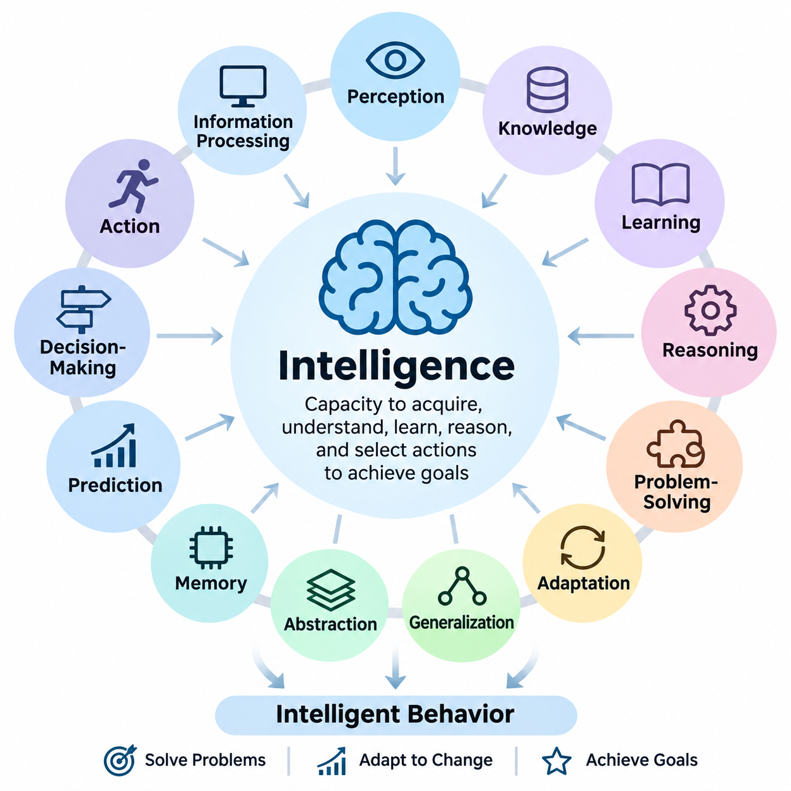
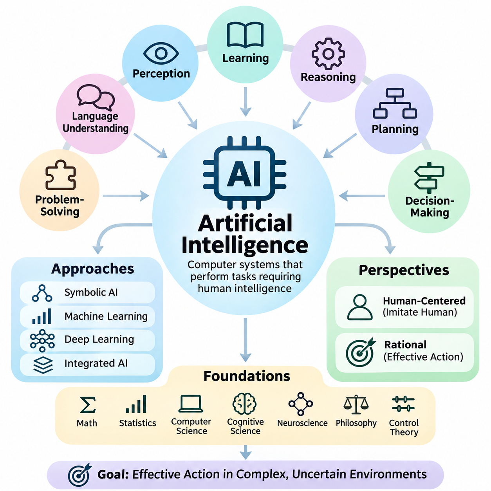
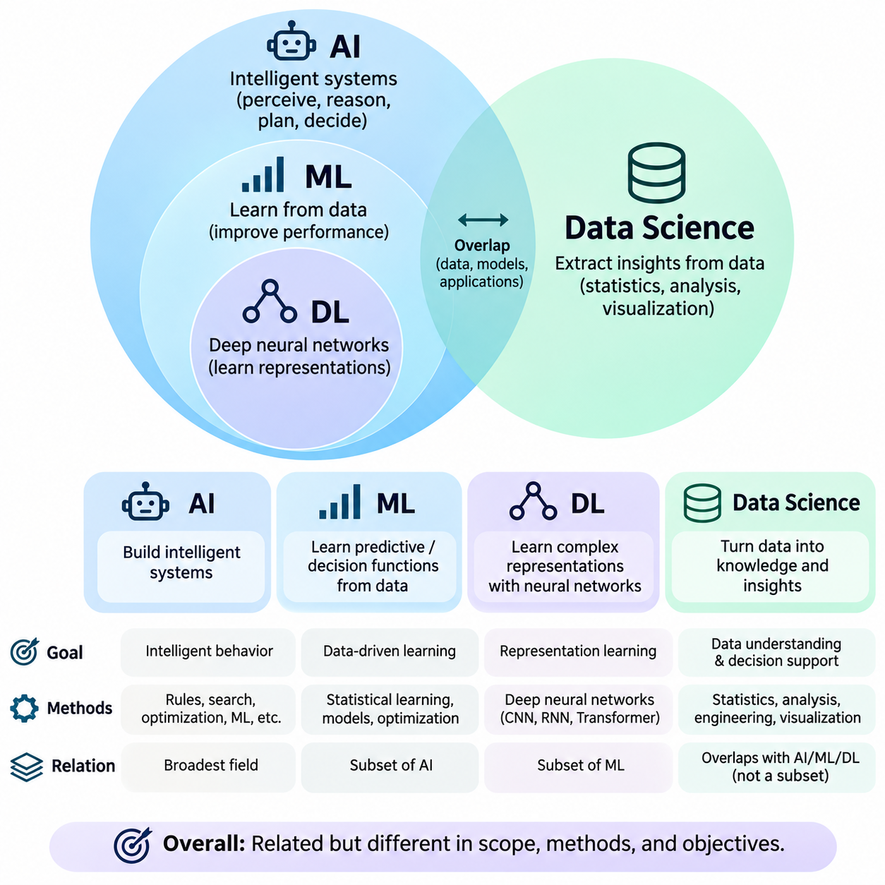
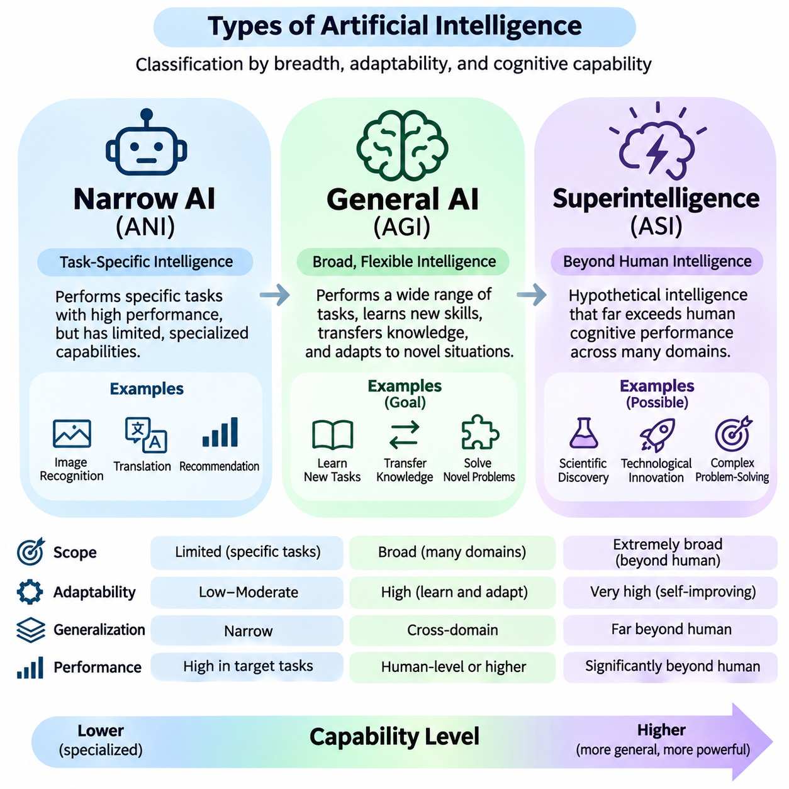
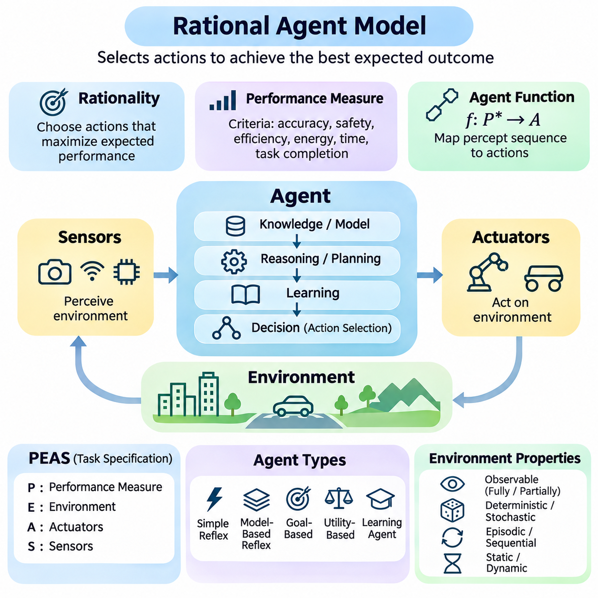
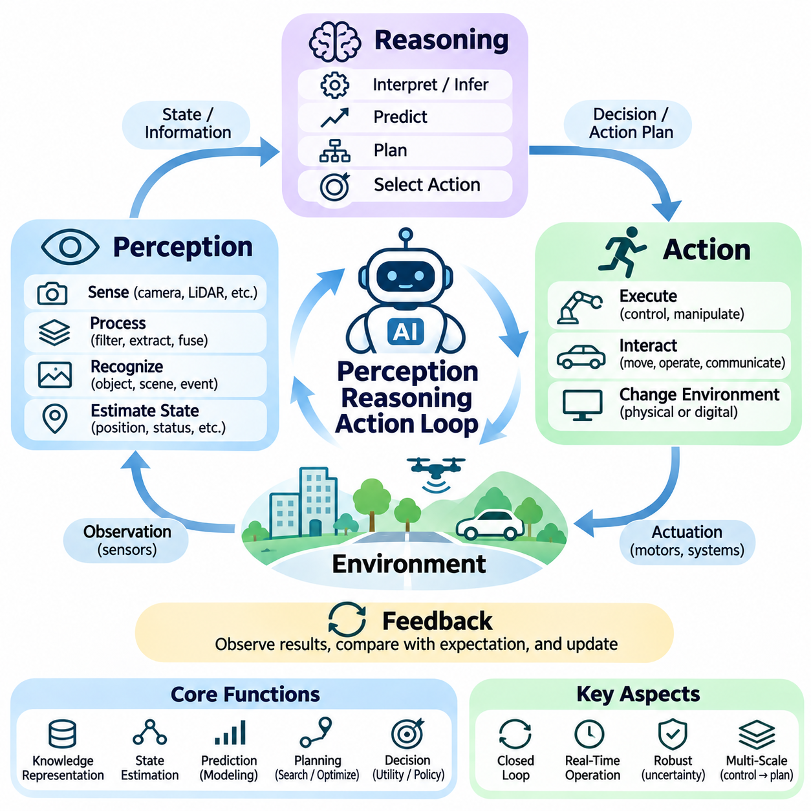
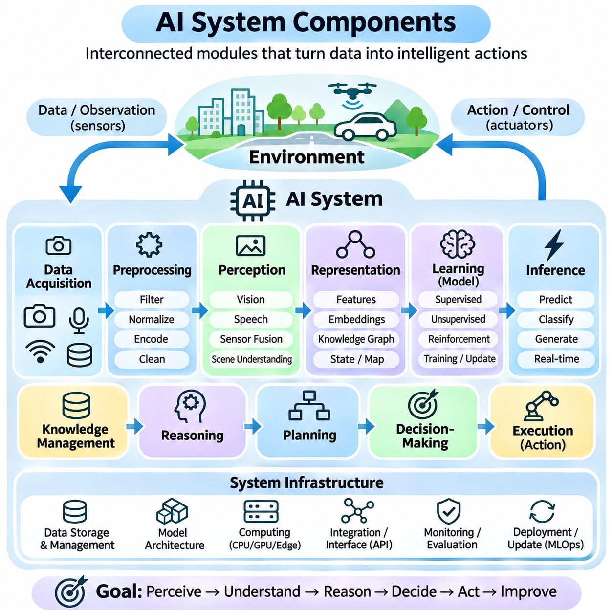
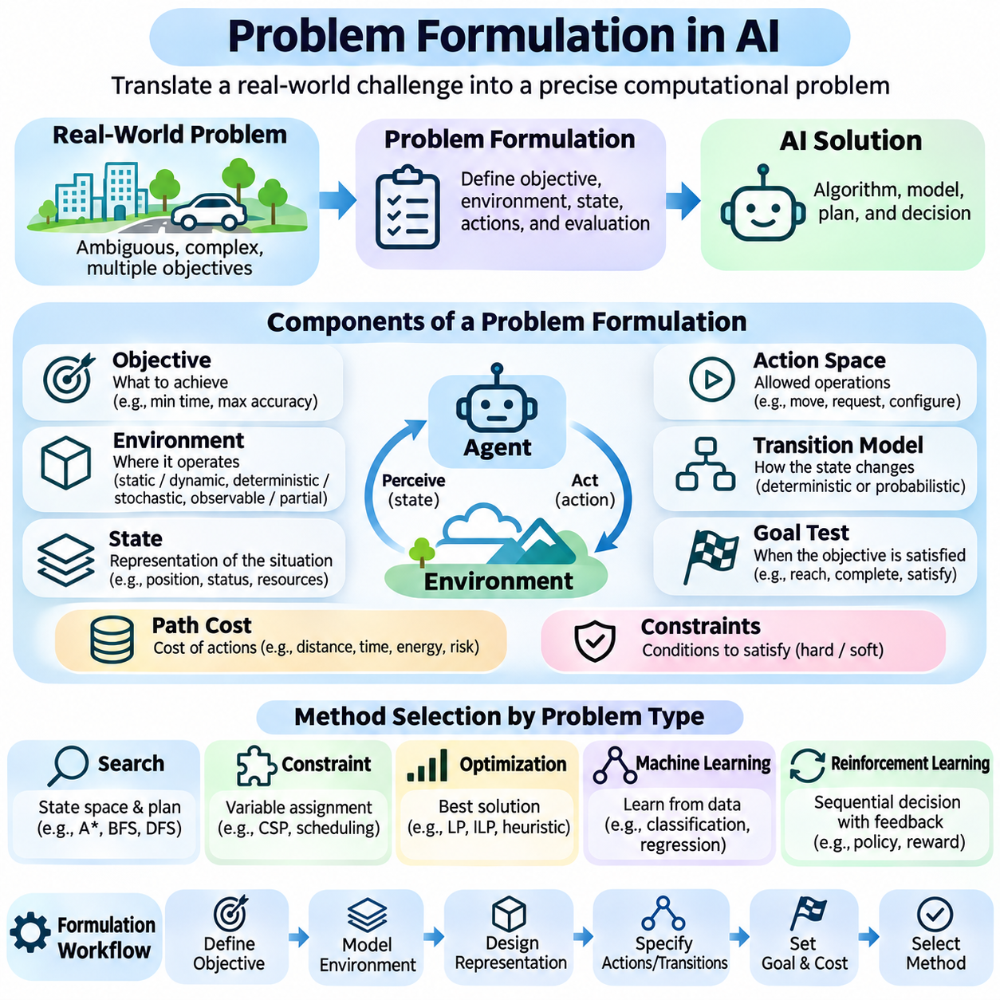
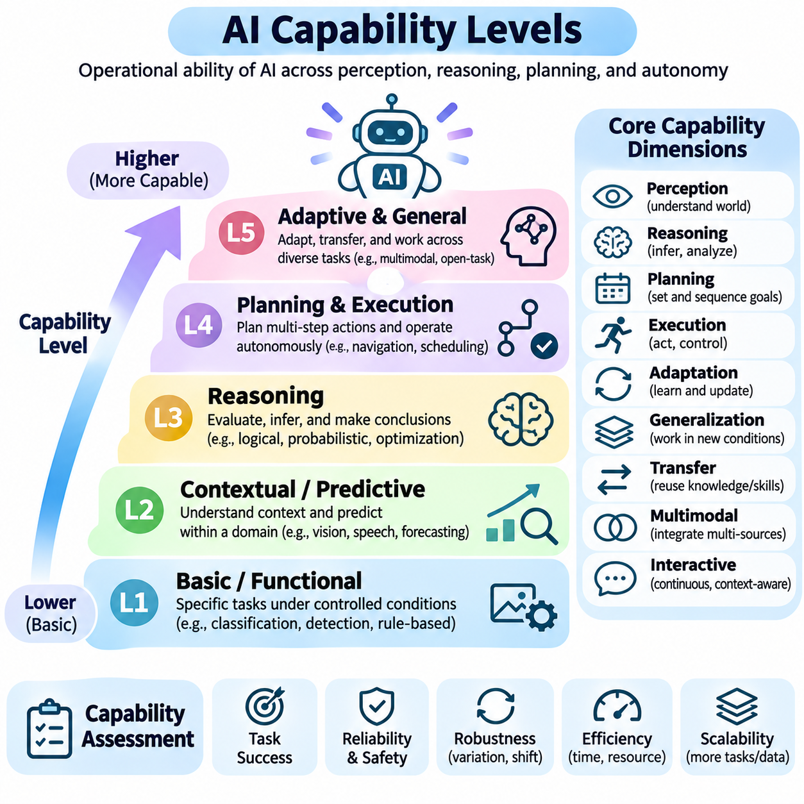
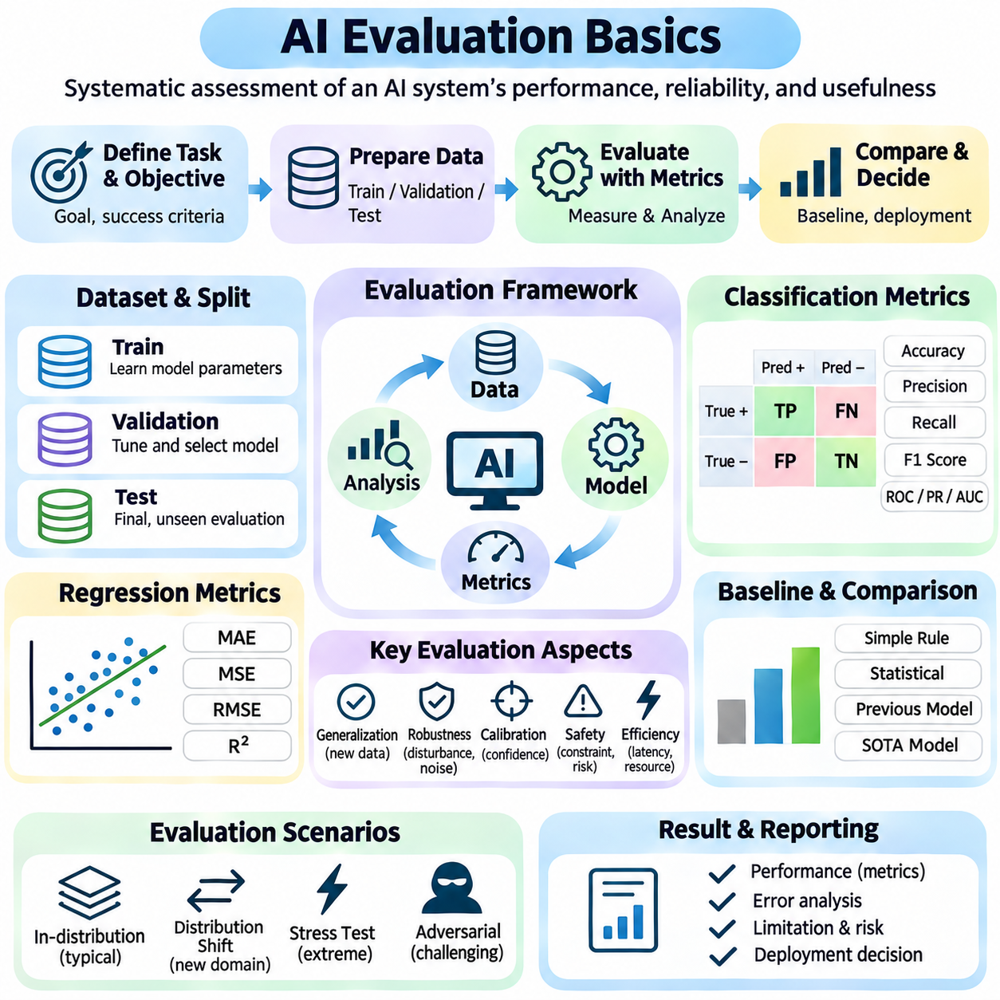

**Volume 04. Artificial Intelligence**

# 01. Foundations and Definitions

## 01.00 What is Intelligence

{width="7.268055555555556in" height="7.268055555555556in"}

Intelligence is the capacity of an individual or system to acquire information, understand its environment, learn from experience, reason about situations, and select actions that achieve meaningful objectives. It involves more than possessing knowledge or performing calculations. Intelligence becomes evident when an entity can use available information to solve problems, respond to changing conditions, and improve its behavior through experience.

The concept of intelligence has been examined across philosophy, psychology, neuroscience, biology, and computer science. Each discipline emphasizes different characteristics. Psychology investigates cognitive abilities, neuroscience examines biological mechanisms, and computer science explores computational processes. These perspectives suggest that intelligence is a multidimensional phenomenon rather than a single measurable property.

A fundamental characteristic of intelligence is the ability to process information and transform it into useful representations. Information may originate from sensory observations, language, numerical measurements, or interactions with the environment. An intelligent system must identify relevant patterns, distinguish meaningful signals from noise, and organize information into structures that support understanding and decision-making.

Perception provides an important foundation for intelligent behavior because an entity must obtain information about its surroundings before responding appropriately. Biological organisms use sensory systems, while artificial systems employ cameras, microphones, radar, LiDAR, and other sensors. Perception transforms raw observations into meaningful descriptions of objects, events, relationships, and environmental conditions.

Knowledge represents information that has been organized into concepts, facts, relationships, procedures, or models. Intelligence depends not only on acquiring knowledge but also on applying it appropriately. A system may store enormous quantities of information without demonstrating sophisticated intelligence if it cannot interpret relationships, recognize relevant contexts, or use that information to solve unfamiliar problems.

Learning is another essential dimension of intelligence. It enables an individual or system to modify its internal representations or behavior based on observations, feedback, and experience. Learning may involve recognizing statistical patterns, discovering relationships, refining strategies, or developing new skills. Its importance lies in reducing dependence on fixed instructions and enabling adaptation to previously unseen circumstances.

Reasoning allows intelligent entities to derive conclusions from available knowledge and evidence. Deductive reasoning applies established principles to specific situations, while inductive reasoning identifies general patterns from observations. Abductive reasoning seeks plausible explanations for incomplete evidence. These processes support interpretation, prediction, diagnosis, and problem-solving under different degrees of uncertainty.

Problem-solving demonstrates intelligence through the identification of objectives, constraints, available resources, and possible actions. An intelligent entity must evaluate alternative solutions and select an appropriate strategy. Some problems can be solved through established procedures, whereas others require exploration, abstraction, experimentation, or creative combinations of existing knowledge.

Adaptation distinguishes flexible intelligence from rigid behavior. Environments frequently change because of uncertainty, disturbances, unexpected events, or evolving objectives. Intelligent systems must recognize when existing strategies become ineffective and adjust their responses accordingly. Adaptation may occur through learning, planning, feedback control, or the reorganization of internal knowledge and behavioral policies.

Generalization refers to the ability to apply previously acquired knowledge to new situations that differ from earlier experiences. A system that memorizes examples without recognizing underlying relationships may perform well on familiar tasks but fail when conditions change. Strong generalization requires representations that capture useful regularities while remaining sufficiently flexible to accommodate unfamiliar combinations of circumstances.

Abstraction enables intelligence to represent complex situations using simplified concepts that preserve essential relationships. Instead of processing every detail independently, an intelligent entity can identify categories, principles, and higher-level structures. Abstraction supports efficient reasoning, knowledge transfer, and planning because similar problems can be understood through shared representations.

Memory contributes to intelligence by preserving information across time. Short-term memory supports immediate reasoning and ongoing activities, while long-term memory retains knowledge, experiences, and learned skills. Effective intelligence requires mechanisms for storing, retrieving, updating, and selectively forgetting information. Memory becomes especially valuable when current decisions depend on events or observations from the past.

Prediction is closely associated with intelligent behavior because effective decisions often require anticipating future conditions. Humans predict consequences through experience and mental models, while artificial systems may employ statistical forecasting, simulation, or learned predictive models. Accurate prediction supports planning and risk reduction, although uncertainty prevents complete knowledge of future events.

Decision-making transforms perception, knowledge, reasoning, and prediction into the selection of actions. Intelligent decisions involve comparing alternatives according to objectives, constraints, expected outcomes, and available evidence. In uncertain environments, decisions may require balancing potential rewards against risks. Rational decision-making seeks actions that are appropriate given the information and resources available.

Goal-directed behavior provides an operational perspective on intelligence. An entity demonstrates purposeful behavior when its actions contribute to achieving defined objectives. Goals may involve survival, resource acquisition, task completion, communication, or environmental improvement. However, goal achievement alone does not establish general intelligence because simple automated mechanisms can also accomplish narrowly specified objectives.

The relationship between intelligence and rationality is important in artificial intelligence. Rationality concerns selecting actions expected to produce desirable outcomes according to a performance criterion. Intelligence includes broader capabilities such as learning, understanding, and adaptation. A rational agent may operate with limited knowledge, while an intelligent system may still make imperfect decisions because of uncertainty or computational constraints.

Intelligence should also be distinguished from consciousness and subjective experience. Consciousness generally concerns awareness and phenomenal experience, whereas intelligence concerns capacities such as reasoning, learning, and effective behavior. These concepts may interact in biological organisms, but they are not equivalent. Whether artificial systems can possess subjective experience remains an unresolved philosophical and scientific question.

Human intelligence combines perception, language, memory, reasoning, social understanding, creativity, and physical interaction. These capabilities operate together rather than as completely independent modules. Human cognition also depends on biological constraints, emotions, motivation, and cultural experience. Consequently, human intelligence cannot be adequately described through computational speed or factual knowledge alone.

Animal intelligence illustrates that sophisticated cognition is not exclusive to humans. Different species demonstrate navigation, communication, cooperation, tool use, memory, and adaptive problem-solving. Their abilities reflect evolutionary pressures and ecological requirements. Comparing intelligence across species reveals that cognitive capabilities may develop in different combinations rather than along a single universal hierarchy.

Collective intelligence emerges when multiple individuals or agents coordinate information, knowledge, and decisions to achieve outcomes beyond their isolated capabilities. Human organizations, biological colonies, and distributed computational systems provide different examples. Effective collective intelligence depends on communication, coordination, information sharing, and mechanisms for resolving conflicting observations or objectives.

Artificial intelligence approaches intelligence through computational mechanisms that perform tasks associated with intelligent behavior. These mechanisms may use symbolic reasoning, statistical learning, neural networks, optimization, or combinations of several approaches. Artificial systems need not reproduce biological cognition exactly. Their intelligence is generally evaluated through observable capabilities, task performance, adaptability, and reliability.

An important distinction exists between intelligence and computational power. Faster processors and larger memory capacities can support more sophisticated algorithms, but hardware resources alone do not guarantee intelligent behavior. Intelligence depends on how computational resources are organized to represent information, learn relationships, evaluate alternatives, and produce effective responses to environmental conditions.

Intelligence is also constrained by available information and computational resources. No individual or artificial system can evaluate every possible situation or consequence. Practical intelligence therefore requires approximation, selective attention, heuristics, and efficient allocation of resources. These mechanisms enable useful decisions despite incomplete knowledge, limited processing capacity, and strict time constraints.

The embodiment perspective emphasizes that intelligence may develop through interaction between an agent\'s body and its environment. Physical characteristics, sensory capabilities, and available actions influence what an agent can learn and accomplish. In robotics, intelligent behavior emerges through coordinated perception, reasoning, planning, and control, continuously influenced by feedback from the physical world.

Social intelligence involves interpreting the intentions, emotions, behaviors, and expectations of other agents. It supports communication, cooperation, negotiation, and coordinated activities. For artificial systems interacting with humans, social intelligence also requires sensitivity to context, ambiguity, and individual preferences. Effective interaction depends on more than generating grammatically correct language or recognizing predefined expressions.

Creativity represents another dimension of intelligence through the generation of ideas, explanations, or solutions that are both novel and useful within a particular context. Creative processes often combine existing knowledge in unfamiliar ways. Computational systems can support creativity through generative modeling, exploration, and optimization, although evaluating originality and practical value remains challenging.

Measuring intelligence is difficult because different tasks emphasize different cognitive capabilities. Standardized tests, problem-solving benchmarks, learning efficiency, and behavioral evaluations provide partial evidence. A system may demonstrate exceptional performance in mathematics while struggling with physical interaction or social reasoning. Consequently, intelligence assessment should consider multiple dimensions rather than relying on a single score.

Robust intelligence requires maintaining useful performance when conditions differ from expectations. Environmental noise, incomplete observations, distribution shifts, and unexpected disturbances can expose limitations in learned behavior. An intelligent system should recognize uncertainty, avoid unjustified confidence, and recover from errors when possible. Robustness is particularly important when decisions affect safety-critical operations.

The relationship between intelligence and autonomy requires careful interpretation. Autonomy describes the degree to which a system can operate without continuous external intervention, whereas intelligence concerns its cognitive and adaptive capabilities. A highly automated machine may follow fixed procedures without sophisticated reasoning. Conversely, an intelligent decision-support system may demonstrate advanced reasoning while remaining under human supervision.

Intelligence can therefore be understood as an integrated capacity involving information processing, learning, reasoning, adaptation, prediction, and goal-directed action. Its expression depends on the environment, available resources, and the problems being addressed. This functional perspective provides a foundation for examining artificial intelligence as the engineering of systems capable of increasingly sophisticated and adaptive behavior.

Understanding intelligence requires recognizing both its observable achievements and its limitations. Successful task execution does not necessarily imply understanding across unrelated domains, and advanced language performance does not automatically establish reliable physical reasoning. A rigorous definition must distinguish demonstrated capabilities from assumed abilities while accounting for uncertainty, generalization, and the boundaries of evaluation.

Ultimately, intelligence is best approached as a collection of interacting capabilities that enable an entity to transform information and experience into effective behavior. No single mechanism fully explains every form of intelligence. This broader understanding establishes the conceptual foundation for studying artificial intelligence, rational agents, computational reasoning, learning systems, and the development of increasingly capable autonomous technologies.

## 01.01 What is Artificial Intelligence

{width="7.268055555555556in" height="7.268055555555556in"}

Artificial Intelligence (AI) is a field of computer science concerned with designing systems capable of performing tasks that ordinarily require human intelligence. These tasks include perception, learning, reasoning, problem-solving, language understanding, planning, and decision-making. AI seeks to develop computational mechanisms that transform information into meaningful predictions, decisions, and actions within defined environments.

The concept of artificial intelligence extends beyond reproducing human behavior. An AI system may achieve intelligent outcomes through computational processes that differ substantially from biological cognition. Rather than requiring machines to think exactly like humans, AI research investigates how information processing, mathematical models, and algorithms can produce effective behavior under different objectives and environmental conditions.

Artificial intelligence can be understood from several complementary perspectives. The human-centered perspective emphasizes systems that imitate human thinking or behavior, while the rational perspective focuses on systems that reason correctly or select effective actions. These perspectives influence how researchers define intelligence, construct computational models, and evaluate the capabilities of artificial systems.

A central objective of AI is to create systems that operate effectively in complex environments where complete information may not be available. Such systems must interpret observations, identify relevant relationships, evaluate alternatives, and respond appropriately. Their performance depends on how successfully they combine knowledge, computation, learning, and decision-making under uncertainty and resource constraints.

The foundations of artificial intelligence draw upon mathematics, statistics, computer science, cognitive science, neuroscience, philosophy, and control theory. Mathematics provides formal representations and optimization techniques, while statistics supports inference from uncertain observations. Cognitive science and neuroscience offer insights into intelligence, and control theory contributes methods for dynamic decision-making and feedback.

Early AI research emphasized symbolic representations, logical inference, and explicit rules. Symbolic AI systems represent knowledge using structured expressions that can be manipulated through reasoning procedures. This approach is particularly useful when problems contain clearly defined concepts, constraints, and logical relationships. However, constructing comprehensive symbolic models becomes difficult in uncertain or continuously changing environments.

Machine learning introduced another major approach by enabling systems to acquire useful patterns from data rather than relying exclusively on manually specified rules. Learning algorithms adjust model parameters according to examples, observations, or feedback. This approach supports classification, prediction, recognition, and decision-making, although successful learning depends on data quality, model assumptions, and appropriate evaluation procedures.

Deep learning extends machine learning through neural networks containing multiple computational layers. These networks learn hierarchical representations that transform raw inputs into increasingly abstract features. Deep learning has contributed significantly to computer vision, speech recognition, natural language processing, and generative modeling. Nevertheless, deep neural networks remain subject to limitations involving reliability, interpretability, and generalization.

Modern AI increasingly combines learning, reasoning, knowledge representation, and computational tools within integrated systems. Foundation models can support multiple tasks through representations learned from large datasets, while specialized components provide retrieval, planning, verification, or external execution. Such integration allows AI systems to address complex workflows that cannot be handled reliably through a single isolated algorithm.

Perception is a fundamental AI capability because intelligent systems frequently operate on incomplete or noisy observations. Computer vision extracts information from images and videos, while speech processing interprets acoustic signals. Multimodal AI combines different information sources to construct richer representations. Effective perception provides the contextual information required for subsequent reasoning, planning, and action.

Knowledge representation enables AI systems to organize information into structures suitable for computation. Logical statements, rules, graphs, probabilistic models, and numerical embeddings provide different methods for encoding knowledge. Each representation offers distinct advantages depending on the problem. Structured knowledge supports explicit relationships, while distributed representations can capture complex statistical similarities.

Reasoning in artificial intelligence involves deriving conclusions, evaluating evidence, and identifying relationships between facts or observations. Logical reasoning applies formal inference rules, while probabilistic reasoning handles uncertainty through mathematical models. Causal reasoning investigates how interventions influence outcomes. These approaches help AI systems move beyond pattern recognition toward more structured forms of problem-solving.

Planning enables an AI system to determine sequences of actions that may achieve specified objectives. A planning problem typically involves an initial state, available actions, constraints, and desired outcomes. Planning algorithms explore possible transitions and evaluate candidate strategies. In dynamic environments, plans must often be revised as new observations become available or previously assumed conditions change.

Decision-making connects information processing with action selection. AI systems may choose actions using predefined policies, optimization methods, probabilistic models, or learned strategies. Rational decision-making aims to select actions that maximize expected performance according to a defined objective. However, uncertainty, computational limitations, and imperfect models can prevent an AI system from identifying the theoretically optimal action.

The intelligent agent provides a useful conceptual framework for understanding AI systems. An agent receives observations from its environment and produces actions that influence subsequent conditions. Its behavior is evaluated according to performance measures and operational constraints. Agents may be purely reactive, model-based, goal-directed, utility-based, or learning-enabled, depending on their internal mechanisms and required capabilities.

Learning agents improve their behavior by incorporating information obtained through interaction or training. Supervised learning uses labeled examples, unsupervised learning discovers patterns without explicit target labels, and reinforcement learning improves action policies through rewards and environmental feedback. These learning paradigms address different problem structures and may be combined within practical AI architectures.

Artificial intelligence is not synonymous with automation. Conventional automation executes predefined procedures under specified conditions, whereas AI can introduce capabilities such as statistical inference, adaptive learning, and context-dependent decision-making. Nevertheless, many AI applications contain substantial conventional software components, and not every automated system requires intelligence. The distinction depends on system functionality rather than marketing terminology.

AI systems also differ in their degree of autonomy. Some operate as decision-support tools that provide recommendations to human operators, while others execute actions with limited supervision. Autonomous vehicles, industrial robots, and intelligent software agents illustrate different operational arrangements. Greater autonomy increases the importance of environmental awareness, reliable decision-making, safety constraints, and human oversight.

Artificial intelligence can be categorized according to the breadth of its capabilities. Narrow AI is designed to perform particular tasks or operate within defined domains. Artificial General Intelligence refers to a proposed level of broad cognitive competence across diverse tasks, while artificial superintelligence describes hypothetical capabilities substantially exceeding human performance across relevant intellectual domains. These categories should not be confused with demonstrated technological maturity.

The development of AI requires distinguishing model capability from complete system capability. A model may generate accurate predictions under controlled conditions but fail when integrated into an operational environment. Real-world performance depends on data pipelines, hardware resources, software interfaces, monitoring, security, and feedback mechanisms. Reliable AI engineering therefore requires a system-level perspective rather than exclusive attention to algorithms.

Evaluation is essential because intelligent behavior cannot be established through isolated demonstrations. AI performance must be examined using appropriate metrics, representative datasets, controlled experiments, and operational tests. Accuracy, robustness, efficiency, latency, calibration, and safety may all be relevant. Evaluation should also investigate how performance changes under unfamiliar conditions, corrupted inputs, and distribution shifts.

Generalization represents a major challenge in artificial intelligence. Models trained on historical examples may perform poorly when deployed in environments with different characteristics. Robust generalization requires suitable training data, appropriate inductive assumptions, regularization, and systematic testing. Transfer learning and adaptation techniques can improve performance across related tasks, but they do not eliminate uncertainty about unfamiliar situations.

The relationship between artificial intelligence and human intelligence remains an important research question. Human cognition integrates biological perception, memory, emotion, reasoning, embodiment, and social interaction. Artificial systems may reproduce selected functional capabilities without sharing the same underlying mechanisms. Consequently, impressive AI performance on specific tasks does not establish equivalence with the full range of human cognitive abilities.

Generative AI has expanded the practical scope of artificial intelligence by enabling systems to produce text, images, audio, software code, and other structured outputs. Generative models learn statistical relationships from training data and use these relationships to construct new outputs. Although these systems can demonstrate remarkable flexibility, generated content may contain factual errors, unsupported conclusions, or inconsistencies.

AI safety and responsible development are fundamental considerations because intelligent systems increasingly influence consequential decisions. Bias, privacy violations, security vulnerabilities, unreliable predictions, and inappropriate autonomous actions can produce significant harm. Responsible AI development requires risk assessment, transparency, monitoring, human accountability, and safeguards appropriate to the intended application and deployment environment.

Artificial intelligence ultimately represents an interdisciplinary engineering and scientific effort to understand and construct computational systems capable of intelligent behavior. Its methods range from explicit logical reasoning to statistical learning and integrated autonomous architectures. Understanding AI requires examining not only what systems can accomplish, but also how they operate, why they succeed or fail, and under which conditions their capabilities remain reliable.

## 01.02 AI vs ML vs DL vs Data Science

{width="7.268055555555556in" height="7.268055555555556in"}

Artificial Intelligence (AI), Machine Learning (ML), Deep Learning (DL), and Data Science are closely related disciplines, but they represent different objectives, methods, and levels of abstraction. Although these terms are frequently used interchangeably, understanding their distinctions is essential for designing intelligent systems, selecting appropriate algorithms, and establishing realistic expectations about technological capabilities.

Artificial Intelligence is the broadest concept among these fields when considering the development of intelligent computational systems. AI focuses on enabling machines to perceive environments, represent knowledge, reason about situations, plan actions, and make decisions. Its methods include symbolic reasoning, search algorithms, optimization, probabilistic inference, machine learning, and combinations of these techniques.

Machine Learning is a major subfield of Artificial Intelligence that develops algorithms capable of improving task performance through data and experience. Instead of requiring programmers to specify every decision rule explicitly, ML systems learn statistical relationships from examples. Their effectiveness depends on training data, model assumptions, optimization procedures, and the ability to generalize beyond observed examples.

Deep Learning is a specialized branch of Machine Learning that employs artificial neural networks with multiple computational layers. These networks learn representations through successive transformations of input data. Deep learning is particularly effective for complex, high-dimensional information such as images, speech, language, and video, where manually designing useful features can be difficult.

Data Science is an interdisciplinary field concerned with extracting meaningful information, patterns, and insights from data. It combines statistics, programming, data engineering, visualization, domain expertise, and analytical reasoning. Unlike AI, which primarily emphasizes intelligent behavior and decision-making, Data Science frequently emphasizes understanding data, explaining relationships, supporting decisions, and communicating findings.

The relationship between AI, ML, and DL can be understood as a hierarchy of increasingly specialized approaches. Machine Learning belongs within the broader field of Artificial Intelligence, while Deep Learning represents a subset of Machine Learning. Data Science overlaps with these disciplines but is not simply another nested category because many data science activities do not require intelligent algorithms.

A fundamental distinction concerns the objectives of each discipline. Artificial Intelligence seeks to construct systems that exhibit intelligent behavior. Machine Learning focuses on learning predictive or decision-making functions from data. Deep Learning emphasizes learning complex representations through neural architectures. Data Science seeks to transform raw data into reliable knowledge, explanations, and actionable insights.

Traditional AI systems may operate without machine learning. A rule-based expert system can apply explicitly defined knowledge to diagnose equipment faults, while a search algorithm can identify a route through a graph using predefined transition rules. Such systems demonstrate that intelligent computation does not necessarily require training datasets or neural networks.

Machine Learning differs from conventional rule-based programming because its behavior is partially determined through optimization over observed examples. A classification model may learn to distinguish defective products from acceptable products using labeled images. Rather than encoding every possible visual condition manually, developers define a learning procedure that estimates useful decision boundaries from training data.

Deep Learning extends this principle by reducing the need for manually engineered features in many applications. Earlier image recognition systems often relied on explicitly designed descriptors, whereas convolutional neural networks can learn spatial features directly from image data. Transformer architectures similarly learn contextual representations through attention mechanisms, supporting language modeling and multimodal information processing.

Data Science often begins before any machine learning model is developed. Analysts must identify relevant data sources, assess data quality, investigate missing values, examine distributions, and understand relationships among variables. These activities establish whether available information is suitable for statistical analysis, predictive modeling, or operational decision-making.

Statistical analysis occupies an important position within Data Science and Machine Learning. Descriptive statistics summarize observed data, while inferential statistics support conclusions about populations and uncertainty. Machine learning often prioritizes predictive performance, although many statistical methods also make predictions. The distinction therefore concerns research objectives and modeling practices rather than completely separate mathematical foundations.

Feature engineering illustrates another relationship between these fields. In conventional machine learning, developers transform raw variables into representations that improve model performance. Data scientists may use domain knowledge to construct meaningful indicators, while deep learning systems can automatically learn many intermediate features. However, data preparation and domain understanding remain important even when neural networks perform representation learning.

The computational requirements of these approaches vary considerably. Symbolic AI algorithms may operate efficiently on structured knowledge, while conventional machine learning models can often be trained using moderate computational resources. Deep learning frequently requires substantial memory, parallel computation, and specialized accelerators. Data Science workloads range from simple statistical summaries to large-scale distributed processing.

Interpretability also differs across methods and applications. Rule-based AI systems can provide explicit reasoning paths, while linear models and decision trees often offer relatively understandable relationships between inputs and outputs. Deep neural networks may contain millions or billions of parameters, making their internal decision processes difficult to explain. Nevertheless, interpretability depends on model design, complexity, and the explanation method used.

The role of data differs across these disciplines. Machine Learning and Deep Learning generally depend heavily on representative training examples, whereas symbolic AI may rely primarily on human-defined knowledge and logical structures. Data Science treats data as the central subject of investigation, including its origin, quality, organization, statistical properties, and relevance to practical questions.

Generalization is particularly important in Machine Learning and Deep Learning. A model must perform effectively on observations that were not included in its training data. Overfitting occurs when a model captures training-specific patterns that do not transfer reliably to new examples. Data Science contributes to generalization by supporting careful sampling, validation design, exploratory analysis, and identification of data leakage.

The evaluation criteria also reflect different objectives. AI systems may be assessed through goal achievement, reasoning correctness, planning efficiency, safety, and operational reliability. Machine Learning commonly uses predictive metrics such as accuracy, precision, recall, and error. Deep Learning adds considerations involving computational efficiency and robustness, while Data Science emphasizes analytical validity and the usefulness of conclusions.

Real-world applications frequently combine all four disciplines within a single workflow. An industrial inspection system may use Data Science to analyze production records, Machine Learning to predict equipment failures, and Deep Learning to detect visual defects. Artificial Intelligence integrates these capabilities with decision rules, planning mechanisms, and operational controls to support intelligent production management.

Autonomous robotics provides another example of their complementary roles. Data Science supports sensor-data analysis and performance monitoring, while Machine Learning estimates environmental relationships and operational patterns. Deep Learning processes camera images or other high-dimensional observations. Artificial Intelligence combines perception, reasoning, planning, and action selection to guide robotic behavior.

Modern language-based systems further demonstrate these relationships. Large language models are primarily developed using Deep Learning, which is a branch of Machine Learning within the broader AI field. Data Science contributes to dataset preparation, quality analysis, evaluation, and monitoring. Additional AI components may provide knowledge retrieval, logical verification, tool execution, and multi-step planning.

Choosing between these approaches requires understanding the actual problem rather than automatically selecting the most complex technology. A deterministic scheduling problem may be solved effectively through mathematical optimization or symbolic planning. A structured prediction problem may require conventional machine learning, while image understanding may benefit from deep learning. Data Science helps determine which approach is justified by available evidence.

These disciplines also differ in their typical development workflows. AI engineering begins by defining objectives, environments, constraints, and desired system behavior. Machine Learning emphasizes dataset construction, model training, validation, and deployment. Deep Learning adds architecture selection and intensive optimization, while Data Science emphasizes data investigation, statistical reasoning, and communication of analytical results.

Despite their differences, the boundaries between these fields continue to evolve. Modern AI systems increasingly integrate statistical learning with symbolic reasoning, external knowledge, and autonomous tools. Deep learning models support general-purpose representations, while data science methodologies improve the quality and reliability of their development. This convergence encourages integrated engineering practices rather than isolated disciplinary approaches.

Understanding AI, ML, DL, and Data Science as complementary but distinct fields provides a foundation for responsible technology selection. Artificial Intelligence defines the broader objective of intelligent computation, Machine Learning supplies data-driven learning mechanisms, Deep Learning provides powerful neural representation methods, and Data Science establishes the analytical processes needed to extract trustworthy value from data. Their effective integration enables practical, reliable, and increasingly sophisticated intelligent systems.

## 01.03 Narrow AI General AI and Superintelligence

{width="7.268055555555556in" height="7.268055555555556in"}

Artificial Intelligence can be classified according to the breadth, adaptability, and sophistication of its cognitive capabilities. Three commonly discussed categories are Narrow Artificial Intelligence, Artificial General Intelligence, and Artificial Superintelligence. These categories describe different levels of potential competence rather than a universally established progression, providing a conceptual framework for examining present technologies and possible future systems.

Narrow Artificial Intelligence, also called Artificial Narrow Intelligence (ANI), refers to systems designed to perform specific tasks or operate within limited domains. Such systems may demonstrate exceptional performance in image recognition, language translation, recommendation, or industrial inspection. However, their capabilities are generally constrained by their training, architecture, available tools, and operational environments.

The defining characteristic of Narrow AI is specialization rather than necessarily limited computational sophistication. A system may outperform human experts in a particular task while remaining unable to perform unrelated activities reliably. For example, an AI model optimized for medical image classification cannot automatically operate industrial machinery or develop scientific hypotheses without additional capabilities and appropriate integration.

Modern Narrow AI encompasses a wide range of computational approaches, including symbolic reasoning, conventional machine learning, deep neural networks, and foundation models deployed for specific applications. Even systems capable of performing multiple related tasks may remain narrow when their competence does not generalize reliably across unfamiliar domains, objectives, and environmental conditions.

The success of Narrow AI depends heavily on clear problem definitions, representative data, appropriate evaluation criteria, and reliable system integration. Applications such as fraud detection, autonomous navigation, predictive maintenance, and document analysis demonstrate its practical value. Nevertheless, strong benchmark performance does not guarantee robust behavior when environmental conditions or task requirements change.

Artificial General Intelligence (AGI) refers to a proposed form of artificial intelligence capable of performing a broad range of intellectual tasks with flexible learning, reasoning, and adaptation. Unlike specialized systems, AGI would be expected to transfer knowledge between domains, acquire unfamiliar skills, and solve novel problems without requiring extensive task-specific redesign or retraining.

There is no universally accepted operational definition of AGI. Some frameworks emphasize human-level performance across diverse cognitive tasks, while others prioritize autonomous learning, general problem-solving, or adaptability in unfamiliar environments. Consequently, claims about achieving AGI depend strongly on the evaluation criteria, task distributions, and assumptions used to define general intelligence.

A central requirement associated with AGI is cross-domain generalization. An intelligent system should apply knowledge acquired in one context to substantially different situations when relevant relationships exist. This ability involves abstraction, compositional reasoning, causal understanding, and flexible knowledge transfer. Merely combining numerous specialized models does not necessarily produce genuine general intelligence.

AGI is also associated with continual learning and adaptive problem-solving. A broadly capable system would need to acquire new knowledge, revise incorrect assumptions, and respond effectively to unfamiliar circumstances. Continual learning introduces challenges involving catastrophic forgetting, knowledge consistency, changing objectives, and the preservation of previously acquired capabilities.

Reasoning and planning represent additional dimensions of general intelligence. An AGI system would be expected to analyze complex situations, construct multi-step solutions, evaluate alternative strategies, and revise plans when circumstances change. These capabilities would need to operate across different domains rather than being restricted to predefined problem structures or narrowly optimized benchmarks.

Language understanding alone is insufficient to establish general intelligence. Although advanced language models can perform diverse reasoning and knowledge-intensive tasks, their performance may vary across unfamiliar environments, extended activities, and situations requiring reliable physical interaction. Evaluating general intelligence therefore requires examining multiple capabilities under controlled and realistic conditions.

Embodied intelligence introduces another perspective on AGI by emphasizing interaction with the physical environment. A general-purpose robotic agent would need to integrate perception, spatial reasoning, manipulation, navigation, planning, and adaptive control. However, physical embodiment is not universally considered a necessary condition for AGI, and researchers disagree about its role in achieving broad cognitive competence.

Artificial Superintelligence (ASI) describes a hypothetical form of intelligence that substantially exceeds human cognitive performance across a broad range of important intellectual domains. These domains may include scientific reasoning, strategic planning, technological innovation, and complex problem-solving. ASI remains a theoretical concept, and its feasibility, development pathways, and potential characteristics are uncertain.

The distinction between AGI and ASI concerns the level of capability rather than merely the number of tasks performed. AGI is generally associated with broad, flexible competence, whereas ASI implies capabilities significantly beyond human performance across relevant domains. However, no universally accepted measurement framework establishes a precise boundary between these proposed categories.

Superintelligence could theoretically arise through improvements in computational efficiency, learning algorithms, reasoning architectures, memory systems, or coordinated computational resources. Some hypotheses emphasize recursive self-improvement, in which increasingly capable systems contribute to improving their own designs. Such scenarios remain speculative and depend on substantial technical, physical, and organizational constraints.

Computational scale alone does not establish superintelligence. Increasing model parameters, training data, or processing power may improve certain capabilities, but performance gains depend on architecture, optimization, data quality, and evaluation conditions. Furthermore, greater computational capability does not automatically guarantee accurate reasoning, reliable decision-making, or competence across unrelated domains.

The transition from Narrow AI toward more general capabilities is not necessarily linear. Systems may demonstrate advanced reasoning in some areas while retaining significant weaknesses in others. Intelligence is multidimensional, involving learning efficiency, adaptability, abstraction, memory, planning, social understanding, and environmental interaction. Consequently, capability development may proceed unevenly across these dimensions.

Evaluating these categories requires distinguishing observed performance from hypothetical potential. Narrow AI can be assessed through domain-specific benchmarks and operational testing. Proposed AGI evaluations require diverse tasks, unfamiliar situations, transfer learning, and sustained adaptation. ASI would require even broader comparative criteria, although no established empirical evaluation standard currently defines its achievement.

Autonomy should not be confused with intelligence level. A Narrow AI system may operate autonomously within a restricted environment, while a broadly capable system may remain under human supervision. Autonomy describes operational independence, whereas generality describes the breadth and transferability of cognitive competence. These dimensions should be evaluated separately when characterizing advanced AI systems.

The relationship between intelligence and consciousness also requires careful distinction. Neither AGI nor ASI necessarily implies subjective awareness, emotions, or human-like experience. These categories primarily concern functional capabilities and cognitive performance. Whether artificial systems can possess consciousness remains an unresolved question involving philosophy, neuroscience, cognitive science, and computational theory.

Safety requirements become increasingly important as AI systems acquire broader capabilities and greater operational independence. Narrow AI presents risks involving bias, reliability, security, and inappropriate deployment. More general systems could introduce additional challenges related to unpredictable behavior, complex objectives, oversight, and the difficulty of evaluating performance across unfamiliar situations.

Alignment refers to the challenge of ensuring that AI behavior remains consistent with intended human objectives, constraints, and values. For advanced systems, alignment involves more than maximizing task performance. It requires attention to uncertainty, conflicting instructions, harmful outcomes, and the preservation of meaningful human control. Greater capability does not inherently guarantee safer or more beneficial behavior.

Governance and accountability must evolve alongside advances in artificial intelligence. Organizations developing or deploying advanced systems need evaluation procedures, monitoring mechanisms, operational safeguards, and clearly assigned responsibilities. Potentially more capable systems may require stronger oversight and independent assessment, particularly when their decisions influence critical infrastructure, public safety, or other consequential activities.

Economic and societal implications also differ across these categories. Narrow AI already supports automation, productivity improvements, and specialized decision-making. Broadly general systems could potentially affect a wider range of intellectual occupations and scientific activities. Hypothetical superintelligence raises additional questions about institutional control, economic concentration, technological dependence, and long-term societal stability.

Understanding Narrow AI, AGI, and ASI requires avoiding both exaggerated expectations and unjustified assumptions about technological limits. Demonstrated competence should be evaluated through reproducible evidence, while future possibilities should be discussed with explicit uncertainty. Distinguishing current capabilities from proposed intelligence levels supports more rigorous research, responsible engineering, and informed decisions about the future development of artificial intelligence.

## 01.04 Rational Agent Model

{width="7.268055555555556in" height="7.268055555555556in"}

The Rational Agent Model provides a fundamental framework for understanding intelligent behavior in Artificial Intelligence. A rational agent is a computational entity that perceives its environment and selects actions expected to achieve the best outcome according to a defined performance measure. This model emphasizes effective decision-making rather than imitation of human thought, providing a systematic foundation for designing autonomous and intelligent systems.

An agent interacts with its environment through sensors and actuators. Sensors collect observations about external conditions, while actuators execute actions that influence the environment. A robotic agent may use cameras, LiDAR, and inertial sensors to perceive its surroundings, while motors and steering mechanisms perform physical actions. Software agents similarly receive digital inputs and produce computational outputs.

Rationality refers to selecting actions that maximize expected performance based on available information. A rational agent does not necessarily possess complete knowledge or unlimited computational resources. Instead, it chooses actions using its percept history, prior knowledge, available actions, and performance objectives. Rational behavior therefore depends on what the agent can reasonably know and accomplish at the time of decision-making.

The performance measure defines the criteria used to evaluate an agent\'s behavior. Depending on the application, these criteria may include accuracy, safety, efficiency, energy consumption, response time, or task completion. A rational agent seeks to maximize expected performance over relevant outcomes rather than simply execute predefined commands. Poorly designed measures may encourage undesirable behavior even when optimization succeeds.

An agent function describes the mapping from percept sequences to actions. Conceptually, this relationship can be expressed as f: P\\\* → A, where P\\\* represents all finite percept sequences and A represents the available actions. The agent program implements this function within a computational architecture. Different implementations may produce similar behavior while using different reasoning, learning, or control mechanisms.

The agent\'s percept sequence contains the history of observations received during interaction with its environment. This history can provide information that is unavailable from the current observation alone. For example, a mobile robot may estimate motion by comparing consecutive sensor readings. Maintaining relevant historical information allows an agent to reason about changes, infer hidden conditions, and improve subsequent decisions.

The task environment determines the conditions under which an agent operates. A common specification method is PEAS, representing Performance Measure, Environment, Actuators, and Sensors. PEAS helps developers identify what successful behavior means, which external conditions matter, how the agent can influence those conditions, and what information it can observe. This specification provides a practical starting point for agent design.

Task environments can be classified according to observability, determinism, temporal structure, and other properties. Fully observable environments provide the information required for decision-making, while partially observable environments contain hidden or uncertain states. Deterministic environments have predictable transitions, whereas stochastic environments involve uncertainty. These characteristics strongly influence the selection of agent architectures.

Environments may also be episodic or sequential. In episodic environments, individual decisions can be evaluated independently, whereas sequential environments require consideration of how current actions affect future situations. Static environments remain unchanged during deliberation, while dynamic environments may evolve continuously. Rational agents must account for these differences when selecting decision-making strategies.

A simple reflex agent selects actions using predefined condition-action rules. Its decisions depend primarily on the current percept rather than an explicit representation of historical information. Such agents can operate efficiently in predictable environments with sufficient observability. However, their limited internal representation makes them less suitable for complex situations involving hidden states or long-term dependencies.

A model-based reflex agent maintains an internal representation of environmental conditions. This internal state is updated using new observations and knowledge about how the environment changes. By estimating information that cannot be observed directly, the agent can respond more effectively under partial observability. Model-based reasoning is particularly useful in robotics, navigation, and dynamic monitoring systems.

A goal-based agent selects actions by considering whether they contribute to achieving specified objectives. Unlike purely reactive agents, goal-based agents may evaluate future states and construct action sequences through search or planning. This capability supports flexible behavior when several possible routes lead toward a desired outcome. However, achieving a goal does not necessarily distinguish between outcomes of different quality.

A utility-based agent evaluates alternative outcomes using a utility function. Utility represents the relative desirability of possible states or results, allowing the agent to compare tradeoffs among competing objectives. For example, an autonomous vehicle may balance travel time, safety, and energy efficiency. Under uncertainty, the agent can select actions that maximize expected utility according to its probability estimates.

Learning agents improve their behavior through experience rather than relying exclusively on fixed knowledge or rules. A learning component updates internal models or policies using observations and feedback. A performance component selects actions, while evaluation mechanisms assess outcomes. Exploration may also be necessary to discover better strategies, although unsafe exploration must be constrained in critical applications.

The distinction between rationality and omniscience is essential. An omniscient agent would know the actual consequences of every possible action, whereas a rational agent operates using incomplete information. An action may be rational when selected yet produce an unfavorable outcome because of uncertainty. Rationality therefore concerns the quality of the decision process relative to available evidence, not guaranteed success.

Bounded rationality recognizes that real agents have limited memory, processing capacity, and decision time. Computing an optimal action may be impractical in complex environments, particularly when decisions must be made in real time. Practical agents therefore use approximations, heuristics, learned policies, or hierarchical planning. These methods seek satisfactory performance while respecting computational and operational constraints.

Uncertainty is commonly represented through probabilistic models that describe possible environmental states and outcomes. A rational agent can maintain beliefs about hidden conditions and update them as new observations arrive. Bayesian inference provides one approach to belief updating, while decision-theoretic methods connect these beliefs with action selection. Such mechanisms support rational behavior under incomplete information.

The Markov Decision Process provides a mathematical framework for sequential decision-making when relevant states are observable. It describes states, actions, transition probabilities, rewards, and policies. When states are only partially observable, the Partially Observable Markov Decision Process extends this framework using belief states. These models formalize how rational agents evaluate actions under uncertainty.

Rational agent architectures frequently combine perception, state estimation, reasoning, planning, and control. Perception transforms sensor measurements into useful observations, while state estimation maintains an internal environmental representation. Planning evaluates possible actions, and control executes selected decisions. Feedback allows the agent to monitor consequences and revise its behavior as environmental conditions change.

Multi-agent environments introduce additional complexity because other agents influence the consequences of actions. Agents may cooperate, compete, negotiate, or operate independently while sharing resources. Rational behavior must therefore account for other agents\' possible objectives and strategies. Game theory, distributed planning, and multi-agent reinforcement learning provide methods for studying these interactions.

Safety constraints are particularly important when rational agents interact with physical systems or consequential decisions. Maximizing performance without appropriate restrictions may produce unacceptable outcomes. Practical architectures incorporate collision avoidance, operational boundaries, emergency procedures, and human intervention mechanisms. Rationality must therefore be evaluated within explicitly defined safety and ethical constraints.

The Rational Agent Model also provides a foundation for evaluating intelligent systems. Performance should be measured across representative environments, uncertain conditions, and realistic operational scenarios. Evaluation must consider not only successful task completion but also robustness, adaptability, computational efficiency, and constraint satisfaction. These criteria help determine whether an agent behaves rationally under practical limitations.

In autonomous robotics, rational agents integrate sensor observations with navigation, obstacle avoidance, and mission planning. An autonomous mobile robot may estimate its position, identify obstacles, evaluate alternative routes, and select actions that balance safety and efficiency. Continuous feedback enables adaptation to changing environments, illustrating how perception and decision-making form an integrated operational process.

The Rational Agent Model ultimately defines intelligence through goal-directed interaction between an agent and its environment. Its central principle is that appropriate actions should be selected according to available information, expected outcomes, and performance objectives. By connecting perception, knowledge, reasoning, learning, and action, the model provides a unified conceptual foundation for both conventional AI algorithms and advanced autonomous systems.

## 01.05 Perception Reasoning Action Loop

{width="7.268055555555556in" height="7.268055555555556in"}

The Perception--Reasoning--Action Loop is a fundamental architectural principle in Artificial Intelligence that explains how intelligent agents interact continuously with their environments. Perception acquires information about external conditions, reasoning interprets observations and determines appropriate responses, and action changes the environment. The resulting feedback enables the agent to update its understanding and adapt its behavior over time.

The loop establishes a closed relationship between sensing, computation, and execution. Unlike open-loop systems that execute predetermined commands without considering subsequent results, closed-loop intelligent systems observe the consequences of their actions. This feedback structure allows agents to correct errors, respond to disturbances, and maintain effective behavior even when environmental conditions change unexpectedly.

Perception begins when sensors or information interfaces collect observations from the environment. Physical agents may employ cameras, LiDAR, radar, microphones, and inertial sensors, while software agents receive documents, database records, messages, or application events. These inputs provide partial evidence about the current situation and must be processed before they can support reliable reasoning or decision-making.

Raw observations rarely provide a complete description of environmental conditions. Sensor measurements may contain noise, missing information, calibration errors, or conflicting signals. Perception systems therefore apply filtering, feature extraction, recognition, and sensor fusion to construct useful representations. The objective is to transform uncertain measurements into information that supports subsequent reasoning and action selection.

State estimation connects perception with reasoning by maintaining an internal representation of the environment. An agent may estimate object positions, movement, system status, or hidden conditions from successive observations. This representation can incorporate historical information and uncertainty estimates. By updating its internal state continuously, the agent can make decisions using more than the most recent sensor measurement.

Reasoning transforms perceived information into interpretations, predictions, and decisions. Depending on the application, reasoning may involve logical inference, probabilistic estimation, causal analysis, search, or learned decision policies. An intelligent agent evaluates the relationship between its current state, desired objectives, and available actions. Effective reasoning must also account for uncertainty and computational limitations.

Knowledge representation plays an important role in the reasoning stage. Agents may organize information using symbolic rules, knowledge graphs, probabilistic models, geometric maps, or learned embeddings. These representations encode different aspects of the environment and support different forms of inference. Selecting an appropriate representation is essential because the structure of knowledge influences the efficiency and reliability of reasoning.

Prediction extends reasoning beyond the current situation by estimating how environmental conditions may evolve. An autonomous robot may predict the movement of nearby objects, while an industrial AI system may estimate future equipment conditions. Predictive models allow agents to anticipate potential consequences before executing actions. However, predictions remain uncertain and should be revised when new evidence becomes available.

Planning converts objectives into sequences of actions that may achieve desired outcomes. A planning system evaluates possible future states, available operations, and operational constraints. It may use graph search, mathematical optimization, or learned policies to identify suitable strategies. In changing environments, plans must be updated when observations reveal obstacles, unexpected events, or differences between predicted and actual outcomes.

Action selection determines which operation should be executed at a particular moment. The selected action depends on the agent\'s current state estimate, goals, predicted outcomes, and performance criteria. Rational agents seek actions that maximize expected utility or satisfy specified objectives. Practical systems must additionally respect safety constraints, execution deadlines, and available computational or physical resources.

The action stage converts decisions into commands that influence the environment. In robotics, actions may involve motor control, steering, manipulation, or communication with other machines. In software systems, actions may include executing programs, retrieving information, modifying records, or sending messages. Successful action execution requires reliable interfaces between high-level decisions and lower-level operational mechanisms.

Feedback closes the Perception--Reasoning--Action Loop by allowing the agent to observe the results of its actions. The actual outcome may differ from the predicted outcome because of environmental disturbances, model inaccuracies, or execution errors. By comparing observations with expectations, the system can identify deviations and adjust subsequent decisions. This process supports adaptive behavior and operational robustness.

The loop operates across multiple temporal scales in practical AI systems. Low-level control may execute at high frequencies to maintain stability, while perception and state estimation operate at rates determined by sensor characteristics. Higher-level reasoning and mission planning may update less frequently. Coordinating these processes requires appropriate scheduling, synchronization, and communication between computational components.

Real-time constraints are especially important in autonomous systems interacting with dynamic environments. Delayed perception or reasoning can cause decisions to rely on outdated information. Processing latency, communication delays, and actuator response times therefore influence overall system performance. Designers must balance computational complexity with deadlines to ensure that selected actions remain relevant when executed.

Uncertainty propagates through the entire loop. Imperfect perception produces uncertain state estimates, which affect predictions and action decisions. Probabilistic reasoning and belief-state representations can help agents account for these uncertainties. Robust systems also consider confidence levels and alternative hypotheses, reducing the risk of treating incomplete observations as unquestionable facts.

Learning improves the loop by modifying perception models, reasoning mechanisms, or action policies through experience. Supervised learning may improve object recognition, while reinforcement learning can optimize action selection using rewards and environmental feedback. Online adaptation may update models during operation. However, learning mechanisms must be controlled to prevent unstable behavior or unsafe modifications.

Hierarchical architectures organize the loop into multiple levels of abstraction. Strategic reasoning determines long-term objectives, tactical planning selects intermediate actions, and reactive control handles immediate environmental changes. Each level may contain its own perception, decision, and feedback mechanisms. This hierarchy supports complex tasks while preserving responsiveness to time-critical events.

The Perception--Reasoning--Action Loop also applies to multi-agent systems. Each agent observes its local environment, reasons about available information, and executes actions that may influence other agents. Communication and coordination allow agents to share observations, negotiate objectives, and synchronize activities. Distributed operation introduces challenges involving inconsistent knowledge, communication delays, and conflicting decisions.

Safety mechanisms must operate throughout the loop rather than only during final action execution. Perception should identify hazardous conditions, reasoning should evaluate operational risks, and action selection should enforce constraints. Independent monitoring or emergency control mechanisms may override unsafe decisions. This layered approach is particularly important in robotics, autonomous vehicles, and industrial automation.

System evaluation should examine the complete loop rather than isolated algorithmic components. Accurate perception does not guarantee effective action if reasoning is unreliable or execution is delayed. Relevant metrics include perception accuracy, decision quality, end-to-end latency, task completion, safety, and recovery performance. Integrated testing reveals interactions that component-level benchmarks may fail to capture.

An autonomous mobile robot illustrates the complete process. Cameras and LiDAR detect obstacles, localization estimates the robot\'s position, and reasoning determines whether its planned route remains feasible. The planner selects an alternative trajectory when necessary, and the controller executes steering and velocity commands. New sensor observations then reveal whether the selected actions achieved the intended result.

In intelligent software agents, the same loop operates through digital interactions. The agent receives user requests or system events, interprets their meaning, reasons about available tools, and selects operations. Execution results become new observations that guide subsequent decisions. This structure supports iterative problem-solving, tool use, workflow automation, and adaptive responses without requiring physical embodiment.

The Perception--Reasoning--Action Loop ultimately provides a unified foundation for intelligent system behavior. Its effectiveness depends on the continuous integration of observation, internal representation, reasoning, planning, execution, and feedback. By repeatedly updating its understanding and adapting its actions, an intelligent agent can pursue objectives in environments characterized by uncertainty, complexity, and continuous change.

## 01.06 AI System Components

{width="7.268055555555556in" height="7.268055555555556in"}

An Artificial Intelligence system consists of interconnected components that transform data into intelligent decisions and actions. Although architectures vary across applications, most AI systems include data acquisition, preprocessing, representation, learning, inference, reasoning, decision-making, and execution mechanisms. These components operate together to support reliable behavior under changing environmental and operational conditions.

The system architecture defines how individual components exchange information and coordinate their operations. A modular architecture separates responsibilities into functional units, allowing independent development, testing, and maintenance. However, overall performance depends on the interactions between modules. Poorly designed interfaces or inconsistent assumptions can undermine even highly accurate individual algorithms.

Data acquisition provides the information required for intelligent computation. AI systems may collect inputs from cameras, microphones, industrial sensors, databases, documents, network services, or user interactions. The acquisition layer must consider sampling rates, data formats, synchronization, and source reliability. In physical systems, measurement quality directly influences subsequent perception and decision-making.

Data preprocessing transforms raw inputs into forms suitable for computational analysis. Common operations include normalization, filtering, resizing, encoding, missing-value handling, and noise reduction. Preprocessing may also involve timestamp alignment and sensor calibration. Consistent preprocessing is essential because differences between training and deployment pipelines can significantly reduce model performance.

Data storage and management preserve the information required for training, inference, and system monitoring. Structured databases, object storage, distributed file systems, and streaming platforms support different workloads. Effective management requires data versioning, access control, retention policies, and traceability. These mechanisms help maintain reproducibility and prevent inconsistencies across system components.

The perception component extracts meaningful information from incoming observations. Computer vision systems identify objects, estimate spatial relationships, and interpret visual scenes. Speech processing converts acoustic signals into linguistic or semantic representations. In robotics, sensor fusion combines measurements from multiple devices to improve environmental understanding and reduce dependence on individual sensors.

Representation mechanisms organize perceived information into structures suitable for reasoning and computation. These structures may include feature vectors, embeddings, symbolic facts, knowledge graphs, spatial maps, or probabilistic state estimates. The choice of representation determines which relationships can be expressed efficiently. Effective representations preserve task-relevant information while reducing unnecessary complexity.

The learning component develops models from data or experience. Supervised learning estimates relationships using labeled examples, while unsupervised learning identifies patterns without explicit targets. Reinforcement learning improves action policies through interaction and feedback. Training procedures typically involve objective functions, optimization algorithms, validation methods, and mechanisms for controlling overfitting.

Model architecture determines how information is processed internally. Decision trees, probabilistic models, neural networks, and transformer architectures provide different computational structures. Architecture selection depends on data characteristics, accuracy requirements, interpretability, memory capacity, and computational resources. No single model architecture is universally optimal for every AI application.

The inference component applies trained models or predefined computational rules to new inputs. During inference, an AI system may classify observations, estimate numerical values, generate text, or predict future conditions. Inference performance depends on model quality, input consistency, computational efficiency, and runtime configuration. Real-time applications must also satisfy strict latency and resource constraints.

Knowledge management provides access to information that may not be contained within model parameters. Symbolic databases, knowledge graphs, document repositories, and retrieval systems can supply relevant facts and relationships. Retrieval-augmented approaches combine external information with model outputs. However, retrieved information must be evaluated for relevance, accuracy, freshness, and access permissions.

Reasoning components derive conclusions and evaluate relationships among observations, knowledge, and objectives. Logical inference supports rule-based deductions, probabilistic reasoning addresses uncertainty, and causal reasoning examines potential consequences. Some architectures combine symbolic reasoning with learned models. Reliable reasoning requires explicit assumptions, appropriate representations, and mechanisms for identifying inconsistent evidence.

Planning components determine sequences of operations needed to achieve defined goals. Search algorithms, optimization methods, and learned planning policies evaluate alternative actions and future states. Planning must account for operational constraints, resource availability, and environmental uncertainty. In dynamic environments, replanning mechanisms update strategies when observations differ from expected conditions.

Decision-making components select actions according to goals, performance measures, and available information. Utility functions, decision policies, and constraint-based optimization provide different selection mechanisms. A decision module may balance accuracy, efficiency, cost, and safety. Rational action selection requires evaluating expected outcomes while respecting operational limitations and explicitly defined restrictions.

Execution components convert selected decisions into operational results. Software agents may call external services, execute programs, or modify authorized records. Physical agents use controllers and actuators to perform movement, manipulation, or communication. Execution interfaces must verify command validity, manage failures, and report results. Reliable execution is essential because correct decisions do not guarantee successful actions.

Feedback and monitoring components observe system behavior after execution. They compare actual outcomes with expected results and identify deviations, errors, or performance degradation. Monitoring may include logs, telemetry, confidence estimates, and operational metrics. Feedback supports corrective action, model evaluation, and controlled adaptation, allowing the system to respond to changing conditions.

The orchestration component coordinates the timing and dependencies of system operations. It manages workflows, communication between modules, task scheduling, and resource allocation. Distributed AI systems may require message queues, service interfaces, and synchronization mechanisms. Effective orchestration prevents bottlenecks and ensures that information reaches the appropriate components when needed.

Computational infrastructure provides the hardware and software resources supporting AI workloads. CPUs handle general-purpose operations, while GPUs and specialized accelerators support parallel numerical computation. Memory, storage, networking, and operating systems influence throughput and responsiveness. Infrastructure design must balance computational performance, energy consumption, reliability, scalability, and deployment cost.

Security and safety mechanisms protect the system against unauthorized access, harmful outputs, and unsafe actions. Authentication, authorization, encryption, input validation, and audit logging address security concerns. Safety mechanisms enforce operational boundaries and may include independent monitoring or emergency intervention. These controls should operate across the architecture rather than being confined to one component.

Evaluation and validation components determine whether the integrated system meets its intended requirements. Model-level metrics measure predictive performance, while system-level tests examine latency, robustness, reliability, and task completion. Testing should include representative operating conditions and foreseeable failure scenarios. Continuous evaluation is necessary because performance can change after deployment.

Deployment and lifecycle management support the transition from development to operational use. Model registries, version control, configuration management, and automated testing help maintain consistency. Monitoring detects data drift and performance degradation, while controlled updates introduce improvements. Rollback mechanisms provide recovery when newly deployed components fail to satisfy operational requirements.

Human interaction components enable users and operators to provide instructions, review results, and intervene when necessary. Interfaces may include dashboards, conversational systems, alerts, and approval workflows. Human oversight is particularly important when AI decisions affect safety or consequential outcomes. Clear explanations and traceable actions improve accountability and operational trust.

An autonomous robot illustrates how these components form a complete system. Sensors acquire environmental data, perception identifies obstacles, and state estimation maintains localization information. Reasoning and planning select suitable trajectories, while controllers execute movement commands. Monitoring evaluates outcomes, and feedback updates subsequent decisions, creating a continuous intelligent control process.

An AI system should therefore be understood as an integrated engineering architecture rather than an isolated model or algorithm. Its effectiveness depends on coordinated data processing, representation, learning, reasoning, execution, infrastructure, and governance. Reliable intelligence emerges when these components operate consistently within defined objectives, constraints, and environmental conditions.

## 01.07 Problem Formulation in AI [w/Code]

{width="7.268055555555556in" height="7.268055555555556in"}

Problem formulation is the process of translating a real-world challenge into a precise computational problem that an Artificial Intelligence system can solve. It defines what the system must accomplish, which information is available, what actions are permitted, and how success will be evaluated. Effective formulation establishes the connection between operational requirements and algorithms, often determining whether an AI solution is practical and reliable.

A real-world problem typically contains ambiguity, incomplete information, and competing objectives. Before selecting an algorithm, developers must identify the underlying decision problem and distinguish essential requirements from incidental details. This abstraction reduces unnecessary complexity while preserving information relevant to successful outcomes. An incorrectly formulated problem may produce technically valid solutions that fail to address actual needs.

The first step is defining the objective in measurable terms. Objectives may involve minimizing travel time, maximizing prediction accuracy, reducing operational costs, or maintaining system safety. Vague goals such as improving intelligence or increasing efficiency must be translated into observable performance criteria. Clear objectives guide algorithm selection, system evaluation, and decisions about acceptable tradeoffs.

A problem formulation also establishes the environment in which decisions occur. The environment includes relevant entities, physical or logical constraints, external events, and sources of uncertainty. Developers must determine whether conditions are static or dynamic, deterministic or stochastic, and fully or partially observable. These properties influence the mathematical models and computational strategies required for solving the problem.

State representation describes the information necessary to characterize a problem at a particular moment. A state may include an agent\'s position, available resources, object relationships, or current task progress. Good representations preserve information needed for future decisions without introducing excessive detail. Poor state definitions can increase computational complexity or omit information essential for correct reasoning.

The initial state specifies the starting conditions from which problem solving begins. In a navigation task, it may describe the robot\'s current location, orientation, and environmental map. In a scheduling task, it may contain available machines, pending jobs, and resource allocations. Accurate initialization matters because subsequent reasoning and planning depend on the assumptions encoded in the initial conditions.

The action space defines the operations available to an intelligent agent. Actions may involve physical movements, computational commands, information requests, or changes to system configurations. Each action must have clear preconditions and expected effects when the formulation requires explicit transition modeling. The size and structure of the action space strongly influence search efficiency and planning complexity.

A transition model describes how the environment changes when an action is executed. In deterministic problems, an action produces a predictable next state under specified conditions. In stochastic problems, transitions are represented through probability distributions over possible outcomes. Accurate transition models allow agents to evaluate consequences, anticipate uncertainty, and construct appropriate action sequences.

The goal test determines whether a candidate state satisfies the desired objective. A goal may require reaching a destination, completing a production schedule, satisfying logical constraints, or achieving a specified system configuration. Clearly defined goal conditions prevent ambiguity during evaluation. In complex applications, multiple acceptable goal states may exist, each with different costs or operational characteristics.

Path costs quantify the resources or penalties associated with sequences of actions. Depending on the application, costs may represent distance, time, energy consumption, financial expense, or operational risk. A solution that reaches the goal is not necessarily optimal if another solution achieves the same objective at lower cost. Cost functions therefore provide a basis for comparing alternative solutions.

Constraints define conditions that valid solutions must satisfy. Hard constraints prohibit violations, such as exceeding mechanical limits or assigning the same resource to incompatible tasks. Soft constraints express preferences that may be relaxed at a measurable penalty. Distinguishing these categories is essential because an optimization algorithm must understand which requirements are mandatory and which permit tradeoffs.

The state space consists of all states that can be represented within the problem formulation, while the reachable state space contains states accessible from the initial conditions. Large state spaces create computational challenges because exhaustive exploration may be impractical. Abstraction, decomposition, heuristics, and learned representations can reduce the effective search burden while preserving relevant decision information.

Problem formulation determines which class of AI methods is appropriate. Search algorithms address explicit state-transition problems, constraint satisfaction methods solve variable-assignment problems, and optimization techniques evaluate numerical objectives. Machine learning estimates patterns or functions from data, while reinforcement learning addresses sequential decisions using feedback. Many practical systems combine several approaches.

For supervised learning, formulation requires defining input features, target variables, training examples, and evaluation criteria. A classification problem predicts discrete categories, whereas regression estimates continuous quantities. Label quality, class imbalance, data leakage, and distribution shifts influence whether the formulation supports reliable generalization. The learning objective must reflect the intended operational task.

For reinforcement learning, the problem is commonly expressed through states, actions, rewards, transition dynamics, and a decision policy. The reward function communicates desired behavior but may not fully capture operational requirements. Poor reward design can encourage unintended strategies. Safety constraints, exploration limits, and delayed consequences must therefore be considered when defining the learning environment.

Uncertainty requires explicit treatment when relevant information cannot be observed directly or outcomes are unpredictable. Probabilistic formulations represent beliefs about possible states and transition outcomes. Bayesian models, Markov Decision Processes, and Partially Observable Markov Decision Processes provide different mathematical structures. The appropriate choice depends on observability, sequential dependencies, and uncertainty characteristics.

Temporal requirements influence how problems are formulated. Some tasks require immediate decisions, while others involve long-term planning and delayed rewards. Real-time systems must account for deadlines, sensing delays, and computational limitations. A theoretically optimal solution may be operationally useless if it cannot be calculated before the required execution time. Practical formulations therefore include timing constraints.

Multi-objective problems involve competing performance criteria that cannot always be optimized simultaneously. An autonomous vehicle may need to balance safety, travel time, passenger comfort, and energy efficiency. Weighted objectives, priority rules, and Pareto optimization provide methods for handling such tradeoffs. However, the relative importance of objectives should reflect application requirements rather than arbitrary numerical choices.

Problem decomposition divides complex tasks into smaller subproblems with manageable responsibilities. An autonomous robot may separate localization, obstacle detection, route planning, and motion control while maintaining coordination between them. Hierarchical formulations support different levels of abstraction and decision frequency. However, independently optimized components may produce undesirable system-level behavior without integration.

A well-formulated problem must also identify assumptions and operational boundaries. These include sensor accuracy, available resources, environmental conditions, permissible actions, and expected failure modes. Explicit assumptions make the model easier to validate and reveal situations where its conclusions may not remain reliable. Hidden assumptions are particularly dangerous when AI systems operate outside their development environments.

Evaluation criteria should be established before solution development. Relevant measures may include correctness, accuracy, computational efficiency, robustness, safety, and resource consumption. Benchmark datasets and simulated environments can support controlled comparison, but real-world validation remains important. Evaluation must determine whether the formulated objective corresponds to meaningful operational success.

Consider an autonomous mobile robot tasked with delivering materials inside a factory. Its initial state includes location and available battery capacity, while actions involve navigation and delivery operations. The transition model estimates movement and energy use, and constraints enforce obstacle avoidance and payload limits. The objective may minimize delivery time while ensuring safe operation and sufficient remaining energy.

Problem formulation is not necessarily a one-time activity. During development, new observations may reveal missing constraints, inaccurate assumptions, or objectives that fail to represent actual requirements. Iterative refinement adjusts state definitions, action models, cost functions, and evaluation criteria. This process connects theoretical problem solving with practical engineering and continuous system improvement.

Ultimately, problem formulation provides the conceptual and mathematical foundation for intelligent computation. By defining states, actions, transitions, goals, costs, constraints, and uncertainty, developers transform ambiguous requirements into structured decision problems. The quality of this transformation influences algorithm effectiveness, computational feasibility, system safety, and the reliability of deployed Artificial Intelligence applications.

## 01.08 AI Capability Levels

{width="7.268055555555556in" height="7.268055555555556in"}

AI capability levels describe the functional abilities, adaptability, autonomy, and reliability of Artificial Intelligence systems. Rather than treating intelligence as a single measurable property, capability assessment examines what a system can accomplish under specified conditions. Different systems may demonstrate strong performance in perception, reasoning, language understanding, or planning while exhibiting significant limitations in other areas.

Capability levels should be distinguished from the categories of Narrow AI, Artificial General Intelligence, and Artificial Superintelligence. These categories describe the breadth or hypothetical extent of intelligence, whereas capability levels characterize observable performance and operational competence. No universally accepted numerical scale captures every dimension of AI capability, making explicit evaluation criteria essential.

At the foundational level, AI systems perform narrowly defined functions under controlled conditions. Examples include image classification, anomaly detection, rule-based recommendations, and predefined decision support. These systems generally rely on fixed objectives, limited input distributions, and established processing procedures. Their effectiveness may decline substantially when operating conditions differ from those encountered during development.

The next level involves contextual interpretation and adaptive prediction within a defined domain. Systems can recognize patterns across varied inputs, estimate uncertain conditions, and adjust outputs according to available context. Examples include advanced visual recognition, speech understanding, and predictive maintenance. Although these capabilities improve flexibility, they do not necessarily provide independent planning or autonomous task execution.

Reasoning-oriented capability enables systems to evaluate relationships, compare alternatives, and derive conclusions from available information. Such systems may apply logical rules, probabilistic inference, mathematical optimization, or learned reasoning procedures. Their effectiveness depends on the quality of knowledge, problem representation, and verification. Apparent reasoning ability should not be confused with consistently correct conclusions.

Planning capability extends intelligence from isolated predictions toward sequences of goal-directed decisions. A planning system evaluates future states, identifies intermediate objectives, and selects actions under operational constraints. Autonomous navigation, production scheduling, and robotic manipulation illustrate this capability. Planning performance depends on environmental models, uncertainty handling, and the ability to revise decisions.

Autonomous execution represents another important capability dimension. Systems with execution authority can perform selected actions through software interfaces, robotic actuators, or connected infrastructure. Autonomy may range from human-approved operations to continuous operation within predefined boundaries. Greater autonomy increases the importance of monitoring, authorization, safety constraints, and reliable recovery mechanisms.

Adaptive capability describes how effectively an AI system responds to changing conditions. A fixed model may maintain acceptable performance across familiar variations, while an adaptive system may update internal estimates, strategies, or learned parameters. Adaptation can involve online learning, feedback control, or periodic retraining. However, uncontrolled adaptation may introduce instability or degrade previously reliable behavior.

Generalization measures whether learned capabilities remain effective beyond the examples encountered during training. Strong in-distribution performance does not guarantee reliable behavior under unfamiliar conditions. Evaluation should distinguish ordinary variation, distribution shift, and genuinely novel tasks. Robust generalization requires representative testing, appropriate uncertainty estimates, and mechanisms for recognizing unsupported situations.

Transfer capability concerns the reuse of knowledge or skills across related tasks and environments. Transfer learning allows models trained in one setting to support another, while multitask learning develops shared representations across several objectives. More advanced transfer may involve adapting strategies with limited additional examples. Successful transfer remains dependent on the similarity and structure of the underlying problems.

Multimodal capability enables systems to integrate information from different input and output modalities. Images, language, audio, spatial measurements, and action signals may contribute complementary evidence about a task. Effective multimodal intelligence requires more than processing each modality independently; it also requires meaningful alignment and integration. Conflicting observations must be resolved without introducing unjustified certainty.

Interactive capability describes how effectively a system maintains context and responds during ongoing exchanges. Conversational agents may clarify requests, use tools, incorporate feedback, and revise outputs. Physical agents may coordinate with operators or other machines during task execution. Sustained interaction requires memory management, consistent objectives, error correction, and appropriate handling of changing instructions.

System-level capability emerges when perception, reasoning, planning, execution, and monitoring operate as an integrated architecture. A highly accurate model may still produce an ineffective system if communication delays, interface failures, or resource limitations prevent timely decisions. Capability assessment must therefore examine end-to-end performance rather than relying exclusively on isolated algorithmic benchmarks.

Reliability and safety are essential dimensions of practical AI capability. A system that succeeds occasionally under ideal conditions cannot be considered operationally mature merely because its peak performance is impressive. Robust systems must handle uncertainty, detect failures, respect constraints, and recover from disturbances. Higher capability should be supported by stronger evidence of dependable behavior across realistic operating conditions.

Human oversight provides an additional dimension for evaluating autonomy. Some systems operate only through direct human commands, while others recommend decisions, execute approved tasks, or function independently within authorized limits. These arrangements reflect different responsibility structures rather than a universal progression toward unrestricted autonomy. Appropriate oversight depends on operational risk and consequences.

Capability evaluation should distinguish competence from confidence. AI systems may produce fluent explanations or decisive predictions without sufficient supporting evidence. Calibration measures whether reported confidence corresponds to observed correctness. Uncertainty estimation, abstention mechanisms, and verification procedures help prevent unsupported outputs from being treated as reliable decisions, particularly in consequential applications.

Benchmark performance provides useful but incomplete evidence of capability. Standardized tests can measure accuracy, reasoning performance, task completion, or computational efficiency under controlled conditions. However, benchmark contamination, narrow test distributions, and unrealistic assumptions may distort conclusions. Independent evaluation and operational testing are necessary to establish broader competence.

Capability levels also depend on resource constraints. Computational capacity, memory, energy availability, communication bandwidth, and response deadlines determine which functions can operate effectively. A model that performs well in a data center may not satisfy the requirements of an embedded robotic platform. Practical capability therefore includes the ability to achieve objectives within available resources.

In robotics, capability development may progress from isolated perception and reactive control toward integrated navigation, manipulation, task planning, and coordinated autonomy. Each additional function introduces dependencies involving sensing accuracy, environmental uncertainty, and execution reliability. Operational competence must be demonstrated through complete missions rather than inferred from individual component performance.

Distributed and multi-agent systems introduce collective capability as a separate consideration. Multiple agents may share observations, allocate tasks, coordinate movements, and combine specialized functions. Collective performance depends on communication, synchronization, cooperation, and conflict resolution. Increasing the number of agents does not automatically increase intelligence or reliability when coordination mechanisms are inadequate.

Advanced AI systems may exhibit broad competence across language, perception, reasoning, programming, and tool use. Nevertheless, breadth of demonstrated performance does not establish human-level general intelligence or unlimited autonomy. Evaluations must identify specific strengths, failure modes, transfer limitations, and operational boundaries. Claims about general capability should remain proportional to reproducible evidence.

A practical capability framework should evaluate systems across several dimensions rather than assigning a single maturity label. Relevant dimensions include task breadth, reasoning depth, adaptability, autonomy, robustness, efficiency, and safety. Each dimension can be assessed using explicit requirements and measurable outcomes. This approach supports meaningful comparisons between systems designed for different applications.

Capability development should follow an evidence-based progression from controlled demonstrations to increasingly realistic operating conditions. Simulation, laboratory experiments, pilot deployments, and sustained operational testing provide complementary evidence. Advancement should depend on demonstrated performance, acceptable risk, and verified constraints rather than architectural complexity or model size alone.

Ultimately, AI capability levels provide a structured way to understand what intelligent systems can accomplish, how independently they operate, and how reliably they perform. Capability is multidimensional, context-dependent, and subject to technological and operational limitations. A rigorous framework connects demonstrated competence with measurable objectives, realistic evaluation, human oversight, and responsible deployment.

## 01.09 AI Evaluation Basics

{width="7.268055555555556in" height="7.268055555555556in"}

AI evaluation is the systematic process of determining whether an Artificial Intelligence system meets its intended objectives under specified conditions. It examines not only the correctness of predictions but also reliability, robustness, efficiency, safety, and operational usefulness. Effective evaluation connects measurable evidence with system requirements, providing a foundation for comparing models and making responsible deployment decisions.

Evaluation begins by defining the task, expected outcomes, and criteria for success. A classification system may require accurate category predictions, while an autonomous robot must complete missions without violating safety constraints. Metrics should reflect the consequences of errors rather than merely provide convenient numerical scores. Clear evaluation objectives prevent misleading conclusions about system capability.

A fundamental distinction exists between training, validation, and test datasets. Training data supports parameter optimization, validation data guides model selection and hyperparameter tuning, and test data estimates performance on previously unseen examples. These datasets should be appropriately separated to prevent information leakage. Repeatedly adjusting a model based on test results can undermine the independence of the final evaluation.

Dataset quality strongly influences the validity of evaluation results. Representative samples should reflect relevant operating conditions, population characteristics, and expected sources of variation. Incorrect labels, duplicated examples, missing categories, and sampling bias can distort measured performance. Dataset documentation should explain collection procedures, annotation methods, limitations, and intended applications.

Classification evaluation commonly uses a confusion matrix to summarize predicted and actual categories. True positives, false positives, true negatives, and false negatives describe different prediction outcomes. Accuracy measures the proportion of correct predictions, but it can be misleading when classes are imbalanced. Understanding the distribution of errors is essential when different mistakes have unequal consequences.

Precision measures the proportion of predicted positive cases that are actually positive, while recall measures the proportion of actual positive cases correctly identified. The F1 score combines precision and recall through their harmonic mean. These metrics highlight different aspects of classification quality. The appropriate balance depends on whether false alarms or missed detections create greater operational risk.

Threshold-dependent classifiers require evaluation across multiple decision thresholds. Precision-recall curves reveal tradeoffs between detecting positive cases and limiting false alarms. Receiver Operating Characteristic curves compare true positive rates with false positive rates. Area-under-curve measures summarize ranking performance, but a single aggregate score cannot fully describe behavior at an operational threshold.

Regression evaluation measures differences between predicted numerical values and reference targets. Mean Absolute Error expresses average absolute deviation, while Mean Squared Error penalizes larger deviations more strongly. Root Mean Squared Error reports error on the original target scale, and the coefficient of determination describes explained variation relative to a baseline. Metric selection should reflect application-specific error costs.

Evaluation should include baseline methods that establish meaningful reference performance. Baselines may consist of simple rules, statistical predictors, previous model versions, or existing operational procedures. A complex neural network is not necessarily preferable if it provides only marginal improvement at substantially higher cost. Comparisons should use consistent datasets, metrics, computational budgets, and experimental conditions.

Generalization evaluation examines whether a model performs reliably beyond its training examples. Randomly sampled test sets measure one form of generalization, but they may not represent future deployment conditions. Temporal, geographic, environmental, or device-based splits can reveal additional limitations. Distribution shifts should be investigated because performance may deteriorate when real-world inputs differ from training data.

Robustness testing evaluates system behavior under disturbances, uncertainty, and imperfect inputs. Examples include sensor noise, missing observations, lighting changes, corrupted records, and communication delays. Stress tests examine performance near operational limits, while adversarial testing explores deliberately challenging inputs. Robustness requires measuring both performance degradation and the system\'s ability to detect unreliable conditions.

Calibration evaluates whether predicted confidence corresponds to observed correctness. A model reporting high confidence should be correct at a correspondingly high frequency across comparable predictions. Poor calibration may cause users or automated controllers to overestimate reliability. Reliability diagrams, calibration errors, and probabilistic scoring rules help assess uncertainty estimates, supporting safer downstream decisions.

Safety evaluation examines whether an AI system respects operational constraints and avoids unacceptable outcomes. In autonomous systems, relevant measures may include collision rates, constraint violations, emergency interventions, and recovery performance. Rare but severe failures require special attention because average accuracy can conceal dangerous behavior. Safety evidence should include realistic scenarios and clearly defined failure criteria.

Efficiency evaluation considers the resources required to achieve a given level of performance. Inference latency, throughput, memory consumption, energy use, and computational cost are common measures. Embedded and real-time systems must satisfy deadlines and hardware limitations. Evaluation should therefore measure complete processing pipelines rather than isolated model execution whenever system-level performance is the actual objective.

Reproducibility requires experiments to be documented sufficiently for independent repetition. Important records include dataset versions, preprocessing procedures, model configurations, random seeds, software dependencies, and hardware specifications. Repeated experiments help distinguish genuine improvements from random variation. Statistical uncertainty should be reported when differences between competing systems are small.

Statistical evaluation helps determine whether observed performance differences are meaningful. Confidence intervals describe uncertainty around estimated metrics, while appropriate hypothesis tests can examine specific comparisons. Results should account for sample size, dependence between observations, and multiple comparisons. A statistically detectable difference is not necessarily large enough to provide practical operational value.

Fairness evaluation investigates whether performance differs systematically across relevant groups or operating contexts. Differences may arise from imbalanced data, measurement errors, or deployment conditions. Fairness criteria depend on the application and may involve competing definitions. Responsible evaluation requires identifying relevant disparities, understanding their causes, and avoiding unsupported claims of universal fairness.

Explainability and interpretability evaluation examine whether model behavior can be understood sufficiently for its intended use. Feature attribution, example-based explanations, and rule extraction may provide useful insights, but explanations can be incomplete or misleading. Evaluation should consider explanation fidelity, stability, and usefulness to intended users. Interpretability does not automatically guarantee correctness or safety.

System-level evaluation integrates individual model performance with communication, reasoning, planning, execution, and monitoring. An accurate perception model may still produce poor outcomes if decisions are delayed or control commands fail. End-to-end testing measures task completion, response time, recovery behavior, and operational reliability. This perspective is essential for evaluating autonomous agents and complex AI architectures.

Benchmarking provides standardized conditions for comparing algorithms and systems. Public benchmarks support reproducible comparisons, but narrow task definitions may encourage optimization for test scores rather than practical competence. Benchmark contamination and repeated exposure to evaluation examples can inflate reported performance. Independent datasets and realistic operational tests help establish more credible conclusions.

Human evaluation becomes important when automated metrics cannot adequately capture output quality. Language generation, interactive assistance, and complex decision support may require assessments of usefulness, factual accuracy, coherence, and instruction adherence. Human judgments should follow consistent rubrics and account for evaluator disagreement. Human evaluation complements quantitative metrics rather than replacing them.

Deployment evaluation examines how an AI system performs during actual operation. Monitoring may detect data drift, changing error patterns, latency increases, or unexpected failures. Controlled rollout procedures and rollback mechanisms reduce the risks of introducing new models. Operational feedback should inform subsequent testing and improvement, establishing a continuous evaluation process throughout the system lifecycle.

Ultimately, AI evaluation is a multidimensional engineering discipline rather than a single numerical measurement. Reliable conclusions require representative data, appropriate metrics, controlled experiments, uncertainty analysis, and realistic system-level testing. By connecting model behavior with operational requirements and measurable evidence, evaluation supports trustworthy development, responsible deployment, and continuous improvement of intelligent systems.
