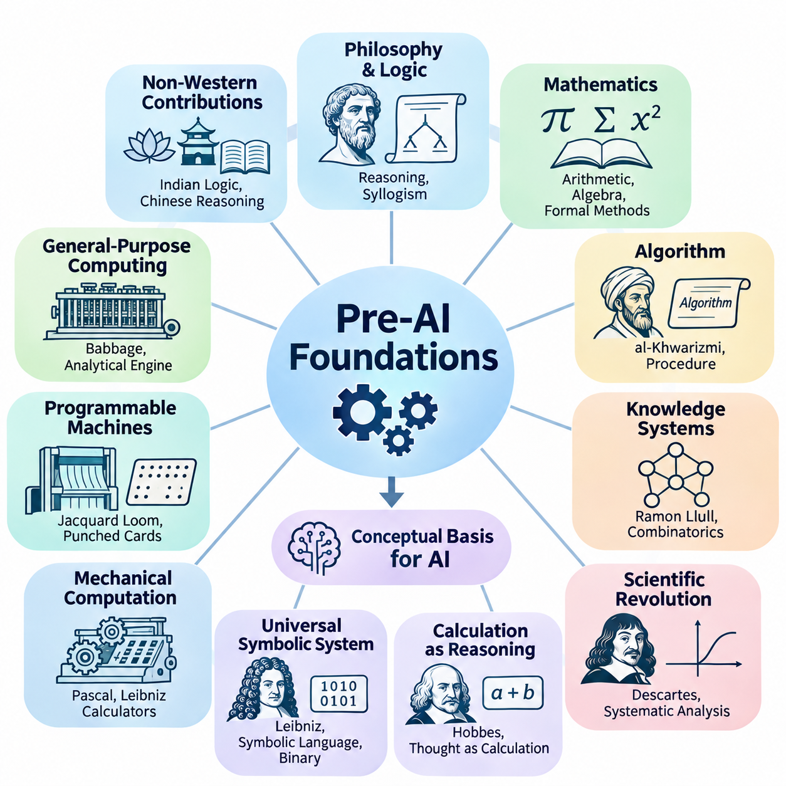
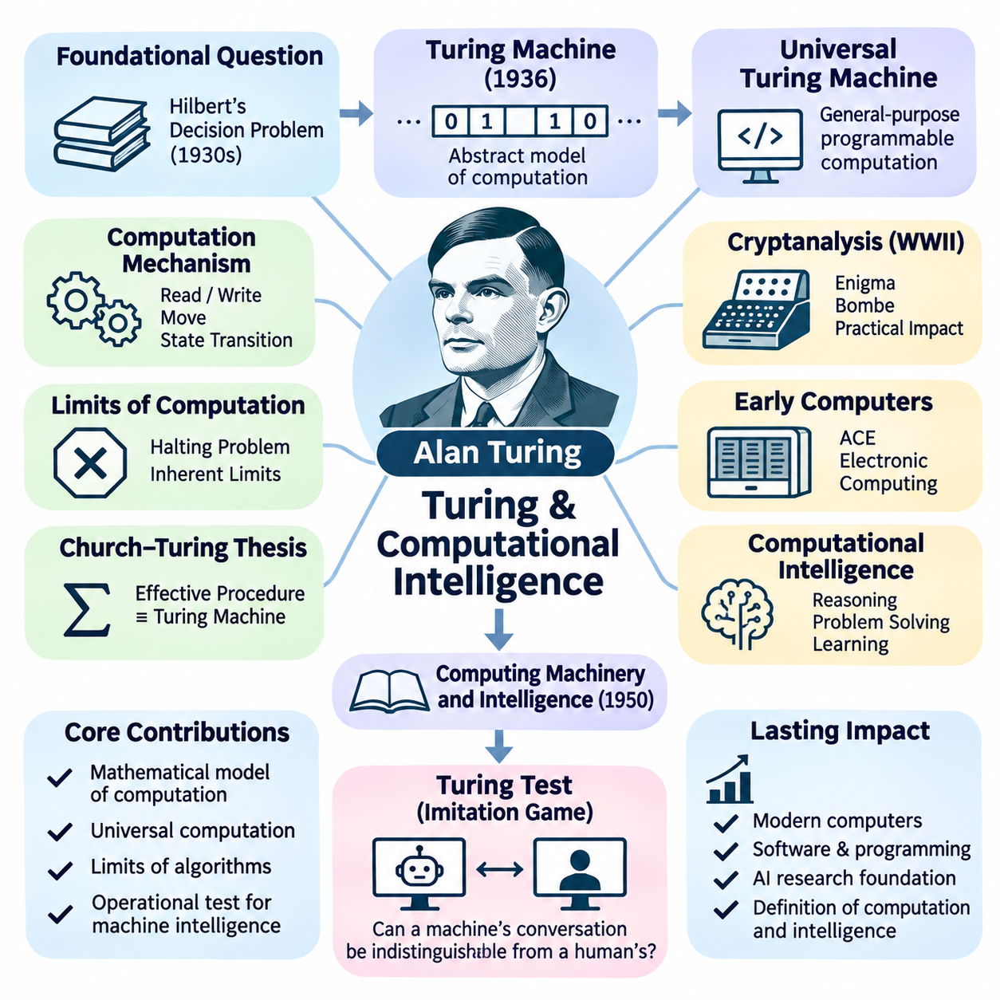
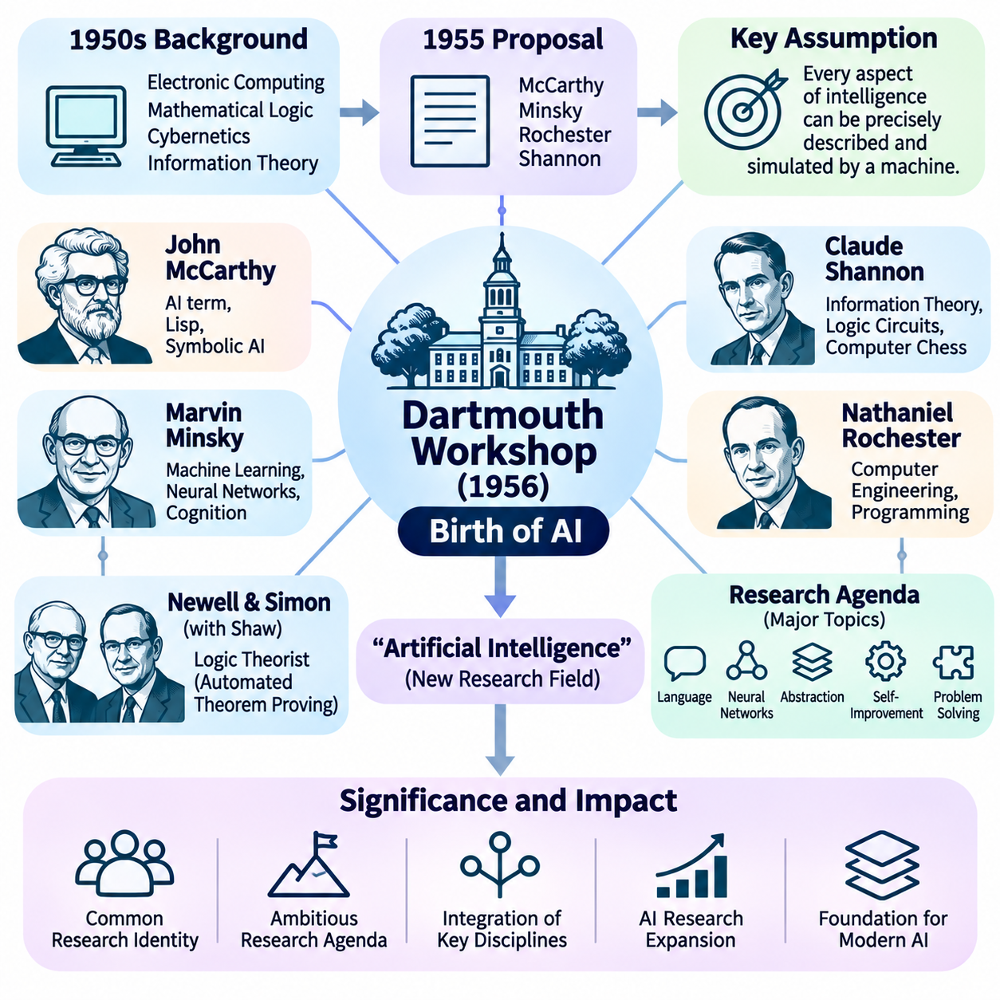
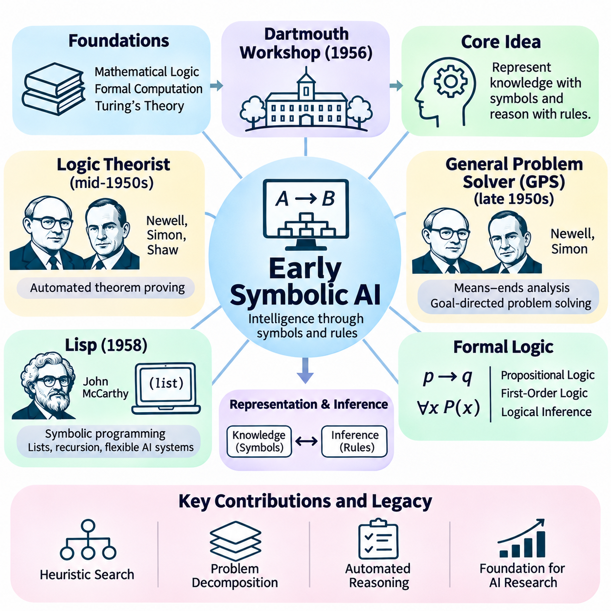
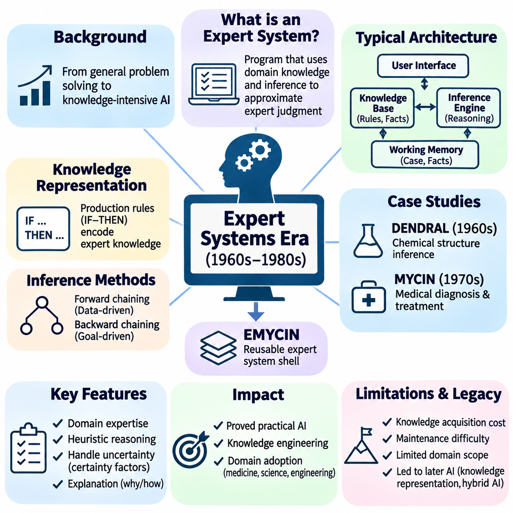
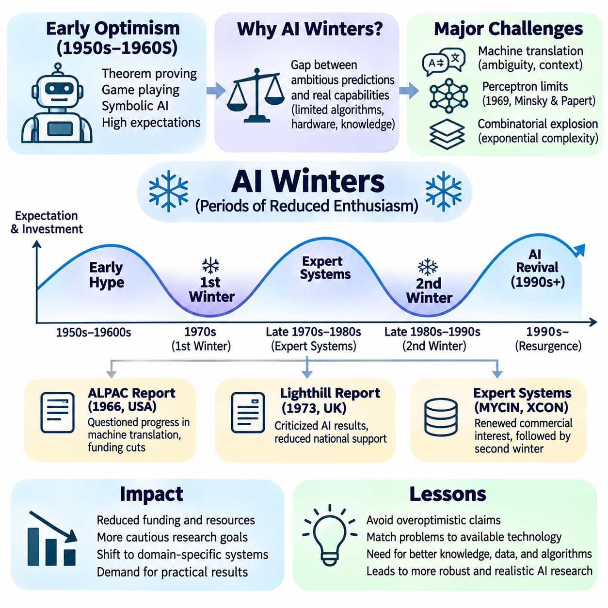
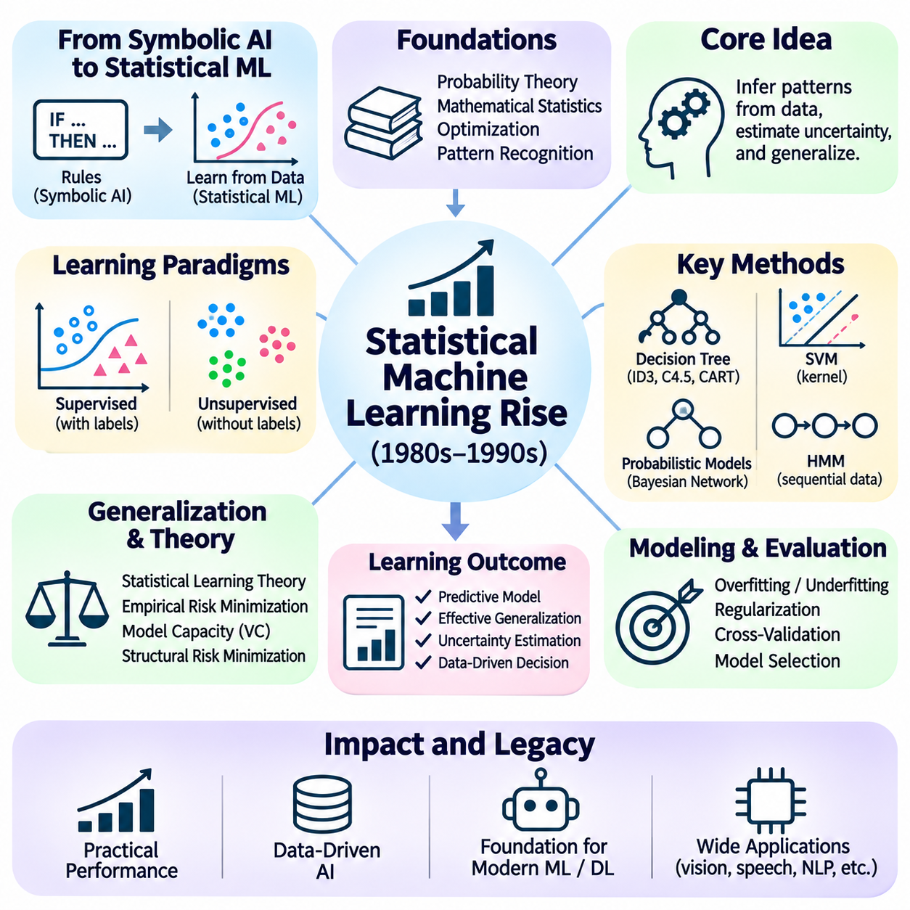
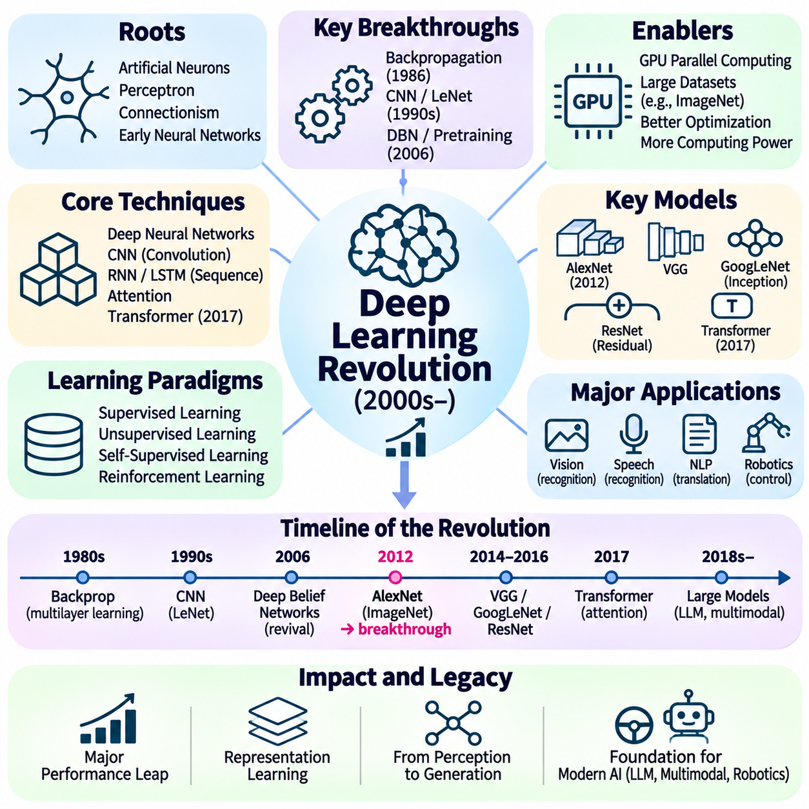
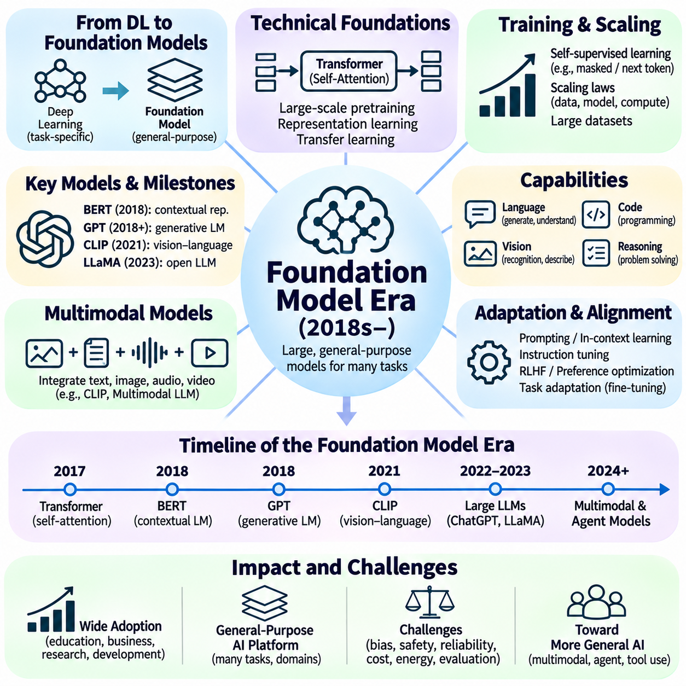
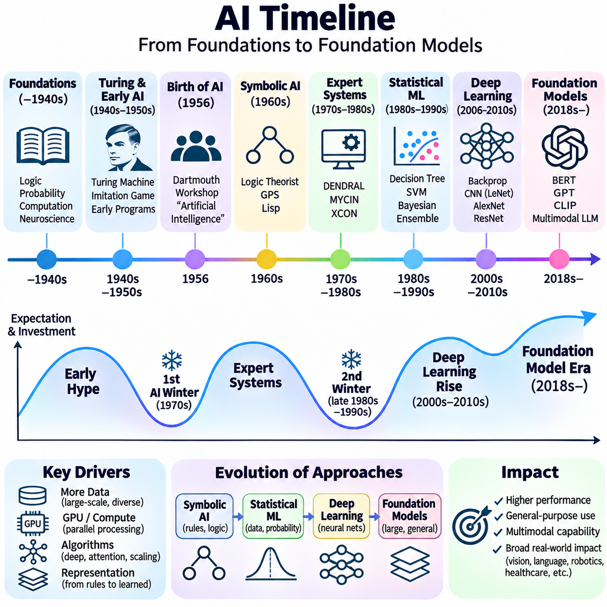

**Volume 04. Artificial Intelligence**


# 02. History of AI

## 02.00 Pre AI Foundations

{width="7.268055555555556in" height="7.268055555555556in"}

The foundations of artificial intelligence emerged long before the invention of electronic computers. Across different civilizations, philosophers, mathematicians, engineers, and scientists investigated whether reasoning, calculation, and intelligent behavior could be expressed through systematic principles. Their work established the conceptual foundations for machines capable of processing information, representing knowledge, and performing tasks traditionally associated with human intelligence.

Ancient philosophical traditions introduced fundamental questions about the nature of intelligence and rational thought. Greek philosophers, particularly Aristotle, examined how valid conclusions could be derived from established premises. His development of syllogistic logic demonstrated that certain forms of reasoning could follow explicit rules. This insight eventually became essential to symbolic artificial intelligence, where logical expressions represent knowledge and computational procedures manipulate those expressions.

The intellectual origins of artificial intelligence were not limited to Western philosophy. Indian traditions developed sophisticated systems of logic and linguistic analysis, while Chinese scholars explored systematic reasoning, classification, and mechanical computation. These traditions contributed different perspectives on knowledge, inference, and formal structure. Although they did not directly establish modern AI, they demonstrate the longstanding human ambition to understand intelligence through organized principles.

Mathematics provided another essential foundation by establishing methods for representing abstract relationships precisely. Ancient arithmetic, geometry, and algebra enabled complex problems to be expressed through symbolic operations. The development of positional number systems and increasingly systematic calculation methods expanded the range of problems that could be solved mechanically. These advances helped establish computation as a process governed by reproducible mathematical rules.

During the ninth century, the mathematician Muhammad ibn Musa al-Khwarizmi contributed significantly to the systematic treatment of mathematical procedures. His writings on algebra and calculation influenced the development of algorithmic thinking. The term algorithm ultimately derives from the Latinized form of his name. Algorithms became fundamental to artificial intelligence because they describe finite, structured procedures for transforming inputs into outputs.

The medieval period also witnessed attempts to organize knowledge into systems capable of supporting structured reasoning. Ramon Llull, a thirteenth-century philosopher, developed combinatorial methods using symbolic arrangements to explore relationships among concepts. His mechanical and logical constructions anticipated aspects of formal knowledge manipulation. Although these systems were not computational intelligence, they reflected the idea that reasoning might be represented through combinations of symbols.

The scientific revolution transformed these philosophical ambitions into increasingly mathematical investigations. René Descartes emphasized systematic reasoning and the relationship between mathematical structure and knowledge. His analytical approach encouraged the representation of complex problems through simpler components. This perspective later influenced computational problem solving, where difficult tasks are decomposed into smaller operations that can be processed systematically.

In the seventeenth century, Thomas Hobbes argued that reasoning could be understood in terms of calculation. This philosophical position suggested that certain intellectual operations might be represented as transformations of symbols or quantities. Although human reasoning extends beyond arithmetic, the computational interpretation of thought became influential in subsequent theories of intelligence. It encouraged researchers to investigate whether cognition could be described through explicit operations.

Gottfried Wilhelm Leibniz advanced this ambition by proposing a universal symbolic language and a systematic calculus of reasoning. He envisioned disputes being resolved through formal calculation rather than ambiguous argument. Leibniz also contributed to the development of binary arithmetic, which later became central to digital computing. His ideas connected symbolic representation, logical inference, and mechanical calculation within a common intellectual framework.

Mechanical calculating devices demonstrated that machines could perform operations previously requiring human effort. Blaise Pascal developed a mechanical calculator in the seventeenth century to support arithmetic calculations. Leibniz subsequently designed a stepped reckoner intended to perform several arithmetic operations. These machines were limited in functionality, but they established an important principle: appropriately designed physical mechanisms could execute mathematical procedures.

The Industrial Revolution created new opportunities for programmable mechanical computation. Joseph Marie Jacquard introduced a loom controlled through punched cards, demonstrating how encoded instructions could determine machine behavior. This separation between stored instructions and mechanical execution influenced later computing designs. It illustrated that a machine could produce different outcomes according to externally specified patterns rather than requiring fundamental mechanical reconstruction.

Charles Babbage extended mechanical computation through his designs for the Difference Engine and Analytical Engine. The Analytical Engine incorporated concepts resembling a processing unit, memory, and programmable control. Although it was never completed during his lifetime, its architecture anticipated important features of general-purpose computers. Babbage\'s work demonstrated that mechanical systems could potentially execute sequences of mathematical instructions beyond a single specialized calculation.

Ada Lovelace recognized the broader implications of programmable computation. In her notes on the Analytical Engine, she described how a machine might manipulate symbols according to formal rules, provided their relationships could be expressed mathematically. Her observations extended the conceptual scope of computation beyond numerical arithmetic. They suggested that programmable machines could operate on structured representations of information, an idea fundamental to modern AI systems.

The nineteenth century also witnessed the formalization of logic through mathematical methods. George Boole developed an algebraic system representing logical propositions through operations that could be analyzed mathematically. Boolean algebra established a powerful connection between logical reasoning and symbolic calculation. Its principles later became essential to digital circuit design, computer programming, and rule-based artificial intelligence.

Gottlob Frege further advanced formal logic by developing a rigorous system for representing quantified statements and relationships. His work provided foundations for modern predicate logic, enabling more expressive descriptions than traditional syllogistic reasoning. Formal logical languages eventually became central to knowledge representation and automated theorem proving. They allowed computational systems to represent objects, properties, and relationships through precisely defined symbolic structures.

At the beginning of the twentieth century, mathematical logic increasingly focused on the foundations and limitations of formal reasoning. Bertrand Russell and Alfred North Whitehead attempted to derive mathematical principles through logical systems in Principia Mathematica. Their work reflected the ambition to establish rigorous foundations for mathematical knowledge. These investigations helped shape the intellectual environment from which theoretical computer science emerged.

David Hilbert promoted the formalization of mathematics through precisely defined axioms and rules of inference. His research program raised fundamental questions about consistency, completeness, and mechanical decision procedures. These questions became closely connected to the possibility of automated reasoning. If mathematical reasoning could be expressed through formal operations, researchers needed to determine which problems could actually be solved by systematic procedures.

Kurt Gödel\'s incompleteness theorems demonstrated important limitations of sufficiently expressive formal mathematical systems. His results showed that certain consistent, effectively axiomatized systems cannot establish every arithmetic truth expressible within them. These discoveries challenged expectations that all mathematical reasoning could be captured by a complete formal framework. They also clarified the distinction between formal derivability and broader mathematical truth.

Probability theory introduced a complementary foundation for reasoning under uncertainty. Early contributions by Blaise Pascal, Pierre de Fermat, and subsequent mathematicians established methods for analyzing uncertain events. Thomas Bayes and Pierre-Simon Laplace advanced probabilistic inference, providing mathematical tools for updating beliefs from evidence. These principles later became essential to statistical learning, Bayesian networks, and intelligent decision-making systems.

Statistics expanded the ability to extract patterns and relationships from observations. Researchers developed methods for estimation, regression, hypothesis testing, and the mathematical analysis of variation. These techniques established foundations for learning from empirical data rather than relying exclusively on predefined logical rules. The eventual development of machine learning depended heavily on this transition from deterministic calculation toward statistical inference and prediction.

Biology and psychology contributed another perspective by investigating how natural intelligence emerges from physical and cognitive processes. Charles Darwin\'s theory of evolution provided a framework for understanding adaptation through variation and selection. Later computational researchers drew inspiration from evolutionary principles when designing optimization algorithms. These approaches suggested that complex problem-solving behavior might emerge through iterative adaptation rather than explicit programming alone.

Early neuroscience established that nervous systems consist of interconnected biological cells responsible for transmitting and processing signals. Santiago Ramón y Cajal\'s investigations helped establish the neuron doctrine, while subsequent physiological research examined neural communication. These discoveries provided a biological foundation for later artificial neural network models. They encouraged the hypothesis that intelligent behavior could emerge from interactions among relatively simple processing elements.

Psychological research also investigated learning, memory, perception, and behavior through experimental methods. Ivan Pavlov studied conditioned responses, while Edward Thorndike examined learning through consequences and repeated experience. These investigations demonstrated that behavior could change systematically in response to environmental conditions. Their findings contributed conceptual foundations for later computational approaches to learning, adaptation, and reinforcement.

The emergence of control theory introduced mathematical methods for regulating dynamic systems through feedback. Engineers investigated how machines could measure their current conditions, compare them with desired states, and adjust their behavior accordingly. Feedback control established a practical connection between sensing, decision-making, and action. This relationship later became central to autonomous robotics, intelligent control systems, and adaptive computational agents.

Information theory provided another critical foundation by treating communication and uncertainty as mathematical quantities. Earlier work on communication systems prepared the way for Claude Shannon\'s formal theory of information in 1948. Shannon demonstrated how information could be quantified and transmitted under noisy conditions. These ideas became important to data representation, communication networks, statistical inference, and the mathematical analysis of learning systems.

The convergence of logic, mathematics, mechanical computation, statistics, neuroscience, and control engineering created the intellectual environment necessary for artificial intelligence. Each discipline contributed a different component of the emerging field. Logic explained formal inference, mathematics established precise representations, statistics addressed uncertainty, neuroscience suggested distributed processing, and engineering demonstrated how abstract procedures could be implemented through physical mechanisms.

These foundations also revealed several competing interpretations of intelligence. One perspective emphasized reasoning through explicit symbols and logical rules, while another emphasized learning, adaptation, and interactions among simple processing units. A third perspective focused on feedback, environmental interaction, and goal-directed behavior. These approaches were not mutually exclusive, but their differences shaped many of the research traditions that subsequently developed within artificial intelligence.

Before artificial intelligence became an established scientific discipline, researchers had already formulated many of its central questions. Could reasoning be mechanized? Could machines manipulate symbols meaningfully? Could learning emerge from experience? Could complex behavior arise from simple computational mechanisms? These questions transformed intelligence from an exclusively philosophical subject into a potential object of mathematical analysis, experimental investigation, and engineering design.

The historical significance of these developments lies in their cumulative influence rather than any single invention. Artificial intelligence emerged from centuries of attempts to formalize thought, automate calculation, understand learning, and construct self-regulating machines. These achievements prepared the conceptual and technical foundations for twentieth-century computational theories of intelligence and the subsequent establishment of artificial intelligence as a distinct research field.

인공지능(Artificial Intelligence, AI)의 기초는 전자식 컴퓨터(Electronic Computer)가 발명되기 훨씬 이전부터 형성되었다. 여러 문명권의 철학자(Philosopher), 수학자(Mathematician), 공학자(Engineer), 과학자(Scientist)들은 추론(Reasoning), 계산(Computation), 지능적 행동(Intelligent Behavior)을 체계적인 원리(Systematic Principles)로 표현할 수 있는지 탐구하였다. 이러한 연구는 정보를 처리하고, 지식을 표현하며, 전통적으로 인간의 지능과 관련된 작업을 수행하는 기계의 개념적 토대(Conceptual Foundations)를 확립하였다.

고대 철학(Ancient Philosophy)은 지능(Intelligence)과 합리적 사고(Rational Thought)의 본질에 관한 근본적인 질문을 제기하였다. 특히 아리스토텔레스(Aristotle)를 비롯한 그리스 철학자들은 확립된 전제(Premises)로부터 타당한 결론(Valid Conclusions)을 도출하는 방법을 연구하였다. 아리스토텔레스의 삼단논법(Syllogistic Logic)은 특정한 추론 과정이 명시적인 규칙(Explicit Rules)을 따를 수 있음을 보여주었다. 이러한 통찰은 논리적 표현(Logical Expressions)으로 지식을 표현하고 계산 절차를 통해 이를 처리하는 기호적 인공지능(Symbolic AI)의 중요한 기초가 되었다.

인공지능의 지적 기원(Intellectual Origins)은 서양 철학에만 국한되지 않았다. 인도의 사상 전통은 정교한 논리 체계(Logical Systems)와 언어 분석(Linguistic Analysis)을 발전시켰으며, 중국의 학자들은 체계적 추론(Systematic Reasoning), 분류(Classification), 기계적 계산(Mechanical Computation)을 탐구하였다. 이러한 전통은 지식(Knowledge), 추론(Inference), 형식적 구조(Formal Structure)에 대한 서로 다른 관점을 제공하였다. 현대 인공지능을 직접 확립한 것은 아니지만, 지능을 체계적인 원리로 이해하려는 인류의 오랜 열망을 보여준다.

수학(Mathematics)은 추상적인 관계(Abstract Relationships)를 정확하게 표현하는 방법을 확립함으로써 또 다른 핵심 기반을 제공하였다. 고대의 산술(Arithmetic), 기하학(Geometry), 대수학(Algebra)은 복잡한 문제를 기호 연산(Symbolic Operations)으로 표현할 수 있게 하였다. 위치 기수법(Positional Number Systems)과 점차 체계화된 계산 방법의 발전은 기계적으로 해결할 수 있는 문제의 범위를 확대하였다. 이러한 진보는 계산을 재현 가능한 수학적 규칙(Reproducible Mathematical Rules)에 따라 수행되는 과정으로 정립하는 데 기여하였다.

9세기 수학자 무함마드 이븐 무사 알콰리즈미(Muhammad ibn Musa al-Khwarizmi)는 수학적 절차(Mathematical Procedures)의 체계화에 크게 기여하였다. 대수학과 계산에 관한 그의 저술은 알고리즘적 사고(Algorithmic Thinking)의 발전에 영향을 주었다. 알고리즘(Algorithm)이라는 용어 역시 그의 이름을 라틴어로 표기한 형태에서 유래하였다. 알고리즘은 입력(Input)을 출력(Output)으로 변환하는 유한하고 구조화된 절차(Finite and Structured Procedures)를 기술하기 때문에 인공지능의 핵심 요소가 되었다.

중세 시대(Medieval Period)에도 체계적인 추론을 지원할 수 있도록 지식을 조직하려는 시도가 이어졌다. 13세기 철학자 라몬 룰(Ramon Llull)은 기호적 배열(Symbolic Arrangements)을 이용하여 개념 간 관계를 탐구하는 조합적 방법(Combinatorial Methods)을 개발하였다. 그의 기계적·논리적 구성은 형식적 지식 조작(Formal Knowledge Manipulation)의 일부 측면을 예견하였다. 이러한 체계가 계산 지능(Computational Intelligence)은 아니었지만, 기호의 조합을 통해 추론을 표현할 수 있다는 생각을 반영하였다.

과학혁명(Scientific Revolution)은 이러한 철학적 열망을 점차 수학적인 탐구로 전환하였다. 르네 데카르트(René Descartes)는 체계적 추론(Systematic Reasoning)과 수학적 구조(Mathematical Structure), 지식 사이의 관계를 강조하였다. 그의 분석적 접근법(Analytical Approach)은 복잡한 문제를 더 단순한 구성 요소로 표현하도록 장려하였다. 이러한 관점은 이후 어려운 작업을 작은 연산으로 분해하여 체계적으로 처리하는 계산적 문제 해결(Computational Problem Solving)에 영향을 주었다.

17세기에 토머스 홉스(Thomas Hobbes)는 추론을 계산(Calculation)의 관점에서 이해할 수 있다고 주장하였다. 이러한 철학적 입장(Philosophical Position)은 특정한 지적 활동(Intellectual Operations)을 기호나 수량의 변환으로 표현할 수 있음을 시사하였다. 인간의 추론이 단순한 산술을 넘어서는 것이기는 하지만, 사고에 대한 계산적 해석(Computational Interpretation)은 이후 지능 이론에 중요한 영향을 미쳤다. 이는 인지(Cognition)를 명시적인 연산(Explicit Operations)으로 기술할 수 있는지 탐구하도록 하였다.

고트프리트 빌헬름 라이프니츠(Gottfried Wilhelm Leibniz)는 보편적 기호 언어(Universal Symbolic Language)와 체계적인 추론 계산법(Calculus of Reasoning)을 제안하여 이러한 구상을 발전시켰다. 그는 모호한 논쟁 대신 형식적 계산(Formal Calculation)을 통해 의견 차이를 해결하는 미래를 구상하였다. 또한 디지털 컴퓨팅(Digital Computing)의 핵심이 된 이진 산술(Binary Arithmetic)의 발전에도 기여하였다. 그의 사상은 기호 표현(Symbolic Representation), 논리적 추론(Logical Inference), 기계적 계산(Mechanical Calculation)을 공통된 지적 체계로 연결하였다.

기계식 계산 장치(Mechanical Calculating Devices)는 이전까지 인간의 노력이 필요했던 연산을 기계가 수행할 수 있음을 입증하였다. 블레즈 파스칼(Blaise Pascal)은 17세기에 산술 계산을 지원하기 위한 기계식 계산기(Mechanical Calculator)를 개발하였다. 이후 라이프니츠는 여러 산술 연산을 수행하도록 설계된 단계식 계산기(Stepped Reckoner)를 제작하였다. 이러한 기계는 기능적으로 제한적이었지만, 적절하게 설계된 물리적 장치(Physical Mechanisms)가 수학적 절차를 실행할 수 있다는 중요한 원리를 확립하였다.

산업혁명(Industrial Revolution)은 프로그래밍 가능한 기계적 계산(Programmable Mechanical Computation)의 새로운 가능성을 열었다. 조제프 마리 자카르(Joseph Marie Jacquard)는 천공 카드(Punched Cards)로 제어되는 직기(Loom)를 도입하여 부호화된 명령(Encoded Instructions)이 기계의 동작을 결정할 수 있음을 보여주었다. 저장된 명령과 기계적 실행을 분리하는 이러한 개념은 이후 컴퓨터 설계에 영향을 미쳤다. 이는 기계의 기본 구조를 변경하지 않고도 외부에서 지정한 패턴에 따라 서로 다른 결과를 생성할 수 있음을 보여주었다.

찰스 배비지(Charles Babbage)는 차분기관(Difference Engine)과 해석기관(Analytical Engine)의 설계를 통해 기계적 계산을 확장하였다. 해석기관은 처리 장치(Processing Unit), 메모리(Memory), 프로그래밍 가능한 제어(Programmable Control)와 유사한 개념을 포함하였다. 비록 그의 생전에 완성되지는 못했지만, 그 구조는 범용 컴퓨터(General-Purpose Computer)의 중요한 특징을 예견하였다. 배비지의 연구는 기계 시스템이 단일한 특수 계산을 넘어 일련의 수학적 명령을 실행할 수 있음을 보여주었다.

에이다 러브레이스(Ada Lovelace)는 프로그래밍 가능한 계산(Programmable Computation)이 지닌 더 넓은 의미를 인식하였다. 해석기관에 관한 주석에서 그녀는 기호 사이의 관계를 수학적으로 표현할 수 있다면 기계가 형식적 규칙(Formal Rules)에 따라 기호를 조작할 수 있다고 설명하였다. 이러한 관찰은 계산의 개념적 범위를 수치 산술(Numerical Arithmetic) 이상으로 확장하였다. 이는 프로그래밍 가능한 기계가 구조화된 정보 표현(Structured Representations of Information)을 처리할 수 있음을 시사하였으며, 현대 인공지능의 근본적인 개념이 되었다.

19세기에는 수학적 방법을 통한 논리학(Logic)의 형식화(Formalization)도 이루어졌다. 조지 불(George Boole)은 수학적으로 분석할 수 있는 연산을 통해 논리 명제(Logical Propositions)를 표현하는 대수 체계(Algebraic System)를 개발하였다. 불 대수(Boolean Algebra)는 논리적 추론과 기호 계산 사이의 강력한 연결을 확립하였다. 이러한 원리는 이후 디지털 회로 설계(Digital Circuit Design), 컴퓨터 프로그래밍(Computer Programming), 규칙 기반 인공지능(Rule-Based AI)의 필수적인 기반이 되었다.

고틀로프 프레게(Gottlob Frege)는 양화된 명제(Quantified Statements)와 관계(Relationships)를 표현하는 엄밀한 체계를 개발하여 형식 논리학(Formal Logic)을 더욱 발전시켰다. 그의 연구는 현대 술어 논리(Predicate Logic)의 기초를 제공하였으며, 전통적인 삼단논법보다 표현력이 높은 기술을 가능하게 하였다. 형식 논리 언어(Formal Logical Languages)는 이후 지식 표현(Knowledge Representation)과 자동 정리 증명(Automated Theorem Proving)의 중심 요소가 되었다. 이를 통해 계산 시스템은 객체, 속성, 관계를 정확하게 정의된 기호 구조로 표현할 수 있게 되었다.

20세기 초 수리논리학(Mathematical Logic)은 형식적 추론(Formal Reasoning)의 기초와 한계를 탐구하는 데 점점 더 집중하였다. 버트런드 러셀(Bertrand Russell)과 알프레드 노스 화이트헤드(Alfred North Whitehead)는 『수학 원리(Principia Mathematica)』에서 논리 체계를 통해 수학적 원리를 도출하려고 시도하였다. 이러한 연구는 수학적 지식의 엄밀한 기초(Rigorous Foundations)를 확립하려는 열망을 반영하였다. 또한 이론 컴퓨터 과학(Theoretical Computer Science)이 등장하는 지적 환경을 형성하는 데 기여하였다.

다비트 힐베르트(David Hilbert)는 정확하게 정의된 공리(Axioms)와 추론 규칙(Rules of Inference)을 통해 수학을 형식화하는 연구를 추진하였다. 그의 연구 프로그램은 일관성(Consistency), 완전성(Completeness), 기계적 결정 절차(Mechanical Decision Procedures)에 관한 근본적인 질문을 제기하였다. 이러한 질문은 자동 추론(Automated Reasoning)의 가능성과 밀접하게 연결되었다. 수학적 추론을 형식적 연산으로 표현할 수 있다면, 어떤 문제를 체계적인 절차로 실제 해결할 수 있는지 판단해야 했기 때문이다.

쿠르트 괴델(Kurt Gödel)의 불완전성 정리(Incompleteness Theorems)는 충분한 표현력을 갖춘 형식적 수학 체계(Formal Mathematical Systems)의 중요한 한계를 입증하였다. 그의 연구는 특정한 일관성을 가진 효과적으로 공리화된 체계(Effectively Axiomatized Systems)가 그 체계 안에서 표현할 수 있는 모든 산술적 진리(Arithmetic Truth)를 증명할 수는 없음을 보여주었다. 이러한 발견은 모든 수학적 추론을 완전한 형식 체계로 포착할 수 있다는 기대에 도전하였다. 또한 형식적 증명 가능성(Formal Derivability)과 더 넓은 수학적 진리(Mathematical Truth)의 차이를 명확하게 하였다.

확률 이론(Probability Theory)은 불확실성(Uncertainty) 아래에서 추론하기 위한 보완적인 기초를 제공하였다. 블레즈 파스칼, 피에르 드 페르마(Pierre de Fermat), 그리고 후대 수학자들의 초기 연구는 불확실한 사건을 분석하는 방법을 확립하였다. 토머스 베이즈(Thomas Bayes)와 피에르시몽 라플라스(Pierre-Simon Laplace)는 확률적 추론(Probabilistic Inference)을 발전시켜 증거(Evidence)에 따라 믿음(Beliefs)을 갱신하는 수학적 도구를 제공하였다. 이러한 원리는 이후 통계적 학습(Statistical Learning), 베이지안 네트워크(Bayesian Networks), 지능형 의사결정 시스템(Intelligent Decision-Making Systems)의 핵심이 되었다.

통계학(Statistics)은 관측(Observations)으로부터 패턴(Patterns)과 관계를 추출하는 능력을 확장하였다. 연구자들은 추정(Estimation), 회귀(Regression), 가설 검정(Hypothesis Testing), 변동성(Variation)의 수학적 분석 방법을 발전시켰다. 이러한 기법은 사전에 정의된 논리 규칙에만 의존하지 않고 경험적 데이터(Empirical Data)로부터 학습하는 기반을 마련하였다. 이후 기계학습(Machine Learning)의 발전은 결정론적 계산(Deterministic Calculation)에서 통계적 추론과 예측(Statistical Inference and Prediction)으로 확장되는 이러한 전환에 크게 의존하였다.

생물학(Biology)과 심리학(Psychology)은 자연 지능(Natural Intelligence)이 물리적·인지적 과정(Physical and Cognitive Processes)에서 어떻게 나타나는지 연구함으로써 또 다른 관점을 제공하였다. 찰스 다윈(Charles Darwin)의 진화론(Theory of Evolution)은 변이(Variation)와 선택(Selection)을 통한 적응(Adaptation)을 이해하는 틀을 제공하였다. 이후 계산 연구자들은 최적화 알고리즘(Optimization Algorithms)을 설계할 때 진화 원리(Evolutionary Principles)에서 영감을 얻었다. 이러한 접근법은 복잡한 문제 해결 행동이 명시적인 프로그래밍뿐 아니라 반복적인 적응(Iterative Adaptation)을 통해서도 나타날 수 있음을 시사하였다.

초기 신경과학(Neuroscience)은 신경계(Nervous Systems)가 신호를 전달하고 처리하는 상호 연결된 생물학적 세포(Biological Cells)로 구성되어 있음을 확립하였다. 산티아고 라몬 이 카할(Santiago Ramón y Cajal)의 연구는 뉴런 학설(Neuron Doctrine)의 정립에 기여하였으며, 이후 생리학 연구는 신경 신호 전달(Neural Communication)을 탐구하였다. 이러한 발견은 인공 신경망(Artificial Neural Networks) 모델의 생물학적 기반을 제공하였다. 또한 비교적 단순한 처리 요소(Processing Elements) 사이의 상호작용으로 지능적 행동이 나타날 수 있다는 가설을 촉진하였다.

심리학 연구(Psychological Research)는 실험적 방법(Experimental Methods)을 통해 학습(Learning), 기억(Memory), 지각(Perception), 행동(Behavior)을 탐구하였다. 이반 파블로프(Ivan Pavlov)는 조건 반응(Conditioned Responses)을 연구하였으며, 에드워드 손다이크(Edward Thorndike)는 행동의 결과와 반복적인 경험을 통한 학습을 조사하였다. 이러한 연구는 환경 조건(Environmental Conditions)에 따라 행동이 체계적으로 변화할 수 있음을 보여주었다. 그 결과는 이후 학습, 적응, 강화(Reinforcement)에 관한 계산적 접근법(Computational Approaches)의 개념적 기초에 기여하였다.

제어 이론(Control Theory)의 등장은 피드백(Feedback)을 통해 동적 시스템(Dynamic Systems)을 조절하는 수학적 방법을 제공하였다. 공학자들은 기계가 현재 상태(Current Conditions)를 측정하고 목표 상태(Desired States)와 비교한 다음 그에 따라 동작을 조정하는 방법을 연구하였다. 피드백 제어(Feedback Control)는 감지(Sensing), 의사결정(Decision-Making), 행동(Action) 사이의 실질적인 연결을 확립하였다. 이러한 관계는 이후 자율 로봇공학(Autonomous Robotics), 지능형 제어 시스템(Intelligent Control Systems), 적응형 계산 에이전트(Adaptive Computational Agents)의 중심 개념이 되었다.

정보 이론(Information Theory)은 통신(Communication)과 불확실성을 수학적 수량(Mathematical Quantities)으로 다루면서 또 다른 중요한 기초를 제공하였다. 통신 시스템에 관한 초기 연구는 1948년 클로드 섀넌(Claude Shannon)의 형식적 정보 이론(Formal Theory of Information)이 등장하는 기반을 마련하였다. 섀넌은 정보의 양을 정량화하고 잡음이 존재하는 조건(Noisy Conditions)에서도 정보를 전달할 수 있는 방법을 제시하였다. 이러한 개념은 데이터 표현(Data Representation), 통신 네트워크(Communication Networks), 통계적 추론, 학습 시스템의 수학적 분석에 중요하게 활용되었다.

논리학, 수학, 기계적 계산, 통계학, 신경과학, 제어공학(Control Engineering)의 융합은 인공지능에 필요한 지적 환경(Intellectual Environment)을 형성하였다. 각 학문은 새롭게 등장하는 분야에 서로 다른 구성 요소를 제공하였다. 논리학은 형식적 추론을 설명하였고, 수학은 정확한 표현을 확립하였으며, 통계학은 불확실성을 다루었다. 신경과학은 분산 처리(Distributed Processing)의 가능성을 제시하였고, 공학은 추상적 절차(Abstract Procedures)를 물리적 장치로 구현할 수 있음을 입증하였다.

이러한 기초 연구는 지능에 관한 여러 경쟁적인 해석(Competing Interpretations)도 드러냈다. 한 관점은 명시적인 기호(Explicit Symbols)와 논리 규칙(Logical Rules)을 통한 추론을 강조하였으며, 다른 관점은 단순한 처리 요소 사이의 학습, 적응, 상호작용(Interactions)을 강조하였다. 세 번째 관점은 피드백, 환경과의 상호작용(Environmental Interaction), 목표 지향적 행동(Goal-Directed Behavior)에 초점을 맞추었다. 이러한 접근법이 반드시 상호 배타적인 것은 아니었지만, 그 차이는 이후 인공지능에서 발전한 여러 연구 전통(Research Traditions)을 형성하였다.

인공지능이 독립적인 과학 분야(Scientific Discipline)로 확립되기 이전에 연구자들은 이미 핵심적인 질문을 제기하고 있었다. 추론을 기계화(Mechanization)할 수 있는가? 기계가 기호를 의미 있게 조작할 수 있는가? 경험으로부터 학습이 나타날 수 있는가? 단순한 계산 메커니즘(Computational Mechanisms)으로부터 복잡한 행동이 발생할 수 있는가? 이러한 질문은 지능을 철학적 주제에만 머무르게 하지 않고 수학적 분석(Mathematical Analysis), 실험적 탐구(Experimental Investigation), 공학적 설계(Engineering Design)의 대상으로 전환하였다.

이러한 발전의 역사적 중요성(Historical Significance)은 특정한 하나의 발명보다 여러 성과가 축적되면서 나타난 영향(Cumulative Influence)에 있다. 인공지능은 사고의 형식화(Formalization of Thought), 계산의 자동화(Automation of Calculation), 학습의 이해(Understanding of Learning), 자기 조절 기계(Self-Regulating Machines)의 구축을 위한 수 세기에 걸친 시도에서 등장하였다. 이러한 성과는 20세기 계산 지능 이론(Computational Theories of Intelligence)과 이후 인공지능이 독립적인 연구 분야(Distinct Research Field)로 확립되는 데 필요한 개념적·기술적 기반(Conceptual and Technical Foundations)을 마련하였다.

## 02.01 Turing and Computational Intelligence

{width="7.268055555555556in" height="7.268055555555556in"}

Alan Turing played a foundational role in transforming the philosophical question of machine intelligence into a scientific and computational problem. His research established fundamental connections among mathematical logic, computation, algorithms, and intelligent behavior. Rather than treating intelligence exclusively as a biological property, Turing investigated whether machines could perform operations associated with human reasoning and demonstrate behavior that observers might interpret as intelligent.

During the 1930s, mathematicians were investigating whether every precisely formulated mathematical problem could be solved through a systematic procedure. This question was closely associated with David Hilbert\'s Entscheidungsproblem, or decision problem. Turing approached the challenge by developing a mathematical model of computation that could represent the essential operations performed by a person following explicit calculation instructions.

In 1936, Turing introduced the theoretical computing model now known as the Turing machine. This abstract machine consists of an unbounded tape divided into cells, a read-write head, a finite set of internal states, and rules governing state transitions. Despite its conceptual simplicity, the model can represent arbitrary algorithmic computations when supplied with suitable instructions, provided the required computation is effectively computable.

A Turing machine processes information through discrete operations determined by its current state and the symbol being examined. At each step, it may write a symbol, move its head, and enter another state according to a transition rule. This mechanism demonstrated how complex computational procedures could emerge from sequences of elementary operations without requiring human judgment during execution.

Turing also introduced the concept of a universal Turing machine, which can simulate other Turing machines when provided with their encoded descriptions and inputs. This principle established the theoretical foundation for general-purpose programmable computers. Instead of constructing a separate machine for every computational task, one universal computational system could execute many different algorithms through changes in its encoded instructions.

The universal machine concept revealed a fundamental relationship between programs and data. Instructions describing a computational procedure could themselves be represented as information and processed by another machine. This insight helped establish the conceptual foundations of stored-program computing, software abstraction, and programmable systems. Modern artificial intelligence depends on this separation between computational hardware and executable algorithms.

Turing\'s work also established important limits on mechanical computation. Through his analysis of the halting problem, he demonstrated that no general algorithm can correctly determine whether every possible program will eventually terminate. This result showed that computational systems possess inherent mathematical limitations. It also clarified that increasing processing power cannot eliminate every fundamental restriction on algorithmic problem solving.

The Church--Turing thesis emerged from closely related investigations by Turing and Alonzo Church. It proposes that any function calculable by an effective mechanical procedure can be computed by a Turing machine. Although it is not a mathematical theorem about an independently formalized notion of effective computation, the thesis provides a foundational interpretation of what algorithms can accomplish.

During World War II, Turing contributed to British cryptanalysis at Bletchley Park, particularly efforts to decipher communications encrypted using the German Enigma system. His work on cryptanalytic methods and the design of the Bombe demonstrated the practical importance of mechanized logical analysis. These achievements helped establish the broader feasibility of using specialized machines to solve complex information-processing problems.

Following the war, Turing participated in early electronic computer development, including work on the Automatic Computing Engine at the National Physical Laboratory. His designs reflected the possibility of implementing general-purpose computation through electronic hardware. The transition from abstract mathematical machines to physical computing systems created the technological environment in which artificial intelligence research could eventually become practical.

Turing\'s interest extended beyond calculating machines toward the possibility of machine intelligence. He recognized that computational systems might perform activities traditionally associated with thinking, including reasoning, problem solving, and learning. This perspective challenged the assumption that intelligence necessarily required biological mechanisms. It also encouraged researchers to evaluate intelligence through observable capabilities rather than internal physical composition.

In 1950, Turing published Computing Machinery and Intelligence, a landmark paper examining whether machines could think. Rather than attempting to define thinking through philosophical arguments alone, he proposed replacing the original question with an operationally defined behavioral experiment. This approach shifted attention toward the observable performance of computational systems and the conditions under which their behavior might be considered intelligent.

The proposed experiment became widely known as the Turing Test, although Turing originally described it through an imitation game. In the machine-oriented version, a human interrogator communicates through text with a machine and a human participant while attempting to distinguish them. The experiment examines whether the machine can produce conversational behavior sufficiently similar to human responses to make reliable identification difficult.

The significance of the Turing Test lies in its behavioral approach to evaluating intelligence. Instead of requiring direct access to consciousness, subjective experience, or internal reasoning mechanisms, the test considers externally observable performance. This perspective influenced later AI evaluation methods by emphasizing measurable capabilities. However, successful imitation does not necessarily demonstrate genuine understanding, consciousness, or general intelligence.

Turing anticipated several objections to machine intelligence, including arguments involving consciousness, mathematical limitations, originality, and the apparent uniqueness of human thought. He examined these objections while emphasizing the importance of empirical investigation. His discussion established a framework for debates that continue to influence artificial intelligence philosophy, particularly questions concerning understanding, intentionality, creativity, and computational cognition.

An especially important aspect of Turing\'s thinking was his recognition that intelligent machines might need to learn rather than depend entirely on explicitly programmed knowledge. He proposed the idea of constructing a child machine whose capabilities could develop through education and experience. This concept anticipated central principles of machine learning, where computational systems improve their performance through training rather than relying exclusively on manually specified rules.

The child-machine proposal distinguished between an initial computational organization and the processes responsible for modifying its behavior. Turing considered how instruction, experience, rewards, and penalties might influence learning. Although his proposals were not equivalent to modern neural network training algorithms, they reflected an early understanding that intelligent behavior could emerge through adaptation over time.

Turing also investigated biological pattern formation through mathematical models of reaction and diffusion. His 1952 work demonstrated how interactions between chemical substances could generate organized spatial patterns. Although this research was not itself an artificial intelligence model, it illustrated his broader interest in explaining complex natural phenomena through mathematical mechanisms. Such interdisciplinary thinking later became influential in computational approaches to biological and adaptive systems.

The relationship between computation and intelligence raises an important distinction between computational capability and cognitive capability. A universal computer can execute any effectively computable algorithm when sufficient resources are available, but this does not imply that it automatically possesses intelligence. Intelligent performance additionally depends on appropriate representations, learning mechanisms, reasoning strategies, environmental information, and goal-directed behavior.

Computational intelligence can therefore be understood as the application of computational mechanisms to tasks requiring adaptive or apparently intelligent behavior. Such systems may perform inference, classification, optimization, planning, and decision making. Turing\'s contributions provided a mathematical framework for understanding which procedures could be mechanized, while subsequent AI research investigated how computational procedures could produce increasingly sophisticated cognitive capabilities.

Turing\'s theoretical framework also influenced the development of symbolic artificial intelligence. If reasoning can be represented through formal symbols and explicit transformation rules, computational machines can potentially execute logical inference procedures. This possibility motivated research into automated theorem proving, problem solving, and knowledge representation. Early symbolic AI systems inherited the broader assumption that aspects of intelligence could be implemented through formal computational operations.

At the same time, Turing\'s learning-oriented proposals anticipated approaches that would later become associated with connectionism and statistical machine learning. These approaches emphasize adapting computational parameters or internal representations through experience. The coexistence of programmed reasoning and learned behavior became one of the defining characteristics of artificial intelligence research, reflecting different interpretations of how intelligent capabilities can arise.

The computational perspective also introduced questions about efficiency and practical feasibility. A problem may be computable in principle while requiring unrealistic amounts of time, memory, or energy. This distinction became increasingly important as AI researchers confronted combinatorial search spaces and complex reasoning tasks. Computational complexity theory subsequently provided methods for analyzing the resources required to solve different classes of problems.

Turing\'s influence extends into modern AI evaluation, where systems are assessed through their ability to perform tasks rather than through claims about internal consciousness. Language understanding, reasoning, planning, and interactive problem solving can all be examined through behavioral tests. Nevertheless, contemporary evaluation increasingly requires broader measurements of factual reliability, robustness, generalization, safety, and performance across diverse environments.

Modern large language models demonstrate the continuing relevance of Turing\'s questions. These systems generate coherent language, answer questions, and perform complex computational and reasoning tasks through learned statistical representations. Their capabilities invite comparisons with human conversational intelligence, while also revealing limitations in reliability, grounding, and consistent reasoning. Such developments reinforce the distinction between convincing behavior and comprehensive intelligence.

Turing\'s lasting contribution was not a complete theory of intelligence but a rigorous framework connecting computation, programmability, and the possibility of intelligent machines. His research established what mechanical computation means, demonstrated some of its mathematical limits, and proposed behavioral methods for examining machine intelligence. These ideas provided essential foundations for the emergence of artificial intelligence as a scientific discipline.

The historical transition initiated by Turing transformed intelligence from a primarily philosophical question into a subject that could be investigated through mathematical models, executable algorithms, and experimental evaluation. His work connected abstract computation with practical machines and anticipated learning-based approaches to intelligent behavior. This intellectual foundation directly preceded the formal establishment of artificial intelligence research during the 1950s.

앨런 튜링(Alan Turing)은 기계 지능(Machine Intelligence)에 관한 철학적 질문을 과학적·계산적 문제(Scientific and Computational Problem)로 전환하는 데 기초적인 역할을 수행하였다. 그의 연구는 수리논리학(Mathematical Logic), 계산(Computation), 알고리즘(Algorithms), 지능적 행동(Intelligent Behavior) 사이의 근본적인 연결 관계를 확립하였다. 튜링은 지능을 생물학적 특성(Biological Property)으로만 취급하지 않고, 기계가 인간의 추론과 관련된 연산을 수행하고 관찰자가 지능적이라고 해석할 수 있는 행동을 나타낼 수 있는지 탐구하였다.

1930년대 수학자들은 정확하게 정의된 모든 수학적 문제(Mathematical Problem)를 체계적인 절차(Systematic Procedure)를 통해 해결할 수 있는지 연구하고 있었다. 이러한 질문은 다비트 힐베르트(David Hilbert)의 결정 문제(Entscheidungsproblem)와 밀접하게 관련되어 있었다. 튜링은 명시적인 계산 지침(Explicit Calculation Instructions)을 따르는 사람이 수행하는 핵심 연산을 표현할 수 있는 수학적 계산 모델(Mathematical Model of Computation)을 개발함으로써 이 문제에 접근하였다.

1936년 튜링은 오늘날 튜링 기계(Turing Machine)라고 알려진 이론적 계산 모델(Theoretical Computing Model)을 제시하였다. 이 추상 기계(Abstract Machine)는 셀(Cell)로 나누어진 무한히 확장 가능한 테이프(Unbounded Tape), 읽기·쓰기 헤드(Read-Write Head), 유한한 내부 상태 집합(Finite Set of Internal States), 상태 전이 규칙(State Transition Rules)으로 구성된다. 개념적으로 단순하지만, 적절한 명령이 주어지면 효과적으로 계산 가능한 모든 알고리즘적 계산(Algorithmic Computation)을 표현할 수 있다.

튜링 기계는 현재 상태(Current State)와 읽고 있는 기호(Symbol)에 따라 결정되는 이산적 연산(Discrete Operations)을 통해 정보를 처리한다. 각 단계에서 전이 규칙(Transition Rule)에 따라 기호를 기록하고, 헤드를 이동시키며, 다른 상태로 전환할 수 있다. 이러한 메커니즘은 실행 과정에서 인간의 판단(Human Judgment)이 개입하지 않더라도 기본 연산(Elementary Operations)의 연속적인 수행을 통해 복잡한 계산 절차(Computational Procedures)를 구현할 수 있음을 보여주었다.

튜링은 다른 튜링 기계의 부호화된 설명(Encoded Descriptions)과 입력을 제공받아 해당 기계를 모의 실행(Simulation)할 수 있는 보편 튜링 기계(Universal Turing Machine)의 개념도 제시하였다. 이 원리는 범용 프로그래밍 컴퓨터(General-Purpose Programmable Computer)의 이론적 기초를 확립하였다. 각각의 계산 작업을 위해 별도의 기계를 제작하는 대신, 하나의 범용 계산 시스템(Universal Computational System)이 부호화된 명령을 변경하여 다양한 알고리즘을 실행할 수 있게 된 것이다.

보편 기계(Universal Machine)의 개념은 프로그램(Programs)과 데이터(Data) 사이의 근본적인 관계를 드러냈다. 계산 절차를 설명하는 명령 자체도 정보로 표현될 수 있으며, 다른 기계에 의해 처리될 수 있었다. 이러한 통찰은 저장 프로그램 방식 컴퓨팅(Stored-Program Computing), 소프트웨어 추상화(Software Abstraction), 프로그래밍 가능한 시스템(Programmable Systems)의 개념적 기초를 확립하는 데 기여하였다. 현대 인공지능은 계산 하드웨어(Computational Hardware)와 실행 가능한 알고리즘(Executable Algorithms)의 이러한 분리에 의존한다.

튜링의 연구는 기계적 계산(Mechanical Computation)의 중요한 한계도 확립하였다. 그는 정지 문제(Halting Problem)에 대한 분석을 통해 가능한 모든 프로그램이 결국 종료되는지를 정확하게 판단하는 범용 알고리즘(General Algorithm)은 존재하지 않음을 증명하였다. 이 결과는 계산 시스템(Computational Systems)에 본질적인 수학적 한계(Inherent Mathematical Limitations)가 존재함을 보여주었다. 또한 처리 능력(Processing Power)을 높이더라도 알고리즘적 문제 해결의 모든 근본적인 제약을 제거할 수는 없다는 사실을 명확하게 하였다.

처치--튜링 명제(Church--Turing Thesis)는 튜링과 알론조 처치(Alonzo Church)의 밀접하게 관련된 연구에서 등장하였다. 이 명제는 효과적인 기계적 절차(Effective Mechanical Procedure)로 계산할 수 있는 모든 함수(Function)가 튜링 기계로도 계산될 수 있다고 제안한다. 효과적 계산(Effective Computation)이라는 독립적으로 형식화되지 않은 개념에 관한 수학적 정리(Mathematical Theorem)는 아니지만, 알고리즘이 수행할 수 있는 작업의 범위를 이해하는 기초적인 해석을 제공한다.

제2차 세계대전(World War II) 동안 튜링은 블레츨리 파크(Bletchley Park)에서 영국의 암호 해독(Cryptanalysis)에 기여하였으며, 특히 독일의 에니그마(Enigma) 암호 시스템으로 암호화된 통신을 해독하는 작업에 참여하였다. 암호 분석 방법(Cryptanalytic Methods)과 봄브(Bombe) 기계 설계에 관한 그의 연구는 기계화된 논리 분석(Mechanized Logical Analysis)의 실용적 중요성을 보여주었다. 이러한 성과는 복잡한 정보 처리 문제(Information-Processing Problems)를 해결하는 특수 목적 기계(Specialized Machines)의 실현 가능성을 입증하는 데 기여하였다.

전쟁 이후 튜링은 영국 국립물리연구소(National Physical Laboratory)에서 자동 계산 엔진(Automatic Computing Engine, ACE)에 관한 연구를 포함하여 초기 전자식 컴퓨터(Electronic Computer) 개발에 참여하였다. 그의 설계는 전자 하드웨어(Electronic Hardware)를 통해 범용 계산(General-Purpose Computation)을 구현할 수 있다는 가능성을 반영하였다. 추상적인 수학적 기계(Abstract Mathematical Machines)에서 물리적 계산 시스템(Physical Computing Systems)으로의 전환은 인공지능 연구가 실질적으로 가능해지는 기술적 환경을 형성하였다.

튜링의 관심은 단순한 계산 기계를 넘어 기계 지능(Machine Intelligence)의 가능성으로 확장되었다. 그는 계산 시스템이 추론(Reasoning), 문제 해결(Problem Solving), 학습(Learning) 등 전통적으로 사고(Thinking)와 관련된 활동을 수행할 수 있다고 인식하였다. 이러한 관점은 지능이 반드시 생물학적 메커니즘(Biological Mechanisms)을 필요로 한다는 가정에 도전하였다. 또한 내부의 물리적 구성(Physical Composition)보다 관찰 가능한 능력(Observable Capabilities)을 통해 지능을 평가하도록 연구자들을 이끌었다.

1950년 튜링은 기계가 생각할 수 있는지를 검토한 기념비적인 논문인 「계산 기계와 지능(Computing Machinery and Intelligence)」을 발표하였다. 그는 철학적 논증만으로 사고(Thinking)를 정의하려 하기보다, 기존 질문을 조작적으로 정의된 행동 실험(Operationally Defined Behavioral Experiment)으로 대체할 것을 제안하였다. 이러한 접근법은 계산 시스템의 관찰 가능한 성능(Observable Performance)과 그 행동을 지능적이라고 판단할 수 있는 조건에 관심을 집중시켰다.

튜링이 제안한 실험은 널리 튜링 테스트(Turing Test)로 알려졌지만, 원래 그는 이를 모방 게임(Imitation Game)을 통해 설명하였다. 기계를 대상으로 하는 형태에서 인간 질문자(Human Interrogator)는 기계와 인간 참가자(Human Participant)에게 텍스트로 질문하고, 두 대상을 구별하려고 시도한다. 이 실험은 기계가 인간의 응답과 충분히 유사한 대화 행동(Conversational Behavior)을 생성하여 질문자가 두 대상을 신뢰성 있게 식별하기 어렵게 만들 수 있는지를 평가한다.

튜링 테스트의 중요성은 지능을 평가하는 행동 중심 접근법(Behavioral Approach)에 있다. 의식(Consciousness), 주관적 경험(Subjective Experience), 내부 추론 메커니즘(Internal Reasoning Mechanisms)에 직접 접근할 것을 요구하는 대신, 외부에서 관찰 가능한 성능(Externally Observable Performance)을 고려한다. 이러한 관점은 측정 가능한 능력(Measurable Capabilities)을 강조함으로써 이후 인공지능 평가 방법(AI Evaluation Methods)에 영향을 주었다. 그러나 성공적인 모방이 반드시 진정한 이해(Genuine Understanding), 의식 또는 일반 지능(General Intelligence)을 입증하는 것은 아니다.

튜링은 의식, 수학적 한계(Mathematical Limitations), 독창성(Originality), 인간 사고의 고유성(Apparent Uniqueness of Human Thought)과 관련된 주장 등 기계 지능에 대한 여러 반론을 예상하였다. 그는 이러한 반론을 검토하면서 경험적 연구(Empirical Investigation)의 중요성을 강조하였다. 그의 논의는 오늘날까지 인공지능 철학(Philosophy of Artificial Intelligence)에 영향을 미치는 논쟁의 틀을 확립하였으며, 특히 이해(Understanding), 지향성(Intentionality), 창의성(Creativity), 계산적 인지(Computational Cognition)에 관한 질문과 연결된다.

튜링의 사고에서 특히 중요한 측면은 지능형 기계(Intelligent Machines)가 명시적으로 프로그래밍된 지식(Explicitly Programmed Knowledge)에만 의존하기보다 학습해야 할 수도 있다는 인식이었다. 그는 교육(Education)과 경험(Experience)을 통해 능력을 발전시킬 수 있는 아동 기계(Child Machine)를 구축하는 개념을 제안하였다. 이러한 개념은 수작업으로 지정된 규칙에만 의존하지 않고 훈련(Training)을 통해 계산 시스템의 성능을 개선하는 기계학습(Machine Learning)의 핵심 원리를 예견하였다.

아동 기계 제안(Child-Machine Proposal)은 초기 계산 구조(Initial Computational Organization)와 행동을 수정하는 과정(Processes for Modifying Behavior)을 구분하였다. 튜링은 교육, 경험, 보상(Rewards), 처벌(Penalties)이 학습에 어떤 영향을 줄 수 있는지 검토하였다. 그의 제안이 현대 신경망 학습 알고리즘(Neural Network Training Algorithms)과 동일한 것은 아니지만, 지능적 행동이 시간에 따른 적응(Adaptation Over Time)을 통해 나타날 수 있다는 초기의 이해를 반영하였다.

튜링은 반응과 확산(Reaction and Diffusion)의 수학적 모델을 통해 생물학적 패턴 형성(Biological Pattern Formation)도 연구하였다. 1952년 그의 연구는 화학 물질(Chemical Substances) 사이의 상호작용이 조직화된 공간 패턴(Organized Spatial Patterns)을 생성할 수 있음을 보여주었다. 이 연구 자체가 인공지능 모델은 아니었지만, 복잡한 자연 현상(Complex Natural Phenomena)을 수학적 메커니즘(Mathematical Mechanisms)으로 설명하려는 그의 폭넓은 관심을 보여주었다. 이러한 학제적 사고(Interdisciplinary Thinking)는 이후 생물학적·적응형 시스템(Biological and Adaptive Systems)에 대한 계산적 접근법에 영향을 주었다.

계산(Computation)과 지능(Intelligence)의 관계는 계산 능력(Computational Capability)과 인지 능력(Cognitive Capability)을 구별해야 한다는 중요한 문제를 제기한다. 범용 컴퓨터(Universal Computer)는 충분한 자원이 주어지면 효과적으로 계산 가능한 모든 알고리즘을 실행할 수 있지만, 이것이 자동으로 지능을 보유한다는 의미는 아니다. 지능적 성능(Intelligent Performance)을 구현하려면 적절한 표현(Representations), 학습 메커니즘(Learning Mechanisms), 추론 전략(Reasoning Strategies), 환경 정보(Environmental Information), 목표 지향적 행동(Goal-Directed Behavior)이 추가로 필요하다.

따라서 계산 지능(Computational Intelligence)은 적응적이거나 지능적으로 보이는 행동이 필요한 작업에 계산 메커니즘(Computational Mechanisms)을 적용하는 것으로 이해할 수 있다. 이러한 시스템은 추론(Inference), 분류(Classification), 최적화(Optimization), 계획(Planning), 의사결정(Decision Making)을 수행할 수 있다. 튜링의 공헌은 어떤 절차를 기계화할 수 있는지 이해하기 위한 수학적 틀을 제공하였으며, 이후 인공지능 연구는 계산 절차가 어떻게 점점 더 정교한 인지 능력(Cognitive Capabilities)을 생성할 수 있는지 탐구하였다.

튜링의 이론적 틀(Theoretical Framework)은 기호적 인공지능(Symbolic Artificial Intelligence)의 발전에도 영향을 주었다. 추론을 형식적 기호(Formal Symbols)와 명시적인 변환 규칙(Explicit Transformation Rules)으로 표현할 수 있다면, 계산 기계는 논리적 추론 절차(Logical Inference Procedures)를 실행할 가능성이 있다. 이러한 가능성은 자동 정리 증명(Automated Theorem Proving), 문제 해결(Problem Solving), 지식 표현(Knowledge Representation)에 관한 연구를 촉진하였다. 초기 기호적 인공지능 시스템은 지능의 일부 측면을 형식적 계산 연산(Formal Computational Operations)으로 구현할 수 있다는 보다 광범위한 가정을 계승하였다.

동시에 튜링의 학습 중심 제안(Learning-Oriented Proposals)은 이후 연결주의(Connectionism)와 통계적 기계학습(Statistical Machine Learning)에 관련된 접근법을 예견하였다. 이러한 접근법은 경험을 통해 계산 매개변수(Computational Parameters)나 내부 표현(Internal Representations)을 조정하는 것을 강조한다. 프로그래밍된 추론(Programmed Reasoning)과 학습된 행동(Learned Behavior)의 공존은 지능적 능력이 어떻게 발생할 수 있는지에 관한 서로 다른 해석을 반영하면서 인공지능 연구의 주요 특징 중 하나가 되었다.

계산적 관점(Computational Perspective)은 효율성(Efficiency)과 실질적 실현 가능성(Practical Feasibility)에 관한 질문도 제기하였다. 어떤 문제는 원리적으로 계산 가능(Computable)하더라도 현실적으로 감당하기 어려운 시간(Time), 메모리(Memory), 에너지(Energy)를 요구할 수 있다. 이러한 구별은 인공지능 연구자들이 조합적 탐색 공간(Combinatorial Search Spaces)과 복잡한 추론 작업(Complex Reasoning Tasks)에 직면하면서 더욱 중요해졌다. 이후 계산 복잡도 이론(Computational Complexity Theory)은 다양한 문제 유형을 해결하는 데 필요한 자원을 분석하는 방법을 제공하였다.

튜링의 영향은 현대 인공지능 평가(Modern AI Evaluation)에도 이어지고 있으며, 오늘날 시스템은 내부 의식(Internal Consciousness)에 관한 주장보다 실제 작업 수행 능력(Task Performance)을 중심으로 평가된다. 언어 이해(Language Understanding), 추론, 계획, 상호작용적 문제 해결(Interactive Problem Solving)은 모두 행동 기반 시험(Behavioral Tests)을 통해 검토할 수 있다. 그러나 현대의 평가는 사실적 신뢰성(Factual Reliability), 강건성(Robustness), 일반화(Generalization), 안전성(Safety), 다양한 환경에서의 성능을 더욱 폭넓게 측정할 것을 요구한다.

현대의 대규모 언어 모델(Large Language Models, LLMs)은 튜링이 제기한 질문이 여전히 중요하다는 사실을 보여준다. 이러한 시스템은 학습된 통계적 표현(Learned Statistical Representations)을 통해 일관성 있는 언어(Coherent Language)를 생성하고, 질문에 답하며, 복잡한 계산 및 추론 작업을 수행한다. 이러한 능력은 인간의 대화 지능(Human Conversational Intelligence)과 비교하도록 만들지만, 동시에 신뢰성, 현실 세계와의 연결(Grounding), 일관된 추론(Consistent Reasoning)에서 한계를 드러낸다. 이러한 발전은 설득력 있는 행동(Convincing Behavior)과 포괄적인 지능(Comprehensive Intelligence)을 구별해야 한다는 점을 다시 강조한다.

튜링이 남긴 지속적인 공헌(Lasting Contribution)은 지능에 관한 완전한 이론(Complete Theory of Intelligence)이 아니라 계산, 프로그래밍 가능성(Programmability), 지능형 기계의 가능성을 연결하는 엄밀한 틀(Rigorous Framework)이었다. 그의 연구는 기계적 계산의 의미를 확립하고, 그 수학적 한계 일부를 증명하였으며, 기계 지능을 검토하기 위한 행동 기반 방법(Behavioral Methods)을 제안하였다. 이러한 사상은 인공지능이 과학적 학문 분야(Scientific Discipline)로 등장하는 데 필수적인 기초를 제공하였다.

튜링이 시작한 역사적 전환(Historical Transition)은 지능을 주로 철학적 질문으로 다루던 단계에서 수학적 모델(Mathematical Models), 실행 가능한 알고리즘(Executable Algorithms), 실험적 평가(Experimental Evaluation)를 통해 탐구할 수 있는 대상으로 변화시켰다. 그의 연구는 추상적 계산(Abstract Computation)을 실제 기계(Practical Machines)와 연결하였으며, 지능적 행동에 대한 학습 기반 접근법(Learning-Based Approaches)을 예견하였다. 이러한 지적 기반(Intellectual Foundation)은 1950년대 인공지능 연구가 공식적인 학문 분야로 확립되는 과정에 직접적으로 선행하였다.

## 02.02 Dartmouth Workshop and Birth of AI

{width="7.268055555555556in" height="7.268055555555556in"}

The Dartmouth Summer Research Project on Artificial Intelligence, held in 1956, is widely recognized as a defining event in the establishment of artificial intelligence as a distinct scientific discipline. Although researchers had previously investigated machine reasoning, computation, and learning, the Dartmouth initiative brought these interests together under a common research identity. It marked a transition from scattered investigations toward an organized effort to understand and construct intelligent machines.

The intellectual environment of the 1950s was shaped by rapid advances in electronic computing, mathematical logic, cybernetics, and information theory. Early computers demonstrated that machines could execute complex symbolic procedures, while theoretical developments clarified the nature of computation. Researchers increasingly considered whether processes such as reasoning, language understanding, and learning could be represented mathematically and implemented through programmable machines.

In 1955, John McCarthy, Marvin Minsky, Nathaniel Rochester, and Claude Shannon prepared a proposal for a summer research project at Dartmouth College. Their proposal outlined an ambitious investigation into the possibility of constructing machines capable of intelligent behavior. The researchers intended to bring together specialists from different disciplines to examine whether aspects of intelligence could be described precisely enough for computational implementation.

The proposal introduced the term artificial intelligence, which became the defining name of the emerging research field. John McCarthy is generally credited with introducing this terminology. The phrase distinguished the proposed discipline from related fields such as cybernetics, automata theory, and information processing. It emphasized the possibility of studying intelligence as a computational phenomenon rather than restricting its investigation to biological or psychological explanations.

A central assumption of the Dartmouth proposal was that every aspect of learning or intelligence could, in principle, be described so precisely that a machine could simulate it. This hypothesis established an ambitious research agenda rather than a demonstrated scientific conclusion. It suggested that reasoning, abstraction, creativity, and learning might be implemented through formal computational mechanisms, even though the necessary representations and algorithms remained largely unknown.

The Dartmouth project was organized around several major research challenges, including natural language use, neural networks, abstraction, self-improvement, and the development of machines capable of solving problems traditionally requiring human intelligence. These topics reflected an unusually broad understanding of intelligence. Rather than concentrating on numerical calculation, the researchers sought computational methods for representing knowledge, manipulating concepts, and adapting behavior.

The workshop took place during the summer of 1956 at Dartmouth College in Hanover, New Hampshire. Participants and visitors included researchers with backgrounds in mathematics, computer science, engineering, and cognitive studies. The event was not a single tightly structured conference but a research gathering involving discussions and collaborative investigations. Its historical significance lies primarily in the intellectual direction it established.

John McCarthy played a central role in organizing the initiative and defining artificial intelligence as a research discipline. His subsequent contributions included the development of the Lisp programming language and important ideas concerning symbolic reasoning. McCarthy emphasized the possibility of representing knowledge through formal structures and using computational procedures to derive conclusions. This perspective became influential in the development of logic-based artificial intelligence.

Marvin Minsky contributed a complementary interest in machine learning, neural computation, and the mechanisms underlying human cognition. His research explored how relatively simple computational structures might support complex intelligent behavior. Minsky later became an influential figure in artificial intelligence research at the Massachusetts Institute of Technology. His work helped connect computational models with broader questions concerning perception, memory, and reasoning.

Claude Shannon brought expertise in information theory, switching circuits, and mathematical approaches to communication and decision processes. His earlier work had demonstrated fundamental connections between Boolean logic and electrical circuits. Shannon also investigated computer chess, showing how strategic decision-making could be approached computationally. These contributions supported the emerging view that intelligent activities could be analyzed through mathematical and algorithmic methods.

Nathaniel Rochester contributed practical experience in electronic computer engineering and programming. His involvement reflected the importance of connecting theoretical ideas about intelligence with actual computational hardware. Early computers possessed extremely limited memory and processing capabilities compared with modern systems. Consequently, researchers had to develop representations and algorithms that could demonstrate intelligent behavior within severe technological constraints.

Allen Newell and Herbert A. Simon were also closely associated with the early development of artificial intelligence. Together with J. C. Shaw, they developed the Logic Theorist, a pioneering program capable of proving selected mathematical theorems. The program demonstrated that symbolic computation could perform tasks associated with formal reasoning. Its presentation during the Dartmouth period strengthened confidence in the feasibility of machine-based problem solving.

The Logic Theorist represented mathematical expressions as symbolic structures and searched for sequences of operations that could establish desired conclusions. Its approach demonstrated the importance of separating problem representation from search procedures. Rather than calculating numerical answers alone, the system manipulated logical expressions according to defined rules. This became a foundational pattern for subsequent symbolic AI systems and automated reasoning programs.

The Dartmouth initiative helped establish symbolic artificial intelligence as a prominent early research direction. Symbolic AI represents knowledge through explicit symbols, logical relationships, and formal rules. Intelligent behavior is produced by manipulating these representations through search, inference, and planning procedures. This approach reflected the belief that significant aspects of human reasoning could be modeled as structured operations over symbolic information.

Early researchers were particularly interested in general problem-solving capabilities. They hoped to develop programs that could operate across different tasks rather than solve only narrowly defined mathematical problems. This ambition encouraged investigations into heuristic search, theorem proving, game playing, and automated planning. The resulting systems demonstrated important computational techniques, although their abilities remained limited by simplified representations and carefully controlled environments.

The concept of heuristic reasoning became especially important because exhaustive search was often computationally impractical. A heuristic provides guidance for selecting promising alternatives without examining every possible solution. Early artificial intelligence researchers recognized that intelligent problem solving frequently requires efficient selection among competing possibilities. This insight influenced search algorithms, planning systems, and later approaches to optimization and decision making.

Natural language processing was another major objective identified by the Dartmouth proposal. Researchers considered whether machines could represent linguistic structure, interpret meaning, and communicate using human language. Early approaches emphasized grammatical rules, symbolic representations, and logical relationships. Although these methods faced substantial limitations, they established research questions that would remain central throughout the subsequent development of computational linguistics and language-based AI.

Learning and self-improvement were also important elements of the original research vision. The Dartmouth proposal anticipated systems capable of modifying their behavior through experience rather than relying exclusively on fixed instructions. This objective connected early artificial intelligence with neural computation and adaptive systems. It also demonstrated that learning-based approaches were present at the field\'s formation, even though symbolic methods initially received considerable attention.

The workshop did not produce a complete theory of intelligence or immediately deliver generally intelligent machines. Many technical questions remained unresolved, including how to represent common sense, acquire knowledge, understand language, and generalize beyond restricted examples. Nevertheless, the gathering created a shared research identity and encouraged collaboration among investigators who had previously approached related problems from different disciplinary perspectives.

The establishment of artificial intelligence as a named field also influenced academic institutions and research funding. Universities and laboratories increasingly organized projects around machine reasoning, learning, and intelligent computation. Research groups emerged at institutions such as Dartmouth, MIT, Carnegie Institute of Technology, and Stanford. These environments supported the development of specialized programming languages, experimental systems, and theoretical frameworks.

The early enthusiasm surrounding artificial intelligence encouraged ambitious predictions about future machine capabilities. Researchers expected substantial progress in automated reasoning, language understanding, and general problem solving. Some anticipated that human-level intellectual activities might become computationally achievable within relatively short periods. These expectations stimulated research investment but also contributed to later disappointment when practical limitations proved more difficult than initially assumed.

Several fundamental difficulties became apparent as researchers attempted to extend laboratory demonstrations into more complex environments. Real-world knowledge was difficult to represent comprehensively, search spaces expanded rapidly, and language interpretation required contextual understanding. Limited computational resources further restricted experimentation. These challenges revealed that successful performance on carefully selected examples did not necessarily translate into broad, reliable intelligence.

Despite these limitations, the Dartmouth project established a durable scientific agenda. Its central questions concerned how intelligence could be represented, how reasoning could be mechanized, how machines could learn, and how computational systems could solve unfamiliar problems. These questions subsequently developed into major branches of artificial intelligence, including knowledge representation, machine learning, automated planning, natural language processing, and computational cognition.

The historical importance of Dartmouth also extends beyond symbolic computation. The original proposal explicitly considered neural networks and self-improving machines, anticipating research traditions that would later gain prominence through statistical learning and deep learning. Consequently, the birth of artificial intelligence should not be understood as the exclusive origin of symbolic methods. It represented a broader effort to investigate intelligence through multiple computational approaches.

The Dartmouth workshop transformed an emerging collection of scientific ideas into a recognizable research discipline with a shared name, ambitious objectives, and a developing institutional community. Its lasting contribution was the formulation of intelligence as a subject that could be investigated through computational models and experimental systems. This foundation shaped the subsequent evolution of artificial intelligence, including its early achievements, periods of disappointment, and later technological transformations.

1956년에 개최된 다트머스 인공지능 하계 연구 프로젝트(Dartmouth Summer Research Project on Artificial Intelligence)는 인공지능(Artificial Intelligence, AI)이 독립적인 과학 분야(Scientific Discipline)로 확립되는 데 결정적인 사건으로 널리 인정받고 있다. 이전에도 연구자들은 기계 추론(Machine Reasoning), 계산(Computation), 학습(Learning)을 연구하였지만, 다트머스 프로젝트는 이러한 관심을 공통된 연구 정체성(Research Identity) 아래 통합하였다. 이는 분산된 개별 연구에서 지능형 기계(Intelligent Machines)를 이해하고 구축하려는 조직적인 연구 활동으로 전환되는 계기가 되었다.

1950년대의 지적 환경(Intellectual Environment)은 전자식 컴퓨팅(Electronic Computing), 수리논리학(Mathematical Logic), 사이버네틱스(Cybernetics), 정보 이론(Information Theory)의 급속한 발전에 의해 형성되었다. 초기 컴퓨터는 기계가 복잡한 기호적 절차(Symbolic Procedures)를 실행할 수 있음을 보여주었으며, 이론적 발전은 계산의 본질을 명확하게 하였다. 연구자들은 추론, 언어 이해(Language Understanding), 학습과 같은 과정을 수학적으로 표현하고 프로그래밍 가능한 기계(Programmable Machines)를 통해 구현할 수 있는지 점차 진지하게 검토하기 시작하였다.

1955년 존 매카시(John McCarthy), 마빈 민스키(Marvin Minsky), 너새니얼 로체스터(Nathaniel Rochester), 클로드 섀넌(Claude Shannon)은 다트머스 대학(Dartmouth College)에서 개최할 하계 연구 프로젝트(Summer Research Project)의 제안서를 작성하였다. 이 제안서는 지능적 행동(Intelligent Behavior)을 수행할 수 있는 기계를 구축하기 위한 야심 찬 연구 방향을 제시하였다. 연구자들은 다양한 학문 분야의 전문가들을 모아 지능의 여러 측면을 계산적으로 구현할 수 있을 만큼 정확하게 기술할 수 있는지 조사하고자 하였다.

이 제안서에서는 인공지능(Artificial Intelligence)이라는 용어가 도입되었으며, 이후 이 명칭은 새롭게 등장하는 연구 분야를 대표하게 되었다. 일반적으로 존 매카시가 이 용어를 제안한 인물로 인정받고 있다. 인공지능이라는 표현은 새롭게 제안된 학문을 사이버네틱스(Cybernetics), 자동장치 이론(Automata Theory), 정보 처리(Information Processing)와 같은 관련 분야와 구별하였다. 또한 지능을 생물학적 또는 심리학적 설명에만 한정하지 않고 계산적 현상(Computational Phenomenon)으로 연구할 수 있다는 가능성을 강조하였다.

다트머스 제안서(Dartmouth Proposal)의 핵심 가정은 학습이나 지능의 모든 측면을 원칙적으로 충분히 정확하게 기술하여 기계가 이를 모의 실행(Simulation)할 수 있다는 것이었다. 이러한 가설(Hypothesis)은 이미 입증된 과학적 결론이 아니라 야심 찬 연구 의제(Research Agenda)를 설정한 것이었다. 이는 필요한 표현 방법(Representations)과 알고리즘(Algorithms)이 대부분 알려지지 않았음에도 추론, 추상화(Abstraction), 창의성(Creativity), 학습을 형식적 계산 메커니즘(Formal Computational Mechanisms)으로 구현할 수 있음을 시사하였다.

다트머스 프로젝트는 자연어 사용(Natural Language Use), 신경망(Neural Networks), 추상화, 자기 개선(Self-Improvement), 전통적으로 인간의 지능이 필요한 문제를 해결하는 기계의 개발 등 여러 주요 연구 과제를 중심으로 구성되었다. 이러한 주제는 지능에 대한 매우 폭넓은 이해를 반영하였다. 연구자들은 단순한 수치 계산(Numerical Calculation)에 집중하기보다 지식 표현(Knowledge Representation), 개념 조작(Concept Manipulation), 행동 적응(Behavioral Adaptation)을 위한 계산적 방법을 탐구하고자 하였다.

워크숍(Workshop)은 1956년 여름 미국 뉴햄프셔주 하노버(Hanover, New Hampshire)의 다트머스 대학에서 개최되었다. 참가자와 방문 연구자들은 수학(Mathematics), 컴퓨터 과학(Computer Science), 공학(Engineering), 인지 연구(Cognitive Studies) 등 다양한 분야의 배경을 가지고 있었다. 이 행사는 엄격하게 구성된 단일 학술대회(Conference)가 아니라 토론과 공동 연구(Collaborative Investigations)가 이루어지는 연구 모임(Research Gathering)이었다. 역사적 중요성은 주로 이 모임이 확립한 지적 방향(Intellectual Direction)에 있다.

존 매카시는 이 프로젝트를 조직하고 인공지능을 연구 분야로 정의하는 데 중심적인 역할을 수행하였다. 이후 그의 주요 공헌에는 리스프 프로그래밍 언어(Lisp Programming Language)의 개발과 기호적 추론(Symbolic Reasoning)에 관한 중요한 개념들이 포함되었다. 매카시는 형식적 구조(Formal Structures)를 통해 지식을 표현하고 계산 절차(Computational Procedures)를 사용하여 결론을 도출할 수 있다는 가능성을 강조하였다. 이러한 관점은 논리 기반 인공지능(Logic-Based Artificial Intelligence)의 발전에 중요한 영향을 미쳤다.

마빈 민스키는 기계학습(Machine Learning), 신경 계산(Neural Computation), 인간 인지(Human Cognition)의 기초 메커니즘에 대한 상호 보완적인 관심을 제시하였다. 그의 연구는 비교적 단순한 계산 구조(Computational Structures)가 복잡한 지능적 행동을 어떻게 지원할 수 있는지 탐구하였다. 민스키는 이후 매사추세츠 공과대학교(Massachusetts Institute of Technology, MIT)에서 인공지능 연구의 영향력 있는 인물이 되었다. 그의 연구는 계산 모델(Computational Models)을 지각(Perception), 기억(Memory), 추론(Reasoning)에 관한 보다 폭넓은 질문과 연결하는 데 기여하였다.

클로드 섀넌은 정보 이론, 스위칭 회로(Switching Circuits), 통신 및 의사결정 과정(Decision Processes)에 대한 수학적 접근법 분야의 전문성을 제공하였다. 그의 초기 연구는 불 대수 논리(Boolean Logic)와 전기 회로(Electrical Circuits) 사이의 근본적인 연결 관계를 입증하였다. 또한 섀넌은 컴퓨터 체스(Computer Chess)를 연구하여 전략적 의사결정(Strategic Decision-Making)에 계산적으로 접근할 수 있음을 보여주었다. 이러한 공헌은 지능적 활동을 수학적·알고리즘적 방법(Mathematical and Algorithmic Methods)으로 분석할 수 있다는 새로운 관점을 뒷받침하였다.

너새니얼 로체스터는 전자식 컴퓨터 공학(Electronic Computer Engineering)과 프로그래밍(Programming)에 관한 실무 경험을 제공하였다. 그의 참여는 지능에 관한 이론적 개념을 실제 계산 하드웨어(Computational Hardware)와 연결하는 것이 중요하다는 사실을 반영하였다. 초기 컴퓨터는 현대 시스템과 비교하여 메모리(Memory)와 처리 능력(Processing Capabilities)이 극도로 제한적이었다. 따라서 연구자들은 심각한 기술적 제약(Technological Constraints) 속에서도 지능적 행동을 입증할 수 있는 표현 방법과 알고리즘을 개발해야 했다.

앨런 뉴얼(Allen Newell)과 허버트 A. 사이먼(Herbert A. Simon) 역시 초기 인공지능 발전과 밀접하게 관련된 연구자들이었다. 이들은 J. C. 쇼(J. C. Shaw)와 함께 선택된 수학적 정리(Mathematical Theorems)를 증명할 수 있는 선구적인 프로그램인 논리 이론가(Logic Theorist)를 개발하였다. 이 프로그램은 기호 계산(Symbolic Computation)이 형식적 추론(Formal Reasoning)과 관련된 작업을 수행할 수 있음을 보여주었다. 다트머스 프로젝트가 진행되던 시기에 이 프로그램이 소개되면서 기계 기반 문제 해결(Machine-Based Problem Solving)의 실현 가능성에 대한 확신이 강화되었다.

논리 이론가는 수학적 표현(Mathematical Expressions)을 기호 구조(Symbolic Structures)로 나타내고, 원하는 결론을 확립할 수 있는 연산의 순서(Sequences of Operations)를 탐색하였다. 이러한 접근법은 문제 표현(Problem Representation)과 탐색 절차(Search Procedures)를 분리하는 것이 중요하다는 사실을 보여주었다. 이 시스템은 단순히 수치적 답을 계산하는 대신 정의된 규칙에 따라 논리적 표현(Logical Expressions)을 조작하였다. 이는 이후 기호적 인공지능 시스템(Symbolic AI Systems)과 자동 추론 프로그램(Automated Reasoning Programs)의 기초적인 설계 방식이 되었다.

다트머스 프로젝트는 기호적 인공지능을 초기의 주요 연구 방향으로 확립하는 데 기여하였다. 기호적 인공지능(Symbolic AI)은 명시적인 기호(Explicit Symbols), 논리적 관계(Logical Relationships), 형식적 규칙(Formal Rules)을 통해 지식을 표현한다. 지능적 행동은 탐색(Search), 추론(Inference), 계획(Planning) 절차를 통해 이러한 표현을 조작함으로써 생성된다. 이러한 접근법은 인간 추론의 중요한 측면을 기호 정보(Symbolic Information)에 대한 구조화된 연산(Structured Operations)으로 모델링할 수 있다는 믿음을 반영하였다.

초기 연구자들은 특히 범용 문제 해결 능력(General Problem-Solving Capabilities)에 관심을 가졌다. 이들은 좁게 정의된 수학적 문제만 해결하는 것이 아니라 다양한 작업에서 동작할 수 있는 프로그램을 개발하고자 하였다. 이러한 목표는 휴리스틱 탐색(Heuristic Search), 정리 증명(Theorem Proving), 게임 수행(Game Playing), 자동 계획(Automated Planning)에 관한 연구를 촉진하였다. 그 결과 개발된 시스템은 중요한 계산 기법(Computational Techniques)을 보여주었지만, 단순화된 표현과 엄격하게 통제된 환경으로 인해 능력에는 여전히 한계가 있었다.

휴리스틱 추론(Heuristic Reasoning)의 개념은 모든 경우를 탐색하는 완전 탐색(Exhaustive Search)이 계산적으로 비현실적인 경우가 많았기 때문에 특히 중요해졌다. 휴리스틱(Heuristic)은 가능한 모든 해결책을 조사하지 않고도 유망한 대안(Promising Alternatives)을 선택하도록 안내한다. 초기 인공지능 연구자들은 지능적 문제 해결(Intelligent Problem Solving)이 경쟁하는 여러 가능성 중에서 효율적으로 선택하는 과정을 필요로 한다는 사실을 인식하였다. 이러한 통찰은 탐색 알고리즘(Search Algorithms), 계획 시스템(Planning Systems), 이후의 최적화 및 의사결정 접근법에 영향을 주었다.

자연어 처리(Natural Language Processing, NLP)는 다트머스 제안서에서 제시된 또 다른 주요 목표였다. 연구자들은 기계가 언어 구조(Linguistic Structure)를 표현하고, 의미(Meaning)를 해석하며, 인간의 언어를 사용하여 의사소통할 수 있는지 검토하였다. 초기 접근법은 문법 규칙(Grammatical Rules), 기호 표현(Symbolic Representations), 논리적 관계(Logical Relationships)를 강조하였다. 이러한 방법에는 상당한 한계가 있었지만, 이후 계산언어학(Computational Linguistics)과 언어 기반 인공지능(Language-Based AI)의 발전 과정에서 지속적으로 중요하게 다루어질 연구 질문을 확립하였다.

학습과 자기 개선(Self-Improvement) 역시 초기 연구 비전(Research Vision)의 중요한 요소였다. 다트머스 제안서는 고정된 명령(Fixed Instructions)에만 의존하지 않고 경험(Experience)을 통해 행동을 수정할 수 있는 시스템을 예상하였다. 이러한 목표는 초기 인공지능을 신경 계산(Neural Computation) 및 적응형 시스템(Adaptive Systems)과 연결하였다. 또한 초기에는 기호적 방법(Symbolic Methods)이 상당한 관심을 받았지만, 학습 기반 접근법(Learning-Based Approaches) 역시 인공지능 분야가 형성될 당시부터 존재하였음을 보여주었다.

다트머스 워크숍은 지능에 관한 완전한 이론(Complete Theory of Intelligence)을 만들어 내거나 즉시 범용 지능형 기계(Generally Intelligent Machines)를 실현하지는 못하였다. 상식(Common Sense)을 표현하고, 지식을 습득하며, 언어를 이해하고, 제한된 사례를 넘어 일반화(Generalization)하는 방법 등 많은 기술적 질문이 해결되지 않은 상태로 남아 있었다. 그럼에도 이 모임은 공통된 연구 정체성을 형성하고, 이전까지 서로 다른 학문적 관점에서 관련 문제를 연구하던 연구자들 사이의 협력을 촉진하였다.

인공지능이 명칭을 가진 독립적인 분야로 확립되면서 학술 기관(Academic Institutions)과 연구 자금 지원(Research Funding)에도 영향을 미쳤다. 대학과 연구소들은 기계 추론, 학습, 지능형 계산(Intelligent Computation)을 중심으로 연구 프로젝트를 점차 조직하기 시작하였다. 다트머스 대학, 매사추세츠 공과대학교, 카네기 공과대학(Carnegie Institute of Technology), 스탠퍼드 대학교(Stanford University) 등의 기관에서 연구 그룹(Research Groups)이 형성되었다. 이러한 환경은 전문 프로그래밍 언어(Specialized Programming Languages), 실험 시스템(Experimental Systems), 이론적 틀(Theoretical Frameworks)의 발전을 지원하였다.

인공지능을 둘러싼 초기의 열정은 미래 기계 능력(Future Machine Capabilities)에 대한 야심 찬 예측을 촉진하였다. 연구자들은 자동 추론(Automated Reasoning), 언어 이해, 범용 문제 해결(General Problem Solving)에서 상당한 발전이 이루어질 것으로 기대하였다. 일부 연구자들은 인간 수준의 지적 활동(Human-Level Intellectual Activities)이 비교적 짧은 기간 안에 계산적으로 실현될 수 있다고 예상하였다. 이러한 기대는 연구 투자(Research Investment)를 촉진하였지만, 실제적인 한계가 초기 예상보다 해결하기 어렵다는 사실이 드러나면서 이후 실망의 원인이 되기도 하였다.

연구자들이 실험실에서의 시연(Laboratory Demonstrations)을 더 복잡한 환경으로 확장하려고 시도하면서 여러 근본적인 어려움이 나타났다. 현실 세계의 지식(Real-World Knowledge)을 포괄적으로 표현하기 어려웠고, 탐색 공간(Search Spaces)은 급격하게 확장되었으며, 언어 해석(Language Interpretation)에는 맥락적 이해(Contextual Understanding)가 필요하였다. 제한된 계산 자원(Computational Resources) 역시 실험을 제약하였다. 이러한 문제는 신중하게 선택된 사례에서의 성공적인 성능이 반드시 폭넓고 신뢰할 수 있는 지능(Broad and Reliable Intelligence)으로 이어지는 것은 아니라는 사실을 보여주었다.

이러한 한계에도 불구하고 다트머스 프로젝트는 지속적인 과학적 연구 의제(Scientific Agenda)를 확립하였다. 핵심 질문은 지능을 어떻게 표현할 수 있는지, 추론을 어떻게 기계화할 수 있는지, 기계가 어떻게 학습할 수 있는지, 계산 시스템이 익숙하지 않은 문제를 어떻게 해결할 수 있는지에 관한 것이었다. 이러한 질문은 이후 지식 표현(Knowledge Representation), 기계학습(Machine Learning), 자동 계획(Automated Planning), 자연어 처리, 계산적 인지(Computational Cognition)를 포함하는 인공지능의 주요 세부 분야로 발전하였다.

다트머스 프로젝트의 역사적 중요성은 기호 계산(Symbolic Computation)을 넘어선다. 최초 제안서는 신경망(Neural Networks)과 자기 개선 기계(Self-Improving Machines)를 명시적으로 고려하였으며, 이는 이후 통계적 학습(Statistical Learning)과 딥러닝(Deep Learning)을 통해 중요성이 커진 연구 전통을 예견하였다. 따라서 인공지능의 탄생을 기호적 방법만의 기원으로 이해해서는 안 된다. 이는 다양한 계산적 접근법(Multiple Computational Approaches)을 통해 지능을 탐구하려는 보다 폭넓은 노력을 의미하였다.

다트머스 워크숍은 새롭게 등장하던 과학적 아이디어들의 집합을 공통된 명칭, 야심 찬 목표, 발전하는 학술 공동체(Institutional Community)를 갖춘 명확한 연구 분야로 전환하였다. 이 프로젝트의 지속적인 공헌은 지능을 계산 모델(Computational Models)과 실험 시스템(Experimental Systems)을 통해 탐구할 수 있는 대상으로 정립한 데 있다. 이러한 기초는 초기의 성과(Early Achievements), 실망의 시기(Periods of Disappointment), 이후의 기술적 변혁(Technological Transformations)을 포함하는 인공지능의 발전 과정 전반에 영향을 미쳤다.

## 02.03 Early Symbolic AI

{width="7.268055555555556in" height="7.268055555555556in"}

Early symbolic artificial intelligence emerged during the 1950s as one of the first systematic approaches to constructing intelligent machines. Its central assumption was that reasoning could be represented through symbols and manipulated according to explicit computational rules. Rather than attempting to reproduce the biological structure of the brain, symbolic AI focused on formal knowledge, logical operations, and structured problem solving as mechanisms for producing intelligent behavior.

The intellectual foundations of symbolic AI were established through mathematical logic, formal computation, and theories of human reasoning. Researchers drew upon Boolean algebra, predicate logic, and the computational framework introduced by Alan Turing. These developments suggested that certain cognitive activities could be modeled as operations over symbolic expressions. The resulting research tradition treated intelligence as a process of representing information and transforming it through algorithms.

The Dartmouth workshop of 1956 helped establish symbolic reasoning as a prominent direction in artificial intelligence research. Scientists such as John McCarthy, Allen Newell, Herbert Simon, and Marvin Minsky investigated whether machines could solve problems through explicit representations and logical procedures. Their early work emphasized the possibility of creating programs that performed reasoning tasks previously considered exclusive to human intelligence.

A fundamental characteristic of symbolic AI is the separation between knowledge representation and inference mechanisms. Knowledge is encoded using symbols that describe objects, properties, relationships, and logical conditions. Inference procedures operate on these representations to derive conclusions or identify possible actions. This architecture enables systems to process abstract information without requiring every possible outcome to be explicitly programmed in advance.

One of the earliest demonstrations of symbolic intelligence was the Logic Theorist, developed by Allen Newell, Herbert Simon, and J. C. Shaw in the mid-1950s. The program attempted to prove mathematical theorems by manipulating symbolic expressions according to logical rules. Its achievements demonstrated that computers could perform selected forms of formal reasoning. This result strengthened confidence that problem solving could be implemented through computational procedures.

The Logic Theorist introduced an important approach to intelligent computation by representing reasoning as a search through possible proof steps. Instead of examining every conceivable sequence, the program employed heuristics to prioritize promising alternatives. This strategy reflected an essential feature of practical intelligence: the ability to select useful possibilities from a large space of potential actions. Heuristic search subsequently became a foundational technique in symbolic AI.

Following these developments, Newell and Simon created the General Problem Solver, commonly known as GPS, during the late 1950s. The system was designed to solve different classes of formally specified problems using general reasoning procedures. GPS introduced means--ends analysis, which compares a current state with a desired goal and selects operations intended to reduce their differences. This approach influenced subsequent research into planning and goal-directed problem solving.

Means--ends analysis provided a systematic method for decomposing complex problems into smaller subproblems. When an operation required conditions that were not currently satisfied, those conditions could become intermediate goals. The resulting process connected symbolic reasoning with hierarchical problem decomposition. Although GPS operated successfully only within restricted domains, its architecture demonstrated how goal-oriented behavior could be organized through explicit computational structures.

Symbolic AI also benefited from the development of programming languages designed for manipulating structured expressions. In 1958, John McCarthy introduced Lisp, which became one of the most influential languages in early artificial intelligence research. Lisp supported symbolic lists, recursive functions, and flexible program structures. These capabilities made it particularly suitable for representing logical expressions, search procedures, and dynamically constructed knowledge structures.

The development of Lisp reflected a broader shift from numerical computation toward symbolic information processing. Traditional scientific computing primarily emphasized arithmetic calculations, while symbolic AI required operations on expressions, relationships, and abstract structures. Programming environments capable of manipulating symbolic data enabled researchers to construct increasingly sophisticated reasoning systems. This distinction became central to the emerging identity of artificial intelligence.

Formal logic provided another major foundation for early symbolic systems. Propositional logic represented statements through truth-valued expressions, while first-order logic introduced variables, predicates, and quantified relationships. These formal languages enabled researchers to express knowledge in mathematically precise forms. Logical inference rules could then be implemented computationally to determine whether conclusions followed from available premises.

Automated theorem proving became an important research area because it offered a clearly defined environment for studying machine reasoning. A theorem-proving system receives axioms, assumptions, and a desired conclusion, then searches for a valid sequence of inference steps. Such systems demonstrated that computers could perform nontrivial logical operations. However, their performance depended heavily on representation choices, search strategies, and computational resources.

The development of resolution-based reasoning further advanced automated deduction. In 1965, John Alan Robinson introduced the resolution principle for first-order logic, providing a systematic foundation for automated theorem proving. Resolution transformed logical reasoning into operations over clauses and substitutions. This method influenced logic programming and later knowledge-based systems by demonstrating how general inference procedures could operate on formally represented knowledge.

Early symbolic AI researchers also investigated game playing as a controlled environment for intelligent decision making. Chess and checkers provided clearly defined rules, observable states, and measurable outcomes. Programs could evaluate possible moves and search through alternative sequences of actions. These experiments demonstrated how symbolic representations, heuristic evaluation, and computational search could be combined to produce purposeful behavior.

Arthur Samuel\'s checkers research illustrated the relationship between symbolic search and adaptive learning. His programs combined game-state evaluation with methods for improving performance through experience. This work demonstrated that early artificial intelligence was not limited to fixed logical rules. Instead, symbolic representations could coexist with learning mechanisms, anticipating later combinations of structured reasoning and data-driven adaptation.

Natural language understanding represented another ambitious application of symbolic AI. Researchers attempted to represent grammatical structure, word meanings, and sentence relationships through explicit rules. Early systems processed restricted linguistic expressions and mapped them into formal representations. These experiments suggested that language could be approached computationally, although ambiguity, context dependence, and common-sense understanding remained difficult challenges.

In the mid-1960s, Joseph Weizenbaum developed ELIZA, a conversational program that used pattern matching and transformation rules to generate responses. Its famous simulated psychotherapist interaction demonstrated how relatively simple symbolic procedures could create an impression of conversational understanding. However, ELIZA did not possess a comprehensive semantic model of language. Its significance included revealing how easily users might attribute understanding to computational behavior.

Another important development was the emergence of symbolic systems capable of operating within simulated environments. Terry Winograd\'s SHRDLU, developed around 1968--1970, interpreted natural language commands in a simplified blocks world. The program combined linguistic processing, object representations, and planning procedures. Its performance demonstrated the advantages of integrating multiple symbolic capabilities within a restricted but internally consistent environment.

The blocks-world approach became influential because it provided a manageable setting for studying complex reasoning tasks. Objects possessed defined properties, actions produced predictable changes, and goals could be expressed through symbolic conditions. Researchers could therefore investigate planning, language interpretation, and spatial relationships without confronting the full complexity of the physical world. However, success in such environments did not guarantee generalization to unrestricted situations.

Knowledge representation gradually became recognized as a central challenge in symbolic intelligence. A reasoning system required more than logical operations; it needed suitable descriptions of the world, relevant relationships, and conditions governing actions. Researchers explored semantic networks, structured descriptions, and rule-based representations. These approaches sought to organize information so that computational procedures could retrieve and manipulate knowledge efficiently.

The physical symbol system hypothesis, articulated by Newell and Simon in 1976, provided a theoretical interpretation of symbolic intelligence. It proposed that a physical symbol system possesses the necessary and sufficient means for general intelligent action. The hypothesis became influential in classical AI, although its sufficiency claim remains debated. It expressed the broader belief that symbolic structures and operations could support general-purpose intelligent behavior.

Despite early successes, symbolic AI encountered substantial limitations when applied to complex real-world problems. Explicitly representing common-sense knowledge proved difficult, while the number of possible reasoning paths often increased combinatorially. Systems also struggled with uncertainty, incomplete information, and ambiguous observations. These difficulties exposed the limitations of relying exclusively on manually constructed representations and deterministic inference procedures.

The historical importance of early symbolic AI lies in its establishment of computational reasoning as a practical research discipline. It introduced foundational techniques for heuristic search, theorem proving, knowledge representation, and goal-directed planning. Although later statistical and neural approaches transformed the field, symbolic methods remained important for applications requiring explicit constraints, structured knowledge, and interpretable decision procedures.

Early symbolic artificial intelligence demonstrated that machines could manipulate abstract representations to solve selected intellectual problems. Its achievements established essential connections among logic, computation, and intelligent behavior, while its limitations revealed the complexity of human cognition. This research tradition created the conceptual and technical foundations for subsequent expert systems, knowledge-based architectures, and modern approaches combining symbolic reasoning with machine learning.

초기 기호적 인공지능(Early Symbolic Artificial Intelligence)은 1950년대에 지능형 기계(Intelligent Machines)를 구축하기 위한 최초의 체계적인 접근법 중 하나로 등장하였다. 핵심 가정은 추론(Reasoning)을 기호(Symbols)로 표현하고 명시적인 계산 규칙(Explicit Computational Rules)에 따라 조작할 수 있다는 것이었다. 기호적 인공지능(Symbolic AI)은 뇌의 생물학적 구조(Biological Structure)를 재현하기보다 형식적 지식(Formal Knowledge), 논리 연산(Logical Operations), 구조화된 문제 해결(Structured Problem Solving)을 통해 지능적 행동(Intelligent Behavior)을 생성하는 데 집중하였다.

기호적 인공지능의 지적 기반(Intellectual Foundations)은 수리논리학(Mathematical Logic), 형식적 계산(Formal Computation), 인간 추론 이론(Theories of Human Reasoning)을 통해 확립되었다. 연구자들은 불 대수(Boolean Algebra), 술어 논리(Predicate Logic), 앨런 튜링(Alan Turing)이 제시한 계산 체계(Computational Framework)를 활용하였다. 이러한 발전은 특정한 인지 활동(Cognitive Activities)을 기호 표현(Symbolic Expressions)에 대한 연산으로 모델링할 수 있음을 시사하였다. 그 결과 형성된 연구 전통은 지능을 정보를 표현하고 알고리즘(Algorithms)을 통해 변환하는 과정으로 이해하였다.

1956년 다트머스 워크숍(Dartmouth Workshop)은 기호적 추론(Symbolic Reasoning)을 인공지능 연구의 주요 방향으로 확립하는 데 기여하였다. 존 매카시(John McCarthy), 앨런 뉴얼(Allen Newell), 허버트 사이먼(Herbert Simon), 마빈 민스키(Marvin Minsky)와 같은 과학자들은 기계가 명시적인 표현(Explicit Representations)과 논리적 절차(Logical Procedures)를 통해 문제를 해결할 수 있는지 연구하였다. 초기 연구는 이전까지 인간 지능(Human Intelligence)의 고유한 영역으로 여겨졌던 추론 작업을 수행하는 프로그램을 개발할 가능성을 강조하였다.

기호적 인공지능의 근본적인 특징은 지식 표현(Knowledge Representation)과 추론 메커니즘(Inference Mechanisms)을 분리한다는 점이다. 지식은 객체(Objects), 속성(Properties), 관계(Relationships), 논리적 조건(Logical Conditions)을 설명하는 기호로 부호화된다. 추론 절차(Inference Procedures)는 이러한 표현을 처리하여 결론을 도출하거나 가능한 행동을 식별한다. 이러한 구조(Architecture)는 모든 가능한 결과를 사전에 명시적으로 프로그래밍하지 않더라도 시스템이 추상적 정보(Abstract Information)를 처리할 수 있도록 한다.

기호 지능(Symbolic Intelligence)의 가장 초기 시연 사례 중 하나는 1950년대 중반 앨런 뉴얼, 허버트 사이먼, J. C. 쇼(J. C. Shaw)가 개발한 논리 이론가(Logic Theorist)였다. 이 프로그램은 논리 규칙(Logical Rules)에 따라 기호 표현을 조작하여 수학적 정리(Mathematical Theorems)를 증명하고자 하였다. 그 성과는 컴퓨터가 특정한 형태의 형식적 추론(Formal Reasoning)을 수행할 수 있음을 입증하였다. 이러한 결과는 문제 해결(Problem Solving)을 계산 절차(Computational Procedures)로 구현할 수 있다는 확신을 강화하였다.

논리 이론가는 추론을 가능한 증명 단계(Proof Steps)를 탐색하는 과정으로 표현함으로써 지능형 계산(Intelligent Computation)의 중요한 접근법을 제시하였다. 프로그램은 생각할 수 있는 모든 순서를 조사하는 대신 휴리스틱(Heuristics)을 사용하여 유망한 대안(Promising Alternatives)에 우선순위를 부여하였다. 이러한 전략은 수많은 잠재적 행동(Potential Actions) 중에서 유용한 가능성을 선택하는 실용적 지능(Practical Intelligence)의 핵심 특성을 반영하였다. 이후 휴리스틱 탐색(Heuristic Search)은 기호적 인공지능의 기초적인 기법이 되었다.

이러한 발전에 이어 뉴얼과 사이먼은 1950년대 후반 일반 문제 해결기(General Problem Solver, GPS)를 개발하였다. 이 시스템은 일반적인 추론 절차(General Reasoning Procedures)를 사용하여 형식적으로 정의된 여러 유형의 문제를 해결하도록 설계되었다. GPS는 현재 상태(Current State)와 목표 상태(Desired Goal)를 비교하고 그 차이를 줄이기 위한 연산을 선택하는 수단--목표 분석(Means--Ends Analysis)을 도입하였다. 이러한 접근법은 이후 계획(Planning)과 목표 지향적 문제 해결(Goal-Directed Problem Solving) 연구에 영향을 주었다.

수단--목표 분석은 복잡한 문제(Complex Problems)를 더 작은 하위 문제(Subproblems)로 분해하는 체계적인 방법을 제공하였다. 어떤 연산에 필요한 조건이 현재 충족되지 않으면 해당 조건을 중간 목표(Intermediate Goals)로 설정할 수 있었다. 이러한 과정은 기호적 추론을 계층적 문제 분해(Hierarchical Problem Decomposition)와 연결하였다. GPS는 제한된 문제 영역(Restricted Domains)에서만 성공적으로 작동하였지만, 그 구조는 명시적인 계산 구조(Explicit Computational Structures)를 통해 목표 지향적 행동을 조직할 수 있음을 보여주었다.

기호적 인공지능은 구조화된 표현(Structured Expressions)을 조작하도록 설계된 프로그래밍 언어(Programming Languages)의 발전에서도 큰 도움을 받았다. 1958년 존 매카시는 초기 인공지능 연구에서 가장 영향력 있는 언어 중 하나가 된 리스프(Lisp)를 도입하였다. 리스프는 기호 리스트(Symbolic Lists), 재귀 함수(Recursive Functions), 유연한 프로그램 구조(Flexible Program Structures)를 지원하였다. 이러한 기능은 논리 표현, 탐색 절차, 동적으로 구성되는 지식 구조(Dynamically Constructed Knowledge Structures)를 표현하는 데 특히 적합하였다.

리스프의 발전은 수치 계산(Numerical Computation)에서 기호 정보 처리(Symbolic Information Processing)로 확장되는 보다 광범위한 전환을 반영하였다. 전통적인 과학 컴퓨팅(Scientific Computing)은 주로 산술 계산(Arithmetic Calculations)을 강조하였지만, 기호적 인공지능은 표현식(Expressions), 관계, 추상적 구조(Abstract Structures)에 대한 연산을 필요로 하였다. 기호 데이터를 조작할 수 있는 프로그래밍 환경(Programming Environments)은 연구자들이 점점 더 정교한 추론 시스템(Reasoning Systems)을 구축할 수 있도록 하였다. 이러한 차이는 새롭게 등장한 인공지능 분야의 정체성을 형성하는 핵심 요소가 되었다.

형식 논리(Formal Logic)는 초기 기호 시스템(Symbolic Systems)의 또 다른 주요 기반을 제공하였다. 명제 논리(Propositional Logic)는 참과 거짓의 값을 갖는 표현(Truth-Valued Expressions)을 통해 명제를 나타냈으며, 일차 논리(First-Order Logic)는 변수(Variables), 술어(Predicates), 양화된 관계(Quantified Relationships)를 도입하였다. 이러한 형식 언어(Formal Languages)는 연구자들이 지식을 수학적으로 정확한 형태로 표현할 수 있도록 하였다. 이후 논리적 추론 규칙(Logical Inference Rules)을 계산적으로 구현하여 주어진 전제(Premises)로부터 결론이 도출되는지 판단할 수 있었다.

자동 정리 증명(Automated Theorem Proving)은 기계 추론(Machine Reasoning)을 연구하기 위한 명확하게 정의된 환경을 제공하였기 때문에 중요한 연구 분야가 되었다. 정리 증명 시스템(Theorem-Proving System)은 공리(Axioms), 가정(Assumptions), 목표 결론(Desired Conclusion)을 입력받아 유효한 추론 단계의 순서(Valid Sequence of Inference Steps)를 탐색한다. 이러한 시스템은 컴퓨터가 단순하지 않은 논리 연산(Nontrivial Logical Operations)을 수행할 수 있음을 보여주었다. 그러나 성능은 표현 방식(Representation Choices), 탐색 전략(Search Strategies), 계산 자원(Computational Resources)에 크게 의존하였다.

해결 원리 기반 추론(Resolution-Based Reasoning)의 발전은 자동 연역(Automated Deduction)을 더욱 발전시켰다. 1965년 존 앨런 로빈슨(John Alan Robinson)은 일차 논리를 위한 해결 원리(Resolution Principle)를 도입하여 자동 정리 증명의 체계적인 기반을 제공하였다. 해결 원리는 논리적 추론을 절(Clauses)과 치환(Substitutions)에 대한 연산으로 변환하였다. 이 방법은 일반적인 추론 절차(General Inference Procedures)가 형식적으로 표현된 지식에 적용될 수 있음을 보여줌으로써 논리 프로그래밍(Logic Programming)과 이후의 지식 기반 시스템(Knowledge-Based Systems)에 영향을 주었다.

초기 기호적 인공지능 연구자들은 지능적 의사결정(Intelligent Decision Making)을 위한 통제된 환경(Controlled Environment)으로 게임 수행(Game Playing)도 연구하였다. 체스(Chess)와 체커(Checkers)는 명확하게 정의된 규칙, 관찰 가능한 상태(Observable States), 측정 가능한 결과(Measurable Outcomes)를 제공하였다. 프로그램은 가능한 수(Moves)를 평가하고 대안적인 행동 순서(Alternative Sequences of Actions)를 탐색할 수 있었다. 이러한 실험은 기호 표현, 휴리스틱 평가(Heuristic Evaluation), 계산적 탐색(Computational Search)을 결합하여 목적 지향적 행동(Purposeful Behavior)을 생성할 수 있음을 보여주었다.

아서 새뮤얼(Arthur Samuel)의 체커 연구는 기호적 탐색(Symbolic Search)과 적응적 학습(Adaptive Learning) 사이의 관계를 보여주었다. 그의 프로그램은 게임 상태 평가(Game-State Evaluation)와 경험을 통한 성능 개선(Performance Improvement) 방법을 결합하였다. 이 연구는 초기 인공지능이 고정된 논리 규칙(Fixed Logical Rules)에만 제한되지 않았음을 입증하였다. 오히려 기호 표현이 학습 메커니즘(Learning Mechanisms)과 공존할 수 있음을 보여주었으며, 이후 구조화된 추론(Structured Reasoning)과 데이터 기반 적응(Data-Driven Adaptation)을 결합하는 접근법을 예견하였다.

자연어 이해(Natural Language Understanding)는 기호적 인공지능의 또 다른 야심 찬 응용 분야였다. 연구자들은 문법 구조(Grammatical Structure), 단어 의미(Word Meanings), 문장 관계(Sentence Relationships)를 명시적인 규칙으로 표현하고자 하였다. 초기 시스템은 제한된 언어 표현(Restricted Linguistic Expressions)을 처리하고 이를 형식적 표현(Formal Representations)으로 변환하였다. 이러한 실험은 언어에 계산적으로 접근할 수 있음을 시사하였지만, 모호성(Ambiguity), 문맥 의존성(Context Dependence), 상식적 이해(Common-Sense Understanding)는 여전히 해결하기 어려운 과제로 남아 있었다.

1960년대 중반 조지프 바이젠바움(Joseph Weizenbaum)은 패턴 매칭(Pattern Matching)과 변환 규칙(Transformation Rules)을 사용하여 응답을 생성하는 대화 프로그램(Conversational Program) 엘리자(ELIZA)를 개발하였다. 심리치료사(Psychotherapist)를 모방한 유명한 대화는 비교적 단순한 기호적 절차가 어떻게 대화 이해(Conversational Understanding)의 인상을 만들어 낼 수 있는지 보여주었다. 그러나 엘리자는 언어에 대한 포괄적인 의미 모델(Comprehensive Semantic Model)을 갖추지 못하였다. 이 프로그램은 사용자가 계산적 행동(Computational Behavior)에 얼마나 쉽게 이해 능력을 부여할 수 있는지 보여주었다는 점에서도 중요하다.

또 다른 중요한 발전은 시뮬레이션 환경(Simulated Environments)에서 동작할 수 있는 기호 시스템의 등장이었다. 테리 위노그래드(Terry Winograd)가 1968년부터 1970년경까지 개발한 슈르들루(SHRDLU)는 단순화된 블록 세계(Blocks World)에서 자연어 명령(Natural Language Commands)을 해석하였다. 이 프로그램은 언어 처리(Linguistic Processing), 객체 표현(Object Representations), 계획 절차(Planning Procedures)를 결합하였다. 그 성능은 제한적이지만 내부적으로 일관된 환경(Internally Consistent Environment)에서 여러 기호적 능력을 통합하는 이점을 보여주었다.

블록 세계 접근법(Blocks-World Approach)은 복잡한 추론 작업(Complex Reasoning Tasks)을 연구하기 위한 관리 가능한 환경을 제공하였기 때문에 영향력이 커졌다. 객체는 정의된 속성(Defined Properties)을 가지고, 행동은 예측 가능한 변화(Predictable Changes)를 일으키며, 목표는 기호적 조건(Symbolic Conditions)으로 표현될 수 있었다. 따라서 연구자들은 현실 세계(Physical World)의 모든 복잡성을 다루지 않고도 계획, 언어 해석(Language Interpretation), 공간 관계(Spatial Relationships)를 연구할 수 있었다. 그러나 이러한 환경에서의 성공이 제약 없는 상황(Unrestricted Situations)으로의 일반화(Generalization)를 보장하지는 않았다.

지식 표현(Knowledge Representation)은 점차 기호 지능(Symbolic Intelligence)의 핵심 과제로 인식되었다. 추론 시스템에는 논리 연산만으로는 충분하지 않았으며, 세계에 대한 적절한 설명(Descriptions of the World), 관련 관계(Relevant Relationships), 행동을 지배하는 조건(Conditions Governing Actions)이 필요하였다. 연구자들은 의미망(Semantic Networks), 구조화된 기술(Structured Descriptions), 규칙 기반 표현(Rule-Based Representations)을 탐구하였다. 이러한 접근법은 계산 절차가 지식을 효율적으로 검색하고 조작할 수 있도록 정보를 조직하는 것을 목표로 하였다.

뉴얼과 사이먼이 1976년에 제시한 물리적 기호 시스템 가설(Physical Symbol System Hypothesis)은 기호 지능에 대한 이론적 해석(Theoretical Interpretation)을 제공하였다. 이 가설은 물리적 기호 시스템(Physical Symbol System)이 일반적인 지능적 행동(General Intelligent Action)에 필요한 수단을 필요충분하게 갖추고 있다고 제안하였다. 이 가설은 고전적 인공지능(Classical AI)에 큰 영향을 미쳤지만, 충분성(Sufficiency)에 관한 주장은 여전히 논쟁의 대상이다. 이는 기호 구조(Symbolic Structures)와 연산이 범용 지능적 행동(General-Purpose Intelligent Behavior)을 지원할 수 있다는 폭넓은 믿음을 표현하였다.

초기의 성공에도 불구하고 기호적 인공지능은 복잡한 현실 세계 문제(Complex Real-World Problems)에 적용되면서 상당한 한계에 직면하였다. 상식적 지식(Common-Sense Knowledge)을 명시적으로 표현하는 것은 어려웠으며, 가능한 추론 경로(Reasoning Paths)의 수는 조합적으로 증가하는 경우가 많았다. 또한 시스템은 불확실성(Uncertainty), 불완전한 정보(Incomplete Information), 모호한 관측(Ambiguous Observations)을 처리하는 데 어려움을 겪었다. 이러한 문제는 수작업으로 구성된 표현(Manually Constructed Representations)과 결정론적 추론 절차(Deterministic Inference Procedures)에만 의존하는 접근법의 한계를 드러냈다.

초기 기호적 인공지능의 역사적 중요성(Historical Importance)은 계산적 추론(Computational Reasoning)을 실질적인 연구 분야로 확립했다는 데 있다. 이 분야는 휴리스틱 탐색, 정리 증명, 지식 표현, 목표 지향적 계획(Goal-Directed Planning)을 위한 기초적인 기법을 도입하였다. 이후 통계적 접근법(Statistical Approaches)과 신경망 기반 접근법(Neural Approaches)이 인공지능 분야를 변화시켰지만, 기호적 방법(Symbolic Methods)은 명시적인 제약 조건(Explicit Constraints), 구조화된 지식(Structured Knowledge), 해석 가능한 의사결정 절차(Interpretable Decision Procedures)가 필요한 응용 분야에서 여전히 중요하게 활용되었다.

초기 기호적 인공지능은 기계가 추상적 표현(Abstract Representations)을 조작하여 특정한 지적 문제(Intellectual Problems)를 해결할 수 있음을 보여주었다. 이러한 성과는 논리(Logic), 계산(Computation), 지능적 행동 사이의 필수적인 연결 관계를 확립하였으며, 동시에 그 한계는 인간 인지(Human Cognition)의 복잡성을 드러냈다. 이 연구 전통은 이후 전문가 시스템(Expert Systems), 지식 기반 아키텍처(Knowledge-Based Architectures), 기호적 추론과 기계학습을 결합하는 현대적 접근법의 개념적·기술적 기반(Conceptual and Technical Foundations)을 마련하였다.

## 02.04 Expert Systems Era

{width="7.268055555555556in" height="7.268055555555556in"}

The expert systems era represented a major transition in artificial intelligence from experimental symbolic reasoning toward practical applications of specialized knowledge. Emerging during the 1960s and expanding rapidly through the 1970s and 1980s, expert systems attempted to reproduce the decision-making capabilities of human specialists within restricted domains. Their development demonstrated that carefully structured knowledge could support useful computational reasoning.

Early artificial intelligence researchers initially pursued general problem-solving systems capable of handling diverse intellectual tasks. However, these systems struggled with complex real-world problems because they lacked sufficient domain knowledge. Researchers gradually recognized that expertise depended not only on general reasoning procedures but also on extensive specialized information. This realization encouraged the development of knowledge-intensive artificial intelligence.

An expert system is a computer program designed to solve problems or provide recommendations by applying encoded domain knowledge and inference procedures. Unlike conventional software that follows a fixed sequence of operations, an expert system evaluates facts and activates relevant rules according to the situation. Its objective is to approximate selected aspects of expert judgment rather than reproduce the complete cognitive abilities of a human specialist.

The classical expert system architecture consists primarily of a knowledge base, an inference engine, and a user interface. The knowledge base stores domain-specific facts, relationships, and rules, while the inference engine applies reasoning procedures to available information. The user interface supports interaction with human operators. Additional components may include working memory, explanation facilities, and knowledge acquisition tools.

Knowledge representation became the central engineering challenge of expert systems. Many systems used production rules expressed through IF--THEN relationships, where specified conditions trigger corresponding conclusions or actions. For example, a diagnostic rule might associate a combination of symptoms with a possible equipment failure. Such representations enabled specialists\' practical knowledge to be translated into executable computational structures.

The inference engine determines which rules are applicable and how conclusions should be derived. Forward chaining begins with known facts and repeatedly applies matching rules to generate additional information. Backward chaining starts with a proposed conclusion and searches for evidence supporting its required conditions. These complementary strategies allowed expert systems to perform data-driven reasoning and goal-directed investigation.

Working memory maintains the facts and intermediate conclusions relevant to a particular problem-solving session. As new information becomes available, the inference engine updates this temporary representation and evaluates additional rules. When several rules are applicable simultaneously, conflict-resolution strategies determine their execution order. This architecture separates relatively stable domain knowledge from the changing circumstances of individual cases.

One of the earliest influential knowledge-based systems was DENDRAL, developed at Stanford University beginning in the 1960s. Researchers including Edward Feigenbaum, Joshua Lederberg, and Bruce Buchanan contributed to its development. DENDRAL used chemical knowledge and heuristic reasoning to infer possible molecular structures from experimental evidence, demonstrating that specialized scientific expertise could substantially improve computational problem solving.

DENDRAL was historically significant because it challenged the assumption that general search methods alone were sufficient for intelligent performance. By incorporating detailed knowledge of chemistry, the system reduced the number of candidate structures requiring examination. Its success established the importance of domain-specific heuristics and knowledge engineering. This approach influenced later expert systems in medicine, engineering, and scientific analysis.

MYCIN, developed at Stanford during the 1970s, became another landmark expert system. It was designed to assist with diagnosing certain bacterial infections and recommending antimicrobial treatments. MYCIN represented medical knowledge through production rules and used backward chaining to investigate diagnostic hypotheses. Its development demonstrated how structured expert knowledge could support sophisticated reasoning in a complex professional domain.

An important feature of MYCIN was its treatment of uncertainty through certainty factors. These numerical values represented degrees of confidence associated with conclusions and evidence. Although certainty factors were not equivalent to rigorous Bayesian probabilities, they offered a practical mechanism for combining uncertain observations. This approach highlighted the difficulty of making decisions when information is incomplete or diagnostic evidence is ambiguous.

MYCIN also demonstrated the value of explanation facilities in intelligent systems. Users could request explanations of why particular questions were being asked or how recommendations had been derived. The system could trace its reasoning through the rules supporting a conclusion. Such capabilities helped establish explainability as an important characteristic of knowledge-based AI, particularly in applications involving professional judgment and accountability.

The development of EMYCIN extended MYCIN\'s architectural ideas into a reusable expert system shell. By separating the inference mechanism from the original medical knowledge, researchers created a framework that could support other domains. Expert system shells reduced the need to develop reasoning infrastructure from the beginning. This separation encouraged broader experimentation and helped establish knowledge engineering as a specialized development discipline.

During the late 1970s and 1980s, expert systems expanded into commercial applications. XCON, also known as R1, was developed to configure computer systems for Digital Equipment Corporation. It applied production rules to determine compatible components and generate appropriate configurations. The system became a prominent example of how expert knowledge could automate complex business procedures and produce measurable operational benefits.

Industrial organizations adopted expert systems for equipment diagnosis, maintenance planning, manufacturing configuration, process monitoring, and technical troubleshooting. Financial institutions investigated applications involving credit assessment and risk analysis. These deployments reflected the appeal of capturing scarce expertise in reusable software. Organizations expected expert systems to improve consistency, reduce decision time, and preserve knowledge that might otherwise remain dependent on individual specialists.

The commercialization of expert systems encouraged investment in specialized hardware and software environments. Lisp machines, rule-based development tools, and knowledge engineering platforms supported increasingly complex applications. Companies established dedicated AI groups to develop and maintain knowledge-based solutions. During the 1980s, expert systems became one of the most visible commercial demonstrations of artificial intelligence.

Knowledge acquisition emerged as a major limitation because expert knowledge was difficult to extract and formalize. Specialists often relied on intuition, experience, and contextual judgments that could not easily be expressed as explicit rules. Knowledge engineers had to conduct interviews, examine cases, and translate informal expertise into structured representations. This labor-intensive process became known as the knowledge acquisition bottleneck.

The maintenance of large rule bases introduced additional difficulties. As systems accumulated hundreds or thousands of rules, inconsistencies, overlapping conditions, and unexpected interactions became increasingly difficult to detect. Modifying one rule could influence conclusions elsewhere in the system. Effective deployment therefore required verification, validation, documentation, and systematic procedures for updating knowledge as operational requirements changed.

Expert systems also faced challenges involving uncertainty, incomplete information, and rapidly changing environments. Rule-based reasoning was effective when domain relationships were sufficiently stable and well understood. However, systems often struggled with unfamiliar situations that were not anticipated during knowledge acquisition. Their limited ability to learn automatically from experience restricted adaptation and increased dependence on manual maintenance.

Another important limitation was the difficulty of representing common-sense knowledge. Human specialists routinely combine technical expertise with contextual understanding, practical experience, and assumptions about the surrounding world. Encoding all these considerations through explicit rules proved impractical in many applications. Consequently, expert systems frequently performed well within narrow domains but demonstrated limited generalization beyond their intended operating conditions.

The economic expectations surrounding expert systems eventually exceeded what many deployed systems could reliably deliver. High development costs, expensive specialized hardware, maintenance burdens, and limited adaptability weakened commercial enthusiasm. By the late 1980s, declining investment contributed to the broader period commonly associated with the second AI winter. Nevertheless, the difficulties varied across applications, and some knowledge-based systems continued to provide practical value.

The expert systems era established several enduring principles of artificial intelligence engineering. It demonstrated the importance of separating knowledge from inference, representing domain constraints explicitly, and providing explanations for automated decisions. It also revealed that intelligent performance depends heavily on the quality, completeness, and maintenance of underlying knowledge. These lessons influenced subsequent decision-support systems, business rule engines, and knowledge management technologies.

Modern artificial intelligence continues to incorporate ideas developed during the expert systems era. Knowledge graphs, rule engines, constraint solvers, and neuro-symbolic architectures preserve aspects of explicit knowledge representation. Hybrid systems can combine learned statistical models with symbolic constraints and verification procedures. Such approaches seek to integrate the adaptability of machine learning with the transparency and structural precision of knowledge-based reasoning.

The historical significance of expert systems lies in their transformation of symbolic artificial intelligence into a practical engineering discipline. They demonstrated that machines could apply specialized knowledge to meaningful professional problems while exposing the limitations of manually encoded expertise. Their achievements and failures shaped later developments in machine learning, knowledge representation, explainable AI, and hybrid intelligent systems.

전문가 시스템 시대(Expert Systems Era)는 인공지능(Artificial Intelligence)이 실험적인 기호적 추론(Symbolic Reasoning)에서 전문 지식(Specialized Knowledge)의 실용적 응용(Practical Applications)으로 전환되는 중요한 시기를 의미한다. 1960년대에 등장하여 1970년대와 1980년대에 급속히 확산된 전문가 시스템(Expert Systems)은 제한된 전문 영역(Restricted Domains)에서 인간 전문가(Human Specialists)의 의사결정 능력(Decision-Making Capabilities)을 재현하고자 하였다. 이러한 발전은 체계적으로 구조화된 지식(Structured Knowledge)이 유용한 계산적 추론(Computational Reasoning)을 지원할 수 있음을 보여주었다.

초기 인공지능 연구자들은 다양한 지적 작업(Intellectual Tasks)을 처리할 수 있는 범용 문제 해결 시스템(General Problem-Solving Systems)을 추구하였다. 그러나 이러한 시스템은 충분한 도메인 지식(Domain Knowledge)이 부족했기 때문에 복잡한 현실 세계 문제(Real-World Problems)를 해결하는 데 어려움을 겪었다. 연구자들은 전문성(Expertise)이 일반적인 추론 절차(General Reasoning Procedures)뿐만 아니라 광범위한 전문 정보(Specialized Information)에도 의존한다는 사실을 점차 인식하였다. 이러한 깨달음은 지식 집약적 인공지능(Knowledge-Intensive Artificial Intelligence)의 발전을 촉진하였다.

전문가 시스템은 부호화된 도메인 지식(Encoded Domain Knowledge)과 추론 절차(Inference Procedures)를 적용하여 문제를 해결하거나 권고 사항(Recommendations)을 제공하도록 설계된 컴퓨터 프로그램(Computer Program)이다. 고정된 연산 순서(Fixed Sequence of Operations)를 따르는 전통적인 소프트웨어(Conventional Software)와 달리, 전문가 시스템은 상황에 따라 사실(Facts)을 평가하고 관련 규칙(Relevant Rules)을 활성화한다. 그 목적은 인간 전문가의 모든 인지 능력(Cognitive Abilities)을 재현하는 것이 아니라 전문적 판단(Expert Judgment)의 특정 측면을 근사적으로 구현하는 데 있다.

고전적인 전문가 시스템 아키텍처(Classical Expert System Architecture)는 주로 지식 베이스(Knowledge Base), 추론 엔진(Inference Engine), 사용자 인터페이스(User Interface)로 구성된다. 지식 베이스는 도메인별 사실(Domain-Specific Facts), 관계(Relationships), 규칙(Rules)을 저장하며, 추론 엔진은 사용 가능한 정보에 추론 절차를 적용한다. 사용자 인터페이스는 인간 운영자(Human Operators)와의 상호작용을 지원한다. 추가 구성 요소로는 작업 기억(Working Memory), 설명 기능(Explanation Facilities), 지식 획득 도구(Knowledge Acquisition Tools) 등이 포함될 수 있다.

지식 표현(Knowledge Representation)은 전문가 시스템의 핵심적인 공학적 과제(Engineering Challenge)가 되었다. 많은 시스템은 지정된 조건이 해당 결론이나 행동을 유발하는 IF--THEN 관계로 표현된 생성 규칙(Production Rules)을 사용하였다. 예를 들어 진단 규칙(Diagnostic Rule)은 여러 증상(Symptoms)의 조합을 특정한 장비 고장(Equipment Failure)의 가능성과 연결할 수 있다. 이러한 표현 방식은 전문가의 실무 지식(Practical Knowledge)을 실행 가능한 계산 구조(Executable Computational Structures)로 변환할 수 있도록 하였다.

추론 엔진은 어떤 규칙을 적용할 수 있으며 결론을 어떻게 도출해야 하는지 결정한다. 전방 추론(Forward Chaining)은 알려진 사실(Known Facts)에서 시작하여 일치하는 규칙을 반복적으로 적용함으로써 추가 정보를 생성한다. 후방 추론(Backward Chaining)은 제안된 결론에서 시작하여 그 결론에 필요한 조건을 뒷받침하는 증거(Evidence)를 탐색한다. 이러한 상호 보완적인 전략은 전문가 시스템이 데이터 기반 추론(Data-Driven Reasoning)과 목표 지향적 조사(Goal-Directed Investigation)를 수행할 수 있도록 하였다.

작업 기억은 특정 문제 해결 세션(Problem-Solving Session)과 관련된 사실 및 중간 결론(Intermediate Conclusions)을 유지한다. 새로운 정보가 제공되면 추론 엔진은 이러한 임시 표현(Temporary Representation)을 갱신하고 추가 규칙을 평가한다. 여러 규칙을 동시에 적용할 수 있는 경우 충돌 해결 전략(Conflict-Resolution Strategies)이 실행 순서를 결정한다. 이러한 아키텍처는 비교적 안정적인 도메인 지식과 개별 사례의 변화하는 상황(Changing Circumstances)을 분리한다.

초기의 영향력 있는 지식 기반 시스템(Knowledge-Based Systems) 중 하나는 1960년대부터 스탠퍼드 대학교(Stanford University)에서 개발된 덴드랄(DENDRAL)이었다. 에드워드 파이겐바움(Edward Feigenbaum), 조슈아 레더버그(Joshua Lederberg), 브루스 뷰캐넌(Bruce Buchanan) 등의 연구자들이 개발에 기여하였다. 덴드랄은 화학 지식(Chemical Knowledge)과 휴리스틱 추론(Heuristic Reasoning)을 활용하여 실험적 증거(Experimental Evidence)로부터 가능한 분자 구조(Molecular Structures)를 추론하였으며, 전문적인 과학 지식(Scientific Expertise)이 계산적 문제 해결을 크게 향상시킬 수 있음을 보여주었다.

덴드랄은 일반적인 탐색 방법(General Search Methods)만으로 지능적 성능(Intelligent Performance)을 구현하기에 충분하다는 가정에 도전하였다는 점에서 역사적으로 중요하였다. 이 시스템은 상세한 화학 지식(Chemistry Knowledge)을 통합함으로써 조사해야 할 후보 구조(Candidate Structures)의 수를 줄였다. 이러한 성공은 도메인별 휴리스틱(Domain-Specific Heuristics)과 지식 공학(Knowledge Engineering)의 중요성을 확립하였다. 이 접근법은 이후 의학(Medicine), 공학(Engineering), 과학적 분석(Scientific Analysis) 분야의 전문가 시스템에 영향을 주었다.

1970년대 스탠퍼드 대학교에서 개발된 마이신(MYCIN)은 또 다른 대표적인 전문가 시스템이 되었다. 이 시스템은 특정 세균 감염(Bacterial Infections)의 진단을 지원하고 항균제 치료(Antimicrobial Treatments)를 권고하도록 설계되었다. 마이신은 생성 규칙을 통해 의학 지식(Medical Knowledge)을 표현하고 후방 추론을 사용하여 진단 가설(Diagnostic Hypotheses)을 조사하였다. 이러한 개발은 구조화된 전문 지식이 복잡한 전문 분야(Professional Domain)에서 정교한 추론을 지원할 수 있음을 보여주었다.

마이신의 중요한 특징 중 하나는 확신도 계수(Certainty Factors)를 통해 불확실성(Uncertainty)을 처리했다는 점이다. 이러한 수치 값(Numerical Values)은 결론과 증거에 관련된 신뢰 수준(Degrees of Confidence)을 나타냈다. 확신도 계수가 엄밀한 베이지안 확률(Bayesian Probabilities)과 동일한 것은 아니었지만, 불확실한 관측(Uncertain Observations)을 결합하는 실용적인 메커니즘을 제공하였다. 이러한 접근법은 정보가 불완전하거나 진단 증거(Diagnostic Evidence)가 모호할 때 의사결정을 수행하는 것이 얼마나 어려운지 보여주었다.

마이신은 지능형 시스템(Intelligent Systems)에서 설명 기능(Explanation Facilities)의 가치도 입증하였다. 사용자는 특정 질문이 제시되는 이유나 권고 사항이 어떻게 도출되었는지에 대한 설명을 요청할 수 있었다. 시스템은 결론을 뒷받침하는 규칙을 따라 자신의 추론 과정(Reasoning Process)을 추적할 수 있었다. 이러한 기능은 특히 전문적 판단(Professional Judgment)과 책임성(Accountability)이 요구되는 응용 분야에서 설명 가능성(Explainability)을 지식 기반 인공지능(Knowledge-Based AI)의 중요한 특성으로 확립하는 데 기여하였다.

이마이신(EMYCIN)의 개발은 마이신의 아키텍처 개념을 재사용 가능한 전문가 시스템 셸(Expert System Shell)로 확장하였다. 연구자들은 추론 메커니즘(Inference Mechanism)을 원래의 의학 지식과 분리함으로써 다른 도메인에서도 활용할 수 있는 프레임워크(Framework)를 구축하였다. 전문가 시스템 셸은 추론 인프라(Reasoning Infrastructure)를 처음부터 개발해야 하는 부담을 줄였다. 이러한 분리는 더 폭넓은 실험을 촉진하였으며, 지식 공학을 전문적인 개발 분야(Specialized Development Discipline)로 확립하는 데 기여하였다.

1970년대 후반부터 1980년대까지 전문가 시스템은 상업적 응용(Commercial Applications)으로 확장되었다. R1이라고도 알려진 엑스콘(XCON)은 디지털 이큅먼트 코퍼레이션(Digital Equipment Corporation)의 컴퓨터 시스템을 구성하기 위해 개발되었다. 이 시스템은 생성 규칙을 적용하여 호환 가능한 구성 요소(Compatible Components)를 결정하고 적절한 시스템 구성(Configurations)을 생성하였다. 엑스콘은 전문 지식이 복잡한 비즈니스 절차(Business Procedures)를 자동화하고 측정 가능한 운영상의 이점(Operational Benefits)을 제공할 수 있음을 보여주는 대표적인 사례가 되었다.

산업 조직(Industrial Organizations)은 장비 진단(Equipment Diagnosis), 유지보수 계획(Maintenance Planning), 제조 구성(Manufacturing Configuration), 공정 모니터링(Process Monitoring), 기술적 문제 해결(Technical Troubleshooting)에 전문가 시스템을 도입하였다. 금융기관(Financial Institutions)은 신용 평가(Credit Assessment)와 위험 분석(Risk Analysis)에 관한 응용 가능성을 검토하였다. 이러한 도입은 희소한 전문 지식(Scarce Expertise)을 재사용 가능한 소프트웨어로 확보하려는 요구를 반영하였다. 조직들은 전문가 시스템이 일관성(Consistency)을 향상시키고 의사결정 시간(Decision Time)을 단축하며 특정 전문가에게 의존하던 지식을 보존할 것으로 기대하였다.

전문가 시스템의 상용화(Commercialization)는 특수 목적 하드웨어(Specialized Hardware)와 소프트웨어 환경(Software Environments)에 대한 투자를 촉진하였다. 리스프 머신(Lisp Machines), 규칙 기반 개발 도구(Rule-Based Development Tools), 지식 공학 플랫폼(Knowledge Engineering Platforms)은 점점 더 복잡한 응용 시스템을 지원하였다. 기업들은 지식 기반 솔루션(Knowledge-Based Solutions)을 개발하고 유지하기 위해 전담 인공지능 조직(Dedicated AI Groups)을 설립하였다. 1980년대에 전문가 시스템은 인공지능의 가장 가시적인 상업적 성과(Commercial Demonstrations) 중 하나가 되었다.

지식 획득(Knowledge Acquisition)은 전문가 지식을 추출하고 형식화하는 과정이 어려웠기 때문에 주요 한계로 등장하였다. 전문가들은 명시적인 규칙으로 쉽게 표현할 수 없는 직관(Intuition), 경험(Experience), 맥락적 판단(Contextual Judgments)에 의존하는 경우가 많았다. 지식 공학자(Knowledge Engineers)는 인터뷰(Interviews)를 수행하고 사례(Cases)를 검토하며 비형식적인 전문 지식(Informal Expertise)을 구조화된 표현(Structured Representations)으로 변환해야 했다. 이러한 노동 집약적 과정(Labor-Intensive Process)은 지식 획득 병목 현상(Knowledge Acquisition Bottleneck)으로 알려지게 되었다.

대규모 규칙 베이스(Rule Bases)의 유지보수(Maintenance)는 추가적인 어려움을 초래하였다. 시스템에 수백 개 또는 수천 개의 규칙이 축적되면서 불일치(Inconsistencies), 중복 조건(Overlapping Conditions), 예상하지 못한 상호작용(Unexpected Interactions)을 발견하기가 점점 어려워졌다. 하나의 규칙을 수정하면 시스템의 다른 부분에서 도출되는 결론에도 영향을 줄 수 있었다. 따라서 효과적인 배포(Deployment)를 위해서는 검증(Verification), 타당성 확인(Validation), 문서화(Documentation), 운영 요구사항(Operational Requirements)의 변화에 따른 체계적인 지식 갱신 절차가 필요하였다.

전문가 시스템은 불확실성, 불완전한 정보(Incomplete Information), 급격하게 변화하는 환경(Rapidly Changing Environments)과 관련된 문제에도 직면하였다. 규칙 기반 추론(Rule-Based Reasoning)은 도메인 관계(Domain Relationships)가 충분히 안정적이고 잘 이해된 경우 효과적이었다. 그러나 시스템은 지식 획득 과정에서 예상하지 못한 낯선 상황(Unfamiliar Situations)을 처리하는 데 어려움을 겪는 경우가 많았다. 경험으로부터 자동으로 학습하는 능력(Automatic Learning Ability)이 제한적이었기 때문에 적응성(Adaptability)이 낮았으며 수동 유지보수(Manual Maintenance)에 대한 의존도가 높아졌다.

또 다른 중요한 한계는 상식적 지식(Common-Sense Knowledge)을 표현하기 어렵다는 점이었다. 인간 전문가는 기술적 전문성(Technical Expertise)을 맥락적 이해(Contextual Understanding), 실무 경험(Practical Experience), 주변 세계에 대한 가정(Assumptions About the Surrounding World)과 자연스럽게 결합한다. 이러한 모든 고려 사항을 명시적인 규칙으로 부호화하는 것은 많은 응용 분야에서 비현실적인 것으로 드러났다. 그 결과 전문가 시스템은 좁은 도메인(Narrow Domains)에서는 우수한 성능을 보이는 경우가 많았지만, 의도된 운영 조건(Intended Operating Conditions)을 벗어나면 일반화 능력이 제한적이었다.

전문가 시스템에 대한 경제적 기대(Economic Expectations)는 결국 많은 실제 배포 시스템(Deployed Systems)이 안정적으로 제공할 수 있는 수준을 넘어섰다. 높은 개발 비용(Development Costs), 고가의 특수 하드웨어(Expensive Specialized Hardware), 유지보수 부담(Maintenance Burdens), 제한적인 적응성(Limited Adaptability)은 상업적 열정(Commercial Enthusiasm)을 약화시켰다. 1980년대 후반에는 투자 감소(Declining Investment)가 일반적으로 두 번째 인공지능 겨울(Second AI Winter)과 관련된 광범위한 침체기에 기여하였다. 그러나 어려움의 정도는 응용 분야에 따라 달랐으며, 일부 지식 기반 시스템은 계속해서 실용적인 가치를 제공하였다.

전문가 시스템 시대는 인공지능 공학(Artificial Intelligence Engineering)의 여러 지속적인 원칙(Enduring Principles)을 확립하였다. 이 시대는 지식과 추론의 분리(Separation of Knowledge and Inference), 도메인 제약 조건(Domain Constraints)의 명시적 표현, 자동화된 의사결정(Automated Decisions)에 대한 설명 제공의 중요성을 보여주었다. 또한 지능적 성능이 기초 지식(Underlying Knowledge)의 품질(Quality), 완전성(Completeness), 유지관리(Maintenance)에 크게 의존한다는 사실을 드러냈다. 이러한 교훈은 이후 의사결정 지원 시스템(Decision-Support Systems), 비즈니스 규칙 엔진(Business Rule Engines), 지식 관리 기술(Knowledge Management Technologies)에 영향을 주었다.

현대 인공지능 역시 전문가 시스템 시대에 개발된 개념을 지속적으로 활용하고 있다. 지식 그래프(Knowledge Graphs), 규칙 엔진(Rule Engines), 제약 조건 해결기(Constraint Solvers), 신경-기호 아키텍처(Neuro-Symbolic Architectures)는 명시적 지식 표현(Explicit Knowledge Representation)의 일부 특성을 유지하고 있다. 하이브리드 시스템(Hybrid Systems)은 학습된 통계 모델(Learned Statistical Models)을 기호적 제약 조건(Symbolic Constraints) 및 검증 절차(Verification Procedures)와 결합할 수 있다. 이러한 접근법은 기계학습(Machine Learning)의 적응성과 지식 기반 추론(Knowledge-Based Reasoning)의 투명성(Transparency) 및 구조적 정확성(Structural Precision)을 통합하고자 한다.

전문가 시스템의 역사적 중요성(Historical Significance)은 기호적 인공지능을 실용적인 공학 분야(Practical Engineering Discipline)로 전환하였다는 데 있다. 전문가 시스템은 기계가 전문 지식을 적용하여 의미 있는 전문적 문제(Professional Problems)를 해결할 수 있음을 보여주는 동시에 수작업으로 부호화된 전문 지식(Manually Encoded Expertise)의 한계를 드러냈다. 이러한 성과와 실패는 이후 기계학습, 지식 표현, 설명 가능한 인공지능(Explainable AI), 하이브리드 지능형 시스템(Hybrid Intelligent Systems)의 발전 방향을 형성하였다.

## 02.05 AI Winters

{width="7.268055555555556in" height="7.268055555555556in"}

The history of artificial intelligence includes periods of rapid optimism followed by declining investment, reduced expectations, and institutional skepticism. These downturns became known as AI winters, reflecting the temporary cooling of enthusiasm for intelligent machines. Rather than representing the complete disappearance of research, AI winters revealed the gap between ambitious predictions and the practical capabilities of available algorithms, computational hardware, and knowledge representations.

The origins of these downturns can be traced to the extraordinary expectations surrounding early artificial intelligence research. During the 1950s and 1960s, successful demonstrations of theorem proving, game playing, and symbolic problem solving encouraged predictions that machines would soon achieve broad intellectual capabilities. However, performance in carefully controlled environments did not translate easily into reliable reasoning across complex real-world situations.

Early symbolic AI systems depended heavily on explicitly represented knowledge and computational search. These methods worked effectively when problems were small, rules were clearly defined, and environmental conditions remained predictable. As researchers attempted more ambitious applications, the number of possible states and reasoning paths expanded dramatically. Limited memory, processing speed, and incomplete knowledge made many apparently straightforward tasks computationally impractical.

Machine translation became an early example of the mismatch between expectations and technological reality. Researchers initially hoped that computers could translate natural languages through dictionaries and grammatical transformation rules. However, ambiguity, contextual meaning, idiomatic expressions, and linguistic variation proved difficult to handle. Translation required semantic and contextual understanding that exceeded the capabilities of early rule-based systems.

In 1966, the Automatic Language Processing Advisory Committee published the influential ALPAC report in the United States. The report questioned the practical progress and economic justification of machine translation research at that time. Its conclusions contributed to substantial reductions in American funding for the field. Although machine translation research continued elsewhere, the episode demonstrated how disappointing results could undermine confidence in ambitious AI-related programs.

Another important challenge emerged from research into artificial neural networks. Frank Rosenblatt\'s perceptron had generated considerable enthusiasm by demonstrating computational learning from examples. However, early perceptron models possessed important representational limitations. Researchers struggled to establish efficient methods for training multilayer networks, while available computational resources restricted experimentation with more complex neural architectures.

In 1969, Marvin Minsky and Seymour Papert published Perceptrons, a mathematical examination of the capabilities and limitations of certain perceptron architectures. Their analysis highlighted significant restrictions affecting single-layer models. Although the book did not establish that all neural networks were fundamentally incapable of sophisticated learning, it contributed to skepticism about connectionist approaches during a period when effective multilayer training methods were not widely available.

The first AI winter is commonly associated with the 1970s, although its timing and intensity differed across countries and research areas. Researchers faced growing pressure to demonstrate practical results rather than promising future breakthroughs. Funding organizations increasingly questioned whether symbolic reasoning systems could scale beyond experimental demonstrations. These concerns were reinforced by the difficulty of developing machines capable of robust perception, language understanding, and general problem solving.

In the United Kingdom, the 1973 Lighthill report critically evaluated the state of artificial intelligence research. James Lighthill emphasized the difficulties encountered when attempting to extend successful demonstrations into more complex problem domains. The report influenced subsequent British research funding decisions and contributed to a reduction in support for several AI activities. Its impact illustrated how institutional assessments could shape the direction of an emerging scientific field.

The combinatorial explosion problem became a central explanation for disappointing progress. Many AI algorithms examined alternative states, logical deductions, or possible action sequences. As problem complexity increased, the number of alternatives could grow exponentially or even more rapidly. Without effective heuristics and suitable representations, computational requirements exceeded available resources. This limitation affected planning, theorem proving, and many early reasoning systems.

Despite declining enthusiasm, artificial intelligence research did not cease during the first winter. Investigations into knowledge representation, logic programming, automated reasoning, and specialized problem solving continued. Researchers increasingly recognized that general-purpose intelligence required more than abstract search procedures. This realization encouraged the development of domain-specific systems that incorporated detailed expert knowledge to improve practical performance.

The growth of expert systems during the late 1970s and early 1980s helped restore commercial interest in artificial intelligence. Systems such as MYCIN and XCON demonstrated that rule-based reasoning could support specialized professional decisions. Companies invested in knowledge engineering tools, Lisp machines, and dedicated AI development environments. These achievements created expectations that expert systems would become a major foundation of enterprise computing.

However, the rapid commercialization of expert systems introduced new technical and economic vulnerabilities. Knowledge acquisition required extensive collaboration with human specialists, while large rule bases became difficult to verify and maintain. Systems often performed poorly when encountering unfamiliar conditions or incomplete information. Their limited ability to adapt automatically increased maintenance costs and reduced the economic advantages anticipated by early adopters.

The second AI winter is generally associated with the late 1980s and early 1990s. Commercial enthusiasm weakened as specialized AI hardware lost its competitive advantage against increasingly powerful general-purpose computers. The Lisp machine market contracted, and several AI-focused businesses encountered financial difficulties. At the same time, organizations became more cautious about investing in expensive expert systems whose performance depended on continuous manual knowledge maintenance.

Japan\'s Fifth Generation Computer Systems project also influenced expectations during this period. Initiated in 1982, the program sought advances in knowledge information processing and parallel computing, with a strong emphasis on logic programming. Its ambitious goals stimulated international competition and research investment. However, the project did not deliver the transformative general-purpose intelligent computing capabilities that many observers had anticipated.

The second winter reflected a broader mismatch between technical demonstrations and sustainable commercial deployment. Expert systems could provide value in well-defined environments, but their success depended on stable rules, reliable knowledge, and carefully managed operating conditions. Many organizations discovered that developing intelligent software required extensive integration, validation, and ongoing maintenance. These practical demands challenged optimistic assumptions about rapid automation.

The term AI winter should not be interpreted as a precise global period in which all artificial intelligence research declined simultaneously. Different subfields experienced different funding patterns, scientific progress, and commercial opportunities. Statistical pattern recognition, robotics, probabilistic reasoning, and machine learning continued developing during periods of reduced public enthusiasm. The historical narrative is therefore better understood as recurring cycles of expectation and disappointment.

An important consequence of these downturns was the growing emphasis on measurable performance and empirical validation. Researchers increasingly recognized the need to compare algorithms using reproducible experiments, representative datasets, and clearly defined evaluation criteria. Demonstrations based on carefully selected examples were insufficient to establish general capability. This shift encouraged stronger connections between artificial intelligence, statistics, optimization, and experimental computer science.

The limitations of manually constructed knowledge also encouraged alternative approaches to intelligent computation. Instead of encoding every rule explicitly, researchers investigated systems capable of learning patterns from data. Statistical learning methods offered mechanisms for handling uncertainty and generalizing from observations. These developments gradually reduced dependence on exclusively symbolic approaches and contributed to the later expansion of machine learning.

Advances in computational hardware, digital data availability, and optimization methods eventually created conditions for renewed progress. Faster processors and improved memory systems supported larger experiments, while increasingly accessible datasets enabled more systematic evaluation. Research in neural networks, probabilistic models, and statistical classification gained momentum. These developments helped establish the technological and methodological foundations for subsequent AI growth.

The history of AI winters reveals that computational feasibility, economic sustainability, and scientific validity are distinct requirements. A system may demonstrate an impressive capability without being scalable, reliable, or commercially practical. Similarly, increased funding cannot immediately overcome fundamental algorithmic limitations. Sustainable progress requires realistic objectives, appropriate evaluation methods, adequate resources, and clear understanding of operational constraints.

AI winters also influenced how researchers communicated technological progress. Overly ambitious predictions could attract investment and public attention but create unrealistic expectations about deployment timelines. When promised capabilities failed to materialize, confidence declined even when meaningful scientific advances continued. This recurring pattern demonstrated the importance of distinguishing experimental achievements, engineering readiness, and broadly applicable intelligence.

The lessons of earlier downturns remain relevant to modern artificial intelligence. Contemporary systems demonstrate capabilities far beyond those of early symbolic programs, yet challenges involving reliability, generalization, computational cost, safety, and real-world integration remain important. Historical experience suggests that impressive benchmarks and rapid investment should be accompanied by careful examination of practical limitations and long-term sustainability.

The lasting significance of AI winters lies in their influence on the maturation of artificial intelligence as a scientific and engineering discipline. They exposed weaknesses in research assumptions, encouraged more rigorous evaluation, and redirected attention toward methods capable of producing measurable results. Rather than merely interrupting progress, these periods helped reshape research priorities and prepared the field for the rise of statistical machine learning and later deep learning.

인공지능(Artificial Intelligence)의 역사에는 급격한 낙관론(Rapid Optimism)이 확산된 이후 투자 감소(Declining Investment), 기대 수준의 하락(Reduced Expectations), 제도적 회의론(Institutional Skepticism)이 뒤따른 시기들이 존재한다. 이러한 침체기는 인공지능 겨울(AI Winters)로 알려졌으며, 지능형 기계(Intelligent Machines)에 대한 열기가 일시적으로 식어가는 현상을 의미한다. 인공지능 겨울은 연구 활동이 완전히 사라졌다는 의미가 아니라, 야심 찬 예측과 당시 사용 가능한 알고리즘(Algorithms), 계산 하드웨어(Computational Hardware), 지식 표현(Knowledge Representations)의 실제 능력 사이에 존재하는 격차를 드러낸 사건이었다.

이러한 침체기의 기원은 초기 인공지능 연구를 둘러싼 매우 높은 기대에서 찾을 수 있다. 1950년대와 1960년대에 정리 증명(Theorem Proving), 게임 수행(Game Playing), 기호적 문제 해결(Symbolic Problem Solving)의 성공적인 시연은 기계가 곧 폭넓은 지적 능력(Broad Intellectual Capabilities)을 확보할 것이라는 예측을 촉진하였다. 그러나 신중하게 통제된 환경(Controlled Environments)에서 나타난 성능을 복잡한 현실 세계 상황(Real-World Situations) 전반에 걸친 신뢰할 수 있는 추론(Reliable Reasoning)으로 확장하는 것은 쉽지 않았다.

초기 기호적 인공지능(Symbolic AI) 시스템은 명시적으로 표현된 지식(Explicitly Represented Knowledge)과 계산적 탐색(Computational Search)에 크게 의존하였다. 이러한 방법은 문제 규모가 작고 규칙이 명확하게 정의되어 있으며 환경 조건(Environmental Conditions)이 예측 가능한 경우 효과적으로 작동하였다. 그러나 연구자들이 더욱 야심 찬 응용 분야에 도전하면서 가능한 상태(States)와 추론 경로(Reasoning Paths)의 수가 급격하게 증가하였다. 제한된 메모리(Memory), 처리 속도(Processing Speed), 불완전한 지식(Incomplete Knowledge)은 겉보기에는 간단한 많은 작업조차 계산적으로 비현실적인 문제로 만들었다.

기계 번역(Machine Translation)은 기대와 기술적 현실(Technological Reality) 사이의 불일치를 보여주는 초기 사례가 되었다. 연구자들은 처음에 컴퓨터가 사전(Dictionaries)과 문법 변환 규칙(Grammatical Transformation Rules)을 통해 자연어(Natural Languages)를 번역할 수 있을 것으로 기대하였다. 그러나 모호성(Ambiguity), 문맥적 의미(Contextual Meaning), 관용적 표현(Idiomatic Expressions), 언어적 다양성(Linguistic Variation)을 처리하는 것은 어려운 문제로 드러났다. 번역에는 초기 규칙 기반 시스템(Rule-Based Systems)의 능력을 넘어서는 의미적 이해(Semantic Understanding)와 문맥적 이해(Contextual Understanding)가 필요하였다.

1966년 미국의 자동 언어 처리 자문위원회(Automatic Language Processing Advisory Committee, ALPAC)는 영향력 있는 ALPAC 보고서(ALPAC Report)를 발표하였다. 이 보고서는 당시 기계 번역 연구의 실질적인 진전(Practical Progress)과 경제적 타당성(Economic Justification)에 의문을 제기하였다. 보고서의 결론은 미국에서 해당 분야에 대한 연구 자금(Funding)이 크게 축소되는 데 기여하였다. 기계 번역 연구가 다른 지역에서는 계속되었지만, 이 사건은 실망스러운 연구 결과가 야심 찬 인공지능 관련 프로그램에 대한 신뢰를 어떻게 약화시킬 수 있는지 보여주었다.

또 다른 중요한 문제는 인공 신경망(Artificial Neural Networks) 연구에서 나타났다. 프랭크 로젠블랫(Frank Rosenblatt)의 퍼셉트론(Perceptron)은 사례(Examples)로부터 계산적으로 학습하는 능력을 보여주면서 상당한 관심을 불러일으켰다. 그러나 초기 퍼셉트론 모델에는 중요한 표현 능력의 한계(Representational Limitations)가 존재하였다. 연구자들은 다층 신경망(Multilayer Networks)을 효율적으로 학습시키는 방법을 확립하는 데 어려움을 겪었으며, 당시의 계산 자원(Computational Resources)은 더 복잡한 신경망 아키텍처(Neural Architectures)에 대한 실험을 제한하였다.

1969년 마빈 민스키(Marvin Minsky)와 시모어 페퍼트(Seymour Papert)는 특정 퍼셉트론 아키텍처의 능력과 한계를 수학적으로 분석한 『퍼셉트론(Perceptrons)』을 출판하였다. 이들의 분석은 단층 모델(Single-Layer Models)에 영향을 미치는 중요한 제약을 강조하였다. 이 책이 모든 신경망이 정교한 학습을 수행할 수 없다는 사실을 입증한 것은 아니었지만, 효과적인 다층 학습 방법(Effective Multilayer Training Methods)이 널리 사용되지 못하던 시기에 연결주의 접근법(Connectionist Approaches)에 대한 회의론을 강화하는 데 기여하였다.

첫 번째 인공지능 겨울(First AI Winter)은 일반적으로 1970년대와 관련되지만, 그 시기와 영향의 강도는 국가와 연구 분야에 따라 달랐다. 연구자들은 미래의 혁신적인 성과(Future Breakthroughs)를 약속하기보다 실질적인 결과(Practical Results)를 입증해야 한다는 압박을 점점 더 많이 받았다. 연구 자금 지원 기관(Funding Organizations)은 기호적 추론 시스템(Symbolic Reasoning Systems)이 실험적 시연을 넘어 확장될 수 있는지 의문을 제기하기 시작하였다. 이러한 우려는 강건한 지각(Robust Perception), 언어 이해(Language Understanding), 범용 문제 해결(General Problem Solving)을 수행하는 기계를 개발하는 데 따르는 어려움으로 더욱 강화되었다.

영국에서는 1973년 라이트힐 보고서(Lighthill Report)가 인공지능 연구의 현황을 비판적으로 평가하였다. 제임스 라이트힐(James Lighthill)은 성공적인 시연을 더 복잡한 문제 영역(Problem Domains)으로 확장하려 할 때 발생하는 어려움을 강조하였다. 이 보고서는 이후 영국의 연구 자금 지원 결정(Research Funding Decisions)에 영향을 미쳤으며, 여러 인공지능 연구 활동에 대한 지원 축소에 기여하였다. 이러한 영향은 제도적 평가(Institutional Assessments)가 새롭게 등장하는 과학 분야의 발전 방향을 어떻게 결정할 수 있는지 보여주었다.

조합 폭발 문제(Combinatorial Explosion Problem)는 기대에 미치지 못한 연구 진전을 설명하는 핵심 요인이 되었다. 많은 인공지능 알고리즘은 대안적인 상태(Alternative States), 논리적 연역(Logical Deductions), 가능한 행동 순서(Possible Action Sequences)를 조사하였다. 문제의 복잡성(Problem Complexity)이 증가하면서 대안의 수는 지수적으로(Exponentially), 때로는 그보다 더 빠르게 증가할 수 있었다. 효과적인 휴리스틱(Heuristics)과 적절한 표현 방법(Representations)이 없으면 계산 요구량(Computational Requirements)이 사용 가능한 자원을 초과하였다. 이러한 한계는 계획(Planning), 정리 증명(Theorem Proving), 초기 추론 시스템(Reasoning Systems) 전반에 영향을 미쳤다.

열기가 감소하였음에도 첫 번째 인공지능 겨울 동안 인공지능 연구가 중단된 것은 아니었다. 지식 표현(Knowledge Representation), 논리 프로그래밍(Logic Programming), 자동 추론(Automated Reasoning), 전문화된 문제 해결(Specialized Problem Solving)에 관한 연구는 계속되었다. 연구자들은 범용 인공지능(General-Purpose Intelligence)을 구현하려면 추상적인 탐색 절차(Abstract Search Procedures) 이상의 요소가 필요하다는 사실을 점차 인식하였다. 이러한 깨달음은 실질적인 성능을 개선하기 위해 상세한 전문 지식(Expert Knowledge)을 통합하는 도메인 특화 시스템(Domain-Specific Systems)의 개발을 촉진하였다.

1970년대 후반과 1980년대 초반 전문가 시스템(Expert Systems)의 성장은 인공지능에 대한 상업적 관심(Commercial Interest)을 회복시키는 데 기여하였다. 마이신(MYCIN)과 엑스콘(XCON) 같은 시스템은 규칙 기반 추론(Rule-Based Reasoning)이 전문적인 의사결정(Professional Decisions)을 지원할 수 있음을 보여주었다. 기업들은 지식 공학 도구(Knowledge Engineering Tools), 리스프 머신(Lisp Machines), 전용 인공지능 개발 환경(Dedicated AI Development Environments)에 투자하였다. 이러한 성과는 전문가 시스템이 기업 컴퓨팅(Enterprise Computing)의 주요 기반이 될 것이라는 기대를 형성하였다.

그러나 전문가 시스템의 급속한 상용화(Commercialization)는 새로운 기술적·경제적 취약성(Technical and Economic Vulnerabilities)을 초래하였다. 지식 획득(Knowledge Acquisition)에는 인간 전문가(Human Specialists)와의 광범위한 협력이 필요했으며, 대규모 규칙 베이스(Rule Bases)는 검증(Verification)과 유지보수(Maintenance)가 어려워졌다. 시스템은 익숙하지 않은 조건(Unfamiliar Conditions)이나 불완전한 정보(Incomplete Information)를 접했을 때 성능이 저하되는 경우가 많았다. 경험으로부터 자동으로 적응하는 능력이 제한적이었기 때문에 유지보수 비용(Maintenance Costs)이 증가하였고, 초기 도입 기업들이 기대했던 경제적 이점(Economic Advantages)은 감소하였다.

두 번째 인공지능 겨울(Second AI Winter)은 일반적으로 1980년대 후반부터 1990년대 초반까지의 시기와 관련된다. 점점 더 강력해지는 범용 컴퓨터(General-Purpose Computers)에 비해 특수 목적 인공지능 하드웨어(Specialized AI Hardware)의 경쟁 우위(Competitive Advantage)가 약화되면서 상업적 열정이 감소하였다. 리스프 머신 시장(Lisp Machine Market)은 축소되었고, 여러 인공지능 전문 기업(AI-Focused Businesses)은 재정적 어려움(Financial Difficulties)에 직면하였다. 동시에 조직들은 지속적인 수동 지식 유지보수(Manual Knowledge Maintenance)에 성능이 의존하는 고가의 전문가 시스템에 투자하는 데 더욱 신중해졌다.

일본의 제5세대 컴퓨터 시스템 프로젝트(Fifth Generation Computer Systems Project) 역시 이 시기의 기대에 영향을 미쳤다. 1982년에 시작된 이 프로그램은 논리 프로그래밍(Logic Programming)을 강하게 강조하면서 지식 정보 처리(Knowledge Information Processing)와 병렬 컴퓨팅(Parallel Computing)의 발전을 추구하였다. 야심 찬 목표는 국제적인 경쟁(International Competition)과 연구 투자를 촉진하였다. 그러나 이 프로젝트는 많은 관찰자가 기대했던 혁신적인 범용 지능형 컴퓨팅 능력(General-Purpose Intelligent Computing Capabilities)을 실현하지 못하였다.

두 번째 인공지능 겨울은 기술적 시연(Technical Demonstrations)과 지속 가능한 상업적 배포(Sustainable Commercial Deployment) 사이의 보다 광범위한 불일치를 반영하였다. 전문가 시스템은 명확하게 정의된 환경(Well-Defined Environments)에서 가치를 제공할 수 있었지만, 그 성공은 안정적인 규칙(Stable Rules), 신뢰할 수 있는 지식(Reliable Knowledge), 세심하게 관리되는 운영 조건(Operating Conditions)에 의존하였다. 많은 조직은 지능형 소프트웨어(Intelligent Software)를 개발하려면 광범위한 시스템 통합(System Integration), 타당성 검증(Validation), 지속적인 유지보수가 필요하다는 사실을 발견하였다. 이러한 실무적 요구는 신속한 자동화(Rapid Automation)에 관한 낙관적인 가정에 도전하였다.

인공지능 겨울이라는 용어를 전 세계의 모든 인공지능 연구가 동시에 쇠퇴한 정확한 기간으로 해석해서는 안 된다. 서로 다른 세부 분야(Subfields)는 각기 다른 연구 자금 지원 양상(Funding Patterns), 과학적 진전(Scientific Progress), 상업적 기회(Commercial Opportunities)를 경험하였다. 통계적 패턴 인식(Statistical Pattern Recognition), 로봇공학(Robotics), 확률적 추론(Probabilistic Reasoning), 기계학습(Machine Learning)은 대중적 관심이 감소한 시기에도 계속 발전하였다. 따라서 이러한 역사적 흐름은 기대와 실망이 반복되는 주기(Recurring Cycles of Expectation and Disappointment)로 이해하는 것이 더 적절하다.

이러한 침체기의 중요한 결과 중 하나는 측정 가능한 성능(Measurable Performance)과 경험적 검증(Empirical Validation)에 대한 강조가 커졌다는 점이다. 연구자들은 재현 가능한 실험(Reproducible Experiments), 대표성 있는 데이터셋(Representative Datasets), 명확하게 정의된 평가 기준(Evaluation Criteria)을 사용하여 알고리즘을 비교할 필요성을 점차 인식하였다. 신중하게 선택된 사례를 기반으로 한 시연만으로는 일반적인 능력(General Capability)을 입증하기에 충분하지 않았다. 이러한 변화는 인공지능과 통계학(Statistics), 최적화(Optimization), 실험적 컴퓨터 과학(Experimental Computer Science) 사이의 연계를 강화하였다.

수작업으로 구성된 지식(Manually Constructed Knowledge)의 한계 역시 지능형 계산(Intelligent Computation)에 대한 대안적 접근법(Alternative Approaches)을 촉진하였다. 모든 규칙을 명시적으로 부호화하는 대신, 연구자들은 데이터(Data)로부터 패턴(Patterns)을 학습할 수 있는 시스템을 탐구하였다. 통계적 학습 방법(Statistical Learning Methods)은 불확실성을 처리하고 관측(Observations)으로부터 일반화(Generalization)하는 메커니즘을 제공하였다. 이러한 발전은 기호적 접근법(Symbolic Approaches)에 대한 독점적인 의존도를 점차 낮추었으며, 이후 기계학습 분야가 확대되는 데 기여하였다.

계산 하드웨어(Computational Hardware), 디지털 데이터 가용성(Digital Data Availability), 최적화 방법(Optimization Methods)의 발전은 결국 새로운 성장의 조건을 형성하였다. 더 빠른 프로세서(Faster Processors)와 개선된 메모리 시스템(Improved Memory Systems)은 더 큰 규모의 실험을 지원하였으며, 접근성이 높아진 데이터셋(Datasets)은 더욱 체계적인 평가(Systematic Evaluation)를 가능하게 하였다. 신경망(Neural Networks), 확률 모델(Probabilistic Models), 통계적 분류(Statistical Classification)에 관한 연구도 활력을 얻었다. 이러한 발전은 이후 인공지능 성장의 기술적·방법론적 기반(Technological and Methodological Foundations)을 확립하는 데 기여하였다.

인공지능 겨울의 역사는 계산적 실현 가능성(Computational Feasibility), 경제적 지속 가능성(Economic Sustainability), 과학적 타당성(Scientific Validity)이 서로 구별되는 요구사항이라는 사실을 보여준다. 어떤 시스템은 인상적인 능력을 시연하더라도 확장성(Scalability), 신뢰성(Reliability), 상업적 실용성(Commercial Practicality)을 확보하지 못할 수 있다. 마찬가지로 연구 자금이 증가한다고 해서 근본적인 알고리즘의 한계(Fundamental Algorithmic Limitations)를 즉시 극복할 수 있는 것은 아니다. 지속 가능한 발전에는 현실적인 목표(Realistic Objectives), 적절한 평가 방법(Evaluation Methods), 충분한 자원(Adequate Resources), 운영 제약 조건(Operational Constraints)에 대한 명확한 이해가 필요하다.

인공지능 겨울은 연구자들이 기술적 진전(Technological Progress)을 전달하는 방식에도 영향을 미쳤다. 지나치게 야심 찬 예측(Overly Ambitious Predictions)은 투자와 대중의 관심(Public Attention)을 끌어들일 수 있지만, 배포 일정(Deployment Timelines)에 대한 비현실적인 기대를 형성할 수도 있다. 약속한 능력이 실현되지 않으면 의미 있는 과학적 발전이 계속되고 있더라도 신뢰가 감소하였다. 이러한 반복적인 양상은 실험적 성과(Experimental Achievements), 공학적 준비 수준(Engineering Readiness), 폭넓게 적용 가능한 지능(Broadly Applicable Intelligence)을 구별하는 것이 중요하다는 사실을 보여주었다.

과거 침체기의 교훈은 현대 인공지능(Modern Artificial Intelligence)에도 여전히 유효하다. 현대 시스템은 초기 기호적 프로그램(Early Symbolic Programs)을 훨씬 뛰어넘는 능력을 보여주지만, 신뢰성, 일반화, 계산 비용(Computational Cost), 안전성(Safety), 현실 세계 시스템 통합(Real-World Integration)과 관련된 과제는 여전히 중요하다. 역사적 경험은 인상적인 벤치마크(Benchmarks) 성과와 급격한 투자 증가가 실제적인 한계(Practical Limitations) 및 장기적 지속 가능성(Long-Term Sustainability)에 대한 신중한 검토와 함께 이루어져야 함을 시사한다.

인공지능 겨울의 지속적인 역사적 의의(Lasting Significance)는 인공지능이 과학 및 공학 분야(Scientific and Engineering Discipline)로 성숙하는 과정에 미친 영향에 있다. 이러한 시기는 연구 가정(Research Assumptions)의 약점을 드러내고 더욱 엄밀한 평가(Rigorous Evaluation)를 촉진하였으며, 측정 가능한 결과(Measurable Results)를 생성할 수 있는 방법으로 연구의 관심을 전환하였다. 인공지능 겨울은 단순히 발전을 중단시킨 것이 아니라 연구 우선순위(Research Priorities)를 재구성하고, 이후 통계적 기계학습(Statistical Machine Learning)과 딥러닝(Deep Learning)이 부상할 수 있는 기반을 마련하는 데 기여하였다.

## 02.06 Statistical Machine Learning Rise

{width="7.268055555555556in" height="7.268055555555556in"}

The rise of statistical machine learning marked a fundamental transformation in artificial intelligence, shifting emphasis from manually encoded rules toward algorithms capable of learning patterns from data. This transition accelerated during the 1980s and 1990s as researchers sought alternatives to the limitations of symbolic systems. Statistical approaches treated intelligence as the ability to infer relationships, estimate uncertainty, and improve predictions through accumulated experience.

The intellectual foundations of statistical machine learning originated in probability theory, mathematical statistics, optimization, and pattern recognition. Rather than requiring complete descriptions of how a problem should be solved, learning algorithms estimated models from observed examples. This approach enabled computers to discover relationships that were difficult to express through explicit logical rules. It also established a mathematical framework for evaluating uncertainty and predictive performance.

A central distinction between symbolic AI and statistical learning concerns how knowledge is acquired and represented. Symbolic systems typically rely on explicitly constructed facts and inference rules, while statistical models estimate parameters from training data. Knowledge may be represented through probability distributions, decision boundaries, or numerical coefficients. Consequently, intelligent behavior becomes closely associated with generalization from observed examples to previously unseen situations.

Supervised learning emerged as a major framework for constructing predictive models. In this setting, algorithms receive examples containing input variables and corresponding target outputs. Training procedures adjust model parameters to reduce prediction errors. Classification systems predict discrete categories, while regression systems estimate continuous quantities. These methods provided practical foundations for applications involving recognition, forecasting, diagnosis, and automated decision support.

Unsupervised learning addressed situations in which labeled examples were unavailable or expensive to obtain. Algorithms examined the statistical structure of data to identify clusters, latent factors, or compact representations. Clustering methods grouped observations according to similarity, while dimensionality reduction techniques summarized high-dimensional information. These approaches supported exploratory analysis and helped reveal previously unknown relationships within complex datasets.

Statistical learning theory provided a rigorous foundation for understanding predictive generalization. Researchers including Vladimir Vapnik investigated how learning systems could perform reliably on observations beyond their training samples. Concepts such as empirical risk minimization, model capacity, and structural risk minimization connected optimization with statistical guarantees. This theoretical perspective helped explain why minimizing training error alone was insufficient for reliable performance.

The distinction between overfitting and underfitting became essential to machine learning methodology. Overfitting occurs when a model captures incidental patterns or noise that do not generalize to new observations. Underfitting occurs when a model lacks sufficient flexibility to represent important relationships. Regularization, cross-validation, and careful model selection were developed to balance complexity and predictive accuracy while reducing sensitivity to limited training data.

Decision trees became influential because they represented predictions through hierarchical partitions of feature space. Algorithms such as ID3, C4.5, and CART constructed trees by selecting informative attributes or optimizing split criteria. Their resulting structures were relatively interpretable and could handle different forms of data. Decision-tree research also contributed to later ensemble methods that combined multiple predictive models to improve robustness.

Support vector machines gained prominence during the 1990s as powerful methods for classification and regression. Their central principle was to identify separating boundaries with favorable geometric margins. Kernel methods extended these models to nonlinear relationships by evaluating similarities in implicitly transformed feature spaces. Support vector machines demonstrated how statistical learning theory and mathematical optimization could produce effective practical algorithms.

Probabilistic graphical models provided another major direction by combining probability theory with structured representations of dependencies. Bayesian networks expressed conditional relationships through directed graphs, while Markov random fields represented dependencies using undirected structures. These models supported probabilistic inference under uncertainty and connected statistical reasoning with ideas inherited from symbolic knowledge representation.

Bayesian learning emphasized updating beliefs as new evidence became available. Bayes\' theorem provided a mathematical mechanism for combining prior assumptions with observed data to estimate posterior probabilities. This perspective supported classification, parameter estimation, and uncertainty-aware decision making. It also encouraged researchers to distinguish between predictive confidence, model assumptions, and the uncertainty inherent in observations.

Hidden Markov models became particularly important for analyzing sequential data. These models represented observable measurements as outcomes generated by underlying hidden states that evolve over time. Efficient inference procedures, including the forward--backward algorithm and Viterbi decoding, enabled practical applications in speech recognition and sequence analysis. Their success demonstrated the value of probabilistic modeling for temporal patterns.

During the 1990s, statistical approaches increasingly transformed speech recognition and natural language processing. Instead of relying exclusively on manually constructed linguistic rules, systems learned probabilities from large collections of speech recordings and text. Statistical language models estimated likely word sequences, while probabilistic sequence models supported recognition and tagging. These developments improved adaptability to linguistic variation and noisy observations.

Ensemble learning introduced methods for improving predictions by combining multiple models. Bagging reduced variance through training on resampled datasets, while boosting constructed sequences of learners that emphasized difficult examples. Random forests later combined decision-tree ensembles with randomized feature selection. These techniques demonstrated that collections of relatively simple models could achieve strong predictive performance across diverse applications.

The expansion of statistical learning was closely connected to improvements in computing infrastructure and data availability. Increasing storage capacity, faster processors, and growing digital information repositories made larger training experiments feasible. Public benchmark datasets and standardized evaluation procedures supported systematic algorithm comparisons. These developments encouraged reproducibility and helped transform machine learning into an increasingly empirical discipline.

The rise of statistical machine learning did not eliminate symbolic artificial intelligence. Instead, it introduced complementary methods for handling uncertainty, adapting to observations, and discovering relationships automatically. Its mathematical foundations established the basis for modern predictive systems and influenced later neural network research. This transition prepared artificial intelligence for the deep learning revolution by making data-driven generalization a central objective of intelligent computation.

통계적 기계학습(Statistical Machine Learning)의 부상은 인공지능(Artificial Intelligence)의 근본적인 전환을 의미하며, 수작업으로 부호화된 규칙(Manually Encoded Rules)에서 데이터(Data)로부터 패턴(Patterns)을 학습할 수 있는 알고리즘(Algorithms)으로 연구의 중심을 이동시켰다. 이러한 전환은 연구자들이 기호적 시스템(Symbolic Systems)의 한계를 극복할 대안을 모색하면서 1980년대와 1990년대에 가속화되었다. 통계적 접근법(Statistical Approaches)은 지능(Intelligence)을 관계를 추론하고, 불확실성(Uncertainty)을 추정하며, 축적된 경험(Accumulated Experience)을 통해 예측(Predictions)을 개선하는 능력으로 이해하였다.

통계적 기계학습의 지적 기반(Intellectual Foundations)은 확률 이론(Probability Theory), 수리통계학(Mathematical Statistics), 최적화(Optimization), 패턴 인식(Pattern Recognition)에서 비롯되었다. 학습 알고리즘(Learning Algorithms)은 문제 해결 방법에 대한 완전한 설명을 요구하는 대신 관측된 사례(Observed Examples)로부터 모델(Models)을 추정하였다. 이러한 접근법은 컴퓨터가 명시적인 논리 규칙(Explicit Logical Rules)으로 표현하기 어려운 관계를 발견할 수 있도록 하였다. 또한 불확실성과 예측 성능(Predictive Performance)을 평가하기 위한 수학적 프레임워크(Mathematical Framework)를 확립하였다.

기호적 인공지능(Symbolic AI)과 통계적 학습(Statistical Learning)의 핵심적인 차이는 지식(Knowledge)을 획득하고 표현하는 방식에 있다. 기호적 시스템은 일반적으로 명시적으로 구성된 사실(Facts)과 추론 규칙(Inference Rules)에 의존하지만, 통계 모델(Statistical Models)은 학습 데이터(Training Data)로부터 매개변수(Parameters)를 추정한다. 지식은 확률 분포(Probability Distributions), 결정 경계(Decision Boundaries), 수치 계수(Numerical Coefficients)를 통해 표현될 수 있다. 따라서 지능적 행동(Intelligent Behavior)은 관측된 사례로부터 이전에 접하지 못한 상황(Unseen Situations)으로 일반화(Generalization)하는 능력과 밀접하게 연결된다.

지도학습(Supervised Learning)은 예측 모델(Predictive Models)을 구축하기 위한 주요 프레임워크로 등장하였다. 이 환경에서 알고리즘은 입력 변수(Input Variables)와 이에 대응하는 목표 출력(Target Outputs)을 포함하는 사례를 제공받는다. 학습 절차(Training Procedures)는 예측 오차(Prediction Errors)를 줄이도록 모델 매개변수를 조정한다. 분류 시스템(Classification Systems)은 이산적인 범주(Discrete Categories)를 예측하고, 회귀 시스템(Regression Systems)은 연속적인 수량(Continuous Quantities)을 추정한다. 이러한 방법은 인식(Recognition), 예측(Forecasting), 진단(Diagnosis), 자동화된 의사결정 지원(Automated Decision Support)과 관련된 응용 분야의 실용적 기반을 제공하였다.

비지도학습(Unsupervised Learning)은 레이블이 지정된 사례(Labeled Examples)를 사용할 수 없거나 확보하는 데 높은 비용이 발생하는 상황을 다루었다. 알고리즘은 데이터의 통계적 구조(Statistical Structure)를 분석하여 군집(Clusters), 잠재 요인(Latent Factors), 압축된 표현(Compact Representations)을 식별하였다. 군집화 방법(Clustering Methods)은 유사성(Similarity)에 따라 관측값(Observations)을 그룹화하였으며, 차원 축소 기법(Dimensionality Reduction Techniques)은 고차원 정보(High-Dimensional Information)를 요약하였다. 이러한 접근법은 탐색적 분석(Exploratory Analysis)을 지원하고 복잡한 데이터셋(Datasets) 내부에 존재하는 이전에 알려지지 않은 관계를 발견하는 데 기여하였다.

통계적 학습 이론(Statistical Learning Theory)은 예측의 일반화(Predictive Generalization)를 이해하기 위한 엄밀한 기반을 제공하였다. 블라디미르 바프니크(Vladimir Vapnik)를 비롯한 연구자들은 학습 시스템이 학습 표본(Training Samples)을 벗어난 관측값에 대해서도 어떻게 신뢰할 수 있는 성능을 발휘할 수 있는지 연구하였다. 경험적 위험 최소화(Empirical Risk Minimization), 모델 용량(Model Capacity), 구조적 위험 최소화(Structural Risk Minimization)와 같은 개념은 최적화와 통계적 보장(Statistical Guarantees)을 연결하였다. 이러한 이론적 관점(Theoretical Perspective)은 학습 오차(Training Error)를 최소화하는 것만으로는 신뢰할 수 있는 성능을 확보하기에 충분하지 않은 이유를 설명하는 데 기여하였다.

과적합(Overfitting)과 과소적합(Underfitting)의 구분은 기계학습 방법론(Machine Learning Methodology)의 필수적인 요소가 되었다. 과적합은 모델이 새로운 관측값으로 일반화되지 않는 우연한 패턴(Incidental Patterns)이나 잡음(Noise)을 학습할 때 발생한다. 과소적합은 모델이 중요한 관계를 표현할 만큼 충분한 유연성(Flexibility)을 갖추지 못할 때 발생한다. 정규화(Regularization), 교차 검증(Cross-Validation), 신중한 모델 선택(Model Selection)은 복잡도(Complexity)와 예측 정확도(Predictive Accuracy)의 균형을 유지하면서 제한된 학습 데이터에 대한 민감도를 줄이기 위해 발전하였다.

의사결정 트리(Decision Trees)는 특징 공간(Feature Space)을 계층적으로 분할(Hierarchical Partitions)하여 예측을 표현한다는 점에서 영향력 있는 방법이 되었다. ID3, C4.5, CART와 같은 알고리즘은 정보량이 높은 속성(Informative Attributes)을 선택하거나 분할 기준(Split Criteria)을 최적화하여 트리를 구성하였다. 이러한 구조는 비교적 해석 가능성(Interpretability)이 높았으며 다양한 형태의 데이터를 처리할 수 있었다. 의사결정 트리 연구는 여러 예측 모델을 결합하여 강건성(Robustness)을 향상시키는 후속 앙상블 방법(Ensemble Methods)의 발전에도 기여하였다.

서포트 벡터 머신(Support Vector Machines, SVM)은 1990년대에 분류(Classification)와 회귀(Regression)를 위한 강력한 방법으로 주목받았다. 핵심 원리는 유리한 기하학적 마진(Geometric Margins)을 갖는 분리 경계(Separating Boundaries)를 찾는 것이었다. 커널 방법(Kernel Methods)은 암묵적으로 변환된 특징 공간(Implicitly Transformed Feature Spaces)에서 유사성(Similarities)을 평가함으로써 이러한 모델을 비선형 관계(Nonlinear Relationships)로 확장하였다. 서포트 벡터 머신은 통계적 학습 이론과 수학적 최적화(Mathematical Optimization)가 효과적인 실용 알고리즘(Practical Algorithms)을 만들어 낼 수 있음을 보여주었다.

확률적 그래프 모델(Probabilistic Graphical Models)은 확률 이론과 의존 관계(Dependencies)의 구조화된 표현(Structured Representations)을 결합함으로써 또 다른 주요 연구 방향을 제시하였다. 베이지안 네트워크(Bayesian Networks)는 방향 그래프(Directed Graphs)를 통해 조건부 관계(Conditional Relationships)를 표현하였으며, 마르코프 랜덤 필드(Markov Random Fields)는 무방향 구조(Undirected Structures)를 사용하여 의존 관계를 나타냈다. 이러한 모델은 불확실성하에서의 확률적 추론(Probabilistic Inference)을 지원하였으며, 통계적 추론(Statistical Reasoning)을 기호적 지식 표현(Symbolic Knowledge Representation)에서 계승된 개념과 연결하였다.

베이지안 학습(Bayesian Learning)은 새로운 증거(Evidence)가 제공될 때 믿음(Beliefs)을 갱신하는 과정을 강조하였다. 베이즈 정리(Bayes\' Theorem)는 사전 가정(Prior Assumptions)과 관측 데이터(Observed Data)를 결합하여 사후 확률(Posterior Probabilities)을 추정하는 수학적 메커니즘을 제공하였다. 이러한 관점은 분류, 매개변수 추정(Parameter Estimation), 불확실성을 고려한 의사결정(Uncertainty-Aware Decision Making)을 지원하였다. 또한 연구자들이 예측 신뢰도(Predictive Confidence), 모델 가정(Model Assumptions), 관측에 내재된 불확실성(Inherent Uncertainty)을 구분하도록 촉진하였다.

은닉 마르코프 모델(Hidden Markov Models, HMM)은 순차 데이터(Sequential Data)를 분석하는 데 특히 중요해졌다. 이러한 모델은 관측 가능한 측정값(Observable Measurements)을 시간에 따라 변화하는 내부의 은닉 상태(Hidden States)에서 생성된 결과로 표현하였다. 전방--후방 알고리즘(Forward--Backward Algorithm)과 비터비 디코딩(Viterbi Decoding)을 포함한 효율적인 추론 절차는 음성 인식(Speech Recognition)과 시퀀스 분석(Sequence Analysis)에서 실용적인 응용을 가능하게 하였다. 이러한 성공은 시간적 패턴(Temporal Patterns)을 처리하는 확률적 모델링(Probabilistic Modeling)의 가치를 입증하였다.

1990년대에 통계적 접근법은 음성 인식과 자연어 처리(Natural Language Processing)를 점차 변화시켰다. 시스템은 수작업으로 구성된 언어 규칙(Linguistic Rules)에만 의존하는 대신, 대규모 음성 녹음(Speech Recordings)과 텍스트(Text) 집합으로부터 확률을 학습하였다. 통계적 언어 모델(Statistical Language Models)은 가능성이 높은 단어 순서(Word Sequences)를 추정하였으며, 확률적 시퀀스 모델(Probabilistic Sequence Models)은 인식과 태깅(Tagging)을 지원하였다. 이러한 발전은 언어적 다양성(Linguistic Variation)과 잡음이 포함된 관측(Noisy Observations)에 대한 적응성을 향상시켰다.

앙상블 학습(Ensemble Learning)은 여러 모델을 결합하여 예측 성능을 향상시키는 방법을 도입하였다. 배깅(Bagging)은 재표본추출된 데이터셋(Resampled Datasets)을 이용한 학습을 통해 분산(Variance)을 감소시켰으며, 부스팅(Boosting)은 어려운 사례(Difficult Examples)를 강조하는 학습기(Learners)의 순차적 집합을 구성하였다. 이후 랜덤 포레스트(Random Forests)는 의사결정 트리 앙상블(Decision-Tree Ensembles)과 무작위 특징 선택(Randomized Feature Selection)을 결합하였다. 이러한 기법은 비교적 단순한 여러 모델의 집합이 다양한 응용 분야에서 강력한 예측 성능을 달성할 수 있음을 보여주었다.

통계적 학습의 확장은 컴퓨팅 인프라(Computing Infrastructure)와 데이터 가용성(Data Availability)의 개선과 밀접하게 연결되었다. 저장 용량(Storage Capacity)의 증가, 더 빠른 프로세서(Faster Processors), 확대되는 디지털 정보 저장소(Digital Information Repositories)는 더 큰 규모의 학습 실험(Training Experiments)을 가능하게 하였다. 공개 벤치마크 데이터셋(Public Benchmark Datasets)과 표준화된 평가 절차(Standardized Evaluation Procedures)는 체계적인 알고리즘 비교(Systematic Algorithm Comparisons)를 지원하였다. 이러한 발전은 재현성(Reproducibility)을 촉진하고 기계학습을 점차 경험적 연구 분야(Empirical Discipline)로 전환하는 데 기여하였다.

통계적 기계학습의 부상은 기호적 인공지능을 소멸시키지 않았다. 오히려 불확실성을 처리하고, 관측에 적응하며, 관계를 자동으로 발견하기 위한 상호 보완적인 방법(Complementary Methods)을 도입하였다. 그 수학적 기반(Mathematical Foundations)은 현대 예측 시스템(Modern Predictive Systems)의 기초를 확립하였으며 이후 신경망 연구(Neural Network Research)에도 영향을 미쳤다. 이러한 전환은 데이터 기반 일반화(Data-Driven Generalization)를 지능형 계산(Intelligent Computation)의 핵심 목표로 자리 잡게 함으로써 인공지능이 딥러닝 혁명(Deep Learning Revolution)을 맞이할 수 있는 기반을 마련하였다.

## 02.07 Deep Learning Revolution

{width="7.268055555555556in" height="7.268055555555556in"}

The deep learning revolution transformed artificial intelligence by demonstrating that multilayer neural networks could learn complex representations directly from large datasets. Building upon earlier neural network research, this transformation accelerated during the 2000s and became especially visible after 2012. Deep learning shifted the emphasis from manually designed features toward hierarchical representation learning, enabling substantial advances in perception, language processing, and predictive modeling.

The foundations of deep learning extend to early artificial neurons, perceptrons, and connectionist theories of intelligence. Researchers investigated how interconnected computational units could approximate functions through adjustable parameters. Although early networks demonstrated promising capabilities, limited computational resources and difficulties in optimization restricted their practical impact. These obstacles delayed the widespread adoption of deep neural architectures.

Backpropagation became a fundamental mechanism for training multilayer neural networks. Popularized through influential research by David Rumelhart, Geoffrey Hinton, and Ronald Williams in 1986, the method efficiently computes gradients through successive network layers. Combined with gradient-based optimization, backpropagation enables networks to adjust internal parameters according to prediction errors. This capability established an essential foundation for modern deep learning.

During the 1990s, convolutional neural networks demonstrated the advantages of specialized architectures for visual recognition. Yann LeCun and collaborators developed systems such as LeNet that used convolution, shared parameters, and spatially structured processing. These networks achieved practical success in handwritten character recognition. Their architecture illustrated how inductive biases could improve learning efficiency by exploiting the spatial organization of images.

Deep neural networks nevertheless remained difficult to train as network depth increased. Problems involving vanishing gradients, unstable optimization, insufficient training data, and limited computing power restricted performance. In 2006, research on deep belief networks and layer-wise pretraining helped renew interest in deep architectures. These developments encouraged researchers to investigate more effective optimization strategies and representations across multiple layers.

The expansion of graphics processing units provided a major technological catalyst for deep learning. GPUs offered highly parallel computation suitable for matrix multiplication and tensor operations. Combined with larger datasets and improved training methods, this hardware substantially reduced the time required for neural network experimentation. The convergence of computational capacity, data availability, and algorithmic improvements enabled increasingly complex models.

The ImageNet dataset and its associated visual recognition competition played a decisive role in demonstrating deep learning\'s capabilities. Large-scale labeled images provided a standardized environment for comparing recognition systems. In 2012, AlexNet, developed by Alex Krizhevsky, Ilya Sutskever, and Geoffrey Hinton, achieved a substantial improvement in ImageNet classification performance. This result accelerated the adoption of deep convolutional networks throughout computer vision.

AlexNet combined several techniques that contributed to its success, including rectified linear units, dropout, data augmentation, and GPU-based training. Its architecture demonstrated that large neural networks could learn effective visual features directly from image data. Rather than relying exclusively on handcrafted descriptors, recognition systems could optimize feature extraction and classification jointly. This marked an important shift in practical computer vision.

Subsequent architectures increased network depth and improved optimization efficiency. VGG networks explored the effectiveness of repeated small convolutional filters, while GoogLeNet introduced inception modules for computationally efficient feature extraction. ResNet later incorporated residual connections that enabled very deep networks to train more effectively. These innovations established architectural design as a central driver of performance improvements.

Deep learning also transformed speech recognition and natural language processing. Recurrent neural networks and long short-term memory networks modeled sequential dependencies across speech and text. Neural language models learned distributed representations of words and linguistic contexts. These approaches reduced reliance on manually engineered features and supported improved recognition, translation, and sequence prediction across diverse language applications.

Sequence-to-sequence learning introduced architectures capable of mapping variable-length input sequences into variable-length outputs. Encoder--decoder models provided a general framework for machine translation, summarization, and other language tasks. Attention mechanisms subsequently improved the ability to identify relevant information across long sequences. These developments established important foundations for more flexible neural language understanding and generation.

In 2017, the Transformer architecture introduced a major change in sequence modeling through attention-based computation. By relying on self-attention rather than recurrent processing, Transformers enabled greater parallelization and more effective modeling of long-range relationships. Their scalability made them particularly suitable for large datasets and powerful computing systems. The architecture subsequently became central to modern language models and multimodal AI.

Deep learning expanded beyond supervised learning through advances in representation learning and generative modeling. Autoencoders learned compressed representations by reconstructing inputs, while variational autoencoders introduced probabilistic latent-variable modeling. Generative adversarial networks, introduced in 2014, used competing neural networks to generate realistic samples. These methods demonstrated that deep models could learn data distributions rather than only predict labels.

Deep reinforcement learning combined neural representation learning with sequential decision-making algorithms. Deep Q-Networks demonstrated that neural networks could learn action-value functions from visual observations in Atari environments. AlphaGo later combined deep neural networks, reinforcement learning, and tree search to achieve a landmark victory against a leading professional Go player in 2016. These achievements expanded deep learning into planning and strategic decision making.

The deep learning revolution also exposed important limitations involving computational cost, data requirements, robustness, and interpretability. Large models often require substantial energy and specialized hardware, while performance can deteriorate under distribution shifts or adversarial perturbations. Neural predictions may be difficult to explain, and learned correlations do not necessarily imply causal understanding. These challenges motivated research into efficiency, reliability, and trustworthy AI.

The historical significance of deep learning lies in establishing representation learning as a powerful foundation for intelligent computation. Its success resulted from the interaction of mathematical methods, scalable hardware, extensive datasets, and architectural innovation rather than a single discovery. Deep learning reshaped computer vision, speech, language, and decision-making systems while preparing the technological foundations for the subsequent foundation model era.

딥러닝 혁명(Deep Learning Revolution)은 다층 신경망(Multilayer Neural Networks)이 대규모 데이터셋(Large Datasets)으로부터 복잡한 표현(Complex Representations)을 직접 학습할 수 있음을 입증함으로써 인공지능(Artificial Intelligence)을 근본적으로 변화시켰다. 이전의 신경망 연구(Neural Network Research)를 기반으로 한 이러한 변화는 2000년대에 가속화되었으며, 특히 2012년 이후 뚜렷하게 나타났다. 딥러닝(Deep Learning)은 수작업으로 설계된 특징(Manually Designed Features)에서 계층적 표현 학습(Hierarchical Representation Learning)으로 연구의 중심을 이동시켰으며, 지각(Perception), 언어 처리(Language Processing), 예측 모델링(Predictive Modeling) 분야에서 상당한 발전을 가능하게 하였다.

딥러닝의 기초는 초기 인공 뉴런(Artificial Neurons), 퍼셉트론(Perceptrons), 연결주의 지능 이론(Connectionist Theories of Intelligence)으로 거슬러 올라간다. 연구자들은 상호 연결된 계산 단위(Interconnected Computational Units)가 조정 가능한 매개변수(Adjustable Parameters)를 통해 함수를 근사(Function Approximation)하는 방법을 연구하였다. 초기 신경망은 유망한 능력을 보여주었지만, 제한된 계산 자원(Computational Resources)과 최적화(Optimization)의 어려움으로 인해 실질적인 영향력이 제한되었다. 이러한 장애물은 심층 신경망 아키텍처(Deep Neural Architectures)의 광범위한 도입을 지연시켰다.

역전파(Backpropagation)는 다층 신경망을 학습시키기 위한 핵심 메커니즘(Fundamental Mechanism)이 되었다. 1986년 데이비드 루멜하트(David Rumelhart), 제프리 힌턴(Geoffrey Hinton), 로널드 윌리엄스(Ronald Williams)의 영향력 있는 연구를 통해 널리 알려진 이 방법은 연속된 신경망 계층(Network Layers)을 통해 기울기(Gradients)를 효율적으로 계산한다. 역전파는 기울기 기반 최적화(Gradient-Based Optimization)와 결합되어 신경망이 예측 오차(Prediction Errors)에 따라 내부 매개변수(Internal Parameters)를 조정할 수 있도록 한다. 이러한 능력은 현대 딥러닝의 필수적인 기반을 확립하였다.

1990년대에는 합성곱 신경망(Convolutional Neural Networks, CNN)이 시각적 인식(Visual Recognition)을 위한 특화된 아키텍처(Specialized Architectures)의 장점을 보여주었다. 얀 르쿤(Yann LeCun)과 공동 연구자들은 합성곱(Convolution), 매개변수 공유(Shared Parameters), 공간적으로 구조화된 처리(Spatially Structured Processing)를 활용하는 르넷(LeNet)과 같은 시스템을 개발하였다. 이러한 신경망은 손글씨 문자 인식(Handwritten Character Recognition)에서 실질적인 성공을 거두었다. 그 아키텍처는 이미지의 공간적 구조(Spatial Organization)를 활용하는 귀납적 편향(Inductive Biases)이 학습 효율성(Learning Efficiency)을 향상시킬 수 있음을 보여주었다.

그러나 심층 신경망(Deep Neural Networks)은 신경망의 깊이(Network Depth)가 증가할수록 학습이 어려워졌다. 기울기 소실(Vanishing Gradients), 불안정한 최적화(Unstable Optimization), 부족한 학습 데이터(Insufficient Training Data), 제한된 계산 능력(Limited Computing Power)과 관련된 문제들이 성능을 제약하였다. 2006년에는 심층 신뢰 신경망(Deep Belief Networks)과 계층별 사전학습(Layer-Wise Pretraining)에 관한 연구가 심층 아키텍처(Deep Architectures)에 대한 관심을 다시 높이는 데 기여하였다. 이러한 발전은 연구자들이 더욱 효과적인 최적화 전략(Optimization Strategies)과 여러 계층에 걸친 표현(Representations)을 탐구하도록 촉진하였다.

그래픽 처리 장치(Graphics Processing Units, GPUs)의 확산은 딥러닝 발전을 촉진한 주요 기술적 요인(Technological Catalyst)이었다. GPU는 행렬 곱셈(Matrix Multiplication)과 텐서 연산(Tensor Operations)에 적합한 고도의 병렬 계산(Highly Parallel Computation)을 제공하였다. 이러한 하드웨어는 더 큰 데이터셋과 개선된 학습 방법(Improved Training Methods)과 결합되어 신경망 실험(Neural Network Experimentation)에 필요한 시간을 크게 단축하였다. 계산 능력(Computational Capacity), 데이터 가용성(Data Availability), 알고리즘 개선(Algorithmic Improvements)의 결합은 점점 더 복잡한 모델의 개발을 가능하게 하였다.

이미지넷 데이터셋(ImageNet Dataset)과 관련 시각 인식 경진대회(Visual Recognition Competition)는 딥러닝의 능력을 입증하는 데 결정적인 역할을 하였다. 대규모 레이블 이미지(Large-Scale Labeled Images)는 인식 시스템(Recognition Systems)을 비교하기 위한 표준화된 환경(Standardized Environment)을 제공하였다. 2012년 알렉스 크리제프스키(Alex Krizhevsky), 일리야 수츠케버(Ilya Sutskever), 제프리 힌턴이 개발한 알렉스넷(AlexNet)은 이미지넷 분류 성능(ImageNet Classification Performance)에서 상당한 개선을 달성하였다. 이러한 결과는 컴퓨터 비전(Computer Vision) 전반에서 심층 합성곱 신경망(Deep Convolutional Networks)의 도입을 가속화하였다.

알렉스넷은 정류 선형 유닛(Rectified Linear Units, ReLU), 드롭아웃(Dropout), 데이터 증강(Data Augmentation), GPU 기반 학습(GPU-Based Training)을 포함한 여러 기법을 결합하여 성공을 거두었다. 이 아키텍처는 대규모 신경망(Large Neural Networks)이 이미지 데이터(Image Data)로부터 효과적인 시각적 특징(Visual Features)을 직접 학습할 수 있음을 보여주었다. 인식 시스템은 수작업으로 설계된 특징 기술자(Handcrafted Descriptors)에만 의존하는 대신 특징 추출(Feature Extraction)과 분류(Classification)를 공동으로 최적화할 수 있게 되었다. 이는 실용적인 컴퓨터 비전 분야에서 중요한 전환점이 되었다.

이후 등장한 아키텍처들은 신경망의 깊이를 증가시키고 최적화 효율성(Optimization Efficiency)을 개선하였다. VGG 네트워크(VGG Networks)는 작은 합성곱 필터(Small Convolutional Filters)를 반복적으로 사용하는 방식의 효과를 탐구하였으며, 구글넷(GoogLeNet)은 계산 효율적인 특징 추출(Computationally Efficient Feature Extraction)을 위한 인셉션 모듈(Inception Modules)을 도입하였다. 이후 레즈넷(ResNet)은 잔차 연결(Residual Connections)을 통합하여 매우 깊은 신경망(Very Deep Networks)을 더욱 효과적으로 학습할 수 있도록 하였다. 이러한 혁신은 아키텍처 설계(Architectural Design)를 성능 향상의 핵심 동력으로 확립하였다.

딥러닝은 음성 인식(Speech Recognition)과 자연어 처리(Natural Language Processing)도 변화시켰다. 순환 신경망(Recurrent Neural Networks, RNN)과 장단기 기억 신경망(Long Short-Term Memory Networks, LSTM)은 음성과 텍스트 전반에 걸친 순차적 의존 관계(Sequential Dependencies)를 모델링하였다. 신경망 언어 모델(Neural Language Models)은 단어와 언어적 문맥(Linguistic Contexts)의 분산 표현(Distributed Representations)을 학습하였다. 이러한 접근법은 수작업으로 설계된 특징(Manually Engineered Features)에 대한 의존도를 낮추었으며, 다양한 언어 응용 분야에서 인식, 번역(Translation), 시퀀스 예측(Sequence Prediction)의 성능 향상을 지원하였다.

시퀀스 투 시퀀스 학습(Sequence-to-Sequence Learning)은 가변 길이 입력 시퀀스(Variable-Length Input Sequences)를 가변 길이 출력 시퀀스(Variable-Length Outputs)로 변환할 수 있는 아키텍처를 도입하였다. 인코더--디코더 모델(Encoder--Decoder Models)은 기계 번역(Machine Translation), 요약(Summarization), 기타 언어 작업(Language Tasks)을 위한 범용 프레임워크(General Framework)를 제공하였다. 이후 어텐션 메커니즘(Attention Mechanisms)은 긴 시퀀스(Long Sequences)에서 관련 정보를 식별하는 능력을 향상시켰다. 이러한 발전은 더욱 유연한 신경망 기반 언어 이해(Neural Language Understanding)와 언어 생성(Language Generation)을 위한 중요한 기반을 확립하였다.

2017년 트랜스포머 아키텍처(Transformer Architecture)는 어텐션 기반 계산(Attention-Based Computation)을 통해 시퀀스 모델링(Sequence Modeling)에 중대한 변화를 가져왔다. 트랜스포머는 순환 처리(Recurrent Processing) 대신 자기 어텐션(Self-Attention)에 의존함으로써 더 높은 병렬화(Parallelization) 수준과 장거리 의존 관계(Long-Range Relationships)의 효과적인 모델링을 가능하게 하였다. 뛰어난 확장성(Scalability)은 트랜스포머를 대규모 데이터셋과 강력한 컴퓨팅 시스템(Powerful Computing Systems)에 특히 적합하게 만들었다. 이후 이 아키텍처는 현대 언어 모델(Language Models)과 멀티모달 인공지능(Multimodal AI)의 핵심 기술이 되었다.

딥러닝은 표현 학습(Representation Learning)과 생성 모델링(Generative Modeling)의 발전을 통해 지도학습(Supervised Learning)을 넘어 확장되었다. 오토인코더(Autoencoders)는 입력을 재구성(Reconstruction)하는 방식으로 압축된 표현(Compressed Representations)을 학습하였으며, 변분 오토인코더(Variational Autoencoders, VAE)는 확률적 잠재변수 모델링(Probabilistic Latent-Variable Modeling)을 도입하였다. 2014년에 등장한 생성적 적대 신경망(Generative Adversarial Networks, GAN)은 경쟁하는 신경망(Competing Neural Networks)을 사용하여 사실적인 샘플(Realistic Samples)을 생성하였다. 이러한 방법은 심층 모델(Deep Models)이 단순히 레이블(Labels)을 예측하는 것을 넘어 데이터 분포(Data Distributions)를 학습할 수 있음을 보여주었다.

심층 강화학습(Deep Reinforcement Learning)은 신경망 기반 표현 학습(Neural Representation Learning)과 순차적 의사결정 알고리즘(Sequential Decision-Making Algorithms)을 결합하였다. 심층 Q-네트워크(Deep Q-Networks, DQN)는 신경망이 아타리 환경(Atari Environments)의 시각적 관측(Visual Observations)으로부터 행동 가치 함수(Action-Value Functions)를 학습할 수 있음을 보여주었다. 이후 알파고(AlphaGo)는 심층 신경망, 강화학습(Reinforcement Learning), 트리 탐색(Tree Search)을 결합하여 2016년 세계 정상급 프로 바둑 기사(Professional Go Player)를 상대로 역사적인 승리를 거두었다. 이러한 성과는 딥러닝의 적용 범위를 계획(Planning)과 전략적 의사결정(Strategic Decision Making)으로 확장하였다.

딥러닝 혁명은 계산 비용(Computational Cost), 데이터 요구량(Data Requirements), 강건성(Robustness), 해석 가능성(Interpretability)과 관련된 중요한 한계도 드러냈다. 대규모 모델(Large Models)은 상당한 에너지(Energy)와 특수 목적 하드웨어(Specialized Hardware)를 필요로 하는 경우가 많으며, 분포 변화(Distribution Shifts)나 적대적 교란(Adversarial Perturbations)이 발생하면 성능이 저하될 수 있다. 신경망의 예측(Neural Predictions)은 설명하기 어려울 수 있으며, 학습된 상관관계(Learned Correlations)가 반드시 인과적 이해(Causal Understanding)를 의미하는 것은 아니다. 이러한 과제는 효율성(Efficiency), 신뢰성(Reliability), 신뢰할 수 있는 인공지능(Trustworthy AI)에 관한 연구를 촉진하였다.

딥러닝의 역사적 중요성(Historical Significance)은 표현 학습을 지능형 계산(Intelligent Computation)의 강력한 기반으로 확립했다는 데 있다. 그 성공은 단일한 발견이 아니라 수학적 방법(Mathematical Methods), 확장 가능한 하드웨어(Scalable Hardware), 방대한 데이터셋(Extensive Datasets), 아키텍처 혁신(Architectural Innovation)의 상호작용에서 비롯되었다. 딥러닝은 컴퓨터 비전, 음성 처리(Speech Processing), 언어 처리, 의사결정 시스템(Decision-Making Systems)을 재편하였으며, 이후 파운데이션 모델 시대(Foundation Model Era)를 위한 기술적 기반(Technological Foundations)을 마련하였다.

## 02.08 Foundation Model Era

{width="7.268055555555556in" height="7.268055555555556in"}

The foundation model era represents a major transformation in artificial intelligence, characterized by large models pretrained on extensive datasets and adapted to diverse downstream tasks. Emerging from advances in deep learning, this paradigm gained momentum during the late 2010s and early 2020s. Instead of constructing separate models for every application, researchers increasingly developed general-purpose representations capable of supporting language, vision, reasoning, and multimodal interaction.

The conceptual foundation of this era lies in transfer learning and representation learning. Earlier machine learning systems typically required substantial task-specific training, while pretrained models could reuse knowledge acquired from broader datasets. Foundation models extended this principle through large-scale pretraining followed by adaptation. Their capabilities arise from learned statistical structures that can be transferred across tasks, domains, and application environments.

The Transformer architecture, introduced in 2017, provided a critical technical foundation for modern language models. Its self-attention mechanism enabled efficient modeling of relationships among tokens without relying on sequential recurrent computation. Parallel training and scalable architectures supported increasingly large neural networks. These properties helped establish Transformers as a dominant approach to language modeling and subsequently influenced vision and multimodal systems.

Self-supervised learning became a central training strategy because it reduced dependence on manually labeled datasets. Models learned from training objectives constructed directly from raw data, such as predicting masked tokens or subsequent tokens. This approach enabled extensive text collections to serve as learning resources. By extracting statistical regularities from large corpora, pretrained models acquired representations useful for many language understanding and generation tasks.

The emergence of contextual language representations marked an important transition toward foundation models. Systems such as ELMo and BERT demonstrated that word representations could depend on surrounding linguistic context. BERT, introduced in 2018, used bidirectional Transformer representations and masked language modeling. Its success established pretraining and task-specific fine-tuning as an effective framework for natural language processing.

Generative pretrained Transformers demonstrated a complementary approach based on autoregressive language modeling. GPT-style systems learned to predict subsequent tokens from preceding context, enabling coherent text generation across varied subjects. Increasing model capacity and training data expanded the range of tasks these systems could address. Their development contributed to the transition from specialized language models toward broadly adaptable generative systems.

Scaling laws became influential in understanding how model performance changes with computational resources, dataset size, and parameter count. Empirical studies showed that predictable improvements could emerge when training configurations were expanded appropriately. However, effective scaling required balancing model size, training tokens, and available computation. These findings encouraged systematic approaches to allocating resources rather than assuming that parameter growth alone guaranteed superior performance.

Large language models demonstrated increasingly flexible behavior through prompting and in-context learning. Instead of updating model parameters for every new task, users could provide instructions, examples, and relevant information within the input context. Models could then produce responses conditioned on those demonstrations. This capability reduced the need for extensive task-specific training, although performance remained sensitive to prompt formulation and task complexity.

Instruction tuning and preference-based alignment further changed how foundation models interacted with users. Supervised fine-tuning on instruction-response examples improved responsiveness to natural language requests. Reinforcement learning from human feedback and related preference optimization methods sought to improve helpfulness and behavioral alignment. These techniques shaped conversational AI systems while introducing new challenges involving evaluation, reward design, and reliability.

The public expansion of conversational AI demonstrated how foundation models could support general-purpose interfaces. Users increasingly interacted with models through natural language rather than specialized programming interfaces. Applications included writing assistance, summarization, translation, programming support, and information analysis. This accessibility accelerated adoption across education, research, business, and software development, while also increasing scrutiny of system limitations.

Foundation models also transformed computer vision through large-scale visual pretraining. Vision Transformers applied attention-based architectures to image representations, while contrastive learning connected visual and linguistic information. CLIP demonstrated that models trained on image--text pairs could support flexible recognition using natural language descriptions. These developments reduced dependence on narrowly defined classification categories and encouraged more general visual understanding.

Multimodal foundation models extended learning beyond individual data types by integrating text, images, audio, video, and other signals. Shared or coordinated representations enabled systems to connect information across modalities. Such models could describe images, answer questions about visual content, interpret speech, and generate multimodal outputs. Their development established an important direction toward artificial intelligence capable of processing heterogeneous information.

Generative modeling expanded significantly through advances in diffusion models and other neural generative architectures. Diffusion models learned to reverse progressively applied noise, enabling high-quality synthesis of images and other data. When combined with language conditioning, these systems supported text-guided content generation. This progress broadened the practical role of artificial intelligence from recognizing existing information to producing new digital artifacts.

Retrieval-augmented generation introduced methods for combining pretrained language models with external information sources. Rather than relying exclusively on knowledge encoded in model parameters, retrieval systems supplied relevant documents during inference. This architecture supported more current, domain-specific, and potentially verifiable responses. Nevertheless, retrieval quality, source reliability, and faithful use of evidence remained essential engineering considerations.

The foundation model paradigm also encouraged the development of tool-using and agent-oriented systems. Language models could coordinate external software functions, retrieve information, generate executable instructions, and participate in multistep workflows. These capabilities connected statistical language generation with planning and operational environments. Reliable deployment, however, required permission controls, execution monitoring, error recovery, and safeguards against unintended actions.

The rapid growth of foundation models introduced substantial challenges involving computational cost, energy consumption, data governance, and concentration of infrastructure resources. Large-scale training demanded specialized accelerators, high-bandwidth communication, and extensive storage systems. Deployment also required careful management of latency, memory usage, and inference expenses. These constraints encouraged research into quantization, distillation, efficient adaptation, and smaller specialized models.

Reliability and safety became central concerns as foundation models entered consequential applications. Models could generate plausible but incorrect information, exhibit inconsistent reasoning, or reproduce biases present in training data. Privacy, intellectual property, security, and misuse risks further complicated deployment. Evaluation therefore expanded beyond benchmark accuracy toward robustness, factuality, transparency, human oversight, and behavior under unfamiliar conditions.

The foundation model era did not eliminate the importance of symbolic reasoning, structured knowledge, or conventional machine learning. Instead, it created opportunities to combine pretrained neural representations with retrieval systems, knowledge graphs, logical constraints, and specialized algorithms. Hybrid architectures sought to improve factual grounding, controllability, and systematic reasoning. This integration reflected the continuing evolution of artificial intelligence rather than the replacement of all earlier approaches.

The historical significance of foundation models lies in transforming artificial intelligence from collections of task-specific systems into adaptable computational platforms. Large-scale pretraining, transfer learning, and natural language interaction enabled unprecedented reuse of learned capabilities. At the same time, the era highlighted the need for rigorous evaluation, efficient infrastructure, responsible governance, and reliable integration with real-world systems.

Foundation models established a new stage in the development of artificial intelligence by combining scalable learning, generative capabilities, and broad task adaptability. Their emergence resulted from decades of progress in neural networks, statistical learning, optimization, and computing infrastructure. Future advances will depend not only on increasing model capabilities but also on improving reliability, efficiency, interpretability, and the integration of learned intelligence with structured reasoning and physical environments.

파운데이션 모델 시대(Foundation Model Era)는 방대한 데이터셋(Extensive Datasets)으로 사전학습(Pretraining)되고 다양한 다운스트림 작업(Downstream Tasks)에 적응할 수 있는 대규모 모델(Large Models)을 특징으로 하는 인공지능(Artificial Intelligence)의 중대한 전환을 의미한다. 딥러닝(Deep Learning)의 발전에서 비롯된 이러한 패러다임(Paradigm)은 2010년대 후반과 2020년대 초반에 빠르게 확산되었다. 연구자들은 개별 응용 분야마다 별도의 모델을 구축하는 대신 언어(Language), 비전(Vision), 추론(Reasoning), 멀티모달 상호작용(Multimodal Interaction)을 지원할 수 있는 범용 표현(General-Purpose Representations)을 개발하는 방향으로 전환하였다.

이 시대의 개념적 기반(Conceptual Foundation)은 전이학습(Transfer Learning)과 표현 학습(Representation Learning)에 있다. 이전의 기계학습 시스템(Machine Learning Systems)은 일반적으로 상당한 양의 작업별 학습(Task-Specific Training)을 필요로 하였지만, 사전학습 모델(Pretrained Models)은 더 광범위한 데이터셋으로부터 획득한 지식을 재사용할 수 있었다. 파운데이션 모델은 대규모 사전학습(Large-Scale Pretraining)과 후속 적응(Adaptation)을 통해 이러한 원리를 확장하였다. 모델의 능력은 작업, 도메인(Domains), 응용 환경(Application Environments) 전반에 전이될 수 있는 학습된 통계적 구조(Learned Statistical Structures)에서 비롯된다.

2017년에 도입된 트랜스포머 아키텍처(Transformer Architecture)는 현대 언어 모델(Language Models)을 위한 핵심적인 기술적 기반(Technical Foundation)을 제공하였다. 자기 어텐션 메커니즘(Self-Attention Mechanism)은 순차적인 순환 계산(Sequential Recurrent Computation)에 의존하지 않고 토큰(Tokens) 사이의 관계를 효율적으로 모델링할 수 있도록 하였다. 병렬 학습(Parallel Training)과 확장 가능한 아키텍처(Scalable Architectures)는 점점 더 큰 신경망(Neural Networks)의 개발을 지원하였다. 이러한 특성은 트랜스포머가 언어 모델링(Language Modeling)의 지배적인 접근법으로 자리 잡는 데 기여하였으며, 이후 비전 및 멀티모달 시스템(Multimodal Systems)에도 영향을 미쳤다.

자기지도학습(Self-Supervised Learning)은 수작업으로 레이블이 지정된 데이터셋(Manually Labeled Datasets)에 대한 의존도를 줄였기 때문에 핵심적인 학습 전략(Training Strategy)이 되었다. 모델은 마스킹된 토큰(Masked Tokens)이나 다음 토큰(Subsequent Tokens)을 예측하는 것처럼 원시 데이터(Raw Data)에서 직접 구성된 학습 목표(Training Objectives)를 통해 학습하였다. 이러한 접근법은 방대한 텍스트 집합(Text Collections)을 학습 자원(Learning Resources)으로 활용할 수 있도록 하였다. 사전학습 모델은 대규모 코퍼스(Large Corpora)에서 통계적 규칙성(Statistical Regularities)을 추출함으로써 다양한 언어 이해(Language Understanding) 및 생성 작업(Generation Tasks)에 유용한 표현을 획득하였다.

문맥 기반 언어 표현(Contextual Language Representations)의 등장은 파운데이션 모델로 발전하는 중요한 전환점이 되었다. ELMo와 버트(BERT) 같은 시스템은 단어 표현(Word Representations)이 주변의 언어적 문맥(Linguistic Context)에 따라 달라질 수 있음을 보여주었다. 2018년에 도입된 버트는 양방향 트랜스포머 표현(Bidirectional Transformer Representations)과 마스크 언어 모델링(Masked Language Modeling)을 사용하였다. 이러한 성공은 사전학습과 작업별 미세조정(Task-Specific Fine-Tuning)을 결합하는 방식이 자연어 처리(Natural Language Processing)에 효과적인 프레임워크(Framework)임을 확립하였다.

생성형 사전학습 트랜스포머(Generative Pretrained Transformers)는 자기회귀 언어 모델링(Autoregressive Language Modeling)을 기반으로 하는 상호 보완적인 접근법을 보여주었다. GPT 계열 시스템(GPT-Style Systems)은 앞선 문맥(Preceding Context)으로부터 다음 토큰을 예측하도록 학습하여 다양한 주제에 걸쳐 일관성 있는 텍스트 생성(Coherent Text Generation)을 가능하게 하였다. 모델 용량(Model Capacity)과 학습 데이터(Training Data)가 증가하면서 이러한 시스템이 처리할 수 있는 작업의 범위도 확대되었다. 이러한 발전은 특화된 언어 모델(Specialized Language Models)에서 폭넓게 적응 가능한 생성 시스템(Broadly Adaptable Generative Systems)으로의 전환에 기여하였다.

스케일링 법칙(Scaling Laws)은 계산 자원(Computational Resources), 데이터셋 크기(Dataset Size), 매개변수 수(Parameter Count)에 따라 모델 성능(Model Performance)이 어떻게 변화하는지 이해하는 데 중요한 역할을 하였다. 경험적 연구(Empirical Studies)는 학습 구성(Training Configurations)을 적절하게 확장하면 예측 가능한 성능 향상(Predictable Improvements)이 나타날 수 있음을 보여주었다. 그러나 효과적인 확장(Effective Scaling)을 위해서는 모델 크기(Model Size), 학습 토큰(Training Tokens), 사용 가능한 계산량(Available Computation) 사이의 균형이 필요하였다. 이러한 연구 결과는 매개변수 증가만으로 우수한 성능이 보장된다고 가정하기보다 자원 배분(Resource Allocation)에 대한 체계적인 접근법을 촉진하였다.

대규모 언어 모델(Large Language Models, LLMs)은 프롬프팅(Prompting)과 문맥 내 학습(In-Context Learning)을 통해 점점 더 유연한 동작(Flexible Behavior)을 보여주었다. 사용자는 새로운 작업마다 모델 매개변수를 갱신하는 대신 입력 문맥(Input Context)에 지시문(Instructions), 예제(Examples), 관련 정보(Relevant Information)를 제공할 수 있었다. 모델은 이러한 시연 사례(Demonstrations)를 조건으로 응답을 생성할 수 있었다. 이러한 능력은 광범위한 작업별 학습의 필요성을 줄였지만, 성능은 여전히 프롬프트 구성(Prompt Formulation)과 작업 복잡도(Task Complexity)에 민감하게 반응하였다.

지시문 튜닝(Instruction Tuning)과 선호도 기반 정렬(Preference-Based Alignment)은 파운데이션 모델이 사용자와 상호작용하는 방식을 더욱 변화시켰다. 지시문--응답 사례(Instruction-Response Examples)를 활용한 지도 미세조정(Supervised Fine-Tuning)은 자연어 요청(Natural Language Requests)에 대한 응답 능력을 향상시켰다. 인간 피드백 기반 강화학습(Reinforcement Learning from Human Feedback, RLHF)과 관련 선호도 최적화 방법(Preference Optimization Methods)은 유용성(Helpfulness)과 행동 정렬(Behavioral Alignment)을 개선하고자 하였다. 이러한 기법은 대화형 인공지능 시스템(Conversational AI Systems)의 발전에 영향을 미치는 동시에 평가(Evaluation), 보상 설계(Reward Design), 신뢰성(Reliability)에 관한 새로운 과제를 제기하였다.

대화형 인공지능(Conversational AI)의 대중적 확산은 파운데이션 모델이 범용 인터페이스(General-Purpose Interfaces)를 지원할 수 있음을 보여주었다. 사용자들은 전문적인 프로그래밍 인터페이스(Specialized Programming Interfaces)보다 자연어(Natural Language)를 통해 모델과 상호작용하는 경우가 증가하였다. 응용 분야에는 글쓰기 지원(Writing Assistance), 요약(Summarization), 번역(Translation), 프로그래밍 지원(Programming Support), 정보 분석(Information Analysis)이 포함되었다. 이러한 접근성(Accessibility)은 교육(Education), 연구(Research), 비즈니스(Business), 소프트웨어 개발(Software Development) 전반에서 도입을 가속화하는 동시에 시스템의 한계(System Limitations)에 대한 검토도 증가시켰다.

파운데이션 모델은 대규모 시각적 사전학습(Large-Scale Visual Pretraining)을 통해 컴퓨터 비전(Computer Vision)도 변화시켰다. 비전 트랜스포머(Vision Transformers, ViT)는 이미지 표현(Image Representations)에 어텐션 기반 아키텍처(Attention-Based Architectures)를 적용하였으며, 대조 학습(Contrastive Learning)은 시각 정보(Visual Information)와 언어 정보(Linguistic Information)를 연결하였다. 클립(CLIP)은 이미지--텍스트 쌍(Image--Text Pairs)으로 학습된 모델이 자연어 설명(Natural Language Descriptions)을 사용하여 유연한 인식(Flexible Recognition)을 지원할 수 있음을 보여주었다. 이러한 발전은 좁게 정의된 분류 범주(Classification Categories)에 대한 의존도를 줄이고 더욱 일반적인 시각적 이해(Visual Understanding)를 촉진하였다.

멀티모달 파운데이션 모델(Multimodal Foundation Models)은 텍스트(Text), 이미지(Images), 오디오(Audio), 비디오(Video), 기타 신호(Signals)를 통합함으로써 개별 데이터 유형(Data Types)을 넘어 학습 범위를 확장하였다. 공유 표현(Shared Representations) 또는 상호 조정된 표현(Coordinated Representations)은 시스템이 서로 다른 모달리티(Modalities) 사이의 정보를 연결할 수 있도록 하였다. 이러한 모델은 이미지를 설명하고, 시각적 콘텐츠(Visual Content)에 관한 질문에 답하며, 음성을 해석하고, 멀티모달 출력(Multimodal Outputs)을 생성할 수 있었다. 이러한 발전은 이질적인 정보(Heterogeneous Information)를 처리할 수 있는 인공지능으로 나아가는 중요한 방향을 확립하였다.

생성 모델링(Generative Modeling)은 확산 모델(Diffusion Models)과 기타 신경망 기반 생성 아키텍처(Neural Generative Architectures)의 발전을 통해 크게 확장되었다. 확산 모델은 점진적으로 적용된 잡음(Progressively Applied Noise)을 역으로 제거하는 과정을 학습하여 이미지 및 기타 데이터의 고품질 합성(High-Quality Synthesis)을 가능하게 하였다. 언어 조건화(Language Conditioning)와 결합된 이러한 시스템은 텍스트 기반 콘텐츠 생성(Text-Guided Content Generation)을 지원하였다. 이러한 발전은 기존 정보를 인식하는 것에서 새로운 디지털 산출물(Digital Artifacts)을 생성하는 것으로 인공지능의 실용적 역할을 확대하였다.

검색 증강 생성(Retrieval-Augmented Generation, RAG)은 사전학습 언어 모델(Pretrained Language Models)과 외부 정보 소스(External Information Sources)를 결합하는 방법을 도입하였다. 모델 매개변수(Model Parameters)에 저장된 지식에만 의존하는 대신 검색 시스템(Retrieval Systems)은 추론 과정(Inference)에서 관련 문서(Relevant Documents)를 제공하였다. 이러한 아키텍처는 더욱 최신의 정보(Current Information), 도메인 특화 정보(Domain-Specific Information), 잠재적으로 검증 가능한 응답(Verifiable Responses)을 지원하였다. 그러나 검색 품질(Retrieval Quality), 출처 신뢰성(Source Reliability), 증거의 충실한 활용(Faithful Use of Evidence)은 여전히 필수적인 공학적 고려 사항(Engineering Considerations)이었다.

파운데이션 모델 패러다임은 도구 활용 시스템(Tool-Using Systems)과 에이전트 지향 시스템(Agent-Oriented Systems)의 발전도 촉진하였다. 언어 모델은 외부 소프트웨어 기능(External Software Functions)을 조정하고, 정보를 검색하며, 실행 가능한 지시문(Executable Instructions)을 생성하고, 다단계 워크플로(Multistep Workflows)에 참여할 수 있었다. 이러한 능력은 통계적 언어 생성(Statistical Language Generation)을 계획(Planning) 및 운영 환경(Operational Environments)과 연결하였다. 그러나 신뢰할 수 있는 배포(Reliable Deployment)를 위해서는 권한 제어(Permission Controls), 실행 모니터링(Execution Monitoring), 오류 복구(Error Recovery), 의도하지 않은 행동(Unintended Actions)을 방지하기 위한 안전장치(Safeguards)가 필요하였다.

파운데이션 모델의 급속한 성장은 계산 비용(Computational Cost), 에너지 소비(Energy Consumption), 데이터 거버넌스(Data Governance), 인프라 자원의 집중(Concentration of Infrastructure Resources)과 관련된 상당한 과제를 초래하였다. 대규모 학습(Large-Scale Training)에는 특수 목적 가속기(Specialized Accelerators), 고대역폭 통신(High-Bandwidth Communication), 광범위한 저장 시스템(Extensive Storage Systems)이 필요하였다. 배포 과정에서도 지연시간(Latency), 메모리 사용량(Memory Usage), 추론 비용(Inference Expenses)을 신중하게 관리해야 했다. 이러한 제약은 양자화(Quantization), 지식 증류(Distillation), 효율적인 적응(Efficient Adaptation), 소규모 특화 모델(Smaller Specialized Models)에 관한 연구를 촉진하였다.

파운데이션 모델이 중요한 응용 분야(Consequential Applications)에 도입되면서 신뢰성과 안전성(Safety)은 핵심적인 관심사가 되었다. 모델은 그럴듯하지만 잘못된 정보(Plausible but Incorrect Information)를 생성하거나, 일관되지 않은 추론(Inconsistent Reasoning)을 보이거나, 학습 데이터에 존재하는 편향(Biases)을 재현할 수 있었다. 개인정보 보호(Privacy), 지식재산권(Intellectual Property), 보안(Security), 오용 위험(Misuse Risks)은 배포를 더욱 복잡하게 만들었다. 따라서 평가는 벤치마크 정확도(Benchmark Accuracy)를 넘어 강건성(Robustness), 사실성(Factuality), 투명성(Transparency), 인간 감독(Human Oversight), 익숙하지 않은 조건(Unfamiliar Conditions)에서의 행동까지 포함하는 방향으로 확대되었다.

파운데이션 모델 시대가 기호적 추론(Symbolic Reasoning), 구조화된 지식(Structured Knowledge), 전통적인 기계학습(Conventional Machine Learning)의 중요성을 없앤 것은 아니다. 오히려 사전학습된 신경망 표현(Pretrained Neural Representations)을 검색 시스템, 지식 그래프(Knowledge Graphs), 논리적 제약 조건(Logical Constraints), 특화 알고리즘(Specialized Algorithms)과 결합할 기회를 창출하였다. 하이브리드 아키텍처(Hybrid Architectures)는 사실적 근거 확보(Factual Grounding), 제어 가능성(Controllability), 체계적인 추론(Systematic Reasoning)을 개선하고자 하였다. 이러한 통합은 이전의 모든 접근법을 대체하는 것이 아니라 인공지능이 지속적으로 진화하고 있음을 반영하였다.

파운데이션 모델의 역사적 중요성(Historical Significance)은 인공지능을 작업별 시스템(Task-Specific Systems)의 집합에서 적응 가능한 계산 플랫폼(Adaptable Computational Platforms)으로 전환하였다는 데 있다. 대규모 사전학습, 전이학습, 자연어 상호작용(Natural Language Interaction)은 학습된 능력(Learned Capabilities)을 전례 없는 수준으로 재사용할 수 있도록 하였다. 동시에 이 시대는 엄밀한 평가(Rigorous Evaluation), 효율적인 인프라(Efficient Infrastructure), 책임 있는 거버넌스(Responsible Governance), 현실 세계 시스템(Real-World Systems)과의 신뢰할 수 있는 통합(Reliable Integration)이 필요하다는 점을 부각하였다.

파운데이션 모델은 확장 가능한 학습(Scalable Learning), 생성 능력(Generative Capabilities), 폭넓은 작업 적응성(Broad Task Adaptability)을 결합함으로써 인공지능 발전의 새로운 단계를 확립하였다. 이러한 등장은 신경망, 통계적 학습(Statistical Learning), 최적화(Optimization), 컴퓨팅 인프라(Computing Infrastructure)에서 수십 년간 축적된 발전의 결과였다. 미래의 발전은 모델 능력(Model Capabilities)을 향상시키는 것뿐만 아니라 신뢰성, 효율성(Efficiency), 해석 가능성(Interpretability)을 개선하고, 학습된 지능(Learned Intelligence)을 구조화된 추론(Structured Reasoning) 및 물리적 환경(Physical Environments)과 통합하는 데에도 달려 있을 것이다.

## 02.09 AI Timeline Visualization [w/Code]

{width="7.268055555555556in" height="7.268055555555556in"}

An artificial intelligence timeline provides a structured historical perspective on the development of intelligent computation, connecting foundational theories, scientific breakthroughs, technological constraints, and practical applications. Rather than presenting AI as a continuous sequence of improvements, a historical timeline reveals overlapping research traditions and recurring changes in expectations. It helps explain how symbolic reasoning, statistical learning, and neural computation collectively shaped modern AI.

The earliest foundations of artificial intelligence emerged from developments in mathematical logic, probability theory, neuroscience, and computational mathematics. During the nineteenth and early twentieth centuries, formal reasoning became increasingly connected to mathematical representations. These intellectual advances established the possibility that aspects of human thought could be described through systematic operations, eventually providing the theoretical basis for computational intelligence.

The 1930s and 1940s introduced decisive concepts concerning computation and artificial neurons. Alan Turing\'s 1936 work established a formal model of computation, while McCulloch and Pitts proposed a mathematical model of artificial neurons in 1943. The development of electronic computers subsequently enabled researchers to implement increasingly complex algorithms. These milestones connected theories of computation with emerging models of intelligent behavior.

In 1950, Turing published Computing Machinery and Intelligence, introducing the imitation game as a framework for discussing machine intelligence. The proposal shifted attention from defining intelligence abstractly toward examining observable computational behavior. During the same decade, researchers investigated learning machines, game-playing programs, and symbolic problem solving. These activities established several complementary directions for the emerging field.

The 1956 Dartmouth workshop became a defining institutional milestone because it formally introduced artificial intelligence as a research identity. John McCarthy, Marvin Minsky, Claude Shannon, and Nathaniel Rochester organized the proposal that brought researchers together. The workshop encouraged investigation into learning, language, abstraction, and problem solving. Its historical importance lies in establishing a shared research agenda rather than producing a single decisive algorithm.

The late 1950s and 1960s witnessed rapid development in symbolic AI. Logic Theorist demonstrated automated theorem proving, while the General Problem Solver explored heuristic search and means--ends analysis. Lisp provided a programming environment for manipulating symbolic expressions. These achievements reinforced the belief that intelligent behavior could emerge from explicit knowledge representations and computational reasoning procedures.

Early connectionist research developed alongside symbolic approaches. Rosenblatt\'s perceptron demonstrated learning through adjustable computational weights, while subsequent neural network studies investigated the capabilities of interconnected processing units. However, limitations in network architectures, training algorithms, and computing resources restricted progress. The coexistence of symbolic and neural research established a recurring contrast between explicit reasoning and learned representations.

The 1960s and 1970s also introduced influential applications of knowledge-based reasoning. DENDRAL applied chemical expertise to molecular structure analysis, while MYCIN used medical rules to support diagnostic recommendations. These systems demonstrated the value of specialized domain knowledge. At the same time, research into natural language understanding, automated planning, and robotics exposed the difficulty of transferring success from restricted environments to complex reality.

The first AI winter emerged during the 1970s as ambitious predictions encountered technical limitations and reduced institutional confidence. The 1966 ALPAC report affected machine translation funding, while the 1973 Lighthill report influenced British AI research support. Combinatorial complexity and inadequate computational resources constrained many symbolic systems. Nevertheless, research continued in specialized reasoning, knowledge representation, and statistical methods.

The late 1970s and 1980s brought renewed optimism through commercial expert systems. XCON demonstrated practical applications of rule-based configuration, and organizations invested in knowledge engineering and specialized computing environments. However, knowledge acquisition bottlenecks, maintenance difficulties, and high deployment costs weakened long-term expectations. These problems contributed to the second AI winter during the late 1980s and early 1990s.

Statistical machine learning gained prominence during the 1980s and 1990s by replacing extensive manual rule construction with data-driven parameter estimation. Decision trees, probabilistic models, support vector machines, and ensemble methods provided effective tools for classification and prediction. Statistical learning theory strengthened understanding of generalization and model complexity. This transition established empirical evaluation and predictive accuracy as central research priorities.

Neural network research continued developing during periods when other approaches dominated commercial attention. Backpropagation supported multilayer learning, while convolutional networks demonstrated practical success in handwritten character recognition. Improvements in optimization, digital datasets, and computing hardware gradually reduced earlier limitations. By the late 2000s, deep architectures became increasingly practical for large-scale representation learning.

The year 2012 became a landmark in modern AI history when AlexNet achieved a substantial improvement in ImageNet image classification. GPU acceleration, large labeled datasets, and effective neural network architectures demonstrated the potential of deep learning. Subsequent developments, including VGG, GoogLeNet, and ResNet, improved visual recognition. Deep neural networks also transformed speech processing and natural language applications.

Deep reinforcement learning extended neural approaches into sequential decision making. Deep Q-Networks demonstrated learning from visual observations in Atari games, while AlphaGo achieved a historic victory against a leading professional Go player in 2016. These systems combined representation learning with optimization, reinforcement learning, and search. Their achievements illustrated the increasing integration of perception, prediction, and action selection.

The introduction of the Transformer architecture in 2017 established another major turning point. Self-attention enabled scalable modeling of relationships across sequences, supporting advances in language representation and generation. BERT demonstrated powerful contextual pretraining, while generative pretrained Transformers expanded flexible text generation. These developments prepared the transition toward large-scale foundation models capable of supporting multiple tasks.

During the early 2020s, foundation models and generative AI became central to artificial intelligence development. Large language models demonstrated instruction following, in-context learning, and conversational interaction. Vision-language models connected textual and visual representations, while diffusion models advanced image generation. Retrieval augmentation and tool integration extended model capabilities beyond isolated prediction toward broader computational workflows.

A comprehensive AI timeline should also represent the technologies enabling each breakthrough. Advances in semiconductor performance, GPU acceleration, distributed computing, data storage, and networking made increasingly large experiments feasible. The availability of benchmark datasets supported systematic comparisons across research groups. These infrastructure developments demonstrate that algorithmic innovation and computational capability evolved together rather than independently.

Historical visualization should distinguish scientific milestones from periods of commercial adoption and institutional investment. A theoretical discovery may precede widespread deployment by decades, while commercial enthusiasm may rise before technical limitations are fully understood. Representing these relationships prevents misleading interpretations of technological progress. It also clarifies why AI history includes overlapping paradigms rather than a simple replacement of one method by another.

An effective timeline can organize developments along parallel dimensions representing algorithms, computing infrastructure, datasets, applications, and research investment. Individual milestones can be associated with dates, contributors, technical achievements, and historical consequences. Such organization enables comparison between symbolic AI, statistical learning, neural networks, and foundation models while preserving the relationships among their respective developments.

The historical trajectory of artificial intelligence demonstrates that progress emerges through interactions among theory, experimentation, engineering, and societal expectations. AI winters exposed the limitations of ambitious predictions, while subsequent breakthroughs benefited from accumulated knowledge and improved computational resources. A timeline therefore serves as more than a chronological reference: it provides a framework for understanding technological transitions and the continuing evolution of intelligent systems.

인공지능 연대표(Artificial Intelligence Timeline)는 지능형 계산(Intelligent Computation)의 발전에 대한 구조화된 역사적 관점(Structured Historical Perspective)을 제공하며, 기초 이론(Foundational Theories), 과학적 돌파구(Scientific Breakthroughs), 기술적 제약(Technological Constraints), 실제 응용(Practical Applications)을 연결한다. 인공지능을 지속적인 성능 향상의 연속으로 제시하는 대신, 역사적 연대표는 서로 중첩되는 연구 전통(Research Traditions)과 반복적으로 변화하는 기대 수준(Expectations)을 보여준다. 이를 통해 기호적 추론(Symbolic Reasoning), 통계적 학습(Statistical Learning), 신경망 계산(Neural Computation)이 현대 인공지능(Modern AI)을 어떻게 공동으로 형성하였는지 이해할 수 있다.

인공지능의 초기 기반은 수리논리학(Mathematical Logic), 확률 이론(Probability Theory), 신경과학(Neuroscience), 계산수학(Computational Mathematics)의 발전에서 형성되었다. 19세기와 20세기 초에 형식적 추론(Formal Reasoning)은 수학적 표현(Mathematical Representations)과 점점 더 밀접하게 연결되었다. 이러한 지적 발전(Intellectual Advances)은 인간 사고(Human Thought)의 일부 측면을 체계적인 연산(Systematic Operations)으로 기술할 수 있다는 가능성을 확립하였으며, 궁극적으로 계산 지능(Computational Intelligence)의 이론적 기반(Theoretical Basis)을 제공하였다.

1930년대와 1940년대에는 계산(Computation)과 인공 뉴런(Artificial Neurons)에 관한 결정적인 개념들이 등장하였다. 앨런 튜링(Alan Turing)의 1936년 연구는 계산의 형식적 모델(Formal Model of Computation)을 확립하였으며, 매컬러크(McCulloch)와 피츠(Pitts)는 1943년에 인공 뉴런의 수학적 모델(Mathematical Model of Artificial Neurons)을 제안하였다. 이후 전자식 컴퓨터(Electronic Computers)의 발전은 연구자들이 점점 더 복잡한 알고리즘(Algorithms)을 구현할 수 있도록 하였다. 이러한 이정표(Milestones)는 계산 이론(Theories of Computation)을 새롭게 등장하는 지능적 행동 모델(Models of Intelligent Behavior)과 연결하였다.

1950년 튜링은 「계산 기계와 지능(Computing Machinery and Intelligence)」을 발표하여 기계 지능(Machine Intelligence)을 논의하기 위한 프레임워크(Framework)로 모방 게임(Imitation Game)을 소개하였다. 이 제안은 지능을 추상적으로 정의하는 것에서 관측 가능한 계산 행동(Observable Computational Behavior)을 검토하는 방향으로 관심을 이동시켰다. 같은 10년 동안 연구자들은 학습 기계(Learning Machines), 게임 수행 프로그램(Game-Playing Programs), 기호적 문제 해결(Symbolic Problem Solving)을 연구하였다. 이러한 활동은 새롭게 형성되던 인공지능 분야의 여러 상호 보완적인 연구 방향(Complementary Research Directions)을 확립하였다.

1956년 다트머스 워크숍(Dartmouth Workshop)은 인공지능을 공식적인 연구 분야(Research Identity)로 정립했다는 점에서 결정적인 제도적 이정표(Institutional Milestone)가 되었다. 존 매카시(John McCarthy), 마빈 민스키(Marvin Minsky), 클로드 섀넌(Claude Shannon), 너새니얼 로체스터(Nathaniel Rochester)는 연구자들을 한자리에 모으는 제안서를 작성하였다. 이 워크숍은 학습(Learning), 언어(Language), 추상화(Abstraction), 문제 해결(Problem Solving)에 관한 연구를 촉진하였다. 역사적 중요성은 단일한 결정적 알고리즘을 만들어낸 것이 아니라 공통의 연구 의제(Shared Research Agenda)를 확립했다는 데 있다.

1950년대 후반과 1960년대에는 기호적 인공지능(Symbolic AI)이 빠르게 발전하였다. 논리 이론가(Logic Theorist)는 자동 정리 증명(Automated Theorem Proving)을 시연하였으며, 일반 문제 해결기(General Problem Solver)는 휴리스틱 탐색(Heuristic Search)과 수단--목표 분석(Means--Ends Analysis)을 탐구하였다. 리스프(Lisp)는 기호 표현식(Symbolic Expressions)을 조작하기 위한 프로그래밍 환경(Programming Environment)을 제공하였다. 이러한 성과는 지능적 행동(Intelligent Behavior)이 명시적인 지식 표현(Explicit Knowledge Representations)과 계산적 추론 절차(Computational Reasoning Procedures)로부터 나타날 수 있다는 믿음을 강화하였다.

초기 연결주의 연구(Connectionist Research)는 기호적 접근법(Symbolic Approaches)과 병행하여 발전하였다. 로젠블랫(Rosenblatt)의 퍼셉트론(Perceptron)은 조정 가능한 계산 가중치(Adjustable Computational Weights)를 통한 학습을 보여주었으며, 이후 신경망 연구(Neural Network Studies)는 상호 연결된 처리 단위(Interconnected Processing Units)의 능력을 조사하였다. 그러나 신경망 아키텍처(Network Architectures), 학습 알고리즘(Training Algorithms), 계산 자원(Computing Resources)의 한계로 인해 발전이 제약되었다. 기호적 연구와 신경망 연구의 공존은 명시적 추론(Explicit Reasoning)과 학습된 표현(Learned Representations) 사이의 반복적인 대비를 형성하였다.

1960년대와 1970년대에는 지식 기반 추론(Knowledge-Based Reasoning)의 영향력 있는 응용 사례도 등장하였다. 덴드랄(DENDRAL)은 화학 전문 지식(Chemical Expertise)을 분자 구조 분석(Molecular Structure Analysis)에 적용하였으며, 마이신(MYCIN)은 의료 규칙(Medical Rules)을 사용하여 진단 권고(Diagnostic Recommendations)를 지원하였다. 이러한 시스템은 전문적인 도메인 지식(Specialized Domain Knowledge)의 가치를 입증하였다. 동시에 자연어 이해(Natural Language Understanding), 자동 계획(Automated Planning), 로보틱스(Robotics) 연구는 제한된 환경(Restricted Environments)에서의 성공을 복잡한 현실 세계(Complex Reality)로 이전하는 것이 얼마나 어려운지를 드러냈다.

첫 번째 인공지능 겨울(AI Winter)은 야심 찬 예측(Ambitious Predictions)이 기술적 한계(Technical Limitations)와 마주하고 제도적 신뢰(Institutional Confidence)가 감소하면서 1970년대에 나타났다. 1966년 ALPAC 보고서(ALPAC Report)는 기계 번역(Machine Translation)에 대한 연구 자금 지원에 영향을 미쳤으며, 1973년 라이트힐 보고서(Lighthill Report)는 영국의 인공지능 연구 지원에 영향을 주었다. 조합적 복잡성(Combinatorial Complexity)과 불충분한 계산 자원(Inadequate Computational Resources)은 많은 기호적 시스템(Symbolic Systems)을 제약하였다. 그럼에도 전문화된 추론(Specialized Reasoning), 지식 표현(Knowledge Representation), 통계적 방법(Statistical Methods)에 관한 연구는 계속되었다.

1970년대 후반과 1980년대에는 상업용 전문가 시스템(Commercial Expert Systems)을 통해 낙관론이 다시 확산되었다. 엑스콘(XCON)은 규칙 기반 구성(Rule-Based Configuration)의 실용적인 응용을 보여주었으며, 여러 조직은 지식 공학(Knowledge Engineering)과 특수 목적 컴퓨팅 환경(Specialized Computing Environments)에 투자하였다. 그러나 지식 획득 병목현상(Knowledge Acquisition Bottlenecks), 유지보수의 어려움(Maintenance Difficulties), 높은 배포 비용(High Deployment Costs)은 장기적인 기대를 약화시켰다. 이러한 문제는 1980년대 후반과 1990년대 초반에 발생한 두 번째 인공지능 겨울(Second AI Winter)에 기여하였다.

통계적 기계학습(Statistical Machine Learning)은 광범위한 수작업 규칙 구성(Manual Rule Construction)을 데이터 기반 매개변수 추정(Data-Driven Parameter Estimation)으로 대체하면서 1980년대와 1990년대에 중요성이 높아졌다. 의사결정 트리(Decision Trees), 확률 모델(Probabilistic Models), 서포트 벡터 머신(Support Vector Machines), 앙상블 방법(Ensemble Methods)은 분류(Classification)와 예측(Prediction)을 위한 효과적인 도구를 제공하였다. 통계적 학습 이론(Statistical Learning Theory)은 일반화(Generalization)와 모델 복잡도(Model Complexity)에 대한 이해를 강화하였다. 이러한 전환은 경험적 평가(Empirical Evaluation)와 예측 정확도(Predictive Accuracy)를 핵심 연구 우선순위로 확립하였다.

신경망 연구는 다른 접근법이 상업적 관심을 지배하던 시기에도 지속적으로 발전하였다. 역전파(Backpropagation)는 다층 학습(Multilayer Learning)을 지원하였으며, 합성곱 신경망(Convolutional Networks)은 손글씨 문자 인식(Handwritten Character Recognition)에서 실용적인 성공을 보여주었다. 최적화(Optimization), 디지털 데이터셋(Digital Datasets), 컴퓨팅 하드웨어(Computing Hardware)의 개선은 초기의 한계를 점진적으로 완화하였다. 2000년대 후반에 이르러 심층 아키텍처(Deep Architectures)는 대규모 표현 학습(Large-Scale Representation Learning)에 점점 더 실용적인 기술이 되었다.

2012년은 알렉스넷(AlexNet)이 이미지넷(ImageNet) 이미지 분류(Image Classification)에서 상당한 성능 향상을 달성하면서 현대 인공지능 역사(Modern AI History)의 중요한 전환점이 되었다. GPU 가속(GPU Acceleration), 대규모 레이블 데이터셋(Large Labeled Datasets), 효과적인 신경망 아키텍처(Neural Network Architectures)는 딥러닝(Deep Learning)의 잠재력을 입증하였다. 이후 VGG, 구글넷(GoogLeNet), 레즈넷(ResNet)을 포함한 기술 발전은 시각적 인식(Visual Recognition)을 개선하였다. 심층 신경망(Deep Neural Networks)은 음성 처리(Speech Processing)와 자연어 응용(Natural Language Applications)도 변화시켰다.

심층 강화학습(Deep Reinforcement Learning)은 신경망 기반 접근법(Neural Approaches)을 순차적 의사결정(Sequential Decision Making)으로 확장하였다. 심층 Q-네트워크(Deep Q-Networks, DQN)는 아타리 게임(Atari Games)의 시각적 관측(Visual Observations)으로부터 학습하는 능력을 보여주었으며, 알파고(AlphaGo)는 2016년 세계 정상급 프로 바둑 기사(Professional Go Player)를 상대로 역사적인 승리를 거두었다. 이러한 시스템은 표현 학습(Representation Learning)을 최적화(Optimization), 강화학습(Reinforcement Learning), 탐색(Search)과 결합하였다. 이러한 성과는 지각(Perception), 예측(Prediction), 행동 선택(Action Selection)의 통합이 점차 확대되고 있음을 보여주었다.

2017년 트랜스포머 아키텍처(Transformer Architecture)의 도입은 또 다른 중요한 전환점을 확립하였다. 자기 어텐션(Self-Attention)은 시퀀스(Sequences) 전반의 관계를 확장 가능하게 모델링할 수 있도록 하여 언어 표현(Language Representation)과 언어 생성(Language Generation)의 발전을 지원하였다. 버트(BERT)는 강력한 문맥 기반 사전학습(Contextual Pretraining)을 보여주었으며, 생성형 사전학습 트랜스포머(Generative Pretrained Transformers)는 유연한 텍스트 생성(Flexible Text Generation)의 범위를 확장하였다. 이러한 발전은 여러 작업을 지원할 수 있는 대규모 파운데이션 모델(Large-Scale Foundation Models)로의 전환을 준비하였다.

2020년대 초반에는 파운데이션 모델(Foundation Models)과 생성형 인공지능(Generative AI)이 인공지능 발전의 중심으로 부상하였다. 대규모 언어 모델(Large Language Models, LLMs)은 지시문 수행(Instruction Following), 문맥 내 학습(In-Context Learning), 대화형 상호작용(Conversational Interaction)을 보여주었다. 비전--언어 모델(Vision-Language Models)은 텍스트 표현(Textual Representations)과 시각적 표현(Visual Representations)을 연결하였으며, 확산 모델(Diffusion Models)은 이미지 생성(Image Generation)을 발전시켰다. 검색 증강(Retrieval Augmentation)과 도구 통합(Tool Integration)은 모델의 능력을 독립적인 예측(Isolated Prediction)에서 더 광범위한 계산 워크플로(Computational Workflows)로 확장하였다.

포괄적인 인공지능 연대표(Comprehensive AI Timeline)는 각 기술적 돌파구(Breakthrough)를 가능하게 한 기반 기술(Enabling Technologies)도 표현해야 한다. 반도체 성능(Semiconductor Performance), GPU 가속, 분산 컴퓨팅(Distributed Computing), 데이터 저장(Data Storage), 네트워킹(Networking)의 발전은 점점 더 큰 규모의 실험을 가능하게 하였다. 벤치마크 데이터셋(Benchmark Datasets)의 가용성은 연구 집단 간의 체계적인 비교(Systematic Comparisons)를 지원하였다. 이러한 인프라 발전(Infrastructure Developments)은 알고리즘 혁신(Algorithmic Innovation)과 계산 능력(Computational Capability)이 독립적으로 발전한 것이 아니라 함께 진화하였음을 보여준다.

역사적 시각화(Historical Visualization)는 과학적 이정표(Scientific Milestones)를 상업적 도입(Commercial Adoption) 및 제도적 투자(Institutional Investment) 시기와 구분해야 한다. 이론적 발견(Theoretical Discovery)은 광범위한 배포(Widespread Deployment)보다 수십 년 앞서 이루어질 수 있으며, 상업적 열기(Commercial Enthusiasm)는 기술적 한계가 충분히 이해되기 전에 높아질 수 있다. 이러한 관계를 표현하면 기술 발전(Technological Progress)에 대한 오해를 방지할 수 있다. 또한 인공지능 역사가 하나의 방법이 다른 방법을 단순히 대체하는 과정이 아니라 서로 중첩되는 패러다임(Overlapping Paradigms)을 포함하는 이유를 명확하게 설명할 수 있다.

효과적인 연대표(Effective Timeline)는 알고리즘(Algorithms), 컴퓨팅 인프라(Computing Infrastructure), 데이터셋(Datasets), 응용 분야(Applications), 연구 투자(Research Investment)를 나타내는 병렬 차원(Parallel Dimensions)을 따라 발전 과정을 구성할 수 있다. 개별 이정표는 날짜(Dates), 기여자(Contributors), 기술적 성과(Technical Achievements), 역사적 결과(Historical Consequences)와 연결될 수 있다. 이러한 구성은 기호적 인공지능, 통계적 학습, 신경망(Neural Networks), 파운데이션 모델을 비교하면서 각각의 발전 사이에 존재하는 관계를 유지할 수 있도록 한다.

인공지능의 역사적 궤적(Historical Trajectory)은 이론(Theory), 실험(Experimentation), 공학(Engineering), 사회적 기대(Societal Expectations)의 상호작용을 통해 발전이 이루어진다는 사실을 보여준다. 인공지능 겨울은 야심 찬 예측의 한계를 드러냈으며, 이후의 기술적 돌파구는 축적된 지식(Accumulated Knowledge)과 개선된 계산 자원(Improved Computational Resources)의 혜택을 받았다. 따라서 연대표는 단순한 연대기적 참고 자료(Chronological Reference)를 넘어 기술적 전환(Technological Transitions)과 지능형 시스템(Intelligent Systems)의 지속적인 진화(Continuing Evolution)를 이해하기 위한 프레임워크를 제공한다.
