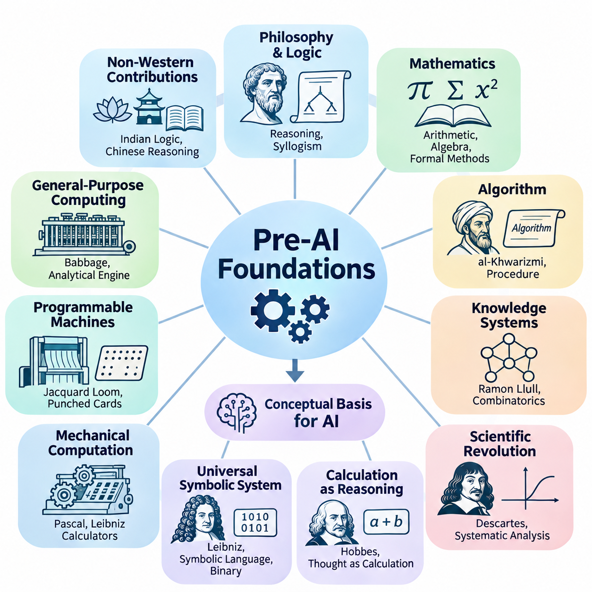
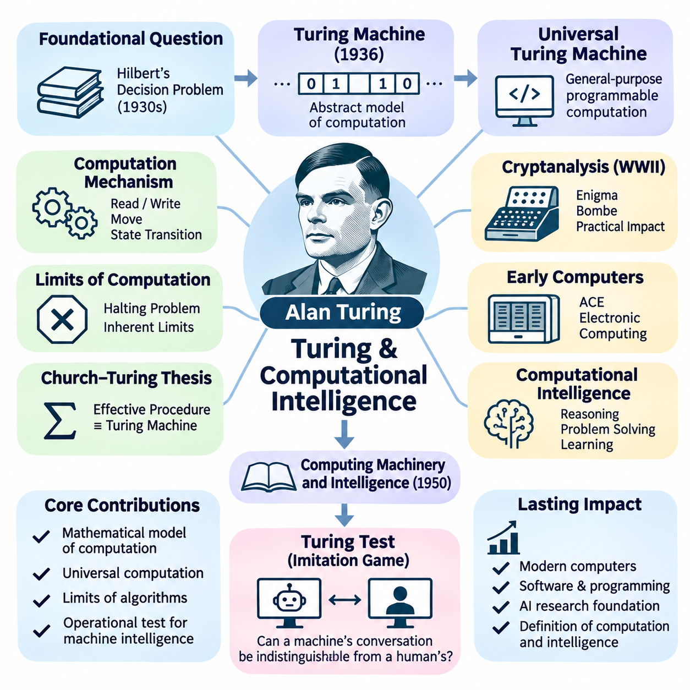
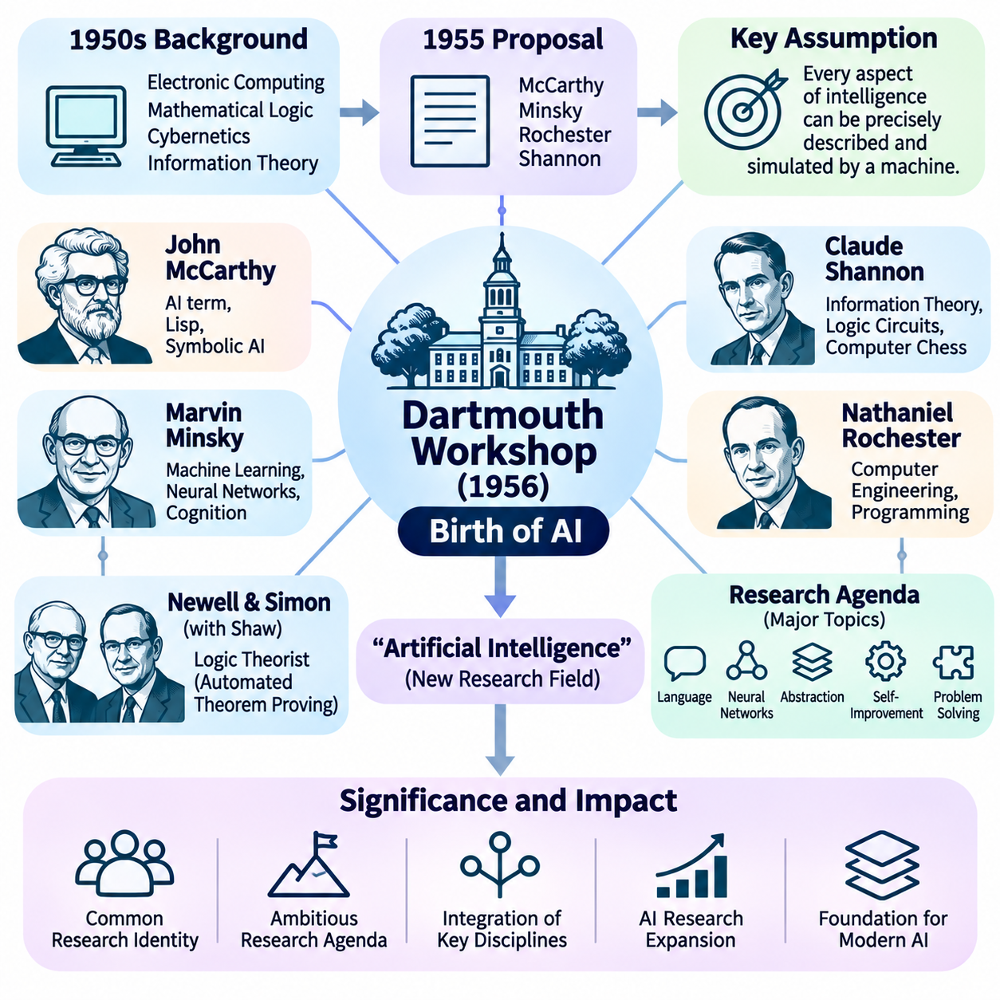
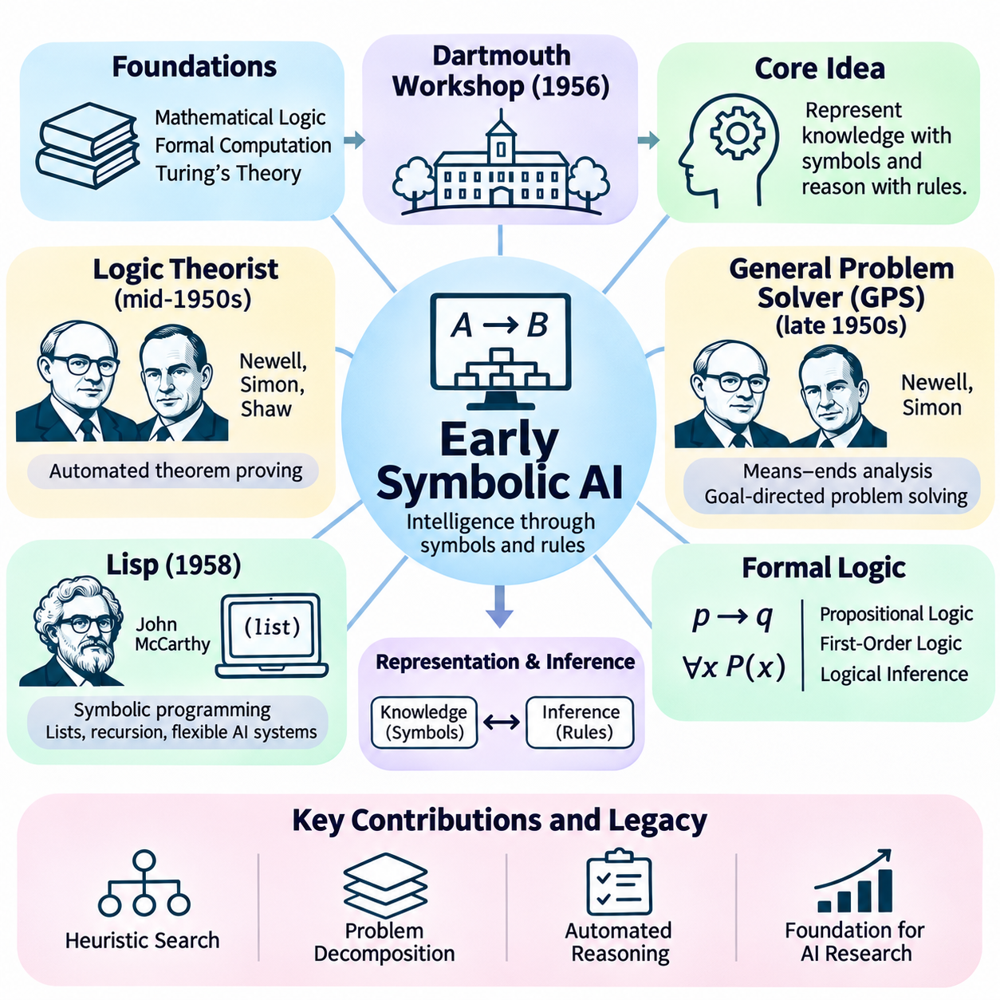
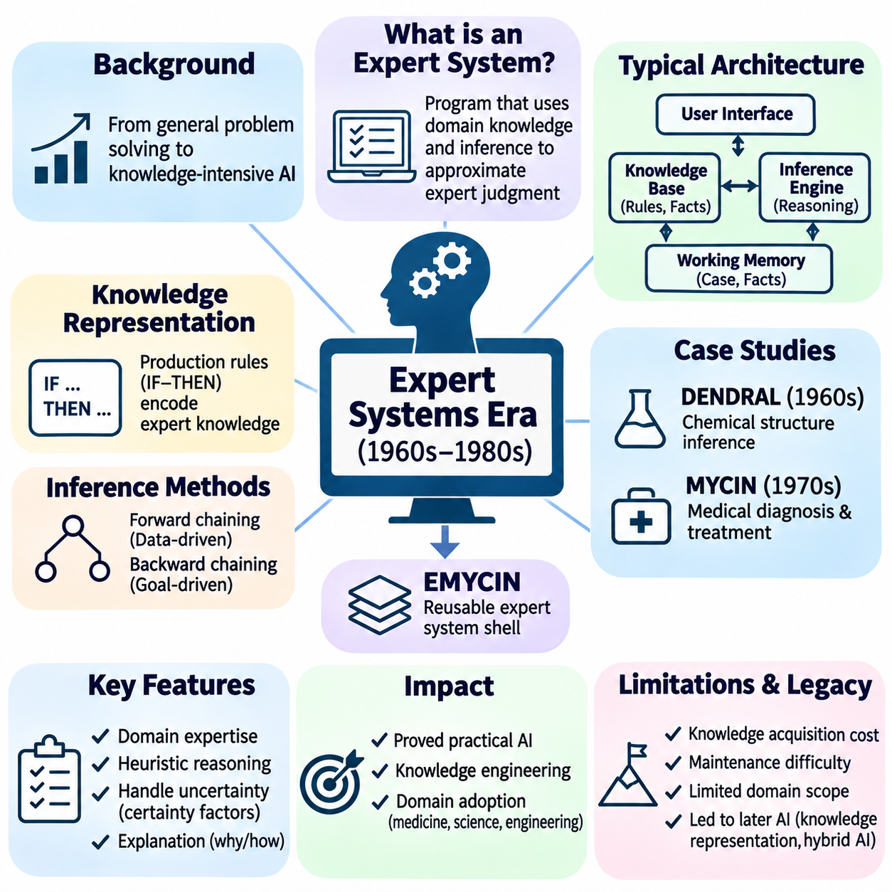
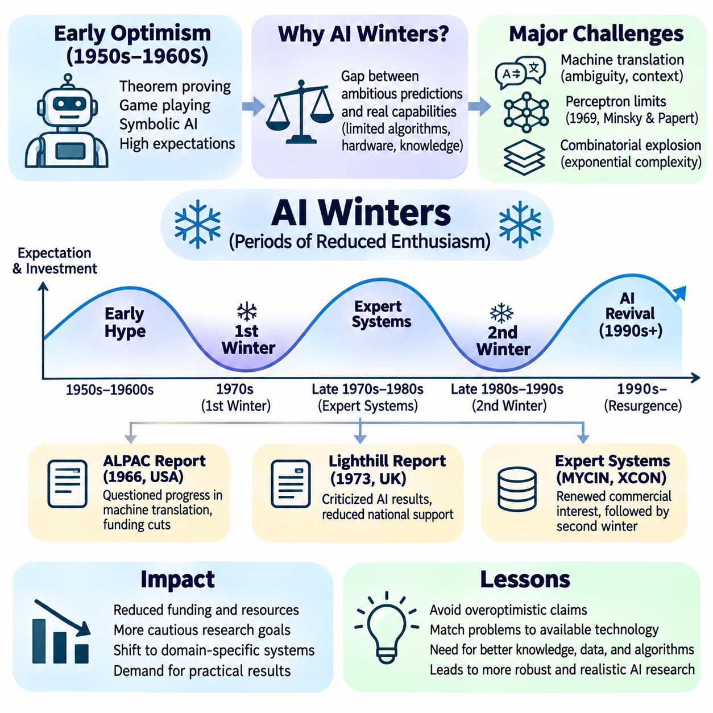
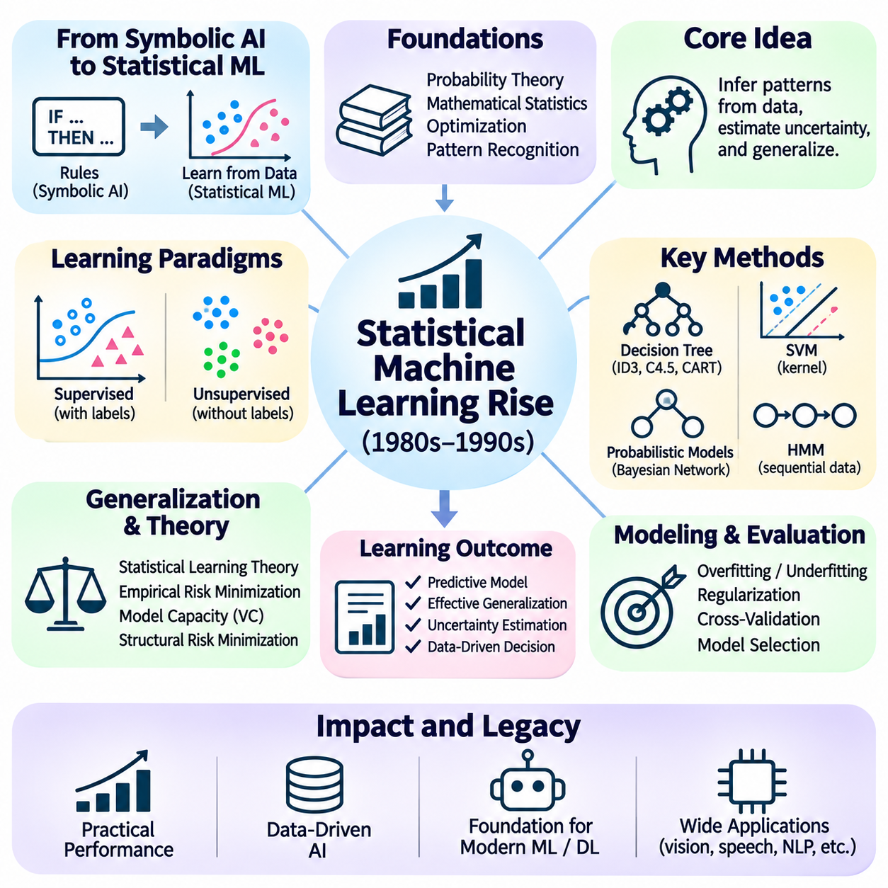
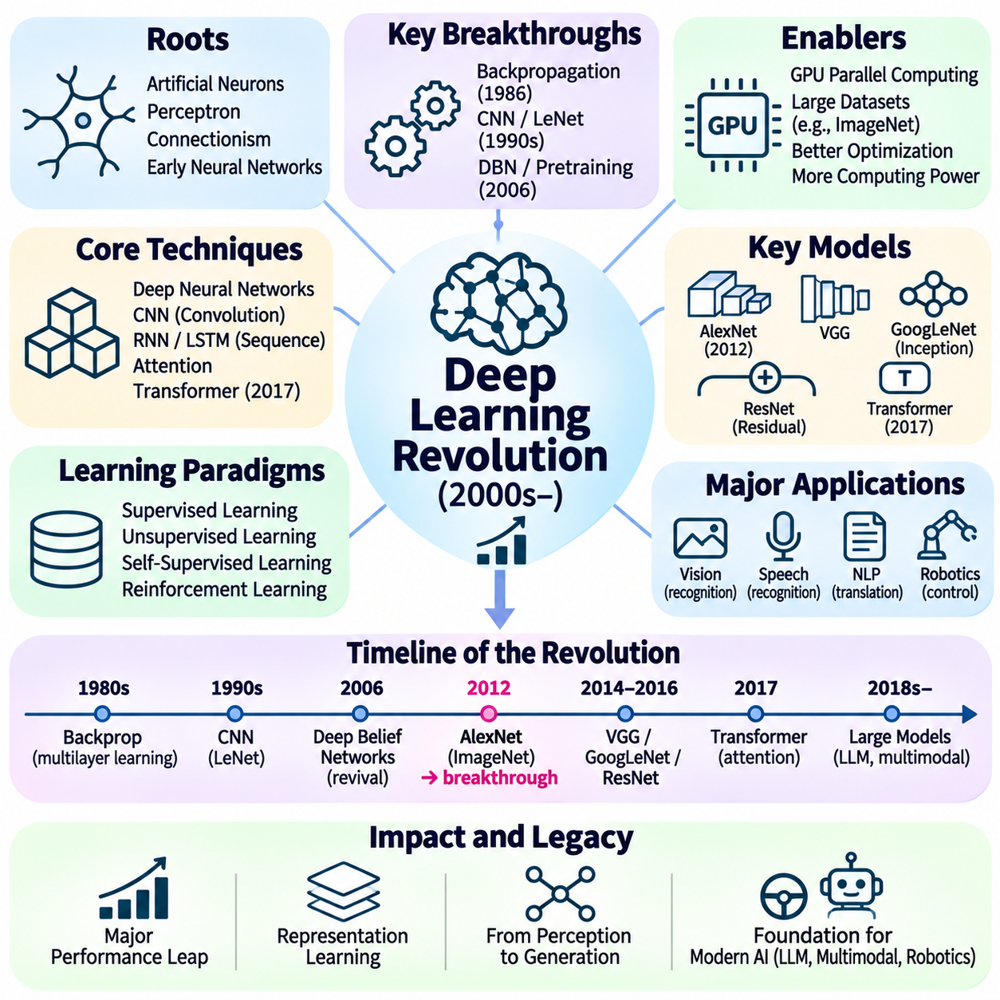
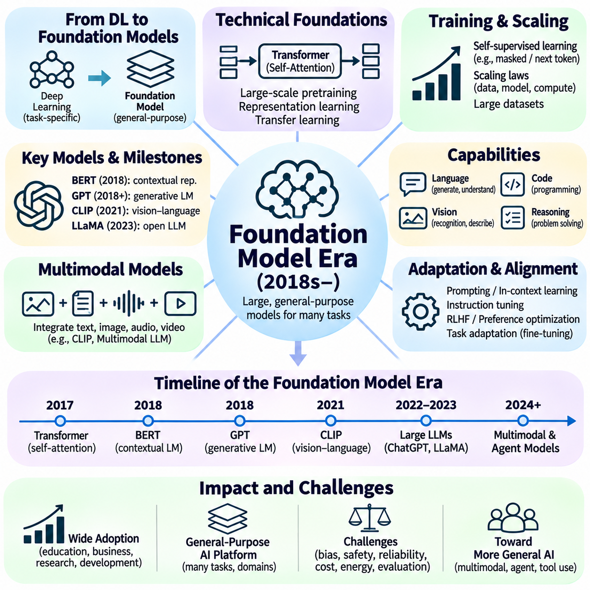
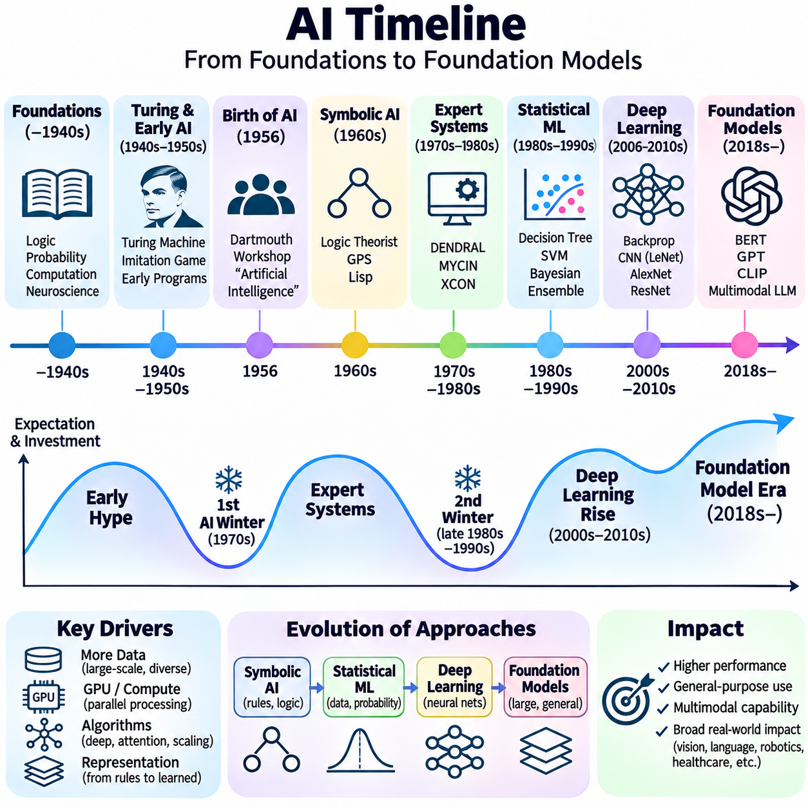

**Volume 04. Artificial Intelligence**

# 02. History of AI

## 02.00 Pre AI Foundations

{width="7.268055555555556in" height="7.268055555555556in"}

The foundations of artificial intelligence emerged long before the invention of electronic computers. Across different civilizations, philosophers, mathematicians, engineers, and scientists investigated whether reasoning, calculation, and intelligent behavior could be expressed through systematic principles. Their work established the conceptual foundations for machines capable of processing information, representing knowledge, and performing tasks traditionally associated with human intelligence.

Ancient philosophical traditions introduced fundamental questions about the nature of intelligence and rational thought. Greek philosophers, particularly Aristotle, examined how valid conclusions could be derived from established premises. His development of syllogistic logic demonstrated that certain forms of reasoning could follow explicit rules. This insight eventually became essential to symbolic artificial intelligence, where logical expressions represent knowledge and computational procedures manipulate those expressions.

The intellectual origins of artificial intelligence were not limited to Western philosophy. Indian traditions developed sophisticated systems of logic and linguistic analysis, while Chinese scholars explored systematic reasoning, classification, and mechanical computation. These traditions contributed different perspectives on knowledge, inference, and formal structure. Although they did not directly establish modern AI, they demonstrate the longstanding human ambition to understand intelligence through organized principles.

Mathematics provided another essential foundation by establishing methods for representing abstract relationships precisely. Ancient arithmetic, geometry, and algebra enabled complex problems to be expressed through symbolic operations. The development of positional number systems and increasingly systematic calculation methods expanded the range of problems that could be solved mechanically. These advances helped establish computation as a process governed by reproducible mathematical rules.

During the ninth century, the mathematician Muhammad ibn Musa al-Khwarizmi contributed significantly to the systematic treatment of mathematical procedures. His writings on algebra and calculation influenced the development of algorithmic thinking. The term algorithm ultimately derives from the Latinized form of his name. Algorithms became fundamental to artificial intelligence because they describe finite, structured procedures for transforming inputs into outputs.

The medieval period also witnessed attempts to organize knowledge into systems capable of supporting structured reasoning. Ramon Llull, a thirteenth-century philosopher, developed combinatorial methods using symbolic arrangements to explore relationships among concepts. His mechanical and logical constructions anticipated aspects of formal knowledge manipulation. Although these systems were not computational intelligence, they reflected the idea that reasoning might be represented through combinations of symbols.

The scientific revolution transformed these philosophical ambitions into increasingly mathematical investigations. René Descartes emphasized systematic reasoning and the relationship between mathematical structure and knowledge. His analytical approach encouraged the representation of complex problems through simpler components. This perspective later influenced computational problem solving, where difficult tasks are decomposed into smaller operations that can be processed systematically.

In the seventeenth century, Thomas Hobbes argued that reasoning could be understood in terms of calculation. This philosophical position suggested that certain intellectual operations might be represented as transformations of symbols or quantities. Although human reasoning extends beyond arithmetic, the computational interpretation of thought became influential in subsequent theories of intelligence. It encouraged researchers to investigate whether cognition could be described through explicit operations.

Gottfried Wilhelm Leibniz advanced this ambition by proposing a universal symbolic language and a systematic calculus of reasoning. He envisioned disputes being resolved through formal calculation rather than ambiguous argument. Leibniz also contributed to the development of binary arithmetic, which later became central to digital computing. His ideas connected symbolic representation, logical inference, and mechanical calculation within a common intellectual framework.

Mechanical calculating devices demonstrated that machines could perform operations previously requiring human effort. Blaise Pascal developed a mechanical calculator in the seventeenth century to support arithmetic calculations. Leibniz subsequently designed a stepped reckoner intended to perform several arithmetic operations. These machines were limited in functionality, but they established an important principle: appropriately designed physical mechanisms could execute mathematical procedures.

The Industrial Revolution created new opportunities for programmable mechanical computation. Joseph Marie Jacquard introduced a loom controlled through punched cards, demonstrating how encoded instructions could determine machine behavior. This separation between stored instructions and mechanical execution influenced later computing designs. It illustrated that a machine could produce different outcomes according to externally specified patterns rather than requiring fundamental mechanical reconstruction.

Charles Babbage extended mechanical computation through his designs for the Difference Engine and Analytical Engine. The Analytical Engine incorporated concepts resembling a processing unit, memory, and programmable control. Although it was never completed during his lifetime, its architecture anticipated important features of general-purpose computers. Babbage\'s work demonstrated that mechanical systems could potentially execute sequences of mathematical instructions beyond a single specialized calculation.

Ada Lovelace recognized the broader implications of programmable computation. In her notes on the Analytical Engine, she described how a machine might manipulate symbols according to formal rules, provided their relationships could be expressed mathematically. Her observations extended the conceptual scope of computation beyond numerical arithmetic. They suggested that programmable machines could operate on structured representations of information, an idea fundamental to modern AI systems.

The nineteenth century also witnessed the formalization of logic through mathematical methods. George Boole developed an algebraic system representing logical propositions through operations that could be analyzed mathematically. Boolean algebra established a powerful connection between logical reasoning and symbolic calculation. Its principles later became essential to digital circuit design, computer programming, and rule-based artificial intelligence.

Gottlob Frege further advanced formal logic by developing a rigorous system for representing quantified statements and relationships. His work provided foundations for modern predicate logic, enabling more expressive descriptions than traditional syllogistic reasoning. Formal logical languages eventually became central to knowledge representation and automated theorem proving. They allowed computational systems to represent objects, properties, and relationships through precisely defined symbolic structures.

At the beginning of the twentieth century, mathematical logic increasingly focused on the foundations and limitations of formal reasoning. Bertrand Russell and Alfred North Whitehead attempted to derive mathematical principles through logical systems in Principia Mathematica. Their work reflected the ambition to establish rigorous foundations for mathematical knowledge. These investigations helped shape the intellectual environment from which theoretical computer science emerged.

David Hilbert promoted the formalization of mathematics through precisely defined axioms and rules of inference. His research program raised fundamental questions about consistency, completeness, and mechanical decision procedures. These questions became closely connected to the possibility of automated reasoning. If mathematical reasoning could be expressed through formal operations, researchers needed to determine which problems could actually be solved by systematic procedures.

Kurt Gödel\'s incompleteness theorems demonstrated important limitations of sufficiently expressive formal mathematical systems. His results showed that certain consistent, effectively axiomatized systems cannot establish every arithmetic truth expressible within them. These discoveries challenged expectations that all mathematical reasoning could be captured by a complete formal framework. They also clarified the distinction between formal derivability and broader mathematical truth.

Probability theory introduced a complementary foundation for reasoning under uncertainty. Early contributions by Blaise Pascal, Pierre de Fermat, and subsequent mathematicians established methods for analyzing uncertain events. Thomas Bayes and Pierre-Simon Laplace advanced probabilistic inference, providing mathematical tools for updating beliefs from evidence. These principles later became essential to statistical learning, Bayesian networks, and intelligent decision-making systems.

Statistics expanded the ability to extract patterns and relationships from observations. Researchers developed methods for estimation, regression, hypothesis testing, and the mathematical analysis of variation. These techniques established foundations for learning from empirical data rather than relying exclusively on predefined logical rules. The eventual development of machine learning depended heavily on this transition from deterministic calculation toward statistical inference and prediction.

Biology and psychology contributed another perspective by investigating how natural intelligence emerges from physical and cognitive processes. Charles Darwin\'s theory of evolution provided a framework for understanding adaptation through variation and selection. Later computational researchers drew inspiration from evolutionary principles when designing optimization algorithms. These approaches suggested that complex problem-solving behavior might emerge through iterative adaptation rather than explicit programming alone.

Early neuroscience established that nervous systems consist of interconnected biological cells responsible for transmitting and processing signals. Santiago Ramón y Cajal\'s investigations helped establish the neuron doctrine, while subsequent physiological research examined neural communication. These discoveries provided a biological foundation for later artificial neural network models. They encouraged the hypothesis that intelligent behavior could emerge from interactions among relatively simple processing elements.

Psychological research also investigated learning, memory, perception, and behavior through experimental methods. Ivan Pavlov studied conditioned responses, while Edward Thorndike examined learning through consequences and repeated experience. These investigations demonstrated that behavior could change systematically in response to environmental conditions. Their findings contributed conceptual foundations for later computational approaches to learning, adaptation, and reinforcement.

The emergence of control theory introduced mathematical methods for regulating dynamic systems through feedback. Engineers investigated how machines could measure their current conditions, compare them with desired states, and adjust their behavior accordingly. Feedback control established a practical connection between sensing, decision-making, and action. This relationship later became central to autonomous robotics, intelligent control systems, and adaptive computational agents.

Information theory provided another critical foundation by treating communication and uncertainty as mathematical quantities. Earlier work on communication systems prepared the way for Claude Shannon\'s formal theory of information in 1948. Shannon demonstrated how information could be quantified and transmitted under noisy conditions. These ideas became important to data representation, communication networks, statistical inference, and the mathematical analysis of learning systems.

The convergence of logic, mathematics, mechanical computation, statistics, neuroscience, and control engineering created the intellectual environment necessary for artificial intelligence. Each discipline contributed a different component of the emerging field. Logic explained formal inference, mathematics established precise representations, statistics addressed uncertainty, neuroscience suggested distributed processing, and engineering demonstrated how abstract procedures could be implemented through physical mechanisms.

These foundations also revealed several competing interpretations of intelligence. One perspective emphasized reasoning through explicit symbols and logical rules, while another emphasized learning, adaptation, and interactions among simple processing units. A third perspective focused on feedback, environmental interaction, and goal-directed behavior. These approaches were not mutually exclusive, but their differences shaped many of the research traditions that subsequently developed within artificial intelligence.

Before artificial intelligence became an established scientific discipline, researchers had already formulated many of its central questions. Could reasoning be mechanized? Could machines manipulate symbols meaningfully? Could learning emerge from experience? Could complex behavior arise from simple computational mechanisms? These questions transformed intelligence from an exclusively philosophical subject into a potential object of mathematical analysis, experimental investigation, and engineering design.

The historical significance of these developments lies in their cumulative influence rather than any single invention. Artificial intelligence emerged from centuries of attempts to formalize thought, automate calculation, understand learning, and construct self-regulating machines. These achievements prepared the conceptual and technical foundations for twentieth-century computational theories of intelligence and the subsequent establishment of artificial intelligence as a distinct research field.

## 02.01 Turing and Computational Intelligence

{width="7.268055555555556in" height="7.268055555555556in"}

Alan Turing played a foundational role in transforming the philosophical question of machine intelligence into a scientific and computational problem. His research established fundamental connections among mathematical logic, computation, algorithms, and intelligent behavior. Rather than treating intelligence exclusively as a biological property, Turing investigated whether machines could perform operations associated with human reasoning and demonstrate behavior that observers might interpret as intelligent.

During the 1930s, mathematicians were investigating whether every precisely formulated mathematical problem could be solved through a systematic procedure. This question was closely associated with David Hilbert\'s Entscheidungsproblem, or decision problem. Turing approached the challenge by developing a mathematical model of computation that could represent the essential operations performed by a person following explicit calculation instructions.

In 1936, Turing introduced the theoretical computing model now known as the Turing machine. This abstract machine consists of an unbounded tape divided into cells, a read-write head, a finite set of internal states, and rules governing state transitions. Despite its conceptual simplicity, the model can represent arbitrary algorithmic computations when supplied with suitable instructions, provided the required computation is effectively computable.

A Turing machine processes information through discrete operations determined by its current state and the symbol being examined. At each step, it may write a symbol, move its head, and enter another state according to a transition rule. This mechanism demonstrated how complex computational procedures could emerge from sequences of elementary operations without requiring human judgment during execution.

Turing also introduced the concept of a universal Turing machine, which can simulate other Turing machines when provided with their encoded descriptions and inputs. This principle established the theoretical foundation for general-purpose programmable computers. Instead of constructing a separate machine for every computational task, one universal computational system could execute many different algorithms through changes in its encoded instructions.

The universal machine concept revealed a fundamental relationship between programs and data. Instructions describing a computational procedure could themselves be represented as information and processed by another machine. This insight helped establish the conceptual foundations of stored-program computing, software abstraction, and programmable systems. Modern artificial intelligence depends on this separation between computational hardware and executable algorithms.

Turing\'s work also established important limits on mechanical computation. Through his analysis of the halting problem, he demonstrated that no general algorithm can correctly determine whether every possible program will eventually terminate. This result showed that computational systems possess inherent mathematical limitations. It also clarified that increasing processing power cannot eliminate every fundamental restriction on algorithmic problem solving.

The Church--Turing thesis emerged from closely related investigations by Turing and Alonzo Church. It proposes that any function calculable by an effective mechanical procedure can be computed by a Turing machine. Although it is not a mathematical theorem about an independently formalized notion of effective computation, the thesis provides a foundational interpretation of what algorithms can accomplish.

During World War II, Turing contributed to British cryptanalysis at Bletchley Park, particularly efforts to decipher communications encrypted using the German Enigma system. His work on cryptanalytic methods and the design of the Bombe demonstrated the practical importance of mechanized logical analysis. These achievements helped establish the broader feasibility of using specialized machines to solve complex information-processing problems.

Following the war, Turing participated in early electronic computer development, including work on the Automatic Computing Engine at the National Physical Laboratory. His designs reflected the possibility of implementing general-purpose computation through electronic hardware. The transition from abstract mathematical machines to physical computing systems created the technological environment in which artificial intelligence research could eventually become practical.

Turing\'s interest extended beyond calculating machines toward the possibility of machine intelligence. He recognized that computational systems might perform activities traditionally associated with thinking, including reasoning, problem solving, and learning. This perspective challenged the assumption that intelligence necessarily required biological mechanisms. It also encouraged researchers to evaluate intelligence through observable capabilities rather than internal physical composition.

In 1950, Turing published Computing Machinery and Intelligence, a landmark paper examining whether machines could think. Rather than attempting to define thinking through philosophical arguments alone, he proposed replacing the original question with an operationally defined behavioral experiment. This approach shifted attention toward the observable performance of computational systems and the conditions under which their behavior might be considered intelligent.

The proposed experiment became widely known as the Turing Test, although Turing originally described it through an imitation game. In the machine-oriented version, a human interrogator communicates through text with a machine and a human participant while attempting to distinguish them. The experiment examines whether the machine can produce conversational behavior sufficiently similar to human responses to make reliable identification difficult.

The significance of the Turing Test lies in its behavioral approach to evaluating intelligence. Instead of requiring direct access to consciousness, subjective experience, or internal reasoning mechanisms, the test considers externally observable performance. This perspective influenced later AI evaluation methods by emphasizing measurable capabilities. However, successful imitation does not necessarily demonstrate genuine understanding, consciousness, or general intelligence.

Turing anticipated several objections to machine intelligence, including arguments involving consciousness, mathematical limitations, originality, and the apparent uniqueness of human thought. He examined these objections while emphasizing the importance of empirical investigation. His discussion established a framework for debates that continue to influence artificial intelligence philosophy, particularly questions concerning understanding, intentionality, creativity, and computational cognition.

An especially important aspect of Turing\'s thinking was his recognition that intelligent machines might need to learn rather than depend entirely on explicitly programmed knowledge. He proposed the idea of constructing a child machine whose capabilities could develop through education and experience. This concept anticipated central principles of machine learning, where computational systems improve their performance through training rather than relying exclusively on manually specified rules.

The child-machine proposal distinguished between an initial computational organization and the processes responsible for modifying its behavior. Turing considered how instruction, experience, rewards, and penalties might influence learning. Although his proposals were not equivalent to modern neural network training algorithms, they reflected an early understanding that intelligent behavior could emerge through adaptation over time.

Turing also investigated biological pattern formation through mathematical models of reaction and diffusion. His 1952 work demonstrated how interactions between chemical substances could generate organized spatial patterns. Although this research was not itself an artificial intelligence model, it illustrated his broader interest in explaining complex natural phenomena through mathematical mechanisms. Such interdisciplinary thinking later became influential in computational approaches to biological and adaptive systems.

The relationship between computation and intelligence raises an important distinction between computational capability and cognitive capability. A universal computer can execute any effectively computable algorithm when sufficient resources are available, but this does not imply that it automatically possesses intelligence. Intelligent performance additionally depends on appropriate representations, learning mechanisms, reasoning strategies, environmental information, and goal-directed behavior.

Computational intelligence can therefore be understood as the application of computational mechanisms to tasks requiring adaptive or apparently intelligent behavior. Such systems may perform inference, classification, optimization, planning, and decision making. Turing\'s contributions provided a mathematical framework for understanding which procedures could be mechanized, while subsequent AI research investigated how computational procedures could produce increasingly sophisticated cognitive capabilities.

Turing\'s theoretical framework also influenced the development of symbolic artificial intelligence. If reasoning can be represented through formal symbols and explicit transformation rules, computational machines can potentially execute logical inference procedures. This possibility motivated research into automated theorem proving, problem solving, and knowledge representation. Early symbolic AI systems inherited the broader assumption that aspects of intelligence could be implemented through formal computational operations.

At the same time, Turing\'s learning-oriented proposals anticipated approaches that would later become associated with connectionism and statistical machine learning. These approaches emphasize adapting computational parameters or internal representations through experience. The coexistence of programmed reasoning and learned behavior became one of the defining characteristics of artificial intelligence research, reflecting different interpretations of how intelligent capabilities can arise.

The computational perspective also introduced questions about efficiency and practical feasibility. A problem may be computable in principle while requiring unrealistic amounts of time, memory, or energy. This distinction became increasingly important as AI researchers confronted combinatorial search spaces and complex reasoning tasks. Computational complexity theory subsequently provided methods for analyzing the resources required to solve different classes of problems.

Turing\'s influence extends into modern AI evaluation, where systems are assessed through their ability to perform tasks rather than through claims about internal consciousness. Language understanding, reasoning, planning, and interactive problem solving can all be examined through behavioral tests. Nevertheless, contemporary evaluation increasingly requires broader measurements of factual reliability, robustness, generalization, safety, and performance across diverse environments.

Modern large language models demonstrate the continuing relevance of Turing\'s questions. These systems generate coherent language, answer questions, and perform complex computational and reasoning tasks through learned statistical representations. Their capabilities invite comparisons with human conversational intelligence, while also revealing limitations in reliability, grounding, and consistent reasoning. Such developments reinforce the distinction between convincing behavior and comprehensive intelligence.

Turing\'s lasting contribution was not a complete theory of intelligence but a rigorous framework connecting computation, programmability, and the possibility of intelligent machines. His research established what mechanical computation means, demonstrated some of its mathematical limits, and proposed behavioral methods for examining machine intelligence. These ideas provided essential foundations for the emergence of artificial intelligence as a scientific discipline.

The historical transition initiated by Turing transformed intelligence from a primarily philosophical question into a subject that could be investigated through mathematical models, executable algorithms, and experimental evaluation. His work connected abstract computation with practical machines and anticipated learning-based approaches to intelligent behavior. This intellectual foundation directly preceded the formal establishment of artificial intelligence research during the 1950s.

## 02.02 Dartmouth Workshop and Birth of AI

{width="7.268055555555556in" height="7.268055555555556in"}

The Dartmouth Summer Research Project on Artificial Intelligence, held in 1956, is widely recognized as a defining event in the establishment of artificial intelligence as a distinct scientific discipline. Although researchers had previously investigated machine reasoning, computation, and learning, the Dartmouth initiative brought these interests together under a common research identity. It marked a transition from scattered investigations toward an organized effort to understand and construct intelligent machines.

The intellectual environment of the 1950s was shaped by rapid advances in electronic computing, mathematical logic, cybernetics, and information theory. Early computers demonstrated that machines could execute complex symbolic procedures, while theoretical developments clarified the nature of computation. Researchers increasingly considered whether processes such as reasoning, language understanding, and learning could be represented mathematically and implemented through programmable machines.

In 1955, John McCarthy, Marvin Minsky, Nathaniel Rochester, and Claude Shannon prepared a proposal for a summer research project at Dartmouth College. Their proposal outlined an ambitious investigation into the possibility of constructing machines capable of intelligent behavior. The researchers intended to bring together specialists from different disciplines to examine whether aspects of intelligence could be described precisely enough for computational implementation.

The proposal introduced the term artificial intelligence, which became the defining name of the emerging research field. John McCarthy is generally credited with introducing this terminology. The phrase distinguished the proposed discipline from related fields such as cybernetics, automata theory, and information processing. It emphasized the possibility of studying intelligence as a computational phenomenon rather than restricting its investigation to biological or psychological explanations.

A central assumption of the Dartmouth proposal was that every aspect of learning or intelligence could, in principle, be described so precisely that a machine could simulate it. This hypothesis established an ambitious research agenda rather than a demonstrated scientific conclusion. It suggested that reasoning, abstraction, creativity, and learning might be implemented through formal computational mechanisms, even though the necessary representations and algorithms remained largely unknown.

The Dartmouth project was organized around several major research challenges, including natural language use, neural networks, abstraction, self-improvement, and the development of machines capable of solving problems traditionally requiring human intelligence. These topics reflected an unusually broad understanding of intelligence. Rather than concentrating on numerical calculation, the researchers sought computational methods for representing knowledge, manipulating concepts, and adapting behavior.

The workshop took place during the summer of 1956 at Dartmouth College in Hanover, New Hampshire. Participants and visitors included researchers with backgrounds in mathematics, computer science, engineering, and cognitive studies. The event was not a single tightly structured conference but a research gathering involving discussions and collaborative investigations. Its historical significance lies primarily in the intellectual direction it established.

John McCarthy played a central role in organizing the initiative and defining artificial intelligence as a research discipline. His subsequent contributions included the development of the Lisp programming language and important ideas concerning symbolic reasoning. McCarthy emphasized the possibility of representing knowledge through formal structures and using computational procedures to derive conclusions. This perspective became influential in the development of logic-based artificial intelligence.

Marvin Minsky contributed a complementary interest in machine learning, neural computation, and the mechanisms underlying human cognition. His research explored how relatively simple computational structures might support complex intelligent behavior. Minsky later became an influential figure in artificial intelligence research at the Massachusetts Institute of Technology. His work helped connect computational models with broader questions concerning perception, memory, and reasoning.

Claude Shannon brought expertise in information theory, switching circuits, and mathematical approaches to communication and decision processes. His earlier work had demonstrated fundamental connections between Boolean logic and electrical circuits. Shannon also investigated computer chess, showing how strategic decision-making could be approached computationally. These contributions supported the emerging view that intelligent activities could be analyzed through mathematical and algorithmic methods.

Nathaniel Rochester contributed practical experience in electronic computer engineering and programming. His involvement reflected the importance of connecting theoretical ideas about intelligence with actual computational hardware. Early computers possessed extremely limited memory and processing capabilities compared with modern systems. Consequently, researchers had to develop representations and algorithms that could demonstrate intelligent behavior within severe technological constraints.

Allen Newell and Herbert A. Simon were also closely associated with the early development of artificial intelligence. Together with J. C. Shaw, they developed the Logic Theorist, a pioneering program capable of proving selected mathematical theorems. The program demonstrated that symbolic computation could perform tasks associated with formal reasoning. Its presentation during the Dartmouth period strengthened confidence in the feasibility of machine-based problem solving.

The Logic Theorist represented mathematical expressions as symbolic structures and searched for sequences of operations that could establish desired conclusions. Its approach demonstrated the importance of separating problem representation from search procedures. Rather than calculating numerical answers alone, the system manipulated logical expressions according to defined rules. This became a foundational pattern for subsequent symbolic AI systems and automated reasoning programs.

The Dartmouth initiative helped establish symbolic artificial intelligence as a prominent early research direction. Symbolic AI represents knowledge through explicit symbols, logical relationships, and formal rules. Intelligent behavior is produced by manipulating these representations through search, inference, and planning procedures. This approach reflected the belief that significant aspects of human reasoning could be modeled as structured operations over symbolic information.

Early researchers were particularly interested in general problem-solving capabilities. They hoped to develop programs that could operate across different tasks rather than solve only narrowly defined mathematical problems. This ambition encouraged investigations into heuristic search, theorem proving, game playing, and automated planning. The resulting systems demonstrated important computational techniques, although their abilities remained limited by simplified representations and carefully controlled environments.

The concept of heuristic reasoning became especially important because exhaustive search was often computationally impractical. A heuristic provides guidance for selecting promising alternatives without examining every possible solution. Early artificial intelligence researchers recognized that intelligent problem solving frequently requires efficient selection among competing possibilities. This insight influenced search algorithms, planning systems, and later approaches to optimization and decision making.

Natural language processing was another major objective identified by the Dartmouth proposal. Researchers considered whether machines could represent linguistic structure, interpret meaning, and communicate using human language. Early approaches emphasized grammatical rules, symbolic representations, and logical relationships. Although these methods faced substantial limitations, they established research questions that would remain central throughout the subsequent development of computational linguistics and language-based AI.

Learning and self-improvement were also important elements of the original research vision. The Dartmouth proposal anticipated systems capable of modifying their behavior through experience rather than relying exclusively on fixed instructions. This objective connected early artificial intelligence with neural computation and adaptive systems. It also demonstrated that learning-based approaches were present at the field\'s formation, even though symbolic methods initially received considerable attention.

The workshop did not produce a complete theory of intelligence or immediately deliver generally intelligent machines. Many technical questions remained unresolved, including how to represent common sense, acquire knowledge, understand language, and generalize beyond restricted examples. Nevertheless, the gathering created a shared research identity and encouraged collaboration among investigators who had previously approached related problems from different disciplinary perspectives.

The establishment of artificial intelligence as a named field also influenced academic institutions and research funding. Universities and laboratories increasingly organized projects around machine reasoning, learning, and intelligent computation. Research groups emerged at institutions such as Dartmouth, MIT, Carnegie Institute of Technology, and Stanford. These environments supported the development of specialized programming languages, experimental systems, and theoretical frameworks.

The early enthusiasm surrounding artificial intelligence encouraged ambitious predictions about future machine capabilities. Researchers expected substantial progress in automated reasoning, language understanding, and general problem solving. Some anticipated that human-level intellectual activities might become computationally achievable within relatively short periods. These expectations stimulated research investment but also contributed to later disappointment when practical limitations proved more difficult than initially assumed.

Several fundamental difficulties became apparent as researchers attempted to extend laboratory demonstrations into more complex environments. Real-world knowledge was difficult to represent comprehensively, search spaces expanded rapidly, and language interpretation required contextual understanding. Limited computational resources further restricted experimentation. These challenges revealed that successful performance on carefully selected examples did not necessarily translate into broad, reliable intelligence.

Despite these limitations, the Dartmouth project established a durable scientific agenda. Its central questions concerned how intelligence could be represented, how reasoning could be mechanized, how machines could learn, and how computational systems could solve unfamiliar problems. These questions subsequently developed into major branches of artificial intelligence, including knowledge representation, machine learning, automated planning, natural language processing, and computational cognition.

The historical importance of Dartmouth also extends beyond symbolic computation. The original proposal explicitly considered neural networks and self-improving machines, anticipating research traditions that would later gain prominence through statistical learning and deep learning. Consequently, the birth of artificial intelligence should not be understood as the exclusive origin of symbolic methods. It represented a broader effort to investigate intelligence through multiple computational approaches.

The Dartmouth workshop transformed an emerging collection of scientific ideas into a recognizable research discipline with a shared name, ambitious objectives, and a developing institutional community. Its lasting contribution was the formulation of intelligence as a subject that could be investigated through computational models and experimental systems. This foundation shaped the subsequent evolution of artificial intelligence, including its early achievements, periods of disappointment, and later technological transformations.

## 02.03 Early Symbolic AI

{width="7.268055555555556in" height="7.268055555555556in"}

Early symbolic artificial intelligence emerged during the 1950s as one of the first systematic approaches to constructing intelligent machines. Its central assumption was that reasoning could be represented through symbols and manipulated according to explicit computational rules. Rather than attempting to reproduce the biological structure of the brain, symbolic AI focused on formal knowledge, logical operations, and structured problem solving as mechanisms for producing intelligent behavior.

The intellectual foundations of symbolic AI were established through mathematical logic, formal computation, and theories of human reasoning. Researchers drew upon Boolean algebra, predicate logic, and the computational framework introduced by Alan Turing. These developments suggested that certain cognitive activities could be modeled as operations over symbolic expressions. The resulting research tradition treated intelligence as a process of representing information and transforming it through algorithms.

The Dartmouth workshop of 1956 helped establish symbolic reasoning as a prominent direction in artificial intelligence research. Scientists such as John McCarthy, Allen Newell, Herbert Simon, and Marvin Minsky investigated whether machines could solve problems through explicit representations and logical procedures. Their early work emphasized the possibility of creating programs that performed reasoning tasks previously considered exclusive to human intelligence.

A fundamental characteristic of symbolic AI is the separation between knowledge representation and inference mechanisms. Knowledge is encoded using symbols that describe objects, properties, relationships, and logical conditions. Inference procedures operate on these representations to derive conclusions or identify possible actions. This architecture enables systems to process abstract information without requiring every possible outcome to be explicitly programmed in advance.

One of the earliest demonstrations of symbolic intelligence was the Logic Theorist, developed by Allen Newell, Herbert Simon, and J. C. Shaw in the mid-1950s. The program attempted to prove mathematical theorems by manipulating symbolic expressions according to logical rules. Its achievements demonstrated that computers could perform selected forms of formal reasoning. This result strengthened confidence that problem solving could be implemented through computational procedures.

The Logic Theorist introduced an important approach to intelligent computation by representing reasoning as a search through possible proof steps. Instead of examining every conceivable sequence, the program employed heuristics to prioritize promising alternatives. This strategy reflected an essential feature of practical intelligence: the ability to select useful possibilities from a large space of potential actions. Heuristic search subsequently became a foundational technique in symbolic AI.

Following these developments, Newell and Simon created the General Problem Solver, commonly known as GPS, during the late 1950s. The system was designed to solve different classes of formally specified problems using general reasoning procedures. GPS introduced means--ends analysis, which compares a current state with a desired goal and selects operations intended to reduce their differences. This approach influenced subsequent research into planning and goal-directed problem solving.

Means--ends analysis provided a systematic method for decomposing complex problems into smaller subproblems. When an operation required conditions that were not currently satisfied, those conditions could become intermediate goals. The resulting process connected symbolic reasoning with hierarchical problem decomposition. Although GPS operated successfully only within restricted domains, its architecture demonstrated how goal-oriented behavior could be organized through explicit computational structures.

Symbolic AI also benefited from the development of programming languages designed for manipulating structured expressions. In 1958, John McCarthy introduced Lisp, which became one of the most influential languages in early artificial intelligence research. Lisp supported symbolic lists, recursive functions, and flexible program structures. These capabilities made it particularly suitable for representing logical expressions, search procedures, and dynamically constructed knowledge structures.

The development of Lisp reflected a broader shift from numerical computation toward symbolic information processing. Traditional scientific computing primarily emphasized arithmetic calculations, while symbolic AI required operations on expressions, relationships, and abstract structures. Programming environments capable of manipulating symbolic data enabled researchers to construct increasingly sophisticated reasoning systems. This distinction became central to the emerging identity of artificial intelligence.

Formal logic provided another major foundation for early symbolic systems. Propositional logic represented statements through truth-valued expressions, while first-order logic introduced variables, predicates, and quantified relationships. These formal languages enabled researchers to express knowledge in mathematically precise forms. Logical inference rules could then be implemented computationally to determine whether conclusions followed from available premises.

Automated theorem proving became an important research area because it offered a clearly defined environment for studying machine reasoning. A theorem-proving system receives axioms, assumptions, and a desired conclusion, then searches for a valid sequence of inference steps. Such systems demonstrated that computers could perform nontrivial logical operations. However, their performance depended heavily on representation choices, search strategies, and computational resources.

The development of resolution-based reasoning further advanced automated deduction. In 1965, John Alan Robinson introduced the resolution principle for first-order logic, providing a systematic foundation for automated theorem proving. Resolution transformed logical reasoning into operations over clauses and substitutions. This method influenced logic programming and later knowledge-based systems by demonstrating how general inference procedures could operate on formally represented knowledge.

Early symbolic AI researchers also investigated game playing as a controlled environment for intelligent decision making. Chess and checkers provided clearly defined rules, observable states, and measurable outcomes. Programs could evaluate possible moves and search through alternative sequences of actions. These experiments demonstrated how symbolic representations, heuristic evaluation, and computational search could be combined to produce purposeful behavior.

Arthur Samuel\'s checkers research illustrated the relationship between symbolic search and adaptive learning. His programs combined game-state evaluation with methods for improving performance through experience. This work demonstrated that early artificial intelligence was not limited to fixed logical rules. Instead, symbolic representations could coexist with learning mechanisms, anticipating later combinations of structured reasoning and data-driven adaptation.

Natural language understanding represented another ambitious application of symbolic AI. Researchers attempted to represent grammatical structure, word meanings, and sentence relationships through explicit rules. Early systems processed restricted linguistic expressions and mapped them into formal representations. These experiments suggested that language could be approached computationally, although ambiguity, context dependence, and common-sense understanding remained difficult challenges.

In the mid-1960s, Joseph Weizenbaum developed ELIZA, a conversational program that used pattern matching and transformation rules to generate responses. Its famous simulated psychotherapist interaction demonstrated how relatively simple symbolic procedures could create an impression of conversational understanding. However, ELIZA did not possess a comprehensive semantic model of language. Its significance included revealing how easily users might attribute understanding to computational behavior.

Another important development was the emergence of symbolic systems capable of operating within simulated environments. Terry Winograd\'s SHRDLU, developed around 1968--1970, interpreted natural language commands in a simplified blocks world. The program combined linguistic processing, object representations, and planning procedures. Its performance demonstrated the advantages of integrating multiple symbolic capabilities within a restricted but internally consistent environment.

The blocks-world approach became influential because it provided a manageable setting for studying complex reasoning tasks. Objects possessed defined properties, actions produced predictable changes, and goals could be expressed through symbolic conditions. Researchers could therefore investigate planning, language interpretation, and spatial relationships without confronting the full complexity of the physical world. However, success in such environments did not guarantee generalization to unrestricted situations.

Knowledge representation gradually became recognized as a central challenge in symbolic intelligence. A reasoning system required more than logical operations; it needed suitable descriptions of the world, relevant relationships, and conditions governing actions. Researchers explored semantic networks, structured descriptions, and rule-based representations. These approaches sought to organize information so that computational procedures could retrieve and manipulate knowledge efficiently.

The physical symbol system hypothesis, articulated by Newell and Simon in 1976, provided a theoretical interpretation of symbolic intelligence. It proposed that a physical symbol system possesses the necessary and sufficient means for general intelligent action. The hypothesis became influential in classical AI, although its sufficiency claim remains debated. It expressed the broader belief that symbolic structures and operations could support general-purpose intelligent behavior.

Despite early successes, symbolic AI encountered substantial limitations when applied to complex real-world problems. Explicitly representing common-sense knowledge proved difficult, while the number of possible reasoning paths often increased combinatorially. Systems also struggled with uncertainty, incomplete information, and ambiguous observations. These difficulties exposed the limitations of relying exclusively on manually constructed representations and deterministic inference procedures.

The historical importance of early symbolic AI lies in its establishment of computational reasoning as a practical research discipline. It introduced foundational techniques for heuristic search, theorem proving, knowledge representation, and goal-directed planning. Although later statistical and neural approaches transformed the field, symbolic methods remained important for applications requiring explicit constraints, structured knowledge, and interpretable decision procedures.

Early symbolic artificial intelligence demonstrated that machines could manipulate abstract representations to solve selected intellectual problems. Its achievements established essential connections among logic, computation, and intelligent behavior, while its limitations revealed the complexity of human cognition. This research tradition created the conceptual and technical foundations for subsequent expert systems, knowledge-based architectures, and modern approaches combining symbolic reasoning with machine learning.

## 02.04 Expert Systems Era

{width="7.268055555555556in" height="7.268055555555556in"}

The expert systems era represented a major transition in artificial intelligence from experimental symbolic reasoning toward practical applications of specialized knowledge. Emerging during the 1960s and expanding rapidly through the 1970s and 1980s, expert systems attempted to reproduce the decision-making capabilities of human specialists within restricted domains. Their development demonstrated that carefully structured knowledge could support useful computational reasoning.

Early artificial intelligence researchers initially pursued general problem-solving systems capable of handling diverse intellectual tasks. However, these systems struggled with complex real-world problems because they lacked sufficient domain knowledge. Researchers gradually recognized that expertise depended not only on general reasoning procedures but also on extensive specialized information. This realization encouraged the development of knowledge-intensive artificial intelligence.

An expert system is a computer program designed to solve problems or provide recommendations by applying encoded domain knowledge and inference procedures. Unlike conventional software that follows a fixed sequence of operations, an expert system evaluates facts and activates relevant rules according to the situation. Its objective is to approximate selected aspects of expert judgment rather than reproduce the complete cognitive abilities of a human specialist.

The classical expert system architecture consists primarily of a knowledge base, an inference engine, and a user interface. The knowledge base stores domain-specific facts, relationships, and rules, while the inference engine applies reasoning procedures to available information. The user interface supports interaction with human operators. Additional components may include working memory, explanation facilities, and knowledge acquisition tools.

Knowledge representation became the central engineering challenge of expert systems. Many systems used production rules expressed through IF--THEN relationships, where specified conditions trigger corresponding conclusions or actions. For example, a diagnostic rule might associate a combination of symptoms with a possible equipment failure. Such representations enabled specialists\' practical knowledge to be translated into executable computational structures.

The inference engine determines which rules are applicable and how conclusions should be derived. Forward chaining begins with known facts and repeatedly applies matching rules to generate additional information. Backward chaining starts with a proposed conclusion and searches for evidence supporting its required conditions. These complementary strategies allowed expert systems to perform data-driven reasoning and goal-directed investigation.

Working memory maintains the facts and intermediate conclusions relevant to a particular problem-solving session. As new information becomes available, the inference engine updates this temporary representation and evaluates additional rules. When several rules are applicable simultaneously, conflict-resolution strategies determine their execution order. This architecture separates relatively stable domain knowledge from the changing circumstances of individual cases.

One of the earliest influential knowledge-based systems was DENDRAL, developed at Stanford University beginning in the 1960s. Researchers including Edward Feigenbaum, Joshua Lederberg, and Bruce Buchanan contributed to its development. DENDRAL used chemical knowledge and heuristic reasoning to infer possible molecular structures from experimental evidence, demonstrating that specialized scientific expertise could substantially improve computational problem solving.

DENDRAL was historically significant because it challenged the assumption that general search methods alone were sufficient for intelligent performance. By incorporating detailed knowledge of chemistry, the system reduced the number of candidate structures requiring examination. Its success established the importance of domain-specific heuristics and knowledge engineering. This approach influenced later expert systems in medicine, engineering, and scientific analysis.

MYCIN, developed at Stanford during the 1970s, became another landmark expert system. It was designed to assist with diagnosing certain bacterial infections and recommending antimicrobial treatments. MYCIN represented medical knowledge through production rules and used backward chaining to investigate diagnostic hypotheses. Its development demonstrated how structured expert knowledge could support sophisticated reasoning in a complex professional domain.

An important feature of MYCIN was its treatment of uncertainty through certainty factors. These numerical values represented degrees of confidence associated with conclusions and evidence. Although certainty factors were not equivalent to rigorous Bayesian probabilities, they offered a practical mechanism for combining uncertain observations. This approach highlighted the difficulty of making decisions when information is incomplete or diagnostic evidence is ambiguous.

MYCIN also demonstrated the value of explanation facilities in intelligent systems. Users could request explanations of why particular questions were being asked or how recommendations had been derived. The system could trace its reasoning through the rules supporting a conclusion. Such capabilities helped establish explainability as an important characteristic of knowledge-based AI, particularly in applications involving professional judgment and accountability.

The development of EMYCIN extended MYCIN\'s architectural ideas into a reusable expert system shell. By separating the inference mechanism from the original medical knowledge, researchers created a framework that could support other domains. Expert system shells reduced the need to develop reasoning infrastructure from the beginning. This separation encouraged broader experimentation and helped establish knowledge engineering as a specialized development discipline.

During the late 1970s and 1980s, expert systems expanded into commercial applications. XCON, also known as R1, was developed to configure computer systems for Digital Equipment Corporation. It applied production rules to determine compatible components and generate appropriate configurations. The system became a prominent example of how expert knowledge could automate complex business procedures and produce measurable operational benefits.

Industrial organizations adopted expert systems for equipment diagnosis, maintenance planning, manufacturing configuration, process monitoring, and technical troubleshooting. Financial institutions investigated applications involving credit assessment and risk analysis. These deployments reflected the appeal of capturing scarce expertise in reusable software. Organizations expected expert systems to improve consistency, reduce decision time, and preserve knowledge that might otherwise remain dependent on individual specialists.

The commercialization of expert systems encouraged investment in specialized hardware and software environments. Lisp machines, rule-based development tools, and knowledge engineering platforms supported increasingly complex applications. Companies established dedicated AI groups to develop and maintain knowledge-based solutions. During the 1980s, expert systems became one of the most visible commercial demonstrations of artificial intelligence.

Knowledge acquisition emerged as a major limitation because expert knowledge was difficult to extract and formalize. Specialists often relied on intuition, experience, and contextual judgments that could not easily be expressed as explicit rules. Knowledge engineers had to conduct interviews, examine cases, and translate informal expertise into structured representations. This labor-intensive process became known as the knowledge acquisition bottleneck.

The maintenance of large rule bases introduced additional difficulties. As systems accumulated hundreds or thousands of rules, inconsistencies, overlapping conditions, and unexpected interactions became increasingly difficult to detect. Modifying one rule could influence conclusions elsewhere in the system. Effective deployment therefore required verification, validation, documentation, and systematic procedures for updating knowledge as operational requirements changed.

Expert systems also faced challenges involving uncertainty, incomplete information, and rapidly changing environments. Rule-based reasoning was effective when domain relationships were sufficiently stable and well understood. However, systems often struggled with unfamiliar situations that were not anticipated during knowledge acquisition. Their limited ability to learn automatically from experience restricted adaptation and increased dependence on manual maintenance.

Another important limitation was the difficulty of representing common-sense knowledge. Human specialists routinely combine technical expertise with contextual understanding, practical experience, and assumptions about the surrounding world. Encoding all these considerations through explicit rules proved impractical in many applications. Consequently, expert systems frequently performed well within narrow domains but demonstrated limited generalization beyond their intended operating conditions.

The economic expectations surrounding expert systems eventually exceeded what many deployed systems could reliably deliver. High development costs, expensive specialized hardware, maintenance burdens, and limited adaptability weakened commercial enthusiasm. By the late 1980s, declining investment contributed to the broader period commonly associated with the second AI winter. Nevertheless, the difficulties varied across applications, and some knowledge-based systems continued to provide practical value.

The expert systems era established several enduring principles of artificial intelligence engineering. It demonstrated the importance of separating knowledge from inference, representing domain constraints explicitly, and providing explanations for automated decisions. It also revealed that intelligent performance depends heavily on the quality, completeness, and maintenance of underlying knowledge. These lessons influenced subsequent decision-support systems, business rule engines, and knowledge management technologies.

Modern artificial intelligence continues to incorporate ideas developed during the expert systems era. Knowledge graphs, rule engines, constraint solvers, and neuro-symbolic architectures preserve aspects of explicit knowledge representation. Hybrid systems can combine learned statistical models with symbolic constraints and verification procedures. Such approaches seek to integrate the adaptability of machine learning with the transparency and structural precision of knowledge-based reasoning.

The historical significance of expert systems lies in their transformation of symbolic artificial intelligence into a practical engineering discipline. They demonstrated that machines could apply specialized knowledge to meaningful professional problems while exposing the limitations of manually encoded expertise. Their achievements and failures shaped later developments in machine learning, knowledge representation, explainable AI, and hybrid intelligent systems.

## 02.05 AI Winters

{width="7.268055555555556in" height="7.268055555555556in"}

The history of artificial intelligence includes periods of rapid optimism followed by declining investment, reduced expectations, and institutional skepticism. These downturns became known as AI winters, reflecting the temporary cooling of enthusiasm for intelligent machines. Rather than representing the complete disappearance of research, AI winters revealed the gap between ambitious predictions and the practical capabilities of available algorithms, computational hardware, and knowledge representations.

The origins of these downturns can be traced to the extraordinary expectations surrounding early artificial intelligence research. During the 1950s and 1960s, successful demonstrations of theorem proving, game playing, and symbolic problem solving encouraged predictions that machines would soon achieve broad intellectual capabilities. However, performance in carefully controlled environments did not translate easily into reliable reasoning across complex real-world situations.

Early symbolic AI systems depended heavily on explicitly represented knowledge and computational search. These methods worked effectively when problems were small, rules were clearly defined, and environmental conditions remained predictable. As researchers attempted more ambitious applications, the number of possible states and reasoning paths expanded dramatically. Limited memory, processing speed, and incomplete knowledge made many apparently straightforward tasks computationally impractical.

Machine translation became an early example of the mismatch between expectations and technological reality. Researchers initially hoped that computers could translate natural languages through dictionaries and grammatical transformation rules. However, ambiguity, contextual meaning, idiomatic expressions, and linguistic variation proved difficult to handle. Translation required semantic and contextual understanding that exceeded the capabilities of early rule-based systems.

In 1966, the Automatic Language Processing Advisory Committee published the influential ALPAC report in the United States. The report questioned the practical progress and economic justification of machine translation research at that time. Its conclusions contributed to substantial reductions in American funding for the field. Although machine translation research continued elsewhere, the episode demonstrated how disappointing results could undermine confidence in ambitious AI-related programs.

Another important challenge emerged from research into artificial neural networks. Frank Rosenblatt\'s perceptron had generated considerable enthusiasm by demonstrating computational learning from examples. However, early perceptron models possessed important representational limitations. Researchers struggled to establish efficient methods for training multilayer networks, while available computational resources restricted experimentation with more complex neural architectures.

In 1969, Marvin Minsky and Seymour Papert published Perceptrons, a mathematical examination of the capabilities and limitations of certain perceptron architectures. Their analysis highlighted significant restrictions affecting single-layer models. Although the book did not establish that all neural networks were fundamentally incapable of sophisticated learning, it contributed to skepticism about connectionist approaches during a period when effective multilayer training methods were not widely available.

The first AI winter is commonly associated with the 1970s, although its timing and intensity differed across countries and research areas. Researchers faced growing pressure to demonstrate practical results rather than promising future breakthroughs. Funding organizations increasingly questioned whether symbolic reasoning systems could scale beyond experimental demonstrations. These concerns were reinforced by the difficulty of developing machines capable of robust perception, language understanding, and general problem solving.

In the United Kingdom, the 1973 Lighthill report critically evaluated the state of artificial intelligence research. James Lighthill emphasized the difficulties encountered when attempting to extend successful demonstrations into more complex problem domains. The report influenced subsequent British research funding decisions and contributed to a reduction in support for several AI activities. Its impact illustrated how institutional assessments could shape the direction of an emerging scientific field.

The combinatorial explosion problem became a central explanation for disappointing progress. Many AI algorithms examined alternative states, logical deductions, or possible action sequences. As problem complexity increased, the number of alternatives could grow exponentially or even more rapidly. Without effective heuristics and suitable representations, computational requirements exceeded available resources. This limitation affected planning, theorem proving, and many early reasoning systems.

Despite declining enthusiasm, artificial intelligence research did not cease during the first winter. Investigations into knowledge representation, logic programming, automated reasoning, and specialized problem solving continued. Researchers increasingly recognized that general-purpose intelligence required more than abstract search procedures. This realization encouraged the development of domain-specific systems that incorporated detailed expert knowledge to improve practical performance.

The growth of expert systems during the late 1970s and early 1980s helped restore commercial interest in artificial intelligence. Systems such as MYCIN and XCON demonstrated that rule-based reasoning could support specialized professional decisions. Companies invested in knowledge engineering tools, Lisp machines, and dedicated AI development environments. These achievements created expectations that expert systems would become a major foundation of enterprise computing.

However, the rapid commercialization of expert systems introduced new technical and economic vulnerabilities. Knowledge acquisition required extensive collaboration with human specialists, while large rule bases became difficult to verify and maintain. Systems often performed poorly when encountering unfamiliar conditions or incomplete information. Their limited ability to adapt automatically increased maintenance costs and reduced the economic advantages anticipated by early adopters.

The second AI winter is generally associated with the late 1980s and early 1990s. Commercial enthusiasm weakened as specialized AI hardware lost its competitive advantage against increasingly powerful general-purpose computers. The Lisp machine market contracted, and several AI-focused businesses encountered financial difficulties. At the same time, organizations became more cautious about investing in expensive expert systems whose performance depended on continuous manual knowledge maintenance.

Japan\'s Fifth Generation Computer Systems project also influenced expectations during this period. Initiated in 1982, the program sought advances in knowledge information processing and parallel computing, with a strong emphasis on logic programming. Its ambitious goals stimulated international competition and research investment. However, the project did not deliver the transformative general-purpose intelligent computing capabilities that many observers had anticipated.

The second winter reflected a broader mismatch between technical demonstrations and sustainable commercial deployment. Expert systems could provide value in well-defined environments, but their success depended on stable rules, reliable knowledge, and carefully managed operating conditions. Many organizations discovered that developing intelligent software required extensive integration, validation, and ongoing maintenance. These practical demands challenged optimistic assumptions about rapid automation.

The term AI winter should not be interpreted as a precise global period in which all artificial intelligence research declined simultaneously. Different subfields experienced different funding patterns, scientific progress, and commercial opportunities. Statistical pattern recognition, robotics, probabilistic reasoning, and machine learning continued developing during periods of reduced public enthusiasm. The historical narrative is therefore better understood as recurring cycles of expectation and disappointment.

An important consequence of these downturns was the growing emphasis on measurable performance and empirical validation. Researchers increasingly recognized the need to compare algorithms using reproducible experiments, representative datasets, and clearly defined evaluation criteria. Demonstrations based on carefully selected examples were insufficient to establish general capability. This shift encouraged stronger connections between artificial intelligence, statistics, optimization, and experimental computer science.

The limitations of manually constructed knowledge also encouraged alternative approaches to intelligent computation. Instead of encoding every rule explicitly, researchers investigated systems capable of learning patterns from data. Statistical learning methods offered mechanisms for handling uncertainty and generalizing from observations. These developments gradually reduced dependence on exclusively symbolic approaches and contributed to the later expansion of machine learning.

Advances in computational hardware, digital data availability, and optimization methods eventually created conditions for renewed progress. Faster processors and improved memory systems supported larger experiments, while increasingly accessible datasets enabled more systematic evaluation. Research in neural networks, probabilistic models, and statistical classification gained momentum. These developments helped establish the technological and methodological foundations for subsequent AI growth.

The history of AI winters reveals that computational feasibility, economic sustainability, and scientific validity are distinct requirements. A system may demonstrate an impressive capability without being scalable, reliable, or commercially practical. Similarly, increased funding cannot immediately overcome fundamental algorithmic limitations. Sustainable progress requires realistic objectives, appropriate evaluation methods, adequate resources, and clear understanding of operational constraints.

AI winters also influenced how researchers communicated technological progress. Overly ambitious predictions could attract investment and public attention but create unrealistic expectations about deployment timelines. When promised capabilities failed to materialize, confidence declined even when meaningful scientific advances continued. This recurring pattern demonstrated the importance of distinguishing experimental achievements, engineering readiness, and broadly applicable intelligence.

The lessons of earlier downturns remain relevant to modern artificial intelligence. Contemporary systems demonstrate capabilities far beyond those of early symbolic programs, yet challenges involving reliability, generalization, computational cost, safety, and real-world integration remain important. Historical experience suggests that impressive benchmarks and rapid investment should be accompanied by careful examination of practical limitations and long-term sustainability.

The lasting significance of AI winters lies in their influence on the maturation of artificial intelligence as a scientific and engineering discipline. They exposed weaknesses in research assumptions, encouraged more rigorous evaluation, and redirected attention toward methods capable of producing measurable results. Rather than merely interrupting progress, these periods helped reshape research priorities and prepared the field for the rise of statistical machine learning and later deep learning.

## 02.06 Statistical Machine Learning Rise

{width="7.268055555555556in" height="7.268055555555556in"}

The rise of statistical machine learning marked a fundamental transformation in artificial intelligence, shifting emphasis from manually encoded rules toward algorithms capable of learning patterns from data. This transition accelerated during the 1980s and 1990s as researchers sought alternatives to the limitations of symbolic systems. Statistical approaches treated intelligence as the ability to infer relationships, estimate uncertainty, and improve predictions through accumulated experience.

The intellectual foundations of statistical machine learning originated in probability theory, mathematical statistics, optimization, and pattern recognition. Rather than requiring complete descriptions of how a problem should be solved, learning algorithms estimated models from observed examples. This approach enabled computers to discover relationships that were difficult to express through explicit logical rules. It also established a mathematical framework for evaluating uncertainty and predictive performance.

A central distinction between symbolic AI and statistical learning concerns how knowledge is acquired and represented. Symbolic systems typically rely on explicitly constructed facts and inference rules, while statistical models estimate parameters from training data. Knowledge may be represented through probability distributions, decision boundaries, or numerical coefficients. Consequently, intelligent behavior becomes closely associated with generalization from observed examples to previously unseen situations.

Supervised learning emerged as a major framework for constructing predictive models. In this setting, algorithms receive examples containing input variables and corresponding target outputs. Training procedures adjust model parameters to reduce prediction errors. Classification systems predict discrete categories, while regression systems estimate continuous quantities. These methods provided practical foundations for applications involving recognition, forecasting, diagnosis, and automated decision support.

Unsupervised learning addressed situations in which labeled examples were unavailable or expensive to obtain. Algorithms examined the statistical structure of data to identify clusters, latent factors, or compact representations. Clustering methods grouped observations according to similarity, while dimensionality reduction techniques summarized high-dimensional information. These approaches supported exploratory analysis and helped reveal previously unknown relationships within complex datasets.

Statistical learning theory provided a rigorous foundation for understanding predictive generalization. Researchers including Vladimir Vapnik investigated how learning systems could perform reliably on observations beyond their training samples. Concepts such as empirical risk minimization, model capacity, and structural risk minimization connected optimization with statistical guarantees. This theoretical perspective helped explain why minimizing training error alone was insufficient for reliable performance.

The distinction between overfitting and underfitting became essential to machine learning methodology. Overfitting occurs when a model captures incidental patterns or noise that do not generalize to new observations. Underfitting occurs when a model lacks sufficient flexibility to represent important relationships. Regularization, cross-validation, and careful model selection were developed to balance complexity and predictive accuracy while reducing sensitivity to limited training data.

Decision trees became influential because they represented predictions through hierarchical partitions of feature space. Algorithms such as ID3, C4.5, and CART constructed trees by selecting informative attributes or optimizing split criteria. Their resulting structures were relatively interpretable and could handle different forms of data. Decision-tree research also contributed to later ensemble methods that combined multiple predictive models to improve robustness.

Support vector machines gained prominence during the 1990s as powerful methods for classification and regression. Their central principle was to identify separating boundaries with favorable geometric margins. Kernel methods extended these models to nonlinear relationships by evaluating similarities in implicitly transformed feature spaces. Support vector machines demonstrated how statistical learning theory and mathematical optimization could produce effective practical algorithms.

Probabilistic graphical models provided another major direction by combining probability theory with structured representations of dependencies. Bayesian networks expressed conditional relationships through directed graphs, while Markov random fields represented dependencies using undirected structures. These models supported probabilistic inference under uncertainty and connected statistical reasoning with ideas inherited from symbolic knowledge representation.

Bayesian learning emphasized updating beliefs as new evidence became available. Bayes\' theorem provided a mathematical mechanism for combining prior assumptions with observed data to estimate posterior probabilities. This perspective supported classification, parameter estimation, and uncertainty-aware decision making. It also encouraged researchers to distinguish between predictive confidence, model assumptions, and the uncertainty inherent in observations.

Hidden Markov models became particularly important for analyzing sequential data. These models represented observable measurements as outcomes generated by underlying hidden states that evolve over time. Efficient inference procedures, including the forward--backward algorithm and Viterbi decoding, enabled practical applications in speech recognition and sequence analysis. Their success demonstrated the value of probabilistic modeling for temporal patterns.

During the 1990s, statistical approaches increasingly transformed speech recognition and natural language processing. Instead of relying exclusively on manually constructed linguistic rules, systems learned probabilities from large collections of speech recordings and text. Statistical language models estimated likely word sequences, while probabilistic sequence models supported recognition and tagging. These developments improved adaptability to linguistic variation and noisy observations.

Ensemble learning introduced methods for improving predictions by combining multiple models. Bagging reduced variance through training on resampled datasets, while boosting constructed sequences of learners that emphasized difficult examples. Random forests later combined decision-tree ensembles with randomized feature selection. These techniques demonstrated that collections of relatively simple models could achieve strong predictive performance across diverse applications.

The expansion of statistical learning was closely connected to improvements in computing infrastructure and data availability. Increasing storage capacity, faster processors, and growing digital information repositories made larger training experiments feasible. Public benchmark datasets and standardized evaluation procedures supported systematic algorithm comparisons. These developments encouraged reproducibility and helped transform machine learning into an increasingly empirical discipline.

The rise of statistical machine learning did not eliminate symbolic artificial intelligence. Instead, it introduced complementary methods for handling uncertainty, adapting to observations, and discovering relationships automatically. Its mathematical foundations established the basis for modern predictive systems and influenced later neural network research. This transition prepared artificial intelligence for the deep learning revolution by making data-driven generalization a central objective of intelligent computation.

## 02.07 Deep Learning Revolution

{width="7.268055555555556in" height="7.268055555555556in"}

The deep learning revolution transformed artificial intelligence by demonstrating that multilayer neural networks could learn complex representations directly from large datasets. Building upon earlier neural network research, this transformation accelerated during the 2000s and became especially visible after 2012. Deep learning shifted the emphasis from manually designed features toward hierarchical representation learning, enabling substantial advances in perception, language processing, and predictive modeling.

The foundations of deep learning extend to early artificial neurons, perceptrons, and connectionist theories of intelligence. Researchers investigated how interconnected computational units could approximate functions through adjustable parameters. Although early networks demonstrated promising capabilities, limited computational resources and difficulties in optimization restricted their practical impact. These obstacles delayed the widespread adoption of deep neural architectures.

Backpropagation became a fundamental mechanism for training multilayer neural networks. Popularized through influential research by David Rumelhart, Geoffrey Hinton, and Ronald Williams in 1986, the method efficiently computes gradients through successive network layers. Combined with gradient-based optimization, backpropagation enables networks to adjust internal parameters according to prediction errors. This capability established an essential foundation for modern deep learning.

During the 1990s, convolutional neural networks demonstrated the advantages of specialized architectures for visual recognition. Yann LeCun and collaborators developed systems such as LeNet that used convolution, shared parameters, and spatially structured processing. These networks achieved practical success in handwritten character recognition. Their architecture illustrated how inductive biases could improve learning efficiency by exploiting the spatial organization of images.

Deep neural networks nevertheless remained difficult to train as network depth increased. Problems involving vanishing gradients, unstable optimization, insufficient training data, and limited computing power restricted performance. In 2006, research on deep belief networks and layer-wise pretraining helped renew interest in deep architectures. These developments encouraged researchers to investigate more effective optimization strategies and representations across multiple layers.

The expansion of graphics processing units provided a major technological catalyst for deep learning. GPUs offered highly parallel computation suitable for matrix multiplication and tensor operations. Combined with larger datasets and improved training methods, this hardware substantially reduced the time required for neural network experimentation. The convergence of computational capacity, data availability, and algorithmic improvements enabled increasingly complex models.

The ImageNet dataset and its associated visual recognition competition played a decisive role in demonstrating deep learning\'s capabilities. Large-scale labeled images provided a standardized environment for comparing recognition systems. In 2012, AlexNet, developed by Alex Krizhevsky, Ilya Sutskever, and Geoffrey Hinton, achieved a substantial improvement in ImageNet classification performance. This result accelerated the adoption of deep convolutional networks throughout computer vision.

AlexNet combined several techniques that contributed to its success, including rectified linear units, dropout, data augmentation, and GPU-based training. Its architecture demonstrated that large neural networks could learn effective visual features directly from image data. Rather than relying exclusively on handcrafted descriptors, recognition systems could optimize feature extraction and classification jointly. This marked an important shift in practical computer vision.

Subsequent architectures increased network depth and improved optimization efficiency. VGG networks explored the effectiveness of repeated small convolutional filters, while GoogLeNet introduced inception modules for computationally efficient feature extraction. ResNet later incorporated residual connections that enabled very deep networks to train more effectively. These innovations established architectural design as a central driver of performance improvements.

Deep learning also transformed speech recognition and natural language processing. Recurrent neural networks and long short-term memory networks modeled sequential dependencies across speech and text. Neural language models learned distributed representations of words and linguistic contexts. These approaches reduced reliance on manually engineered features and supported improved recognition, translation, and sequence prediction across diverse language applications.

Sequence-to-sequence learning introduced architectures capable of mapping variable-length input sequences into variable-length outputs. Encoder--decoder models provided a general framework for machine translation, summarization, and other language tasks. Attention mechanisms subsequently improved the ability to identify relevant information across long sequences. These developments established important foundations for more flexible neural language understanding and generation.

In 2017, the Transformer architecture introduced a major change in sequence modeling through attention-based computation. By relying on self-attention rather than recurrent processing, Transformers enabled greater parallelization and more effective modeling of long-range relationships. Their scalability made them particularly suitable for large datasets and powerful computing systems. The architecture subsequently became central to modern language models and multimodal AI.

Deep learning expanded beyond supervised learning through advances in representation learning and generative modeling. Autoencoders learned compressed representations by reconstructing inputs, while variational autoencoders introduced probabilistic latent-variable modeling. Generative adversarial networks, introduced in 2014, used competing neural networks to generate realistic samples. These methods demonstrated that deep models could learn data distributions rather than only predict labels.

Deep reinforcement learning combined neural representation learning with sequential decision-making algorithms. Deep Q-Networks demonstrated that neural networks could learn action-value functions from visual observations in Atari environments. AlphaGo later combined deep neural networks, reinforcement learning, and tree search to achieve a landmark victory against a leading professional Go player in 2016. These achievements expanded deep learning into planning and strategic decision making.

The deep learning revolution also exposed important limitations involving computational cost, data requirements, robustness, and interpretability. Large models often require substantial energy and specialized hardware, while performance can deteriorate under distribution shifts or adversarial perturbations. Neural predictions may be difficult to explain, and learned correlations do not necessarily imply causal understanding. These challenges motivated research into efficiency, reliability, and trustworthy AI.

The historical significance of deep learning lies in establishing representation learning as a powerful foundation for intelligent computation. Its success resulted from the interaction of mathematical methods, scalable hardware, extensive datasets, and architectural innovation rather than a single discovery. Deep learning reshaped computer vision, speech, language, and decision-making systems while preparing the technological foundations for the subsequent foundation model era.

## 02.08 Foundation Model Era

{width="7.268055555555556in" height="7.268055555555556in"}

The foundation model era represents a major transformation in artificial intelligence, characterized by large models pretrained on extensive datasets and adapted to diverse downstream tasks. Emerging from advances in deep learning, this paradigm gained momentum during the late 2010s and early 2020s. Instead of constructing separate models for every application, researchers increasingly developed general-purpose representations capable of supporting language, vision, reasoning, and multimodal interaction.

The conceptual foundation of this era lies in transfer learning and representation learning. Earlier machine learning systems typically required substantial task-specific training, while pretrained models could reuse knowledge acquired from broader datasets. Foundation models extended this principle through large-scale pretraining followed by adaptation. Their capabilities arise from learned statistical structures that can be transferred across tasks, domains, and application environments.

The Transformer architecture, introduced in 2017, provided a critical technical foundation for modern language models. Its self-attention mechanism enabled efficient modeling of relationships among tokens without relying on sequential recurrent computation. Parallel training and scalable architectures supported increasingly large neural networks. These properties helped establish Transformers as a dominant approach to language modeling and subsequently influenced vision and multimodal systems.

Self-supervised learning became a central training strategy because it reduced dependence on manually labeled datasets. Models learned from training objectives constructed directly from raw data, such as predicting masked tokens or subsequent tokens. This approach enabled extensive text collections to serve as learning resources. By extracting statistical regularities from large corpora, pretrained models acquired representations useful for many language understanding and generation tasks.

The emergence of contextual language representations marked an important transition toward foundation models. Systems such as ELMo and BERT demonstrated that word representations could depend on surrounding linguistic context. BERT, introduced in 2018, used bidirectional Transformer representations and masked language modeling. Its success established pretraining and task-specific fine-tuning as an effective framework for natural language processing.

Generative pretrained Transformers demonstrated a complementary approach based on autoregressive language modeling. GPT-style systems learned to predict subsequent tokens from preceding context, enabling coherent text generation across varied subjects. Increasing model capacity and training data expanded the range of tasks these systems could address. Their development contributed to the transition from specialized language models toward broadly adaptable generative systems.

Scaling laws became influential in understanding how model performance changes with computational resources, dataset size, and parameter count. Empirical studies showed that predictable improvements could emerge when training configurations were expanded appropriately. However, effective scaling required balancing model size, training tokens, and available computation. These findings encouraged systematic approaches to allocating resources rather than assuming that parameter growth alone guaranteed superior performance.

Large language models demonstrated increasingly flexible behavior through prompting and in-context learning. Instead of updating model parameters for every new task, users could provide instructions, examples, and relevant information within the input context. Models could then produce responses conditioned on those demonstrations. This capability reduced the need for extensive task-specific training, although performance remained sensitive to prompt formulation and task complexity.

Instruction tuning and preference-based alignment further changed how foundation models interacted with users. Supervised fine-tuning on instruction-response examples improved responsiveness to natural language requests. Reinforcement learning from human feedback and related preference optimization methods sought to improve helpfulness and behavioral alignment. These techniques shaped conversational AI systems while introducing new challenges involving evaluation, reward design, and reliability.

The public expansion of conversational AI demonstrated how foundation models could support general-purpose interfaces. Users increasingly interacted with models through natural language rather than specialized programming interfaces. Applications included writing assistance, summarization, translation, programming support, and information analysis. This accessibility accelerated adoption across education, research, business, and software development, while also increasing scrutiny of system limitations.

Foundation models also transformed computer vision through large-scale visual pretraining. Vision Transformers applied attention-based architectures to image representations, while contrastive learning connected visual and linguistic information. CLIP demonstrated that models trained on image--text pairs could support flexible recognition using natural language descriptions. These developments reduced dependence on narrowly defined classification categories and encouraged more general visual understanding.

Multimodal foundation models extended learning beyond individual data types by integrating text, images, audio, video, and other signals. Shared or coordinated representations enabled systems to connect information across modalities. Such models could describe images, answer questions about visual content, interpret speech, and generate multimodal outputs. Their development established an important direction toward artificial intelligence capable of processing heterogeneous information.

Generative modeling expanded significantly through advances in diffusion models and other neural generative architectures. Diffusion models learned to reverse progressively applied noise, enabling high-quality synthesis of images and other data. When combined with language conditioning, these systems supported text-guided content generation. This progress broadened the practical role of artificial intelligence from recognizing existing information to producing new digital artifacts.

Retrieval-augmented generation introduced methods for combining pretrained language models with external information sources. Rather than relying exclusively on knowledge encoded in model parameters, retrieval systems supplied relevant documents during inference. This architecture supported more current, domain-specific, and potentially verifiable responses. Nevertheless, retrieval quality, source reliability, and faithful use of evidence remained essential engineering considerations.

The foundation model paradigm also encouraged the development of tool-using and agent-oriented systems. Language models could coordinate external software functions, retrieve information, generate executable instructions, and participate in multistep workflows. These capabilities connected statistical language generation with planning and operational environments. Reliable deployment, however, required permission controls, execution monitoring, error recovery, and safeguards against unintended actions.

The rapid growth of foundation models introduced substantial challenges involving computational cost, energy consumption, data governance, and concentration of infrastructure resources. Large-scale training demanded specialized accelerators, high-bandwidth communication, and extensive storage systems. Deployment also required careful management of latency, memory usage, and inference expenses. These constraints encouraged research into quantization, distillation, efficient adaptation, and smaller specialized models.

Reliability and safety became central concerns as foundation models entered consequential applications. Models could generate plausible but incorrect information, exhibit inconsistent reasoning, or reproduce biases present in training data. Privacy, intellectual property, security, and misuse risks further complicated deployment. Evaluation therefore expanded beyond benchmark accuracy toward robustness, factuality, transparency, human oversight, and behavior under unfamiliar conditions.

The foundation model era did not eliminate the importance of symbolic reasoning, structured knowledge, or conventional machine learning. Instead, it created opportunities to combine pretrained neural representations with retrieval systems, knowledge graphs, logical constraints, and specialized algorithms. Hybrid architectures sought to improve factual grounding, controllability, and systematic reasoning. This integration reflected the continuing evolution of artificial intelligence rather than the replacement of all earlier approaches.

The historical significance of foundation models lies in transforming artificial intelligence from collections of task-specific systems into adaptable computational platforms. Large-scale pretraining, transfer learning, and natural language interaction enabled unprecedented reuse of learned capabilities. At the same time, the era highlighted the need for rigorous evaluation, efficient infrastructure, responsible governance, and reliable integration with real-world systems.

Foundation models established a new stage in the development of artificial intelligence by combining scalable learning, generative capabilities, and broad task adaptability. Their emergence resulted from decades of progress in neural networks, statistical learning, optimization, and computing infrastructure. Future advances will depend not only on increasing model capabilities but also on improving reliability, efficiency, interpretability, and the integration of learned intelligence with structured reasoning and physical environments.

## 02.09 AI Timeline Visualization [w/Code]

{width="7.268055555555556in" height="7.268055555555556in"}

An artificial intelligence timeline provides a structured historical perspective on the development of intelligent computation, connecting foundational theories, scientific breakthroughs, technological constraints, and practical applications. Rather than presenting AI as a continuous sequence of improvements, a historical timeline reveals overlapping research traditions and recurring changes in expectations. It helps explain how symbolic reasoning, statistical learning, and neural computation collectively shaped modern AI.

The earliest foundations of artificial intelligence emerged from developments in mathematical logic, probability theory, neuroscience, and computational mathematics. During the nineteenth and early twentieth centuries, formal reasoning became increasingly connected to mathematical representations. These intellectual advances established the possibility that aspects of human thought could be described through systematic operations, eventually providing the theoretical basis for computational intelligence.

The 1930s and 1940s introduced decisive concepts concerning computation and artificial neurons. Alan Turing\'s 1936 work established a formal model of computation, while McCulloch and Pitts proposed a mathematical model of artificial neurons in 1943. The development of electronic computers subsequently enabled researchers to implement increasingly complex algorithms. These milestones connected theories of computation with emerging models of intelligent behavior.

In 1950, Turing published Computing Machinery and Intelligence, introducing the imitation game as a framework for discussing machine intelligence. The proposal shifted attention from defining intelligence abstractly toward examining observable computational behavior. During the same decade, researchers investigated learning machines, game-playing programs, and symbolic problem solving. These activities established several complementary directions for the emerging field.

The 1956 Dartmouth workshop became a defining institutional milestone because it formally introduced artificial intelligence as a research identity. John McCarthy, Marvin Minsky, Claude Shannon, and Nathaniel Rochester organized the proposal that brought researchers together. The workshop encouraged investigation into learning, language, abstraction, and problem solving. Its historical importance lies in establishing a shared research agenda rather than producing a single decisive algorithm.

The late 1950s and 1960s witnessed rapid development in symbolic AI. Logic Theorist demonstrated automated theorem proving, while the General Problem Solver explored heuristic search and means--ends analysis. Lisp provided a programming environment for manipulating symbolic expressions. These achievements reinforced the belief that intelligent behavior could emerge from explicit knowledge representations and computational reasoning procedures.

Early connectionist research developed alongside symbolic approaches. Rosenblatt\'s perceptron demonstrated learning through adjustable computational weights, while subsequent neural network studies investigated the capabilities of interconnected processing units. However, limitations in network architectures, training algorithms, and computing resources restricted progress. The coexistence of symbolic and neural research established a recurring contrast between explicit reasoning and learned representations.

The 1960s and 1970s also introduced influential applications of knowledge-based reasoning. DENDRAL applied chemical expertise to molecular structure analysis, while MYCIN used medical rules to support diagnostic recommendations. These systems demonstrated the value of specialized domain knowledge. At the same time, research into natural language understanding, automated planning, and robotics exposed the difficulty of transferring success from restricted environments to complex reality.

The first AI winter emerged during the 1970s as ambitious predictions encountered technical limitations and reduced institutional confidence. The 1966 ALPAC report affected machine translation funding, while the 1973 Lighthill report influenced British AI research support. Combinatorial complexity and inadequate computational resources constrained many symbolic systems. Nevertheless, research continued in specialized reasoning, knowledge representation, and statistical methods.

The late 1970s and 1980s brought renewed optimism through commercial expert systems. XCON demonstrated practical applications of rule-based configuration, and organizations invested in knowledge engineering and specialized computing environments. However, knowledge acquisition bottlenecks, maintenance difficulties, and high deployment costs weakened long-term expectations. These problems contributed to the second AI winter during the late 1980s and early 1990s.

Statistical machine learning gained prominence during the 1980s and 1990s by replacing extensive manual rule construction with data-driven parameter estimation. Decision trees, probabilistic models, support vector machines, and ensemble methods provided effective tools for classification and prediction. Statistical learning theory strengthened understanding of generalization and model complexity. This transition established empirical evaluation and predictive accuracy as central research priorities.

Neural network research continued developing during periods when other approaches dominated commercial attention. Backpropagation supported multilayer learning, while convolutional networks demonstrated practical success in handwritten character recognition. Improvements in optimization, digital datasets, and computing hardware gradually reduced earlier limitations. By the late 2000s, deep architectures became increasingly practical for large-scale representation learning.

The year 2012 became a landmark in modern AI history when AlexNet achieved a substantial improvement in ImageNet image classification. GPU acceleration, large labeled datasets, and effective neural network architectures demonstrated the potential of deep learning. Subsequent developments, including VGG, GoogLeNet, and ResNet, improved visual recognition. Deep neural networks also transformed speech processing and natural language applications.

Deep reinforcement learning extended neural approaches into sequential decision making. Deep Q-Networks demonstrated learning from visual observations in Atari games, while AlphaGo achieved a historic victory against a leading professional Go player in 2016. These systems combined representation learning with optimization, reinforcement learning, and search. Their achievements illustrated the increasing integration of perception, prediction, and action selection.

The introduction of the Transformer architecture in 2017 established another major turning point. Self-attention enabled scalable modeling of relationships across sequences, supporting advances in language representation and generation. BERT demonstrated powerful contextual pretraining, while generative pretrained Transformers expanded flexible text generation. These developments prepared the transition toward large-scale foundation models capable of supporting multiple tasks.

During the early 2020s, foundation models and generative AI became central to artificial intelligence development. Large language models demonstrated instruction following, in-context learning, and conversational interaction. Vision-language models connected textual and visual representations, while diffusion models advanced image generation. Retrieval augmentation and tool integration extended model capabilities beyond isolated prediction toward broader computational workflows.

A comprehensive AI timeline should also represent the technologies enabling each breakthrough. Advances in semiconductor performance, GPU acceleration, distributed computing, data storage, and networking made increasingly large experiments feasible. The availability of benchmark datasets supported systematic comparisons across research groups. These infrastructure developments demonstrate that algorithmic innovation and computational capability evolved together rather than independently.

Historical visualization should distinguish scientific milestones from periods of commercial adoption and institutional investment. A theoretical discovery may precede widespread deployment by decades, while commercial enthusiasm may rise before technical limitations are fully understood. Representing these relationships prevents misleading interpretations of technological progress. It also clarifies why AI history includes overlapping paradigms rather than a simple replacement of one method by another.

An effective timeline can organize developments along parallel dimensions representing algorithms, computing infrastructure, datasets, applications, and research investment. Individual milestones can be associated with dates, contributors, technical achievements, and historical consequences. Such organization enables comparison between symbolic AI, statistical learning, neural networks, and foundation models while preserving the relationships among their respective developments.

The historical trajectory of artificial intelligence demonstrates that progress emerges through interactions among theory, experimentation, engineering, and societal expectations. AI winters exposed the limitations of ambitious predictions, while subsequent breakthroughs benefited from accumulated knowledge and improved computational resources. A timeline therefore serves as more than a chronological reference: it provides a framework for understanding technological transitions and the continuing evolution of intelligent systems.
