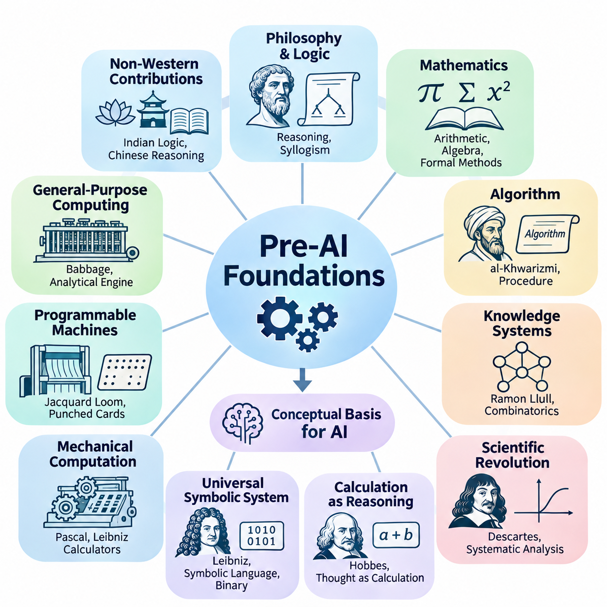
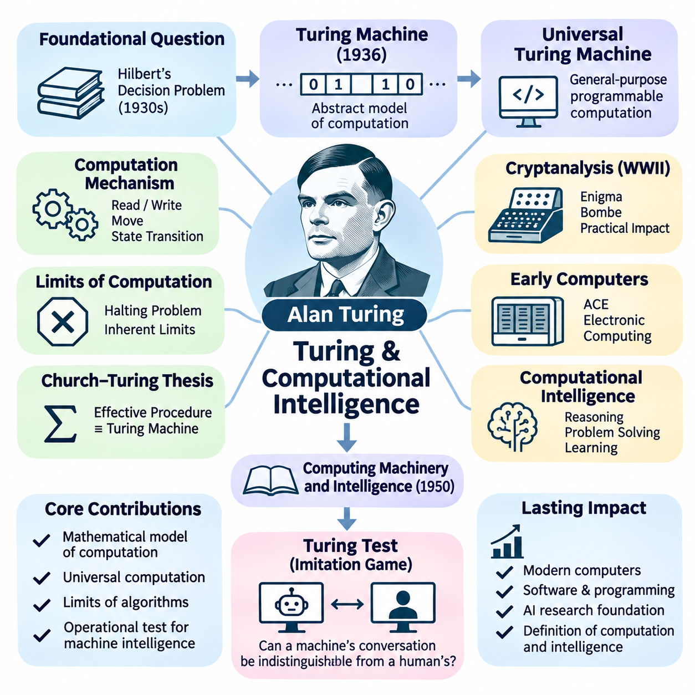
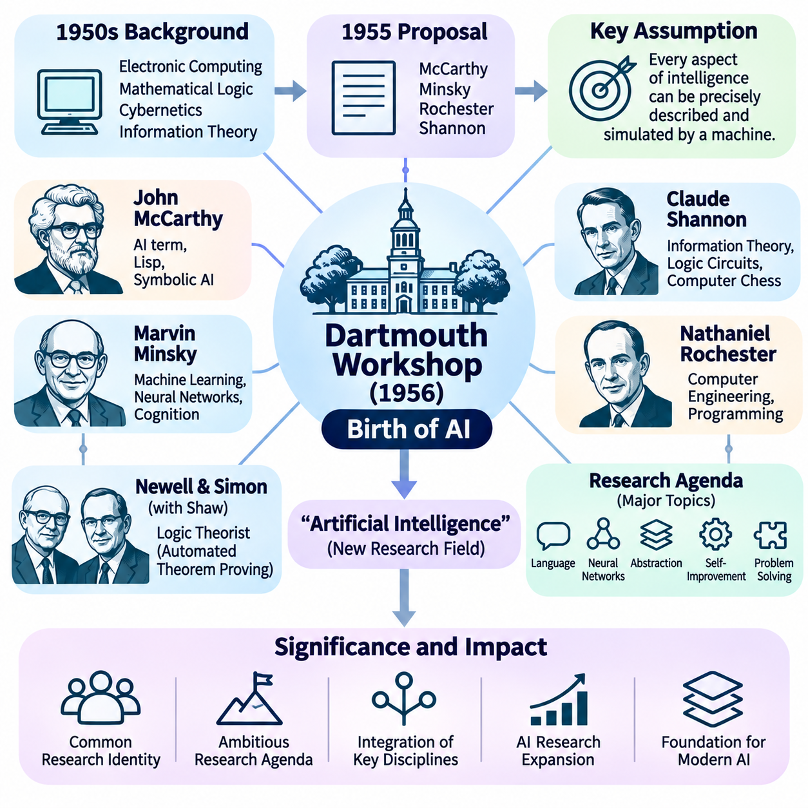
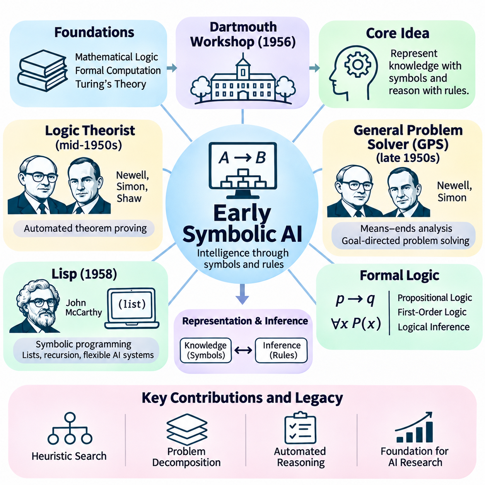
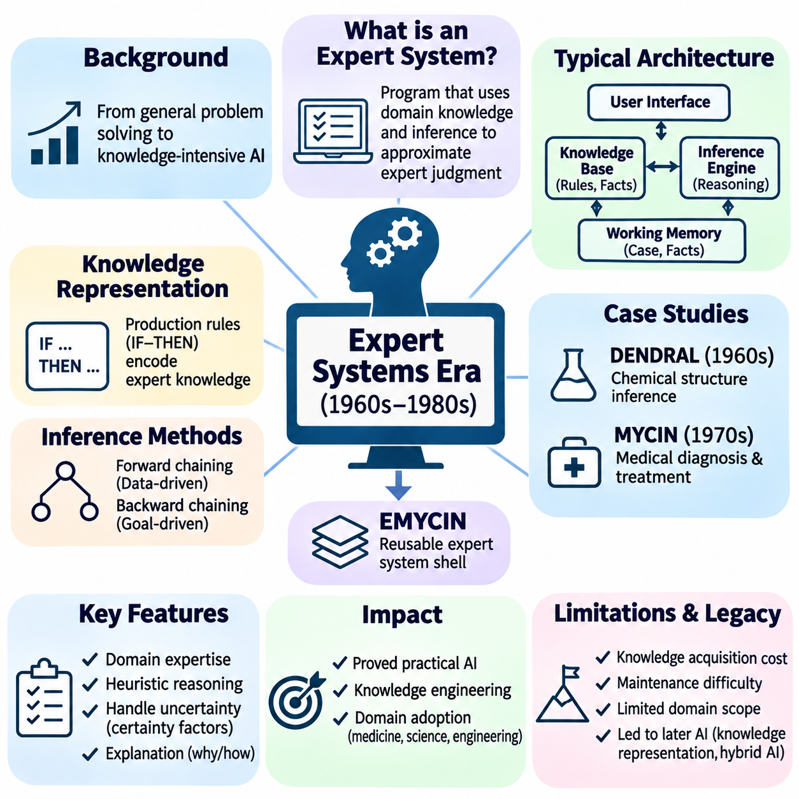
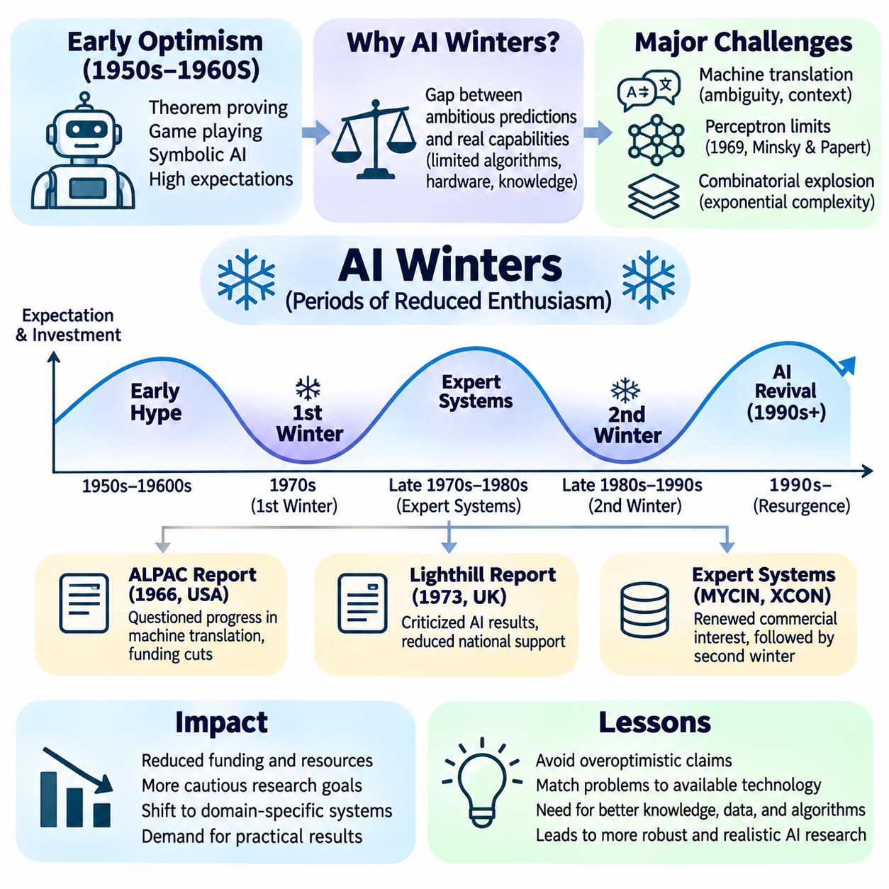
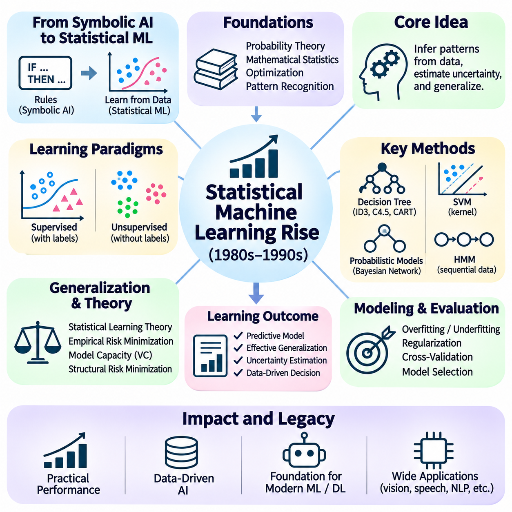
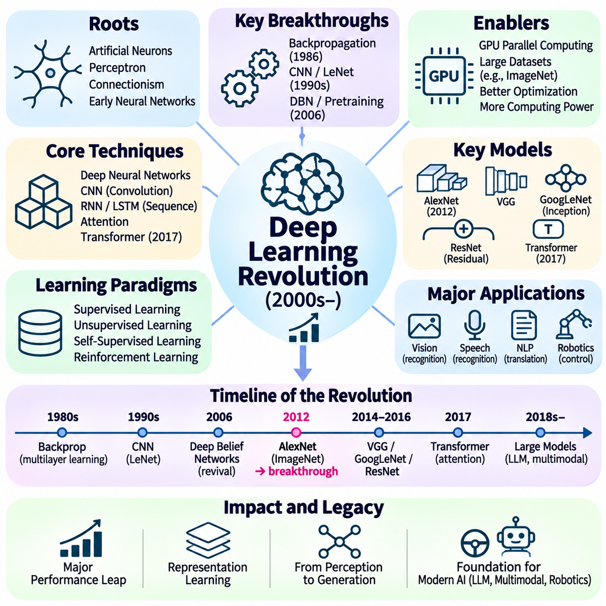
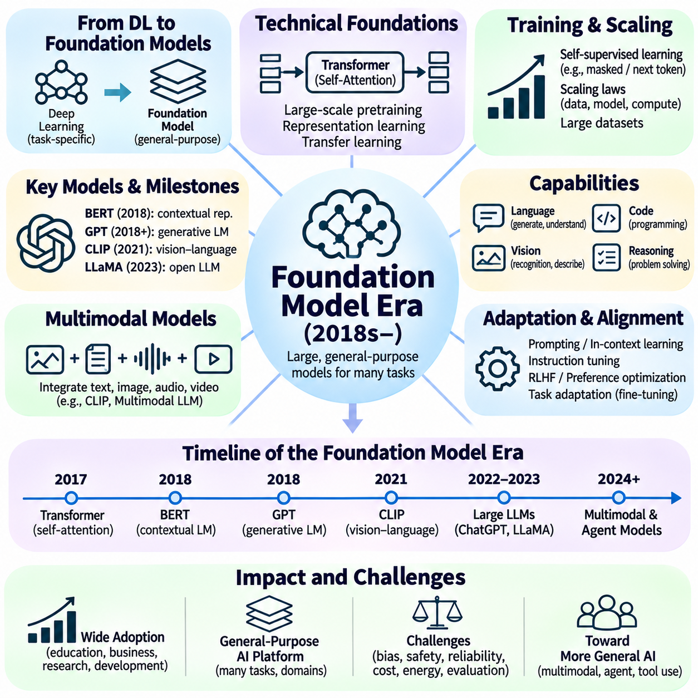
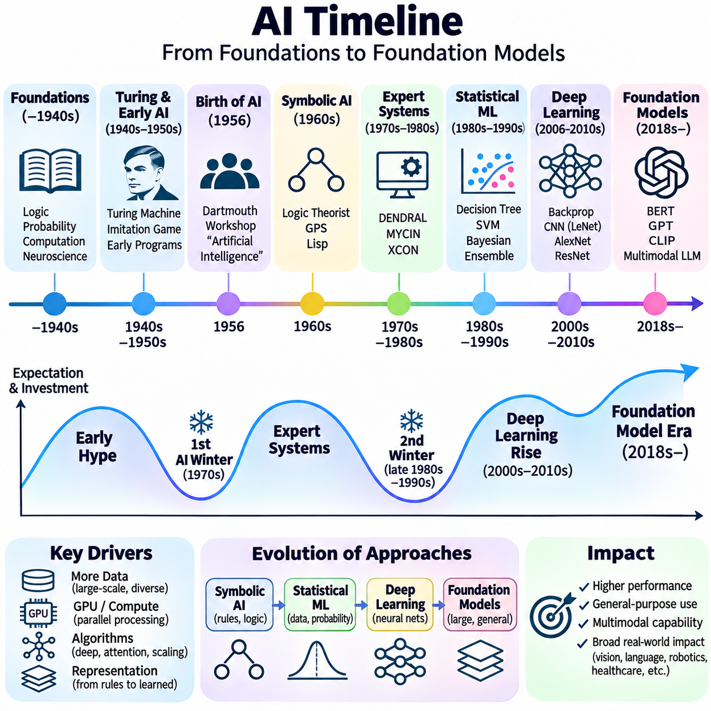

**Volume 04. Artificial Intelligence**

# 02. History of AI

## 02.00 Pre AI Foundations

{width="7.268055555555556in" height="7.268055555555556in"}

인공지능(Artificial Intelligence, AI)의 기초는 전자식 컴퓨터(Electronic Computer)가 발명되기 훨씬 이전부터 형성되었다. 여러 문명권의 철학자(Philosopher), 수학자(Mathematician), 공학자(Engineer), 과학자(Scientist)들은 추론(Reasoning), 계산(Computation), 지능적 행동(Intelligent Behavior)을 체계적인 원리(Systematic Principles)로 표현할 수 있는지 탐구하였다. 이러한 연구는 정보를 처리하고, 지식을 표현하며, 전통적으로 인간의 지능과 관련된 작업을 수행하는 기계의 개념적 토대(Conceptual Foundations)를 확립하였다.

고대 철학(Ancient Philosophy)은 지능(Intelligence)과 합리적 사고(Rational Thought)의 본질에 관한 근본적인 질문을 제기하였다. 특히 아리스토텔레스(Aristotle)를 비롯한 그리스 철학자들은 확립된 전제(Premises)로부터 타당한 결론(Valid Conclusions)을 도출하는 방법을 연구하였다. 아리스토텔레스의 삼단논법(Syllogistic Logic)은 특정한 추론 과정이 명시적인 규칙(Explicit Rules)을 따를 수 있음을 보여주었다. 이러한 통찰은 논리적 표현(Logical Expressions)으로 지식을 표현하고 계산 절차를 통해 이를 처리하는 기호적 인공지능(Symbolic AI)의 중요한 기초가 되었다.

인공지능의 지적 기원(Intellectual Origins)은 서양 철학에만 국한되지 않았다. 인도의 사상 전통은 정교한 논리 체계(Logical Systems)와 언어 분석(Linguistic Analysis)을 발전시켰으며, 중국의 학자들은 체계적 추론(Systematic Reasoning), 분류(Classification), 기계적 계산(Mechanical Computation)을 탐구하였다. 이러한 전통은 지식(Knowledge), 추론(Inference), 형식적 구조(Formal Structure)에 대한 서로 다른 관점을 제공하였다. 현대 인공지능을 직접 확립한 것은 아니지만, 지능을 체계적인 원리로 이해하려는 인류의 오랜 열망을 보여준다.

수학(Mathematics)은 추상적인 관계(Abstract Relationships)를 정확하게 표현하는 방법을 확립함으로써 또 다른 핵심 기반을 제공하였다. 고대의 산술(Arithmetic), 기하학(Geometry), 대수학(Algebra)은 복잡한 문제를 기호 연산(Symbolic Operations)으로 표현할 수 있게 하였다. 위치 기수법(Positional Number Systems)과 점차 체계화된 계산 방법의 발전은 기계적으로 해결할 수 있는 문제의 범위를 확대하였다. 이러한 진보는 계산을 재현 가능한 수학적 규칙(Reproducible Mathematical Rules)에 따라 수행되는 과정으로 정립하는 데 기여하였다.

9세기 수학자 무함마드 이븐 무사 알콰리즈미(Muhammad ibn Musa al-Khwarizmi)는 수학적 절차(Mathematical Procedures)의 체계화에 크게 기여하였다. 대수학과 계산에 관한 그의 저술은 알고리즘적 사고(Algorithmic Thinking)의 발전에 영향을 주었다. 알고리즘(Algorithm)이라는 용어 역시 그의 이름을 라틴어로 표기한 형태에서 유래하였다. 알고리즘은 입력(Input)을 출력(Output)으로 변환하는 유한하고 구조화된 절차(Finite and Structured Procedures)를 기술하기 때문에 인공지능의 핵심 요소가 되었다.

중세 시대(Medieval Period)에도 체계적인 추론을 지원할 수 있도록 지식을 조직하려는 시도가 이어졌다. 13세기 철학자 라몬 룰(Ramon Llull)은 기호적 배열(Symbolic Arrangements)을 이용하여 개념 간 관계를 탐구하는 조합적 방법(Combinatorial Methods)을 개발하였다. 그의 기계적·논리적 구성은 형식적 지식 조작(Formal Knowledge Manipulation)의 일부 측면을 예견하였다. 이러한 체계가 계산 지능(Computational Intelligence)은 아니었지만, 기호의 조합을 통해 추론을 표현할 수 있다는 생각을 반영하였다.

과학혁명(Scientific Revolution)은 이러한 철학적 열망을 점차 수학적인 탐구로 전환하였다. 르네 데카르트(René Descartes)는 체계적 추론(Systematic Reasoning)과 수학적 구조(Mathematical Structure), 지식 사이의 관계를 강조하였다. 그의 분석적 접근법(Analytical Approach)은 복잡한 문제를 더 단순한 구성 요소로 표현하도록 장려하였다. 이러한 관점은 이후 어려운 작업을 작은 연산으로 분해하여 체계적으로 처리하는 계산적 문제 해결(Computational Problem Solving)에 영향을 주었다.

17세기에 토머스 홉스(Thomas Hobbes)는 추론을 계산(Calculation)의 관점에서 이해할 수 있다고 주장하였다. 이러한 철학적 입장(Philosophical Position)은 특정한 지적 활동(Intellectual Operations)을 기호나 수량의 변환으로 표현할 수 있음을 시사하였다. 인간의 추론이 단순한 산술을 넘어서는 것이기는 하지만, 사고에 대한 계산적 해석(Computational Interpretation)은 이후 지능 이론에 중요한 영향을 미쳤다. 이는 인지(Cognition)를 명시적인 연산(Explicit Operations)으로 기술할 수 있는지 탐구하도록 하였다.

고트프리트 빌헬름 라이프니츠(Gottfried Wilhelm Leibniz)는 보편적 기호 언어(Universal Symbolic Language)와 체계적인 추론 계산법(Calculus of Reasoning)을 제안하여 이러한 구상을 발전시켰다. 그는 모호한 논쟁 대신 형식적 계산(Formal Calculation)을 통해 의견 차이를 해결하는 미래를 구상하였다. 또한 디지털 컴퓨팅(Digital Computing)의 핵심이 된 이진 산술(Binary Arithmetic)의 발전에도 기여하였다. 그의 사상은 기호 표현(Symbolic Representation), 논리적 추론(Logical Inference), 기계적 계산(Mechanical Calculation)을 공통된 지적 체계로 연결하였다.

기계식 계산 장치(Mechanical Calculating Devices)는 이전까지 인간의 노력이 필요했던 연산을 기계가 수행할 수 있음을 입증하였다. 블레즈 파스칼(Blaise Pascal)은 17세기에 산술 계산을 지원하기 위한 기계식 계산기(Mechanical Calculator)를 개발하였다. 이후 라이프니츠는 여러 산술 연산을 수행하도록 설계된 단계식 계산기(Stepped Reckoner)를 제작하였다. 이러한 기계는 기능적으로 제한적이었지만, 적절하게 설계된 물리적 장치(Physical Mechanisms)가 수학적 절차를 실행할 수 있다는 중요한 원리를 확립하였다.

산업혁명(Industrial Revolution)은 프로그래밍 가능한 기계적 계산(Programmable Mechanical Computation)의 새로운 가능성을 열었다. 조제프 마리 자카르(Joseph Marie Jacquard)는 천공 카드(Punched Cards)로 제어되는 직기(Loom)를 도입하여 부호화된 명령(Encoded Instructions)이 기계의 동작을 결정할 수 있음을 보여주었다. 저장된 명령과 기계적 실행을 분리하는 이러한 개념은 이후 컴퓨터 설계에 영향을 미쳤다. 이는 기계의 기본 구조를 변경하지 않고도 외부에서 지정한 패턴에 따라 서로 다른 결과를 생성할 수 있음을 보여주었다.

찰스 배비지(Charles Babbage)는 차분기관(Difference Engine)과 해석기관(Analytical Engine)의 설계를 통해 기계적 계산을 확장하였다. 해석기관은 처리 장치(Processing Unit), 메모리(Memory), 프로그래밍 가능한 제어(Programmable Control)와 유사한 개념을 포함하였다. 비록 그의 생전에 완성되지는 못했지만, 그 구조는 범용 컴퓨터(General-Purpose Computer)의 중요한 특징을 예견하였다. 배비지의 연구는 기계 시스템이 단일한 특수 계산을 넘어 일련의 수학적 명령을 실행할 수 있음을 보여주었다.

에이다 러브레이스(Ada Lovelace)는 프로그래밍 가능한 계산(Programmable Computation)이 지닌 더 넓은 의미를 인식하였다. 해석기관에 관한 주석에서 그녀는 기호 사이의 관계를 수학적으로 표현할 수 있다면 기계가 형식적 규칙(Formal Rules)에 따라 기호를 조작할 수 있다고 설명하였다. 이러한 관찰은 계산의 개념적 범위를 수치 산술(Numerical Arithmetic) 이상으로 확장하였다. 이는 프로그래밍 가능한 기계가 구조화된 정보 표현(Structured Representations of Information)을 처리할 수 있음을 시사하였으며, 현대 인공지능의 근본적인 개념이 되었다.

19세기에는 수학적 방법을 통한 논리학(Logic)의 형식화(Formalization)도 이루어졌다. 조지 불(George Boole)은 수학적으로 분석할 수 있는 연산을 통해 논리 명제(Logical Propositions)를 표현하는 대수 체계(Algebraic System)를 개발하였다. 불 대수(Boolean Algebra)는 논리적 추론과 기호 계산 사이의 강력한 연결을 확립하였다. 이러한 원리는 이후 디지털 회로 설계(Digital Circuit Design), 컴퓨터 프로그래밍(Computer Programming), 규칙 기반 인공지능(Rule-Based AI)의 필수적인 기반이 되었다.

고틀로프 프레게(Gottlob Frege)는 양화된 명제(Quantified Statements)와 관계(Relationships)를 표현하는 엄밀한 체계를 개발하여 형식 논리학(Formal Logic)을 더욱 발전시켰다. 그의 연구는 현대 술어 논리(Predicate Logic)의 기초를 제공하였으며, 전통적인 삼단논법보다 표현력이 높은 기술을 가능하게 하였다. 형식 논리 언어(Formal Logical Languages)는 이후 지식 표현(Knowledge Representation)과 자동 정리 증명(Automated Theorem Proving)의 중심 요소가 되었다. 이를 통해 계산 시스템은 객체, 속성, 관계를 정확하게 정의된 기호 구조로 표현할 수 있게 되었다.

20세기 초 수리논리학(Mathematical Logic)은 형식적 추론(Formal Reasoning)의 기초와 한계를 탐구하는 데 점점 더 집중하였다. 버트런드 러셀(Bertrand Russell)과 알프레드 노스 화이트헤드(Alfred North Whitehead)는 『수학 원리(Principia Mathematica)』에서 논리 체계를 통해 수학적 원리를 도출하려고 시도하였다. 이러한 연구는 수학적 지식의 엄밀한 기초(Rigorous Foundations)를 확립하려는 열망을 반영하였다. 또한 이론 컴퓨터 과학(Theoretical Computer Science)이 등장하는 지적 환경을 형성하는 데 기여하였다.

다비트 힐베르트(David Hilbert)는 정확하게 정의된 공리(Axioms)와 추론 규칙(Rules of Inference)을 통해 수학을 형식화하는 연구를 추진하였다. 그의 연구 프로그램은 일관성(Consistency), 완전성(Completeness), 기계적 결정 절차(Mechanical Decision Procedures)에 관한 근본적인 질문을 제기하였다. 이러한 질문은 자동 추론(Automated Reasoning)의 가능성과 밀접하게 연결되었다. 수학적 추론을 형식적 연산으로 표현할 수 있다면, 어떤 문제를 체계적인 절차로 실제 해결할 수 있는지 판단해야 했기 때문이다.

쿠르트 괴델(Kurt Gödel)의 불완전성 정리(Incompleteness Theorems)는 충분한 표현력을 갖춘 형식적 수학 체계(Formal Mathematical Systems)의 중요한 한계를 입증하였다. 그의 연구는 특정한 일관성을 가진 효과적으로 공리화된 체계(Effectively Axiomatized Systems)가 그 체계 안에서 표현할 수 있는 모든 산술적 진리(Arithmetic Truth)를 증명할 수는 없음을 보여주었다. 이러한 발견은 모든 수학적 추론을 완전한 형식 체계로 포착할 수 있다는 기대에 도전하였다. 또한 형식적 증명 가능성(Formal Derivability)과 더 넓은 수학적 진리(Mathematical Truth)의 차이를 명확하게 하였다.

확률 이론(Probability Theory)은 불확실성(Uncertainty) 아래에서 추론하기 위한 보완적인 기초를 제공하였다. 블레즈 파스칼, 피에르 드 페르마(Pierre de Fermat), 그리고 후대 수학자들의 초기 연구는 불확실한 사건을 분석하는 방법을 확립하였다. 토머스 베이즈(Thomas Bayes)와 피에르시몽 라플라스(Pierre-Simon Laplace)는 확률적 추론(Probabilistic Inference)을 발전시켜 증거(Evidence)에 따라 믿음(Beliefs)을 갱신하는 수학적 도구를 제공하였다. 이러한 원리는 이후 통계적 학습(Statistical Learning), 베이지안 네트워크(Bayesian Networks), 지능형 의사결정 시스템(Intelligent Decision-Making Systems)의 핵심이 되었다.

통계학(Statistics)은 관측(Observations)으로부터 패턴(Patterns)과 관계를 추출하는 능력을 확장하였다. 연구자들은 추정(Estimation), 회귀(Regression), 가설 검정(Hypothesis Testing), 변동성(Variation)의 수학적 분석 방법을 발전시켰다. 이러한 기법은 사전에 정의된 논리 규칙에만 의존하지 않고 경험적 데이터(Empirical Data)로부터 학습하는 기반을 마련하였다. 이후 기계학습(Machine Learning)의 발전은 결정론적 계산(Deterministic Calculation)에서 통계적 추론과 예측(Statistical Inference and Prediction)으로 확장되는 이러한 전환에 크게 의존하였다.

생물학(Biology)과 심리학(Psychology)은 자연 지능(Natural Intelligence)이 물리적·인지적 과정(Physical and Cognitive Processes)에서 어떻게 나타나는지 연구함으로써 또 다른 관점을 제공하였다. 찰스 다윈(Charles Darwin)의 진화론(Theory of Evolution)은 변이(Variation)와 선택(Selection)을 통한 적응(Adaptation)을 이해하는 틀을 제공하였다. 이후 계산 연구자들은 최적화 알고리즘(Optimization Algorithms)을 설계할 때 진화 원리(Evolutionary Principles)에서 영감을 얻었다. 이러한 접근법은 복잡한 문제 해결 행동이 명시적인 프로그래밍뿐 아니라 반복적인 적응(Iterative Adaptation)을 통해서도 나타날 수 있음을 시사하였다.

초기 신경과학(Neuroscience)은 신경계(Nervous Systems)가 신호를 전달하고 처리하는 상호 연결된 생물학적 세포(Biological Cells)로 구성되어 있음을 확립하였다. 산티아고 라몬 이 카할(Santiago Ramón y Cajal)의 연구는 뉴런 학설(Neuron Doctrine)의 정립에 기여하였으며, 이후 생리학 연구는 신경 신호 전달(Neural Communication)을 탐구하였다. 이러한 발견은 인공 신경망(Artificial Neural Networks) 모델의 생물학적 기반을 제공하였다. 또한 비교적 단순한 처리 요소(Processing Elements) 사이의 상호작용으로 지능적 행동이 나타날 수 있다는 가설을 촉진하였다.

심리학 연구(Psychological Research)는 실험적 방법(Experimental Methods)을 통해 학습(Learning), 기억(Memory), 지각(Perception), 행동(Behavior)을 탐구하였다. 이반 파블로프(Ivan Pavlov)는 조건 반응(Conditioned Responses)을 연구하였으며, 에드워드 손다이크(Edward Thorndike)는 행동의 결과와 반복적인 경험을 통한 학습을 조사하였다. 이러한 연구는 환경 조건(Environmental Conditions)에 따라 행동이 체계적으로 변화할 수 있음을 보여주었다. 그 결과는 이후 학습, 적응, 강화(Reinforcement)에 관한 계산적 접근법(Computational Approaches)의 개념적 기초에 기여하였다.

제어 이론(Control Theory)의 등장은 피드백(Feedback)을 통해 동적 시스템(Dynamic Systems)을 조절하는 수학적 방법을 제공하였다. 공학자들은 기계가 현재 상태(Current Conditions)를 측정하고 목표 상태(Desired States)와 비교한 다음 그에 따라 동작을 조정하는 방법을 연구하였다. 피드백 제어(Feedback Control)는 감지(Sensing), 의사결정(Decision-Making), 행동(Action) 사이의 실질적인 연결을 확립하였다. 이러한 관계는 이후 자율 로봇공학(Autonomous Robotics), 지능형 제어 시스템(Intelligent Control Systems), 적응형 계산 에이전트(Adaptive Computational Agents)의 중심 개념이 되었다.

정보 이론(Information Theory)은 통신(Communication)과 불확실성을 수학적 수량(Mathematical Quantities)으로 다루면서 또 다른 중요한 기초를 제공하였다. 통신 시스템에 관한 초기 연구는 1948년 클로드 섀넌(Claude Shannon)의 형식적 정보 이론(Formal Theory of Information)이 등장하는 기반을 마련하였다. 섀넌은 정보의 양을 정량화하고 잡음이 존재하는 조건(Noisy Conditions)에서도 정보를 전달할 수 있는 방법을 제시하였다. 이러한 개념은 데이터 표현(Data Representation), 통신 네트워크(Communication Networks), 통계적 추론, 학습 시스템의 수학적 분석에 중요하게 활용되었다.

논리학, 수학, 기계적 계산, 통계학, 신경과학, 제어공학(Control Engineering)의 융합은 인공지능에 필요한 지적 환경(Intellectual Environment)을 형성하였다. 각 학문은 새롭게 등장하는 분야에 서로 다른 구성 요소를 제공하였다. 논리학은 형식적 추론을 설명하였고, 수학은 정확한 표현을 확립하였으며, 통계학은 불확실성을 다루었다. 신경과학은 분산 처리(Distributed Processing)의 가능성을 제시하였고, 공학은 추상적 절차(Abstract Procedures)를 물리적 장치로 구현할 수 있음을 입증하였다.

이러한 기초 연구는 지능에 관한 여러 경쟁적인 해석(Competing Interpretations)도 드러냈다. 한 관점은 명시적인 기호(Explicit Symbols)와 논리 규칙(Logical Rules)을 통한 추론을 강조하였으며, 다른 관점은 단순한 처리 요소 사이의 학습, 적응, 상호작용(Interactions)을 강조하였다. 세 번째 관점은 피드백, 환경과의 상호작용(Environmental Interaction), 목표 지향적 행동(Goal-Directed Behavior)에 초점을 맞추었다. 이러한 접근법이 반드시 상호 배타적인 것은 아니었지만, 그 차이는 이후 인공지능에서 발전한 여러 연구 전통(Research Traditions)을 형성하였다.

인공지능이 독립적인 과학 분야(Scientific Discipline)로 확립되기 이전에 연구자들은 이미 핵심적인 질문을 제기하고 있었다. 추론을 기계화(Mechanization)할 수 있는가? 기계가 기호를 의미 있게 조작할 수 있는가? 경험으로부터 학습이 나타날 수 있는가? 단순한 계산 메커니즘(Computational Mechanisms)으로부터 복잡한 행동이 발생할 수 있는가? 이러한 질문은 지능을 철학적 주제에만 머무르게 하지 않고 수학적 분석(Mathematical Analysis), 실험적 탐구(Experimental Investigation), 공학적 설계(Engineering Design)의 대상으로 전환하였다.

이러한 발전의 역사적 중요성(Historical Significance)은 특정한 하나의 발명보다 여러 성과가 축적되면서 나타난 영향(Cumulative Influence)에 있다. 인공지능은 사고의 형식화(Formalization of Thought), 계산의 자동화(Automation of Calculation), 학습의 이해(Understanding of Learning), 자기 조절 기계(Self-Regulating Machines)의 구축을 위한 수 세기에 걸친 시도에서 등장하였다. 이러한 성과는 20세기 계산 지능 이론(Computational Theories of Intelligence)과 이후 인공지능이 독립적인 연구 분야(Distinct Research Field)로 확립되는 데 필요한 개념적·기술적 기반(Conceptual and Technical Foundations)을 마련하였다.

## 02.01 Turing and Computational Intelligence

{width="7.268055555555556in" height="7.268055555555556in"}

앨런 튜링(Alan Turing)은 기계 지능(Machine Intelligence)에 관한 철학적 질문을 과학적·계산적 문제(Scientific and Computational Problem)로 전환하는 데 기초적인 역할을 수행하였다. 그의 연구는 수리논리학(Mathematical Logic), 계산(Computation), 알고리즘(Algorithms), 지능적 행동(Intelligent Behavior) 사이의 근본적인 연결 관계를 확립하였다. 튜링은 지능을 생물학적 특성(Biological Property)으로만 취급하지 않고, 기계가 인간의 추론과 관련된 연산을 수행하고 관찰자가 지능적이라고 해석할 수 있는 행동을 나타낼 수 있는지 탐구하였다.

1930년대 수학자들은 정확하게 정의된 모든 수학적 문제(Mathematical Problem)를 체계적인 절차(Systematic Procedure)를 통해 해결할 수 있는지 연구하고 있었다. 이러한 질문은 다비트 힐베르트(David Hilbert)의 결정 문제(Entscheidungsproblem)와 밀접하게 관련되어 있었다. 튜링은 명시적인 계산 지침(Explicit Calculation Instructions)을 따르는 사람이 수행하는 핵심 연산을 표현할 수 있는 수학적 계산 모델(Mathematical Model of Computation)을 개발함으로써 이 문제에 접근하였다.

1936년 튜링은 오늘날 튜링 기계(Turing Machine)라고 알려진 이론적 계산 모델(Theoretical Computing Model)을 제시하였다. 이 추상 기계(Abstract Machine)는 셀(Cell)로 나누어진 무한히 확장 가능한 테이프(Unbounded Tape), 읽기·쓰기 헤드(Read-Write Head), 유한한 내부 상태 집합(Finite Set of Internal States), 상태 전이 규칙(State Transition Rules)으로 구성된다. 개념적으로 단순하지만, 적절한 명령이 주어지면 효과적으로 계산 가능한 모든 알고리즘적 계산(Algorithmic Computation)을 표현할 수 있다.

튜링 기계는 현재 상태(Current State)와 읽고 있는 기호(Symbol)에 따라 결정되는 이산적 연산(Discrete Operations)을 통해 정보를 처리한다. 각 단계에서 전이 규칙(Transition Rule)에 따라 기호를 기록하고, 헤드를 이동시키며, 다른 상태로 전환할 수 있다. 이러한 메커니즘은 실행 과정에서 인간의 판단(Human Judgment)이 개입하지 않더라도 기본 연산(Elementary Operations)의 연속적인 수행을 통해 복잡한 계산 절차(Computational Procedures)를 구현할 수 있음을 보여주었다.

튜링은 다른 튜링 기계의 부호화된 설명(Encoded Descriptions)과 입력을 제공받아 해당 기계를 모의 실행(Simulation)할 수 있는 보편 튜링 기계(Universal Turing Machine)의 개념도 제시하였다. 이 원리는 범용 프로그래밍 컴퓨터(General-Purpose Programmable Computer)의 이론적 기초를 확립하였다. 각각의 계산 작업을 위해 별도의 기계를 제작하는 대신, 하나의 범용 계산 시스템(Universal Computational System)이 부호화된 명령을 변경하여 다양한 알고리즘을 실행할 수 있게 된 것이다.

보편 기계(Universal Machine)의 개념은 프로그램(Programs)과 데이터(Data) 사이의 근본적인 관계를 드러냈다. 계산 절차를 설명하는 명령 자체도 정보로 표현될 수 있으며, 다른 기계에 의해 처리될 수 있었다. 이러한 통찰은 저장 프로그램 방식 컴퓨팅(Stored-Program Computing), 소프트웨어 추상화(Software Abstraction), 프로그래밍 가능한 시스템(Programmable Systems)의 개념적 기초를 확립하는 데 기여하였다. 현대 인공지능은 계산 하드웨어(Computational Hardware)와 실행 가능한 알고리즘(Executable Algorithms)의 이러한 분리에 의존한다.

튜링의 연구는 기계적 계산(Mechanical Computation)의 중요한 한계도 확립하였다. 그는 정지 문제(Halting Problem)에 대한 분석을 통해 가능한 모든 프로그램이 결국 종료되는지를 정확하게 판단하는 범용 알고리즘(General Algorithm)은 존재하지 않음을 증명하였다. 이 결과는 계산 시스템(Computational Systems)에 본질적인 수학적 한계(Inherent Mathematical Limitations)가 존재함을 보여주었다. 또한 처리 능력(Processing Power)을 높이더라도 알고리즘적 문제 해결의 모든 근본적인 제약을 제거할 수는 없다는 사실을 명확하게 하였다.

처치--튜링 명제(Church--Turing Thesis)는 튜링과 알론조 처치(Alonzo Church)의 밀접하게 관련된 연구에서 등장하였다. 이 명제는 효과적인 기계적 절차(Effective Mechanical Procedure)로 계산할 수 있는 모든 함수(Function)가 튜링 기계로도 계산될 수 있다고 제안한다. 효과적 계산(Effective Computation)이라는 독립적으로 형식화되지 않은 개념에 관한 수학적 정리(Mathematical Theorem)는 아니지만, 알고리즘이 수행할 수 있는 작업의 범위를 이해하는 기초적인 해석을 제공한다.

제2차 세계대전(World War II) 동안 튜링은 블레츨리 파크(Bletchley Park)에서 영국의 암호 해독(Cryptanalysis)에 기여하였으며, 특히 독일의 에니그마(Enigma) 암호 시스템으로 암호화된 통신을 해독하는 작업에 참여하였다. 암호 분석 방법(Cryptanalytic Methods)과 봄브(Bombe) 기계 설계에 관한 그의 연구는 기계화된 논리 분석(Mechanized Logical Analysis)의 실용적 중요성을 보여주었다. 이러한 성과는 복잡한 정보 처리 문제(Information-Processing Problems)를 해결하는 특수 목적 기계(Specialized Machines)의 실현 가능성을 입증하는 데 기여하였다.

전쟁 이후 튜링은 영국 국립물리연구소(National Physical Laboratory)에서 자동 계산 엔진(Automatic Computing Engine, ACE)에 관한 연구를 포함하여 초기 전자식 컴퓨터(Electronic Computer) 개발에 참여하였다. 그의 설계는 전자 하드웨어(Electronic Hardware)를 통해 범용 계산(General-Purpose Computation)을 구현할 수 있다는 가능성을 반영하였다. 추상적인 수학적 기계(Abstract Mathematical Machines)에서 물리적 계산 시스템(Physical Computing Systems)으로의 전환은 인공지능 연구가 실질적으로 가능해지는 기술적 환경을 형성하였다.

튜링의 관심은 단순한 계산 기계를 넘어 기계 지능(Machine Intelligence)의 가능성으로 확장되었다. 그는 계산 시스템이 추론(Reasoning), 문제 해결(Problem Solving), 학습(Learning) 등 전통적으로 사고(Thinking)와 관련된 활동을 수행할 수 있다고 인식하였다. 이러한 관점은 지능이 반드시 생물학적 메커니즘(Biological Mechanisms)을 필요로 한다는 가정에 도전하였다. 또한 내부의 물리적 구성(Physical Composition)보다 관찰 가능한 능력(Observable Capabilities)을 통해 지능을 평가하도록 연구자들을 이끌었다.

1950년 튜링은 기계가 생각할 수 있는지를 검토한 기념비적인 논문인 「계산 기계와 지능(Computing Machinery and Intelligence)」을 발표하였다. 그는 철학적 논증만으로 사고(Thinking)를 정의하려 하기보다, 기존 질문을 조작적으로 정의된 행동 실험(Operationally Defined Behavioral Experiment)으로 대체할 것을 제안하였다. 이러한 접근법은 계산 시스템의 관찰 가능한 성능(Observable Performance)과 그 행동을 지능적이라고 판단할 수 있는 조건에 관심을 집중시켰다.

튜링이 제안한 실험은 널리 튜링 테스트(Turing Test)로 알려졌지만, 원래 그는 이를 모방 게임(Imitation Game)을 통해 설명하였다. 기계를 대상으로 하는 형태에서 인간 질문자(Human Interrogator)는 기계와 인간 참가자(Human Participant)에게 텍스트로 질문하고, 두 대상을 구별하려고 시도한다. 이 실험은 기계가 인간의 응답과 충분히 유사한 대화 행동(Conversational Behavior)을 생성하여 질문자가 두 대상을 신뢰성 있게 식별하기 어렵게 만들 수 있는지를 평가한다.

튜링 테스트의 중요성은 지능을 평가하는 행동 중심 접근법(Behavioral Approach)에 있다. 의식(Consciousness), 주관적 경험(Subjective Experience), 내부 추론 메커니즘(Internal Reasoning Mechanisms)에 직접 접근할 것을 요구하는 대신, 외부에서 관찰 가능한 성능(Externally Observable Performance)을 고려한다. 이러한 관점은 측정 가능한 능력(Measurable Capabilities)을 강조함으로써 이후 인공지능 평가 방법(AI Evaluation Methods)에 영향을 주었다. 그러나 성공적인 모방이 반드시 진정한 이해(Genuine Understanding), 의식 또는 일반 지능(General Intelligence)을 입증하는 것은 아니다.

튜링은 의식, 수학적 한계(Mathematical Limitations), 독창성(Originality), 인간 사고의 고유성(Apparent Uniqueness of Human Thought)과 관련된 주장 등 기계 지능에 대한 여러 반론을 예상하였다. 그는 이러한 반론을 검토하면서 경험적 연구(Empirical Investigation)의 중요성을 강조하였다. 그의 논의는 오늘날까지 인공지능 철학(Philosophy of Artificial Intelligence)에 영향을 미치는 논쟁의 틀을 확립하였으며, 특히 이해(Understanding), 지향성(Intentionality), 창의성(Creativity), 계산적 인지(Computational Cognition)에 관한 질문과 연결된다.

튜링의 사고에서 특히 중요한 측면은 지능형 기계(Intelligent Machines)가 명시적으로 프로그래밍된 지식(Explicitly Programmed Knowledge)에만 의존하기보다 학습해야 할 수도 있다는 인식이었다. 그는 교육(Education)과 경험(Experience)을 통해 능력을 발전시킬 수 있는 아동 기계(Child Machine)를 구축하는 개념을 제안하였다. 이러한 개념은 수작업으로 지정된 규칙에만 의존하지 않고 훈련(Training)을 통해 계산 시스템의 성능을 개선하는 기계학습(Machine Learning)의 핵심 원리를 예견하였다.

아동 기계 제안(Child-Machine Proposal)은 초기 계산 구조(Initial Computational Organization)와 행동을 수정하는 과정(Processes for Modifying Behavior)을 구분하였다. 튜링은 교육, 경험, 보상(Rewards), 처벌(Penalties)이 학습에 어떤 영향을 줄 수 있는지 검토하였다. 그의 제안이 현대 신경망 학습 알고리즘(Neural Network Training Algorithms)과 동일한 것은 아니지만, 지능적 행동이 시간에 따른 적응(Adaptation Over Time)을 통해 나타날 수 있다는 초기의 이해를 반영하였다.

튜링은 반응과 확산(Reaction and Diffusion)의 수학적 모델을 통해 생물학적 패턴 형성(Biological Pattern Formation)도 연구하였다. 1952년 그의 연구는 화학 물질(Chemical Substances) 사이의 상호작용이 조직화된 공간 패턴(Organized Spatial Patterns)을 생성할 수 있음을 보여주었다. 이 연구 자체가 인공지능 모델은 아니었지만, 복잡한 자연 현상(Complex Natural Phenomena)을 수학적 메커니즘(Mathematical Mechanisms)으로 설명하려는 그의 폭넓은 관심을 보여주었다. 이러한 학제적 사고(Interdisciplinary Thinking)는 이후 생물학적·적응형 시스템(Biological and Adaptive Systems)에 대한 계산적 접근법에 영향을 주었다.

계산(Computation)과 지능(Intelligence)의 관계는 계산 능력(Computational Capability)과 인지 능력(Cognitive Capability)을 구별해야 한다는 중요한 문제를 제기한다. 범용 컴퓨터(Universal Computer)는 충분한 자원이 주어지면 효과적으로 계산 가능한 모든 알고리즘을 실행할 수 있지만, 이것이 자동으로 지능을 보유한다는 의미는 아니다. 지능적 성능(Intelligent Performance)을 구현하려면 적절한 표현(Representations), 학습 메커니즘(Learning Mechanisms), 추론 전략(Reasoning Strategies), 환경 정보(Environmental Information), 목표 지향적 행동(Goal-Directed Behavior)이 추가로 필요하다.

따라서 계산 지능(Computational Intelligence)은 적응적이거나 지능적으로 보이는 행동이 필요한 작업에 계산 메커니즘(Computational Mechanisms)을 적용하는 것으로 이해할 수 있다. 이러한 시스템은 추론(Inference), 분류(Classification), 최적화(Optimization), 계획(Planning), 의사결정(Decision Making)을 수행할 수 있다. 튜링의 공헌은 어떤 절차를 기계화할 수 있는지 이해하기 위한 수학적 틀을 제공하였으며, 이후 인공지능 연구는 계산 절차가 어떻게 점점 더 정교한 인지 능력(Cognitive Capabilities)을 생성할 수 있는지 탐구하였다.

튜링의 이론적 틀(Theoretical Framework)은 기호적 인공지능(Symbolic Artificial Intelligence)의 발전에도 영향을 주었다. 추론을 형식적 기호(Formal Symbols)와 명시적인 변환 규칙(Explicit Transformation Rules)으로 표현할 수 있다면, 계산 기계는 논리적 추론 절차(Logical Inference Procedures)를 실행할 가능성이 있다. 이러한 가능성은 자동 정리 증명(Automated Theorem Proving), 문제 해결(Problem Solving), 지식 표현(Knowledge Representation)에 관한 연구를 촉진하였다. 초기 기호적 인공지능 시스템은 지능의 일부 측면을 형식적 계산 연산(Formal Computational Operations)으로 구현할 수 있다는 보다 광범위한 가정을 계승하였다.

동시에 튜링의 학습 중심 제안(Learning-Oriented Proposals)은 이후 연결주의(Connectionism)와 통계적 기계학습(Statistical Machine Learning)에 관련된 접근법을 예견하였다. 이러한 접근법은 경험을 통해 계산 매개변수(Computational Parameters)나 내부 표현(Internal Representations)을 조정하는 것을 강조한다. 프로그래밍된 추론(Programmed Reasoning)과 학습된 행동(Learned Behavior)의 공존은 지능적 능력이 어떻게 발생할 수 있는지에 관한 서로 다른 해석을 반영하면서 인공지능 연구의 주요 특징 중 하나가 되었다.

계산적 관점(Computational Perspective)은 효율성(Efficiency)과 실질적 실현 가능성(Practical Feasibility)에 관한 질문도 제기하였다. 어떤 문제는 원리적으로 계산 가능(Computable)하더라도 현실적으로 감당하기 어려운 시간(Time), 메모리(Memory), 에너지(Energy)를 요구할 수 있다. 이러한 구별은 인공지능 연구자들이 조합적 탐색 공간(Combinatorial Search Spaces)과 복잡한 추론 작업(Complex Reasoning Tasks)에 직면하면서 더욱 중요해졌다. 이후 계산 복잡도 이론(Computational Complexity Theory)은 다양한 문제 유형을 해결하는 데 필요한 자원을 분석하는 방법을 제공하였다.

튜링의 영향은 현대 인공지능 평가(Modern AI Evaluation)에도 이어지고 있으며, 오늘날 시스템은 내부 의식(Internal Consciousness)에 관한 주장보다 실제 작업 수행 능력(Task Performance)을 중심으로 평가된다. 언어 이해(Language Understanding), 추론, 계획, 상호작용적 문제 해결(Interactive Problem Solving)은 모두 행동 기반 시험(Behavioral Tests)을 통해 검토할 수 있다. 그러나 현대의 평가는 사실적 신뢰성(Factual Reliability), 강건성(Robustness), 일반화(Generalization), 안전성(Safety), 다양한 환경에서의 성능을 더욱 폭넓게 측정할 것을 요구한다.

현대의 대규모 언어 모델(Large Language Models, LLMs)은 튜링이 제기한 질문이 여전히 중요하다는 사실을 보여준다. 이러한 시스템은 학습된 통계적 표현(Learned Statistical Representations)을 통해 일관성 있는 언어(Coherent Language)를 생성하고, 질문에 답하며, 복잡한 계산 및 추론 작업을 수행한다. 이러한 능력은 인간의 대화 지능(Human Conversational Intelligence)과 비교하도록 만들지만, 동시에 신뢰성, 현실 세계와의 연결(Grounding), 일관된 추론(Consistent Reasoning)에서 한계를 드러낸다. 이러한 발전은 설득력 있는 행동(Convincing Behavior)과 포괄적인 지능(Comprehensive Intelligence)을 구별해야 한다는 점을 다시 강조한다.

튜링이 남긴 지속적인 공헌(Lasting Contribution)은 지능에 관한 완전한 이론(Complete Theory of Intelligence)이 아니라 계산, 프로그래밍 가능성(Programmability), 지능형 기계의 가능성을 연결하는 엄밀한 틀(Rigorous Framework)이었다. 그의 연구는 기계적 계산의 의미를 확립하고, 그 수학적 한계 일부를 증명하였으며, 기계 지능을 검토하기 위한 행동 기반 방법(Behavioral Methods)을 제안하였다. 이러한 사상은 인공지능이 과학적 학문 분야(Scientific Discipline)로 등장하는 데 필수적인 기초를 제공하였다.

튜링이 시작한 역사적 전환(Historical Transition)은 지능을 주로 철학적 질문으로 다루던 단계에서 수학적 모델(Mathematical Models), 실행 가능한 알고리즘(Executable Algorithms), 실험적 평가(Experimental Evaluation)를 통해 탐구할 수 있는 대상으로 변화시켰다. 그의 연구는 추상적 계산(Abstract Computation)을 실제 기계(Practical Machines)와 연결하였으며, 지능적 행동에 대한 학습 기반 접근법(Learning-Based Approaches)을 예견하였다. 이러한 지적 기반(Intellectual Foundation)은 1950년대 인공지능 연구가 공식적인 학문 분야로 확립되는 과정에 직접적으로 선행하였다.

## 02.02 Dartmouth Workshop and Birth of AI

{width="7.268055555555556in" height="7.268055555555556in"}

1956년에 개최된 다트머스 인공지능 하계 연구 프로젝트(Dartmouth Summer Research Project on Artificial Intelligence)는 인공지능(Artificial Intelligence, AI)이 독립적인 과학 분야(Scientific Discipline)로 확립되는 데 결정적인 사건으로 널리 인정받고 있다. 이전에도 연구자들은 기계 추론(Machine Reasoning), 계산(Computation), 학습(Learning)을 연구하였지만, 다트머스 프로젝트는 이러한 관심을 공통된 연구 정체성(Research Identity) 아래 통합하였다. 이는 분산된 개별 연구에서 지능형 기계(Intelligent Machines)를 이해하고 구축하려는 조직적인 연구 활동으로 전환되는 계기가 되었다.

1950년대의 지적 환경(Intellectual Environment)은 전자식 컴퓨팅(Electronic Computing), 수리논리학(Mathematical Logic), 사이버네틱스(Cybernetics), 정보 이론(Information Theory)의 급속한 발전에 의해 형성되었다. 초기 컴퓨터는 기계가 복잡한 기호적 절차(Symbolic Procedures)를 실행할 수 있음을 보여주었으며, 이론적 발전은 계산의 본질을 명확하게 하였다. 연구자들은 추론, 언어 이해(Language Understanding), 학습과 같은 과정을 수학적으로 표현하고 프로그래밍 가능한 기계(Programmable Machines)를 통해 구현할 수 있는지 점차 진지하게 검토하기 시작하였다.

1955년 존 매카시(John McCarthy), 마빈 민스키(Marvin Minsky), 너새니얼 로체스터(Nathaniel Rochester), 클로드 섀넌(Claude Shannon)은 다트머스 대학(Dartmouth College)에서 개최할 하계 연구 프로젝트(Summer Research Project)의 제안서를 작성하였다. 이 제안서는 지능적 행동(Intelligent Behavior)을 수행할 수 있는 기계를 구축하기 위한 야심 찬 연구 방향을 제시하였다. 연구자들은 다양한 학문 분야의 전문가들을 모아 지능의 여러 측면을 계산적으로 구현할 수 있을 만큼 정확하게 기술할 수 있는지 조사하고자 하였다.

이 제안서에서는 인공지능(Artificial Intelligence)이라는 용어가 도입되었으며, 이후 이 명칭은 새롭게 등장하는 연구 분야를 대표하게 되었다. 일반적으로 존 매카시가 이 용어를 제안한 인물로 인정받고 있다. 인공지능이라는 표현은 새롭게 제안된 학문을 사이버네틱스(Cybernetics), 자동장치 이론(Automata Theory), 정보 처리(Information Processing)와 같은 관련 분야와 구별하였다. 또한 지능을 생물학적 또는 심리학적 설명에만 한정하지 않고 계산적 현상(Computational Phenomenon)으로 연구할 수 있다는 가능성을 강조하였다.

다트머스 제안서(Dartmouth Proposal)의 핵심 가정은 학습이나 지능의 모든 측면을 원칙적으로 충분히 정확하게 기술하여 기계가 이를 모의 실행(Simulation)할 수 있다는 것이었다. 이러한 가설(Hypothesis)은 이미 입증된 과학적 결론이 아니라 야심 찬 연구 의제(Research Agenda)를 설정한 것이었다. 이는 필요한 표현 방법(Representations)과 알고리즘(Algorithms)이 대부분 알려지지 않았음에도 추론, 추상화(Abstraction), 창의성(Creativity), 학습을 형식적 계산 메커니즘(Formal Computational Mechanisms)으로 구현할 수 있음을 시사하였다.

다트머스 프로젝트는 자연어 사용(Natural Language Use), 신경망(Neural Networks), 추상화, 자기 개선(Self-Improvement), 전통적으로 인간의 지능이 필요한 문제를 해결하는 기계의 개발 등 여러 주요 연구 과제를 중심으로 구성되었다. 이러한 주제는 지능에 대한 매우 폭넓은 이해를 반영하였다. 연구자들은 단순한 수치 계산(Numerical Calculation)에 집중하기보다 지식 표현(Knowledge Representation), 개념 조작(Concept Manipulation), 행동 적응(Behavioral Adaptation)을 위한 계산적 방법을 탐구하고자 하였다.

워크숍(Workshop)은 1956년 여름 미국 뉴햄프셔주 하노버(Hanover, New Hampshire)의 다트머스 대학에서 개최되었다. 참가자와 방문 연구자들은 수학(Mathematics), 컴퓨터 과학(Computer Science), 공학(Engineering), 인지 연구(Cognitive Studies) 등 다양한 분야의 배경을 가지고 있었다. 이 행사는 엄격하게 구성된 단일 학술대회(Conference)가 아니라 토론과 공동 연구(Collaborative Investigations)가 이루어지는 연구 모임(Research Gathering)이었다. 역사적 중요성은 주로 이 모임이 확립한 지적 방향(Intellectual Direction)에 있다.

존 매카시는 이 프로젝트를 조직하고 인공지능을 연구 분야로 정의하는 데 중심적인 역할을 수행하였다. 이후 그의 주요 공헌에는 리스프 프로그래밍 언어(Lisp Programming Language)의 개발과 기호적 추론(Symbolic Reasoning)에 관한 중요한 개념들이 포함되었다. 매카시는 형식적 구조(Formal Structures)를 통해 지식을 표현하고 계산 절차(Computational Procedures)를 사용하여 결론을 도출할 수 있다는 가능성을 강조하였다. 이러한 관점은 논리 기반 인공지능(Logic-Based Artificial Intelligence)의 발전에 중요한 영향을 미쳤다.

마빈 민스키는 기계학습(Machine Learning), 신경 계산(Neural Computation), 인간 인지(Human Cognition)의 기초 메커니즘에 대한 상호 보완적인 관심을 제시하였다. 그의 연구는 비교적 단순한 계산 구조(Computational Structures)가 복잡한 지능적 행동을 어떻게 지원할 수 있는지 탐구하였다. 민스키는 이후 매사추세츠 공과대학교(Massachusetts Institute of Technology, MIT)에서 인공지능 연구의 영향력 있는 인물이 되었다. 그의 연구는 계산 모델(Computational Models)을 지각(Perception), 기억(Memory), 추론(Reasoning)에 관한 보다 폭넓은 질문과 연결하는 데 기여하였다.

클로드 섀넌은 정보 이론, 스위칭 회로(Switching Circuits), 통신 및 의사결정 과정(Decision Processes)에 대한 수학적 접근법 분야의 전문성을 제공하였다. 그의 초기 연구는 불 대수 논리(Boolean Logic)와 전기 회로(Electrical Circuits) 사이의 근본적인 연결 관계를 입증하였다. 또한 섀넌은 컴퓨터 체스(Computer Chess)를 연구하여 전략적 의사결정(Strategic Decision-Making)에 계산적으로 접근할 수 있음을 보여주었다. 이러한 공헌은 지능적 활동을 수학적·알고리즘적 방법(Mathematical and Algorithmic Methods)으로 분석할 수 있다는 새로운 관점을 뒷받침하였다.

너새니얼 로체스터는 전자식 컴퓨터 공학(Electronic Computer Engineering)과 프로그래밍(Programming)에 관한 실무 경험을 제공하였다. 그의 참여는 지능에 관한 이론적 개념을 실제 계산 하드웨어(Computational Hardware)와 연결하는 것이 중요하다는 사실을 반영하였다. 초기 컴퓨터는 현대 시스템과 비교하여 메모리(Memory)와 처리 능력(Processing Capabilities)이 극도로 제한적이었다. 따라서 연구자들은 심각한 기술적 제약(Technological Constraints) 속에서도 지능적 행동을 입증할 수 있는 표현 방법과 알고리즘을 개발해야 했다.

앨런 뉴얼(Allen Newell)과 허버트 A. 사이먼(Herbert A. Simon) 역시 초기 인공지능 발전과 밀접하게 관련된 연구자들이었다. 이들은 J. C. 쇼(J. C. Shaw)와 함께 선택된 수학적 정리(Mathematical Theorems)를 증명할 수 있는 선구적인 프로그램인 논리 이론가(Logic Theorist)를 개발하였다. 이 프로그램은 기호 계산(Symbolic Computation)이 형식적 추론(Formal Reasoning)과 관련된 작업을 수행할 수 있음을 보여주었다. 다트머스 프로젝트가 진행되던 시기에 이 프로그램이 소개되면서 기계 기반 문제 해결(Machine-Based Problem Solving)의 실현 가능성에 대한 확신이 강화되었다.

논리 이론가는 수학적 표현(Mathematical Expressions)을 기호 구조(Symbolic Structures)로 나타내고, 원하는 결론을 확립할 수 있는 연산의 순서(Sequences of Operations)를 탐색하였다. 이러한 접근법은 문제 표현(Problem Representation)과 탐색 절차(Search Procedures)를 분리하는 것이 중요하다는 사실을 보여주었다. 이 시스템은 단순히 수치적 답을 계산하는 대신 정의된 규칙에 따라 논리적 표현(Logical Expressions)을 조작하였다. 이는 이후 기호적 인공지능 시스템(Symbolic AI Systems)과 자동 추론 프로그램(Automated Reasoning Programs)의 기초적인 설계 방식이 되었다.

다트머스 프로젝트는 기호적 인공지능을 초기의 주요 연구 방향으로 확립하는 데 기여하였다. 기호적 인공지능(Symbolic AI)은 명시적인 기호(Explicit Symbols), 논리적 관계(Logical Relationships), 형식적 규칙(Formal Rules)을 통해 지식을 표현한다. 지능적 행동은 탐색(Search), 추론(Inference), 계획(Planning) 절차를 통해 이러한 표현을 조작함으로써 생성된다. 이러한 접근법은 인간 추론의 중요한 측면을 기호 정보(Symbolic Information)에 대한 구조화된 연산(Structured Operations)으로 모델링할 수 있다는 믿음을 반영하였다.

초기 연구자들은 특히 범용 문제 해결 능력(General Problem-Solving Capabilities)에 관심을 가졌다. 이들은 좁게 정의된 수학적 문제만 해결하는 것이 아니라 다양한 작업에서 동작할 수 있는 프로그램을 개발하고자 하였다. 이러한 목표는 휴리스틱 탐색(Heuristic Search), 정리 증명(Theorem Proving), 게임 수행(Game Playing), 자동 계획(Automated Planning)에 관한 연구를 촉진하였다. 그 결과 개발된 시스템은 중요한 계산 기법(Computational Techniques)을 보여주었지만, 단순화된 표현과 엄격하게 통제된 환경으로 인해 능력에는 여전히 한계가 있었다.

휴리스틱 추론(Heuristic Reasoning)의 개념은 모든 경우를 탐색하는 완전 탐색(Exhaustive Search)이 계산적으로 비현실적인 경우가 많았기 때문에 특히 중요해졌다. 휴리스틱(Heuristic)은 가능한 모든 해결책을 조사하지 않고도 유망한 대안(Promising Alternatives)을 선택하도록 안내한다. 초기 인공지능 연구자들은 지능적 문제 해결(Intelligent Problem Solving)이 경쟁하는 여러 가능성 중에서 효율적으로 선택하는 과정을 필요로 한다는 사실을 인식하였다. 이러한 통찰은 탐색 알고리즘(Search Algorithms), 계획 시스템(Planning Systems), 이후의 최적화 및 의사결정 접근법에 영향을 주었다.

자연어 처리(Natural Language Processing, NLP)는 다트머스 제안서에서 제시된 또 다른 주요 목표였다. 연구자들은 기계가 언어 구조(Linguistic Structure)를 표현하고, 의미(Meaning)를 해석하며, 인간의 언어를 사용하여 의사소통할 수 있는지 검토하였다. 초기 접근법은 문법 규칙(Grammatical Rules), 기호 표현(Symbolic Representations), 논리적 관계(Logical Relationships)를 강조하였다. 이러한 방법에는 상당한 한계가 있었지만, 이후 계산언어학(Computational Linguistics)과 언어 기반 인공지능(Language-Based AI)의 발전 과정에서 지속적으로 중요하게 다루어질 연구 질문을 확립하였다.

학습과 자기 개선(Self-Improvement) 역시 초기 연구 비전(Research Vision)의 중요한 요소였다. 다트머스 제안서는 고정된 명령(Fixed Instructions)에만 의존하지 않고 경험(Experience)을 통해 행동을 수정할 수 있는 시스템을 예상하였다. 이러한 목표는 초기 인공지능을 신경 계산(Neural Computation) 및 적응형 시스템(Adaptive Systems)과 연결하였다. 또한 초기에는 기호적 방법(Symbolic Methods)이 상당한 관심을 받았지만, 학습 기반 접근법(Learning-Based Approaches) 역시 인공지능 분야가 형성될 당시부터 존재하였음을 보여주었다.

다트머스 워크숍은 지능에 관한 완전한 이론(Complete Theory of Intelligence)을 만들어 내거나 즉시 범용 지능형 기계(Generally Intelligent Machines)를 실현하지는 못하였다. 상식(Common Sense)을 표현하고, 지식을 습득하며, 언어를 이해하고, 제한된 사례를 넘어 일반화(Generalization)하는 방법 등 많은 기술적 질문이 해결되지 않은 상태로 남아 있었다. 그럼에도 이 모임은 공통된 연구 정체성을 형성하고, 이전까지 서로 다른 학문적 관점에서 관련 문제를 연구하던 연구자들 사이의 협력을 촉진하였다.

인공지능이 명칭을 가진 독립적인 분야로 확립되면서 학술 기관(Academic Institutions)과 연구 자금 지원(Research Funding)에도 영향을 미쳤다. 대학과 연구소들은 기계 추론, 학습, 지능형 계산(Intelligent Computation)을 중심으로 연구 프로젝트를 점차 조직하기 시작하였다. 다트머스 대학, 매사추세츠 공과대학교, 카네기 공과대학(Carnegie Institute of Technology), 스탠퍼드 대학교(Stanford University) 등의 기관에서 연구 그룹(Research Groups)이 형성되었다. 이러한 환경은 전문 프로그래밍 언어(Specialized Programming Languages), 실험 시스템(Experimental Systems), 이론적 틀(Theoretical Frameworks)의 발전을 지원하였다.

인공지능을 둘러싼 초기의 열정은 미래 기계 능력(Future Machine Capabilities)에 대한 야심 찬 예측을 촉진하였다. 연구자들은 자동 추론(Automated Reasoning), 언어 이해, 범용 문제 해결(General Problem Solving)에서 상당한 발전이 이루어질 것으로 기대하였다. 일부 연구자들은 인간 수준의 지적 활동(Human-Level Intellectual Activities)이 비교적 짧은 기간 안에 계산적으로 실현될 수 있다고 예상하였다. 이러한 기대는 연구 투자(Research Investment)를 촉진하였지만, 실제적인 한계가 초기 예상보다 해결하기 어렵다는 사실이 드러나면서 이후 실망의 원인이 되기도 하였다.

연구자들이 실험실에서의 시연(Laboratory Demonstrations)을 더 복잡한 환경으로 확장하려고 시도하면서 여러 근본적인 어려움이 나타났다. 현실 세계의 지식(Real-World Knowledge)을 포괄적으로 표현하기 어려웠고, 탐색 공간(Search Spaces)은 급격하게 확장되었으며, 언어 해석(Language Interpretation)에는 맥락적 이해(Contextual Understanding)가 필요하였다. 제한된 계산 자원(Computational Resources) 역시 실험을 제약하였다. 이러한 문제는 신중하게 선택된 사례에서의 성공적인 성능이 반드시 폭넓고 신뢰할 수 있는 지능(Broad and Reliable Intelligence)으로 이어지는 것은 아니라는 사실을 보여주었다.

이러한 한계에도 불구하고 다트머스 프로젝트는 지속적인 과학적 연구 의제(Scientific Agenda)를 확립하였다. 핵심 질문은 지능을 어떻게 표현할 수 있는지, 추론을 어떻게 기계화할 수 있는지, 기계가 어떻게 학습할 수 있는지, 계산 시스템이 익숙하지 않은 문제를 어떻게 해결할 수 있는지에 관한 것이었다. 이러한 질문은 이후 지식 표현(Knowledge Representation), 기계학습(Machine Learning), 자동 계획(Automated Planning), 자연어 처리, 계산적 인지(Computational Cognition)를 포함하는 인공지능의 주요 세부 분야로 발전하였다.

다트머스 프로젝트의 역사적 중요성은 기호 계산(Symbolic Computation)을 넘어선다. 최초 제안서는 신경망(Neural Networks)과 자기 개선 기계(Self-Improving Machines)를 명시적으로 고려하였으며, 이는 이후 통계적 학습(Statistical Learning)과 딥러닝(Deep Learning)을 통해 중요성이 커진 연구 전통을 예견하였다. 따라서 인공지능의 탄생을 기호적 방법만의 기원으로 이해해서는 안 된다. 이는 다양한 계산적 접근법(Multiple Computational Approaches)을 통해 지능을 탐구하려는 보다 폭넓은 노력을 의미하였다.

다트머스 워크숍은 새롭게 등장하던 과학적 아이디어들의 집합을 공통된 명칭, 야심 찬 목표, 발전하는 학술 공동체(Institutional Community)를 갖춘 명확한 연구 분야로 전환하였다. 이 프로젝트의 지속적인 공헌은 지능을 계산 모델(Computational Models)과 실험 시스템(Experimental Systems)을 통해 탐구할 수 있는 대상으로 정립한 데 있다. 이러한 기초는 초기의 성과(Early Achievements), 실망의 시기(Periods of Disappointment), 이후의 기술적 변혁(Technological Transformations)을 포함하는 인공지능의 발전 과정 전반에 영향을 미쳤다.

## 02.03 Early Symbolic AI

{width="7.268055555555556in" height="7.268055555555556in"}

초기 기호적 인공지능(Early Symbolic Artificial Intelligence)은 1950년대에 지능형 기계(Intelligent Machines)를 구축하기 위한 최초의 체계적인 접근법 중 하나로 등장하였다. 핵심 가정은 추론(Reasoning)을 기호(Symbols)로 표현하고 명시적인 계산 규칙(Explicit Computational Rules)에 따라 조작할 수 있다는 것이었다. 기호적 인공지능(Symbolic AI)은 뇌의 생물학적 구조(Biological Structure)를 재현하기보다 형식적 지식(Formal Knowledge), 논리 연산(Logical Operations), 구조화된 문제 해결(Structured Problem Solving)을 통해 지능적 행동(Intelligent Behavior)을 생성하는 데 집중하였다.

기호적 인공지능의 지적 기반(Intellectual Foundations)은 수리논리학(Mathematical Logic), 형식적 계산(Formal Computation), 인간 추론 이론(Theories of Human Reasoning)을 통해 확립되었다. 연구자들은 불 대수(Boolean Algebra), 술어 논리(Predicate Logic), 앨런 튜링(Alan Turing)이 제시한 계산 체계(Computational Framework)를 활용하였다. 이러한 발전은 특정한 인지 활동(Cognitive Activities)을 기호 표현(Symbolic Expressions)에 대한 연산으로 모델링할 수 있음을 시사하였다. 그 결과 형성된 연구 전통은 지능을 정보를 표현하고 알고리즘(Algorithms)을 통해 변환하는 과정으로 이해하였다.

1956년 다트머스 워크숍(Dartmouth Workshop)은 기호적 추론(Symbolic Reasoning)을 인공지능 연구의 주요 방향으로 확립하는 데 기여하였다. 존 매카시(John McCarthy), 앨런 뉴얼(Allen Newell), 허버트 사이먼(Herbert Simon), 마빈 민스키(Marvin Minsky)와 같은 과학자들은 기계가 명시적인 표현(Explicit Representations)과 논리적 절차(Logical Procedures)를 통해 문제를 해결할 수 있는지 연구하였다. 초기 연구는 이전까지 인간 지능(Human Intelligence)의 고유한 영역으로 여겨졌던 추론 작업을 수행하는 프로그램을 개발할 가능성을 강조하였다.

기호적 인공지능의 근본적인 특징은 지식 표현(Knowledge Representation)과 추론 메커니즘(Inference Mechanisms)을 분리한다는 점이다. 지식은 객체(Objects), 속성(Properties), 관계(Relationships), 논리적 조건(Logical Conditions)을 설명하는 기호로 부호화된다. 추론 절차(Inference Procedures)는 이러한 표현을 처리하여 결론을 도출하거나 가능한 행동을 식별한다. 이러한 구조(Architecture)는 모든 가능한 결과를 사전에 명시적으로 프로그래밍하지 않더라도 시스템이 추상적 정보(Abstract Information)를 처리할 수 있도록 한다.

기호 지능(Symbolic Intelligence)의 가장 초기 시연 사례 중 하나는 1950년대 중반 앨런 뉴얼, 허버트 사이먼, J. C. 쇼(J. C. Shaw)가 개발한 논리 이론가(Logic Theorist)였다. 이 프로그램은 논리 규칙(Logical Rules)에 따라 기호 표현을 조작하여 수학적 정리(Mathematical Theorems)를 증명하고자 하였다. 그 성과는 컴퓨터가 특정한 형태의 형식적 추론(Formal Reasoning)을 수행할 수 있음을 입증하였다. 이러한 결과는 문제 해결(Problem Solving)을 계산 절차(Computational Procedures)로 구현할 수 있다는 확신을 강화하였다.

논리 이론가는 추론을 가능한 증명 단계(Proof Steps)를 탐색하는 과정으로 표현함으로써 지능형 계산(Intelligent Computation)의 중요한 접근법을 제시하였다. 프로그램은 생각할 수 있는 모든 순서를 조사하는 대신 휴리스틱(Heuristics)을 사용하여 유망한 대안(Promising Alternatives)에 우선순위를 부여하였다. 이러한 전략은 수많은 잠재적 행동(Potential Actions) 중에서 유용한 가능성을 선택하는 실용적 지능(Practical Intelligence)의 핵심 특성을 반영하였다. 이후 휴리스틱 탐색(Heuristic Search)은 기호적 인공지능의 기초적인 기법이 되었다.

이러한 발전에 이어 뉴얼과 사이먼은 1950년대 후반 일반 문제 해결기(General Problem Solver, GPS)를 개발하였다. 이 시스템은 일반적인 추론 절차(General Reasoning Procedures)를 사용하여 형식적으로 정의된 여러 유형의 문제를 해결하도록 설계되었다. GPS는 현재 상태(Current State)와 목표 상태(Desired Goal)를 비교하고 그 차이를 줄이기 위한 연산을 선택하는 수단--목표 분석(Means--Ends Analysis)을 도입하였다. 이러한 접근법은 이후 계획(Planning)과 목표 지향적 문제 해결(Goal-Directed Problem Solving) 연구에 영향을 주었다.

수단--목표 분석은 복잡한 문제(Complex Problems)를 더 작은 하위 문제(Subproblems)로 분해하는 체계적인 방법을 제공하였다. 어떤 연산에 필요한 조건이 현재 충족되지 않으면 해당 조건을 중간 목표(Intermediate Goals)로 설정할 수 있었다. 이러한 과정은 기호적 추론을 계층적 문제 분해(Hierarchical Problem Decomposition)와 연결하였다. GPS는 제한된 문제 영역(Restricted Domains)에서만 성공적으로 작동하였지만, 그 구조는 명시적인 계산 구조(Explicit Computational Structures)를 통해 목표 지향적 행동을 조직할 수 있음을 보여주었다.

기호적 인공지능은 구조화된 표현(Structured Expressions)을 조작하도록 설계된 프로그래밍 언어(Programming Languages)의 발전에서도 큰 도움을 받았다. 1958년 존 매카시는 초기 인공지능 연구에서 가장 영향력 있는 언어 중 하나가 된 리스프(Lisp)를 도입하였다. 리스프는 기호 리스트(Symbolic Lists), 재귀 함수(Recursive Functions), 유연한 프로그램 구조(Flexible Program Structures)를 지원하였다. 이러한 기능은 논리 표현, 탐색 절차, 동적으로 구성되는 지식 구조(Dynamically Constructed Knowledge Structures)를 표현하는 데 특히 적합하였다.

리스프의 발전은 수치 계산(Numerical Computation)에서 기호 정보 처리(Symbolic Information Processing)로 확장되는 보다 광범위한 전환을 반영하였다. 전통적인 과학 컴퓨팅(Scientific Computing)은 주로 산술 계산(Arithmetic Calculations)을 강조하였지만, 기호적 인공지능은 표현식(Expressions), 관계, 추상적 구조(Abstract Structures)에 대한 연산을 필요로 하였다. 기호 데이터를 조작할 수 있는 프로그래밍 환경(Programming Environments)은 연구자들이 점점 더 정교한 추론 시스템(Reasoning Systems)을 구축할 수 있도록 하였다. 이러한 차이는 새롭게 등장한 인공지능 분야의 정체성을 형성하는 핵심 요소가 되었다.

형식 논리(Formal Logic)는 초기 기호 시스템(Symbolic Systems)의 또 다른 주요 기반을 제공하였다. 명제 논리(Propositional Logic)는 참과 거짓의 값을 갖는 표현(Truth-Valued Expressions)을 통해 명제를 나타냈으며, 일차 논리(First-Order Logic)는 변수(Variables), 술어(Predicates), 양화된 관계(Quantified Relationships)를 도입하였다. 이러한 형식 언어(Formal Languages)는 연구자들이 지식을 수학적으로 정확한 형태로 표현할 수 있도록 하였다. 이후 논리적 추론 규칙(Logical Inference Rules)을 계산적으로 구현하여 주어진 전제(Premises)로부터 결론이 도출되는지 판단할 수 있었다.

자동 정리 증명(Automated Theorem Proving)은 기계 추론(Machine Reasoning)을 연구하기 위한 명확하게 정의된 환경을 제공하였기 때문에 중요한 연구 분야가 되었다. 정리 증명 시스템(Theorem-Proving System)은 공리(Axioms), 가정(Assumptions), 목표 결론(Desired Conclusion)을 입력받아 유효한 추론 단계의 순서(Valid Sequence of Inference Steps)를 탐색한다. 이러한 시스템은 컴퓨터가 단순하지 않은 논리 연산(Nontrivial Logical Operations)을 수행할 수 있음을 보여주었다. 그러나 성능은 표현 방식(Representation Choices), 탐색 전략(Search Strategies), 계산 자원(Computational Resources)에 크게 의존하였다.

해결 원리 기반 추론(Resolution-Based Reasoning)의 발전은 자동 연역(Automated Deduction)을 더욱 발전시켰다. 1965년 존 앨런 로빈슨(John Alan Robinson)은 일차 논리를 위한 해결 원리(Resolution Principle)를 도입하여 자동 정리 증명의 체계적인 기반을 제공하였다. 해결 원리는 논리적 추론을 절(Clauses)과 치환(Substitutions)에 대한 연산으로 변환하였다. 이 방법은 일반적인 추론 절차(General Inference Procedures)가 형식적으로 표현된 지식에 적용될 수 있음을 보여줌으로써 논리 프로그래밍(Logic Programming)과 이후의 지식 기반 시스템(Knowledge-Based Systems)에 영향을 주었다.

초기 기호적 인공지능 연구자들은 지능적 의사결정(Intelligent Decision Making)을 위한 통제된 환경(Controlled Environment)으로 게임 수행(Game Playing)도 연구하였다. 체스(Chess)와 체커(Checkers)는 명확하게 정의된 규칙, 관찰 가능한 상태(Observable States), 측정 가능한 결과(Measurable Outcomes)를 제공하였다. 프로그램은 가능한 수(Moves)를 평가하고 대안적인 행동 순서(Alternative Sequences of Actions)를 탐색할 수 있었다. 이러한 실험은 기호 표현, 휴리스틱 평가(Heuristic Evaluation), 계산적 탐색(Computational Search)을 결합하여 목적 지향적 행동(Purposeful Behavior)을 생성할 수 있음을 보여주었다.

아서 새뮤얼(Arthur Samuel)의 체커 연구는 기호적 탐색(Symbolic Search)과 적응적 학습(Adaptive Learning) 사이의 관계를 보여주었다. 그의 프로그램은 게임 상태 평가(Game-State Evaluation)와 경험을 통한 성능 개선(Performance Improvement) 방법을 결합하였다. 이 연구는 초기 인공지능이 고정된 논리 규칙(Fixed Logical Rules)에만 제한되지 않았음을 입증하였다. 오히려 기호 표현이 학습 메커니즘(Learning Mechanisms)과 공존할 수 있음을 보여주었으며, 이후 구조화된 추론(Structured Reasoning)과 데이터 기반 적응(Data-Driven Adaptation)을 결합하는 접근법을 예견하였다.

자연어 이해(Natural Language Understanding)는 기호적 인공지능의 또 다른 야심 찬 응용 분야였다. 연구자들은 문법 구조(Grammatical Structure), 단어 의미(Word Meanings), 문장 관계(Sentence Relationships)를 명시적인 규칙으로 표현하고자 하였다. 초기 시스템은 제한된 언어 표현(Restricted Linguistic Expressions)을 처리하고 이를 형식적 표현(Formal Representations)으로 변환하였다. 이러한 실험은 언어에 계산적으로 접근할 수 있음을 시사하였지만, 모호성(Ambiguity), 문맥 의존성(Context Dependence), 상식적 이해(Common-Sense Understanding)는 여전히 해결하기 어려운 과제로 남아 있었다.

1960년대 중반 조지프 바이젠바움(Joseph Weizenbaum)은 패턴 매칭(Pattern Matching)과 변환 규칙(Transformation Rules)을 사용하여 응답을 생성하는 대화 프로그램(Conversational Program) 엘리자(ELIZA)를 개발하였다. 심리치료사(Psychotherapist)를 모방한 유명한 대화는 비교적 단순한 기호적 절차가 어떻게 대화 이해(Conversational Understanding)의 인상을 만들어 낼 수 있는지 보여주었다. 그러나 엘리자는 언어에 대한 포괄적인 의미 모델(Comprehensive Semantic Model)을 갖추지 못하였다. 이 프로그램은 사용자가 계산적 행동(Computational Behavior)에 얼마나 쉽게 이해 능력을 부여할 수 있는지 보여주었다는 점에서도 중요하다.

또 다른 중요한 발전은 시뮬레이션 환경(Simulated Environments)에서 동작할 수 있는 기호 시스템의 등장이었다. 테리 위노그래드(Terry Winograd)가 1968년부터 1970년경까지 개발한 슈르들루(SHRDLU)는 단순화된 블록 세계(Blocks World)에서 자연어 명령(Natural Language Commands)을 해석하였다. 이 프로그램은 언어 처리(Linguistic Processing), 객체 표현(Object Representations), 계획 절차(Planning Procedures)를 결합하였다. 그 성능은 제한적이지만 내부적으로 일관된 환경(Internally Consistent Environment)에서 여러 기호적 능력을 통합하는 이점을 보여주었다.

블록 세계 접근법(Blocks-World Approach)은 복잡한 추론 작업(Complex Reasoning Tasks)을 연구하기 위한 관리 가능한 환경을 제공하였기 때문에 영향력이 커졌다. 객체는 정의된 속성(Defined Properties)을 가지고, 행동은 예측 가능한 변화(Predictable Changes)를 일으키며, 목표는 기호적 조건(Symbolic Conditions)으로 표현될 수 있었다. 따라서 연구자들은 현실 세계(Physical World)의 모든 복잡성을 다루지 않고도 계획, 언어 해석(Language Interpretation), 공간 관계(Spatial Relationships)를 연구할 수 있었다. 그러나 이러한 환경에서의 성공이 제약 없는 상황(Unrestricted Situations)으로의 일반화(Generalization)를 보장하지는 않았다.

지식 표현(Knowledge Representation)은 점차 기호 지능(Symbolic Intelligence)의 핵심 과제로 인식되었다. 추론 시스템에는 논리 연산만으로는 충분하지 않았으며, 세계에 대한 적절한 설명(Descriptions of the World), 관련 관계(Relevant Relationships), 행동을 지배하는 조건(Conditions Governing Actions)이 필요하였다. 연구자들은 의미망(Semantic Networks), 구조화된 기술(Structured Descriptions), 규칙 기반 표현(Rule-Based Representations)을 탐구하였다. 이러한 접근법은 계산 절차가 지식을 효율적으로 검색하고 조작할 수 있도록 정보를 조직하는 것을 목표로 하였다.

뉴얼과 사이먼이 1976년에 제시한 물리적 기호 시스템 가설(Physical Symbol System Hypothesis)은 기호 지능에 대한 이론적 해석(Theoretical Interpretation)을 제공하였다. 이 가설은 물리적 기호 시스템(Physical Symbol System)이 일반적인 지능적 행동(General Intelligent Action)에 필요한 수단을 필요충분하게 갖추고 있다고 제안하였다. 이 가설은 고전적 인공지능(Classical AI)에 큰 영향을 미쳤지만, 충분성(Sufficiency)에 관한 주장은 여전히 논쟁의 대상이다. 이는 기호 구조(Symbolic Structures)와 연산이 범용 지능적 행동(General-Purpose Intelligent Behavior)을 지원할 수 있다는 폭넓은 믿음을 표현하였다.

초기의 성공에도 불구하고 기호적 인공지능은 복잡한 현실 세계 문제(Complex Real-World Problems)에 적용되면서 상당한 한계에 직면하였다. 상식적 지식(Common-Sense Knowledge)을 명시적으로 표현하는 것은 어려웠으며, 가능한 추론 경로(Reasoning Paths)의 수는 조합적으로 증가하는 경우가 많았다. 또한 시스템은 불확실성(Uncertainty), 불완전한 정보(Incomplete Information), 모호한 관측(Ambiguous Observations)을 처리하는 데 어려움을 겪었다. 이러한 문제는 수작업으로 구성된 표현(Manually Constructed Representations)과 결정론적 추론 절차(Deterministic Inference Procedures)에만 의존하는 접근법의 한계를 드러냈다.

초기 기호적 인공지능의 역사적 중요성(Historical Importance)은 계산적 추론(Computational Reasoning)을 실질적인 연구 분야로 확립했다는 데 있다. 이 분야는 휴리스틱 탐색, 정리 증명, 지식 표현, 목표 지향적 계획(Goal-Directed Planning)을 위한 기초적인 기법을 도입하였다. 이후 통계적 접근법(Statistical Approaches)과 신경망 기반 접근법(Neural Approaches)이 인공지능 분야를 변화시켰지만, 기호적 방법(Symbolic Methods)은 명시적인 제약 조건(Explicit Constraints), 구조화된 지식(Structured Knowledge), 해석 가능한 의사결정 절차(Interpretable Decision Procedures)가 필요한 응용 분야에서 여전히 중요하게 활용되었다.

초기 기호적 인공지능은 기계가 추상적 표현(Abstract Representations)을 조작하여 특정한 지적 문제(Intellectual Problems)를 해결할 수 있음을 보여주었다. 이러한 성과는 논리(Logic), 계산(Computation), 지능적 행동 사이의 필수적인 연결 관계를 확립하였으며, 동시에 그 한계는 인간 인지(Human Cognition)의 복잡성을 드러냈다. 이 연구 전통은 이후 전문가 시스템(Expert Systems), 지식 기반 아키텍처(Knowledge-Based Architectures), 기호적 추론과 기계학습을 결합하는 현대적 접근법의 개념적·기술적 기반(Conceptual and Technical Foundations)을 마련하였다.

## 02.04 Expert Systems Era

{width="7.268055555555556in" height="7.268055555555556in"}

전문가 시스템 시대(Expert Systems Era)는 인공지능(Artificial Intelligence)이 실험적인 기호적 추론(Symbolic Reasoning)에서 전문 지식(Specialized Knowledge)의 실용적 응용(Practical Applications)으로 전환되는 중요한 시기를 의미한다. 1960년대에 등장하여 1970년대와 1980년대에 급속히 확산된 전문가 시스템(Expert Systems)은 제한된 전문 영역(Restricted Domains)에서 인간 전문가(Human Specialists)의 의사결정 능력(Decision-Making Capabilities)을 재현하고자 하였다. 이러한 발전은 체계적으로 구조화된 지식(Structured Knowledge)이 유용한 계산적 추론(Computational Reasoning)을 지원할 수 있음을 보여주었다.

초기 인공지능 연구자들은 다양한 지적 작업(Intellectual Tasks)을 처리할 수 있는 범용 문제 해결 시스템(General Problem-Solving Systems)을 추구하였다. 그러나 이러한 시스템은 충분한 도메인 지식(Domain Knowledge)이 부족했기 때문에 복잡한 현실 세계 문제(Real-World Problems)를 해결하는 데 어려움을 겪었다. 연구자들은 전문성(Expertise)이 일반적인 추론 절차(General Reasoning Procedures)뿐만 아니라 광범위한 전문 정보(Specialized Information)에도 의존한다는 사실을 점차 인식하였다. 이러한 깨달음은 지식 집약적 인공지능(Knowledge-Intensive Artificial Intelligence)의 발전을 촉진하였다.

전문가 시스템은 부호화된 도메인 지식(Encoded Domain Knowledge)과 추론 절차(Inference Procedures)를 적용하여 문제를 해결하거나 권고 사항(Recommendations)을 제공하도록 설계된 컴퓨터 프로그램(Computer Program)이다. 고정된 연산 순서(Fixed Sequence of Operations)를 따르는 전통적인 소프트웨어(Conventional Software)와 달리, 전문가 시스템은 상황에 따라 사실(Facts)을 평가하고 관련 규칙(Relevant Rules)을 활성화한다. 그 목적은 인간 전문가의 모든 인지 능력(Cognitive Abilities)을 재현하는 것이 아니라 전문적 판단(Expert Judgment)의 특정 측면을 근사적으로 구현하는 데 있다.

고전적인 전문가 시스템 아키텍처(Classical Expert System Architecture)는 주로 지식 베이스(Knowledge Base), 추론 엔진(Inference Engine), 사용자 인터페이스(User Interface)로 구성된다. 지식 베이스는 도메인별 사실(Domain-Specific Facts), 관계(Relationships), 규칙(Rules)을 저장하며, 추론 엔진은 사용 가능한 정보에 추론 절차를 적용한다. 사용자 인터페이스는 인간 운영자(Human Operators)와의 상호작용을 지원한다. 추가 구성 요소로는 작업 기억(Working Memory), 설명 기능(Explanation Facilities), 지식 획득 도구(Knowledge Acquisition Tools) 등이 포함될 수 있다.

지식 표현(Knowledge Representation)은 전문가 시스템의 핵심적인 공학적 과제(Engineering Challenge)가 되었다. 많은 시스템은 지정된 조건이 해당 결론이나 행동을 유발하는 IF--THEN 관계로 표현된 생성 규칙(Production Rules)을 사용하였다. 예를 들어 진단 규칙(Diagnostic Rule)은 여러 증상(Symptoms)의 조합을 특정한 장비 고장(Equipment Failure)의 가능성과 연결할 수 있다. 이러한 표현 방식은 전문가의 실무 지식(Practical Knowledge)을 실행 가능한 계산 구조(Executable Computational Structures)로 변환할 수 있도록 하였다.

추론 엔진은 어떤 규칙을 적용할 수 있으며 결론을 어떻게 도출해야 하는지 결정한다. 전방 추론(Forward Chaining)은 알려진 사실(Known Facts)에서 시작하여 일치하는 규칙을 반복적으로 적용함으로써 추가 정보를 생성한다. 후방 추론(Backward Chaining)은 제안된 결론에서 시작하여 그 결론에 필요한 조건을 뒷받침하는 증거(Evidence)를 탐색한다. 이러한 상호 보완적인 전략은 전문가 시스템이 데이터 기반 추론(Data-Driven Reasoning)과 목표 지향적 조사(Goal-Directed Investigation)를 수행할 수 있도록 하였다.

작업 기억은 특정 문제 해결 세션(Problem-Solving Session)과 관련된 사실 및 중간 결론(Intermediate Conclusions)을 유지한다. 새로운 정보가 제공되면 추론 엔진은 이러한 임시 표현(Temporary Representation)을 갱신하고 추가 규칙을 평가한다. 여러 규칙을 동시에 적용할 수 있는 경우 충돌 해결 전략(Conflict-Resolution Strategies)이 실행 순서를 결정한다. 이러한 아키텍처는 비교적 안정적인 도메인 지식과 개별 사례의 변화하는 상황(Changing Circumstances)을 분리한다.

초기의 영향력 있는 지식 기반 시스템(Knowledge-Based Systems) 중 하나는 1960년대부터 스탠퍼드 대학교(Stanford University)에서 개발된 덴드랄(DENDRAL)이었다. 에드워드 파이겐바움(Edward Feigenbaum), 조슈아 레더버그(Joshua Lederberg), 브루스 뷰캐넌(Bruce Buchanan) 등의 연구자들이 개발에 기여하였다. 덴드랄은 화학 지식(Chemical Knowledge)과 휴리스틱 추론(Heuristic Reasoning)을 활용하여 실험적 증거(Experimental Evidence)로부터 가능한 분자 구조(Molecular Structures)를 추론하였으며, 전문적인 과학 지식(Scientific Expertise)이 계산적 문제 해결을 크게 향상시킬 수 있음을 보여주었다.

덴드랄은 일반적인 탐색 방법(General Search Methods)만으로 지능적 성능(Intelligent Performance)을 구현하기에 충분하다는 가정에 도전하였다는 점에서 역사적으로 중요하였다. 이 시스템은 상세한 화학 지식(Chemistry Knowledge)을 통합함으로써 조사해야 할 후보 구조(Candidate Structures)의 수를 줄였다. 이러한 성공은 도메인별 휴리스틱(Domain-Specific Heuristics)과 지식 공학(Knowledge Engineering)의 중요성을 확립하였다. 이 접근법은 이후 의학(Medicine), 공학(Engineering), 과학적 분석(Scientific Analysis) 분야의 전문가 시스템에 영향을 주었다.

1970년대 스탠퍼드 대학교에서 개발된 마이신(MYCIN)은 또 다른 대표적인 전문가 시스템이 되었다. 이 시스템은 특정 세균 감염(Bacterial Infections)의 진단을 지원하고 항균제 치료(Antimicrobial Treatments)를 권고하도록 설계되었다. 마이신은 생성 규칙을 통해 의학 지식(Medical Knowledge)을 표현하고 후방 추론을 사용하여 진단 가설(Diagnostic Hypotheses)을 조사하였다. 이러한 개발은 구조화된 전문 지식이 복잡한 전문 분야(Professional Domain)에서 정교한 추론을 지원할 수 있음을 보여주었다.

마이신의 중요한 특징 중 하나는 확신도 계수(Certainty Factors)를 통해 불확실성(Uncertainty)을 처리했다는 점이다. 이러한 수치 값(Numerical Values)은 결론과 증거에 관련된 신뢰 수준(Degrees of Confidence)을 나타냈다. 확신도 계수가 엄밀한 베이지안 확률(Bayesian Probabilities)과 동일한 것은 아니었지만, 불확실한 관측(Uncertain Observations)을 결합하는 실용적인 메커니즘을 제공하였다. 이러한 접근법은 정보가 불완전하거나 진단 증거(Diagnostic Evidence)가 모호할 때 의사결정을 수행하는 것이 얼마나 어려운지 보여주었다.

마이신은 지능형 시스템(Intelligent Systems)에서 설명 기능(Explanation Facilities)의 가치도 입증하였다. 사용자는 특정 질문이 제시되는 이유나 권고 사항이 어떻게 도출되었는지에 대한 설명을 요청할 수 있었다. 시스템은 결론을 뒷받침하는 규칙을 따라 자신의 추론 과정(Reasoning Process)을 추적할 수 있었다. 이러한 기능은 특히 전문적 판단(Professional Judgment)과 책임성(Accountability)이 요구되는 응용 분야에서 설명 가능성(Explainability)을 지식 기반 인공지능(Knowledge-Based AI)의 중요한 특성으로 확립하는 데 기여하였다.

이마이신(EMYCIN)의 개발은 마이신의 아키텍처 개념을 재사용 가능한 전문가 시스템 셸(Expert System Shell)로 확장하였다. 연구자들은 추론 메커니즘(Inference Mechanism)을 원래의 의학 지식과 분리함으로써 다른 도메인에서도 활용할 수 있는 프레임워크(Framework)를 구축하였다. 전문가 시스템 셸은 추론 인프라(Reasoning Infrastructure)를 처음부터 개발해야 하는 부담을 줄였다. 이러한 분리는 더 폭넓은 실험을 촉진하였으며, 지식 공학을 전문적인 개발 분야(Specialized Development Discipline)로 확립하는 데 기여하였다.

1970년대 후반부터 1980년대까지 전문가 시스템은 상업적 응용(Commercial Applications)으로 확장되었다. R1이라고도 알려진 엑스콘(XCON)은 디지털 이큅먼트 코퍼레이션(Digital Equipment Corporation)의 컴퓨터 시스템을 구성하기 위해 개발되었다. 이 시스템은 생성 규칙을 적용하여 호환 가능한 구성 요소(Compatible Components)를 결정하고 적절한 시스템 구성(Configurations)을 생성하였다. 엑스콘은 전문 지식이 복잡한 비즈니스 절차(Business Procedures)를 자동화하고 측정 가능한 운영상의 이점(Operational Benefits)을 제공할 수 있음을 보여주는 대표적인 사례가 되었다.

산업 조직(Industrial Organizations)은 장비 진단(Equipment Diagnosis), 유지보수 계획(Maintenance Planning), 제조 구성(Manufacturing Configuration), 공정 모니터링(Process Monitoring), 기술적 문제 해결(Technical Troubleshooting)에 전문가 시스템을 도입하였다. 금융기관(Financial Institutions)은 신용 평가(Credit Assessment)와 위험 분석(Risk Analysis)에 관한 응용 가능성을 검토하였다. 이러한 도입은 희소한 전문 지식(Scarce Expertise)을 재사용 가능한 소프트웨어로 확보하려는 요구를 반영하였다. 조직들은 전문가 시스템이 일관성(Consistency)을 향상시키고 의사결정 시간(Decision Time)을 단축하며 특정 전문가에게 의존하던 지식을 보존할 것으로 기대하였다.

전문가 시스템의 상용화(Commercialization)는 특수 목적 하드웨어(Specialized Hardware)와 소프트웨어 환경(Software Environments)에 대한 투자를 촉진하였다. 리스프 머신(Lisp Machines), 규칙 기반 개발 도구(Rule-Based Development Tools), 지식 공학 플랫폼(Knowledge Engineering Platforms)은 점점 더 복잡한 응용 시스템을 지원하였다. 기업들은 지식 기반 솔루션(Knowledge-Based Solutions)을 개발하고 유지하기 위해 전담 인공지능 조직(Dedicated AI Groups)을 설립하였다. 1980년대에 전문가 시스템은 인공지능의 가장 가시적인 상업적 성과(Commercial Demonstrations) 중 하나가 되었다.

지식 획득(Knowledge Acquisition)은 전문가 지식을 추출하고 형식화하는 과정이 어려웠기 때문에 주요 한계로 등장하였다. 전문가들은 명시적인 규칙으로 쉽게 표현할 수 없는 직관(Intuition), 경험(Experience), 맥락적 판단(Contextual Judgments)에 의존하는 경우가 많았다. 지식 공학자(Knowledge Engineers)는 인터뷰(Interviews)를 수행하고 사례(Cases)를 검토하며 비형식적인 전문 지식(Informal Expertise)을 구조화된 표현(Structured Representations)으로 변환해야 했다. 이러한 노동 집약적 과정(Labor-Intensive Process)은 지식 획득 병목 현상(Knowledge Acquisition Bottleneck)으로 알려지게 되었다.

대규모 규칙 베이스(Rule Bases)의 유지보수(Maintenance)는 추가적인 어려움을 초래하였다. 시스템에 수백 개 또는 수천 개의 규칙이 축적되면서 불일치(Inconsistencies), 중복 조건(Overlapping Conditions), 예상하지 못한 상호작용(Unexpected Interactions)을 발견하기가 점점 어려워졌다. 하나의 규칙을 수정하면 시스템의 다른 부분에서 도출되는 결론에도 영향을 줄 수 있었다. 따라서 효과적인 배포(Deployment)를 위해서는 검증(Verification), 타당성 확인(Validation), 문서화(Documentation), 운영 요구사항(Operational Requirements)의 변화에 따른 체계적인 지식 갱신 절차가 필요하였다.

전문가 시스템은 불확실성, 불완전한 정보(Incomplete Information), 급격하게 변화하는 환경(Rapidly Changing Environments)과 관련된 문제에도 직면하였다. 규칙 기반 추론(Rule-Based Reasoning)은 도메인 관계(Domain Relationships)가 충분히 안정적이고 잘 이해된 경우 효과적이었다. 그러나 시스템은 지식 획득 과정에서 예상하지 못한 낯선 상황(Unfamiliar Situations)을 처리하는 데 어려움을 겪는 경우가 많았다. 경험으로부터 자동으로 학습하는 능력(Automatic Learning Ability)이 제한적이었기 때문에 적응성(Adaptability)이 낮았으며 수동 유지보수(Manual Maintenance)에 대한 의존도가 높아졌다.

또 다른 중요한 한계는 상식적 지식(Common-Sense Knowledge)을 표현하기 어렵다는 점이었다. 인간 전문가는 기술적 전문성(Technical Expertise)을 맥락적 이해(Contextual Understanding), 실무 경험(Practical Experience), 주변 세계에 대한 가정(Assumptions About the Surrounding World)과 자연스럽게 결합한다. 이러한 모든 고려 사항을 명시적인 규칙으로 부호화하는 것은 많은 응용 분야에서 비현실적인 것으로 드러났다. 그 결과 전문가 시스템은 좁은 도메인(Narrow Domains)에서는 우수한 성능을 보이는 경우가 많았지만, 의도된 운영 조건(Intended Operating Conditions)을 벗어나면 일반화 능력이 제한적이었다.

전문가 시스템에 대한 경제적 기대(Economic Expectations)는 결국 많은 실제 배포 시스템(Deployed Systems)이 안정적으로 제공할 수 있는 수준을 넘어섰다. 높은 개발 비용(Development Costs), 고가의 특수 하드웨어(Expensive Specialized Hardware), 유지보수 부담(Maintenance Burdens), 제한적인 적응성(Limited Adaptability)은 상업적 열정(Commercial Enthusiasm)을 약화시켰다. 1980년대 후반에는 투자 감소(Declining Investment)가 일반적으로 두 번째 인공지능 겨울(Second AI Winter)과 관련된 광범위한 침체기에 기여하였다. 그러나 어려움의 정도는 응용 분야에 따라 달랐으며, 일부 지식 기반 시스템은 계속해서 실용적인 가치를 제공하였다.

전문가 시스템 시대는 인공지능 공학(Artificial Intelligence Engineering)의 여러 지속적인 원칙(Enduring Principles)을 확립하였다. 이 시대는 지식과 추론의 분리(Separation of Knowledge and Inference), 도메인 제약 조건(Domain Constraints)의 명시적 표현, 자동화된 의사결정(Automated Decisions)에 대한 설명 제공의 중요성을 보여주었다. 또한 지능적 성능이 기초 지식(Underlying Knowledge)의 품질(Quality), 완전성(Completeness), 유지관리(Maintenance)에 크게 의존한다는 사실을 드러냈다. 이러한 교훈은 이후 의사결정 지원 시스템(Decision-Support Systems), 비즈니스 규칙 엔진(Business Rule Engines), 지식 관리 기술(Knowledge Management Technologies)에 영향을 주었다.

현대 인공지능 역시 전문가 시스템 시대에 개발된 개념을 지속적으로 활용하고 있다. 지식 그래프(Knowledge Graphs), 규칙 엔진(Rule Engines), 제약 조건 해결기(Constraint Solvers), 신경-기호 아키텍처(Neuro-Symbolic Architectures)는 명시적 지식 표현(Explicit Knowledge Representation)의 일부 특성을 유지하고 있다. 하이브리드 시스템(Hybrid Systems)은 학습된 통계 모델(Learned Statistical Models)을 기호적 제약 조건(Symbolic Constraints) 및 검증 절차(Verification Procedures)와 결합할 수 있다. 이러한 접근법은 기계학습(Machine Learning)의 적응성과 지식 기반 추론(Knowledge-Based Reasoning)의 투명성(Transparency) 및 구조적 정확성(Structural Precision)을 통합하고자 한다.

전문가 시스템의 역사적 중요성(Historical Significance)은 기호적 인공지능을 실용적인 공학 분야(Practical Engineering Discipline)로 전환하였다는 데 있다. 전문가 시스템은 기계가 전문 지식을 적용하여 의미 있는 전문적 문제(Professional Problems)를 해결할 수 있음을 보여주는 동시에 수작업으로 부호화된 전문 지식(Manually Encoded Expertise)의 한계를 드러냈다. 이러한 성과와 실패는 이후 기계학습, 지식 표현, 설명 가능한 인공지능(Explainable AI), 하이브리드 지능형 시스템(Hybrid Intelligent Systems)의 발전 방향을 형성하였다.

## 02.05 AI Winters

{width="7.268055555555556in" height="7.268055555555556in"}

인공지능(Artificial Intelligence)의 역사에는 급격한 낙관론(Rapid Optimism)이 확산된 이후 투자 감소(Declining Investment), 기대 수준의 하락(Reduced Expectations), 제도적 회의론(Institutional Skepticism)이 뒤따른 시기들이 존재한다. 이러한 침체기는 인공지능 겨울(AI Winters)로 알려졌으며, 지능형 기계(Intelligent Machines)에 대한 열기가 일시적으로 식어가는 현상을 의미한다. 인공지능 겨울은 연구 활동이 완전히 사라졌다는 의미가 아니라, 야심 찬 예측과 당시 사용 가능한 알고리즘(Algorithms), 계산 하드웨어(Computational Hardware), 지식 표현(Knowledge Representations)의 실제 능력 사이에 존재하는 격차를 드러낸 사건이었다.

이러한 침체기의 기원은 초기 인공지능 연구를 둘러싼 매우 높은 기대에서 찾을 수 있다. 1950년대와 1960년대에 정리 증명(Theorem Proving), 게임 수행(Game Playing), 기호적 문제 해결(Symbolic Problem Solving)의 성공적인 시연은 기계가 곧 폭넓은 지적 능력(Broad Intellectual Capabilities)을 확보할 것이라는 예측을 촉진하였다. 그러나 신중하게 통제된 환경(Controlled Environments)에서 나타난 성능을 복잡한 현실 세계 상황(Real-World Situations) 전반에 걸친 신뢰할 수 있는 추론(Reliable Reasoning)으로 확장하는 것은 쉽지 않았다.

초기 기호적 인공지능(Symbolic AI) 시스템은 명시적으로 표현된 지식(Explicitly Represented Knowledge)과 계산적 탐색(Computational Search)에 크게 의존하였다. 이러한 방법은 문제 규모가 작고 규칙이 명확하게 정의되어 있으며 환경 조건(Environmental Conditions)이 예측 가능한 경우 효과적으로 작동하였다. 그러나 연구자들이 더욱 야심 찬 응용 분야에 도전하면서 가능한 상태(States)와 추론 경로(Reasoning Paths)의 수가 급격하게 증가하였다. 제한된 메모리(Memory), 처리 속도(Processing Speed), 불완전한 지식(Incomplete Knowledge)은 겉보기에는 간단한 많은 작업조차 계산적으로 비현실적인 문제로 만들었다.

기계 번역(Machine Translation)은 기대와 기술적 현실(Technological Reality) 사이의 불일치를 보여주는 초기 사례가 되었다. 연구자들은 처음에 컴퓨터가 사전(Dictionaries)과 문법 변환 규칙(Grammatical Transformation Rules)을 통해 자연어(Natural Languages)를 번역할 수 있을 것으로 기대하였다. 그러나 모호성(Ambiguity), 문맥적 의미(Contextual Meaning), 관용적 표현(Idiomatic Expressions), 언어적 다양성(Linguistic Variation)을 처리하는 것은 어려운 문제로 드러났다. 번역에는 초기 규칙 기반 시스템(Rule-Based Systems)의 능력을 넘어서는 의미적 이해(Semantic Understanding)와 문맥적 이해(Contextual Understanding)가 필요하였다.

1966년 미국의 자동 언어 처리 자문위원회(Automatic Language Processing Advisory Committee, ALPAC)는 영향력 있는 ALPAC 보고서(ALPAC Report)를 발표하였다. 이 보고서는 당시 기계 번역 연구의 실질적인 진전(Practical Progress)과 경제적 타당성(Economic Justification)에 의문을 제기하였다. 보고서의 결론은 미국에서 해당 분야에 대한 연구 자금(Funding)이 크게 축소되는 데 기여하였다. 기계 번역 연구가 다른 지역에서는 계속되었지만, 이 사건은 실망스러운 연구 결과가 야심 찬 인공지능 관련 프로그램에 대한 신뢰를 어떻게 약화시킬 수 있는지 보여주었다.

또 다른 중요한 문제는 인공 신경망(Artificial Neural Networks) 연구에서 나타났다. 프랭크 로젠블랫(Frank Rosenblatt)의 퍼셉트론(Perceptron)은 사례(Examples)로부터 계산적으로 학습하는 능력을 보여주면서 상당한 관심을 불러일으켰다. 그러나 초기 퍼셉트론 모델에는 중요한 표현 능력의 한계(Representational Limitations)가 존재하였다. 연구자들은 다층 신경망(Multilayer Networks)을 효율적으로 학습시키는 방법을 확립하는 데 어려움을 겪었으며, 당시의 계산 자원(Computational Resources)은 더 복잡한 신경망 아키텍처(Neural Architectures)에 대한 실험을 제한하였다.

1969년 마빈 민스키(Marvin Minsky)와 시모어 페퍼트(Seymour Papert)는 특정 퍼셉트론 아키텍처의 능력과 한계를 수학적으로 분석한 『퍼셉트론(Perceptrons)』을 출판하였다. 이들의 분석은 단층 모델(Single-Layer Models)에 영향을 미치는 중요한 제약을 강조하였다. 이 책이 모든 신경망이 정교한 학습을 수행할 수 없다는 사실을 입증한 것은 아니었지만, 효과적인 다층 학습 방법(Effective Multilayer Training Methods)이 널리 사용되지 못하던 시기에 연결주의 접근법(Connectionist Approaches)에 대한 회의론을 강화하는 데 기여하였다.

첫 번째 인공지능 겨울(First AI Winter)은 일반적으로 1970년대와 관련되지만, 그 시기와 영향의 강도는 국가와 연구 분야에 따라 달랐다. 연구자들은 미래의 혁신적인 성과(Future Breakthroughs)를 약속하기보다 실질적인 결과(Practical Results)를 입증해야 한다는 압박을 점점 더 많이 받았다. 연구 자금 지원 기관(Funding Organizations)은 기호적 추론 시스템(Symbolic Reasoning Systems)이 실험적 시연을 넘어 확장될 수 있는지 의문을 제기하기 시작하였다. 이러한 우려는 강건한 지각(Robust Perception), 언어 이해(Language Understanding), 범용 문제 해결(General Problem Solving)을 수행하는 기계를 개발하는 데 따르는 어려움으로 더욱 강화되었다.

영국에서는 1973년 라이트힐 보고서(Lighthill Report)가 인공지능 연구의 현황을 비판적으로 평가하였다. 제임스 라이트힐(James Lighthill)은 성공적인 시연을 더 복잡한 문제 영역(Problem Domains)으로 확장하려 할 때 발생하는 어려움을 강조하였다. 이 보고서는 이후 영국의 연구 자금 지원 결정(Research Funding Decisions)에 영향을 미쳤으며, 여러 인공지능 연구 활동에 대한 지원 축소에 기여하였다. 이러한 영향은 제도적 평가(Institutional Assessments)가 새롭게 등장하는 과학 분야의 발전 방향을 어떻게 결정할 수 있는지 보여주었다.

조합 폭발 문제(Combinatorial Explosion Problem)는 기대에 미치지 못한 연구 진전을 설명하는 핵심 요인이 되었다. 많은 인공지능 알고리즘은 대안적인 상태(Alternative States), 논리적 연역(Logical Deductions), 가능한 행동 순서(Possible Action Sequences)를 조사하였다. 문제의 복잡성(Problem Complexity)이 증가하면서 대안의 수는 지수적으로(Exponentially), 때로는 그보다 더 빠르게 증가할 수 있었다. 효과적인 휴리스틱(Heuristics)과 적절한 표현 방법(Representations)이 없으면 계산 요구량(Computational Requirements)이 사용 가능한 자원을 초과하였다. 이러한 한계는 계획(Planning), 정리 증명(Theorem Proving), 초기 추론 시스템(Reasoning Systems) 전반에 영향을 미쳤다.

열기가 감소하였음에도 첫 번째 인공지능 겨울 동안 인공지능 연구가 중단된 것은 아니었다. 지식 표현(Knowledge Representation), 논리 프로그래밍(Logic Programming), 자동 추론(Automated Reasoning), 전문화된 문제 해결(Specialized Problem Solving)에 관한 연구는 계속되었다. 연구자들은 범용 인공지능(General-Purpose Intelligence)을 구현하려면 추상적인 탐색 절차(Abstract Search Procedures) 이상의 요소가 필요하다는 사실을 점차 인식하였다. 이러한 깨달음은 실질적인 성능을 개선하기 위해 상세한 전문 지식(Expert Knowledge)을 통합하는 도메인 특화 시스템(Domain-Specific Systems)의 개발을 촉진하였다.

1970년대 후반과 1980년대 초반 전문가 시스템(Expert Systems)의 성장은 인공지능에 대한 상업적 관심(Commercial Interest)을 회복시키는 데 기여하였다. 마이신(MYCIN)과 엑스콘(XCON) 같은 시스템은 규칙 기반 추론(Rule-Based Reasoning)이 전문적인 의사결정(Professional Decisions)을 지원할 수 있음을 보여주었다. 기업들은 지식 공학 도구(Knowledge Engineering Tools), 리스프 머신(Lisp Machines), 전용 인공지능 개발 환경(Dedicated AI Development Environments)에 투자하였다. 이러한 성과는 전문가 시스템이 기업 컴퓨팅(Enterprise Computing)의 주요 기반이 될 것이라는 기대를 형성하였다.

그러나 전문가 시스템의 급속한 상용화(Commercialization)는 새로운 기술적·경제적 취약성(Technical and Economic Vulnerabilities)을 초래하였다. 지식 획득(Knowledge Acquisition)에는 인간 전문가(Human Specialists)와의 광범위한 협력이 필요했으며, 대규모 규칙 베이스(Rule Bases)는 검증(Verification)과 유지보수(Maintenance)가 어려워졌다. 시스템은 익숙하지 않은 조건(Unfamiliar Conditions)이나 불완전한 정보(Incomplete Information)를 접했을 때 성능이 저하되는 경우가 많았다. 경험으로부터 자동으로 적응하는 능력이 제한적이었기 때문에 유지보수 비용(Maintenance Costs)이 증가하였고, 초기 도입 기업들이 기대했던 경제적 이점(Economic Advantages)은 감소하였다.

두 번째 인공지능 겨울(Second AI Winter)은 일반적으로 1980년대 후반부터 1990년대 초반까지의 시기와 관련된다. 점점 더 강력해지는 범용 컴퓨터(General-Purpose Computers)에 비해 특수 목적 인공지능 하드웨어(Specialized AI Hardware)의 경쟁 우위(Competitive Advantage)가 약화되면서 상업적 열정이 감소하였다. 리스프 머신 시장(Lisp Machine Market)은 축소되었고, 여러 인공지능 전문 기업(AI-Focused Businesses)은 재정적 어려움(Financial Difficulties)에 직면하였다. 동시에 조직들은 지속적인 수동 지식 유지보수(Manual Knowledge Maintenance)에 성능이 의존하는 고가의 전문가 시스템에 투자하는 데 더욱 신중해졌다.

일본의 제5세대 컴퓨터 시스템 프로젝트(Fifth Generation Computer Systems Project) 역시 이 시기의 기대에 영향을 미쳤다. 1982년에 시작된 이 프로그램은 논리 프로그래밍(Logic Programming)을 강하게 강조하면서 지식 정보 처리(Knowledge Information Processing)와 병렬 컴퓨팅(Parallel Computing)의 발전을 추구하였다. 야심 찬 목표는 국제적인 경쟁(International Competition)과 연구 투자를 촉진하였다. 그러나 이 프로젝트는 많은 관찰자가 기대했던 혁신적인 범용 지능형 컴퓨팅 능력(General-Purpose Intelligent Computing Capabilities)을 실현하지 못하였다.

두 번째 인공지능 겨울은 기술적 시연(Technical Demonstrations)과 지속 가능한 상업적 배포(Sustainable Commercial Deployment) 사이의 보다 광범위한 불일치를 반영하였다. 전문가 시스템은 명확하게 정의된 환경(Well-Defined Environments)에서 가치를 제공할 수 있었지만, 그 성공은 안정적인 규칙(Stable Rules), 신뢰할 수 있는 지식(Reliable Knowledge), 세심하게 관리되는 운영 조건(Operating Conditions)에 의존하였다. 많은 조직은 지능형 소프트웨어(Intelligent Software)를 개발하려면 광범위한 시스템 통합(System Integration), 타당성 검증(Validation), 지속적인 유지보수가 필요하다는 사실을 발견하였다. 이러한 실무적 요구는 신속한 자동화(Rapid Automation)에 관한 낙관적인 가정에 도전하였다.

인공지능 겨울이라는 용어를 전 세계의 모든 인공지능 연구가 동시에 쇠퇴한 정확한 기간으로 해석해서는 안 된다. 서로 다른 세부 분야(Subfields)는 각기 다른 연구 자금 지원 양상(Funding Patterns), 과학적 진전(Scientific Progress), 상업적 기회(Commercial Opportunities)를 경험하였다. 통계적 패턴 인식(Statistical Pattern Recognition), 로봇공학(Robotics), 확률적 추론(Probabilistic Reasoning), 기계학습(Machine Learning)은 대중적 관심이 감소한 시기에도 계속 발전하였다. 따라서 이러한 역사적 흐름은 기대와 실망이 반복되는 주기(Recurring Cycles of Expectation and Disappointment)로 이해하는 것이 더 적절하다.

이러한 침체기의 중요한 결과 중 하나는 측정 가능한 성능(Measurable Performance)과 경험적 검증(Empirical Validation)에 대한 강조가 커졌다는 점이다. 연구자들은 재현 가능한 실험(Reproducible Experiments), 대표성 있는 데이터셋(Representative Datasets), 명확하게 정의된 평가 기준(Evaluation Criteria)을 사용하여 알고리즘을 비교할 필요성을 점차 인식하였다. 신중하게 선택된 사례를 기반으로 한 시연만으로는 일반적인 능력(General Capability)을 입증하기에 충분하지 않았다. 이러한 변화는 인공지능과 통계학(Statistics), 최적화(Optimization), 실험적 컴퓨터 과학(Experimental Computer Science) 사이의 연계를 강화하였다.

수작업으로 구성된 지식(Manually Constructed Knowledge)의 한계 역시 지능형 계산(Intelligent Computation)에 대한 대안적 접근법(Alternative Approaches)을 촉진하였다. 모든 규칙을 명시적으로 부호화하는 대신, 연구자들은 데이터(Data)로부터 패턴(Patterns)을 학습할 수 있는 시스템을 탐구하였다. 통계적 학습 방법(Statistical Learning Methods)은 불확실성을 처리하고 관측(Observations)으로부터 일반화(Generalization)하는 메커니즘을 제공하였다. 이러한 발전은 기호적 접근법(Symbolic Approaches)에 대한 독점적인 의존도를 점차 낮추었으며, 이후 기계학습 분야가 확대되는 데 기여하였다.

계산 하드웨어(Computational Hardware), 디지털 데이터 가용성(Digital Data Availability), 최적화 방법(Optimization Methods)의 발전은 결국 새로운 성장의 조건을 형성하였다. 더 빠른 프로세서(Faster Processors)와 개선된 메모리 시스템(Improved Memory Systems)은 더 큰 규모의 실험을 지원하였으며, 접근성이 높아진 데이터셋(Datasets)은 더욱 체계적인 평가(Systematic Evaluation)를 가능하게 하였다. 신경망(Neural Networks), 확률 모델(Probabilistic Models), 통계적 분류(Statistical Classification)에 관한 연구도 활력을 얻었다. 이러한 발전은 이후 인공지능 성장의 기술적·방법론적 기반(Technological and Methodological Foundations)을 확립하는 데 기여하였다.

인공지능 겨울의 역사는 계산적 실현 가능성(Computational Feasibility), 경제적 지속 가능성(Economic Sustainability), 과학적 타당성(Scientific Validity)이 서로 구별되는 요구사항이라는 사실을 보여준다. 어떤 시스템은 인상적인 능력을 시연하더라도 확장성(Scalability), 신뢰성(Reliability), 상업적 실용성(Commercial Practicality)을 확보하지 못할 수 있다. 마찬가지로 연구 자금이 증가한다고 해서 근본적인 알고리즘의 한계(Fundamental Algorithmic Limitations)를 즉시 극복할 수 있는 것은 아니다. 지속 가능한 발전에는 현실적인 목표(Realistic Objectives), 적절한 평가 방법(Evaluation Methods), 충분한 자원(Adequate Resources), 운영 제약 조건(Operational Constraints)에 대한 명확한 이해가 필요하다.

인공지능 겨울은 연구자들이 기술적 진전(Technological Progress)을 전달하는 방식에도 영향을 미쳤다. 지나치게 야심 찬 예측(Overly Ambitious Predictions)은 투자와 대중의 관심(Public Attention)을 끌어들일 수 있지만, 배포 일정(Deployment Timelines)에 대한 비현실적인 기대를 형성할 수도 있다. 약속한 능력이 실현되지 않으면 의미 있는 과학적 발전이 계속되고 있더라도 신뢰가 감소하였다. 이러한 반복적인 양상은 실험적 성과(Experimental Achievements), 공학적 준비 수준(Engineering Readiness), 폭넓게 적용 가능한 지능(Broadly Applicable Intelligence)을 구별하는 것이 중요하다는 사실을 보여주었다.

과거 침체기의 교훈은 현대 인공지능(Modern Artificial Intelligence)에도 여전히 유효하다. 현대 시스템은 초기 기호적 프로그램(Early Symbolic Programs)을 훨씬 뛰어넘는 능력을 보여주지만, 신뢰성, 일반화, 계산 비용(Computational Cost), 안전성(Safety), 현실 세계 시스템 통합(Real-World Integration)과 관련된 과제는 여전히 중요하다. 역사적 경험은 인상적인 벤치마크(Benchmarks) 성과와 급격한 투자 증가가 실제적인 한계(Practical Limitations) 및 장기적 지속 가능성(Long-Term Sustainability)에 대한 신중한 검토와 함께 이루어져야 함을 시사한다.

인공지능 겨울의 지속적인 역사적 의의(Lasting Significance)는 인공지능이 과학 및 공학 분야(Scientific and Engineering Discipline)로 성숙하는 과정에 미친 영향에 있다. 이러한 시기는 연구 가정(Research Assumptions)의 약점을 드러내고 더욱 엄밀한 평가(Rigorous Evaluation)를 촉진하였으며, 측정 가능한 결과(Measurable Results)를 생성할 수 있는 방법으로 연구의 관심을 전환하였다. 인공지능 겨울은 단순히 발전을 중단시킨 것이 아니라 연구 우선순위(Research Priorities)를 재구성하고, 이후 통계적 기계학습(Statistical Machine Learning)과 딥러닝(Deep Learning)이 부상할 수 있는 기반을 마련하는 데 기여하였다.

## 02.06 Statistical Machine Learning Rise

{width="7.268055555555556in" height="7.268055555555556in"}

통계적 기계학습(Statistical Machine Learning)의 부상은 인공지능(Artificial Intelligence)의 근본적인 전환을 의미하며, 수작업으로 부호화된 규칙(Manually Encoded Rules)에서 데이터(Data)로부터 패턴(Patterns)을 학습할 수 있는 알고리즘(Algorithms)으로 연구의 중심을 이동시켰다. 이러한 전환은 연구자들이 기호적 시스템(Symbolic Systems)의 한계를 극복할 대안을 모색하면서 1980년대와 1990년대에 가속화되었다. 통계적 접근법(Statistical Approaches)은 지능(Intelligence)을 관계를 추론하고, 불확실성(Uncertainty)을 추정하며, 축적된 경험(Accumulated Experience)을 통해 예측(Predictions)을 개선하는 능력으로 이해하였다.

통계적 기계학습의 지적 기반(Intellectual Foundations)은 확률 이론(Probability Theory), 수리통계학(Mathematical Statistics), 최적화(Optimization), 패턴 인식(Pattern Recognition)에서 비롯되었다. 학습 알고리즘(Learning Algorithms)은 문제 해결 방법에 대한 완전한 설명을 요구하는 대신 관측된 사례(Observed Examples)로부터 모델(Models)을 추정하였다. 이러한 접근법은 컴퓨터가 명시적인 논리 규칙(Explicit Logical Rules)으로 표현하기 어려운 관계를 발견할 수 있도록 하였다. 또한 불확실성과 예측 성능(Predictive Performance)을 평가하기 위한 수학적 프레임워크(Mathematical Framework)를 확립하였다.

기호적 인공지능(Symbolic AI)과 통계적 학습(Statistical Learning)의 핵심적인 차이는 지식(Knowledge)을 획득하고 표현하는 방식에 있다. 기호적 시스템은 일반적으로 명시적으로 구성된 사실(Facts)과 추론 규칙(Inference Rules)에 의존하지만, 통계 모델(Statistical Models)은 학습 데이터(Training Data)로부터 매개변수(Parameters)를 추정한다. 지식은 확률 분포(Probability Distributions), 결정 경계(Decision Boundaries), 수치 계수(Numerical Coefficients)를 통해 표현될 수 있다. 따라서 지능적 행동(Intelligent Behavior)은 관측된 사례로부터 이전에 접하지 못한 상황(Unseen Situations)으로 일반화(Generalization)하는 능력과 밀접하게 연결된다.

지도학습(Supervised Learning)은 예측 모델(Predictive Models)을 구축하기 위한 주요 프레임워크로 등장하였다. 이 환경에서 알고리즘은 입력 변수(Input Variables)와 이에 대응하는 목표 출력(Target Outputs)을 포함하는 사례를 제공받는다. 학습 절차(Training Procedures)는 예측 오차(Prediction Errors)를 줄이도록 모델 매개변수를 조정한다. 분류 시스템(Classification Systems)은 이산적인 범주(Discrete Categories)를 예측하고, 회귀 시스템(Regression Systems)은 연속적인 수량(Continuous Quantities)을 추정한다. 이러한 방법은 인식(Recognition), 예측(Forecasting), 진단(Diagnosis), 자동화된 의사결정 지원(Automated Decision Support)과 관련된 응용 분야의 실용적 기반을 제공하였다.

비지도학습(Unsupervised Learning)은 레이블이 지정된 사례(Labeled Examples)를 사용할 수 없거나 확보하는 데 높은 비용이 발생하는 상황을 다루었다. 알고리즘은 데이터의 통계적 구조(Statistical Structure)를 분석하여 군집(Clusters), 잠재 요인(Latent Factors), 압축된 표현(Compact Representations)을 식별하였다. 군집화 방법(Clustering Methods)은 유사성(Similarity)에 따라 관측값(Observations)을 그룹화하였으며, 차원 축소 기법(Dimensionality Reduction Techniques)은 고차원 정보(High-Dimensional Information)를 요약하였다. 이러한 접근법은 탐색적 분석(Exploratory Analysis)을 지원하고 복잡한 데이터셋(Datasets) 내부에 존재하는 이전에 알려지지 않은 관계를 발견하는 데 기여하였다.

통계적 학습 이론(Statistical Learning Theory)은 예측의 일반화(Predictive Generalization)를 이해하기 위한 엄밀한 기반을 제공하였다. 블라디미르 바프니크(Vladimir Vapnik)를 비롯한 연구자들은 학습 시스템이 학습 표본(Training Samples)을 벗어난 관측값에 대해서도 어떻게 신뢰할 수 있는 성능을 발휘할 수 있는지 연구하였다. 경험적 위험 최소화(Empirical Risk Minimization), 모델 용량(Model Capacity), 구조적 위험 최소화(Structural Risk Minimization)와 같은 개념은 최적화와 통계적 보장(Statistical Guarantees)을 연결하였다. 이러한 이론적 관점(Theoretical Perspective)은 학습 오차(Training Error)를 최소화하는 것만으로는 신뢰할 수 있는 성능을 확보하기에 충분하지 않은 이유를 설명하는 데 기여하였다.

과적합(Overfitting)과 과소적합(Underfitting)의 구분은 기계학습 방법론(Machine Learning Methodology)의 필수적인 요소가 되었다. 과적합은 모델이 새로운 관측값으로 일반화되지 않는 우연한 패턴(Incidental Patterns)이나 잡음(Noise)을 학습할 때 발생한다. 과소적합은 모델이 중요한 관계를 표현할 만큼 충분한 유연성(Flexibility)을 갖추지 못할 때 발생한다. 정규화(Regularization), 교차 검증(Cross-Validation), 신중한 모델 선택(Model Selection)은 복잡도(Complexity)와 예측 정확도(Predictive Accuracy)의 균형을 유지하면서 제한된 학습 데이터에 대한 민감도를 줄이기 위해 발전하였다.

의사결정 트리(Decision Trees)는 특징 공간(Feature Space)을 계층적으로 분할(Hierarchical Partitions)하여 예측을 표현한다는 점에서 영향력 있는 방법이 되었다. ID3, C4.5, CART와 같은 알고리즘은 정보량이 높은 속성(Informative Attributes)을 선택하거나 분할 기준(Split Criteria)을 최적화하여 트리를 구성하였다. 이러한 구조는 비교적 해석 가능성(Interpretability)이 높았으며 다양한 형태의 데이터를 처리할 수 있었다. 의사결정 트리 연구는 여러 예측 모델을 결합하여 강건성(Robustness)을 향상시키는 후속 앙상블 방법(Ensemble Methods)의 발전에도 기여하였다.

서포트 벡터 머신(Support Vector Machines, SVM)은 1990년대에 분류(Classification)와 회귀(Regression)를 위한 강력한 방법으로 주목받았다. 핵심 원리는 유리한 기하학적 마진(Geometric Margins)을 갖는 분리 경계(Separating Boundaries)를 찾는 것이었다. 커널 방법(Kernel Methods)은 암묵적으로 변환된 특징 공간(Implicitly Transformed Feature Spaces)에서 유사성(Similarities)을 평가함으로써 이러한 모델을 비선형 관계(Nonlinear Relationships)로 확장하였다. 서포트 벡터 머신은 통계적 학습 이론과 수학적 최적화(Mathematical Optimization)가 효과적인 실용 알고리즘(Practical Algorithms)을 만들어 낼 수 있음을 보여주었다.

확률적 그래프 모델(Probabilistic Graphical Models)은 확률 이론과 의존 관계(Dependencies)의 구조화된 표현(Structured Representations)을 결합함으로써 또 다른 주요 연구 방향을 제시하였다. 베이지안 네트워크(Bayesian Networks)는 방향 그래프(Directed Graphs)를 통해 조건부 관계(Conditional Relationships)를 표현하였으며, 마르코프 랜덤 필드(Markov Random Fields)는 무방향 구조(Undirected Structures)를 사용하여 의존 관계를 나타냈다. 이러한 모델은 불확실성하에서의 확률적 추론(Probabilistic Inference)을 지원하였으며, 통계적 추론(Statistical Reasoning)을 기호적 지식 표현(Symbolic Knowledge Representation)에서 계승된 개념과 연결하였다.

베이지안 학습(Bayesian Learning)은 새로운 증거(Evidence)가 제공될 때 믿음(Beliefs)을 갱신하는 과정을 강조하였다. 베이즈 정리(Bayes\' Theorem)는 사전 가정(Prior Assumptions)과 관측 데이터(Observed Data)를 결합하여 사후 확률(Posterior Probabilities)을 추정하는 수학적 메커니즘을 제공하였다. 이러한 관점은 분류, 매개변수 추정(Parameter Estimation), 불확실성을 고려한 의사결정(Uncertainty-Aware Decision Making)을 지원하였다. 또한 연구자들이 예측 신뢰도(Predictive Confidence), 모델 가정(Model Assumptions), 관측에 내재된 불확실성(Inherent Uncertainty)을 구분하도록 촉진하였다.

은닉 마르코프 모델(Hidden Markov Models, HMM)은 순차 데이터(Sequential Data)를 분석하는 데 특히 중요해졌다. 이러한 모델은 관측 가능한 측정값(Observable Measurements)을 시간에 따라 변화하는 내부의 은닉 상태(Hidden States)에서 생성된 결과로 표현하였다. 전방--후방 알고리즘(Forward--Backward Algorithm)과 비터비 디코딩(Viterbi Decoding)을 포함한 효율적인 추론 절차는 음성 인식(Speech Recognition)과 시퀀스 분석(Sequence Analysis)에서 실용적인 응용을 가능하게 하였다. 이러한 성공은 시간적 패턴(Temporal Patterns)을 처리하는 확률적 모델링(Probabilistic Modeling)의 가치를 입증하였다.

1990년대에 통계적 접근법은 음성 인식과 자연어 처리(Natural Language Processing)를 점차 변화시켰다. 시스템은 수작업으로 구성된 언어 규칙(Linguistic Rules)에만 의존하는 대신, 대규모 음성 녹음(Speech Recordings)과 텍스트(Text) 집합으로부터 확률을 학습하였다. 통계적 언어 모델(Statistical Language Models)은 가능성이 높은 단어 순서(Word Sequences)를 추정하였으며, 확률적 시퀀스 모델(Probabilistic Sequence Models)은 인식과 태깅(Tagging)을 지원하였다. 이러한 발전은 언어적 다양성(Linguistic Variation)과 잡음이 포함된 관측(Noisy Observations)에 대한 적응성을 향상시켰다.

앙상블 학습(Ensemble Learning)은 여러 모델을 결합하여 예측 성능을 향상시키는 방법을 도입하였다. 배깅(Bagging)은 재표본추출된 데이터셋(Resampled Datasets)을 이용한 학습을 통해 분산(Variance)을 감소시켰으며, 부스팅(Boosting)은 어려운 사례(Difficult Examples)를 강조하는 학습기(Learners)의 순차적 집합을 구성하였다. 이후 랜덤 포레스트(Random Forests)는 의사결정 트리 앙상블(Decision-Tree Ensembles)과 무작위 특징 선택(Randomized Feature Selection)을 결합하였다. 이러한 기법은 비교적 단순한 여러 모델의 집합이 다양한 응용 분야에서 강력한 예측 성능을 달성할 수 있음을 보여주었다.

통계적 학습의 확장은 컴퓨팅 인프라(Computing Infrastructure)와 데이터 가용성(Data Availability)의 개선과 밀접하게 연결되었다. 저장 용량(Storage Capacity)의 증가, 더 빠른 프로세서(Faster Processors), 확대되는 디지털 정보 저장소(Digital Information Repositories)는 더 큰 규모의 학습 실험(Training Experiments)을 가능하게 하였다. 공개 벤치마크 데이터셋(Public Benchmark Datasets)과 표준화된 평가 절차(Standardized Evaluation Procedures)는 체계적인 알고리즘 비교(Systematic Algorithm Comparisons)를 지원하였다. 이러한 발전은 재현성(Reproducibility)을 촉진하고 기계학습을 점차 경험적 연구 분야(Empirical Discipline)로 전환하는 데 기여하였다.

통계적 기계학습의 부상은 기호적 인공지능을 소멸시키지 않았다. 오히려 불확실성을 처리하고, 관측에 적응하며, 관계를 자동으로 발견하기 위한 상호 보완적인 방법(Complementary Methods)을 도입하였다. 그 수학적 기반(Mathematical Foundations)은 현대 예측 시스템(Modern Predictive Systems)의 기초를 확립하였으며 이후 신경망 연구(Neural Network Research)에도 영향을 미쳤다. 이러한 전환은 데이터 기반 일반화(Data-Driven Generalization)를 지능형 계산(Intelligent Computation)의 핵심 목표로 자리 잡게 함으로써 인공지능이 딥러닝 혁명(Deep Learning Revolution)을 맞이할 수 있는 기반을 마련하였다.

## 02.07 Deep Learning Revolution

{width="7.268055555555556in" height="7.268055555555556in"}

딥러닝 혁명(Deep Learning Revolution)은 다층 신경망(Multilayer Neural Networks)이 대규모 데이터셋(Large Datasets)으로부터 복잡한 표현(Complex Representations)을 직접 학습할 수 있음을 입증함으로써 인공지능(Artificial Intelligence)을 근본적으로 변화시켰다. 이전의 신경망 연구(Neural Network Research)를 기반으로 한 이러한 변화는 2000년대에 가속화되었으며, 특히 2012년 이후 뚜렷하게 나타났다. 딥러닝(Deep Learning)은 수작업으로 설계된 특징(Manually Designed Features)에서 계층적 표현 학습(Hierarchical Representation Learning)으로 연구의 중심을 이동시켰으며, 지각(Perception), 언어 처리(Language Processing), 예측 모델링(Predictive Modeling) 분야에서 상당한 발전을 가능하게 하였다.

딥러닝의 기초는 초기 인공 뉴런(Artificial Neurons), 퍼셉트론(Perceptrons), 연결주의 지능 이론(Connectionist Theories of Intelligence)으로 거슬러 올라간다. 연구자들은 상호 연결된 계산 단위(Interconnected Computational Units)가 조정 가능한 매개변수(Adjustable Parameters)를 통해 함수를 근사(Function Approximation)하는 방법을 연구하였다. 초기 신경망은 유망한 능력을 보여주었지만, 제한된 계산 자원(Computational Resources)과 최적화(Optimization)의 어려움으로 인해 실질적인 영향력이 제한되었다. 이러한 장애물은 심층 신경망 아키텍처(Deep Neural Architectures)의 광범위한 도입을 지연시켰다.

역전파(Backpropagation)는 다층 신경망을 학습시키기 위한 핵심 메커니즘(Fundamental Mechanism)이 되었다. 1986년 데이비드 루멜하트(David Rumelhart), 제프리 힌턴(Geoffrey Hinton), 로널드 윌리엄스(Ronald Williams)의 영향력 있는 연구를 통해 널리 알려진 이 방법은 연속된 신경망 계층(Network Layers)을 통해 기울기(Gradients)를 효율적으로 계산한다. 역전파는 기울기 기반 최적화(Gradient-Based Optimization)와 결합되어 신경망이 예측 오차(Prediction Errors)에 따라 내부 매개변수(Internal Parameters)를 조정할 수 있도록 한다. 이러한 능력은 현대 딥러닝의 필수적인 기반을 확립하였다.

1990년대에는 합성곱 신경망(Convolutional Neural Networks, CNN)이 시각적 인식(Visual Recognition)을 위한 특화된 아키텍처(Specialized Architectures)의 장점을 보여주었다. 얀 르쿤(Yann LeCun)과 공동 연구자들은 합성곱(Convolution), 매개변수 공유(Shared Parameters), 공간적으로 구조화된 처리(Spatially Structured Processing)를 활용하는 르넷(LeNet)과 같은 시스템을 개발하였다. 이러한 신경망은 손글씨 문자 인식(Handwritten Character Recognition)에서 실질적인 성공을 거두었다. 그 아키텍처는 이미지의 공간적 구조(Spatial Organization)를 활용하는 귀납적 편향(Inductive Biases)이 학습 효율성(Learning Efficiency)을 향상시킬 수 있음을 보여주었다.

그러나 심층 신경망(Deep Neural Networks)은 신경망의 깊이(Network Depth)가 증가할수록 학습이 어려워졌다. 기울기 소실(Vanishing Gradients), 불안정한 최적화(Unstable Optimization), 부족한 학습 데이터(Insufficient Training Data), 제한된 계산 능력(Limited Computing Power)과 관련된 문제들이 성능을 제약하였다. 2006년에는 심층 신뢰 신경망(Deep Belief Networks)과 계층별 사전학습(Layer-Wise Pretraining)에 관한 연구가 심층 아키텍처(Deep Architectures)에 대한 관심을 다시 높이는 데 기여하였다. 이러한 발전은 연구자들이 더욱 효과적인 최적화 전략(Optimization Strategies)과 여러 계층에 걸친 표현(Representations)을 탐구하도록 촉진하였다.

그래픽 처리 장치(Graphics Processing Units, GPUs)의 확산은 딥러닝 발전을 촉진한 주요 기술적 요인(Technological Catalyst)이었다. GPU는 행렬 곱셈(Matrix Multiplication)과 텐서 연산(Tensor Operations)에 적합한 고도의 병렬 계산(Highly Parallel Computation)을 제공하였다. 이러한 하드웨어는 더 큰 데이터셋과 개선된 학습 방법(Improved Training Methods)과 결합되어 신경망 실험(Neural Network Experimentation)에 필요한 시간을 크게 단축하였다. 계산 능력(Computational Capacity), 데이터 가용성(Data Availability), 알고리즘 개선(Algorithmic Improvements)의 결합은 점점 더 복잡한 모델의 개발을 가능하게 하였다.

이미지넷 데이터셋(ImageNet Dataset)과 관련 시각 인식 경진대회(Visual Recognition Competition)는 딥러닝의 능력을 입증하는 데 결정적인 역할을 하였다. 대규모 레이블 이미지(Large-Scale Labeled Images)는 인식 시스템(Recognition Systems)을 비교하기 위한 표준화된 환경(Standardized Environment)을 제공하였다. 2012년 알렉스 크리제프스키(Alex Krizhevsky), 일리야 수츠케버(Ilya Sutskever), 제프리 힌턴이 개발한 알렉스넷(AlexNet)은 이미지넷 분류 성능(ImageNet Classification Performance)에서 상당한 개선을 달성하였다. 이러한 결과는 컴퓨터 비전(Computer Vision) 전반에서 심층 합성곱 신경망(Deep Convolutional Networks)의 도입을 가속화하였다.

알렉스넷은 정류 선형 유닛(Rectified Linear Units, ReLU), 드롭아웃(Dropout), 데이터 증강(Data Augmentation), GPU 기반 학습(GPU-Based Training)을 포함한 여러 기법을 결합하여 성공을 거두었다. 이 아키텍처는 대규모 신경망(Large Neural Networks)이 이미지 데이터(Image Data)로부터 효과적인 시각적 특징(Visual Features)을 직접 학습할 수 있음을 보여주었다. 인식 시스템은 수작업으로 설계된 특징 기술자(Handcrafted Descriptors)에만 의존하는 대신 특징 추출(Feature Extraction)과 분류(Classification)를 공동으로 최적화할 수 있게 되었다. 이는 실용적인 컴퓨터 비전 분야에서 중요한 전환점이 되었다.

이후 등장한 아키텍처들은 신경망의 깊이를 증가시키고 최적화 효율성(Optimization Efficiency)을 개선하였다. VGG 네트워크(VGG Networks)는 작은 합성곱 필터(Small Convolutional Filters)를 반복적으로 사용하는 방식의 효과를 탐구하였으며, 구글넷(GoogLeNet)은 계산 효율적인 특징 추출(Computationally Efficient Feature Extraction)을 위한 인셉션 모듈(Inception Modules)을 도입하였다. 이후 레즈넷(ResNet)은 잔차 연결(Residual Connections)을 통합하여 매우 깊은 신경망(Very Deep Networks)을 더욱 효과적으로 학습할 수 있도록 하였다. 이러한 혁신은 아키텍처 설계(Architectural Design)를 성능 향상의 핵심 동력으로 확립하였다.

딥러닝은 음성 인식(Speech Recognition)과 자연어 처리(Natural Language Processing)도 변화시켰다. 순환 신경망(Recurrent Neural Networks, RNN)과 장단기 기억 신경망(Long Short-Term Memory Networks, LSTM)은 음성과 텍스트 전반에 걸친 순차적 의존 관계(Sequential Dependencies)를 모델링하였다. 신경망 언어 모델(Neural Language Models)은 단어와 언어적 문맥(Linguistic Contexts)의 분산 표현(Distributed Representations)을 학습하였다. 이러한 접근법은 수작업으로 설계된 특징(Manually Engineered Features)에 대한 의존도를 낮추었으며, 다양한 언어 응용 분야에서 인식, 번역(Translation), 시퀀스 예측(Sequence Prediction)의 성능 향상을 지원하였다.

시퀀스 투 시퀀스 학습(Sequence-to-Sequence Learning)은 가변 길이 입력 시퀀스(Variable-Length Input Sequences)를 가변 길이 출력 시퀀스(Variable-Length Outputs)로 변환할 수 있는 아키텍처를 도입하였다. 인코더--디코더 모델(Encoder--Decoder Models)은 기계 번역(Machine Translation), 요약(Summarization), 기타 언어 작업(Language Tasks)을 위한 범용 프레임워크(General Framework)를 제공하였다. 이후 어텐션 메커니즘(Attention Mechanisms)은 긴 시퀀스(Long Sequences)에서 관련 정보를 식별하는 능력을 향상시켰다. 이러한 발전은 더욱 유연한 신경망 기반 언어 이해(Neural Language Understanding)와 언어 생성(Language Generation)을 위한 중요한 기반을 확립하였다.

2017년 트랜스포머 아키텍처(Transformer Architecture)는 어텐션 기반 계산(Attention-Based Computation)을 통해 시퀀스 모델링(Sequence Modeling)에 중대한 변화를 가져왔다. 트랜스포머는 순환 처리(Recurrent Processing) 대신 자기 어텐션(Self-Attention)에 의존함으로써 더 높은 병렬화(Parallelization) 수준과 장거리 의존 관계(Long-Range Relationships)의 효과적인 모델링을 가능하게 하였다. 뛰어난 확장성(Scalability)은 트랜스포머를 대규모 데이터셋과 강력한 컴퓨팅 시스템(Powerful Computing Systems)에 특히 적합하게 만들었다. 이후 이 아키텍처는 현대 언어 모델(Language Models)과 멀티모달 인공지능(Multimodal AI)의 핵심 기술이 되었다.

딥러닝은 표현 학습(Representation Learning)과 생성 모델링(Generative Modeling)의 발전을 통해 지도학습(Supervised Learning)을 넘어 확장되었다. 오토인코더(Autoencoders)는 입력을 재구성(Reconstruction)하는 방식으로 압축된 표현(Compressed Representations)을 학습하였으며, 변분 오토인코더(Variational Autoencoders, VAE)는 확률적 잠재변수 모델링(Probabilistic Latent-Variable Modeling)을 도입하였다. 2014년에 등장한 생성적 적대 신경망(Generative Adversarial Networks, GAN)은 경쟁하는 신경망(Competing Neural Networks)을 사용하여 사실적인 샘플(Realistic Samples)을 생성하였다. 이러한 방법은 심층 모델(Deep Models)이 단순히 레이블(Labels)을 예측하는 것을 넘어 데이터 분포(Data Distributions)를 학습할 수 있음을 보여주었다.

심층 강화학습(Deep Reinforcement Learning)은 신경망 기반 표현 학습(Neural Representation Learning)과 순차적 의사결정 알고리즘(Sequential Decision-Making Algorithms)을 결합하였다. 심층 Q-네트워크(Deep Q-Networks, DQN)는 신경망이 아타리 환경(Atari Environments)의 시각적 관측(Visual Observations)으로부터 행동 가치 함수(Action-Value Functions)를 학습할 수 있음을 보여주었다. 이후 알파고(AlphaGo)는 심층 신경망, 강화학습(Reinforcement Learning), 트리 탐색(Tree Search)을 결합하여 2016년 세계 정상급 프로 바둑 기사(Professional Go Player)를 상대로 역사적인 승리를 거두었다. 이러한 성과는 딥러닝의 적용 범위를 계획(Planning)과 전략적 의사결정(Strategic Decision Making)으로 확장하였다.

딥러닝 혁명은 계산 비용(Computational Cost), 데이터 요구량(Data Requirements), 강건성(Robustness), 해석 가능성(Interpretability)과 관련된 중요한 한계도 드러냈다. 대규모 모델(Large Models)은 상당한 에너지(Energy)와 특수 목적 하드웨어(Specialized Hardware)를 필요로 하는 경우가 많으며, 분포 변화(Distribution Shifts)나 적대적 교란(Adversarial Perturbations)이 발생하면 성능이 저하될 수 있다. 신경망의 예측(Neural Predictions)은 설명하기 어려울 수 있으며, 학습된 상관관계(Learned Correlations)가 반드시 인과적 이해(Causal Understanding)를 의미하는 것은 아니다. 이러한 과제는 효율성(Efficiency), 신뢰성(Reliability), 신뢰할 수 있는 인공지능(Trustworthy AI)에 관한 연구를 촉진하였다.

딥러닝의 역사적 중요성(Historical Significance)은 표현 학습을 지능형 계산(Intelligent Computation)의 강력한 기반으로 확립했다는 데 있다. 그 성공은 단일한 발견이 아니라 수학적 방법(Mathematical Methods), 확장 가능한 하드웨어(Scalable Hardware), 방대한 데이터셋(Extensive Datasets), 아키텍처 혁신(Architectural Innovation)의 상호작용에서 비롯되었다. 딥러닝은 컴퓨터 비전, 음성 처리(Speech Processing), 언어 처리, 의사결정 시스템(Decision-Making Systems)을 재편하였으며, 이후 파운데이션 모델 시대(Foundation Model Era)를 위한 기술적 기반(Technological Foundations)을 마련하였다.

## 02.08 Foundation Model Era

{width="7.268055555555556in" height="7.268055555555556in"}

파운데이션 모델 시대(Foundation Model Era)는 방대한 데이터셋(Extensive Datasets)으로 사전학습(Pretraining)되고 다양한 다운스트림 작업(Downstream Tasks)에 적응할 수 있는 대규모 모델(Large Models)을 특징으로 하는 인공지능(Artificial Intelligence)의 중대한 전환을 의미한다. 딥러닝(Deep Learning)의 발전에서 비롯된 이러한 패러다임(Paradigm)은 2010년대 후반과 2020년대 초반에 빠르게 확산되었다. 연구자들은 개별 응용 분야마다 별도의 모델을 구축하는 대신 언어(Language), 비전(Vision), 추론(Reasoning), 멀티모달 상호작용(Multimodal Interaction)을 지원할 수 있는 범용 표현(General-Purpose Representations)을 개발하는 방향으로 전환하였다.

이 시대의 개념적 기반(Conceptual Foundation)은 전이학습(Transfer Learning)과 표현 학습(Representation Learning)에 있다. 이전의 기계학습 시스템(Machine Learning Systems)은 일반적으로 상당한 양의 작업별 학습(Task-Specific Training)을 필요로 하였지만, 사전학습 모델(Pretrained Models)은 더 광범위한 데이터셋으로부터 획득한 지식을 재사용할 수 있었다. 파운데이션 모델은 대규모 사전학습(Large-Scale Pretraining)과 후속 적응(Adaptation)을 통해 이러한 원리를 확장하였다. 모델의 능력은 작업, 도메인(Domains), 응용 환경(Application Environments) 전반에 전이될 수 있는 학습된 통계적 구조(Learned Statistical Structures)에서 비롯된다.

2017년에 도입된 트랜스포머 아키텍처(Transformer Architecture)는 현대 언어 모델(Language Models)을 위한 핵심적인 기술적 기반(Technical Foundation)을 제공하였다. 자기 어텐션 메커니즘(Self-Attention Mechanism)은 순차적인 순환 계산(Sequential Recurrent Computation)에 의존하지 않고 토큰(Tokens) 사이의 관계를 효율적으로 모델링할 수 있도록 하였다. 병렬 학습(Parallel Training)과 확장 가능한 아키텍처(Scalable Architectures)는 점점 더 큰 신경망(Neural Networks)의 개발을 지원하였다. 이러한 특성은 트랜스포머가 언어 모델링(Language Modeling)의 지배적인 접근법으로 자리 잡는 데 기여하였으며, 이후 비전 및 멀티모달 시스템(Multimodal Systems)에도 영향을 미쳤다.

자기지도학습(Self-Supervised Learning)은 수작업으로 레이블이 지정된 데이터셋(Manually Labeled Datasets)에 대한 의존도를 줄였기 때문에 핵심적인 학습 전략(Training Strategy)이 되었다. 모델은 마스킹된 토큰(Masked Tokens)이나 다음 토큰(Subsequent Tokens)을 예측하는 것처럼 원시 데이터(Raw Data)에서 직접 구성된 학습 목표(Training Objectives)를 통해 학습하였다. 이러한 접근법은 방대한 텍스트 집합(Text Collections)을 학습 자원(Learning Resources)으로 활용할 수 있도록 하였다. 사전학습 모델은 대규모 코퍼스(Large Corpora)에서 통계적 규칙성(Statistical Regularities)을 추출함으로써 다양한 언어 이해(Language Understanding) 및 생성 작업(Generation Tasks)에 유용한 표현을 획득하였다.

문맥 기반 언어 표현(Contextual Language Representations)의 등장은 파운데이션 모델로 발전하는 중요한 전환점이 되었다. ELMo와 버트(BERT) 같은 시스템은 단어 표현(Word Representations)이 주변의 언어적 문맥(Linguistic Context)에 따라 달라질 수 있음을 보여주었다. 2018년에 도입된 버트는 양방향 트랜스포머 표현(Bidirectional Transformer Representations)과 마스크 언어 모델링(Masked Language Modeling)을 사용하였다. 이러한 성공은 사전학습과 작업별 미세조정(Task-Specific Fine-Tuning)을 결합하는 방식이 자연어 처리(Natural Language Processing)에 효과적인 프레임워크(Framework)임을 확립하였다.

생성형 사전학습 트랜스포머(Generative Pretrained Transformers)는 자기회귀 언어 모델링(Autoregressive Language Modeling)을 기반으로 하는 상호 보완적인 접근법을 보여주었다. GPT 계열 시스템(GPT-Style Systems)은 앞선 문맥(Preceding Context)으로부터 다음 토큰을 예측하도록 학습하여 다양한 주제에 걸쳐 일관성 있는 텍스트 생성(Coherent Text Generation)을 가능하게 하였다. 모델 용량(Model Capacity)과 학습 데이터(Training Data)가 증가하면서 이러한 시스템이 처리할 수 있는 작업의 범위도 확대되었다. 이러한 발전은 특화된 언어 모델(Specialized Language Models)에서 폭넓게 적응 가능한 생성 시스템(Broadly Adaptable Generative Systems)으로의 전환에 기여하였다.

스케일링 법칙(Scaling Laws)은 계산 자원(Computational Resources), 데이터셋 크기(Dataset Size), 매개변수 수(Parameter Count)에 따라 모델 성능(Model Performance)이 어떻게 변화하는지 이해하는 데 중요한 역할을 하였다. 경험적 연구(Empirical Studies)는 학습 구성(Training Configurations)을 적절하게 확장하면 예측 가능한 성능 향상(Predictable Improvements)이 나타날 수 있음을 보여주었다. 그러나 효과적인 확장(Effective Scaling)을 위해서는 모델 크기(Model Size), 학습 토큰(Training Tokens), 사용 가능한 계산량(Available Computation) 사이의 균형이 필요하였다. 이러한 연구 결과는 매개변수 증가만으로 우수한 성능이 보장된다고 가정하기보다 자원 배분(Resource Allocation)에 대한 체계적인 접근법을 촉진하였다.

대규모 언어 모델(Large Language Models, LLMs)은 프롬프팅(Prompting)과 문맥 내 학습(In-Context Learning)을 통해 점점 더 유연한 동작(Flexible Behavior)을 보여주었다. 사용자는 새로운 작업마다 모델 매개변수를 갱신하는 대신 입력 문맥(Input Context)에 지시문(Instructions), 예제(Examples), 관련 정보(Relevant Information)를 제공할 수 있었다. 모델은 이러한 시연 사례(Demonstrations)를 조건으로 응답을 생성할 수 있었다. 이러한 능력은 광범위한 작업별 학습의 필요성을 줄였지만, 성능은 여전히 프롬프트 구성(Prompt Formulation)과 작업 복잡도(Task Complexity)에 민감하게 반응하였다.

지시문 튜닝(Instruction Tuning)과 선호도 기반 정렬(Preference-Based Alignment)은 파운데이션 모델이 사용자와 상호작용하는 방식을 더욱 변화시켰다. 지시문--응답 사례(Instruction-Response Examples)를 활용한 지도 미세조정(Supervised Fine-Tuning)은 자연어 요청(Natural Language Requests)에 대한 응답 능력을 향상시켰다. 인간 피드백 기반 강화학습(Reinforcement Learning from Human Feedback, RLHF)과 관련 선호도 최적화 방법(Preference Optimization Methods)은 유용성(Helpfulness)과 행동 정렬(Behavioral Alignment)을 개선하고자 하였다. 이러한 기법은 대화형 인공지능 시스템(Conversational AI Systems)의 발전에 영향을 미치는 동시에 평가(Evaluation), 보상 설계(Reward Design), 신뢰성(Reliability)에 관한 새로운 과제를 제기하였다.

대화형 인공지능(Conversational AI)의 대중적 확산은 파운데이션 모델이 범용 인터페이스(General-Purpose Interfaces)를 지원할 수 있음을 보여주었다. 사용자들은 전문적인 프로그래밍 인터페이스(Specialized Programming Interfaces)보다 자연어(Natural Language)를 통해 모델과 상호작용하는 경우가 증가하였다. 응용 분야에는 글쓰기 지원(Writing Assistance), 요약(Summarization), 번역(Translation), 프로그래밍 지원(Programming Support), 정보 분석(Information Analysis)이 포함되었다. 이러한 접근성(Accessibility)은 교육(Education), 연구(Research), 비즈니스(Business), 소프트웨어 개발(Software Development) 전반에서 도입을 가속화하는 동시에 시스템의 한계(System Limitations)에 대한 검토도 증가시켰다.

파운데이션 모델은 대규모 시각적 사전학습(Large-Scale Visual Pretraining)을 통해 컴퓨터 비전(Computer Vision)도 변화시켰다. 비전 트랜스포머(Vision Transformers, ViT)는 이미지 표현(Image Representations)에 어텐션 기반 아키텍처(Attention-Based Architectures)를 적용하였으며, 대조 학습(Contrastive Learning)은 시각 정보(Visual Information)와 언어 정보(Linguistic Information)를 연결하였다. 클립(CLIP)은 이미지--텍스트 쌍(Image--Text Pairs)으로 학습된 모델이 자연어 설명(Natural Language Descriptions)을 사용하여 유연한 인식(Flexible Recognition)을 지원할 수 있음을 보여주었다. 이러한 발전은 좁게 정의된 분류 범주(Classification Categories)에 대한 의존도를 줄이고 더욱 일반적인 시각적 이해(Visual Understanding)를 촉진하였다.

멀티모달 파운데이션 모델(Multimodal Foundation Models)은 텍스트(Text), 이미지(Images), 오디오(Audio), 비디오(Video), 기타 신호(Signals)를 통합함으로써 개별 데이터 유형(Data Types)을 넘어 학습 범위를 확장하였다. 공유 표현(Shared Representations) 또는 상호 조정된 표현(Coordinated Representations)은 시스템이 서로 다른 모달리티(Modalities) 사이의 정보를 연결할 수 있도록 하였다. 이러한 모델은 이미지를 설명하고, 시각적 콘텐츠(Visual Content)에 관한 질문에 답하며, 음성을 해석하고, 멀티모달 출력(Multimodal Outputs)을 생성할 수 있었다. 이러한 발전은 이질적인 정보(Heterogeneous Information)를 처리할 수 있는 인공지능으로 나아가는 중요한 방향을 확립하였다.

생성 모델링(Generative Modeling)은 확산 모델(Diffusion Models)과 기타 신경망 기반 생성 아키텍처(Neural Generative Architectures)의 발전을 통해 크게 확장되었다. 확산 모델은 점진적으로 적용된 잡음(Progressively Applied Noise)을 역으로 제거하는 과정을 학습하여 이미지 및 기타 데이터의 고품질 합성(High-Quality Synthesis)을 가능하게 하였다. 언어 조건화(Language Conditioning)와 결합된 이러한 시스템은 텍스트 기반 콘텐츠 생성(Text-Guided Content Generation)을 지원하였다. 이러한 발전은 기존 정보를 인식하는 것에서 새로운 디지털 산출물(Digital Artifacts)을 생성하는 것으로 인공지능의 실용적 역할을 확대하였다.

검색 증강 생성(Retrieval-Augmented Generation, RAG)은 사전학습 언어 모델(Pretrained Language Models)과 외부 정보 소스(External Information Sources)를 결합하는 방법을 도입하였다. 모델 매개변수(Model Parameters)에 저장된 지식에만 의존하는 대신 검색 시스템(Retrieval Systems)은 추론 과정(Inference)에서 관련 문서(Relevant Documents)를 제공하였다. 이러한 아키텍처는 더욱 최신의 정보(Current Information), 도메인 특화 정보(Domain-Specific Information), 잠재적으로 검증 가능한 응답(Verifiable Responses)을 지원하였다. 그러나 검색 품질(Retrieval Quality), 출처 신뢰성(Source Reliability), 증거의 충실한 활용(Faithful Use of Evidence)은 여전히 필수적인 공학적 고려 사항(Engineering Considerations)이었다.

파운데이션 모델 패러다임은 도구 활용 시스템(Tool-Using Systems)과 에이전트 지향 시스템(Agent-Oriented Systems)의 발전도 촉진하였다. 언어 모델은 외부 소프트웨어 기능(External Software Functions)을 조정하고, 정보를 검색하며, 실행 가능한 지시문(Executable Instructions)을 생성하고, 다단계 워크플로(Multistep Workflows)에 참여할 수 있었다. 이러한 능력은 통계적 언어 생성(Statistical Language Generation)을 계획(Planning) 및 운영 환경(Operational Environments)과 연결하였다. 그러나 신뢰할 수 있는 배포(Reliable Deployment)를 위해서는 권한 제어(Permission Controls), 실행 모니터링(Execution Monitoring), 오류 복구(Error Recovery), 의도하지 않은 행동(Unintended Actions)을 방지하기 위한 안전장치(Safeguards)가 필요하였다.

파운데이션 모델의 급속한 성장은 계산 비용(Computational Cost), 에너지 소비(Energy Consumption), 데이터 거버넌스(Data Governance), 인프라 자원의 집중(Concentration of Infrastructure Resources)과 관련된 상당한 과제를 초래하였다. 대규모 학습(Large-Scale Training)에는 특수 목적 가속기(Specialized Accelerators), 고대역폭 통신(High-Bandwidth Communication), 광범위한 저장 시스템(Extensive Storage Systems)이 필요하였다. 배포 과정에서도 지연시간(Latency), 메모리 사용량(Memory Usage), 추론 비용(Inference Expenses)을 신중하게 관리해야 했다. 이러한 제약은 양자화(Quantization), 지식 증류(Distillation), 효율적인 적응(Efficient Adaptation), 소규모 특화 모델(Smaller Specialized Models)에 관한 연구를 촉진하였다.

파운데이션 모델이 중요한 응용 분야(Consequential Applications)에 도입되면서 신뢰성과 안전성(Safety)은 핵심적인 관심사가 되었다. 모델은 그럴듯하지만 잘못된 정보(Plausible but Incorrect Information)를 생성하거나, 일관되지 않은 추론(Inconsistent Reasoning)을 보이거나, 학습 데이터에 존재하는 편향(Biases)을 재현할 수 있었다. 개인정보 보호(Privacy), 지식재산권(Intellectual Property), 보안(Security), 오용 위험(Misuse Risks)은 배포를 더욱 복잡하게 만들었다. 따라서 평가는 벤치마크 정확도(Benchmark Accuracy)를 넘어 강건성(Robustness), 사실성(Factuality), 투명성(Transparency), 인간 감독(Human Oversight), 익숙하지 않은 조건(Unfamiliar Conditions)에서의 행동까지 포함하는 방향으로 확대되었다.

파운데이션 모델 시대가 기호적 추론(Symbolic Reasoning), 구조화된 지식(Structured Knowledge), 전통적인 기계학습(Conventional Machine Learning)의 중요성을 없앤 것은 아니다. 오히려 사전학습된 신경망 표현(Pretrained Neural Representations)을 검색 시스템, 지식 그래프(Knowledge Graphs), 논리적 제약 조건(Logical Constraints), 특화 알고리즘(Specialized Algorithms)과 결합할 기회를 창출하였다. 하이브리드 아키텍처(Hybrid Architectures)는 사실적 근거 확보(Factual Grounding), 제어 가능성(Controllability), 체계적인 추론(Systematic Reasoning)을 개선하고자 하였다. 이러한 통합은 이전의 모든 접근법을 대체하는 것이 아니라 인공지능이 지속적으로 진화하고 있음을 반영하였다.

파운데이션 모델의 역사적 중요성(Historical Significance)은 인공지능을 작업별 시스템(Task-Specific Systems)의 집합에서 적응 가능한 계산 플랫폼(Adaptable Computational Platforms)으로 전환하였다는 데 있다. 대규모 사전학습, 전이학습, 자연어 상호작용(Natural Language Interaction)은 학습된 능력(Learned Capabilities)을 전례 없는 수준으로 재사용할 수 있도록 하였다. 동시에 이 시대는 엄밀한 평가(Rigorous Evaluation), 효율적인 인프라(Efficient Infrastructure), 책임 있는 거버넌스(Responsible Governance), 현실 세계 시스템(Real-World Systems)과의 신뢰할 수 있는 통합(Reliable Integration)이 필요하다는 점을 부각하였다.

파운데이션 모델은 확장 가능한 학습(Scalable Learning), 생성 능력(Generative Capabilities), 폭넓은 작업 적응성(Broad Task Adaptability)을 결합함으로써 인공지능 발전의 새로운 단계를 확립하였다. 이러한 등장은 신경망, 통계적 학습(Statistical Learning), 최적화(Optimization), 컴퓨팅 인프라(Computing Infrastructure)에서 수십 년간 축적된 발전의 결과였다. 미래의 발전은 모델 능력(Model Capabilities)을 향상시키는 것뿐만 아니라 신뢰성, 효율성(Efficiency), 해석 가능성(Interpretability)을 개선하고, 학습된 지능(Learned Intelligence)을 구조화된 추론(Structured Reasoning) 및 물리적 환경(Physical Environments)과 통합하는 데에도 달려 있을 것이다.

## 02.09 AI Timeline Visualization [w/Code]

{width="7.268055555555556in" height="7.268055555555556in"}

인공지능 연대표(Artificial Intelligence Timeline)는 지능형 계산(Intelligent Computation)의 발전에 대한 구조화된 역사적 관점(Structured Historical Perspective)을 제공하며, 기초 이론(Foundational Theories), 과학적 돌파구(Scientific Breakthroughs), 기술적 제약(Technological Constraints), 실제 응용(Practical Applications)을 연결한다. 인공지능을 지속적인 성능 향상의 연속으로 제시하는 대신, 역사적 연대표는 서로 중첩되는 연구 전통(Research Traditions)과 반복적으로 변화하는 기대 수준(Expectations)을 보여준다. 이를 통해 기호적 추론(Symbolic Reasoning), 통계적 학습(Statistical Learning), 신경망 계산(Neural Computation)이 현대 인공지능(Modern AI)을 어떻게 공동으로 형성하였는지 이해할 수 있다.

인공지능의 초기 기반은 수리논리학(Mathematical Logic), 확률 이론(Probability Theory), 신경과학(Neuroscience), 계산수학(Computational Mathematics)의 발전에서 형성되었다. 19세기와 20세기 초에 형식적 추론(Formal Reasoning)은 수학적 표현(Mathematical Representations)과 점점 더 밀접하게 연결되었다. 이러한 지적 발전(Intellectual Advances)은 인간 사고(Human Thought)의 일부 측면을 체계적인 연산(Systematic Operations)으로 기술할 수 있다는 가능성을 확립하였으며, 궁극적으로 계산 지능(Computational Intelligence)의 이론적 기반(Theoretical Basis)을 제공하였다.

1930년대와 1940년대에는 계산(Computation)과 인공 뉴런(Artificial Neurons)에 관한 결정적인 개념들이 등장하였다. 앨런 튜링(Alan Turing)의 1936년 연구는 계산의 형식적 모델(Formal Model of Computation)을 확립하였으며, 매컬러크(McCulloch)와 피츠(Pitts)는 1943년에 인공 뉴런의 수학적 모델(Mathematical Model of Artificial Neurons)을 제안하였다. 이후 전자식 컴퓨터(Electronic Computers)의 발전은 연구자들이 점점 더 복잡한 알고리즘(Algorithms)을 구현할 수 있도록 하였다. 이러한 이정표(Milestones)는 계산 이론(Theories of Computation)을 새롭게 등장하는 지능적 행동 모델(Models of Intelligent Behavior)과 연결하였다.

1950년 튜링은 「계산 기계와 지능(Computing Machinery and Intelligence)」을 발표하여 기계 지능(Machine Intelligence)을 논의하기 위한 프레임워크(Framework)로 모방 게임(Imitation Game)을 소개하였다. 이 제안은 지능을 추상적으로 정의하는 것에서 관측 가능한 계산 행동(Observable Computational Behavior)을 검토하는 방향으로 관심을 이동시켰다. 같은 10년 동안 연구자들은 학습 기계(Learning Machines), 게임 수행 프로그램(Game-Playing Programs), 기호적 문제 해결(Symbolic Problem Solving)을 연구하였다. 이러한 활동은 새롭게 형성되던 인공지능 분야의 여러 상호 보완적인 연구 방향(Complementary Research Directions)을 확립하였다.

1956년 다트머스 워크숍(Dartmouth Workshop)은 인공지능을 공식적인 연구 분야(Research Identity)로 정립했다는 점에서 결정적인 제도적 이정표(Institutional Milestone)가 되었다. 존 매카시(John McCarthy), 마빈 민스키(Marvin Minsky), 클로드 섀넌(Claude Shannon), 너새니얼 로체스터(Nathaniel Rochester)는 연구자들을 한자리에 모으는 제안서를 작성하였다. 이 워크숍은 학습(Learning), 언어(Language), 추상화(Abstraction), 문제 해결(Problem Solving)에 관한 연구를 촉진하였다. 역사적 중요성은 단일한 결정적 알고리즘을 만들어낸 것이 아니라 공통의 연구 의제(Shared Research Agenda)를 확립했다는 데 있다.

1950년대 후반과 1960년대에는 기호적 인공지능(Symbolic AI)이 빠르게 발전하였다. 논리 이론가(Logic Theorist)는 자동 정리 증명(Automated Theorem Proving)을 시연하였으며, 일반 문제 해결기(General Problem Solver)는 휴리스틱 탐색(Heuristic Search)과 수단--목표 분석(Means--Ends Analysis)을 탐구하였다. 리스프(Lisp)는 기호 표현식(Symbolic Expressions)을 조작하기 위한 프로그래밍 환경(Programming Environment)을 제공하였다. 이러한 성과는 지능적 행동(Intelligent Behavior)이 명시적인 지식 표현(Explicit Knowledge Representations)과 계산적 추론 절차(Computational Reasoning Procedures)로부터 나타날 수 있다는 믿음을 강화하였다.

초기 연결주의 연구(Connectionist Research)는 기호적 접근법(Symbolic Approaches)과 병행하여 발전하였다. 로젠블랫(Rosenblatt)의 퍼셉트론(Perceptron)은 조정 가능한 계산 가중치(Adjustable Computational Weights)를 통한 학습을 보여주었으며, 이후 신경망 연구(Neural Network Studies)는 상호 연결된 처리 단위(Interconnected Processing Units)의 능력을 조사하였다. 그러나 신경망 아키텍처(Network Architectures), 학습 알고리즘(Training Algorithms), 계산 자원(Computing Resources)의 한계로 인해 발전이 제약되었다. 기호적 연구와 신경망 연구의 공존은 명시적 추론(Explicit Reasoning)과 학습된 표현(Learned Representations) 사이의 반복적인 대비를 형성하였다.

1960년대와 1970년대에는 지식 기반 추론(Knowledge-Based Reasoning)의 영향력 있는 응용 사례도 등장하였다. 덴드랄(DENDRAL)은 화학 전문 지식(Chemical Expertise)을 분자 구조 분석(Molecular Structure Analysis)에 적용하였으며, 마이신(MYCIN)은 의료 규칙(Medical Rules)을 사용하여 진단 권고(Diagnostic Recommendations)를 지원하였다. 이러한 시스템은 전문적인 도메인 지식(Specialized Domain Knowledge)의 가치를 입증하였다. 동시에 자연어 이해(Natural Language Understanding), 자동 계획(Automated Planning), 로보틱스(Robotics) 연구는 제한된 환경(Restricted Environments)에서의 성공을 복잡한 현실 세계(Complex Reality)로 이전하는 것이 얼마나 어려운지를 드러냈다.

첫 번째 인공지능 겨울(AI Winter)은 야심 찬 예측(Ambitious Predictions)이 기술적 한계(Technical Limitations)와 마주하고 제도적 신뢰(Institutional Confidence)가 감소하면서 1970년대에 나타났다. 1966년 ALPAC 보고서(ALPAC Report)는 기계 번역(Machine Translation)에 대한 연구 자금 지원에 영향을 미쳤으며, 1973년 라이트힐 보고서(Lighthill Report)는 영국의 인공지능 연구 지원에 영향을 주었다. 조합적 복잡성(Combinatorial Complexity)과 불충분한 계산 자원(Inadequate Computational Resources)은 많은 기호적 시스템(Symbolic Systems)을 제약하였다. 그럼에도 전문화된 추론(Specialized Reasoning), 지식 표현(Knowledge Representation), 통계적 방법(Statistical Methods)에 관한 연구는 계속되었다.

1970년대 후반과 1980년대에는 상업용 전문가 시스템(Commercial Expert Systems)을 통해 낙관론이 다시 확산되었다. 엑스콘(XCON)은 규칙 기반 구성(Rule-Based Configuration)의 실용적인 응용을 보여주었으며, 여러 조직은 지식 공학(Knowledge Engineering)과 특수 목적 컴퓨팅 환경(Specialized Computing Environments)에 투자하였다. 그러나 지식 획득 병목현상(Knowledge Acquisition Bottlenecks), 유지보수의 어려움(Maintenance Difficulties), 높은 배포 비용(High Deployment Costs)은 장기적인 기대를 약화시켰다. 이러한 문제는 1980년대 후반과 1990년대 초반에 발생한 두 번째 인공지능 겨울(Second AI Winter)에 기여하였다.

통계적 기계학습(Statistical Machine Learning)은 광범위한 수작업 규칙 구성(Manual Rule Construction)을 데이터 기반 매개변수 추정(Data-Driven Parameter Estimation)으로 대체하면서 1980년대와 1990년대에 중요성이 높아졌다. 의사결정 트리(Decision Trees), 확률 모델(Probabilistic Models), 서포트 벡터 머신(Support Vector Machines), 앙상블 방법(Ensemble Methods)은 분류(Classification)와 예측(Prediction)을 위한 효과적인 도구를 제공하였다. 통계적 학습 이론(Statistical Learning Theory)은 일반화(Generalization)와 모델 복잡도(Model Complexity)에 대한 이해를 강화하였다. 이러한 전환은 경험적 평가(Empirical Evaluation)와 예측 정확도(Predictive Accuracy)를 핵심 연구 우선순위로 확립하였다.

신경망 연구는 다른 접근법이 상업적 관심을 지배하던 시기에도 지속적으로 발전하였다. 역전파(Backpropagation)는 다층 학습(Multilayer Learning)을 지원하였으며, 합성곱 신경망(Convolutional Networks)은 손글씨 문자 인식(Handwritten Character Recognition)에서 실용적인 성공을 보여주었다. 최적화(Optimization), 디지털 데이터셋(Digital Datasets), 컴퓨팅 하드웨어(Computing Hardware)의 개선은 초기의 한계를 점진적으로 완화하였다. 2000년대 후반에 이르러 심층 아키텍처(Deep Architectures)는 대규모 표현 학습(Large-Scale Representation Learning)에 점점 더 실용적인 기술이 되었다.

2012년은 알렉스넷(AlexNet)이 이미지넷(ImageNet) 이미지 분류(Image Classification)에서 상당한 성능 향상을 달성하면서 현대 인공지능 역사(Modern AI History)의 중요한 전환점이 되었다. GPU 가속(GPU Acceleration), 대규모 레이블 데이터셋(Large Labeled Datasets), 효과적인 신경망 아키텍처(Neural Network Architectures)는 딥러닝(Deep Learning)의 잠재력을 입증하였다. 이후 VGG, 구글넷(GoogLeNet), 레즈넷(ResNet)을 포함한 기술 발전은 시각적 인식(Visual Recognition)을 개선하였다. 심층 신경망(Deep Neural Networks)은 음성 처리(Speech Processing)와 자연어 응용(Natural Language Applications)도 변화시켰다.

심층 강화학습(Deep Reinforcement Learning)은 신경망 기반 접근법(Neural Approaches)을 순차적 의사결정(Sequential Decision Making)으로 확장하였다. 심층 Q-네트워크(Deep Q-Networks, DQN)는 아타리 게임(Atari Games)의 시각적 관측(Visual Observations)으로부터 학습하는 능력을 보여주었으며, 알파고(AlphaGo)는 2016년 세계 정상급 프로 바둑 기사(Professional Go Player)를 상대로 역사적인 승리를 거두었다. 이러한 시스템은 표현 학습(Representation Learning)을 최적화(Optimization), 강화학습(Reinforcement Learning), 탐색(Search)과 결합하였다. 이러한 성과는 지각(Perception), 예측(Prediction), 행동 선택(Action Selection)의 통합이 점차 확대되고 있음을 보여주었다.

2017년 트랜스포머 아키텍처(Transformer Architecture)의 도입은 또 다른 중요한 전환점을 확립하였다. 자기 어텐션(Self-Attention)은 시퀀스(Sequences) 전반의 관계를 확장 가능하게 모델링할 수 있도록 하여 언어 표현(Language Representation)과 언어 생성(Language Generation)의 발전을 지원하였다. 버트(BERT)는 강력한 문맥 기반 사전학습(Contextual Pretraining)을 보여주었으며, 생성형 사전학습 트랜스포머(Generative Pretrained Transformers)는 유연한 텍스트 생성(Flexible Text Generation)의 범위를 확장하였다. 이러한 발전은 여러 작업을 지원할 수 있는 대규모 파운데이션 모델(Large-Scale Foundation Models)로의 전환을 준비하였다.

2020년대 초반에는 파운데이션 모델(Foundation Models)과 생성형 인공지능(Generative AI)이 인공지능 발전의 중심으로 부상하였다. 대규모 언어 모델(Large Language Models, LLMs)은 지시문 수행(Instruction Following), 문맥 내 학습(In-Context Learning), 대화형 상호작용(Conversational Interaction)을 보여주었다. 비전--언어 모델(Vision-Language Models)은 텍스트 표현(Textual Representations)과 시각적 표현(Visual Representations)을 연결하였으며, 확산 모델(Diffusion Models)은 이미지 생성(Image Generation)을 발전시켰다. 검색 증강(Retrieval Augmentation)과 도구 통합(Tool Integration)은 모델의 능력을 독립적인 예측(Isolated Prediction)에서 더 광범위한 계산 워크플로(Computational Workflows)로 확장하였다.

포괄적인 인공지능 연대표(Comprehensive AI Timeline)는 각 기술적 돌파구(Breakthrough)를 가능하게 한 기반 기술(Enabling Technologies)도 표현해야 한다. 반도체 성능(Semiconductor Performance), GPU 가속, 분산 컴퓨팅(Distributed Computing), 데이터 저장(Data Storage), 네트워킹(Networking)의 발전은 점점 더 큰 규모의 실험을 가능하게 하였다. 벤치마크 데이터셋(Benchmark Datasets)의 가용성은 연구 집단 간의 체계적인 비교(Systematic Comparisons)를 지원하였다. 이러한 인프라 발전(Infrastructure Developments)은 알고리즘 혁신(Algorithmic Innovation)과 계산 능력(Computational Capability)이 독립적으로 발전한 것이 아니라 함께 진화하였음을 보여준다.

역사적 시각화(Historical Visualization)는 과학적 이정표(Scientific Milestones)를 상업적 도입(Commercial Adoption) 및 제도적 투자(Institutional Investment) 시기와 구분해야 한다. 이론적 발견(Theoretical Discovery)은 광범위한 배포(Widespread Deployment)보다 수십 년 앞서 이루어질 수 있으며, 상업적 열기(Commercial Enthusiasm)는 기술적 한계가 충분히 이해되기 전에 높아질 수 있다. 이러한 관계를 표현하면 기술 발전(Technological Progress)에 대한 오해를 방지할 수 있다. 또한 인공지능 역사가 하나의 방법이 다른 방법을 단순히 대체하는 과정이 아니라 서로 중첩되는 패러다임(Overlapping Paradigms)을 포함하는 이유를 명확하게 설명할 수 있다.

효과적인 연대표(Effective Timeline)는 알고리즘(Algorithms), 컴퓨팅 인프라(Computing Infrastructure), 데이터셋(Datasets), 응용 분야(Applications), 연구 투자(Research Investment)를 나타내는 병렬 차원(Parallel Dimensions)을 따라 발전 과정을 구성할 수 있다. 개별 이정표는 날짜(Dates), 기여자(Contributors), 기술적 성과(Technical Achievements), 역사적 결과(Historical Consequences)와 연결될 수 있다. 이러한 구성은 기호적 인공지능, 통계적 학습, 신경망(Neural Networks), 파운데이션 모델을 비교하면서 각각의 발전 사이에 존재하는 관계를 유지할 수 있도록 한다.

인공지능의 역사적 궤적(Historical Trajectory)은 이론(Theory), 실험(Experimentation), 공학(Engineering), 사회적 기대(Societal Expectations)의 상호작용을 통해 발전이 이루어진다는 사실을 보여준다. 인공지능 겨울은 야심 찬 예측의 한계를 드러냈으며, 이후의 기술적 돌파구는 축적된 지식(Accumulated Knowledge)과 개선된 계산 자원(Improved Computational Resources)의 혜택을 받았다. 따라서 연대표는 단순한 연대기적 참고 자료(Chronological Reference)를 넘어 기술적 전환(Technological Transitions)과 지능형 시스템(Intelligent Systems)의 지속적인 진화(Continuing Evolution)를 이해하기 위한 프레임워크를 제공한다.
