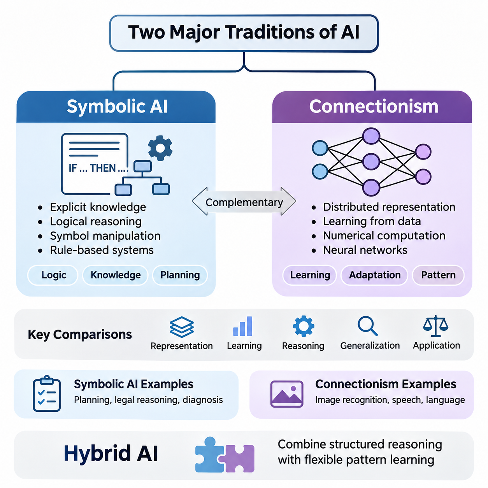
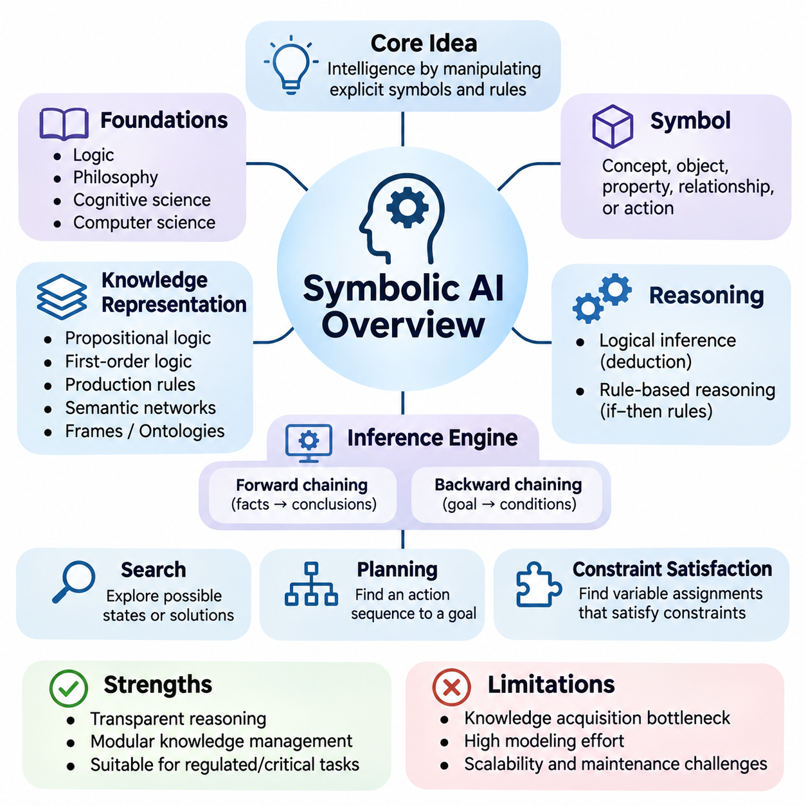
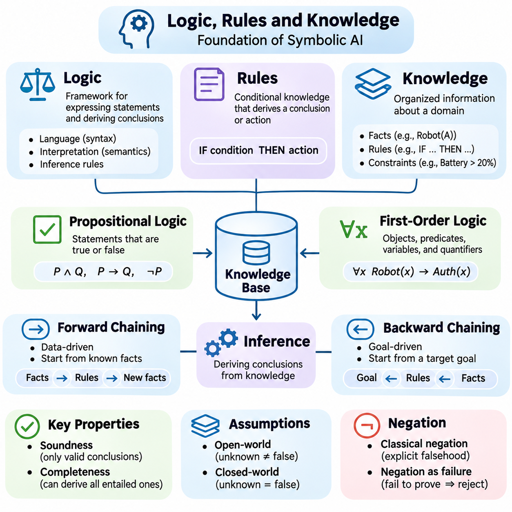
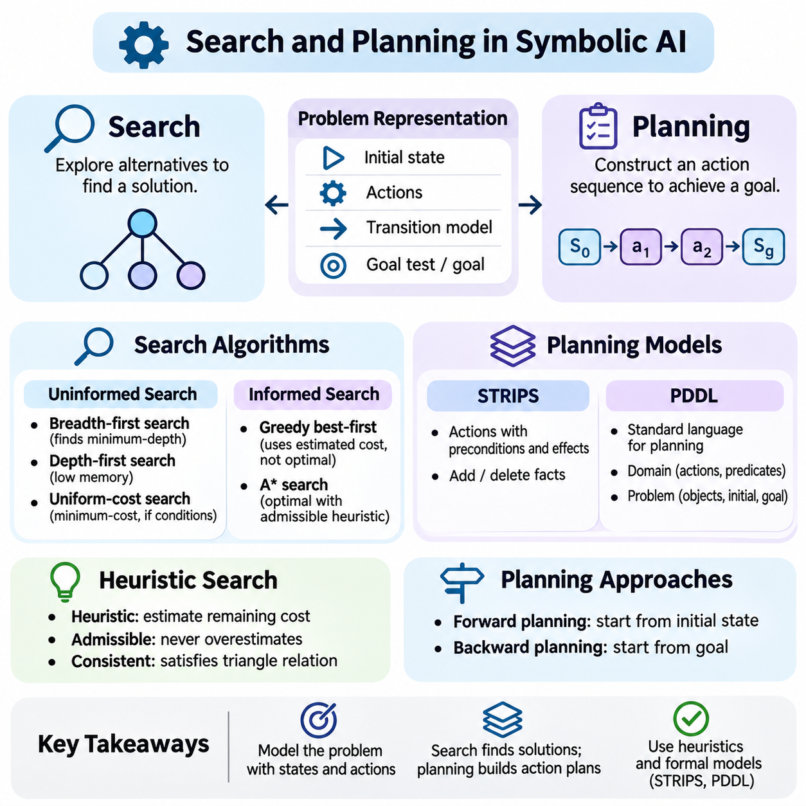
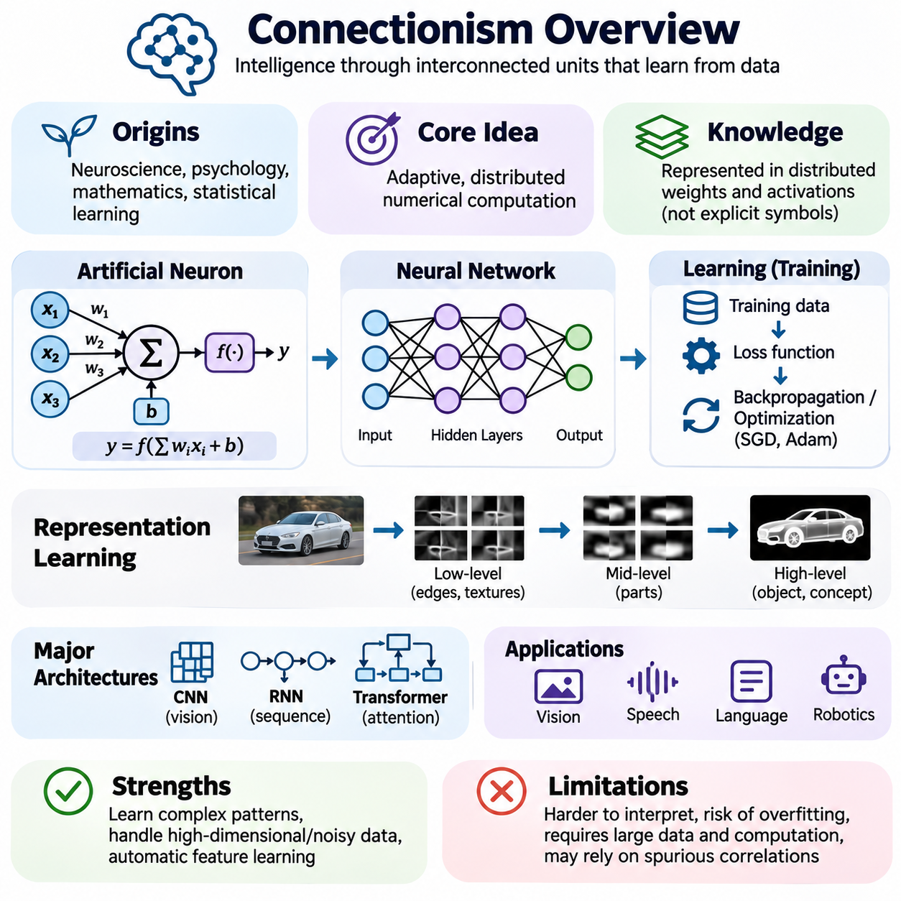
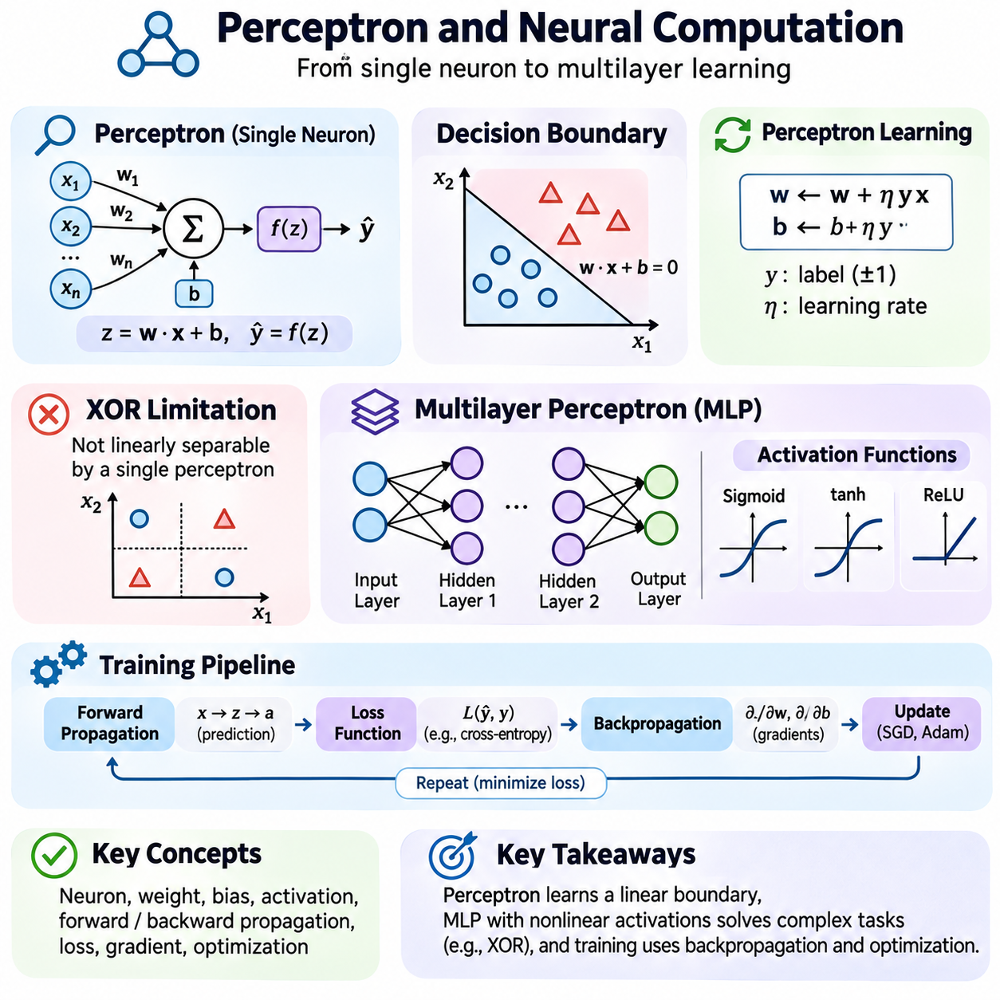
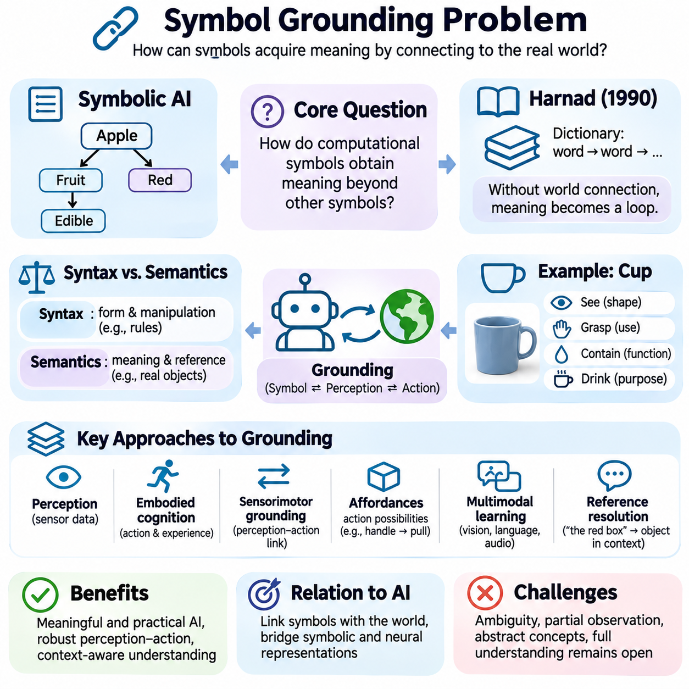
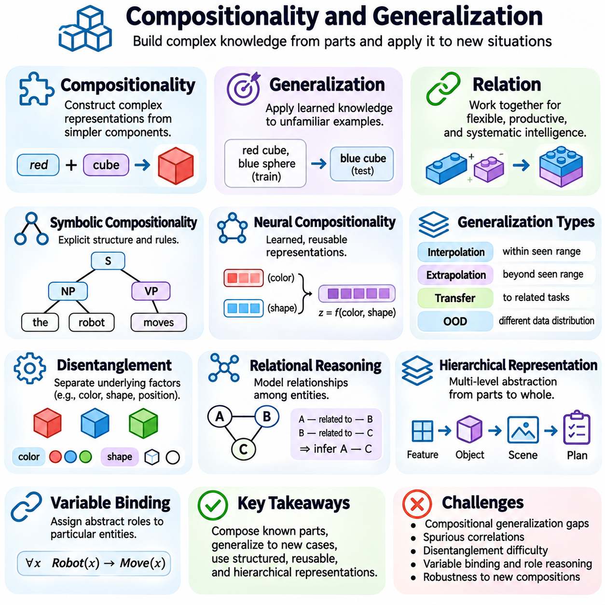
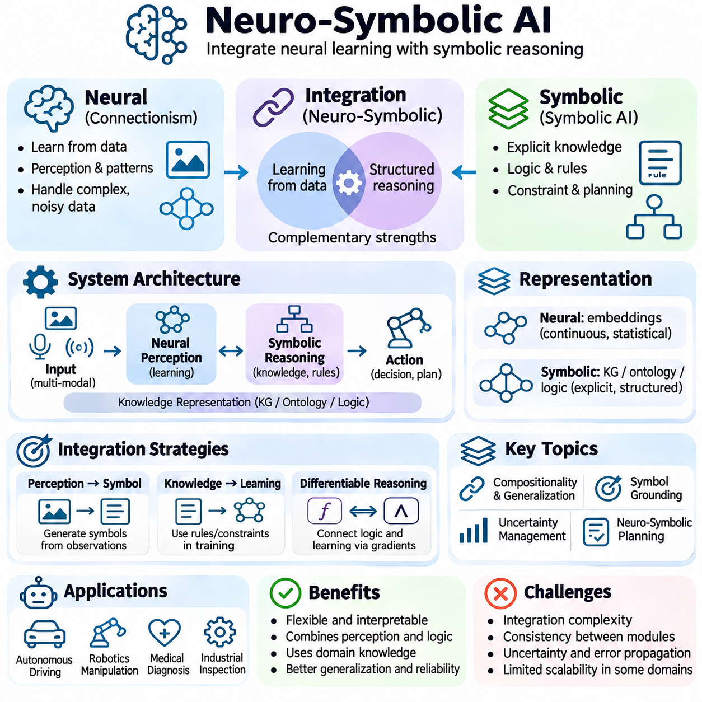
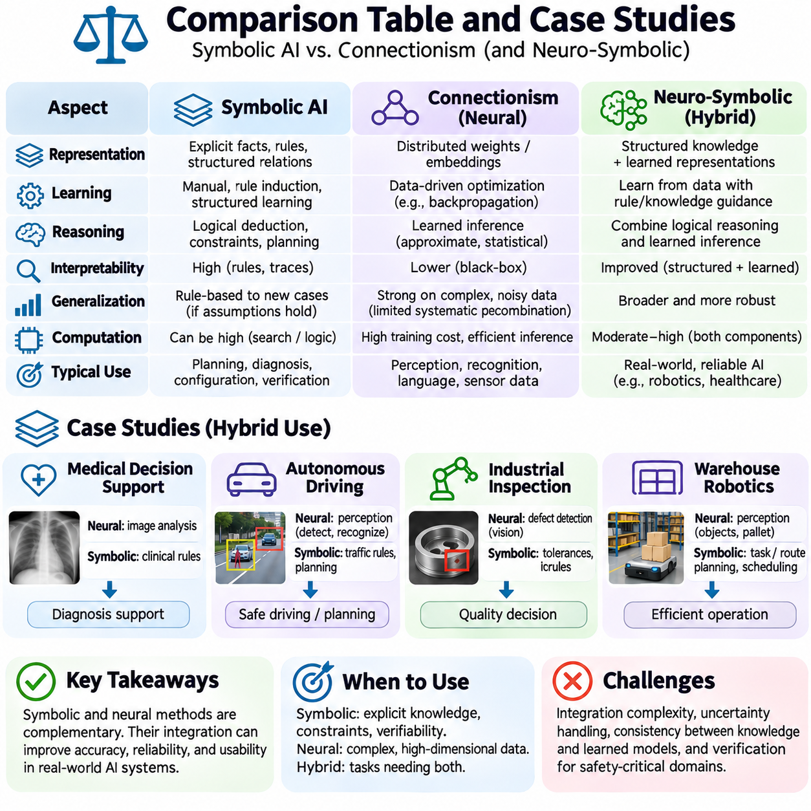

**Volume 04. Artificial Intelligence**


# 03. Symbolic AI vs Connectionism

## 03.00 Two Major Traditions of AI

{width="7.268055555555556in" height="7.268055555555556in"}

Artificial intelligence has developed through two major intellectual traditions: symbolic artificial intelligence and connectionism. Both seek to construct computational systems capable of intelligent behavior, but they differ fundamentally in how knowledge is represented, how learning occurs, and how reasoning is performed. Understanding these traditions provides a conceptual foundation for examining classical AI, neural networks, and modern hybrid intelligence.

Symbolic artificial intelligence assumes that intelligent behavior can emerge from manipulating explicit representations of knowledge. Concepts, objects, relationships, and actions are expressed through symbols governed by logical rules. A symbolic system solves problems by applying inference procedures to structured information, allowing it to derive conclusions, evaluate conditions, and construct sequences of actions according to predefined reasoning mechanisms.

Connectionism approaches intelligence through networks of interconnected computational units inspired by biological neural systems. Rather than requiring every concept or relationship to be explicitly programmed, connectionist models acquire internal representations by adjusting numerical parameters during learning. Knowledge is distributed across network connections, and intelligent behavior emerges from coordinated numerical transformations.

The distinction between these traditions reflects different assumptions about the nature of intelligence. Symbolic AI emphasizes explicit knowledge, logical structure, and deliberate reasoning, while connectionism emphasizes adaptation, distributed representation, and learning from experience. These approaches are not necessarily incompatible, because intelligent systems may require both structured reasoning and flexible pattern recognition.

The intellectual foundations of symbolic AI are closely associated with formal logic, mathematics, linguistics, and cognitive theories of reasoning. Early researchers proposed that aspects of human thought could be modeled as operations over symbolic structures. This perspective encouraged the development of theorem provers, rule-based systems, planning algorithms, and knowledge representation languages capable of expressing complex relationships.

Connectionism draws inspiration from neuroscience, psychology, statistical learning, and mathematical optimization. Its central hypothesis is that computational networks can acquire useful representations through interactions among simple processing units. Early artificial neurons and perceptrons demonstrated how numerical inputs, weighted connections, and activation mechanisms could support elementary classification and adaptive decision-making.

Symbolic systems typically separate knowledge representation from the procedures that operate upon it. A knowledge base may contain facts describing the environment, while an inference engine applies logical rules to determine additional facts or appropriate actions. This separation supports modularity, inspection, and systematic modification, although constructing and maintaining comprehensive knowledge bases can require substantial effort.

Connectionist systems generally encode acquired knowledge within numerical parameters distributed across network layers. During training, optimization algorithms adjust these parameters to reduce discrepancies between predicted and desired outputs or to optimize other learning objectives. The resulting representations may capture statistical regularities, semantic relationships, and complex patterns without requiring programmers to specify each relationship individually.

Consider an intelligent system designed to identify animals. A symbolic approach might represent an animal through properties such as feathers, wings, scales, or habitat, then apply classification rules. A connectionist approach might learn visual features from labeled images and predict animal categories directly. Both can produce classifications, but their internal representations and methods of acquiring knowledge differ substantially.

The symbolic approach becomes especially valuable when a problem requires explicit constraints, formal verification, or logically traceable decisions. Applications such as automated planning, configuration management, legal rule processing, and knowledge-based diagnosis benefit from structured representations. Their reliability nevertheless depends on the completeness, consistency, and correctness of the underlying knowledge and inference procedures.

Connectionist methods are particularly effective when relevant information is high-dimensional, noisy, ambiguous, or difficult to describe through manually constructed rules. Image recognition, speech processing, language modeling, and sensory interpretation frequently involve patterns that cannot be captured conveniently through explicit symbolic descriptions. Neural networks can learn such patterns from sufficiently informative training data.

Learning represents another fundamental difference between the traditions. Traditional symbolic systems often depend on knowledge supplied by human experts, although symbolic machine learning can also induce rules and structures from observations. Connectionist systems generally emphasize parameter adaptation through data-driven optimization. Consequently, the distinction concerns dominant representation and computation mechanisms rather than the presence or absence of learning.

Generalization is essential to both approaches, but it emerges through different mechanisms. Symbolic systems can apply abstract rules to previously unseen combinations of known concepts when their representations and inference procedures support those combinations. Connectionist systems generalize through learned relationships in parameter space, allowing them to respond to new inputs that share relevant statistical structure with training examples.

Reasoning in symbolic AI commonly involves deduction, logical inference, constraint propagation, or explicit search through possible states. These mechanisms can provide identifiable sequences of operations leading from premises to conclusions. Connectionist reasoning may instead occur through successive transformations of distributed representations, making its internal computational processes more difficult to interpret as conventional logical steps.

Uncertainty introduces additional challenges. Classical symbolic logic often operates with propositions that are treated as true or false, whereas real environments contain incomplete observations and uncertain relationships. Probabilistic graphical models, fuzzy logic, and uncertainty-aware reasoning extend structured approaches beyond strict Boolean representations. Connectionist systems can model uncertainty statistically, although reliable confidence estimation requires careful design and evaluation.

Both traditions face limitations when deployed independently. Symbolic systems may struggle with perceptual ambiguity, incomplete knowledge, and the effort required to construct extensive rule sets. Connectionist systems may struggle with systematic compositional generalization, transparent reasoning, and dependable adherence to explicit constraints. Neither tradition automatically guarantees correctness, robustness, or adaptability across unfamiliar environments.

The symbol grounding problem illustrates a particularly important conceptual challenge. Symbols can be manipulated according to formal rules without necessarily establishing how their meanings relate to physical objects, sensory experiences, or real-world interactions. Connectionist perception can help associate representations with observations, but statistical association alone does not completely resolve questions about meaning, reference, and grounded understanding.

Compositionality provides another important dimension of comparison. Human reasoning frequently combines familiar concepts into unfamiliar structures while preserving meaningful relationships. Symbolic representations naturally support certain forms of compositional manipulation through variables, operators, and logical expressions. Neural architectures can also develop compositional capabilities, but their reliability across novel combinations depends on architecture, training, and task characteristics.

Historically, symbolic AI dominated many early research programs because explicit reasoning appeared to offer a direct route toward computational intelligence. Systems demonstrated achievements in theorem proving, game playing, planning, and expert decision support. However, difficulties involving knowledge acquisition, uncertain environments, and computational complexity exposed important limitations in attempts to reproduce broad intelligence through symbolic manipulation alone.

Connectionist research experienced periods of enthusiasm and reduced attention before becoming central to modern AI. Advances in learning algorithms, computing hardware, training datasets, and neural architectures enabled substantial improvements in perception and representation learning. Deep learning extended connectionist principles through multiple computational layers capable of learning increasingly complex transformations from large-scale data.

Modern foundation models demonstrate the extraordinary representational capacity of connectionist architectures. Transformer-based systems can process language, images, audio, and other modalities using learned numerical representations. Their capabilities include generation, classification, retrieval assistance, and certain forms of reasoning. Nevertheless, fluent outputs and successful predictions do not establish that these systems consistently perform valid logical inference.

The emergence of neuro-symbolic AI reflects growing recognition that these traditions offer complementary capabilities. Hybrid architectures seek to integrate neural representation learning with symbolic knowledge, logical constraints, and structured reasoning. Such systems may use neural networks to interpret sensory observations while employing symbolic mechanisms to enforce rules, construct plans, or verify selected conclusions.

A practical neuro-symbolic system might begin with a neural perception module that identifies objects and estimates their attributes. These observations can be converted into structured representations describing entities and relationships. A symbolic reasoning component can then evaluate constraints, infer relevant conditions, and determine permissible actions. Feedback from execution may subsequently improve perception, knowledge, or decision policies.

Autonomous robotics illustrates the value of combining these approaches. Neural models can interpret camera images, estimate environmental features, and recognize objects under variable conditions. Symbolic planners can represent missions, operational rules, and task dependencies. Integrating both capabilities enables robots to connect uncertain sensory information with structured decisions, although real-world operation also requires robust control and safety mechanisms.

Industrial AI provides another useful example. A neural inspection model may identify potential manufacturing defects from images, while a symbolic rule engine evaluates inspection standards, product specifications, and maintenance requirements. The combined system can transform perceptual predictions into operational recommendations. Its effectiveness depends on calibrated predictions, reliable rules, and careful management of conflicting evidence.

The relationship between symbolic AI and connectionism should therefore be understood as a continuing architectural and scientific question rather than a competition with a single winner. Different applications impose different requirements for representation, learning, inference, transparency, and computational efficiency. Selecting an appropriate approach requires examining these requirements instead of assuming that one computational tradition is universally superior.

Future AI systems may increasingly combine explicit knowledge structures, distributed neural representations, probabilistic reasoning, and adaptive control. Such integration offers opportunities to improve interpretability, generalization, and operational reliability, but it also introduces challenges involving representation alignment, uncertainty propagation, computational cost, and system validation. Hybridization is a design strategy rather than an automatic solution.

Ultimately, symbolic AI and connectionism represent two foundational perspectives on computational intelligence. One emphasizes the manipulation of structured knowledge, while the other emphasizes learning distributed representations through numerical computation. Their historical development, complementary strengths, and unresolved limitations provide essential context for understanding modern AI and designing systems that integrate perception, reasoning, learning, and action.

인공지능(Artificial Intelligence, AI)은 기호주의 인공지능(Symbolic Artificial Intelligence)과 연결주의(Connectionism)라는 두 가지 주요 지적 전통을 중심으로 발전해 왔다. 두 접근법 모두 지능적 행동(Intelligent Behavior)을 수행할 수 있는 계산 시스템(Computational System)을 구축하는 것을 목표로 하지만, 지식 표현(Knowledge Representation), 학습(Learning), 추론(Reasoning)을 수행하는 방식에서는 근본적인 차이를 보인다. 이러한 전통을 이해하는 것은 고전적 인공지능(Classical AI), 신경망(Neural Networks), 현대 하이브리드 지능(Hybrid Intelligence)을 살펴보기 위한 개념적 토대를 제공한다.

기호주의 인공지능(Symbolic AI)은 명시적인 지식 표현(Explicit Knowledge Representation)을 조작함으로써 지능적 행동이 나타날 수 있다고 가정한다. 개념(Concept), 객체(Object), 관계(Relationship), 행동(Action)은 논리적 규칙(Logical Rules)에 의해 제어되는 기호(Symbol)로 표현된다. 기호 시스템(Symbolic System)은 구조화된 정보(Structured Information)에 추론 절차(Inference Procedure)를 적용하여 문제를 해결하며, 사전에 정의된 추론 메커니즘(Reasoning Mechanism)에 따라 결론을 도출하고 조건을 평가하며 행동 순서를 구성할 수 있다.

연결주의(Connectionism)는 생물학적 신경계(Biological Neural System)에서 영감을 받은 상호 연결된 계산 단위(Computational Unit)의 네트워크를 통해 지능에 접근한다. 모든 개념이나 관계를 명시적으로 프로그래밍하는 대신, 연결주의 모델(Connectionist Model)은 학습 과정에서 수치 매개변수(Numerical Parameter)를 조정하여 내부 표현(Internal Representation)을 획득한다. 지식은 네트워크 연결 전반에 분산되며, 지능적 행동은 여러 수치 변환(Numerical Transformation)의 조정된 상호작용을 통해 나타난다.

이 두 전통의 차이는 지능의 본질(Nature of Intelligence)에 관한 서로 다른 가정을 반영한다. 기호주의 인공지능은 명시적 지식(Explicit Knowledge), 논리적 구조(Logical Structure), 의도적인 추론(Deliberate Reasoning)을 강조하는 반면, 연결주의는 적응(Adaptation), 분산 표현(Distributed Representation), 경험 기반 학습(Experience-Based Learning)을 강조한다. 그러나 이러한 접근법이 반드시 양립할 수 없는 것은 아니다. 지능형 시스템(Intelligent System)은 구조화된 추론과 유연한 패턴 인식(Pattern Recognition)을 동시에 필요로 할 수 있기 때문이다.

기호주의 인공지능의 지적 기반(Intellectual Foundations)은 형식 논리(Formal Logic), 수학(Mathematics), 언어학(Linguistics), 인지적 추론 이론(Cognitive Theories of Reasoning)과 밀접하게 연결되어 있다. 초기 연구자들은 인간 사고(Human Thought)의 일부를 기호 구조(Symbolic Structure)에 대한 연산으로 모델링할 수 있다고 제안하였다. 이러한 관점은 정리 증명기(Theorem Prover), 규칙 기반 시스템(Rule-Based System), 계획 알고리즘(Planning Algorithm), 복잡한 관계를 표현할 수 있는 지식 표현 언어(Knowledge Representation Language)의 발전을 촉진하였다.

연결주의는 신경과학(Neuroscience), 심리학(Psychology), 통계적 학습(Statistical Learning), 수학적 최적화(Mathematical Optimization)에서 영감을 얻는다. 핵심 가설은 단순한 처리 단위(Processing Unit) 사이의 상호작용을 통해 계산 네트워크가 유용한 표현을 학습할 수 있다는 것이다. 초기 인공 뉴런(Artificial Neuron)과 퍼셉트론(Perceptron)은 수치 입력(Numerical Input), 가중 연결(Weighted Connection), 활성화 메커니즘(Activation Mechanism)이 기본적인 분류(Classification)와 적응적 의사결정(Adaptive Decision-Making)을 지원할 수 있음을 보여주었다.

기호 시스템은 일반적으로 지식 표현(Knowledge Representation)과 이를 처리하는 절차를 분리한다. 지식 베이스(Knowledge Base)는 환경을 설명하는 사실(Fact)을 포함하고, 추론 엔진(Inference Engine)은 논리적 규칙을 적용하여 추가적인 사실이나 적절한 행동을 결정한다. 이러한 분리는 모듈성(Modularity), 검사 가능성(Inspectability), 체계적인 수정(Systematic Modification)을 지원하지만, 포괄적인 지식 베이스를 구축하고 유지하는 데 상당한 노력이 필요할 수 있다.

연결주의 시스템은 일반적으로 네트워크 계층(Network Layer) 전반에 분산된 수치 매개변수에 학습된 지식을 인코딩(Encoding)한다. 학습 과정에서 최적화 알고리즘(Optimization Algorithm)은 예측 출력(Predicted Output)과 목표 출력(Desired Output) 사이의 차이를 줄이거나 다른 학습 목적(Learning Objective)을 최적화하도록 매개변수를 조정한다. 그 결과 프로그래머가 각 관계를 개별적으로 지정하지 않아도 통계적 규칙성(Statistical Regularity), 의미적 관계(Semantic Relationship), 복잡한 패턴(Complex Pattern)을 포착하는 표현이 형성될 수 있다.

동물을 식별하도록 설계된 지능형 시스템을 생각해 볼 수 있다. 기호주의 접근법(Symbolic Approach)은 깃털, 날개, 비늘, 서식지 등의 속성(Attribute)을 통해 동물을 표현하고 분류 규칙(Classification Rule)을 적용할 수 있다. 반면 연결주의 접근법(Connectionist Approach)은 레이블이 지정된 이미지(Labeled Image)에서 시각적 특징(Visual Feature)을 학습하고 동물 범주(Animal Category)를 직접 예측할 수 있다. 두 방식 모두 분류 결과를 생성하지만, 내부 표현과 지식 획득 방법은 상당히 다르다.

기호주의 접근법은 명시적 제약조건(Explicit Constraint), 형식적 검증(Formal Verification), 논리적으로 추적 가능한 의사결정(Traceable Decision-Making)이 필요한 문제에서 특히 유용하다. 자동 계획(Automated Planning), 구성 관리(Configuration Management), 법률 규칙 처리(Legal Rule Processing), 지식 기반 진단(Knowledge-Based Diagnosis)과 같은 응용 분야는 구조화된 표현의 이점을 활용한다. 그러나 신뢰성(Reliability)은 기반 지식과 추론 절차의 완전성(Completeness), 일관성(Consistency), 정확성(Correctness)에 의존한다.

연결주의 방법은 관련 정보가 고차원(High-Dimensional)이거나 잡음(Noise), 모호성(Ambiguity)을 포함하며, 수작업으로 작성한 규칙으로 설명하기 어려운 경우에 특히 효과적이다. 이미지 인식(Image Recognition), 음성 처리(Speech Processing), 언어 모델링(Language Modeling), 감각 정보 해석(Sensory Interpretation)은 명시적인 기호 설명으로 편리하게 포착하기 어려운 패턴을 포함하는 경우가 많다. 신경망은 충분히 유용한 학습 데이터(Training Data)로부터 이러한 패턴을 학습할 수 있다.

학습(Learning)은 두 전통을 구분하는 또 다른 근본적인 요소이다. 전통적인 기호 시스템은 인간 전문가(Human Expert)가 제공하는 지식에 의존하는 경우가 많지만, 기호적 기계학습(Symbolic Machine Learning) 역시 관측 데이터로부터 규칙과 구조를 유도할 수 있다. 연결주의 시스템은 일반적으로 데이터 기반 최적화(Data-Driven Optimization)를 통한 매개변수 적응(Parameter Adaptation)을 강조한다. 따라서 두 접근법의 차이는 학습의 존재 여부보다는 지배적인 표현 방식과 계산 메커니즘에 있다.

일반화(Generalization)는 두 접근법 모두에서 필수적이지만 서로 다른 메커니즘을 통해 나타난다. 기호 시스템은 표현과 추론 절차가 지원하는 경우, 이미 알려진 개념들의 새로운 조합에도 추상적 규칙(Abstract Rule)을 적용할 수 있다. 연결주의 시스템은 매개변수 공간(Parameter Space)에서 학습한 관계를 통해 일반화하며, 학습 사례와 관련된 통계적 구조(Statistical Structure)를 공유하는 새로운 입력에 대응할 수 있다.

기호주의 인공지능에서 추론(Reasoning)은 일반적으로 연역(Deduction), 논리적 추론(Logical Inference), 제약 전파(Constraint Propagation), 가능한 상태에 대한 명시적 탐색(Explicit Search)을 포함한다. 이러한 메커니즘은 전제(Premise)에서 결론(Conclusion)에 이르는 식별 가능한 연산 순서를 제공할 수 있다. 반면 연결주의 추론은 분산 표현(Distributed Representation)의 연속적인 변환을 통해 수행될 수 있으므로, 내부 계산 과정을 전통적인 논리 단계로 해석하기가 더 어려울 수 있다.

불확실성(Uncertainty)은 추가적인 과제를 제기한다. 고전적인 기호 논리(Classical Symbolic Logic)는 명제를 참(True) 또는 거짓(False)으로 취급하는 경우가 많지만, 실제 환경에는 불완전한 관측(Incomplete Observation)과 불확실한 관계가 존재한다. 확률적 그래프 모델(Probabilistic Graphical Model), 퍼지 논리(Fuzzy Logic), 불확실성 인식 추론(Uncertainty-Aware Reasoning)은 엄격한 불리언 표현(Boolean Representation)을 넘어 구조화된 접근법을 확장한다. 연결주의 시스템도 불확실성을 통계적으로 모델링할 수 있지만, 신뢰할 수 있는 신뢰도 추정(Confidence Estimation)을 위해서는 신중한 설계와 평가가 필요하다.

두 전통 모두 독립적으로 적용될 때 한계를 가진다. 기호 시스템은 지각적 모호성(Perceptual Ambiguity), 불완전한 지식(Incomplete Knowledge), 방대한 규칙 집합(Rule Set)의 구축 부담에 어려움을 겪을 수 있다. 연결주의 시스템은 체계적인 구성적 일반화(Systematic Compositional Generalization), 투명한 추론(Transparent Reasoning), 명시적 제약조건의 안정적인 준수에서 어려움을 겪을 수 있다. 어느 접근법도 정확성, 강건성(Robustness), 낯선 환경에 대한 적응성을 자동으로 보장하지 않는다.

기호 접지 문제(Symbol Grounding Problem)는 특히 중요한 개념적 과제를 보여준다. 기호는 형식적 규칙에 따라 조작될 수 있지만, 그 의미가 실제 물체(Physical Object), 감각 경험(Sensory Experience), 현실 세계의 상호작용(Real-World Interaction)과 어떻게 연결되는지는 반드시 확립되지 않는다. 연결주의 지각(Connectionist Perception)은 표현을 관측과 연관시키는 데 도움을 줄 수 있지만, 통계적 연관성(Statistical Association)만으로 의미(Meaning), 지시 대상(Reference), 접지된 이해(Grounded Understanding)에 관한 문제가 완전히 해결되는 것은 아니다.

구성성(Compositionality)은 두 접근법을 비교하는 또 다른 중요한 관점이다. 인간의 추론은 익숙한 개념들을 새로운 구조로 결합하면서 의미 있는 관계를 유지하는 경우가 많다. 기호 표현(Symbolic Representation)은 변수(Variable), 연산자(Operator), 논리식(Logical Expression)을 통해 특정 형태의 구성적 조작(Compositional Manipulation)을 자연스럽게 지원한다. 신경망 구조(Neural Architecture)도 구성적 능력을 발전시킬 수 있지만, 새로운 조합에 대한 신뢰성은 구조, 학습 방식, 과제 특성에 따라 달라진다.

역사적으로 기호주의 인공지능은 명시적 추론이 계산 지능(Computational Intelligence)에 도달하는 직접적인 경로로 여겨졌기 때문에 초기 연구 프로그램의 상당 부분을 주도하였다. 이러한 시스템은 정리 증명(Theorem Proving), 게임 수행(Game Playing), 계획(Planning), 전문가 의사결정 지원(Expert Decision Support)에서 성과를 보여주었다. 그러나 지식 획득(Knowledge Acquisition), 불확실한 환경, 계산 복잡도(Computational Complexity)와 관련된 어려움은 기호 조작만으로 광범위한 지능을 재현하려는 시도의 중요한 한계를 드러냈다.

연결주의 연구는 현대 인공지능의 중심이 되기 전까지 높은 관심과 상대적으로 낮은 관심이 반복되는 시기를 경험하였다. 학습 알고리즘(Learning Algorithm), 컴퓨팅 하드웨어(Computing Hardware), 학습 데이터셋(Training Dataset), 신경망 구조의 발전은 지각(Perception)과 표현 학습(Representation Learning)의 성능을 크게 향상시켰다. 딥러닝(Deep Learning)은 대규모 데이터에서 점점 복잡한 변환을 학습할 수 있는 다중 계산 계층(Multiple Computational Layers)을 통해 연결주의 원리를 확장하였다.

현대 파운데이션 모델(Foundation Model)은 연결주의 구조의 뛰어난 표현 능력(Representational Capacity)을 보여준다. 트랜스포머 기반 시스템(Transformer-Based System)은 학습된 수치 표현을 사용하여 언어, 이미지, 오디오 및 기타 양식(Modality)을 처리할 수 있다. 이러한 능력에는 생성(Generation), 분류(Classification), 검색 지원(Retrieval Assistance), 특정 형태의 추론이 포함된다. 그러나 유창한 출력(Fluent Output)과 성공적인 예측이 항상 일관되고 타당한 논리적 추론을 수행한다는 것을 의미하지는 않는다.

신경-기호 인공지능(Neuro-Symbolic AI)의 등장은 두 전통이 상호 보완적인 능력을 제공한다는 인식이 확산되고 있음을 반영한다. 하이브리드 구조(Hybrid Architecture)는 신경망 표현 학습(Neural Representation Learning)을 기호 지식(Symbolic Knowledge), 논리적 제약조건(Logical Constraint), 구조화된 추론(Structured Reasoning)과 통합하려 한다. 이러한 시스템은 신경망으로 감각 관측을 해석하면서 기호 메커니즘으로 규칙을 적용하고 계획을 구성하거나 특정 결론을 검증할 수 있다.

실용적인 신경-기호 시스템(Neuro-Symbolic System)은 객체를 식별하고 속성을 추정하는 신경망 지각 모듈(Neural Perception Module)에서 시작할 수 있다. 이러한 관측은 개체(Entity)와 관계(Relationship)를 설명하는 구조화된 표현으로 변환된다. 이후 기호 추론 구성요소(Symbolic Reasoning Component)는 제약조건을 평가하고 관련 조건을 추론하며 허용 가능한 행동을 결정한다. 실행 과정에서 얻은 피드백(Feedback)은 지각, 지식 또는 의사결정 정책(Decision Policy)을 개선하는 데 활용될 수 있다.

자율 로봇공학(Autonomous Robotics)은 이러한 접근법을 결합하는 가치를 잘 보여준다. 신경망 모델은 카메라 이미지(Camera Image)를 해석하고 환경 특징(Environmental Feature)을 추정하며 다양한 조건에서 객체를 인식할 수 있다. 기호 계획기(Symbolic Planner)는 임무(Mission), 운영 규칙(Operational Rule), 작업 의존성(Task Dependency)을 표현할 수 있다. 두 능력을 통합하면 로봇이 불확실한 감각 정보를 구조화된 의사결정과 연결할 수 있지만, 실제 환경에서의 운용에는 강건한 제어(Robust Control)와 안전 메커니즘(Safety Mechanism)도 필요하다.

산업 인공지능(Industrial AI)은 또 다른 유용한 사례를 제공한다. 신경망 검사 모델(Neural Inspection Model)은 이미지에서 잠재적인 제조 결함(Manufacturing Defect)을 식별하고, 기호 규칙 엔진(Symbolic Rule Engine)은 검사 기준(Inspection Standard), 제품 사양(Product Specification), 유지보수 요구사항(Maintenance Requirement)을 평가할 수 있다. 결합된 시스템은 지각적 예측(Perceptual Prediction)을 운영 권고(Operational Recommendation)로 변환할 수 있으며, 그 효과는 보정된 예측(Calibrated Prediction), 신뢰할 수 있는 규칙, 상충하는 증거(Conflicting Evidence)의 신중한 관리에 달려 있다.

따라서 기호주의 인공지능과 연결주의의 관계는 하나의 승자를 결정하는 경쟁이 아니라 지속적인 구조적·과학적 문제(Architectural and Scientific Question)로 이해해야 한다. 서로 다른 응용 분야는 표현, 학습, 추론, 투명성(Transparency), 계산 효율성(Computational Efficiency)에 대해 서로 다른 요구사항을 가진다. 적절한 접근법을 선택하려면 하나의 계산 전통이 보편적으로 우수하다고 가정하기보다 이러한 요구사항을 분석해야 한다.

미래의 인공지능 시스템은 명시적 지식 구조(Explicit Knowledge Structure), 분산 신경망 표현(Distributed Neural Representation), 확률적 추론(Probabilistic Reasoning), 적응적 제어(Adaptive Control)를 점점 더 긴밀하게 결합할 수 있다. 이러한 통합은 해석 가능성(Interpretability), 일반화, 운영 신뢰성(Operational Reliability)을 개선할 기회를 제공하지만, 표현 정렬(Representation Alignment), 불확실성 전파(Uncertainty Propagation), 계산 비용(Computational Cost), 시스템 검증(System Validation)과 관련된 과제도 발생시킨다. 하이브리드화(Hybridization)는 자동적인 해결책이 아니라 하나의 설계 전략(Design Strategy)이다.

궁극적으로 기호주의 인공지능과 연결주의는 계산 지능에 관한 두 가지 기초적인 관점(Foundational Perspective)을 나타낸다. 하나는 구조화된 지식(Structured Knowledge)의 조작을 강조하고, 다른 하나는 수치 계산(Numerical Computation)을 통한 분산 표현의 학습을 강조한다. 두 전통의 역사적 발전, 상호 보완적인 강점, 아직 해결되지 않은 한계는 현대 인공지능을 이해하고 지각, 추론, 학습, 행동을 통합하는 시스템을 설계하는 데 필수적인 개념적 배경을 제공한다.

## 03.01 Symbolic AI Overview

{width="7.268055555555556in" height="7.268055555555556in"}

Symbolic artificial intelligence is a foundational approach to computational intelligence in which knowledge is represented through explicit symbols, logical expressions, and structured relationships. Its central assumption is that intelligent behavior can be produced by manipulating meaningful representations according to formal rules. This approach emphasizes reasoning, knowledge organization, and systematic problem solving rather than learning exclusively from numerical data.

The intellectual foundations of symbolic AI originate from mathematical logic, philosophy, cognitive science, and early computer science. Researchers proposed that aspects of human reasoning could be expressed as computational operations over symbols. This perspective encouraged the development of formal languages and inference mechanisms capable of representing facts, evaluating propositions, and deriving conclusions through well-defined computational procedures.

A symbol represents an identifiable concept, object, property, relationship, or action within a computational system. Symbols may describe physical entities, abstract categories, environmental conditions, or logical states. Their significance comes from the interpretation assigned to them and the rules governing their manipulation. Symbolic AI therefore depends on structured representations that preserve meaningful relationships among different elements of knowledge.

Knowledge representation is a central component of symbolic intelligence. Information may be organized through propositional logic, first-order logic, production rules, semantic networks, frames, or ontologies. Each representation provides a different mechanism for describing entities and their relationships. Selecting an appropriate representation influences the expressiveness, computational complexity, and reasoning capabilities of the resulting intelligent system.

Logical reasoning enables symbolic systems to derive new information from existing knowledge. Deductive inference applies valid logical rules to established premises, allowing conclusions to follow from formally specified assumptions. For example, if every autonomous vehicle requires operational authorization and a particular robot is classified as an autonomous vehicle, the system can infer that the robot requires operational authorization.

Rule-based reasoning provides another important mechanism for symbolic computation. A rule typically specifies conditions under which a particular conclusion or action becomes applicable. When the conditions are satisfied, an inference engine may activate the corresponding rule. This structure supports expert systems, diagnostic applications, automated decision procedures, and operational control systems where knowledge can be expressed through explicit conditions.

An inference engine is responsible for applying reasoning procedures to a knowledge base. The knowledge base stores facts, rules, and relationships, while the inference engine determines which conclusions can be derived. Forward chaining begins with available facts and repeatedly applies applicable rules. Backward chaining starts with a desired conclusion and searches for supporting conditions that would establish its validity.

Symbolic AI also relies heavily on search algorithms to explore alternative states, decisions, or solutions. A problem can be represented through an initial state, available actions, transition rules, and a goal condition. Search procedures systematically investigate possible paths toward the goal. Breadth-first search, depth-first search, and heuristic search demonstrate how symbolic representations can support structured problem-solving strategies.

Planning extends symbolic reasoning by constructing sequences of actions that achieve specified objectives. A planning system represents the current environment, available operations, action preconditions, and expected effects. It then identifies a sequence that transforms the initial state into a desired goal state. Classical planning frameworks such as STRIPS and PDDL provide formal mechanisms for describing planning domains and problems.

Constraint satisfaction represents another important application of symbolic intelligence. A constraint satisfaction problem defines variables, possible values, and restrictions governing acceptable combinations. Solving the problem requires finding assignments that satisfy the specified constraints. Scheduling, resource allocation, configuration management, and logistics planning frequently benefit from this approach because their requirements can be expressed explicitly.

One important strength of symbolic AI is its capacity to support transparent reasoning. Because knowledge and inference procedures are represented explicitly, developers can often inspect the rules and reconstruct the logical steps behind a conclusion. This characteristic is valuable in regulated environments, engineering systems, and applications requiring accountability. However, transparency depends on the complexity and implementation of the reasoning architecture.

Symbolic systems also support modular knowledge management. Individual rules, facts, or relationships can often be modified without retraining an entire computational model. This makes symbolic approaches attractive when domain knowledge changes through regulations, engineering requirements, or operational procedures. Nevertheless, modifications must be checked for logical consistency because interacting rules can introduce contradictions or unexpected consequences.

The knowledge acquisition bottleneck is a major limitation of traditional symbolic AI. Constructing comprehensive knowledge bases often requires experts to identify relevant concepts, formulate rules, and encode exceptions. As the application domain expands, the number of required relationships can become difficult to manage. Incomplete or incorrectly specified knowledge may produce conclusions that are logically consistent with the rules but inappropriate for reality.

Symbolic reasoning also encounters difficulties when information is uncertain, ambiguous, or continuously changing. Classical logical systems commonly operate with discrete propositions and precisely defined relationships, while real environments contain noisy observations and incomplete evidence. Extensions involving probabilistic reasoning, fuzzy logic, and nonmonotonic reasoning help address these challenges by supporting uncertainty and revisions to previously accepted conclusions.

Computational complexity creates another practical challenge. Search and inference procedures may require examining extremely large combinations of possible states or logical assignments. Certain planning and constraint satisfaction problems become computationally expensive as their dimensions increase. Heuristics, pruning strategies, efficient representations, and specialized solvers are therefore essential for making symbolic reasoning practical in demanding applications.

The relationship between symbolic AI and human cognition has been influential throughout the history of artificial intelligence. Symbolic cognitive theories propose that aspects of thinking involve structured representations and operations resembling logical manipulation. Such models can explain certain forms of deliberate reasoning and problem solving. However, human intelligence also includes perception, intuition, adaptation, and embodied interaction that cannot be fully characterized by explicit symbolic rules alone.

Expert systems demonstrate the historical importance of symbolic approaches. These systems encode specialized domain knowledge through rules and apply inference mechanisms to provide recommendations or diagnoses. Early medical and engineering expert systems illustrated how structured expertise could support complex decisions. Their limitations also revealed the difficulties of maintaining extensive rule bases and adapting to situations outside predefined knowledge.

Modern knowledge graphs extend symbolic representation by organizing information into entities and relationships. Graph structures support semantic queries, relationship exploration, and certain forms of logical inference. Ontologies can define classes, properties, and constraints that provide a shared conceptual structure. These technologies remain important in enterprise information systems, scientific knowledge management, semantic integration, and knowledge-intensive AI applications.

Symbolic AI continues to contribute to autonomous systems and robotics. Task planners can represent mission objectives, action dependencies, operational restrictions, and resource requirements. Rule-based components can enforce safety conditions or determine permissible behaviors. When integrated with perception and control modules, symbolic reasoning helps transform high-level objectives into structured operational decisions while maintaining explicit constraints.

Large language models and other neural systems have renewed interest in symbolic reasoning as a complementary capability. Neural models can interpret natural language and generate candidate plans, while symbolic components can evaluate formal constraints, execute structured searches, or verify selected conclusions. Such integration does not guarantee correctness, but it can provide mechanisms for reducing certain reasoning errors and improving consistency.

Neuro-symbolic AI combines explicit knowledge structures with learned numerical representations. Neural networks may identify objects, extract relationships, or estimate uncertain environmental conditions, while symbolic mechanisms organize the resulting information and perform rule-based inference. This division of responsibilities can support applications requiring both flexible perception and structured decision-making, although reliable integration remains a significant engineering challenge.

The effectiveness of symbolic AI depends strongly on problem formulation and representation quality. Developers must identify relevant entities, define meaningful relationships, specify valid operations, and establish appropriate reasoning objectives. A poorly designed symbolic model can produce inefficient searches or misleading conclusions even when its inference engine operates correctly. Representation engineering is therefore a fundamental aspect of symbolic system design.

Evaluating symbolic systems requires more than checking whether they produce expected answers. Important considerations include logical soundness, completeness relative to the selected inference system, computational efficiency, scalability, and consistency of the knowledge base. Application-level evaluation must also determine whether encoded assumptions accurately describe the operating environment and whether the system behaves appropriately when information is missing.

Symbolic artificial intelligence remains a fundamental component of the broader AI landscape because explicit representation and structured reasoning address requirements that statistical prediction alone may not satisfy. Its methods provide foundations for logic programming, automated planning, constraint solving, knowledge representation, and explainable decision processes. Understanding these principles is essential for designing intelligent systems that combine formal reasoning with modern learning technologies.

기호주의 인공지능(Symbolic Artificial Intelligence)은 명시적인 기호(Symbol), 논리적 표현(Logical Expression), 구조화된 관계(Structured Relationship)를 통해 지식을 표현하는 계산 지능(Computational Intelligence)의 기초적인 접근법이다. 핵심 가정은 형식적 규칙(Formal Rule)에 따라 의미 있는 표현(Meaningful Representation)을 조작함으로써 지능적 행동(Intelligent Behavior)을 생성할 수 있다는 것이다. 이 접근법은 수치 데이터(Numerical Data)만을 통한 학습보다는 추론(Reasoning), 지식 조직(Knowledge Organization), 체계적인 문제 해결(Systematic Problem Solving)을 강조한다.

기호주의 인공지능의 지적 기반(Intellectual Foundations)은 수리 논리학(Mathematical Logic), 철학(Philosophy), 인지과학(Cognitive Science), 초기 컴퓨터 과학(Early Computer Science)에서 비롯되었다. 연구자들은 인간 추론(Human Reasoning)의 일부를 기호에 대한 계산 연산(Computational Operation)으로 표현할 수 있다고 제안하였다. 이러한 관점은 사실(Fact)을 표현하고 명제(Proposition)를 평가하며 명확하게 정의된 계산 절차(Computational Procedure)를 통해 결론을 도출할 수 있는 형식 언어(Formal Language)와 추론 메커니즘(Inference Mechanism)의 발전을 촉진하였다.

기호(Symbol)는 계산 시스템(Computational System) 내에서 식별 가능한 개념(Concept), 객체(Object), 속성(Property), 관계(Relationship), 행동(Action)을 나타낸다. 기호는 물리적 개체(Physical Entity), 추상적 범주(Abstract Category), 환경 조건(Environmental Condition), 논리적 상태(Logical State)를 설명할 수 있다. 기호의 의미는 해당 기호에 부여된 해석(Interpretation)과 이를 조작하는 규칙에서 비롯된다. 따라서 기호주의 인공지능은 지식의 여러 요소 사이에 의미 있는 관계를 유지하는 구조화된 표현(Structured Representation)에 의존한다.

지식 표현(Knowledge Representation)은 기호 지능(Symbolic Intelligence)의 핵심 구성요소이다. 정보는 명제 논리(Propositional Logic), 일차 논리(First-Order Logic), 생성 규칙(Production Rule), 의미망(Semantic Network), 프레임(Frame), 온톨로지(Ontology)를 통해 구성될 수 있다. 각 표현 방식은 개체와 그 관계를 설명하는 서로 다른 메커니즘을 제공한다. 적절한 표현 방식을 선택하는 것은 지능형 시스템(Intelligent System)의 표현력(Expressiveness), 계산 복잡도(Computational Complexity), 추론 능력(Reasoning Capability)에 영향을 미친다.

논리적 추론(Logical Reasoning)은 기호 시스템(Symbolic System)이 기존 지식으로부터 새로운 정보를 도출하도록 한다. 연역적 추론(Deductive Inference)은 확립된 전제(Premise)에 유효한 논리 규칙(Logical Rule)을 적용하여 형식적으로 명시된 가정(Assumption)으로부터 결론(Conclusion)을 도출한다. 예를 들어 모든 자율주행 차량(Autonomous Vehicle)에 운행 허가(Operational Authorization)가 필요하고 특정 로봇이 자율주행 차량으로 분류된다면, 시스템은 해당 로봇에도 운행 허가가 필요하다는 결론을 추론할 수 있다.

규칙 기반 추론(Rule-Based Reasoning)은 기호 계산(Symbolic Computation)의 또 다른 중요한 메커니즘이다. 규칙(Rule)은 일반적으로 특정 결론이나 행동이 적용될 수 있는 조건(Condition)을 명시한다. 이러한 조건이 충족되면 추론 엔진(Inference Engine)은 해당 규칙을 활성화할 수 있다. 이 구조는 지식을 명시적인 조건으로 표현할 수 있는 전문가 시스템(Expert System), 진단 응용(Diagnostic Application), 자동화된 의사결정 절차(Automated Decision Procedure), 운영 제어 시스템(Operational Control System)을 지원한다.

추론 엔진(Inference Engine)은 지식 베이스(Knowledge Base)에 추론 절차(Reasoning Procedure)를 적용하는 역할을 담당한다. 지식 베이스는 사실(Fact), 규칙(Rule), 관계(Relationship)를 저장하며, 추론 엔진은 어떤 결론을 도출할 수 있는지 결정한다. 전방향 추론(Forward Chaining)은 사용 가능한 사실에서 시작하여 적용 가능한 규칙을 반복적으로 실행한다. 후방향 추론(Backward Chaining)은 원하는 결론에서 출발하여 그 결론의 타당성을 입증할 수 있는 지원 조건(Supporting Condition)을 탐색한다.

기호주의 인공지능은 대안적인 상태(State), 의사결정(Decision), 해결책(Solution)을 탐색하기 위해 탐색 알고리즘(Search Algorithm)에 크게 의존한다. 문제는 초기 상태(Initial State), 사용 가능한 행동(Available Action), 상태 전이 규칙(Transition Rule), 목표 조건(Goal Condition)으로 표현할 수 있다. 탐색 절차(Search Procedure)는 목표에 도달할 수 있는 경로를 체계적으로 조사한다. 너비 우선 탐색(Breadth-First Search), 깊이 우선 탐색(Depth-First Search), 휴리스틱 탐색(Heuristic Search)은 기호 표현이 구조화된 문제 해결 전략을 지원하는 방식을 보여준다.

계획(Planning)은 지정된 목표(Objective)를 달성하는 행동 순서(Action Sequence)를 구성함으로써 기호 추론(Symbolic Reasoning)을 확장한다. 계획 시스템(Planning System)은 현재 환경(Current Environment), 사용 가능한 연산(Operation), 행동 전제조건(Action Precondition), 예상 효과(Expected Effect)를 표현한다. 이후 초기 상태를 원하는 목표 상태(Goal State)로 변환하는 행동 순서를 식별한다. STRIPS와 PDDL 같은 고전적 계획 프레임워크(Classical Planning Framework)는 계획 도메인(Planning Domain)과 문제를 설명하기 위한 형식적 메커니즘을 제공한다.

제약 충족(Constraint Satisfaction)은 기호 지능(Symbolic Intelligence)의 또 다른 중요한 응용 분야이다. 제약 충족 문제(Constraint Satisfaction Problem, CSP)는 변수(Variable), 가능한 값(Possible Value), 허용 가능한 조합을 제한하는 제약조건(Constraint)을 정의한다. 문제 해결에는 지정된 제약조건을 만족하는 값의 할당(Assignment)을 찾는 과정이 필요하다. 일정 계획(Scheduling), 자원 할당(Resource Allocation), 구성 관리(Configuration Management), 물류 계획(Logistics Planning)은 요구사항을 명시적으로 표현할 수 있으므로 이러한 접근법의 이점을 활용한다.

기호주의 인공지능의 중요한 강점 중 하나는 투명한 추론(Transparent Reasoning)을 지원할 수 있다는 점이다. 지식과 추론 절차가 명시적으로 표현되기 때문에 개발자는 규칙을 검사하고 결론에 도달한 논리적 단계(Logical Step)를 재구성할 수 있는 경우가 많다. 이러한 특성은 규제 환경(Regulated Environment), 공학 시스템(Engineering System), 책임성(Accountability)이 요구되는 응용 분야에서 유용하다. 그러나 투명성은 추론 구조(Reasoning Architecture)의 복잡성과 구현 방식에 따라 달라진다.

기호 시스템은 모듈식 지식 관리(Modular Knowledge Management)도 지원한다. 개별 규칙, 사실 또는 관계는 전체 계산 모델(Computational Model)을 다시 학습시키지 않고도 수정할 수 있는 경우가 많다. 이러한 특성은 규정(Regulation), 공학 요구사항(Engineering Requirement), 운영 절차(Operational Procedure)에 따라 도메인 지식(Domain Knowledge)이 변경되는 환경에서 기호주의 접근법을 매력적으로 만든다. 다만 상호작용하는 규칙이 모순(Contradiction)이나 예상하지 못한 결과(Unexpected Consequence)를 초래할 수 있으므로 수정 사항에 대한 논리적 일관성(Logical Consistency)을 확인해야 한다.

지식 획득 병목현상(Knowledge Acquisition Bottleneck)은 전통적인 기호주의 인공지능의 주요 한계이다. 포괄적인 지식 베이스를 구축하려면 전문가가 관련 개념을 식별하고 규칙을 공식화하며 예외(Exception)를 인코딩(Encoding)해야 하는 경우가 많다. 응용 도메인(Application Domain)이 확장되면 필요한 관계의 수가 관리하기 어려울 정도로 증가할 수 있다. 불완전하거나 잘못 명시된 지식은 규칙과 논리적으로 일치하더라도 현실에는 부적절한 결론을 생성할 수 있다.

기호 추론(Symbolic Reasoning)은 정보가 불확실하거나 모호하며 지속적으로 변화하는 경우에도 어려움을 겪는다. 고전적 논리 시스템(Classical Logical System)은 일반적으로 이산적 명제(Discrete Proposition)와 명확하게 정의된 관계를 사용하지만, 실제 환경에는 잡음이 포함된 관측(Noisy Observation)과 불완전한 증거(Incomplete Evidence)가 존재한다. 확률적 추론(Probabilistic Reasoning), 퍼지 논리(Fuzzy Logic), 비단조 추론(Nonmonotonic Reasoning)을 포함하는 확장 기법은 불확실성과 기존 결론의 수정을 지원함으로써 이러한 문제를 해결하는 데 도움을 준다.

계산 복잡도(Computational Complexity)는 또 다른 실질적인 과제를 만든다. 탐색 및 추론 절차는 가능한 상태나 논리적 할당(Logical Assignment)의 매우 큰 조합을 조사해야 할 수 있다. 특정 계획 문제(Planning Problem)와 제약 충족 문제는 차원(Dimension)이 증가함에 따라 계산 비용이 급격히 증가한다. 따라서 휴리스틱(Heuristic), 가지치기 전략(Pruning Strategy), 효율적인 표현(Efficient Representation), 특수 목적 해결기(Specialized Solver)는 복잡한 응용 분야에서 기호 추론을 실용적으로 구현하는 데 필수적이다.

기호주의 인공지능과 인간 인지(Human Cognition)의 관계는 인공지능 역사 전반에 걸쳐 중요한 영향을 미쳤다. 기호적 인지 이론(Symbolic Cognitive Theory)은 사고(Thinking)의 일부가 논리적 조작과 유사한 구조화된 표현 및 연산을 포함한다고 제안한다. 이러한 모델은 특정 형태의 의도적 추론(Deliberate Reasoning)과 문제 해결(Problem Solving)을 설명할 수 있다. 그러나 인간 지능(Human Intelligence)에는 지각(Perception), 직관(Intuition), 적응(Adaptation), 체화된 상호작용(Embodied Interaction)도 포함되며, 이러한 요소를 명시적인 기호 규칙만으로 완전히 설명할 수는 없다.

전문가 시스템(Expert System)은 기호주의 접근법의 역사적 중요성을 보여준다. 이러한 시스템은 전문적인 도메인 지식을 규칙으로 인코딩하고 추론 메커니즘을 적용하여 권고(Recommendation)나 진단(Diagnosis)을 제공한다. 초기 의료 및 공학 전문가 시스템은 구조화된 전문 지식(Structured Expertise)이 복잡한 의사결정을 지원할 수 있음을 보여주었다. 동시에 광범위한 규칙 베이스(Rule Base)를 유지하고 사전에 정의된 지식 범위를 벗어나는 상황에 적응하는 데 따르는 어려움도 드러냈다.

현대 지식 그래프(Knowledge Graph)는 정보를 개체(Entity)와 관계(Relationship)로 구성함으로써 기호 표현(Symbolic Representation)을 확장한다. 그래프 구조(Graph Structure)는 의미적 질의(Semantic Query), 관계 탐색(Relationship Exploration), 특정 형태의 논리적 추론(Logical Inference)을 지원한다. 온톨로지(Ontology)는 공유된 개념 구조(Conceptual Structure)를 제공하는 클래스(Class), 속성(Property), 제약조건(Constraint)을 정의할 수 있다. 이러한 기술은 기업 정보 시스템(Enterprise Information System), 과학 지식 관리(Scientific Knowledge Management), 의미적 통합(Semantic Integration), 지식 집약적 인공지능(Knowledge-Intensive AI)에서 여전히 중요하다.

기호주의 인공지능은 자율 시스템(Autonomous System)과 로봇공학(Robotics)에도 지속적으로 기여하고 있다. 작업 계획기(Task Planner)는 임무 목표(Mission Objective), 행동 의존성(Action Dependency), 운영 제한사항(Operational Restriction), 자원 요구사항(Resource Requirement)을 표현할 수 있다. 규칙 기반 구성요소(Rule-Based Component)는 안전 조건(Safety Condition)을 강제하거나 허용 가능한 행동을 결정할 수 있다. 지각 및 제어 모듈(Perception and Control Module)과 통합되면 기호 추론은 명시적 제약조건을 유지하면서 상위 수준 목표(High-Level Objective)를 구조화된 운영 의사결정(Structured Operational Decision)으로 변환하는 데 도움을 준다.

대규모 언어 모델(Large Language Model, LLM)과 기타 신경망 시스템(Neural System)의 발전은 상호 보완적인 능력으로서 기호 추론에 대한 관심을 다시 높였다. 신경망 모델은 자연어(Natural Language)를 해석하고 후보 계획(Candidate Plan)을 생성할 수 있으며, 기호 구성요소(Symbolic Component)는 형식적 제약조건(Formal Constraint)을 평가하고 구조화된 탐색(Structured Search)을 실행하거나 특정 결론을 검증할 수 있다. 이러한 통합이 정확성을 보장하는 것은 아니지만, 일부 추론 오류(Reasoning Error)를 줄이고 일관성을 개선하는 메커니즘을 제공할 수 있다.

신경-기호 인공지능(Neuro-Symbolic AI)은 명시적 지식 구조(Explicit Knowledge Structure)와 학습된 수치 표현(Learned Numerical Representation)을 결합한다. 신경망(Neural Network)은 객체를 식별하고 관계를 추출하거나 불확실한 환경 조건(Environmental Condition)을 추정할 수 있으며, 기호 메커니즘(Symbolic Mechanism)은 그 결과로 얻은 정보를 조직하고 규칙 기반 추론(Rule-Based Inference)을 수행한다. 이러한 역할 분담은 유연한 지각(Flexible Perception)과 구조화된 의사결정(Structured Decision-Making)을 모두 요구하는 응용 분야를 지원할 수 있지만, 신뢰할 수 있는 통합(Reliable Integration)은 여전히 중요한 공학적 과제이다.

기호주의 인공지능의 효과는 문제 정식화(Problem Formulation)와 표현 품질(Representation Quality)에 크게 의존한다. 개발자는 관련 개체를 식별하고 의미 있는 관계를 정의하며 유효한 연산(Valid Operation)을 명시하고 적절한 추론 목표(Reasoning Objective)를 설정해야 한다. 잘못 설계된 기호 모델(Symbolic Model)은 추론 엔진이 올바르게 작동하더라도 비효율적인 탐색이나 잘못된 결론을 생성할 수 있다. 따라서 표현 공학(Representation Engineering)은 기호 시스템 설계(Symbolic System Design)의 근본적인 요소이다.

기호 시스템을 평가(Evaluation)하려면 예상한 답을 생성하는지 확인하는 것 이상의 검토가 필요하다. 중요한 고려사항에는 논리적 건전성(Logical Soundness), 선택한 추론 시스템에 대한 완전성(Completeness), 계산 효율성(Computational Efficiency), 확장성(Scalability), 지식 베이스의 일관성(Consistency)이 포함된다. 응용 수준 평가(Application-Level Evaluation)에서는 인코딩된 가정이 실제 운영 환경(Operating Environment)을 정확하게 설명하는지, 정보가 누락되었을 때 시스템이 적절하게 동작하는지도 확인해야 한다.

기호주의 인공지능은 명시적 표현(Explicit Representation)과 구조화된 추론(Structured Reasoning)이 통계적 예측(Statistical Prediction)만으로 충족하기 어려운 요구사항을 해결하기 때문에 광범위한 인공지능 기술 체계에서 여전히 핵심적인 구성요소로 남아 있다. 기호주의 방법은 논리 프로그래밍(Logic Programming), 자동 계획(Automated Planning), 제약조건 해결(Constraint Solving), 지식 표현(Knowledge Representation), 설명 가능한 의사결정 과정(Explainable Decision Process)의 기반을 제공한다. 이러한 원리를 이해하는 것은 형식적 추론(Formal Reasoning)과 현대 학습 기술(Modern Learning Technology)을 결합하는 지능형 시스템을 설계하는 데 필수적이다.

## 03.02 Logic Rules and Knowledge

{width="7.268055555555556in" height="7.268055555555556in"}

Logic, rules, and knowledge form the conceptual foundation of symbolic artificial intelligence. They enable computational systems to represent facts, describe relationships, and derive conclusions through explicit reasoning procedures. Unlike approaches that primarily learn numerical patterns from data, symbolic systems organize information into meaningful structures whose interpretation and manipulation are governed by formal principles.

Logic provides a mathematical framework for expressing statements and determining whether conclusions follow from established premises. A logical system defines a language, an interpretation of expressions, and inference rules. These components distinguish the syntax of knowledge representations from their semantics. This distinction allows reasoning procedures to operate systematically while preserving clearly specified relationships between statements.

Propositional logic represents knowledge through statements that are either true or false under a particular interpretation. Logical operators such as conjunction, disjunction, negation, and implication combine propositions into more complex expressions. For example, a system may represent that a robot is operational and that its battery is sufficiently charged. These propositions can support decisions when combined with additional logical conditions.

First-order logic extends propositional reasoning by introducing objects, predicates, variables, and quantifiers. It can express general relationships rather than requiring every statement to describe a specific situation. For example, a rule may state that every robot assigned to a restricted area requires authorization. Universal quantification expresses this general requirement, while individual facts identify robots and their assignments.

Knowledge representation determines how information about a domain is organized for computational reasoning. A knowledge base may contain facts describing objects, rules governing relationships, and constraints defining acceptable conditions. Its effectiveness depends on whether the representation captures distinctions relevant to the task. An overly simplified representation may omit important relationships, while excessive detail can increase computational complexity.

Rules provide a practical mechanism for encoding domain knowledge as conditional relationships. A production rule typically connects an antecedent, representing required conditions, with a consequent, representing a conclusion or action. When the antecedent is satisfied, the system may derive the consequent or activate an associated procedure. Such rules are widely used in expert systems, configuration engines, and automated decision support.

Logical implication and operational rule execution must be distinguished. A logical implication describes a relationship between propositions, whereas an executable rule specifies how a reasoning engine should process information. The two may share similar notation but differ in computational behavior. Understanding this distinction is essential when translating declarative knowledge into reliable software implementations.

Inference is the process of deriving conclusions from available knowledge according to defined rules. A sound inference procedure produces conclusions that logically follow from its premises. Completeness, relative to a chosen logic, means that every entailed conclusion can in principle be derived. These properties provide theoretical foundations for evaluating reasoning systems, although computational resource limitations remain important in practice.

Forward chaining is a data-driven inference strategy that begins with known facts and repeatedly applies rules whose conditions are satisfied. Each successful application may add new information to the knowledge base. The process continues until a target conclusion is obtained or no additional facts can be derived. Forward chaining is useful in monitoring systems, event processing, and applications requiring continuous evaluation of changing conditions.

Backward chaining follows a goal-driven strategy. Instead of deriving every possible conclusion, it begins with a target proposition and searches for rules that could establish it. The conditions of those rules become subgoals that must be verified through facts or further inference. This approach is particularly useful in diagnostic systems, query answering, and logic programming environments where specific conclusions must be investigated.

Knowledge bases require mechanisms for maintaining consistency and controlling the interaction of rules. Contradictory statements may create invalid conclusions in classical logic, while overlapping rules may produce conflicting operational recommendations. Validation procedures, priority mechanisms, and explicit conflict-resolution policies help manage these difficulties. However, rule priorities are implementation choices rather than universal properties of formal logic.

The distinction between open-world and closed-world assumptions significantly affects symbolic reasoning. Under an open-world assumption, information that is not known to be true is not automatically considered false. Under a closed-world assumption, missing information may be treated as false within a defined domain. Knowledge graphs and databases often adopt different assumptions, making their reasoning behavior dependent on the chosen semantic framework.

Negation also requires careful interpretation. Classical negation explicitly represents the falsity of a proposition, whereas negation as failure treats an unsuccessful attempt to prove a statement as grounds for rejecting it under specified assumptions. These mechanisms behave differently when knowledge is incomplete. Selecting an appropriate treatment of negation is therefore important for systems operating with partial information.

Ontologies organize knowledge through formally defined concepts, categories, properties, and relationships. They provide shared vocabularies that help different applications interpret information consistently. An ontology may describe classes of robots, their capabilities, operational environments, and permissible relationships. Logical axioms can support classification, consistency checking, and the derivation of relationships not explicitly asserted.

Semantic networks and knowledge graphs provide graph-based representations of entities and their relationships. Nodes typically represent objects or concepts, while edges describe associations between them. Such structures support relational queries and knowledge integration. When combined with formal semantics and inference rules, they can also support reasoning over hierarchical relationships, property restrictions, and domain-specific constraints.

Frames and schemas offer alternative mechanisms for organizing structured knowledge. A frame represents an object or situation through attributes, expected values, and associated relationships. Schemas describe recurring patterns of information or activity. These representations are useful when knowledge has recognizable organizational structure, although their reasoning capabilities depend on the formal interpretation and procedures attached to them.

Knowledge engineering involves acquiring, formalizing, validating, and maintaining information required by an intelligent system. Domain experts may provide rules, operational constraints, and conceptual definitions, while engineers translate them into machine-processable representations. This process requires careful attention to ambiguity, exceptions, and changing requirements because errors in encoded knowledge can propagate through subsequent inference.

The expressiveness of a knowledge representation influences the complexity of reasoning. More expressive logical languages can describe richer relationships but may require substantially greater computational resources. Some restricted logical fragments support efficient inference, while more general formulations can become computationally expensive or undecidable. Practical symbolic AI therefore balances representational flexibility against predictable reasoning performance.

Uncertainty presents challenges because real-world observations rarely provide perfectly complete or reliable information. Probabilistic reasoning extends knowledge-based systems by associating uncertainty with events or relationships. Fuzzy logic represents graded membership or truth under suitable semantics. These approaches address different forms of uncertainty and should not be treated as interchangeable mechanisms for managing incomplete knowledge.

Nonmonotonic reasoning allows conclusions to be revised when new information becomes available. Classical monotonic logic preserves previously derived conclusions when additional premises are introduced, assuming the original premises remain unchanged. In contrast, default reasoning may withdraw an earlier conclusion after discovering an exception. This capability is valuable in dynamic environments where assumptions must be updated as evidence changes.

Consider a mobile robot operating inside an industrial facility. Its knowledge base may describe restricted zones, authorized personnel, battery requirements, and task dependencies. Rules can determine whether movement into a particular area is permitted or whether charging is required before executing a mission. Logical inference connects these operational facts with explicit policies, producing decisions that can be inspected and validated.

A practical reasoning architecture typically separates knowledge storage, inference execution, and application interfaces. The knowledge repository maintains facts and rules, while the reasoning engine evaluates relevant conditions and derives conclusions. Application components translate these conclusions into recommendations or actions. Clear interfaces help maintain modularity and allow knowledge representations to evolve without unnecessarily modifying every subsystem.

Modern AI increasingly combines symbolic knowledge with learned representations. Neural models may extract entities, classify observations, or interpret natural-language instructions, while symbolic components verify constraints and reason over structured information. Knowledge graphs can provide explicit relationships that complement vector embeddings. Such integration offers opportunities to combine flexible learning with controlled inference and traceable decision processes.

Evaluating logic-based AI requires examining both formal correctness and practical effectiveness. Soundness, consistency, inference coverage, response latency, scalability, and knowledge maintenance costs are relevant considerations. Tests should include contradictory facts, missing information, unexpected rule interactions, and changes in domain assumptions. Reliable performance depends on both valid reasoning procedures and accurate representations of the operating environment.

Logic, rules, and knowledge remain essential to symbolic artificial intelligence because they transform domain information into structures that support systematic reasoning. Their value lies not only in deriving conclusions but also in making assumptions, relationships, and constraints explicit. Understanding these mechanisms provides the foundation for advanced knowledge representation, automated planning, expert systems, and hybrid AI architectures that integrate learning with formal reasoning.

논리(Logic), 규칙(Rules), 지식(Knowledge)은 기호주의 인공지능(Symbolic Artificial Intelligence)의 개념적 기반(Conceptual Foundation)을 형성한다. 이러한 요소는 계산 시스템(Computational System)이 사실(Fact)을 표현하고 관계(Relationship)를 설명하며 명시적인 추론 절차(Reasoning Procedure)를 통해 결론(Conclusion)을 도출할 수 있도록 한다. 주로 데이터에서 수치적 패턴(Numerical Pattern)을 학습하는 접근법과 달리, 기호 시스템(Symbolic System)은 형식적 원칙(Formal Principle)에 따라 해석되고 조작되는 의미 있는 구조(Meaningful Structure)로 정보를 조직한다.

논리(Logic)는 명제(Statement)를 표현하고 확립된 전제(Premise)로부터 결론이 도출되는지를 판단하기 위한 수학적 프레임워크(Mathematical Framework)를 제공한다. 논리 시스템(Logical System)은 언어(Language), 표현식의 해석(Interpretation), 추론 규칙(Inference Rule)을 정의한다. 이러한 구성요소는 지식 표현의 구문(Syntax)과 의미론(Semantics)을 구분한다. 이 구분을 통해 추론 절차는 명제 사이에 명확하게 정의된 관계를 유지하면서 체계적으로 작동할 수 있다.

명제 논리(Propositional Logic)는 특정 해석에 따라 참(True) 또는 거짓(False)이 되는 명제를 통해 지식을 표현한다. 논리 연산자(Logical Operator)인 논리곱(Conjunction), 논리합(Disjunction), 부정(Negation), 함의(Implication)는 명제들을 결합하여 더욱 복잡한 논리식(Logical Expression)을 구성한다. 예를 들어 시스템은 로봇이 정상적으로 작동하고 있으며 배터리가 충분히 충전되어 있다는 사실을 표현할 수 있다. 이러한 명제들은 추가적인 논리 조건(Logical Condition)과 결합되어 의사결정(Decision-Making)을 지원한다.

일차 논리(First-Order Logic)는 객체(Object), 술어(Predicate), 변수(Variable), 한정자(Quantifier)를 도입하여 명제 논리의 추론 능력을 확장한다. 모든 명제가 특정 상황만을 설명하도록 제한하지 않고 일반적인 관계를 표현할 수 있다. 예를 들어 제한 구역(Restricted Area)에 배정된 모든 로봇에는 승인(Authorization)이 필요하다는 규칙을 정의할 수 있다. 전칭 한정(Universal Quantification)은 이러한 일반적인 요구사항을 표현하며, 개별 사실(Individual Fact)은 특정 로봇과 그 배정 정보를 식별한다.

지식 표현(Knowledge Representation)은 도메인(Domain)에 관한 정보를 계산적 추론(Computational Reasoning)에 적합하도록 조직하는 방식을 결정한다. 지식 베이스(Knowledge Base)는 객체를 설명하는 사실(Fact), 관계를 규정하는 규칙(Rule), 허용 가능한 조건을 정의하는 제약조건(Constraint)을 포함할 수 있다. 효과적인 지식 표현은 해당 작업(Task)에 중요한 차이를 얼마나 정확하게 포착하는지에 따라 결정된다. 지나치게 단순한 표현은 중요한 관계를 누락할 수 있으며, 과도하게 상세한 표현은 계산 복잡도(Computational Complexity)를 증가시킬 수 있다.

규칙(Rule)은 도메인 지식(Domain Knowledge)을 조건부 관계(Conditional Relationship)로 인코딩(Encoding)하는 실용적인 메커니즘을 제공한다. 생성 규칙(Production Rule)은 일반적으로 필요한 조건을 나타내는 전건(Antecedent)과 결론 또는 행동을 나타내는 후건(Consequent)을 연결한다. 전건이 충족되면 시스템은 후건을 도출하거나 관련 절차를 활성화할 수 있다. 이러한 규칙은 전문가 시스템(Expert System), 구성 엔진(Configuration Engine), 자동화된 의사결정 지원(Automated Decision Support)에 널리 사용된다.

논리적 함의(Logical Implication)와 운영 규칙 실행(Operational Rule Execution)은 구분해야 한다. 논리적 함의는 명제 사이의 관계를 설명하는 반면, 실행 가능한 규칙(Executable Rule)은 추론 엔진(Reasoning Engine)이 정보를 처리하는 방식을 지정한다. 두 방식은 유사한 표기법(Notation)을 사용할 수 있지만 계산적 동작(Computational Behavior)은 서로 다르다. 이러한 차이를 이해하는 것은 선언적 지식(Declarative Knowledge)을 신뢰할 수 있는 소프트웨어 구현(Software Implementation)으로 변환할 때 필수적이다.

추론(Inference)은 정의된 규칙에 따라 사용 가능한 지식으로부터 결론을 도출하는 과정이다. 건전한 추론 절차(Sound Inference Procedure)는 전제로부터 논리적으로 따라오는 결론만 생성한다. 선택한 논리 체계에 대한 완전성(Completeness)은 논리적으로 함축되는 모든 결론을 원칙적으로 도출할 수 있음을 의미한다. 이러한 속성은 추론 시스템(Reasoning System)을 평가하기 위한 이론적 기반(Theoretical Foundation)을 제공하지만, 실제 환경에서는 계산 자원(Computational Resource)의 한계도 중요하게 고려해야 한다.

전방향 추론(Forward Chaining)은 알려진 사실에서 시작하여 조건이 충족되는 규칙을 반복적으로 적용하는 데이터 기반 추론 전략(Data-Driven Inference Strategy)이다. 규칙이 성공적으로 적용될 때마다 새로운 정보가 지식 베이스에 추가될 수 있다. 이러한 과정은 목표 결론(Target Conclusion)에 도달하거나 더 이상 새로운 사실을 도출할 수 없을 때까지 계속된다. 전방향 추론은 모니터링 시스템(Monitoring System), 이벤트 처리(Event Processing), 변화하는 조건을 지속적으로 평가해야 하는 응용 분야에 유용하다.

후방향 추론(Backward Chaining)은 목표 기반 전략(Goal-Driven Strategy)을 따른다. 가능한 모든 결론을 도출하는 대신 목표 명제(Target Proposition)에서 시작하여 이를 성립시킬 수 있는 규칙을 탐색한다. 해당 규칙의 조건은 사실이나 추가 추론을 통해 검증해야 하는 하위 목표(Subgoal)가 된다. 이러한 접근법은 특정 결론을 조사해야 하는 진단 시스템(Diagnostic System), 질의응답(Query Answering), 논리 프로그래밍 환경(Logic Programming Environment)에서 특히 유용하다.

지식 베이스에는 일관성(Consistency)을 유지하고 규칙 사이의 상호작용(Rule Interaction)을 제어하는 메커니즘이 필요하다. 모순된 명제(Contradictory Statement)는 고전 논리(Classical Logic)에서 부적절한 결론을 초래할 수 있으며, 중복되거나 겹치는 규칙(Overlapping Rule)은 상충하는 운영 권고(Operational Recommendation)를 생성할 수 있다. 검증 절차(Validation Procedure), 우선순위 메커니즘(Priority Mechanism), 명시적 충돌 해결 정책(Conflict-Resolution Policy)은 이러한 어려움을 관리하는 데 도움을 준다. 그러나 규칙 우선순위는 형식 논리의 보편적인 속성이 아니라 구현상의 선택이다.

개방 세계 가정(Open-World Assumption)과 폐쇄 세계 가정(Closed-World Assumption)의 차이는 기호 추론(Symbolic Reasoning)에 상당한 영향을 미친다. 개방 세계 가정에서는 참이라고 알려지지 않은 정보가 자동으로 거짓으로 간주되지 않는다. 반면 폐쇄 세계 가정에서는 정의된 도메인 내에서 누락된 정보를 거짓으로 취급할 수 있다. 지식 그래프(Knowledge Graph)와 데이터베이스(Database)는 서로 다른 가정을 채택하는 경우가 많으므로, 추론 동작은 선택한 의미론적 프레임워크(Semantic Framework)에 따라 달라진다.

부정(Negation) 역시 신중하게 해석해야 한다. 고전적 부정(Classical Negation)은 명제가 거짓이라는 사실을 명시적으로 표현하는 반면, 증명 실패에 의한 부정(Negation as Failure)은 특정 가정 아래에서 명제를 증명하려는 시도가 실패한 것을 해당 명제를 받아들이지 않는 근거로 사용한다. 이러한 메커니즘은 지식이 불완전할 때 서로 다르게 작동한다. 따라서 부분적인 정보(Partial Information)를 다루는 시스템에서는 적절한 부정 처리 방식(Negation Handling)을 선택하는 것이 중요하다.

온톨로지(Ontology)는 형식적으로 정의된 개념(Concept), 범주(Category), 속성(Property), 관계(Relationship)를 통해 지식을 조직한다. 온톨로지는 서로 다른 응용 프로그램이 정보를 일관되게 해석할 수 있도록 공유 어휘(Shared Vocabulary)를 제공한다. 예를 들어 로봇의 클래스(Class), 기능(Capability), 운영 환경(Operational Environment), 허용 가능한 관계를 설명할 수 있다. 논리적 공리(Logical Axiom)는 분류(Classification), 일관성 검사(Consistency Checking), 명시적으로 선언되지 않은 관계의 도출을 지원한다.

의미망(Semantic Network)과 지식 그래프(Knowledge Graph)는 개체(Entity)와 관계(Relationship)를 그래프 기반 표현(Graph-Based Representation)으로 구성한다. 노드(Node)는 일반적으로 객체나 개념을 나타내며, 엣지(Edge)는 이들 사이의 연관성(Association)을 설명한다. 이러한 구조는 관계형 질의(Relational Query)와 지식 통합(Knowledge Integration)을 지원한다. 형식 의미론(Formal Semantics) 및 추론 규칙(Inference Rule)과 결합되면 계층적 관계(Hierarchical Relationship), 속성 제한(Property Restriction), 도메인별 제약조건(Domain-Specific Constraint)에 대한 추론도 지원할 수 있다.

프레임(Frame)과 스키마(Schema)는 구조화된 지식(Structured Knowledge)을 조직하는 대안적인 메커니즘을 제공한다. 프레임은 속성(Attribute), 예상 값(Expected Value), 관련 관계를 통해 객체나 상황을 표현한다. 스키마는 정보 또는 활동에서 반복적으로 나타나는 패턴(Recurring Pattern)을 설명한다. 이러한 표현은 지식에 식별 가능한 조직 구조(Organizational Structure)가 존재할 때 유용하지만, 추론 능력은 해당 표현에 부여된 형식적 해석(Formal Interpretation)과 처리 절차에 따라 달라진다.

지식 공학(Knowledge Engineering)은 지능형 시스템에 필요한 정보를 획득(Acquisition), 형식화(Formalization), 검증(Validation), 유지관리(Maintenance)하는 과정을 포함한다. 도메인 전문가(Domain Expert)는 규칙, 운영 제약조건(Operational Constraint), 개념 정의(Conceptual Definition)를 제공하고, 엔지니어는 이를 기계 처리 가능한 표현(Machine-Processable Representation)으로 변환한다. 이 과정에서는 모호성(Ambiguity), 예외(Exception), 변화하는 요구사항(Changing Requirement)에 주의해야 한다. 인코딩된 지식의 오류가 이후 추론 과정으로 전파될 수 있기 때문이다.

지식 표현의 표현력(Expressiveness)은 추론의 복잡도(Reasoning Complexity)에 영향을 미친다. 표현력이 높은 논리 언어(Logical Language)는 더욱 풍부한 관계를 설명할 수 있지만, 훨씬 많은 계산 자원(Computational Resource)을 요구할 수 있다. 일부 제한된 논리 체계(Restricted Logical Fragment)는 효율적인 추론을 지원하는 반면, 보다 일반적인 형식화(General Formulation)는 계산 비용이 높아지거나 결정 불가능(Undecidable)해질 수 있다. 따라서 실용적인 기호주의 인공지능은 표현의 유연성(Representational Flexibility)과 예측 가능한 추론 성능(Predictable Reasoning Performance) 사이의 균형을 유지해야 한다.

불확실성(Uncertainty)은 현실 세계의 관측(Real-World Observation)이 완전하거나 신뢰할 수 있는 정보를 제공하는 경우가 드물기 때문에 중요한 과제가 된다. 확률적 추론(Probabilistic Reasoning)은 사건(Event)이나 관계에 불확실성을 연결함으로써 지식 기반 시스템(Knowledge-Based System)을 확장한다. 퍼지 논리(Fuzzy Logic)는 적절한 의미론 아래에서 단계적인 소속 정도(Graded Membership)나 진리 정도(Graded Truth)를 표현한다. 이러한 접근법은 서로 다른 형태의 불확실성을 다루므로 불완전한 지식을 관리하는 동일한 메커니즘으로 취급해서는 안 된다.

비단조 추론(Nonmonotonic Reasoning)은 새로운 정보가 제공되었을 때 기존 결론을 수정할 수 있도록 한다. 고전적인 단조 논리(Monotonic Logic)는 원래 전제가 변경되지 않는다는 가정 아래에서 새로운 전제가 추가되더라도 이전에 도출한 결론을 유지한다. 반면 기본 추론(Default Reasoning)은 예외가 발견되면 이전 결론을 철회할 수 있다. 이러한 능력은 증거(Evidence)가 변화함에 따라 가정(Assumption)을 갱신해야 하는 동적 환경(Dynamic Environment)에서 유용하다.

산업 시설(Industrial Facility) 내부에서 운행하는 이동 로봇(Mobile Robot)을 생각해 볼 수 있다. 지식 베이스는 제한 구역(Restricted Zone), 승인된 인력(Authorized Personnel), 배터리 요구사항(Battery Requirement), 작업 의존성(Task Dependency)을 설명할 수 있다. 규칙은 특정 구역으로 이동하는 것이 허용되는지 또는 임무 수행 전에 충전이 필요한지를 결정할 수 있다. 논리적 추론(Logical Inference)은 이러한 운영 사실(Operational Fact)을 명시적 정책(Explicit Policy)과 연결하여 검사하고 검증할 수 있는 의사결정(Decision)을 생성한다.

실용적인 추론 아키텍처(Reasoning Architecture)는 일반적으로 지식 저장(Knowledge Storage), 추론 실행(Inference Execution), 응용 인터페이스(Application Interface)를 분리한다. 지식 저장소(Knowledge Repository)는 사실과 규칙을 유지하고, 추론 엔진(Reasoning Engine)은 관련 조건을 평가하여 결론을 도출한다. 응용 구성요소(Application Component)는 이러한 결론을 권고(Recommendation)나 행동(Action)으로 변환한다. 명확한 인터페이스는 모듈성(Modularity)을 유지하고 모든 하위 시스템(Subsystem)을 불필요하게 수정하지 않으면서 지식 표현을 발전시킬 수 있도록 한다.

현대 인공지능(Modern AI)은 기호 지식(Symbolic Knowledge)과 학습된 표현(Learned Representation)을 점점 더 많이 결합하고 있다. 신경망 모델(Neural Model)은 개체를 추출하고 관측을 분류하거나 자연어 명령(Natural-Language Instruction)을 해석할 수 있으며, 기호 구성요소(Symbolic Component)는 제약조건을 검증하고 구조화된 정보에 대해 추론할 수 있다. 지식 그래프는 벡터 임베딩(Vector Embedding)을 보완하는 명시적 관계(Explicit Relationship)를 제공할 수 있다. 이러한 통합은 유연한 학습(Flexible Learning), 제어된 추론(Controlled Inference), 추적 가능한 의사결정 과정(Traceable Decision Process)을 결합할 기회를 제공한다.

논리 기반 인공지능(Logic-Based AI)을 평가하려면 형식적 정확성(Formal Correctness)과 실질적인 효과(Practical Effectiveness)를 모두 검토해야 한다. 건전성(Soundness), 일관성(Consistency), 추론 범위(Inference Coverage), 응답 지연시간(Response Latency), 확장성(Scalability), 지식 유지관리 비용(Knowledge Maintenance Cost)이 중요한 평가 요소이다. 테스트에는 모순된 사실, 누락된 정보, 예상하지 못한 규칙 상호작용, 도메인 가정(Domain Assumption)의 변화가 포함되어야 한다. 신뢰할 수 있는 성능은 유효한 추론 절차와 운영 환경을 정확하게 표현한 지식 모두에 의존한다.

논리(Logic), 규칙(Rules), 지식(Knowledge)은 도메인 정보를 체계적인 추론(Systematic Reasoning)을 지원하는 구조로 변환하기 때문에 기호주의 인공지능(Symbolic Artificial Intelligence)의 필수 요소로 남아 있다. 이들의 가치는 단순히 결론을 도출하는 것뿐 아니라 가정(Assumption), 관계(Relationship), 제약조건(Constraint)을 명시적으로 표현하는 데 있다. 이러한 메커니즘을 이해하는 것은 고급 지식 표현(Advanced Knowledge Representation), 자동 계획(Automated Planning), 전문가 시스템(Expert System), 학습과 형식적 추론(Formal Reasoning)을 통합하는 하이브리드 인공지능 아키텍처(Hybrid AI Architecture)의 기반을 제공한다.

## 03.03 Search and Planning in Symbolic AI

{width="7.268055555555556in" height="7.268055555555556in"}

Search and planning are fundamental mechanisms of symbolic artificial intelligence, enabling intelligent systems to explore alternatives and construct actions that achieve defined objectives. Search identifies possible solutions within a structured problem space, while planning determines how actions transform an initial situation into a desired outcome. Both rely on explicit representations of states, actions, goals, and constraints.

A search problem is typically formulated through an initial state, a set of possible actions, a transition model, and a goal test. The initial state describes the starting situation, while the transition model specifies how actions change the environment. The goal test determines whether a candidate state satisfies the objective. This formulation converts an abstract problem into a computational structure that algorithms can systematically explore.

State-space representation is central to symbolic search. Each state describes relevant properties of the problem, and transitions connect states through permissible actions. A state space may represent robot positions, puzzle configurations, resource assignments, or operational conditions. The quality of this representation directly affects search efficiency because unnecessary details can greatly increase the number of possible states.

Search trees and search graphs provide different perspectives on problem exploration. A search tree represents sequences of actions, potentially containing repeated occurrences of the same underlying state. A search graph represents distinct states and their connections. Graph-search algorithms can track previously explored states to avoid redundant processing, although the effectiveness of duplicate detection depends on accurate state identification.

Uninformed search algorithms explore a problem without using domain-specific estimates of goal proximity. Breadth-first search expands the shallowest nodes first and finds a minimum-depth solution when branching is finite and a solution exists. Depth-first search follows one branch before backtracking and often requires less memory. However, its completeness depends on the search space and implementation.

Uniform-cost search expands states according to accumulated path cost rather than search depth. It can find a minimum-cost solution when step costs satisfy appropriate positive lower-bound conditions. This approach is useful when actions have different costs, such as travel distance, energy consumption, or execution time. Its computational expense can increase substantially when many low-cost alternatives exist.

Informed search incorporates heuristic functions that estimate the remaining cost or distance to a goal. A heuristic guides exploration toward promising states without requiring exhaustive examination of every alternative. Effective heuristics exploit structural properties of the problem while remaining computationally inexpensive. Their quality strongly influences search performance, especially in large state spaces.

Greedy best-first search prioritizes states according to estimated remaining cost. It may reach a goal quickly when the heuristic provides useful guidance, but it does not generally guarantee an optimal solution. A\\\* search combines accumulated path cost with estimated remaining cost. With suitable admissible heuristics and appropriate search conditions, A\\\* can identify optimal solutions while reducing unnecessary exploration.

Heuristic admissibility means that an estimate never exceeds the true minimum remaining cost. Consistency additionally requires estimates to satisfy a triangle-like relationship across transitions. These properties are important for establishing optimality guarantees under particular A\\\* implementations. Designing effective heuristics often involves relaxed problems, abstraction, domain knowledge, or previously computed solution patterns.

Planning extends search by explicitly representing actions and their effects on the world. A planning problem defines an initial state, a goal description, and a collection of available actions. Each action specifies conditions required for execution and changes produced afterward. The planner seeks an action sequence that satisfies the goal while respecting the transition rules and constraints of the modeled environment.

Classical planning commonly assumes deterministic actions, complete state information, and a static environment during planning. These assumptions simplify reasoning by allowing action outcomes to be predicted precisely. Although they do not describe every real-world application, they provide a useful foundation for studying planning algorithms and understanding how complex tasks can be decomposed into structured operations.

STRIPS represents actions through preconditions and effects, often expressed as additions and deletions of logical facts. An action is applicable when its preconditions hold, and its execution updates the symbolic state according to its effects. For example, a robot may move between locations only when a connecting path is available. Executing the movement action changes the robot\'s recorded location.

The Planning Domain Definition Language, or PDDL, provides a standardized framework for describing planning domains and problem instances. Domain descriptions define predicates, action schemas, and supported planning features. Problem descriptions specify objects, initial conditions, and goals. This separation allows general-purpose planning algorithms to operate across different applications without requiring complete redesign.

Forward planning begins with the initial state and explores applicable actions until a goal state is reached. Backward planning begins with the desired goal and reasons about actions capable of establishing it. The planner then identifies conditions that must hold before those actions can execute. Both strategies can be effective, but their performance depends on action structure, goal complexity, and search-space characteristics.

Partial-order planning represents dependencies between actions without immediately imposing a complete execution sequence. Independent actions may remain unordered until their relationships require specific ordering constraints. This flexibility can reduce unnecessary commitments and expose opportunities for parallel execution. However, maintaining causal dependencies and resolving conflicts introduces additional planning complexity.

Hierarchical task planning organizes complex objectives into smaller tasks and subtasks. High-level activities are decomposed through domain-specific methods until executable actions are identified. This approach can improve planning efficiency by incorporating procedural knowledge about how tasks are normally performed. Its effectiveness depends on the completeness and suitability of the available decomposition methods.

Constraint satisfaction is closely related to symbolic planning because many decisions must satisfy explicit restrictions. Scheduling tasks may require precedence relationships, resource limits, and time windows. Constraint propagation can eliminate invalid assignments before extensive search occurs. Combining search with constraint reasoning often improves efficiency when planning problems contain tightly coupled operational requirements.

Planning under uncertainty extends classical methods to environments where actions may have unpredictable outcomes or observations may be incomplete. Contingent planning constructs policies that respond to different observations, while probabilistic planning evaluates uncertain transitions and outcomes. These methods are important in robotics and autonomous systems, where real-world conditions rarely match perfectly deterministic assumptions.

Replanning allows intelligent systems to adapt when the environment changes or an expected action fails. Instead of executing an obsolete plan, the system updates its state representation and searches for a revised sequence of actions. Continuous planning architectures may alternate between planning, execution, monitoring, and correction. This feedback process supports more reliable operation in dynamic environments.

Consider an autonomous mobile robot assigned to deliver materials inside a factory. Symbolic search can identify routes between locations, while task planning determines the sequence of pickup, transportation, and delivery operations. Constraints may restrict access to certain areas or require sufficient battery capacity. A combined planner can evaluate these conditions before generating an executable mission.

The computational complexity of search and planning is a major engineering concern. Large branching factors, long solution paths, and extensive state descriptions can produce combinatorial growth. Heuristics, abstraction, pruning, decomposition, and efficient data structures help control this expansion. Practical systems must balance solution quality, computational resources, response latency, and operational reliability.

Search and planning also require careful evaluation. Important measures include solution validity, path cost, planning time, memory consumption, completeness, and robustness to environmental changes. Optimality guarantees should be interpreted according to the assumptions of each algorithm. In deployed systems, a computationally efficient plan is valuable only when its actions remain feasible and satisfy operational safety requirements.

Modern AI architectures increasingly combine symbolic planning with neural perception and learned decision models. Neural networks may estimate environmental conditions or propose candidate actions, while symbolic planners enforce explicit constraints and construct structured action sequences. This integration can support interpretable task execution, although uncertainty in perception and errors in the symbolic model must be carefully managed.

Search and planning demonstrate how symbolic artificial intelligence transforms explicit knowledge into goal-directed behavior. Search provides systematic exploration of possible solutions, while planning organizes actions according to preconditions, effects, and objectives. Together, they establish essential foundations for automated reasoning, robotics, logistics, scheduling, and intelligent agents capable of making structured decisions in complex environments.

탐색(Search)과 계획(Planning)은 기호주의 인공지능(Symbolic Artificial Intelligence)의 핵심 메커니즘으로, 지능형 시스템(Intelligent System)이 다양한 대안(Alternative)을 탐색하고 정의된 목표(Objective)를 달성하기 위한 행동(Action)을 구성할 수 있도록 한다. 탐색은 구조화된 문제 공간(Structured Problem Space)에서 가능한 해결책(Solution)을 식별하며, 계획은 행동을 통해 초기 상황(Initial Situation)을 원하는 결과(Desired Outcome)로 변환하는 방법을 결정한다. 두 접근법 모두 상태(State), 행동(Action), 목표(Goal), 제약조건(Constraint)에 대한 명시적 표현(Explicit Representation)에 의존한다.

탐색 문제(Search Problem)는 일반적으로 초기 상태(Initial State), 가능한 행동 집합(Set of Possible Actions), 상태 전이 모델(Transition Model), 목표 검사(Goal Test)를 통해 정식화된다. 초기 상태는 시작 상황을 설명하며, 상태 전이 모델은 행동이 환경(Environment)을 어떻게 변화시키는지 정의한다. 목표 검사는 후보 상태(Candidate State)가 목표를 만족하는지 판단한다. 이러한 정식화(Formulation)는 추상적인 문제(Abstract Problem)를 알고리즘(Algorithm)이 체계적으로 탐색할 수 있는 계산 구조(Computational Structure)로 변환한다.

상태 공간 표현(State-Space Representation)은 기호 탐색(Symbolic Search)의 중심 요소이다. 각 상태는 문제와 관련된 속성(Property)을 설명하며, 상태 전이(Transition)는 허용 가능한 행동(Permissible Action)을 통해 상태들을 연결한다. 상태 공간(State Space)은 로봇 위치(Robot Position), 퍼즐 구성(Puzzle Configuration), 자원 할당(Resource Assignment), 운영 조건(Operational Condition)을 표현할 수 있다. 이러한 표현의 품질은 탐색 효율성(Search Efficiency)에 직접적인 영향을 미치며, 불필요한 세부사항은 가능한 상태의 수를 크게 증가시킬 수 있다.

탐색 트리(Search Tree)와 탐색 그래프(Search Graph)는 문제 탐색에 대한 서로 다른 관점을 제공한다. 탐색 트리는 행동 순서(Action Sequence)를 표현하며, 동일한 실제 상태(Underlying State)가 여러 번 나타날 수 있다. 반면 탐색 그래프는 서로 다른 상태와 그 연결 관계를 표현한다. 그래프 탐색 알고리즘(Graph-Search Algorithm)은 이전에 탐색한 상태를 추적하여 중복 처리(Redundant Processing)를 방지할 수 있지만, 중복 탐지(Duplicate Detection)의 효과는 정확한 상태 식별(State Identification)에 따라 달라진다.

비정보 탐색 알고리즘(Uninformed Search Algorithm)은 목표까지의 근접성(Goal Proximity)에 대한 도메인별 추정(Domain-Specific Estimate)을 사용하지 않고 문제를 탐색한다. 너비 우선 탐색(Breadth-First Search)은 가장 얕은 노드(Node)부터 확장하며, 분기 수가 유한하고 해가 존재하면 최소 깊이(Minimum Depth)의 해결책을 찾는다. 깊이 우선 탐색(Depth-First Search)은 하나의 분기를 따라 진행한 후 역추적(Backtracking)하며 일반적으로 메모리를 적게 사용한다. 그러나 완전성(Completeness)은 탐색 공간과 구현 방식에 따라 달라진다.

균일 비용 탐색(Uniform-Cost Search)은 탐색 깊이(Search Depth)가 아니라 누적 경로 비용(Accumulated Path Cost)을 기준으로 상태를 확장한다. 단계별 비용(Step Cost)이 적절한 양의 하한 조건(Positive Lower-Bound Condition)을 만족하면 최소 비용 해결책(Minimum-Cost Solution)을 찾을 수 있다. 이러한 접근법은 이동 거리(Travel Distance), 에너지 소비(Energy Consumption), 실행 시간(Execution Time)처럼 행동마다 비용이 다른 경우에 유용하다. 그러나 비용이 낮은 대안이 많이 존재하면 계산 비용(Computational Cost)이 상당히 증가할 수 있다.

정보 탐색(Informed Search)은 목표까지 남은 비용이나 거리를 추정하는 휴리스틱 함수(Heuristic Function)를 활용한다. 휴리스틱(Heuristic)은 모든 대안을 완전히 조사하지 않고도 유망한 상태(Promising State)를 우선적으로 탐색하도록 안내한다. 효과적인 휴리스틱은 계산 비용을 낮게 유지하면서 문제의 구조적 특성(Structural Property)을 활용한다. 휴리스틱의 품질은 특히 대규모 상태 공간(Large State Space)에서 탐색 성능(Search Performance)에 큰 영향을 미친다.

탐욕적 최선 우선 탐색(Greedy Best-First Search)은 목표까지 남은 추정 비용(Estimated Remaining Cost)을 기준으로 상태의 우선순위를 결정한다. 휴리스틱이 유용한 정보를 제공하면 목표에 빠르게 도달할 수 있지만, 일반적으로 최적해(Optimal Solution)를 보장하지 않는다. A\\\* 탐색(A\\\* Search)은 누적 경로 비용과 목표까지의 추정 비용을 결합한다. 적절한 허용적 휴리스틱(Admissible Heuristic)과 탐색 조건(Search Condition)이 충족되면 A\\\*는 불필요한 탐색을 줄이면서 최적해를 식별할 수 있다.

휴리스틱의 허용성(Heuristic Admissibility)은 추정값이 실제 최소 잔여 비용(True Minimum Remaining Cost)을 초과하지 않는다는 의미이다. 일관성(Consistency)은 추가적으로 상태 전이 사이에서 추정값이 삼각 부등식(Triangle Inequality)과 유사한 관계를 만족하도록 요구한다. 이러한 속성은 특정 A\\\* 구현에서 최적성(Optimality)을 보장하는 데 중요하다. 효과적인 휴리스틱 설계(Heuristic Design)는 완화 문제(Relaxed Problem), 추상화(Abstraction), 도메인 지식(Domain Knowledge), 사전에 계산된 해결 패턴(Precomputed Solution Pattern)을 활용하는 경우가 많다.

계획(Planning)은 행동과 그 행동이 현실 세계에 미치는 효과(Effect)를 명시적으로 표현함으로써 탐색을 확장한다. 계획 문제(Planning Problem)는 초기 상태(Initial State), 목표 기술(Goal Description), 사용 가능한 행동 집합(Collection of Available Actions)을 정의한다. 각 행동은 실행에 필요한 조건과 실행 이후 발생하는 변화를 명시한다. 계획기(Planner)는 모델링된 환경(Modelled Environment)의 상태 전이 규칙과 제약조건을 준수하면서 목표를 만족하는 행동 순서(Action Sequence)를 탐색한다.

고전적 계획(Classical Planning)은 일반적으로 결정론적 행동(Deterministic Action), 완전한 상태 정보(Complete State Information), 계획 과정에서의 정적 환경(Static Environment)을 가정한다. 이러한 가정은 행동 결과(Action Outcome)를 정확하게 예측할 수 있도록 하여 추론을 단순화한다. 모든 실제 응용 분야를 설명하지는 못하지만, 계획 알고리즘(Planning Algorithm)을 연구하고 복잡한 작업(Complex Task)을 구조화된 연산(Structured Operation)으로 분해하는 방법을 이해하는 데 유용한 기반을 제공한다.

STRIPS는 전제조건(Precondition)과 효과(Effect)를 통해 행동을 표현하며, 효과는 일반적으로 논리적 사실(Logical Fact)의 추가(Addition)와 삭제(Deletion)로 나타낸다. 행동은 전제조건이 충족될 때 적용 가능하며, 실행 후 효과에 따라 기호 상태(Symbolic State)를 갱신한다. 예를 들어 로봇은 연결된 경로(Connecting Path)가 존재할 때만 위치 사이를 이동할 수 있다. 이동 행동(Movement Action)을 실행하면 로봇의 기록된 위치(Recorded Location)가 변경된다.

계획 도메인 정의 언어(Planning Domain Definition Language, PDDL)는 계획 도메인(Planning Domain)과 문제 인스턴스(Problem Instance)를 설명하기 위한 표준화된 프레임워크(Standardized Framework)를 제공한다. 도메인 기술(Domain Description)은 술어(Predicate), 행동 스키마(Action Schema), 지원되는 계획 기능(Planning Feature)을 정의한다. 문제 기술(Problem Description)은 객체(Object), 초기 조건(Initial Condition), 목표(Goal)를 명시한다. 이러한 분리는 범용 계획 알고리즘(General-Purpose Planning Algorithm)이 완전한 재설계 없이 다양한 응용 분야에서 작동하도록 한다.

전방향 계획(Forward Planning)은 초기 상태에서 시작하여 목표 상태(Goal State)에 도달할 때까지 적용 가능한 행동을 탐색한다. 후방향 계획(Backward Planning)은 원하는 목표에서 시작하여 이를 성립시킬 수 있는 행동을 추론한다. 이후 계획기는 해당 행동을 실행하기 전에 충족되어야 하는 조건을 식별한다. 두 전략 모두 효과적일 수 있지만, 성능은 행동 구조(Action Structure), 목표 복잡도(Goal Complexity), 탐색 공간의 특성(Search-Space Characteristics)에 따라 달라진다.

부분 순서 계획(Partial-Order Planning)은 처음부터 완전한 실행 순서(Execution Sequence)를 강제하지 않고 행동 사이의 의존성(Dependency)을 표현한다. 독립적인 행동(Independent Action)은 관계상 특정한 순서 제약조건(Ordering Constraint)이 필요해질 때까지 순서가 정해지지 않은 상태로 유지될 수 있다. 이러한 유연성(Flexibility)은 불필요한 결정(Commitment)을 줄이고 병렬 실행(Parallel Execution)의 가능성을 드러낸다. 그러나 인과적 의존성(Causal Dependency)을 유지하고 충돌(Conflict)을 해결하는 과정에서는 추가적인 계획 복잡도(Planning Complexity)가 발생한다.

계층적 작업 계획(Hierarchical Task Planning)은 복잡한 목표(Objective)를 더 작은 작업(Task)과 하위 작업(Subtask)으로 구성한다. 상위 수준 활동(High-Level Activity)은 실행 가능한 행동이 식별될 때까지 도메인별 방법(Domain-Specific Method)을 통해 분해된다. 이러한 접근법은 작업이 일반적으로 수행되는 방식에 관한 절차적 지식(Procedural Knowledge)을 활용하여 계획 효율성(Planning Efficiency)을 개선할 수 있다. 효과는 사용 가능한 작업 분해 방법(Decomposition Method)의 완전성과 적합성에 따라 달라진다.

제약 충족(Constraint Satisfaction)은 많은 의사결정이 명시적인 제한사항(Explicit Restriction)을 만족해야 한다는 점에서 기호 계획(Symbolic Planning)과 밀접하게 관련된다. 일정 계획(Scheduling)에서는 선후 관계(Precedence Relationship), 자원 제한(Resource Limit), 시간 구간(Time Window)을 고려해야 할 수 있다. 제약 전파(Constraint Propagation)는 광범위한 탐색이 수행되기 전에 유효하지 않은 할당(Invalid Assignment)을 제거할 수 있다. 탐색과 제약 추론(Constraint Reasoning)을 결합하면 운영 요구사항(Operational Requirement)이 밀접하게 연결된 계획 문제에서 효율성을 높일 수 있다.

불확실성하의 계획(Planning Under Uncertainty)은 행동 결과를 예측하기 어렵거나 관측 정보(Observation)가 불완전한 환경으로 고전적 계획 방법을 확장한다. 조건부 계획(Contingent Planning)은 서로 다른 관측에 대응하는 정책(Policy)을 구성하며, 확률적 계획(Probabilistic Planning)은 불확실한 상태 전이(Uncertain Transition)와 결과를 평가한다. 이러한 방법은 실제 환경 조건이 완전히 결정론적인 가정(Deterministic Assumption)과 일치하는 경우가 드문 로봇공학(Robotics)과 자율 시스템(Autonomous System)에서 중요하다.

재계획(Replanning)은 환경이 변화하거나 예상한 행동이 실패했을 때 지능형 시스템이 적응할 수 있도록 한다. 시스템은 더 이상 유효하지 않은 계획(Obsolete Plan)을 실행하는 대신 상태 표현(State Representation)을 갱신하고 수정된 행동 순서를 탐색한다. 연속 계획 아키텍처(Continuous Planning Architecture)는 계획, 실행(Execution), 모니터링(Monitoring), 수정(Correction)을 번갈아 수행할 수 있다. 이러한 피드백 과정(Feedback Process)은 동적 환경(Dynamic Environment)에서 더욱 신뢰할 수 있는 운영을 지원한다.

공장(Factory) 내부에서 자재(Material)를 운반하도록 배정된 자율 이동 로봇(Autonomous Mobile Robot)을 생각해 볼 수 있다. 기호 탐색(Symbolic Search)은 위치 사이의 경로(Route)를 식별할 수 있으며, 작업 계획(Task Planning)은 자재 수령(Pickup), 운송(Transportation), 배송(Delivery)의 순서를 결정한다. 제약조건은 특정 구역에 대한 접근을 제한하거나 충분한 배터리 용량(Battery Capacity)을 요구할 수 있다. 통합 계획기(Combined Planner)는 실행 가능한 임무(Executable Mission)를 생성하기 전에 이러한 조건을 평가할 수 있다.

탐색과 계획의 계산 복잡도(Computational Complexity)는 중요한 공학적 고려사항(Engineering Concern)이다. 큰 분기 계수(Branching Factor), 긴 해결 경로(Solution Path), 광범위한 상태 기술(State Description)은 조합적 증가(Combinatorial Growth)를 초래할 수 있다. 휴리스틱(Heuristic), 추상화(Abstraction), 가지치기(Pruning), 분해(Decomposition), 효율적인 자료구조(Efficient Data Structure)는 이러한 증가를 제어하는 데 도움을 준다. 실용적인 시스템은 해결책의 품질(Solution Quality), 계산 자원(Computational Resource), 응답 지연시간(Response Latency), 운영 신뢰성(Operational Reliability) 사이에서 균형을 유지해야 한다.

탐색과 계획에는 신중한 평가(Evaluation)도 필요하다. 중요한 평가 지표(Evaluation Metric)에는 해결책의 유효성(Solution Validity), 경로 비용(Path Cost), 계획 시간(Planning Time), 메모리 사용량(Memory Consumption), 완전성(Completeness), 환경 변화에 대한 강건성(Robustness)이 포함된다. 최적성 보장(Optimality Guarantee)은 각 알고리즘의 가정에 따라 해석해야 한다. 실제 배포 시스템(Deployed System)에서는 계산적으로 효율적인 계획이라도 행동이 실행 가능하고 운영 안전 요구사항(Operational Safety Requirement)을 만족할 때만 가치가 있다.

현대 인공지능 아키텍처(Modern AI Architecture)는 기호 계획(Symbolic Planning)을 신경망 지각(Neural Perception) 및 학습된 의사결정 모델(Learned Decision Model)과 점점 더 많이 결합하고 있다. 신경망(Neural Network)은 환경 조건을 추정하거나 후보 행동(Candidate Action)을 제안할 수 있으며, 기호 계획기(Symbolic Planner)는 명시적 제약조건을 적용하고 구조화된 행동 순서(Structured Action Sequence)를 구성한다. 이러한 통합은 해석 가능한 작업 실행(Interpretable Task Execution)을 지원할 수 있지만, 지각의 불확실성(Perceptual Uncertainty)과 기호 모델의 오류(Symbolic Model Error)는 신중하게 관리해야 한다.

탐색(Search)과 계획(Planning)은 기호주의 인공지능(Symbolic Artificial Intelligence)이 명시적 지식(Explicit Knowledge)을 목표 지향적 행동(Goal-Directed Behavior)으로 변환하는 방식을 보여준다. 탐색은 가능한 해결책을 체계적으로 조사하는 기능을 제공하며, 계획은 전제조건(Precondition), 효과(Effect), 목표(Objective)에 따라 행동을 조직한다. 두 메커니즘은 자동 추론(Automated Reasoning), 로봇공학(Robotics), 물류(Logistics), 일정 계획(Scheduling), 복잡한 환경에서 구조화된 의사결정(Structured Decision-Making)을 수행하는 지능형 에이전트(Intelligent Agent)의 필수적인 기반을 형성한다.

## 03.04 Connectionism Overview

{width="7.268055555555556in" height="7.268055555555556in"}

Connectionism is a major paradigm of artificial intelligence that explains intelligent behavior through networks of interconnected computational units. Rather than relying primarily on explicitly programmed logical rules, connectionist systems learn representations and transformations from data. Their central principle is that complex cognitive capabilities can emerge from distributed numerical computations and adaptive interactions among relatively simple processing elements.

The intellectual origins of connectionism lie in neuroscience, cognitive psychology, mathematics, and statistical learning. Early researchers investigated whether simplified models of biological neurons could reproduce aspects of perception and learning. Although artificial neural networks are not faithful simulations of biological brains, their interconnected structures and adaptive parameters provide computational mechanisms inspired by neural information processing.

An artificial neuron receives numerical inputs, combines them using adjustable weights, adds a bias, and applies an activation function. The resulting output is transmitted to other computational units or used to produce a prediction. Individual neurons typically perform relatively simple operations, but networks containing many such units can represent complex relationships through coordinated computation across multiple layers.

Weights determine how strongly signals influence subsequent computations, while biases adjust the operating conditions of individual units. Activation functions introduce nonlinear transformations that allow networks to represent relationships beyond simple linear mappings. Common activation functions include sigmoid, hyperbolic tangent, and rectified linear units. Their mathematical properties influence optimization behavior and information propagation.

Connectionist knowledge is generally distributed across numerical parameters rather than stored as explicit symbolic statements. A concept may be represented through patterns of activity involving many neurons, while individual neurons can participate in multiple representations. This distributed organization supports flexible pattern recognition, although interpreting precisely how a network represents a particular concept can be difficult.

Learning occurs when network parameters are adjusted to improve performance on a defined objective. During supervised learning, the system compares predicted outputs with reference targets and calculates a loss function. Optimization algorithms update parameters to reduce this loss. Repeated exposure to training examples gradually changes the network\'s internal representations and its ability to map inputs to desired outputs.

Backpropagation is a central mechanism for training differentiable neural networks. It efficiently computes gradients of a loss function with respect to network parameters by applying the chain rule of calculus. Optimization methods such as stochastic gradient descent and Adam use these gradients to update weights. Training effectiveness depends on architecture, initialization, data quality, and optimization settings.

Representation learning is one of the defining capabilities of connectionist systems. Instead of requiring engineers to specify every relevant feature manually, neural networks can discover useful transformations from training data. Early layers may capture relatively simple patterns, while deeper layers can construct increasingly abstract representations. The exact organization depends on network architecture, training objectives, and data characteristics.

The perceptron represents an important historical milestone in connectionist research. It combines weighted inputs with a threshold-based decision mechanism to perform linear classification. Although a single-layer perceptron cannot solve problems requiring nonlinear decision boundaries, multilayer neural networks with suitable activation functions can represent much richer mappings. These developments established foundations for modern neural computation.

Connectionist research experienced periods of optimism and reduced attention before the widespread adoption of deep learning. Advances in computational hardware, large datasets, improved optimization methods, and effective network architectures enabled substantial progress. Deep learning expanded neural approaches into computer vision, speech recognition, natural language processing, and many other domains requiring complex statistical representations.

Different neural architectures incorporate structural assumptions suited to particular problems. Convolutional neural networks exploit local spatial relationships and parameter sharing, making them useful for image analysis. Recurrent neural networks process sequential information through evolving internal states. Transformers use attention mechanisms to model relationships among elements and have become central to many language and multimodal systems.

Generalization describes a network\'s ability to perform effectively on examples not encountered during training. Successful generalization requires learning relationships that remain useful beyond the training dataset. However, networks may overfit by memorizing training-specific patterns or exploiting accidental correlations. Regularization, appropriate validation procedures, and representative datasets help reduce these risks without guaranteeing reliable performance.

Connectionist models are especially effective when information is high-dimensional, noisy, or difficult to describe through explicit rules. Images, audio signals, sensor measurements, and natural language contain patterns that are challenging to encode manually. Neural networks can learn statistical relationships within such data and produce useful predictions. Their effectiveness nevertheless depends on whether training conditions adequately represent deployment environments.

Uncertainty is an important consideration in neural prediction. Many networks produce numerical scores that can be transformed into probability-like outputs, but these values are not automatically well calibrated. Confidence estimates may become unreliable under distribution shifts or unfamiliar inputs. Calibration techniques, uncertainty estimation, and out-of-distribution detection help evaluate prediction reliability in practical applications.

The distributed nature of neural representations creates challenges for interpretability. A model may classify an object accurately without providing an explicit logical explanation of its decision. Feature attribution, activation analysis, probing, and mechanistic interpretability methods attempt to investigate internal computations. These techniques can reveal useful evidence about model behavior, but their explanations may remain incomplete or sensitive to methodology.

Connectionist learning also introduces substantial computational requirements. Training large networks involves repeated numerical operations, memory-intensive parameter updates, and extensive data processing. GPUs and specialized accelerators support parallel computation, while distributed training enables larger models. Practical design must consider energy consumption, memory capacity, training duration, inference latency, and deployment constraints.

Data quality strongly influences connectionist performance. Incorrect labels, sampling bias, insufficient diversity, and inconsistent preprocessing can distort learned relationships. Models may also reproduce unwanted correlations present in training datasets. Effective dataset engineering therefore requires careful collection, annotation, validation, and monitoring. Evaluation should examine performance across relevant operating conditions rather than relying only on aggregate accuracy.

Transfer learning allows knowledge acquired during one training process to support related tasks. A pretrained network may provide useful representations that can be adapted through fine-tuning or additional training. Self-supervised learning extends this principle by constructing training objectives from the structure of available data. These approaches can reduce dependence on manually labeled examples, although adaptation quality varies across domains.

Connectionism differs from traditional symbolic AI in how knowledge is represented and manipulated. Symbolic systems use explicit facts, logical relationships, and inference rules, while neural systems encode learned relationships through numerical parameters and activation patterns. Symbolic reasoning often supports transparent constraint enforcement, whereas connectionist models excel at flexible perception and statistical pattern learning. Neither approach universally replaces the other.

Modern foundation models demonstrate the scalability of connectionist methods. Large neural architectures trained on extensive datasets can acquire representations useful across multiple tasks. Language models, vision transformers, and multimodal networks illustrate this flexibility. Nevertheless, strong statistical performance does not inherently guarantee logical consistency, factual correctness, causal understanding, or reliable behavior in unfamiliar situations.

Connectionist systems increasingly interact with symbolic reasoning, planning, and structured knowledge representations. Neural components may convert sensory observations into object descriptions or estimate environmental states, while symbolic modules evaluate constraints and construct action plans. Such neuro-symbolic architectures seek to combine adaptive learning with explicit reasoning, although integration introduces challenges involving uncertainty, representation alignment, and verification.

In autonomous robotics, connectionist models can support object detection, scene understanding, localization, and learned control policies. Sensor measurements are transformed into numerical representations that inform decisions about the surrounding environment. However, safe operation also requires constraints, uncertainty management, and dependable system integration. Neural perception alone cannot guarantee correct mission execution or compliance with operational requirements.

Evaluating connectionist systems requires examining predictive accuracy, robustness, calibration, generalization, computational efficiency, and behavior under distribution shifts. Controlled benchmarks provide useful comparisons, but deployment testing must reflect realistic environmental variability. Reproducibility also depends on documenting datasets, model configurations, random seeds, training procedures, and evaluation protocols.

Connectionism remains a central foundation of modern artificial intelligence because it enables systems to learn complex representations directly from experience and data. Its contributions extend from early perceptrons to deep neural networks and large foundation models. Understanding distributed representation, gradient-based learning, generalization, and architectural design provides essential preparation for studying neural computation and hybrid intelligent systems.

연결주의(Connectionism)는 상호 연결된 계산 단위(Computational Unit)의 네트워크를 통해 지능적 행동(Intelligent Behavior)을 설명하는 인공지능(Artificial Intelligence)의 주요 패러다임(Paradigm)이다. 연결주의 시스템(Connectionist System)은 명시적으로 프로그래밍된 논리 규칙(Logical Rule)에 주로 의존하는 대신 데이터(Data)로부터 표현(Representation)과 변환(Transformation)을 학습한다. 핵심 원리는 분산된 수치 계산(Distributed Numerical Computation)과 비교적 단순한 처리 요소(Processing Element) 사이의 적응적 상호작용(Adaptive Interaction)을 통해 복잡한 인지 능력(Cognitive Capability)이 출현할 수 있다는 것이다.

연결주의의 지적 기원(Intellectual Origin)은 신경과학(Neuroscience), 인지심리학(Cognitive Psychology), 수학(Mathematics), 통계적 학습(Statistical Learning)에 있다. 초기 연구자들은 생물학적 뉴런(Biological Neuron)의 단순화된 모델이 지각(Perception)과 학습(Learning)의 일부 특성을 재현할 수 있는지 연구하였다. 인공신경망(Artificial Neural Network)은 생물학적 뇌(Biological Brain)를 충실하게 모사한 것은 아니지만, 상호 연결된 구조(Interconnected Structure)와 적응 가능한 매개변수(Adaptive Parameter)를 통해 신경 정보 처리(Neural Information Processing)에서 영감을 받은 계산 메커니즘을 제공한다.

인공 뉴런(Artificial Neuron)은 수치 입력(Numerical Input)을 받아 조정 가능한 가중치(Weight)를 적용하여 결합하고, 편향(Bias)을 더한 다음 활성화 함수(Activation Function)를 적용한다. 그 결과로 생성된 출력(Output)은 다른 계산 단위로 전달되거나 예측(Prediction)을 생성하는 데 사용된다. 개별 뉴런은 일반적으로 비교적 단순한 연산(Operation)을 수행하지만, 이러한 단위가 다수 포함된 네트워크는 여러 계층(Layer)에 걸친 협력적 계산(Coordinated Computation)을 통해 복잡한 관계를 표현할 수 있다.

가중치(Weight)는 신호(Signal)가 후속 계산에 영향을 미치는 정도를 결정하며, 편향(Bias)은 개별 단위의 작동 조건(Operating Condition)을 조정한다. 활성화 함수(Activation Function)는 비선형 변환(Nonlinear Transformation)을 도입하여 네트워크가 단순한 선형 매핑(Linear Mapping)을 넘어서는 관계를 표현할 수 있도록 한다. 대표적인 활성화 함수에는 시그모이드(Sigmoid), 쌍곡탄젠트(Hyperbolic Tangent), 정류 선형 유닛(Rectified Linear Unit, ReLU)이 있다. 이러한 함수의 수학적 특성(Mathematical Property)은 최적화 동작(Optimization Behavior)과 정보 전파(Information Propagation)에 영향을 미친다.

연결주의 지식(Connectionist Knowledge)은 일반적으로 명시적인 기호 명제(Symbolic Statement)로 저장되는 대신 수치 매개변수(Numerical Parameter) 전반에 분산되어 표현된다. 하나의 개념(Concept)은 여러 뉴런이 관여하는 활성화 패턴(Activation Pattern)을 통해 표현될 수 있으며, 개별 뉴런은 여러 표현에 동시에 참여할 수 있다. 이러한 분산 조직(Distributed Organization)은 유연한 패턴 인식(Pattern Recognition)을 지원하지만, 네트워크가 특정 개념을 정확히 어떻게 표현하는지 해석하기는 어려울 수 있다.

학습(Learning)은 정의된 목표(Objective)에 대한 성능을 개선하도록 네트워크 매개변수(Network Parameter)를 조정할 때 발생한다. 지도학습(Supervised Learning)에서는 시스템이 예측 출력(Predicted Output)을 정답 목표값(Reference Target)과 비교하고 손실 함수(Loss Function)를 계산한다. 최적화 알고리즘(Optimization Algorithm)은 이러한 손실을 줄이도록 매개변수를 갱신한다. 학습 예제(Training Example)에 반복적으로 노출되면서 네트워크의 내부 표현(Internal Representation)과 입력을 원하는 출력으로 매핑하는 능력이 점진적으로 변화한다.

역전파(Backpropagation)는 미분 가능한 신경망(Differentiable Neural Network)을 학습시키는 핵심 메커니즘이다. 역전파는 미적분학(Calculus)의 연쇄 법칙(Chain Rule)을 적용하여 네트워크 매개변수에 대한 손실 함수의 기울기(Gradient)를 효율적으로 계산한다. 확률적 경사 하강법(Stochastic Gradient Descent, SGD)과 Adam 같은 최적화 방법(Optimization Method)은 이러한 기울기를 이용하여 가중치를 갱신한다. 학습 효과(Training Effectiveness)는 아키텍처(Architecture), 초기화(Initialization), 데이터 품질(Data Quality), 최적화 설정(Optimization Setting)에 따라 달라진다.

표현 학습(Representation Learning)은 연결주의 시스템(Connectionist System)을 특징짓는 핵심 능력 중 하나이다. 엔지니어가 모든 관련 특징(Feature)을 수동으로 지정하도록 요구하는 대신, 신경망은 학습 데이터(Training Data)에서 유용한 변환을 발견할 수 있다. 초기 계층(Early Layer)은 비교적 단순한 패턴을 포착하고, 더 깊은 계층(Deeper Layer)은 점점 추상적인 표현(Abstract Representation)을 구성할 수 있다. 실제 표현의 구성 방식은 네트워크 아키텍처(Network Architecture), 학습 목표(Training Objective), 데이터 특성(Data Characteristic)에 따라 달라진다.

퍼셉트론(Perceptron)은 연결주의 연구(Connectionist Research)의 중요한 역사적 이정표(Historical Milestone)이다. 퍼셉트론은 가중 입력(Weighted Input)과 임계값 기반 결정 메커니즘(Threshold-Based Decision Mechanism)을 결합하여 선형 분류(Linear Classification)를 수행한다. 단층 퍼셉트론(Single-Layer Perceptron)은 비선형 결정 경계(Nonlinear Decision Boundary)가 필요한 문제를 해결할 수 없지만, 적절한 활성화 함수를 사용하는 다층 신경망(Multilayer Neural Network)은 훨씬 풍부한 매핑을 표현할 수 있다. 이러한 발전은 현대 신경 계산(Neural Computation)의 기반을 확립하였다.

연결주의 연구는 딥러닝(Deep Learning)이 널리 채택되기 전까지 낙관적인 기대와 관심 감소의 시기를 반복적으로 경험하였다. 계산 하드웨어(Computational Hardware), 대규모 데이터셋(Large Dataset), 개선된 최적화 방법(Optimization Method), 효과적인 네트워크 아키텍처(Network Architecture)의 발전은 상당한 진전을 가능하게 하였다. 딥러닝은 복잡한 통계적 표현(Statistical Representation)이 필요한 컴퓨터 비전(Computer Vision), 음성 인식(Speech Recognition), 자연어 처리(Natural Language Processing) 및 다양한 분야로 신경망 접근법을 확장하였다.

서로 다른 신경망 아키텍처(Neural Network Architecture)는 특정 문제에 적합한 구조적 가정(Structural Assumption)을 포함한다. 합성곱 신경망(Convolutional Neural Network, CNN)은 국소적인 공간 관계(Local Spatial Relationship)와 매개변수 공유(Parameter Sharing)를 활용하므로 이미지 분석(Image Analysis)에 유용하다. 순환 신경망(Recurrent Neural Network, RNN)은 변화하는 내부 상태(Internal State)를 통해 순차 정보(Sequential Information)를 처리한다. 트랜스포머(Transformer)는 어텐션 메커니즘(Attention Mechanism)을 사용하여 요소 사이의 관계를 모델링하며, 많은 언어 및 멀티모달 시스템(Multimodal System)의 핵심 아키텍처로 자리 잡았다.

일반화(Generalization)는 네트워크가 학습 과정에서 접하지 않은 예제(Unseen Example)에 대해서도 효과적으로 작동하는 능력을 의미한다. 성공적인 일반화를 위해서는 학습 데이터셋(Training Dataset)을 넘어 유용하게 적용되는 관계를 학습해야 한다. 그러나 네트워크는 학습 데이터에 특화된 패턴을 암기하거나 우연한 상관관계(Accidental Correlation)를 활용하는 과적합(Overfitting)을 보일 수 있다. 정규화(Regularization), 적절한 검증 절차(Validation Procedure), 대표성 있는 데이터셋(Representative Dataset)은 이러한 위험을 줄이는 데 도움을 주지만 신뢰할 수 있는 성능을 보장하지는 않는다.

연결주의 모델(Connectionist Model)은 정보가 고차원(High-Dimensional)이거나 잡음이 많거나 명시적 규칙으로 설명하기 어려운 경우에 특히 효과적이다. 이미지(Image), 오디오 신호(Audio Signal), 센서 측정값(Sensor Measurement), 자연어(Natural Language)에는 수동으로 인코딩하기 어려운 패턴이 포함되어 있다. 신경망은 이러한 데이터 내부의 통계적 관계(Statistical Relationship)를 학습하고 유용한 예측(Prediction)을 생성할 수 있다. 그러나 효과는 학습 조건(Training Condition)이 실제 배포 환경(Deployment Environment)을 얼마나 적절하게 대표하는지에 따라 달라진다.

불확실성(Uncertainty)은 신경망 예측(Neural Prediction)에서 중요한 고려사항이다. 많은 네트워크는 확률과 유사한 출력(Probability-Like Output)으로 변환할 수 있는 수치 점수(Numerical Score)를 생성하지만, 이러한 값이 자동으로 올바르게 보정(Calibration)되는 것은 아니다. 신뢰도 추정(Confidence Estimate)은 분포 변화(Distribution Shift)나 익숙하지 않은 입력(Unfamiliar Input)에서 신뢰성이 낮아질 수 있다. 보정 기법(Calibration Technique), 불확실성 추정(Uncertainty Estimation), 분포 외 데이터 탐지(Out-of-Distribution Detection)는 실제 응용 분야에서 예측 신뢰성(Prediction Reliability)을 평가하는 데 도움을 준다.

신경망 표현(Neural Representation)의 분산적 특성(Distributed Nature)은 해석 가능성(Interpretability)에 어려움을 만든다. 모델은 객체(Object)를 정확하게 분류하면서도 그 결정에 대한 명시적인 논리적 설명(Logical Explanation)을 제공하지 못할 수 있다. 특징 기여도 분석(Feature Attribution), 활성화 분석(Activation Analysis), 프로빙(Probing), 기계론적 해석 가능성(Mechanistic Interpretability) 방법은 내부 계산(Internal Computation)을 조사하려고 시도한다. 이러한 기법은 모델 동작(Model Behavior)에 관한 유용한 근거를 제공할 수 있지만, 설명이 불완전하거나 분석 방법(Methodology)에 민감할 수 있다.

연결주의 학습(Connectionist Learning)은 상당한 계산 요구사항(Computational Requirement)도 수반한다. 대규모 네트워크(Large Network)의 학습에는 반복적인 수치 연산(Numerical Operation), 메모리 집약적인 매개변수 갱신(Memory-Intensive Parameter Update), 광범위한 데이터 처리(Data Processing)가 필요하다. 그래픽 처리 장치(Graphics Processing Unit, GPU)와 특수 목적 가속기(Specialized Accelerator)는 병렬 계산(Parallel Computation)을 지원하며, 분산 학습(Distributed Training)은 더 큰 모델의 학습을 가능하게 한다. 실용적인 설계에서는 에너지 소비(Energy Consumption), 메모리 용량(Memory Capacity), 학습 시간(Training Duration), 추론 지연시간(Inference Latency), 배포 제약조건(Deployment Constraint)을 고려해야 한다.

데이터 품질(Data Quality)은 연결주의 모델의 성능에 큰 영향을 미친다. 잘못된 레이블(Incorrect Label), 표본 추출 편향(Sampling Bias), 다양성 부족(Insufficient Diversity), 일관되지 않은 전처리(Inconsistent Preprocessing)는 학습된 관계를 왜곡할 수 있다. 모델은 학습 데이터셋에 존재하는 바람직하지 않은 상관관계(Unwanted Correlation)를 재현할 수도 있다. 따라서 효과적인 데이터셋 공학(Dataset Engineering)에는 신중한 수집(Collection), 주석 작업(Annotation), 검증(Validation), 모니터링(Monitoring)이 필요하다. 평가는 전체 정확도(Aggregate Accuracy)에만 의존하지 않고 관련 운영 조건(Operating Condition) 전반의 성능을 조사해야 한다.

전이 학습(Transfer Learning)은 한 학습 과정에서 획득한 지식이 관련 작업을 지원하도록 한다. 사전학습된 네트워크(Pretrained Network)는 미세조정(Fine-Tuning)이나 추가 학습(Additional Training)을 통해 적응시킬 수 있는 유용한 표현을 제공할 수 있다. 자기지도학습(Self-Supervised Learning)은 사용 가능한 데이터의 구조에서 학습 목표를 구성함으로써 이러한 원리를 확장한다. 이러한 접근법은 수동으로 레이블이 지정된 예제(Manually Labeled Example)에 대한 의존도를 줄일 수 있지만, 적응 품질(Adaptation Quality)은 도메인에 따라 달라진다.

연결주의(Connectionism)는 지식을 표현하고 조작하는 방식에서 전통적인 기호주의 인공지능(Symbolic AI)과 차이가 있다. 기호 시스템(Symbolic System)은 명시적인 사실(Fact), 논리적 관계(Logical Relationship), 추론 규칙(Inference Rule)을 사용하는 반면, 신경망 시스템(Neural System)은 수치 매개변수(Numerical Parameter)와 활성화 패턴(Activation Pattern)을 통해 학습된 관계를 인코딩한다. 기호 추론(Symbolic Reasoning)은 투명한 제약조건 적용(Transparent Constraint Enforcement)을 지원하는 경우가 많으며, 연결주의 모델은 유연한 지각(Flexible Perception)과 통계적 패턴 학습(Statistical Pattern Learning)에 강점을 보인다. 어느 접근법도 다른 접근법을 보편적으로 대체하지는 않는다.

현대 파운데이션 모델(Foundation Model)은 연결주의 방법(Connectionist Method)의 확장성(Scalability)을 보여준다. 광범위한 데이터셋으로 학습된 대규모 신경망 아키텍처(Large Neural Architecture)는 여러 작업에 유용한 표현을 획득할 수 있다. 언어 모델(Language Model), 비전 트랜스포머(Vision Transformer), 멀티모달 네트워크(Multimodal Network)는 이러한 유연성을 보여주는 사례이다. 그러나 우수한 통계적 성능(Statistical Performance)이 논리적 일관성(Logical Consistency), 사실적 정확성(Factual Correctness), 인과적 이해(Causal Understanding), 익숙하지 않은 상황에서의 신뢰할 수 있는 동작(Reliable Behavior)을 본질적으로 보장하는 것은 아니다.

연결주의 시스템은 기호 추론(Symbolic Reasoning), 계획(Planning), 구조화된 지식 표현(Structured Knowledge Representation)과 점점 더 많이 상호작용하고 있다. 신경망 구성요소(Neural Component)는 감각 관측(Sensory Observation)을 객체 기술(Object Description)로 변환하거나 환경 상태(Environmental State)를 추정할 수 있으며, 기호 모듈(Symbolic Module)은 제약조건을 평가하고 행동 계획(Action Plan)을 구성한다. 이러한 신경-기호 아키텍처(Neuro-Symbolic Architecture)는 적응적 학습(Adaptive Learning)과 명시적 추론(Explicit Reasoning)을 결합하려 하지만, 불확실성, 표현 정렬(Representation Alignment), 검증(Verification)과 관련된 통합 과제(Integration Challenge)를 수반한다.

자율 로봇공학(Autonomous Robotics)에서 연결주의 모델은 객체 탐지(Object Detection), 장면 이해(Scene Understanding), 위치 추정(Localization), 학습된 제어 정책(Learned Control Policy)을 지원할 수 있다. 센서 측정값(Sensor Measurement)은 주변 환경(Surrounding Environment)에 관한 의사결정에 활용되는 수치 표현(Numerical Representation)으로 변환된다. 그러나 안전한 운영(Safe Operation)을 위해서는 제약조건(Constraint), 불확실성 관리(Uncertainty Management), 신뢰할 수 있는 시스템 통합(Dependable System Integration)도 필요하다. 신경망 지각(Neural Perception)만으로는 올바른 임무 실행(Mission Execution)이나 운영 요구사항(Operational Requirement)의 준수를 보장할 수 없다.

연결주의 시스템의 평가(Evaluation)에서는 예측 정확도(Predictive Accuracy), 강건성(Robustness), 보정(Calibration), 일반화(Generalization), 계산 효율성(Computational Efficiency), 분포 변화(Distribution Shift)에서의 동작을 검토해야 한다. 통제된 벤치마크(Controlled Benchmark)는 유용한 비교를 제공하지만, 배포 시험(Deployment Testing)은 현실적인 환경 변동성(Environmental Variability)을 반영해야 한다. 재현성(Reproducibility)은 데이터셋(Dataset), 모델 구성(Model Configuration), 난수 시드(Random Seed), 학습 절차(Training Procedure), 평가 프로토콜(Evaluation Protocol)을 문서화하는 데에도 의존한다.

연결주의(Connectionism)는 시스템이 경험(Experience)과 데이터(Data)로부터 복잡한 표현(Complex Representation)을 직접 학습할 수 있도록 하기 때문에 현대 인공지능(Modern Artificial Intelligence)의 핵심 기반으로 남아 있다. 연결주의의 기여는 초기 퍼셉트론(Perceptron)에서 딥러닝 신경망(Deep Neural Network)과 대규모 파운데이션 모델(Large Foundation Model)에 이르기까지 확장된다. 분산 표현(Distributed Representation), 기울기 기반 학습(Gradient-Based Learning), 일반화(Generalization), 아키텍처 설계(Architectural Design)를 이해하는 것은 신경 계산(Neural Computation)과 하이브리드 지능형 시스템(Hybrid Intelligent System)을 학습하기 위한 필수적인 준비 과정이다.

## 03.05 Perceptron and Neural Computation [w/Code]

{width="7.268055555555556in" height="7.268055555555556in"}

The perceptron is one of the earliest computational models of artificial neural intelligence and provides a foundation for understanding modern neural computation. It represents a simplified processing unit that transforms numerical inputs into an output through weighted combinations and a decision function. Although elementary compared with deep neural networks, the perceptron demonstrates how adaptive parameters enable machines to learn decision boundaries from examples.

The perceptron emerged from research seeking computational explanations of biological learning and perception. Frank Rosenblatt introduced the model in the 1950s as a trainable pattern recognition mechanism. Its significance was not biological realism but the demonstration that a machine could modify its behavior through experience. This concept established an important connection between numerical computation, learning algorithms, and intelligent classification.

A perceptron receives an input vector containing numerical features that describe an observation. Each feature is multiplied by a corresponding weight, and the resulting values are summed with a bias term. The weighted sum determines the neuron\'s activation before the decision function is applied. This structure converts multiple input measurements into a single computational response representing a classification decision.

The mathematical operation of a perceptron can be expressed as z = w·x + b, where x represents the input vector, w denotes the weight vector, and b is the bias. A threshold function converts z into a discrete prediction, commonly representing one of two classes. The weights determine the orientation of the decision boundary, while the bias determines its position within the feature space.

The geometric interpretation of the perceptron is especially important. In a two-dimensional feature space, its decision boundary forms a straight line. In higher dimensions, the boundary becomes a hyperplane separating regions assigned to different classes. This linear structure makes the model computationally simple and interpretable, but it also limits the types of classification problems that a single perceptron can solve.

Perceptron learning adjusts weights and bias when the model makes an incorrect classification. For labels represented as positive and negative values, an update moves the parameters toward a boundary that better separates the misclassified example. The learning rate controls the magnitude of this adjustment. Repeated updates gradually modify the decision surface according to the observed training examples.

The perceptron convergence theorem establishes that the learning algorithm converges after finitely many mistakes when the training examples are linearly separable and appropriate conditions hold. However, convergence is not guaranteed for datasets that cannot be separated by a linear boundary. This distinction reveals how the mathematical structure of a model determines which problems its learning procedure can solve.

The exclusive-or problem, commonly called XOR, illustrates the limitations of a single-layer perceptron. XOR assigns positive outputs to input combinations that cannot be separated from the negative combinations by one straight line. Consequently, a single linear threshold unit cannot represent the required mapping. Introducing hidden layers and nonlinear transformations allows multilayer networks to represent such relationships.

A multilayer perceptron consists of interconnected computational units organized into an input layer, one or more hidden layers, and an output layer. Each hidden layer transforms the representation received from the preceding layer. By combining multiple transformations, the network can learn nonlinear relationships between inputs and outputs. Its representational capacity depends on architecture, activation functions, and parameter configuration.

Activation functions determine how weighted inputs are transformed into neuron outputs. A purely linear network remains equivalent to a single linear transformation regardless of its depth. Nonlinear activation functions overcome this limitation by enabling more complex mappings. Sigmoid, hyperbolic tangent, and rectified linear units are common examples, each influencing gradient propagation and training behavior differently.

Forward propagation describes the process through which input information moves across successive neural network layers. Each layer computes weighted combinations, adds biases, and applies activation functions to produce intermediate representations. The final layer generates a prediction or numerical output. This sequence forms the computational foundation of neural inference and provides the quantities required for evaluating training objectives.

Training multilayer neural networks requires measuring the difference between predictions and desired outcomes. A loss function quantifies this difference and defines the objective minimized during learning. Cross-entropy is commonly used for classification, while mean squared error is often applied to regression. Selecting an appropriate loss function aligns parameter optimization with the intended behavior of the model.

Backpropagation enables efficient computation of gradients throughout a differentiable network. Beginning with the loss, it applies the chain rule to propagate derivative information backward through the computational graph. Each parameter receives a gradient describing how a small change affects the objective. Gradient-based optimizers then use this information to update weights and biases across the network.

Stochastic gradient descent updates parameters using individual examples or minibatches rather than evaluating the entire dataset for every update. Minibatch training supports efficient parallel computation and introduces variability into optimization. Momentum and adaptive methods such as Adam modify how gradients influence updates. Their effectiveness depends on learning rates, batch sizes, data characteristics, and model architecture.

Neural computation also depends on parameter initialization and numerical stability. Poor initialization may cause activations or gradients to grow excessively or diminish across layers. Normalization techniques, suitable activation functions, and carefully designed architectures can improve training behavior. These considerations become increasingly important as networks become deeper and their computational dependencies become more complex.

The expressive power of multilayer neural networks extends far beyond linear classification. Under suitable conditions, networks with nonlinear activations can approximate broad classes of continuous functions. However, representational capability does not guarantee that training will discover an accurate solution. Optimization difficulty, limited data, overfitting, and computational constraints influence the performance achieved in practice.

Neural computation is naturally expressed through matrix and tensor operations. Instead of evaluating every neuron separately, implementations combine many weighted calculations into parallel linear algebra operations. This organization allows GPUs and specialized accelerators to process large batches efficiently. Modern deep learning frameworks automate differentiation and provide optimized numerical kernels for training and inference.

A practical perceptron experiment may begin with two-dimensional labeled samples and a randomly initialized linear classifier. During training, each misclassified sample triggers a parameter update, gradually shifting the decision boundary. Visualizing the boundary after successive iterations helps demonstrate how learning occurs. Repeating the experiment with XOR data reveals the representational limitations of a single-layer model.

A corresponding multilayer experiment can use a small network with a hidden layer and nonlinear activation. Training the network on XOR demonstrates how hidden representations transform the original feature space into a form that supports classification. Comparing training losses and predicted outputs between the two models illustrates the relationship between network architecture, expressiveness, and optimization.

Practical neural implementations require attention to reproducibility and evaluation. Random seeds, dataset partitions, initialization methods, optimizer settings, and training duration should be documented. Accuracy on training examples alone is insufficient because memorization may not translate into generalization. Separate validation and test datasets help assess performance on previously unseen observations.

The perceptron also provides a conceptual bridge between symbolic and connectionist artificial intelligence. A symbolic classifier may rely on explicitly defined logical conditions, whereas a perceptron learns a numerical decision rule from examples. Both produce structured decisions, but their knowledge representations and adaptation mechanisms differ. Multilayer neural computation extends this distinction through distributed representations learned across interconnected units.

In robotics and industrial automation, perceptron-based concepts support the broader understanding of learned classification and control. Neural networks may interpret sensor measurements, identify objects, or estimate operational conditions. Nevertheless, dependable deployment requires appropriate data, robustness testing, uncertainty management, and explicit safety constraints. Numerical prediction must be integrated with the surrounding engineering system.

Evaluating neural computation involves examining predictive performance, convergence behavior, computational cost, and sensitivity to hyperparameters. Learning curves reveal optimization progress, while confusion matrices and class-specific metrics expose classification errors. Experiments should also investigate distribution shifts and noisy inputs. Such analysis distinguishes successful numerical optimization from reliable performance under realistic conditions.

The perceptron establishes the essential principles of weighted computation, adaptive learning, and decision-boundary formation. Multilayer networks extend these principles through nonlinear transformations, gradient-based optimization, and distributed representation learning. Together, they provide the conceptual and mathematical foundations for modern neural networks and explain how connectionist systems transform numerical experience into increasingly sophisticated computational behavior.

퍼셉트론(Perceptron)은 인공 신경 지능(Artificial Neural Intelligence)의 가장 초기 계산 모델(Computational Model) 중 하나이며, 현대 신경 계산(Neural Computation)을 이해하기 위한 기초를 제공한다. 퍼셉트론은 가중 결합(Weighted Combination)과 결정 함수(Decision Function)를 통해 수치 입력(Numerical Input)을 출력(Output)으로 변환하는 단순화된 처리 단위(Processing Unit)를 나타낸다. 현대 심층 신경망(Deep Neural Network)에 비해 기본적인 구조이지만, 적응 가능한 매개변수(Adaptive Parameter)를 통해 기계가 학습 예제(Training Example)로부터 결정 경계(Decision Boundary)를 학습하는 방식을 보여준다.

퍼셉트론은 생물학적 학습(Biological Learning)과 지각(Perception)을 계산적으로 설명하려는 연구에서 등장하였다. 프랭크 로젠블랫(Frank Rosenblatt)은 1950년대에 학습 가능한 패턴 인식 메커니즘(Trainable Pattern Recognition Mechanism)으로 퍼셉트론 모델을 제안하였다. 퍼셉트론의 중요성은 생물학적 사실성(Biological Realism)이 아니라 기계가 경험(Experience)을 통해 자신의 동작(Behavior)을 수정할 수 있음을 보여주었다는 점에 있다. 이러한 개념은 수치 계산(Numerical Computation), 학습 알고리즘(Learning Algorithm), 지능형 분류(Intelligent Classification) 사이의 중요한 연결 관계를 확립하였다.

퍼셉트론은 관측값(Observation)을 설명하는 수치 특징(Numerical Feature)으로 구성된 입력 벡터(Input Vector)를 받는다. 각 특징에는 해당하는 가중치(Weight)가 곱해지며, 그 결과를 합산한 후 편향 항(Bias Term)을 더한다. 가중합(Weighted Sum)은 결정 함수(Decision Function)가 적용되기 전 뉴런(Neuron)의 활성화(Activation)를 결정한다. 이러한 구조는 여러 입력 측정값(Input Measurement)을 분류 결정(Classification Decision)을 나타내는 하나의 계산 응답(Computational Response)으로 변환한다.

퍼셉트론의 수학적 연산(Mathematical Operation)은 z = w·x + b로 표현할 수 있으며, 여기서 x는 입력 벡터(Input Vector), w는 가중치 벡터(Weight Vector), b는 편향(Bias)을 나타낸다. 임계값 함수(Threshold Function)는 z를 일반적으로 두 클래스(Class) 중 하나를 나타내는 이산적 예측(Discrete Prediction)으로 변환한다. 가중치는 결정 경계(Decision Boundary)의 방향(Orientation)을 결정하며, 편향은 특징 공간(Feature Space)에서 결정 경계의 위치(Position)를 결정한다.

퍼셉트론의 기하학적 해석(Geometric Interpretation)은 특히 중요하다. 2차원 특징 공간(Two-Dimensional Feature Space)에서 결정 경계는 직선(Straight Line)을 형성한다. 더 높은 차원(Higher Dimension)에서는 결정 경계가 서로 다른 클래스로 분류되는 영역을 구분하는 초평면(Hyperplane)이 된다. 이러한 선형 구조(Linear Structure)는 모델을 계산적으로 단순하고 해석 가능하게 만들지만, 동시에 단일 퍼셉트론(Single Perceptron)이 해결할 수 있는 분류 문제(Classification Problem)의 유형을 제한한다.

퍼셉트론 학습(Perceptron Learning)은 모델이 잘못된 분류(Incorrect Classification)를 수행할 때 가중치(Weight)와 편향(Bias)을 조정한다. 양수와 음수로 표현된 레이블(Label)을 사용하는 경우, 매개변수 갱신(Parameter Update)은 잘못 분류된 예제(Misclassified Example)를 더 잘 구분할 수 있는 결정 경계 방향으로 매개변수를 이동시킨다. 학습률(Learning Rate)은 이러한 조정의 크기를 제어한다. 반복적인 갱신을 통해 관측된 학습 예제에 따라 결정 표면(Decision Surface)이 점진적으로 변화한다.

퍼셉트론 수렴 정리(Perceptron Convergence Theorem)는 학습 예제(Training Example)가 선형 분리 가능(Linearly Separable)하고 적절한 조건이 충족되면 학습 알고리즘(Learning Algorithm)이 유한한 횟수의 오류 이후 수렴(Convergence)한다는 것을 보장한다. 그러나 선형 결정 경계(Linear Decision Boundary)로 분리할 수 없는 데이터셋(Dataset)에서는 수렴이 보장되지 않는다. 이러한 차이는 모델의 수학적 구조(Mathematical Structure)가 학습 절차(Learning Procedure)로 해결할 수 있는 문제의 범위를 결정한다는 사실을 보여준다.

일반적으로 XOR이라고 부르는 배타적 논리합 문제(Exclusive-Or Problem)는 단층 퍼셉트론(Single-Layer Perceptron)의 한계를 보여준다. XOR은 하나의 직선으로 음성 조합(Negative Combination)과 분리할 수 없는 입력 조합(Input Combination)에 양성 출력(Positive Output)을 할당한다. 따라서 단일 선형 임계값 단위(Single Linear Threshold Unit)는 필요한 매핑(Mapping)을 표현할 수 없다. 은닉층(Hidden Layer)과 비선형 변환(Nonlinear Transformation)을 도입하면 다층 네트워크(Multilayer Network)가 이러한 관계를 표현할 수 있다.

다층 퍼셉트론(Multilayer Perceptron, MLP)은 입력층(Input Layer), 하나 이상의 은닉층(Hidden Layer), 출력층(Output Layer)으로 구성된 상호 연결된 계산 단위(Interconnected Computational Unit)의 집합이다. 각 은닉층은 이전 계층(Previous Layer)에서 전달받은 표현(Representation)을 변환한다. 여러 변환을 결합함으로써 네트워크는 입력과 출력 사이의 비선형 관계(Nonlinear Relationship)를 학습할 수 있다. 표현 능력(Representational Capacity)은 아키텍처(Architecture), 활성화 함수(Activation Function), 매개변수 구성(Parameter Configuration)에 따라 달라진다.

활성화 함수(Activation Function)는 가중 입력(Weighted Input)이 뉴런 출력(Neuron Output)으로 변환되는 방식을 결정한다. 순수한 선형 네트워크(Linear Network)는 깊이(Depth)에 관계없이 하나의 선형 변환(Linear Transformation)과 동등하다. 비선형 활성화 함수(Nonlinear Activation Function)는 더 복잡한 매핑을 가능하게 하여 이러한 한계를 극복한다. 시그모이드(Sigmoid), 쌍곡탄젠트(Hyperbolic Tangent), 정류 선형 유닛(Rectified Linear Unit, ReLU)은 대표적인 예이며, 각각 기울기 전파(Gradient Propagation)와 학습 동작(Training Behavior)에 서로 다른 영향을 미친다.

순전파(Forward Propagation)는 입력 정보(Input Information)가 연속된 신경망 계층(Neural Network Layer)을 통과하는 과정을 설명한다. 각 계층은 가중 결합(Weighted Combination)을 계산하고 편향(Bias)을 더한 후 활성화 함수(Activation Function)를 적용하여 중간 표현(Intermediate Representation)을 생성한다. 최종 계층(Final Layer)은 예측(Prediction) 또는 수치 출력(Numerical Output)을 생성한다. 이러한 연산 순서는 신경망 추론(Neural Inference)의 계산적 기반을 형성하며 학습 목표(Training Objective)를 평가하는 데 필요한 값들을 제공한다.

다층 신경망(Multilayer Neural Network)을 학습시키려면 예측(Prediction)과 원하는 결과(Desired Outcome) 사이의 차이를 측정해야 한다. 손실 함수(Loss Function)는 이러한 차이를 정량화(Quantification)하고 학습 과정에서 최소화할 목표(Objective)를 정의한다. 교차 엔트로피(Cross-Entropy)는 일반적으로 분류(Classification)에 사용되며, 평균 제곱 오차(Mean Squared Error, MSE)는 회귀(Regression)에 자주 적용된다. 적절한 손실 함수를 선택하면 매개변수 최적화(Parameter Optimization)가 모델의 의도된 동작(Intended Behavior)과 일치하도록 할 수 있다.

역전파(Backpropagation)는 미분 가능한 네트워크(Differentiable Network) 전체에서 기울기(Gradient)를 효율적으로 계산할 수 있도록 한다. 손실(Loss)에서 시작하여 연쇄 법칙(Chain Rule)을 적용함으로써 계산 그래프(Computational Graph)를 따라 미분 정보(Derivative Information)를 역방향으로 전파한다. 각 매개변수(Parameter)는 작은 변화가 목표 함수(Objective Function)에 미치는 영향을 나타내는 기울기를 받는다. 이후 기울기 기반 최적화기(Gradient-Based Optimizer)는 이 정보를 사용하여 네트워크 전체의 가중치와 편향을 갱신한다.

확률적 경사 하강법(Stochastic Gradient Descent, SGD)은 매번 전체 데이터셋(Entire Dataset)을 평가하는 대신 개별 예제(Individual Example) 또는 미니배치(Minibatch)를 사용하여 매개변수를 갱신한다. 미니배치 학습(Minibatch Training)은 효율적인 병렬 계산(Parallel Computation)을 지원하며 최적화(Optimization)에 변동성(Variability)을 도입한다. 모멘텀(Momentum)과 Adam 같은 적응형 최적화 방법(Adaptive Optimization Method)은 기울기가 매개변수 갱신에 영향을 미치는 방식을 조정한다. 효과는 학습률(Learning Rate), 배치 크기(Batch Size), 데이터 특성(Data Characteristic), 모델 아키텍처(Model Architecture)에 따라 달라진다.

신경 계산(Neural Computation)은 매개변수 초기화(Parameter Initialization)와 수치적 안정성(Numerical Stability)에도 의존한다. 부적절한 초기화(Poor Initialization)는 계층을 통과하는 동안 활성화 값(Activation Value)이나 기울기(Gradient)가 과도하게 증가하거나 감소하도록 만들 수 있다. 정규화 기법(Normalization Technique), 적절한 활성화 함수(Activation Function), 신중하게 설계된 아키텍처(Architecture)는 학습 동작(Training Behavior)을 개선할 수 있다. 이러한 고려사항은 네트워크가 깊어지고 계산 의존성(Computational Dependency)이 복잡해질수록 더욱 중요해진다.

다층 신경망(Multilayer Neural Network)의 표현력(Expressive Power)은 선형 분류(Linear Classification)를 훨씬 뛰어넘는다. 적절한 조건에서 비선형 활성화 함수(Nonlinear Activation Function)를 사용하는 네트워크는 광범위한 연속 함수(Continuous Function)를 근사(Approximation)할 수 있다. 그러나 표현 능력(Representational Capability)이 학습 과정에서 정확한 해결책(Accurate Solution)을 발견한다는 것을 보장하지는 않는다. 최적화의 어려움(Optimization Difficulty), 제한된 데이터(Limited Data), 과적합(Overfitting), 계산 제약조건(Computational Constraint)은 실제로 달성되는 성능에 영향을 미친다.

신경 계산(Neural Computation)은 행렬(Matrix)과 텐서(Tensor) 연산을 통해 자연스럽게 표현된다. 모든 뉴런을 개별적으로 계산하는 대신, 구현 과정에서는 많은 가중 연산(Weighted Calculation)을 병렬 선형대수 연산(Parallel Linear Algebra Operation)으로 결합한다. 이러한 구성은 그래픽 처리 장치(Graphics Processing Unit, GPU)와 특수 목적 가속기(Specialized Accelerator)가 대규모 배치(Large Batch)를 효율적으로 처리할 수 있도록 한다. 현대 딥러닝 프레임워크(Deep Learning Framework)는 자동 미분(Automatic Differentiation)을 수행하고 학습 및 추론을 위한 최적화된 수치 커널(Optimized Numerical Kernel)을 제공한다.

실용적인 퍼셉트론 실험(Perceptron Experiment)은 2차원 레이블 데이터(Two-Dimensional Labeled Data)와 무작위로 초기화된 선형 분류기(Linear Classifier)에서 시작할 수 있다. 학습 과정에서 잘못 분류된 각 샘플(Sample)은 매개변수 갱신(Parameter Update)을 유발하여 결정 경계(Decision Boundary)를 점진적으로 이동시킨다. 반복 단계(Iteration)에 따라 결정 경계를 시각화(Visualization)하면 학습이 진행되는 방식을 이해하는 데 도움이 된다. XOR 데이터로 실험을 반복하면 단층 모델(Single-Layer Model)의 표현상 한계(Representational Limitation)를 확인할 수 있다.

이에 대응하는 다층 실험(Multilayer Experiment)에서는 은닉층(Hidden Layer)과 비선형 활성화 함수(Nonlinear Activation Function)를 사용하는 소규모 네트워크(Small Network)를 활용할 수 있다. XOR 문제에 대해 네트워크를 학습시키면 은닉 표현(Hidden Representation)이 원래의 특징 공간(Feature Space)을 분류 가능한 형태로 변환하는 방식을 확인할 수 있다. 두 모델의 학습 손실(Training Loss)과 예측 출력(Predicted Output)을 비교하면 네트워크 아키텍처(Network Architecture), 표현력(Expressiveness), 최적화(Optimization) 사이의 관계를 이해할 수 있다.

실용적인 신경망 구현(Neural Implementation)에서는 재현성(Reproducibility)과 평가(Evaluation)에 주의를 기울여야 한다. 난수 시드(Random Seed), 데이터셋 분할(Dataset Partition), 초기화 방법(Initialization Method), 최적화기 설정(Optimizer Setting), 학습 기간(Training Duration)을 문서화해야 한다. 학습 예제에 대한 정확도(Training Accuracy)만으로는 충분하지 않으며, 암기(Memorization)가 일반화(Generalization)로 이어지지 않을 수 있기 때문이다. 별도의 검증 데이터셋(Validation Dataset)과 테스트 데이터셋(Test Dataset)은 이전에 관측하지 않은 데이터(Unseen Observation)에 대한 성능을 평가하는 데 도움을 준다.

퍼셉트론(Perceptron)은 기호주의 인공지능(Symbolic Artificial Intelligence)과 연결주의 인공지능(Connectionist Artificial Intelligence) 사이의 개념적 연결고리(Conceptual Bridge)도 제공한다. 기호 분류기(Symbolic Classifier)는 명시적으로 정의된 논리 조건(Logical Condition)에 의존할 수 있지만, 퍼셉트론은 예제로부터 수치적 결정 규칙(Numerical Decision Rule)을 학습한다. 두 방식 모두 구조화된 결정(Structured Decision)을 생성하지만, 지식 표현(Knowledge Representation)과 적응 메커니즘(Adaptation Mechanism)은 서로 다르다. 다층 신경 계산(Multilayer Neural Computation)은 상호 연결된 단위 전반에서 학습되는 분산 표현(Distributed Representation)을 통해 이러한 차이를 확장한다.

로봇공학(Robotics)과 산업 자동화(Industrial Automation)에서 퍼셉트론 기반 개념(Perceptron-Based Concept)은 학습된 분류(Learned Classification)와 제어(Control)를 폭넓게 이해하는 데 기여한다. 신경망(Neural Network)은 센서 측정값(Sensor Measurement)을 해석하고 객체(Object)를 식별하거나 운영 조건(Operational Condition)을 추정할 수 있다. 그러나 신뢰할 수 있는 배포(Dependable Deployment)를 위해서는 적절한 데이터, 강건성 시험(Robustness Testing), 불확실성 관리(Uncertainty Management), 명시적인 안전 제약조건(Safety Constraint)이 필요하다. 수치적 예측(Numerical Prediction)은 주변 공학 시스템(Engineering System)과 통합되어야 한다.

신경 계산(Neural Computation)의 평가(Evaluation)에는 예측 성능(Predictive Performance), 수렴 동작(Convergence Behavior), 계산 비용(Computational Cost), 하이퍼파라미터(Hyperparameter)에 대한 민감도(Sensitivity)를 검토하는 과정이 포함된다. 학습 곡선(Learning Curve)은 최적화 진행 상황(Optimization Progress)을 보여주며, 혼동 행렬(Confusion Matrix)과 클래스별 평가 지표(Class-Specific Metric)는 분류 오류(Classification Error)를 드러낸다. 실험에서는 분포 변화(Distribution Shift)와 잡음이 포함된 입력(Noisy Input)도 조사해야 한다. 이러한 분석은 성공적인 수치 최적화(Numerical Optimization)와 현실적인 조건에서의 신뢰할 수 있는 성능(Reliable Performance)을 구분한다.

퍼셉트론(Perceptron)은 가중 계산(Weighted Computation), 적응적 학습(Adaptive Learning), 결정 경계 형성(Decision-Boundary Formation)의 핵심 원리를 확립한다. 다층 네트워크(Multilayer Network)는 비선형 변환(Nonlinear Transformation), 기울기 기반 최적화(Gradient-Based Optimization), 분산 표현 학습(Distributed Representation Learning)을 통해 이러한 원리를 확장한다. 이들은 함께 현대 신경망(Modern Neural Network)의 개념적·수학적 기반(Conceptual and Mathematical Foundation)을 제공하며, 연결주의 시스템(Connectionist System)이 수치적 경험(Numerical Experience)을 점점 더 정교한 계산 동작(Computational Behavior)으로 변환하는 방식을 설명한다.

## 03.06 Symbol Grounding Problem

{width="7.268055555555556in" height="7.268055555555556in"}

The symbol grounding problem addresses a fundamental question in artificial intelligence: how can computational symbols acquire meaning beyond their relationships with other symbols? A symbolic system may manipulate words, categories, and logical expressions according to formal rules, yet correct manipulation does not necessarily establish an understanding of what those representations refer to. Grounding concerns the connection between internal representations and the world they describe.

Traditional symbolic AI represents knowledge through explicitly defined concepts and relationships. A system may encode that an apple is a fruit, that fruits are edible, and that apples can be red. These statements support logical inference, but their meanings depend on an interpretation supplied by designers or users. The symbol grounding problem asks how a machine could establish such meanings through its own perceptual and interactive capabilities.

Stevan Harnad formally articulated the symbol grounding problem in 1990, emphasizing the limitations of systems whose symbols are defined only through other symbols. A dictionary illustrates this difficulty because every definition refers to additional words that themselves require interpretation. Without a connection to something beyond the symbolic network, the system risks an endless cycle of definitions without independently established reference.

The distinction between syntax and semantics is central to grounding. Syntax specifies how symbols are structured and manipulated, while semantics concerns their meaning and reference. A computer can execute formally correct transformations without determining whether the symbols correspond to actual objects or situations. Grounding therefore examines how computational representations become connected to perceptual evidence, physical interactions, and meaningful environmental relationships.

Perception provides one possible foundation for grounding symbols in observable experience. Cameras, microphones, tactile sensors, and other sensing devices convert environmental signals into numerical measurements. Perceptual models can associate these measurements with object categories, properties, or events. However, recognizing statistical patterns does not automatically establish complete semantic understanding, especially when observations are ambiguous or context dependent.

Consider a robot learning the concept of a cup. A purely symbolic description might specify that a cup is a container used for drinking. A grounded system could additionally observe cups through cameras, identify their shapes, estimate their physical properties, and interact with them. Repeated experiences may connect the internal concept with visual appearance, graspability, containment, and practical use across different situations.

Embodied cognition emphasizes the relationship between intelligence, physical interaction, and environmental experience. From this perspective, meaning develops partly through the actions an agent can perform and the consequences it observes. A robot may associate the concept of an obstacle with blocked movement, collision risk, and avoidance behavior. Such associations connect symbolic descriptions with sensorimotor experience rather than relying exclusively on definitions.

Sensorimotor grounding links internal representations to patterns of perception and action. An agent learns that particular movements produce predictable sensory changes and that environmental objects support different interactions. These regularities can provide operational meaning for concepts such as distance, contact, movement, and containment. Nevertheless, sensorimotor associations alone may not explain every aspect of abstract or linguistic meaning.

Affordances provide another useful perspective on grounding. An affordance describes an action possibility arising from the relationship between an agent and its environment. A handle may afford pulling, while a flat surface may afford supporting an object. Because affordances depend on the capabilities of the agent, grounding involves more than identifying physical properties. It also concerns how objects participate in purposeful behavior.

Multimodal learning connects information from different sensory and representational channels. Images, language, audio, and physical measurements may provide complementary evidence about the same object or event. A model can learn associations between spoken descriptions and visual observations, supporting cross-modal recognition. However, successful alignment between modalities does not necessarily demonstrate causal understanding or reliable grounding in physical reality.

Language-only learning raises important questions about semantic grounding. Large language models acquire extensive statistical knowledge from linguistic data and can describe many objects and relationships without direct physical experience. Their capabilities show that language contains substantial information about the world. Nevertheless, linguistic competence alone does not settle whether internal representations possess independently grounded meaning or human-like understanding.

Grounding also involves reference resolution, which determines what a particular expression identifies in a given context. The phrase "the red box" may refer to different objects depending on the surrounding environment. A grounded agent must combine linguistic descriptions with perceptual observations and contextual information. Reference becomes especially challenging when multiple objects share similar properties or when relevant entities are partially hidden.

The symbol grounding problem is closely related to the distinction between recognition and understanding. A classifier may correctly identify a hammer from an image without knowing how to use it or what consequences follow from striking an object. Functional knowledge requires relationships among objects, actions, goals, and outcomes. Grounding research therefore examines whether representations support meaningful interaction beyond accurate category prediction.

Causal learning may strengthen grounding by connecting concepts to interventions and their consequences. An agent that observes a door opening after pushing it can learn more than a visual association between doors and motion. Repeated interventions help distinguish causal relationships from coincidental correlations. Such experience can support predictions about what actions will accomplish, although causal inference remains difficult under incomplete observations.

Grounding abstract concepts presents challenges beyond those encountered with physical objects. Ideas such as fairness, responsibility, probability, and permission do not correspond to simple sensory patterns. Their meanings depend on social practices, formal definitions, contextual reasoning, and relationships among other concepts. Consequently, grounding cannot be reduced to attaching every word to a directly observable physical object.

Social interaction provides another potential source of semantic grounding. Humans learn many concepts through communication, demonstration, correction, and shared attention. Artificial agents may similarly use feedback from people to connect expressions with objects, actions, and intended outcomes. Interactive learning can clarify ambiguous references and refine category boundaries, but it also depends on the reliability and consistency of the feedback received.

Symbol grounding is particularly important in robotics because incorrect interpretations can produce physical consequences. A robot instructed to place a fragile object on a stable surface must connect linguistic categories with perceptual estimates and operational constraints. Misidentifying an object or misunderstanding a spatial relationship can cause task failure. Reliable grounding therefore requires coordination among perception, reasoning, planning, and control.

Grounding must also remain robust when environments change. Objects may appear under unfamiliar lighting, from different viewpoints, or in configurations absent from training data. A system that associates concepts only with narrow visual patterns may fail despite performing well on familiar examples. Generalizable grounding requires representations that preserve relevant relationships across changing contexts, although achieving this remains an open research challenge.

Neuro-symbolic AI offers a possible framework for integrating grounding with explicit reasoning. Neural networks can extract perceptual features and estimate object identities, while symbolic systems organize entities, relationships, and task constraints. The resulting architecture may connect learned sensory representations with logical structures. However, assigning symbolic labels to neural outputs does not by itself resolve the deeper question of semantic grounding.

World models provide another perspective by representing environmental states and predicting how they evolve. A grounded agent may use a world model to anticipate the consequences of actions and compare predictions with observations. Prediction errors can support revisions to internal representations. Such mechanisms connect concepts with temporal experience, although accurate prediction alone does not guarantee comprehensive semantic understanding.

Evaluating grounding requires more than measuring classification accuracy or language fluency. Tests may examine whether an agent can identify referents, manipulate unfamiliar objects, transfer concepts across modalities, and respond appropriately to changing environments. Interactive evaluation can reveal whether representations support practical behavior. Nevertheless, no single benchmark conclusively establishes that a system possesses genuine semantic understanding.

The symbol grounding problem highlights a fundamental limitation of treating intelligence solely as formal symbol manipulation. Meaningful computational representations may require connections to perception, action, causal structure, language, and social context. Different grounding theories emphasize different combinations of these mechanisms, and no universally accepted solution has emerged. The problem remains central to research on artificial understanding and embodied intelligence.

For intelligent system engineering, grounding can be approached as a requirement for connecting internal representations with verifiable environmental evidence. Designers can establish sensor-to-concept mappings, maintain uncertainty estimates, validate action consequences, and detect inconsistencies between predictions and observations. These measures improve operational reliability without claiming to resolve every philosophical question about meaning or understanding.

Ultimately, the symbol grounding problem connects symbolic AI, connectionism, cognitive science, and embodied robotics through the question of how representations acquire significance. It explains why formal reasoning and statistical recognition, although powerful, do not automatically establish complete understanding. Studying grounding provides an essential foundation for developing AI systems that relate language and knowledge to perception, interaction, and the physical world.

기호 접지 문제(Symbol Grounding Problem)는 인공지능(Artificial Intelligence)의 근본적인 질문을 다룬다. 계산 기호(Computational Symbol)는 다른 기호와의 관계를 넘어 어떻게 의미(Meaning)를 획득할 수 있는가? 기호 시스템(Symbolic System)은 형식적 규칙(Formal Rule)에 따라 단어, 범주(Category), 논리적 표현(Logical Expression)을 조작할 수 있지만, 올바른 기호 조작(Symbol Manipulation)이 반드시 해당 표현이 가리키는 대상에 대한 이해(Understanding)를 확립하는 것은 아니다. 접지(Grounding)는 내부 표현(Internal Representation)과 그것이 설명하는 현실 세계(Real World) 사이의 연결을 의미한다.

전통적인 기호주의 인공지능(Symbolic Artificial Intelligence)은 명시적으로 정의된 개념(Concept)과 관계(Relationship)를 통해 지식을 표현한다. 시스템은 사과가 과일이고, 과일은 먹을 수 있으며, 사과는 빨간색일 수 있다는 사실을 인코딩(Encoding)할 수 있다. 이러한 명제(Statement)는 논리적 추론(Logical Inference)을 지원하지만, 그 의미는 설계자(Designer)나 사용자(User)가 제공하는 해석(Interpretation)에 의존한다. 기호 접지 문제는 기계가 자신의 지각 능력(Perceptual Capability)과 상호작용 능력(Interactive Capability)을 통해 이러한 의미를 어떻게 확립할 수 있는지를 질문한다.

스테반 하르나드(Stevan Harnad)는 1990년에 기호 접지 문제(Symbol Grounding Problem)를 공식적으로 제기하면서, 기호가 오직 다른 기호를 통해서만 정의되는 시스템의 한계를 강조하였다. 사전(Dictionary)은 모든 정의(Definition)가 추가적인 단어를 참조하고, 그 단어들 역시 해석이 필요하다는 점에서 이러한 어려움을 보여준다. 기호 네트워크(Symbolic Network) 외부의 대상과 연결되지 않는다면, 시스템은 독립적으로 확립된 지시 대상(Reference) 없이 정의가 끝없이 반복되는 순환에 빠질 위험이 있다.

구문(Syntax)과 의미론(Semantics)의 구분은 기호 접지(Symbol Grounding)의 핵심이다. 구문은 기호가 어떻게 구성되고 조작되는지를 규정하며, 의미론은 기호의 의미와 지시 대상(Referent)을 다룬다. 컴퓨터는 기호가 실제 객체(Object)나 상황(Situation)에 대응하는지를 판단하지 않고도 형식적으로 올바른 변환(Formally Correct Transformation)을 실행할 수 있다. 따라서 기호 접지는 계산 표현(Computational Representation)이 지각적 증거(Perceptual Evidence), 물리적 상호작용(Physical Interaction), 의미 있는 환경적 관계(Environmental Relationship)와 어떻게 연결되는지를 연구한다.

지각(Perception)은 관측 가능한 경험(Observable Experience)에 기호를 접지하기 위한 하나의 기반을 제공한다. 카메라(Camera), 마이크로폰(Microphone), 촉각 센서(Tactile Sensor), 기타 감지 장치(Sensing Device)는 환경 신호(Environmental Signal)를 수치 측정값(Numerical Measurement)으로 변환한다. 지각 모델(Perceptual Model)은 이러한 측정값을 객체 범주(Object Category), 속성(Property), 사건(Event)과 연결할 수 있다. 그러나 통계적 패턴(Statistical Pattern)을 인식하는 것이 자동으로 완전한 의미적 이해(Semantic Understanding)를 확립하는 것은 아니며, 특히 관측이 모호하거나 맥락(Context)에 의존할 때 더욱 그렇다.

컵(Cup)이라는 개념을 학습하는 로봇(Robot)을 생각해 볼 수 있다. 순수한 기호적 설명(Symbolic Description)은 컵을 음료를 마시는 데 사용하는 용기(Container)로 정의할 수 있다. 반면 접지된 시스템(Grounded System)은 카메라를 통해 컵을 관측하고, 형태(Shape)를 식별하며, 물리적 속성(Physical Property)을 추정하고, 컵과 직접 상호작용할 수 있다. 반복적인 경험(Repeated Experience)은 내부 개념(Internal Concept)을 시각적 외형(Visual Appearance), 파지 가능성(Graspability), 수용 기능(Containment), 다양한 상황에서의 실제 사용(Practical Use)과 연결할 수 있다.

체화된 인지(Embodied Cognition)는 지능(Intelligence), 물리적 상호작용(Physical Interaction), 환경적 경험(Environmental Experience) 사이의 관계를 강조한다. 이러한 관점에서 의미는 에이전트(Agent)가 수행할 수 있는 행동(Action)과 그 결과(Consequence)를 관측하는 과정을 통해 부분적으로 형성된다. 로봇은 장애물(Obstacle)이라는 개념을 이동 차단(Blocked Movement), 충돌 위험(Collision Risk), 회피 행동(Avoidance Behavior)과 연결할 수 있다. 이러한 연관성(Association)은 기호적 설명을 정의에만 의존하지 않고 감각운동 경험(Sensorimotor Experience)과 연결한다.

감각운동 접지(Sensorimotor Grounding)는 내부 표현(Internal Representation)을 지각(Perception)과 행동(Action)의 패턴에 연결한다. 에이전트는 특정 움직임(Movement)이 예측 가능한 감각 변화(Sensory Change)를 일으키며, 환경의 객체가 서로 다른 상호작용을 지원한다는 사실을 학습한다. 이러한 규칙성(Regularity)은 거리(Distance), 접촉(Contact), 이동(Motion), 수용(Containment)과 같은 개념에 작동적 의미(Operational Meaning)를 제공할 수 있다. 그러나 감각운동적 연관성만으로 추상적 의미(Abstract Meaning)나 언어적 의미(Linguistic Meaning)의 모든 측면을 설명할 수 있는 것은 아니다.

행동 가능성(Affordance)은 기호 접지를 이해하는 또 다른 유용한 관점을 제공한다. 행동 가능성은 에이전트와 환경 사이의 관계에서 발생하는 행동의 가능성(Action Possibility)을 설명한다. 손잡이(Handle)는 당기는 행동(Pulling)을 가능하게 할 수 있으며, 평평한 표면(Flat Surface)은 객체를 지지하는 행동(Supporting)을 가능하게 할 수 있다. 행동 가능성은 에이전트의 능력(Capability)에 따라 달라지므로, 접지는 물리적 속성을 식별하는 것 이상의 의미를 갖는다. 객체가 목적 지향적 행동(Purposeful Behavior)에 어떻게 참여하는지도 포함한다.

멀티모달 학습(Multimodal Learning)은 서로 다른 감각 및 표현 채널(Sensory and Representational Channel)의 정보를 연결한다. 이미지(Image), 언어(Language), 오디오(Audio), 물리적 측정값(Physical Measurement)은 동일한 객체나 사건에 관한 상호 보완적인 증거(Complementary Evidence)를 제공할 수 있다. 모델은 음성 설명(Spoken Description)과 시각적 관측(Visual Observation) 사이의 연관성을 학습하여 교차 모달 인식(Cross-Modal Recognition)을 지원할 수 있다. 그러나 모달리티(Modality) 사이의 성공적인 정렬(Alignment)이 반드시 인과적 이해(Causal Understanding)나 물리적 현실(Physical Reality)에 대한 신뢰할 수 있는 접지를 입증하는 것은 아니다.

언어 전용 학습(Language-Only Learning)은 의미적 접지(Semantic Grounding)에 관한 중요한 질문을 제기한다. 대규모 언어 모델(Large Language Model, LLM)은 언어 데이터(Linguistic Data)에서 광범위한 통계적 지식(Statistical Knowledge)을 획득하며, 직접적인 물리적 경험(Physical Experience) 없이도 많은 객체와 관계를 설명할 수 있다. 이러한 능력은 언어가 현실 세계에 관한 상당한 정보를 포함하고 있음을 보여준다. 그러나 언어적 능력(Linguistic Competence)만으로 내부 표현이 독립적으로 접지된 의미(Independently Grounded Meaning)나 인간과 유사한 이해(Human-Like Understanding)를 갖는지에 관한 문제가 해결되지는 않는다.

접지(Grounding)에는 특정 표현(Expression)이 주어진 맥락에서 무엇을 가리키는지 결정하는 지시 대상 해석(Reference Resolution)도 포함된다. 예를 들어 "빨간 상자(The Red Box)"라는 표현은 주변 환경에 따라 서로 다른 객체를 가리킬 수 있다. 접지된 에이전트(Grounded Agent)는 언어적 설명(Linguistic Description)을 지각적 관측(Perceptual Observation) 및 맥락 정보(Contextual Information)와 결합해야 한다. 여러 객체가 유사한 속성을 공유하거나 관련 개체(Entity)가 부분적으로 가려져 있을 때 지시 대상 해석은 특히 어려워진다.

기호 접지 문제(Symbol Grounding Problem)는 인식(Recognition)과 이해(Understanding)의 차이와 밀접하게 관련된다. 분류기(Classifier)는 이미지에서 망치(Hammer)를 정확하게 식별하면서도 이를 사용하는 방법이나 객체를 타격했을 때 발생하는 결과를 알지 못할 수 있다. 기능적 지식(Functional Knowledge)은 객체, 행동, 목표(Goal), 결과(Outcome) 사이의 관계를 필요로 한다. 따라서 접지 연구(Grounding Research)는 정확한 범주 예측(Category Prediction)을 넘어 표현이 의미 있는 상호작용(Meaningful Interaction)을 지원하는지를 조사한다.

인과 학습(Causal Learning)은 개념을 개입(Intervention)과 그 결과(Consequence)에 연결함으로써 접지를 강화할 수 있다. 문을 밀었을 때 문이 열리는 것을 관측한 에이전트는 문과 움직임 사이의 시각적 연관성(Visual Association) 이상의 지식을 학습할 수 있다. 반복적인 개입은 인과관계(Causal Relationship)와 우연한 상관관계(Coincidental Correlation)를 구분하는 데 도움을 준다. 이러한 경험은 행동이 어떤 결과를 달성할 수 있는지 예측하는 능력을 지원하지만, 불완전한 관측(Incomplete Observation) 아래에서 인과 추론(Causal Inference)은 여전히 어려운 문제이다.

추상적 개념(Abstract Concept)의 접지는 물리적 객체(Physical Object)의 접지보다 더 복잡한 과제를 제시한다. 공정성(Fairness), 책임(Responsibility), 확률(Probability), 허가(Permission)와 같은 개념은 단순한 감각 패턴(Sensory Pattern)에 대응하지 않는다. 이러한 개념의 의미는 사회적 관행(Social Practice), 형식적 정의(Formal Definition), 맥락적 추론(Contextual Reasoning), 다른 개념과의 관계에 의존한다. 따라서 접지를 모든 단어를 직접 관측 가능한 물리적 객체에 연결하는 과정으로만 축소할 수는 없다.

사회적 상호작용(Social Interaction)은 의미적 접지(Semantic Grounding)의 또 다른 잠재적 원천을 제공한다. 인간은 의사소통(Communication), 시연(Demonstration), 교정(Correction), 공동 주의(Shared Attention)를 통해 많은 개념을 학습한다. 인공 에이전트(Artificial Agent)도 사람의 피드백(Feedback)을 활용하여 표현을 객체, 행동, 의도된 결과(Intended Outcome)와 연결할 수 있다. 상호작용 학습(Interactive Learning)은 모호한 지시 대상(Ambiguous Reference)을 명확하게 하고 범주 경계(Category Boundary)를 개선할 수 있지만, 제공되는 피드백의 신뢰성(Reliability)과 일관성(Consistency)에 의존한다.

기호 접지(Symbol Grounding)는 잘못된 해석(Incorrect Interpretation)이 물리적 결과(Physical Consequence)를 초래할 수 있기 때문에 로봇공학(Robotics)에서 특히 중요하다. 깨지기 쉬운 객체(Fragile Object)를 안정적인 표면(Stable Surface)에 놓으라는 지시를 받은 로봇은 언어적 범주(Linguistic Category)를 지각적 추정(Perceptual Estimate) 및 운영 제약조건(Operational Constraint)과 연결해야 한다. 객체를 잘못 식별하거나 공간 관계(Spatial Relationship)를 오해하면 작업 실패(Task Failure)가 발생할 수 있다. 따라서 신뢰할 수 있는 접지(Reliable Grounding)를 위해서는 지각, 추론(Reasoning), 계획(Planning), 제어(Control) 사이의 조정(Coordination)이 필요하다.

접지(Grounding)는 환경이 변화하더라도 강건성(Robustness)을 유지해야 한다. 객체는 익숙하지 않은 조명(Lighting), 서로 다른 시점(Viewpoint), 학습 데이터(Training Data)에 존재하지 않았던 구성(Configuration)에서 나타날 수 있다. 개념을 제한적인 시각 패턴(Visual Pattern)에만 연결하는 시스템은 익숙한 예제에서 좋은 성능을 보이더라도 새로운 환경에서는 실패할 수 있다. 일반화 가능한 접지(Generalizable Grounding)는 변화하는 맥락에서도 관련 관계를 유지하는 표현을 요구하지만, 이를 달성하는 것은 여전히 해결되지 않은 연구 과제(Open Research Challenge)이다.

신경-기호 인공지능(Neuro-Symbolic AI)은 접지와 명시적 추론(Explicit Reasoning)을 통합하기 위한 가능한 프레임워크를 제공한다. 신경망(Neural Network)은 지각 특징(Perceptual Feature)을 추출하고 객체 정체성(Object Identity)을 추정할 수 있으며, 기호 시스템(Symbolic System)은 개체(Entity), 관계(Relationship), 작업 제약조건(Task Constraint)을 조직한다. 이러한 아키텍처는 학습된 감각 표현(Learned Sensory Representation)을 논리적 구조(Logical Structure)와 연결할 수 있다. 그러나 신경망 출력(Neural Output)에 기호 레이블(Symbolic Label)을 부여하는 것만으로 의미적 접지의 더 근본적인 문제가 해결되는 것은 아니다.

세계 모델(World Model)은 환경 상태(Environmental State)를 표현하고 시간에 따른 변화를 예측함으로써 또 다른 관점을 제공한다. 접지된 에이전트(Grounded Agent)는 세계 모델을 사용하여 행동의 결과를 예상하고 예측(Prediction)을 관측(Observation)과 비교할 수 있다. 예측 오차(Prediction Error)는 내부 표현(Internal Representation)의 수정을 지원할 수 있다. 이러한 메커니즘은 개념을 시간적 경험(Temporal Experience)과 연결하지만, 정확한 예측만으로 포괄적인 의미적 이해(Comprehensive Semantic Understanding)가 보장되는 것은 아니다.

접지 평가(Grounding Evaluation)에는 분류 정확도(Classification Accuracy)나 언어적 유창성(Language Fluency)을 측정하는 것 이상의 검토가 필요하다. 시험(Test)에서는 에이전트가 지시 대상(Referent)을 식별하고, 익숙하지 않은 객체를 조작하며, 모달리티 사이에서 개념을 전이(Concept Transfer)하고, 변화하는 환경에 적절하게 대응할 수 있는지를 평가할 수 있다. 상호작용 평가(Interactive Evaluation)는 표현이 실제 행동(Practical Behavior)을 지원하는지를 보여줄 수 있다. 그러나 어떤 단일 벤치마크(Benchmark)도 시스템이 진정한 의미적 이해(Genuine Semantic Understanding)를 보유하고 있음을 결정적으로 입증하지는 못한다.

기호 접지 문제(Symbol Grounding Problem)는 지능(Intelligence)을 오직 형식적 기호 조작(Formal Symbol Manipulation)으로만 취급하는 접근법의 근본적인 한계를 보여준다. 의미 있는 계산 표현(Meaningful Computational Representation)은 지각(Perception), 행동(Action), 인과 구조(Causal Structure), 언어(Language), 사회적 맥락(Social Context)과의 연결을 필요로 할 수 있다. 서로 다른 접지 이론(Grounding Theory)은 이러한 메커니즘의 다양한 조합을 강조하며, 보편적으로 인정되는 해결책(Universally Accepted Solution)은 아직 확립되지 않았다. 이 문제는 인공적 이해(Artificial Understanding)와 체화 지능(Embodied Intelligence)에 관한 연구의 핵심으로 남아 있다.

지능형 시스템 공학(Intelligent System Engineering)의 관점에서 접지는 내부 표현(Internal Representation)을 검증 가능한 환경적 증거(Verifiable Environmental Evidence)와 연결하기 위한 요구사항(Requirement)으로 접근할 수 있다. 설계자는 센서-개념 매핑(Sensor-to-Concept Mapping)을 구축하고, 불확실성 추정(Uncertainty Estimate)을 유지하며, 행동 결과(Action Consequence)를 검증하고, 예측과 관측 사이의 불일치(Inconsistency)를 탐지할 수 있다. 이러한 조치는 의미나 이해에 관한 모든 철학적 질문(Philosophical Question)을 해결했다고 주장하지 않으면서도 운영 신뢰성(Operational Reliability)을 개선한다.

궁극적으로 기호 접지 문제(Symbol Grounding Problem)는 표현(Representation)이 어떻게 의미(Significance)를 획득하는가라는 질문을 통해 기호주의 인공지능(Symbolic AI), 연결주의(Connectionism), 인지과학(Cognitive Science), 체화 로봇공학(Embodied Robotics)을 연결한다. 이는 형식적 추론(Formal Reasoning)과 통계적 인식(Statistical Recognition)이 강력한 능력을 제공하더라도 자동으로 완전한 이해(Complete Understanding)를 확립하지는 못하는 이유를 설명한다. 접지에 대한 연구는 언어와 지식을 지각, 상호작용, 물리적 세계(Physical World)와 연결하는 인공지능 시스템을 개발하기 위한 필수적인 기반을 제공한다.

## 03.07 Compositionality and Generalization

{width="7.268055555555556in" height="7.268055555555556in"}

Compositionality and generalization are fundamental principles for understanding how intelligent systems represent knowledge and apply learned capabilities to unfamiliar situations. Compositionality describes the ability to construct complex representations from simpler components, while generalization concerns successful performance beyond previously observed examples. Together, these principles explain how intelligence can extend beyond memorized patterns toward flexible reasoning and adaptation.

The principle of compositionality originates from philosophy of language, formal logic, and cognitive science. It proposes that the meaning of a complex expression depends on the meanings of its constituent parts and the rules governing their combination. For example, understanding individual concepts such as objects, properties, and actions allows a system to interpret new statements formed from familiar elements. This principle supports productive and systematic language use.

Symbolic AI naturally incorporates compositionality through structured representations and explicit combination rules. Logical expressions, syntax trees, and knowledge graphs organize concepts into reusable components. A symbolic system can combine known predicates and relationships to construct unfamiliar propositions without learning every possible combination separately. However, successful composition still depends on accurate representations and appropriately defined rules.

In formal logic, compositional structure allows complex propositions to be evaluated through their constituent expressions. Logical operators such as conjunction, disjunction, and negation combine simpler statements into larger formulas. Their semantics determine how the truth values of compound expressions relate to those of their components. This systematic organization enables automated reasoning, theorem proving, and structured knowledge manipulation.

Neural networks approach compositionality differently because knowledge is represented through distributed numerical parameters and activation patterns. Rather than explicitly storing every concept as a discrete symbol, connectionist systems learn representations from data. These representations may encode reusable features and relationships, but the extent to which neural networks systematically combine familiar elements into unfamiliar structures depends on architecture and training conditions.

Systematic generalization refers to the ability to apply learned rules or relationships to novel combinations of familiar components. A model that understands the commands "walk twice" and "jump once" should ideally interpret "jump twice" without requiring direct exposure to that exact expression. Such behavior indicates that the model has learned reusable operations rather than merely memorizing complete training examples.

Productivity is closely related to systematicity. Productivity describes the capacity to generate or interpret an extensive range of expressions from a limited collection of elements and combination rules. Human language demonstrates this property because speakers routinely understand sentences they have never encountered. Artificial intelligence systems seek comparable flexibility, although successful performance on familiar patterns does not automatically establish productive compositional reasoning.

Generalization encompasses several distinct forms of adaptation. Interpolation involves predictions within regions represented by training examples, while extrapolation extends predictions beyond observed conditions. Transfer learning applies acquired representations to related tasks, and out-of-distribution generalization concerns performance when deployment data differs from training data. These distinctions are important because success in one setting does not guarantee success in another.

Compositional generalization specifically examines whether learned components can be recombined in ways absent from training. A visual model might recognize red cubes and blue spheres separately but struggle with a blue cube if that combination was never observed. This failure suggests dependence on correlations between attributes rather than independent representations of color and shape. Carefully designed evaluation datasets can reveal such weaknesses.

Disentangled representation learning attempts to separate underlying factors of variation within learned features. Ideally, properties such as color, shape, position, and motion can change independently in the representation. Such separation may facilitate recombination and transfer across contexts. However, disentanglement does not automatically emerge from arbitrary data, and independent factors may be difficult to identify without suitable assumptions or supervision.

Relational reasoning provides another mechanism for compositional intelligence. Instead of representing objects only through isolated features, a system models relationships among entities. Graph neural networks can propagate information across connected nodes, while attention mechanisms can capture dependencies between elements. These architectures support structured interactions, although their ability to generalize to unfamiliar relational configurations requires empirical evaluation.

Hierarchical representations organize knowledge across multiple levels of abstraction. Simple features may combine into objects, objects into scenes, and actions into complex plans. Hierarchical structures can reduce the need to learn every possible configuration independently. In robotics, reusable motion primitives may be combined into manipulation sequences, enabling an agent to construct new behaviors from previously learned capabilities.

Variable binding is a central challenge in compositional reasoning. A system must distinguish abstract roles from the particular entities occupying those roles. For example, the relationship "A follows B" should remain meaningful when different objects replace A and B. Symbolic systems implement variable binding explicitly, while neural architectures employ mechanisms such as attention, structured memory, and role-sensitive representations to approximate similar functionality.

The relationship between compositionality and generalization is important but not absolute. Compositional representations can support generalization by allowing familiar elements to be reused in novel contexts. However, a system may possess compositional structure yet fail because of incorrect rules, ambiguous concepts, or unreliable perception. Conversely, statistical models can generalize effectively in many domains without exhibiting fully systematic symbolic composition.

Training data strongly influences whether compositional behavior emerges. Datasets containing numerous combinations may encourage models to learn reusable factors, but they can also permit memorization of superficial correlations. Training objectives, architectural constraints, and curriculum design affect which regularities are learned. Effective experimental design must distinguish genuine recombination from success caused by overlap between training and evaluation examples.

Compositional generalization benchmarks deliberately separate combinations observed during training from those used for testing. Language-based tasks may require interpreting unfamiliar command structures, while visual benchmarks examine unseen attribute combinations. Such evaluations are more informative than random dataset splits when the objective is systematic recombination. Nevertheless, benchmark results must be interpreted in relation to task design and possible shortcuts.

Large language models exhibit substantial generalization across linguistic tasks, programming problems, and structured instructions. Their attention-based architectures can represent relationships among tokens and support flexible contextual processing. However, strong aggregate performance does not establish reliable systematic generalization. Models may remain sensitive to changes in wording, structural complexity, or combinations that differ from their training distributions.

Neuro-symbolic AI offers a framework for combining learned representations with explicit compositional structures. Neural components can extract concepts from sensory inputs, while symbolic modules manipulate variables, relations, and logical constraints. Such systems may benefit from both adaptive perception and systematic reasoning. Their effectiveness depends on accurate interfaces between representations and the ability to manage uncertainty across components.

Causal models can also contribute to compositional generalization by representing mechanisms that remain meaningful across changing environments. When a system distinguishes causal relationships from incidental correlations, it may better predict outcomes under new combinations of conditions. Interventions provide evidence about how components interact. Nevertheless, learning reliable causal structures from incomplete or biased observations remains a substantial challenge.

In autonomous robotics, compositionality supports the reuse of perception, planning, and control capabilities across different missions. A robot that can identify objects, navigate to locations, and manipulate items may combine these abilities into new task sequences. Such flexibility requires consistent representations of objects, spatial relationships, action preconditions, and expected effects. Failures in any component can disrupt the complete behavior.

Evaluating compositional intelligence requires examining both component-level competence and system-level performance. A model may recognize individual objects accurately but fail when relationships become unfamiliar. Tests should vary combinations, task lengths, environmental conditions, and structural complexity. Error analysis can reveal whether failures arise from perception, representation, reasoning, or execution rather than treating all incorrect outcomes as equivalent.

Robust compositional systems also require mechanisms for uncertainty management and error recovery. When an unfamiliar combination produces ambiguous interpretations, an agent should avoid treating uncertain predictions as established facts. Confidence estimation, consistency checking, and feedback-driven correction can improve reliability. These mechanisms are particularly important when generated plans or interpretations lead to physical actions.

The engineering value of compositionality lies in modularity, reuse, and scalable adaptation. Systems built from well-defined capabilities can be extended without retraining every possible task combination. However, modular interfaces must preserve semantic consistency, and integration testing must verify interactions among components. Compositional design therefore complements rather than replaces careful validation and deployment-specific evaluation.

Compositionality and generalization connect symbolic reasoning, connectionist learning, and modern hybrid intelligence. Symbolic systems provide explicit structures for combining knowledge, while neural systems learn flexible representations from experience. Their integration offers promising approaches to systematic adaptation, but fundamental challenges remain in variable binding, abstraction, causal understanding, and robustness. Understanding these principles is essential for developing AI that operates beyond familiar examples.

조합성(Compositionality)과 일반화(Generalization)는 지능형 시스템(Intelligent System)이 지식(Knowledge)을 표현하고 학습된 능력(Learned Capability)을 익숙하지 않은 상황에 적용하는 방식을 이해하기 위한 근본적인 원리이다. 조합성은 단순한 구성요소(Component)로부터 복잡한 표현(Complex Representation)을 구성하는 능력을 의미하며, 일반화는 이전에 관측한 예제(Observed Example)를 넘어 성공적으로 수행하는 능력을 의미한다. 두 원리는 지능(Intelligence)이 암기된 패턴(Memorized Pattern)을 넘어 유연한 추론(Flexible Reasoning)과 적응(Adaptation)으로 확장되는 방식을 설명한다.

조합성의 원리(Principle of Compositionality)는 언어철학(Philosophy of Language), 형식 논리학(Formal Logic), 인지과학(Cognitive Science)에서 유래하였다. 이 원리는 복잡한 표현(Complex Expression)의 의미가 구성 부분(Constituent Part)의 의미와 이들을 결합하는 규칙(Combination Rule)에 따라 결정된다고 설명한다. 예를 들어 객체(Object), 속성(Property), 행동(Action)과 같은 개별 개념을 이해하면 익숙한 요소로 구성된 새로운 문장(Statement)을 해석할 수 있다. 이러한 원리는 생산적이고 체계적인 언어 사용(Productive and Systematic Language Use)을 지원한다.

기호주의 인공지능(Symbolic AI)은 구조화된 표현(Structured Representation)과 명시적인 결합 규칙(Explicit Combination Rule)을 통해 조합성을 자연스럽게 구현한다. 논리 표현(Logical Expression), 구문 트리(Syntax Tree), 지식 그래프(Knowledge Graph)는 개념을 재사용 가능한 구성요소(Reusable Component)로 조직한다. 기호 시스템(Symbolic System)은 알려진 술어(Predicate)와 관계(Relationship)를 결합하여 가능한 모든 조합을 개별적으로 학습하지 않고도 새로운 명제(Proposition)를 구성할 수 있다. 그러나 성공적인 조합은 여전히 정확한 표현과 적절하게 정의된 규칙에 의존한다.

형식 논리학(Formal Logic)에서 조합적 구조(Compositional Structure)는 복잡한 명제(Complex Proposition)를 구성 표현(Constituent Expression)을 통해 평가할 수 있도록 한다. 논리 연산자(Logical Operator)인 논리곱(Conjunction), 논리합(Disjunction), 부정(Negation)은 단순한 명제를 결합하여 더 큰 논리식(Logical Formula)을 구성한다. 이러한 연산자의 의미론(Semantics)은 복합 표현(Compound Expression)의 진릿값(Truth Value)이 구성요소의 진릿값과 어떻게 관련되는지를 결정한다. 이러한 체계적 조직(Systematic Organization)은 자동 추론(Automated Reasoning), 정리 증명(Theorem Proving), 구조화된 지식 조작(Structured Knowledge Manipulation)을 가능하게 한다.

신경망(Neural Network)은 지식이 분산된 수치 매개변수(Distributed Numerical Parameter)와 활성화 패턴(Activation Pattern)을 통해 표현되기 때문에 조합성에 다르게 접근한다. 연결주의 시스템(Connectionist System)은 모든 개념을 개별적인 기호(Discrete Symbol)로 명시적으로 저장하는 대신 데이터(Data)로부터 표현(Representation)을 학습한다. 이러한 표현은 재사용 가능한 특징(Reusable Feature)과 관계를 인코딩할 수 있지만, 신경망이 익숙한 요소를 새로운 구조로 체계적으로 결합하는 정도는 아키텍처(Architecture)와 학습 조건(Training Condition)에 따라 달라진다.

체계적 일반화(Systematic Generalization)는 학습된 규칙(Learned Rule)이나 관계를 익숙한 구성요소의 새로운 조합(Novel Combination)에 적용하는 능력을 의미한다. "두 번 걷기(Walk Twice)"와 "한 번 점프하기(Jump Once)"라는 명령(Command)을 이해하는 모델은 이상적으로 "두 번 점프하기(Jump Twice)"라는 표현을 직접 학습하지 않았더라도 해석할 수 있어야 한다. 이러한 동작은 모델이 완전한 학습 예제(Training Example)를 단순히 암기하는 대신 재사용 가능한 연산(Reusable Operation)을 학습했음을 나타낸다.

생산성(Productivity)은 체계성(Systematicity)과 밀접하게 관련된다. 생산성은 제한된 요소(Element)와 결합 규칙(Combination Rule)의 집합으로부터 광범위한 표현을 생성하거나 해석하는 능력을 의미한다. 인간 언어(Human Language)는 화자가 이전에 접하지 않은 문장도 일상적으로 이해한다는 점에서 이러한 특성을 보여준다. 인공지능 시스템(Artificial Intelligence System)은 이와 유사한 유연성을 추구하지만, 익숙한 패턴에서 성공적인 성능을 보인다는 사실만으로 생산적인 조합적 추론(Productive Compositional Reasoning)이 확립되는 것은 아니다.

일반화(Generalization)는 여러 형태의 적응(Adaptation)을 포함한다. 보간(Interpolation)은 학습 예제(Training Example)가 나타내는 영역 내부에서 예측하는 것이며, 외삽(Extrapolation)은 관측된 조건(Observed Condition)을 넘어 예측을 확장하는 것이다. 전이 학습(Transfer Learning)은 획득한 표현(Acquired Representation)을 관련 작업(Related Task)에 적용하며, 분포 외 일반화(Out-of-Distribution Generalization)는 배포 데이터(Deployment Data)가 학습 데이터(Training Data)와 다른 경우의 성능을 다룬다. 이러한 구분은 한 환경에서의 성공이 다른 환경에서의 성공을 보장하지 않기 때문에 중요하다.

조합적 일반화(Compositional Generalization)는 학습된 구성요소를 학습 과정에서 나타나지 않았던 방식으로 재결합할 수 있는지를 구체적으로 조사한다. 시각 모델(Visual Model)은 빨간색 정육면체(Red Cube)와 파란색 구(Blue Sphere)를 각각 인식하면서도, 이전에 관측하지 않은 파란색 정육면체(Blue Cube)를 인식하는 데 어려움을 겪을 수 있다. 이러한 실패는 색상(Color)과 형태(Shape)의 독립적인 표현보다는 속성 사이의 상관관계(Correlation)에 의존하고 있음을 시사한다. 신중하게 설계된 평가 데이터셋(Evaluation Dataset)은 이러한 약점을 드러낼 수 있다.

분리된 표현 학습(Disentangled Representation Learning)은 학습된 특징(Learned Feature) 내부에서 변동의 근본 요인(Underlying Factor of Variation)을 분리하려고 시도한다. 이상적으로 색상, 형태, 위치(Position), 움직임(Motion)과 같은 속성은 표현 내부에서 독립적으로 변화할 수 있어야 한다. 이러한 분리는 맥락 사이의 재결합(Recombination)과 전이(Transfer)를 촉진할 수 있다. 그러나 표현 분리(Disentanglement)가 임의의 데이터에서 자동으로 나타나는 것은 아니며, 적절한 가정(Assumption)이나 지도 정보(Supervision)가 없으면 독립적인 요인을 식별하기 어려울 수 있다.

관계 추론(Relational Reasoning)은 조합적 지능(Compositional Intelligence)을 위한 또 다른 메커니즘을 제공한다. 시스템은 객체를 고립된 특징(Isolated Feature)으로만 표현하는 대신 개체(Entity) 사이의 관계를 모델링한다. 그래프 신경망(Graph Neural Network, GNN)은 연결된 노드(Node)를 따라 정보를 전파할 수 있으며, 어텐션 메커니즘(Attention Mechanism)은 요소 사이의 의존성(Dependency)을 포착할 수 있다. 이러한 아키텍처는 구조화된 상호작용(Structured Interaction)을 지원하지만, 익숙하지 않은 관계 구성(Relational Configuration)에 대한 일반화 능력은 실증적 평가(Empirical Evaluation)가 필요하다.

계층적 표현(Hierarchical Representation)은 여러 추상화 수준(Level of Abstraction)에 걸쳐 지식을 조직한다. 단순한 특징(Simple Feature)은 객체로 결합되고, 객체는 장면(Scene)으로, 행동은 복잡한 계획(Complex Plan)으로 결합될 수 있다. 계층적 구조(Hierarchical Structure)는 가능한 모든 구성을 독립적으로 학습해야 할 필요성을 줄일 수 있다. 로봇공학(Robotics)에서는 재사용 가능한 동작 프리미티브(Motion Primitive)를 조작 시퀀스(Manipulation Sequence)로 결합하여 에이전트(Agent)가 이전에 학습한 능력으로부터 새로운 행동을 구성할 수 있다.

변수 바인딩(Variable Binding)은 조합적 추론(Compositional Reasoning)의 핵심 과제이다. 시스템은 추상적인 역할(Abstract Role)과 그 역할을 수행하는 특정 개체(Particular Entity)를 구분해야 한다. 예를 들어 "A가 B를 따른다(A Follows B)"라는 관계는 서로 다른 객체가 A와 B를 대체하더라도 의미를 유지해야 한다. 기호 시스템(Symbolic System)은 변수 바인딩을 명시적으로 구현하는 반면, 신경망 아키텍처(Neural Architecture)는 어텐션(Attention), 구조화된 메모리(Structured Memory), 역할 민감 표현(Role-Sensitive Representation)과 같은 메커니즘을 사용하여 유사한 기능을 근사한다.

조합성과 일반화 사이의 관계는 중요하지만 절대적인 것은 아니다. 조합적 표현(Compositional Representation)은 익숙한 요소를 새로운 맥락에서 재사용할 수 있도록 하여 일반화를 지원할 수 있다. 그러나 시스템이 조합적 구조를 갖추고 있더라도 잘못된 규칙(Incorrect Rule), 모호한 개념(Ambiguous Concept), 신뢰할 수 없는 지각(Unreliable Perception) 때문에 실패할 수 있다. 반대로 통계적 모델(Statistical Model)은 완전히 체계적인 기호적 조합(Systematic Symbolic Composition)을 나타내지 않더라도 여러 분야에서 효과적으로 일반화할 수 있다.

학습 데이터(Training Data)는 조합적 행동(Compositional Behavior)의 출현 여부에 큰 영향을 미친다. 다양한 조합을 포함하는 데이터셋(Dataset)은 모델이 재사용 가능한 요인(Reusable Factor)을 학습하도록 유도할 수 있지만, 피상적인 상관관계(Superficial Correlation)를 암기하도록 허용할 수도 있다. 학습 목표(Training Objective), 아키텍처 제약조건(Architectural Constraint), 커리큘럼 설계(Curriculum Design)는 어떤 규칙성(Regularity)이 학습되는지에 영향을 미친다. 효과적인 실험 설계(Experimental Design)는 진정한 재결합(Genuine Recombination)과 학습 및 평가 예제 사이의 중복(Overlap)으로 인한 성공을 구분해야 한다.

조합적 일반화 벤치마크(Compositional Generalization Benchmark)는 학습 과정에서 관측된 조합과 테스트에 사용되는 조합을 의도적으로 분리한다. 언어 기반 작업(Language-Based Task)은 익숙하지 않은 명령 구조(Command Structure)의 해석을 요구할 수 있으며, 시각 벤치마크(Visual Benchmark)는 관측하지 않은 속성 조합(Unseen Attribute Combination)을 평가한다. 이러한 평가는 목표가 체계적 재결합(Systematic Recombination)일 때 무작위 데이터셋 분할(Random Dataset Split)보다 더 유용한 정보를 제공한다. 그러나 벤치마크 결과는 작업 설계(Task Design)와 가능한 지름길(Shortcut)을 고려하여 해석해야 한다.

대규모 언어 모델(Large Language Model, LLM)은 언어 작업(Linguistic Task), 프로그래밍 문제(Programming Problem), 구조화된 명령(Structured Instruction) 전반에서 상당한 일반화 능력을 보여준다. 어텐션 기반 아키텍처(Attention-Based Architecture)는 토큰(Token) 사이의 관계를 표현하고 유연한 맥락 처리(Contextual Processing)를 지원할 수 있다. 그러나 높은 종합 성능(Aggregate Performance)이 신뢰할 수 있는 체계적 일반화(Reliable Systematic Generalization)를 확립하는 것은 아니다. 모델은 표현 방식(Wording), 구조적 복잡성(Structural Complexity), 학습 분포(Training Distribution)와 다른 조합의 변화에 여전히 민감할 수 있다.

신경-기호 인공지능(Neuro-Symbolic AI)은 학습된 표현(Learned Representation)과 명시적인 조합적 구조(Explicit Compositional Structure)를 결합하기 위한 프레임워크를 제공한다. 신경망 구성요소(Neural Component)는 감각 입력(Sensory Input)에서 개념을 추출할 수 있으며, 기호 모듈(Symbolic Module)은 변수(Variable), 관계(Relation), 논리적 제약조건(Logical Constraint)을 조작할 수 있다. 이러한 시스템은 적응적 지각(Adaptive Perception)과 체계적 추론(Systematic Reasoning)의 이점을 모두 활용할 수 있다. 효과는 표현 사이의 정확한 인터페이스(Interface)와 구성요소 전반의 불확실성(Uncertainty)을 관리하는 능력에 따라 달라진다.

인과 모델(Causal Model)은 변화하는 환경에서도 의미를 유지하는 메커니즘(Mechanism)을 표현함으로써 조합적 일반화(Compositional Generalization)에 기여할 수 있다. 시스템이 인과관계(Causal Relationship)와 우연한 상관관계(Incidental Correlation)를 구분하면 새로운 조건 조합(New Combination of Conditions)에서 결과를 더 정확하게 예측할 수 있다. 개입(Intervention)은 구성요소가 어떻게 상호작용하는지에 관한 증거(Evidence)를 제공한다. 그러나 불완전하거나 편향된 관측(Incomplete or Biased Observation)으로부터 신뢰할 수 있는 인과 구조(Causal Structure)를 학습하는 것은 여전히 중요한 과제이다.

자율 로봇공학(Autonomous Robotics)에서 조합성은 서로 다른 임무(Mission)에 걸쳐 지각(Perception), 계획(Planning), 제어(Control) 능력을 재사용하도록 지원한다. 객체를 식별하고 위치(Location)로 이동하며 물품(Item)을 조작할 수 있는 로봇은 이러한 능력을 새로운 작업 시퀀스(Task Sequence)로 결합할 수 있다. 이러한 유연성을 위해서는 객체, 공간 관계(Spatial Relationship), 행동 전제조건(Action Precondition), 예상 효과(Expected Effect)에 대한 일관된 표현이 필요하다. 어느 한 구성요소의 실패도 전체 행동을 방해할 수 있다.

조합적 지능(Compositional Intelligence)의 평가에는 구성요소 수준의 역량(Component-Level Competence)과 시스템 수준의 성능(System-Level Performance)을 모두 검토해야 한다. 모델은 개별 객체를 정확하게 인식하면서도 관계가 익숙하지 않게 변화하면 실패할 수 있다. 시험(Test)에서는 조합(Combination), 작업 길이(Task Length), 환경 조건(Environmental Condition), 구조적 복잡성(Structural Complexity)을 변화시켜야 한다. 오류 분석(Error Analysis)은 모든 잘못된 결과를 동일하게 취급하는 대신 실패가 지각, 표현, 추론, 실행(Execution) 중 어디에서 발생했는지를 밝혀낼 수 있다.

강건한 조합적 시스템(Robust Compositional System)에는 불확실성 관리(Uncertainty Management)와 오류 복구(Error Recovery)를 위한 메커니즘도 필요하다. 익숙하지 않은 조합이 모호한 해석(Ambiguous Interpretation)을 생성할 때 에이전트는 불확실한 예측(Uncertain Prediction)을 확립된 사실(Established Fact)처럼 취급하지 않아야 한다. 신뢰도 추정(Confidence Estimation), 일관성 검사(Consistency Checking), 피드백 기반 수정(Feedback-Driven Correction)은 신뢰성(Reliability)을 개선할 수 있다. 이러한 메커니즘은 생성된 계획(Generated Plan)이나 해석이 물리적 행동(Physical Action)으로 이어지는 경우에 특히 중요하다.

조합성의 공학적 가치(Engineering Value)는 모듈성(Modularity), 재사용(Reuse), 확장 가능한 적응(Scalable Adaptation)에 있다. 잘 정의된 능력(Well-Defined Capability)으로 구성된 시스템은 가능한 모든 작업 조합(Task Combination)을 다시 학습하지 않고도 확장할 수 있다. 그러나 모듈 인터페이스(Modular Interface)는 의미적 일관성(Semantic Consistency)을 유지해야 하며, 통합 시험(Integration Testing)은 구성요소 사이의 상호작용을 검증해야 한다. 따라서 조합적 설계(Compositional Design)는 신중한 검증(Validation)과 배포 환경별 평가(Deployment-Specific Evaluation)를 대체하는 것이 아니라 보완한다.

조합성(Compositionality)과 일반화(Generalization)는 기호 추론(Symbolic Reasoning), 연결주의 학습(Connectionist Learning), 현대 하이브리드 지능(Modern Hybrid Intelligence)을 연결한다. 기호 시스템(Symbolic System)은 지식을 결합하기 위한 명시적인 구조(Explicit Structure)를 제공하며, 신경망 시스템(Neural System)은 경험(Experience)으로부터 유연한 표현(Flexible Representation)을 학습한다. 두 접근법의 통합은 체계적 적응(Systematic Adaptation)을 위한 유망한 방법을 제공하지만, 변수 바인딩(Variable Binding), 추상화(Abstraction), 인과적 이해(Causal Understanding), 강건성(Robustness)에는 여전히 근본적인 과제가 남아 있다. 이러한 원리를 이해하는 것은 익숙한 예제를 넘어 작동하는 인공지능을 개발하는 데 필수적이다.

## 03.08 Neuro Symbolic AI

{width="7.268055555555556in" height="7.268055555555556in"}

Neuro-symbolic artificial intelligence integrates neural learning with symbolic reasoning to develop systems that combine adaptive perception and structured knowledge manipulation. Neural networks learn statistical representations from data, while symbolic methods express concepts, relationships, and logical constraints explicitly. Their integration seeks to overcome limitations associated with either approach alone and establish more flexible, interpretable, and reliable intelligent behavior.

The motivation for neuro-symbolic AI arises from the complementary strengths of connectionism and symbolic artificial intelligence. Neural models perform effectively on complex sensory data but may struggle with systematic reasoning and explicit constraint satisfaction. Symbolic systems support logical inference and structured planning but often depend on manually defined knowledge. Hybrid architectures attempt to combine these capabilities within coordinated computational processes.

A neuro-symbolic system typically contains components for perception, representation, reasoning, and action. Neural modules transform images, language, or sensor measurements into learned features and candidate concepts. Symbolic modules organize these concepts into entities, predicates, rules, and relationships. Information flows between the components to support decisions that depend on both uncertain observations and explicit domain knowledge.

Knowledge representation is central to neuro-symbolic integration. Symbolic structures such as knowledge graphs, ontologies, and logical formulas provide explicit descriptions of entities and their relationships. Neural embeddings encode statistical similarities and contextual patterns in continuous vector spaces. Combining these representations allows systems to connect learned features with structured concepts, although maintaining consistent meanings across representations remains challenging.

One integration strategy uses neural networks to generate symbolic descriptions from raw observations. An object detector may identify vehicles, pedestrians, and traffic signals, while a symbolic reasoning engine evaluates relationships among them. The neural component estimates what exists in the environment, and the symbolic component determines which rules apply. This arrangement separates perceptual uncertainty from explicit reasoning while allowing coordinated decision-making.

Another strategy introduces logical knowledge directly into neural learning. Constraints derived from rules or domain relationships can influence training objectives, model architectures, or prediction procedures. A network may be encouraged to produce outputs consistent with known relationships rather than optimizing predictive accuracy alone. Such methods can improve consistency, but soft constraints do not necessarily guarantee that every logical requirement will be satisfied.

Differentiable reasoning attempts to connect symbolic operations with gradient-based optimization. Logical relationships may be represented through continuous relaxations that permit derivatives to propagate across reasoning steps. This enables learning algorithms to adjust neural parameters using signals associated with structured knowledge. However, approximating discrete logic with continuous functions can introduce semantic differences and numerical optimization difficulties.

Neural theorem proving explores how learned representations can support logical inference. Traditional theorem provers manipulate explicit formulas using formally defined inference rules. Neural approaches may estimate relationships, retrieve relevant premises, or guide the selection of proof steps. Combining these mechanisms can improve search efficiency in some settings, but probabilistic guidance must be distinguished from formally verified logical conclusions.

Knowledge graphs provide a practical interface between neural and symbolic computation. Nodes represent entities, while edges describe relationships among them. Graph neural networks learn representations by exchanging information across connected structures. Symbolic queries and logical rules can then operate on graph relationships. Such architectures support relational learning, although incomplete graphs and uncertain predictions can propagate errors through subsequent reasoning.

Neuro-symbolic approaches also address compositionality and systematic generalization. Explicit structures enable systems to represent reusable concepts, variables, and relationships, while neural learning provides adaptable representations of complex observations. A hybrid system may recognize unfamiliar objects and apply previously learned rules to new combinations. Nevertheless, systematic generalization depends on the quality of concept extraction and the correctness of symbolic operations.

Symbol grounding remains a fundamental challenge for neuro-symbolic AI. Neural perception may associate sensory patterns with symbolic labels, but assigning a label does not automatically establish complete semantic understanding. Grounding requires reliable connections among observations, concepts, actions, and environmental consequences. Interactive learning and embodied experience can strengthen these connections, particularly in systems operating within physical environments.

Uncertainty management is essential because neural predictions are rarely perfectly reliable. A symbolic reasoning engine may treat an incorrectly detected object as a definite fact unless confidence and ambiguity are explicitly represented. Probabilistic logic, weighted rules, and uncertainty-aware inference provide mechanisms for handling incomplete evidence. Effective integration must preserve uncertainty rather than converting every estimated observation into an unquestioned proposition.

Neuro-symbolic planning combines learned environmental representations with explicit models of actions and goals. Neural components may estimate object states or predict action outcomes, while symbolic planners evaluate preconditions, effects, and task constraints. This division supports structured decision-making under complex observations. However, planning reliability depends on the accuracy of learned state estimates and the validity of the symbolic action model.

In robotics, neuro-symbolic AI can connect perception with task execution. A mobile robot may identify a delivery object using neural vision, determine its location, and generate a symbolic plan for transportation. The planner can enforce navigation restrictions and task ordering, while feedback from sensors updates the estimated environment. This interaction illustrates how learning and reasoning can contribute to coordinated autonomous behavior.

Industrial automation provides another application domain. Neural models can detect manufacturing defects, classify components, and estimate equipment conditions. Symbolic rules can represent inspection requirements, operational procedures, and safety constraints. Combining these capabilities supports decisions informed by both sensor evidence and engineering knowledge. Nevertheless, safety-critical functions require independent validation and appropriately designed enforcement mechanisms.

Natural language understanding also benefits from neuro-symbolic integration. Language models can extract entities, relationships, and candidate intentions from unstructured text. Symbolic representations can organize this information into queries, executable plans, or logical constraints. Such combinations may improve consistency in structured tasks, but errors in language interpretation can still affect downstream reasoning and require verification.

Explainability is a major motivation for hybrid intelligence. Symbolic modules can expose rules, intermediate conclusions, and planning steps that are easier to inspect than distributed neural activations. However, an interpretable reasoning trace does not necessarily explain why the neural component produced its original predictions. Complete system-level explanations must account for both learned representations and symbolic decisions.

Training neuro-symbolic systems introduces challenges involving heterogeneous representations and optimization methods. Neural networks commonly rely on gradient-based learning, while symbolic engines use discrete search, logical inference, or constraint solving. Coordinating these mechanisms may require alternating optimization, differentiable approximations, or modular training procedures. Each approach introduces tradeoffs among computational cost, flexibility, and correctness.

Evaluation must examine neural and symbolic components individually and as an integrated system. Perception accuracy, logical consistency, constraint satisfaction, planning success, and computational efficiency provide complementary measurements. Tests should include ambiguous observations, unfamiliar combinations, and changing environments. Strong performance on isolated modules does not guarantee reliable behavior when errors propagate across component interfaces.

Architectural design requires careful specification of information exchanged between neural and symbolic modules. Interfaces must define entity identities, confidence values, temporal relationships, and valid data structures. Versioned knowledge representations and explicit validation rules can reduce integration failures. These engineering considerations become especially important in distributed systems where components operate asynchronously or under different computational constraints.

Neuro-symbolic AI is closely related to world models, causal reasoning, and agent-based intelligence. Learned models can estimate environmental dynamics, while symbolic structures represent goals, dependencies, and operational rules. Causal knowledge may help distinguish meaningful mechanisms from statistical correlations. Integrating these capabilities offers a path toward more structured autonomy, although reliable causal understanding remains an open research challenge.

Scalability presents difficulties as knowledge bases, neural models, and reasoning spaces grow. Symbolic inference may become computationally expensive, while neural training and inference demand substantial hardware resources. Hybrid systems must balance reasoning depth, memory consumption, latency, and accuracy. Practical solutions may use selective reasoning, hierarchical representations, caching, and task-specific allocation of computational resources.

The future development of neuro-symbolic AI depends on improving representation alignment, grounding, uncertainty propagation, and verifiable reasoning. Research continues to investigate how learned concepts can interact with formal knowledge without sacrificing adaptability. Progress also requires evaluation methods that distinguish genuine reasoning from memorized patterns and measure reliability under realistic operating conditions.

Neuro-symbolic artificial intelligence represents an important direction for integrating the strengths of symbolic and connectionist traditions. It combines data-driven representation learning with explicit knowledge structures, logical inference, and planning mechanisms. Although integration does not eliminate the limitations of either paradigm, it provides a foundation for intelligent systems that connect perception, reasoning, and action within more coherent computational architectures.

신경-기호 인공지능(Neuro-Symbolic Artificial Intelligence)은 신경망 학습(Neural Learning)과 기호 추론(Symbolic Reasoning)을 통합하여 적응적 지각(Adaptive Perception)과 구조화된 지식 조작(Structured Knowledge Manipulation)을 결합하는 시스템을 개발하는 접근법이다. 신경망(Neural Network)은 데이터(Data)로부터 통계적 표현(Statistical Representation)을 학습하는 반면, 기호적 방법(Symbolic Method)은 개념(Concept), 관계(Relationship), 논리적 제약조건(Logical Constraint)을 명시적으로 표현한다. 이러한 통합은 각 접근법이 개별적으로 가지는 한계를 극복하고 더욱 유연하고 해석 가능하며 신뢰할 수 있는 지능적 행동(Intelligent Behavior)을 구현하는 것을 목표로 한다.

신경-기호 인공지능의 개발 동기(Motivation)는 연결주의(Connectionism)와 기호주의 인공지능(Symbolic Artificial Intelligence)이 가진 상호 보완적인 강점(Complementary Strength)에서 비롯된다. 신경망 모델(Neural Model)은 복잡한 감각 데이터(Sensory Data)를 효과적으로 처리하지만 체계적 추론(Systematic Reasoning)과 명시적 제약조건 충족(Explicit Constraint Satisfaction)에서는 어려움을 겪을 수 있다. 기호 시스템(Symbolic System)은 논리적 추론(Logical Inference)과 구조화된 계획(Structured Planning)을 지원하지만 수동으로 정의된 지식(Manually Defined Knowledge)에 의존하는 경우가 많다. 하이브리드 아키텍처(Hybrid Architecture)는 이러한 능력을 조정된 계산 과정(Coordinated Computational Process) 안에서 결합하려고 시도한다.

신경-기호 시스템(Neuro-Symbolic System)은 일반적으로 지각(Perception), 표현(Representation), 추론(Reasoning), 행동(Action)을 위한 구성요소(Component)를 포함한다. 신경망 모듈(Neural Module)은 이미지(Image), 언어(Language), 센서 측정값(Sensor Measurement)을 학습된 특징(Learned Feature)과 후보 개념(Candidate Concept)으로 변환한다. 기호 모듈(Symbolic Module)은 이러한 개념을 개체(Entity), 술어(Predicate), 규칙(Rule), 관계(Relationship)로 조직한다. 구성요소 사이에서 정보가 흐르면서 불확실한 관측(Uncertain Observation)과 명시적인 도메인 지식(Domain Knowledge)에 모두 의존하는 의사결정(Decision-Making)을 지원한다.

지식 표현(Knowledge Representation)은 신경-기호 통합(Neuro-Symbolic Integration)의 핵심이다. 지식 그래프(Knowledge Graph), 온톨로지(Ontology), 논리식(Logical Formula)과 같은 기호 구조(Symbolic Structure)는 개체와 그 관계를 명시적으로 기술한다. 신경망 임베딩(Neural Embedding)은 연속 벡터 공간(Continuous Vector Space)에서 통계적 유사성(Statistical Similarity)과 맥락적 패턴(Contextual Pattern)을 인코딩한다. 이러한 표현을 결합하면 학습된 특징을 구조화된 개념(Structured Concept)과 연결할 수 있지만, 표현 사이에서 일관된 의미(Consistent Meaning)를 유지하는 것은 여전히 어려운 과제이다.

한 가지 통합 전략(Integration Strategy)은 신경망을 사용하여 원시 관측(Raw Observation)으로부터 기호적 설명(Symbolic Description)을 생성하는 것이다. 객체 탐지기(Object Detector)는 차량(Vehicle), 보행자(Pedestrian), 교통 신호(Traffic Signal)를 식별하고, 기호 추론 엔진(Symbolic Reasoning Engine)은 이들 사이의 관계를 평가할 수 있다. 신경망 구성요소는 환경에 무엇이 존재하는지를 추정하고, 기호 구성요소는 어떤 규칙이 적용되는지를 결정한다. 이러한 구성은 지각적 불확실성(Perceptual Uncertainty)과 명시적 추론(Explicit Reasoning)을 분리하면서도 조정된 의사결정을 가능하게 한다.

또 다른 전략은 논리적 지식(Logical Knowledge)을 신경망 학습(Neural Learning)에 직접 도입하는 것이다. 규칙이나 도메인 관계(Domain Relationship)에서 도출된 제약조건(Constraint)은 학습 목표(Training Objective), 모델 아키텍처(Model Architecture), 예측 절차(Prediction Procedure)에 영향을 줄 수 있다. 네트워크는 예측 정확도(Predictive Accuracy)만을 최적화하는 대신 알려진 관계와 일치하는 출력을 생성하도록 유도될 수 있다. 이러한 방법은 일관성(Consistency)을 개선할 수 있지만, 연성 제약조건(Soft Constraint)이 모든 논리적 요구사항(Logical Requirement)의 충족을 반드시 보장하는 것은 아니다.

미분 가능한 추론(Differentiable Reasoning)은 기호 연산(Symbolic Operation)을 기울기 기반 최적화(Gradient-Based Optimization)와 연결하려는 접근법이다. 논리적 관계(Logical Relationship)는 추론 단계(Reasoning Step)를 따라 미분값(Derivative)이 전파될 수 있도록 연속적 완화(Continuous Relaxation)를 통해 표현될 수 있다. 이를 통해 학습 알고리즘(Learning Algorithm)은 구조화된 지식(Structured Knowledge)과 관련된 신호를 이용하여 신경망 매개변수(Neural Parameter)를 조정할 수 있다. 그러나 이산 논리(Discrete Logic)를 연속 함수(Continuous Function)로 근사하면 의미적 차이(Semantic Difference)와 수치 최적화의 어려움(Numerical Optimization Difficulty)이 발생할 수 있다.

신경 정리 증명(Neural Theorem Proving)은 학습된 표현(Learned Representation)이 논리적 추론(Logical Inference)을 어떻게 지원할 수 있는지 연구한다. 전통적인 정리 증명기(Traditional Theorem Prover)는 형식적으로 정의된 추론 규칙(Inference Rule)을 사용하여 명시적인 논리식(Explicit Formula)을 조작한다. 신경망 접근법(Neural Approach)은 관계를 추정하거나 관련 전제(Premise)를 검색하고 증명 단계(Proof Step)의 선택을 안내할 수 있다. 이러한 메커니즘의 결합은 일부 환경에서 탐색 효율성(Search Efficiency)을 개선할 수 있지만, 확률적 안내(Probabilistic Guidance)는 형식적으로 검증된 논리적 결론(Formally Verified Logical Conclusion)과 구분되어야 한다.

지식 그래프(Knowledge Graph)는 신경망 계산(Neural Computation)과 기호 계산(Symbolic Computation) 사이의 실용적인 인터페이스(Interface)를 제공한다. 노드(Node)는 개체(Entity)를 나타내고, 엣지(Edge)는 개체 사이의 관계를 설명한다. 그래프 신경망(Graph Neural Network, GNN)은 연결된 구조 전반에서 정보를 교환함으로써 표현을 학습한다. 이후 기호 질의(Symbolic Query)와 논리 규칙(Logical Rule)은 그래프 관계(Graph Relationship)에 적용될 수 있다. 이러한 아키텍처는 관계 학습(Relational Learning)을 지원하지만, 불완전한 그래프(Incomplete Graph)와 불확실한 예측(Uncertain Prediction)은 후속 추론 과정으로 오류를 전파할 수 있다.

신경-기호 접근법(Neuro-Symbolic Approach)은 조합성(Compositionality)과 체계적 일반화(Systematic Generalization)도 다룬다. 명시적 구조(Explicit Structure)는 시스템이 재사용 가능한 개념(Reusable Concept), 변수(Variable), 관계(Relationship)를 표현할 수 있도록 하며, 신경망 학습은 복잡한 관측(Complex Observation)에 대한 적응 가능한 표현(Adaptable Representation)을 제공한다. 하이브리드 시스템(Hybrid System)은 익숙하지 않은 객체를 인식하고 이전에 학습한 규칙을 새로운 조합(Novel Combination)에 적용할 수 있다. 그러나 체계적 일반화는 개념 추출(Concept Extraction)의 품질과 기호 연산(Symbolic Operation)의 정확성에 의존한다.

기호 접지(Symbol Grounding)는 신경-기호 인공지능의 근본적인 과제로 남아 있다. 신경망 지각(Neural Perception)은 감각 패턴(Sensory Pattern)을 기호 레이블(Symbolic Label)과 연결할 수 있지만, 레이블을 부여하는 것만으로 완전한 의미적 이해(Semantic Understanding)가 자동으로 확립되는 것은 아니다. 접지(Grounding)는 관측(Observation), 개념(Concept), 행동(Action), 환경적 결과(Environmental Consequence) 사이의 신뢰할 수 있는 연결을 요구한다. 상호작용 학습(Interactive Learning)과 체화된 경험(Embodied Experience)은 특히 물리적 환경(Physical Environment)에서 작동하는 시스템에서 이러한 연결을 강화할 수 있다.

신경망 예측(Neural Prediction)이 완벽하게 신뢰할 수 있는 경우는 드물기 때문에 불확실성 관리(Uncertainty Management)는 필수적이다. 기호 추론 엔진(Symbolic Reasoning Engine)은 신뢰도(Confidence)와 모호성(Ambiguity)을 명시적으로 표현하지 않으면 잘못 탐지된 객체를 확정된 사실(Definite Fact)로 취급할 수 있다. 확률 논리(Probabilistic Logic), 가중 규칙(Weighted Rule), 불확실성 인식 추론(Uncertainty-Aware Inference)은 불완전한 증거(Incomplete Evidence)를 처리하기 위한 메커니즘을 제공한다. 효과적인 통합은 모든 추정 관측값(Estimated Observation)을 의심의 여지가 없는 명제(Unquestioned Proposition)로 변환하는 대신 불확실성을 유지해야 한다.

신경-기호 계획(Neuro-Symbolic Planning)은 학습된 환경 표현(Learned Environmental Representation)을 명시적인 행동 모델(Action Model) 및 목표(Goal)와 결합한다. 신경망 구성요소(Neural Component)는 객체 상태(Object State)를 추정하거나 행동 결과(Action Outcome)를 예측할 수 있으며, 기호 계획기(Symbolic Planner)는 전제조건(Precondition), 효과(Effect), 작업 제약조건(Task Constraint)을 평가한다. 이러한 역할 분담은 복잡한 관측 아래에서 구조화된 의사결정(Structured Decision-Making)을 지원한다. 그러나 계획의 신뢰성(Planning Reliability)은 학습된 상태 추정(State Estimation)의 정확성과 기호적 행동 모델(Symbolic Action Model)의 타당성(Validity)에 의존한다.

로봇공학(Robotics)에서 신경-기호 인공지능은 지각(Perception)을 작업 실행(Task Execution)과 연결할 수 있다. 이동 로봇(Mobile Robot)은 신경망 비전(Neural Vision)을 사용하여 배송 객체(Delivery Object)를 식별하고 위치(Location)를 결정한 다음 운송을 위한 기호적 계획(Symbolic Plan)을 생성할 수 있다. 계획기(Planner)는 이동 제한조건(Navigation Restriction)과 작업 순서(Task Ordering)를 강제할 수 있으며, 센서 피드백(Sensor Feedback)은 추정된 환경(Estimated Environment)을 갱신한다. 이러한 상호작용은 학습과 추론이 조정된 자율 행동(Coordinated Autonomous Behavior)에 어떻게 기여하는지를 보여준다.

산업 자동화(Industrial Automation)는 또 다른 응용 분야(Application Domain)를 제공한다. 신경망 모델(Neural Model)은 제조 결함(Manufacturing Defect)을 탐지하고 부품(Component)을 분류하며 장비 상태(Equipment Condition)를 추정할 수 있다. 기호 규칙(Symbolic Rule)은 검사 요구사항(Inspection Requirement), 운영 절차(Operational Procedure), 안전 제약조건(Safety Constraint)을 표현할 수 있다. 이러한 능력을 결합하면 센서 증거(Sensor Evidence)와 공학 지식(Engineering Knowledge)을 모두 반영한 의사결정을 지원한다. 그러나 안전 필수 기능(Safety-Critical Function)에는 독립적인 검증(Independent Validation)과 적절하게 설계된 강제 적용 메커니즘(Enforcement Mechanism)이 필요하다.

자연어 이해(Natural Language Understanding) 역시 신경-기호 통합(Neuro-Symbolic Integration)의 이점을 얻을 수 있다. 언어 모델(Language Model)은 비정형 텍스트(Unstructured Text)에서 개체(Entity), 관계(Relationship), 후보 의도(Candidate Intention)를 추출할 수 있다. 기호 표현(Symbolic Representation)은 이러한 정보를 질의(Query), 실행 가능한 계획(Executable Plan), 논리적 제약조건(Logical Constraint)으로 조직할 수 있다. 이러한 결합은 구조화된 작업(Structured Task)의 일관성을 개선할 수 있지만, 언어 해석(Language Interpretation)의 오류는 여전히 후속 추론(Downstream Reasoning)에 영향을 줄 수 있으므로 검증(Verification)이 필요하다.

설명 가능성(Explainability)은 하이브리드 지능(Hybrid Intelligence)을 개발하는 주요 동기 중 하나이다. 기호 모듈(Symbolic Module)은 분산된 신경망 활성화(Distributed Neural Activation)보다 검사하기 쉬운 규칙(Rule), 중간 결론(Intermediate Conclusion), 계획 단계(Planning Step)를 제공할 수 있다. 그러나 해석 가능한 추론 과정(Interpretable Reasoning Trace)이 신경망 구성요소가 최초의 예측을 생성한 이유까지 반드시 설명하는 것은 아니다. 완전한 시스템 수준의 설명(System-Level Explanation)은 학습된 표현(Learned Representation)과 기호적 결정(Symbolic Decision)을 모두 고려해야 한다.

신경-기호 시스템(Neuro-Symbolic System)의 학습은 이질적인 표현(Heterogeneous Representation)과 최적화 방법(Optimization Method)을 조정해야 하는 과제를 수반한다. 신경망은 일반적으로 기울기 기반 학습(Gradient-Based Learning)에 의존하는 반면, 기호 엔진(Symbolic Engine)은 이산 탐색(Discrete Search), 논리적 추론(Logical Inference), 제약조건 해결(Constraint Solving)을 사용한다. 이러한 메커니즘을 조정하려면 교대 최적화(Alternating Optimization), 미분 가능한 근사(Differentiable Approximation), 모듈식 학습 절차(Modular Training Procedure)가 필요할 수 있다. 각 접근법은 계산 비용(Computational Cost), 유연성(Flexibility), 정확성(Correctness) 사이의 절충관계(Tradeoff)를 수반한다.

평가(Evaluation)에서는 신경망 구성요소와 기호 구성요소를 개별적으로 검토하는 동시에 통합 시스템(Integrated System)으로서의 성능도 조사해야 한다. 지각 정확도(Perception Accuracy), 논리적 일관성(Logical Consistency), 제약조건 충족(Constraint Satisfaction), 계획 성공률(Planning Success), 계산 효율성(Computational Efficiency)은 상호 보완적인 측정 지표(Measurement)를 제공한다. 시험(Test)에는 모호한 관측(Ambiguous Observation), 익숙하지 않은 조합(Unfamiliar Combination), 변화하는 환경(Changing Environment)이 포함되어야 한다. 개별 모듈(Isolated Module)의 높은 성능이 구성요소 인터페이스(Component Interface)를 통해 오류가 전파될 때에도 신뢰할 수 있는 동작을 보장하는 것은 아니다.

아키텍처 설계(Architectural Design)에서는 신경망 모듈과 기호 모듈 사이에서 교환되는 정보(Exchanged Information)를 신중하게 명세해야 한다. 인터페이스(Interface)는 개체 식별 정보(Entity Identity), 신뢰도 값(Confidence Value), 시간적 관계(Temporal Relationship), 유효한 데이터 구조(Valid Data Structure)를 정의해야 한다. 버전이 관리되는 지식 표현(Versioned Knowledge Representation)과 명시적인 검증 규칙(Explicit Validation Rule)은 통합 실패(Integration Failure)를 줄일 수 있다. 이러한 공학적 고려사항은 구성요소가 비동기적(Asynchronous)으로 작동하거나 서로 다른 계산 제약조건(Computational Constraint) 아래에서 동작하는 분산 시스템(Distributed System)에서 특히 중요하다.

신경-기호 인공지능은 세계 모델(World Model), 인과 추론(Causal Reasoning), 에이전트 기반 지능(Agent-Based Intelligence)과 밀접하게 관련된다. 학습된 모델(Learned Model)은 환경 동역학(Environmental Dynamics)을 추정할 수 있으며, 기호 구조(Symbolic Structure)는 목표(Goal), 의존성(Dependency), 운영 규칙(Operational Rule)을 표현한다. 인과 지식(Causal Knowledge)은 의미 있는 메커니즘(Meaningful Mechanism)과 통계적 상관관계(Statistical Correlation)를 구분하는 데 도움을 줄 수 있다. 이러한 능력의 통합은 더욱 구조화된 자율성(Structured Autonomy)을 향한 경로를 제공하지만, 신뢰할 수 있는 인과적 이해(Reliable Causal Understanding)는 여전히 해결되지 않은 연구 과제(Open Research Challenge)이다.

지식 베이스(Knowledge Base), 신경망 모델(Neural Model), 추론 공간(Reasoning Space)의 규모가 커질수록 확장성(Scalability) 문제가 발생한다. 기호 추론(Symbolic Inference)은 계산 비용이 높아질 수 있으며, 신경망 학습과 추론은 상당한 하드웨어 자원(Hardware Resource)을 요구한다. 하이브리드 시스템(Hybrid System)은 추론 깊이(Reasoning Depth), 메모리 소비(Memory Consumption), 지연시간(Latency), 정확도(Accuracy) 사이의 균형을 유지해야 한다. 실용적인 해결책에는 선택적 추론(Selective Reasoning), 계층적 표현(Hierarchical Representation), 캐싱(Caching), 작업별 계산 자원 할당(Task-Specific Allocation of Computational Resources)이 포함될 수 있다.

신경-기호 인공지능의 미래 발전(Future Development)은 표현 정렬(Representation Alignment), 접지(Grounding), 불확실성 전파(Uncertainty Propagation), 검증 가능한 추론(Verifiable Reasoning)의 개선에 달려 있다. 연구자들은 학습된 개념(Learned Concept)이 적응성(Adaptability)을 희생하지 않으면서 형식적 지식(Formal Knowledge)과 상호작용하는 방법을 계속 탐구하고 있다. 또한 진정한 추론(Genuine Reasoning)과 암기된 패턴(Memorized Pattern)을 구분하고 현실적인 운영 조건(Realistic Operating Condition)에서 신뢰성을 측정하는 평가 방법(Evaluation Method)의 발전도 필요하다.

신경-기호 인공지능(Neuro-Symbolic Artificial Intelligence)은 기호주의(Symbolic Tradition)와 연결주의(Connectionist Tradition)의 강점을 통합하기 위한 중요한 발전 방향을 나타낸다. 이는 데이터 기반 표현 학습(Data-Driven Representation Learning)을 명시적인 지식 구조(Explicit Knowledge Structure), 논리적 추론(Logical Inference), 계획 메커니즘(Planning Mechanism)과 결합한다. 이러한 통합이 어느 한 패러다임(Paradigm)의 한계를 완전히 제거하는 것은 아니지만, 지각(Perception), 추론(Reasoning), 행동(Action)을 더욱 일관된 계산 아키텍처(Coherent Computational Architecture) 안에서 연결하는 지능형 시스템(Intelligent System)의 기반을 제공한다.

## 03.09 Comparison Table and Case Studies

{width="7.268055555555556in" height="7.268055555555556in"}

Comparing symbolic AI and connectionism reveals two complementary approaches to representing knowledge, learning from experience, and producing intelligent behavior. Symbolic systems manipulate explicit concepts and logical relationships, while connectionist systems learn distributed numerical representations. A systematic comparison examines knowledge representation, reasoning, learning, interpretability, generalization, and computational requirements rather than treating either paradigm as universally superior.

Knowledge representation provides the first major distinction. Symbolic AI expresses information through facts, predicates, rules, and structured relationships that can be inspected directly. Connectionist models encode learned information within weights, activations, and vector representations. Symbolic structures make explicit relationships accessible, whereas neural representations support flexible statistical associations. Both approaches require appropriate assumptions about the domain.

Learning mechanisms differ substantially between the two traditions. Symbolic systems may acquire knowledge through manual encoding, rule induction, or structured learning procedures. Neural networks typically adjust numerical parameters through optimization over training examples. Symbolic learning can produce explicit rules, while neural learning can discover complex features from raw data. Their effectiveness depends on the available evidence and the structure of the learning problem.

Reasoning capabilities provide another important comparison dimension. Symbolic AI supports logical deduction, constraint satisfaction, and explicit planning through formally defined operations. Connectionist systems perform inference through learned numerical transformations and can approximate complex relationships. Neural models may exhibit reasoning-like behavior, but their predictions do not automatically satisfy formal logical requirements. Hybrid systems can combine these mechanisms when appropriate.

Interpretability differs because the two paradigms expose information in different forms. Symbolic systems can provide inspectable rules and inference traces, although large rule bases may still become difficult to understand. Neural models distribute information across many parameters, making individual decisions harder to explain. Feature attribution and probing can provide useful evidence about neural behavior, but such methods do not necessarily establish complete explanations.

Generalization is another area where the approaches exhibit different strengths and limitations. Symbolic systems can apply explicit rules to unfamiliar combinations when their representations and assumptions remain valid. Neural networks often generalize effectively across noisy observations and complex statistical patterns. However, symbolic rules may fail under incomplete knowledge, while neural models may struggle with systematic recombination or distribution shifts.

Computational requirements depend on the chosen algorithms and problem structures. Symbolic reasoning can become expensive when search spaces or combinations of constraints grow rapidly. Neural training may require extensive numerical computation, large datasets, and specialized hardware. Once trained, neural inference can be efficient for certain tasks. Consequently, practical comparisons must consider training cost, inference latency, memory consumption, and operational constraints.

A useful conceptual comparison can be organized around representation, learning, inference, transparency, adaptability, and deployment. Symbolic methods emphasize explicit structure, rule manipulation, and verifiable constraints. Connectionist methods emphasize distributed representation, statistical optimization, and learned pattern recognition. Neuro-symbolic methods combine selected characteristics of both. These categories describe tendencies rather than rigid boundaries between all possible systems.

A medical decision-support case illustrates the importance of complementary capabilities. A neural model may analyze medical images and identify patterns associated with possible abnormalities. A symbolic component can apply clinical rules, represent contraindications, and organize diagnostic relationships. The combined system may support structured review, but clinical reliability requires validated evidence, uncertainty management, and qualified human oversight.

In autonomous driving, neural perception systems can detect vehicles, pedestrians, road markings, and traffic signals. Symbolic planning components can represent traffic rules, maneuver constraints, and operational priorities. A hybrid architecture may transform uncertain sensory observations into structured environmental descriptions used for planning. However, safety depends on validated perception, reliable state estimation, robust control, and independent safety mechanisms.

Industrial inspection provides another practical comparison. A connectionist vision model can recognize surface defects, irregular textures, or unexpected visual patterns that are difficult to describe through fixed rules. Symbolic logic can evaluate dimensional tolerances, inspection sequences, and acceptance criteria. Combining the approaches allows statistical defect recognition to interact with explicit engineering requirements, provided uncertainty and measurement validity are preserved.

Warehouse robotics demonstrates the interaction between learned perception and symbolic planning. A mobile robot may use neural networks to identify pallets, obstacles, and storage locations. A symbolic planner can determine task ordering, route constraints, and resource dependencies. Fleet coordination may additionally require scheduling and conflict resolution. Reliable execution depends on consistent interfaces between perception, planning, control, and monitoring.

Natural language processing reveals different forms of linguistic intelligence. Traditional symbolic approaches use grammars, dictionaries, and explicitly defined semantic structures. Neural language models learn contextual representations from large text collections and generate flexible responses. Hybrid methods can extract structured information from language and apply logical constraints to downstream tasks. Nevertheless, linguistic fluency does not guarantee factual accuracy or formal reasoning correctness.

Game-playing systems provide a historically important case study. Symbolic search algorithms such as minimax and alpha-beta pruning explore possible actions using explicit game rules. Neural networks can estimate position values or suggest promising actions from learned patterns. Systems combining search with learned evaluation demonstrate how statistical prediction and structured exploration can reinforce one another, although performance depends on the game and computational budget.

The AlphaGo system offers a prominent example of neural learning combined with search. Deep neural networks estimated promising moves and board positions, while Monte Carlo tree search organized exploration of possible continuations. This integration contributed to strong performance in the game of Go. The example demonstrates a practical combination of learned evaluation and explicit search, although it does not establish a universal solution to general reasoning.

A manufacturing scheduling case highlights the value of symbolic constraints. Production systems must satisfy machine availability, task precedence, deadlines, and resource limitations. Constraint programming and symbolic optimization can represent these requirements explicitly. Neural models may estimate processing durations, equipment conditions, or future demand. Combining predictions with constraint-based scheduling can improve adaptability while retaining enforceable operational requirements.

Robotic manipulation introduces additional challenges involving symbol grounding and uncertainty. A neural vision system may identify an object and estimate its pose, while symbolic planning determines which manipulation steps are required. Motion planning and feedback control translate those steps into physical actions. The system must account for uncertain measurements, contact dynamics, and execution failures. Neither symbolic reasoning nor neural recognition alone guarantees successful manipulation.

Case studies should be evaluated through consistent criteria rather than anecdotal success. Relevant measurements include task accuracy, logical consistency, robustness, computational efficiency, explainability, and operational reliability. Comparisons should use equivalent datasets, realistic constraints, and clearly documented evaluation procedures. Hybrid architectures should also be tested for integration overhead and error propagation between their components.

Failure analysis reveals limitations that aggregate performance metrics may conceal. Symbolic systems may fail because their rules are incomplete, contradictory, or based on incorrect assumptions. Neural systems may fail under distribution shifts, ambiguous observations, or misleading correlations. Hybrid systems can inherit both categories of failure while introducing interface errors. Identifying the origin of each failure is essential for meaningful system improvement.

The selection of an AI paradigm should begin with the requirements of the application. Problems involving explicit regulations, logical consistency, and verifiable constraints may benefit from symbolic techniques. Tasks dominated by high-dimensional sensory information often favor neural learning. Applications requiring both perception and structured decision-making may justify hybrid architectures. The appropriate design depends on measurable requirements rather than methodological preference.

Neuro-symbolic integration also introduces engineering tradeoffs. Translating neural outputs into symbolic facts can discard uncertainty or create incorrect assumptions. Logical constraints may improve consistency but increase computational complexity. Differentiable reasoning can support joint optimization while approximating discrete operations. These tradeoffs require careful interface design, confidence representation, and evaluation across realistic operating conditions.

A comprehensive comparison must distinguish model-level capabilities from complete system behavior. A neural classifier may achieve high recognition accuracy without supporting dependable planning. A symbolic planner may generate logically valid actions from an inaccurate environmental model. System reliability emerges from coordinated perception, representation, reasoning, execution, and feedback. End-to-end testing is therefore necessary even when individual components perform well.

The broader lesson of these case studies is that symbolic AI and connectionism address different aspects of intelligence. Symbolic methods provide explicit structures for reasoning and constraint management, while connectionist methods learn adaptable representations from complex data. Their combination can support more capable intelligent systems, but it does not eliminate uncertainty or guarantee correctness. Understanding their complementary roles enables principled architecture selection and reliable AI system design.

기호주의 인공지능(Symbolic AI)과 연결주의(Connectionism)를 비교하면 지식 표현(Knowledge Representation), 경험 기반 학습(Experience-Based Learning), 지능적 행동(Intelligent Behavior)을 구현하기 위한 상호 보완적인 두 가지 접근법을 이해할 수 있다. 기호 시스템(Symbolic System)은 명시적인 개념(Explicit Concept)과 논리적 관계(Logical Relationship)를 조작하는 반면, 연결주의 시스템(Connectionist System)은 분산된 수치 표현(Distributed Numerical Representation)을 학습한다. 체계적인 비교(Systematic Comparison)는 어느 한 패러다임(Paradigm)이 보편적으로 우월하다고 판단하기보다 지식 표현, 추론(Reasoning), 학습(Learning), 해석 가능성(Interpretability), 일반화(Generalization), 계산 요구사항(Computational Requirement)을 검토한다.

지식 표현(Knowledge Representation)은 두 접근법 사이의 첫 번째 주요 차이점을 제공한다. 기호주의 인공지능은 직접 검사할 수 있는 사실(Fact), 술어(Predicate), 규칙(Rule), 구조화된 관계(Structured Relationship)를 통해 정보를 표현한다. 연결주의 모델(Connectionist Model)은 가중치(Weight), 활성화(Activation), 벡터 표현(Vector Representation) 내부에 학습된 정보를 인코딩한다. 기호 구조(Symbolic Structure)는 명시적인 관계에 쉽게 접근할 수 있도록 하는 반면, 신경망 표현(Neural Representation)은 유연한 통계적 연관성(Statistical Association)을 지원한다. 두 접근법 모두 적용 영역(Domain)에 관한 적절한 가정(Assumption)을 필요로 한다.

학습 메커니즘(Learning Mechanism)은 두 전통 사이에서 상당한 차이를 보인다. 기호 시스템(Symbolic System)은 수동 인코딩(Manual Encoding), 규칙 귀납(Rule Induction), 구조화된 학습 절차(Structured Learning Procedure)를 통해 지식을 획득할 수 있다. 신경망(Neural Network)은 일반적으로 학습 예제(Training Example)에 대한 최적화(Optimization)를 통해 수치 매개변수(Numerical Parameter)를 조정한다. 기호 학습(Symbolic Learning)은 명시적인 규칙을 생성할 수 있으며, 신경망 학습(Neural Learning)은 원시 데이터(Raw Data)에서 복잡한 특징(Complex Feature)을 발견할 수 있다. 두 방법의 효과는 이용 가능한 증거(Evidence)와 학습 문제(Learning Problem)의 구조에 따라 달라진다.

추론 능력(Reasoning Capability)은 또 다른 중요한 비교 차원(Comparison Dimension)을 제공한다. 기호주의 인공지능은 형식적으로 정의된 연산(Formally Defined Operation)을 통해 논리적 연역(Logical Deduction), 제약조건 충족(Constraint Satisfaction), 명시적 계획(Explicit Planning)을 지원한다. 연결주의 시스템은 학습된 수치 변환(Learned Numerical Transformation)을 통해 추론(Inference)을 수행하며 복잡한 관계를 근사할 수 있다. 신경망 모델은 추론과 유사한 행동(Reasoning-Like Behavior)을 나타낼 수 있지만, 그 예측이 형식적 논리 요구사항(Formal Logical Requirement)을 자동으로 충족하는 것은 아니다. 하이브리드 시스템(Hybrid System)은 필요에 따라 이러한 메커니즘을 결합할 수 있다.

해석 가능성(Interpretability)은 두 패러다임이 정보를 드러내는 형태가 다르기 때문에 차이가 발생한다. 기호 시스템은 검사 가능한 규칙(Inspectable Rule)과 추론 과정(Inference Trace)을 제공할 수 있지만, 대규모 규칙 베이스(Rule Base)는 여전히 이해하기 어려워질 수 있다. 신경망 모델은 많은 매개변수에 정보를 분산하여 표현하므로 개별 의사결정(Individual Decision)을 설명하기가 더 어렵다. 특징 기여도 분석(Feature Attribution)과 프로빙(Probing)은 신경망 행동(Neural Behavior)에 관한 유용한 증거를 제공할 수 있지만, 이러한 방법이 반드시 완전한 설명(Complete Explanation)을 확립하는 것은 아니다.

일반화(Generalization)는 두 접근법이 서로 다른 강점과 한계를 나타내는 또 다른 영역이다. 기호 시스템(Symbolic System)은 표현과 가정이 유효하게 유지되는 경우 명시적인 규칙(Explicit Rule)을 익숙하지 않은 조합(Unfamiliar Combination)에 적용할 수 있다. 신경망(Neural Network)은 잡음이 포함된 관측(Noisy Observation)과 복잡한 통계적 패턴(Statistical Pattern) 전반에서 효과적으로 일반화하는 경우가 많다. 그러나 기호 규칙은 불완전한 지식(Incomplete Knowledge) 아래에서 실패할 수 있으며, 신경망 모델은 체계적 재결합(Systematic Recombination)이나 분포 변화(Distribution Shift)에 어려움을 겪을 수 있다.

계산 요구사항(Computational Requirement)은 선택한 알고리즘(Algorithm)과 문제 구조(Problem Structure)에 따라 달라진다. 기호 추론(Symbolic Reasoning)은 탐색 공간(Search Space)이나 제약조건의 조합이 빠르게 증가할 때 계산 비용이 높아질 수 있다. 신경망 학습(Neural Training)은 광범위한 수치 계산(Numerical Computation), 대규모 데이터셋(Large Dataset), 특수 하드웨어(Specialized Hardware)를 요구할 수 있다. 학습이 완료된 이후 신경망 추론(Neural Inference)은 특정 작업에서 효율적으로 수행될 수 있다. 따라서 실용적인 비교에서는 학습 비용(Training Cost), 추론 지연시간(Inference Latency), 메모리 소비(Memory Consumption), 운영 제약조건(Operational Constraint)을 고려해야 한다.

유용한 개념적 비교(Conceptual Comparison)는 표현(Representation), 학습(Learning), 추론(Inference), 투명성(Transparency), 적응성(Adaptability), 배포(Deployment)를 중심으로 구성할 수 있다. 기호적 방법(Symbolic Method)은 명시적 구조(Explicit Structure), 규칙 조작(Rule Manipulation), 검증 가능한 제약조건(Verifiable Constraint)을 강조한다. 연결주의 방법(Connectionist Method)은 분산 표현(Distributed Representation), 통계적 최적화(Statistical Optimization), 학습된 패턴 인식(Learned Pattern Recognition)을 강조한다. 신경-기호 방법(Neuro-Symbolic Method)은 두 접근법의 선택된 특성을 결합한다. 이러한 범주는 모든 시스템 사이의 엄격한 경계가 아니라 일반적인 경향을 설명한다.

의료 의사결정 지원(Medical Decision Support) 사례는 상호 보완적인 능력의 중요성을 보여준다. 신경망 모델(Neural Model)은 의료 영상(Medical Image)을 분석하고 잠재적인 이상(Abnormality)과 관련된 패턴을 식별할 수 있다. 기호 구성요소(Symbolic Component)는 임상 규칙(Clinical Rule)을 적용하고 금기사항(Contraindication)을 표현하며 진단 관계(Diagnostic Relationship)를 조직할 수 있다. 결합된 시스템은 구조화된 검토(Structured Review)를 지원할 수 있지만, 임상적 신뢰성(Clinical Reliability)을 확보하려면 검증된 증거(Validated Evidence), 불확실성 관리(Uncertainty Management), 자격을 갖춘 전문가의 감독(Qualified Human Oversight)이 필요하다.

자율주행(Autonomous Driving)에서 신경망 지각 시스템(Neural Perception System)은 차량(Vehicle), 보행자(Pedestrian), 도로 표시(Road Marking), 교통 신호(Traffic Signal)를 탐지할 수 있다. 기호 계획 구성요소(Symbolic Planning Component)는 교통 규칙(Traffic Rule), 주행 기동 제약조건(Maneuver Constraint), 운영 우선순위(Operational Priority)를 표현할 수 있다. 하이브리드 아키텍처(Hybrid Architecture)는 불확실한 감각 관측(Uncertain Sensory Observation)을 계획에 사용되는 구조화된 환경 설명(Structured Environmental Description)으로 변환할 수 있다. 그러나 안전성(Safety)은 검증된 지각(Validated Perception), 신뢰할 수 있는 상태 추정(Reliable State Estimation), 강건한 제어(Robust Control), 독립적인 안전 메커니즘(Independent Safety Mechanism)에 의존한다.

산업 검사(Industrial Inspection)는 또 다른 실용적인 비교 사례를 제공한다. 연결주의 비전 모델(Connectionist Vision Model)은 고정된 규칙으로 설명하기 어려운 표면 결함(Surface Defect), 불규칙한 텍스처(Irregular Texture), 예상하지 못한 시각적 패턴(Unexpected Visual Pattern)을 인식할 수 있다. 기호 논리(Symbolic Logic)는 치수 공차(Dimensional Tolerance), 검사 순서(Inspection Sequence), 합격 기준(Acceptance Criteria)을 평가할 수 있다. 두 접근법을 결합하면 불확실성과 측정 유효성(Measurement Validity)을 유지하는 조건에서 통계적 결함 인식(Statistical Defect Recognition)을 명시적인 공학 요구사항(Engineering Requirement)과 연결할 수 있다.

창고 로봇공학(Warehouse Robotics)은 학습된 지각(Learned Perception)과 기호 계획(Symbolic Planning) 사이의 상호작용을 보여준다. 이동 로봇(Mobile Robot)은 신경망을 사용하여 팔레트(Pallet), 장애물(Obstacle), 보관 위치(Storage Location)를 식별할 수 있다. 기호 계획기(Symbolic Planner)는 작업 순서(Task Ordering), 경로 제약조건(Route Constraint), 자원 의존성(Resource Dependency)을 결정할 수 있다. 군집 로봇 조정(Fleet Coordination)에는 추가적으로 스케줄링(Scheduling)과 충돌 해결(Conflict Resolution)이 필요할 수 있다. 신뢰할 수 있는 실행(Reliable Execution)은 지각, 계획, 제어(Control), 모니터링(Monitoring) 사이의 일관된 인터페이스(Consistent Interface)에 의존한다.

자연어 처리(Natural Language Processing)는 서로 다른 형태의 언어 지능(Linguistic Intelligence)을 보여준다. 전통적인 기호적 접근법(Symbolic Approach)은 문법(Grammar), 사전(Dictionary), 명시적으로 정의된 의미 구조(Semantic Structure)를 사용한다. 신경망 언어 모델(Neural Language Model)은 대규모 텍스트 모음(Large Text Collection)에서 맥락적 표현(Contextual Representation)을 학습하고 유연한 응답(Flexible Response)을 생성한다. 하이브리드 방법(Hybrid Method)은 언어에서 구조화된 정보(Structured Information)를 추출하고 후속 작업(Downstream Task)에 논리적 제약조건(Logical Constraint)을 적용할 수 있다. 그러나 언어적 유창성(Linguistic Fluency)이 사실적 정확성(Factual Accuracy)이나 형식적 추론의 정확성(Formal Reasoning Correctness)을 보장하지는 않는다.

게임 플레이 시스템(Game-Playing System)은 역사적으로 중요한 사례 연구(Case Study)를 제공한다. 미니맥스(Minimax)와 알파-베타 가지치기(Alpha-Beta Pruning) 같은 기호 탐색 알고리즘(Symbolic Search Algorithm)은 명시적인 게임 규칙(Game Rule)을 사용하여 가능한 행동을 탐색한다. 신경망(Neural Network)은 학습된 패턴을 기반으로 국면 가치(Position Value)를 추정하거나 유망한 행동(Promising Action)을 제안할 수 있다. 탐색(Search)과 학습된 평가(Learned Evaluation)를 결합한 시스템은 통계적 예측(Statistical Prediction)과 구조화된 탐색(Structured Exploration)이 서로를 강화할 수 있음을 보여주지만, 성능은 게임과 계산 예산(Computational Budget)에 따라 달라진다.

알파고(AlphaGo) 시스템은 신경망 학습(Neural Learning)과 탐색(Search)을 결합한 대표적인 사례를 제공한다. 심층 신경망(Deep Neural Network)은 유망한 수(Move)와 바둑판 국면(Board Position)을 평가하였으며, 몬테카를로 트리 탐색(Monte Carlo Tree Search, MCTS)은 가능한 후속 진행(Continuation)에 대한 탐색을 조직하였다. 이러한 통합은 바둑(Go)에서 높은 성능을 달성하는 데 기여하였다. 이 사례는 학습된 평가(Learned Evaluation)와 명시적 탐색(Explicit Search)의 실용적인 결합을 보여주지만, 일반적인 추론(General Reasoning)에 대한 보편적 해결책을 확립한 것은 아니다.

제조 스케줄링(Manufacturing Scheduling) 사례는 기호적 제약조건(Symbolic Constraint)의 가치를 강조한다. 생산 시스템(Production System)은 설비 가용성(Machine Availability), 작업 선후관계(Task Precedence), 마감기한(Deadline), 자원 제한(Resource Limitation)을 충족해야 한다. 제약 프로그래밍(Constraint Programming)과 기호 최적화(Symbolic Optimization)는 이러한 요구사항을 명시적으로 표현할 수 있다. 신경망 모델(Neural Model)은 처리 시간(Processing Duration), 장비 상태(Equipment Condition), 미래 수요(Future Demand)를 추정할 수 있다. 예측과 제약조건 기반 스케줄링(Constraint-Based Scheduling)을 결합하면 강제 적용 가능한 운영 요구사항(Enforceable Operational Requirement)을 유지하면서 적응성을 개선할 수 있다.

로봇 조작(Robotic Manipulation)은 기호 접지(Symbol Grounding)와 불확실성(Uncertainty)에 관한 추가적인 과제를 제시한다. 신경망 비전 시스템(Neural Vision System)은 객체를 식별하고 자세(Pose)를 추정할 수 있으며, 기호 계획(Symbolic Planning)은 필요한 조작 단계(Manipulation Step)를 결정한다. 동작 계획(Motion Planning)과 피드백 제어(Feedback Control)는 이러한 단계를 물리적 행동(Physical Action)으로 변환한다. 시스템은 불확실한 측정값(Uncertain Measurement), 접촉 동역학(Contact Dynamics), 실행 실패(Execution Failure)를 고려해야 한다. 기호 추론이나 신경망 인식만으로 성공적인 조작이 보장되는 것은 아니다.

사례 연구(Case Study)는 일화적인 성공(Anecdotal Success)이 아니라 일관된 기준(Consistent Criteria)을 통해 평가되어야 한다. 관련 측정 지표(Measurement Metric)에는 작업 정확도(Task Accuracy), 논리적 일관성(Logical Consistency), 강건성(Robustness), 계산 효율성(Computational Efficiency), 설명 가능성(Explainability), 운영 신뢰성(Operational Reliability)이 포함된다. 비교에서는 동등한 데이터셋(Equivalent Dataset), 현실적인 제약조건(Realistic Constraint), 명확하게 문서화된 평가 절차(Evaluation Procedure)를 사용해야 한다. 하이브리드 아키텍처(Hybrid Architecture)는 통합 오버헤드(Integration Overhead)와 구성요소 사이의 오류 전파(Error Propagation)에 대해서도 시험해야 한다.

실패 분석(Failure Analysis)은 종합 성능 지표(Aggregate Performance Metric)가 감출 수 있는 한계를 드러낸다. 기호 시스템(Symbolic System)은 규칙이 불완전하거나 모순되거나 잘못된 가정(Incorrect Assumption)에 기반할 때 실패할 수 있다. 신경망 시스템(Neural System)은 분포 변화(Distribution Shift), 모호한 관측(Ambiguous Observation), 오해를 유발하는 상관관계(Misleading Correlation) 아래에서 실패할 수 있다. 하이브리드 시스템(Hybrid System)은 두 종류의 실패를 모두 계승하면서 인터페이스 오류(Interface Error)를 추가로 발생시킬 수 있다. 각 실패의 원인(Origin)을 식별하는 것은 의미 있는 시스템 개선(System Improvement)에 필수적이다.

인공지능 패러다임(AI Paradigm)의 선택은 응용 분야(Application)의 요구사항(Requirement)에서 시작해야 한다. 명시적인 규정(Explicit Regulation), 논리적 일관성(Logical Consistency), 검증 가능한 제약조건(Verifiable Constraint)이 중요한 문제에는 기호적 기법(Symbolic Technique)이 유리할 수 있다. 고차원 감각 정보(High-Dimensional Sensory Information)가 중심이 되는 작업에는 신경망 학습(Neural Learning)이 적합한 경우가 많다. 지각(Perception)과 구조화된 의사결정(Structured Decision-Making)을 모두 요구하는 응용 분야에서는 하이브리드 아키텍처(Hybrid Architecture)가 타당할 수 있다. 적절한 설계는 방법론적 선호(Methodological Preference)가 아니라 측정 가능한 요구사항(Measurable Requirement)에 따라 결정된다.

신경-기호 통합(Neuro-Symbolic Integration)은 공학적 절충관계(Engineering Tradeoff)도 수반한다. 신경망 출력(Neural Output)을 기호적 사실(Symbolic Fact)로 변환하는 과정에서 불확실성(Uncertainty)이 손실되거나 잘못된 가정이 생성될 수 있다. 논리적 제약조건(Logical Constraint)은 일관성을 개선할 수 있지만 계산 복잡도(Computational Complexity)를 증가시킬 수 있다. 미분 가능한 추론(Differentiable Reasoning)은 이산 연산(Discrete Operation)을 근사하면서 공동 최적화(Joint Optimization)를 지원할 수 있다. 이러한 절충관계는 신중한 인터페이스 설계(Interface Design), 신뢰도 표현(Confidence Representation), 현실적인 운영 조건(Realistic Operating Condition) 전반에 걸친 평가를 요구한다.

포괄적인 비교(Comprehensive Comparison)에서는 모델 수준의 능력(Model-Level Capability)과 완전한 시스템 동작(Complete System Behavior)을 구분해야 한다. 신경망 분류기(Neural Classifier)는 높은 인식 정확도(Recognition Accuracy)를 달성하면서도 신뢰할 수 있는 계획(Dependable Planning)을 지원하지 못할 수 있다. 기호 계획기(Symbolic Planner)는 부정확한 환경 모델(Inaccurate Environmental Model)을 기반으로 논리적으로 유효한 행동(Logically Valid Action)을 생성할 수 있다. 시스템 신뢰성(System Reliability)은 조정된 지각, 표현(Representation), 추론, 실행(Execution), 피드백(Feedback)에서 비롯된다. 따라서 개별 구성요소가 높은 성능을 보이더라도 종단 간 시험(End-to-End Testing)이 필요하다.

이러한 사례 연구가 제공하는 보다 폭넓은 교훈은 기호주의 인공지능과 연결주의가 지능(Intelligence)의 서로 다른 측면을 다룬다는 것이다. 기호적 방법(Symbolic Method)은 추론과 제약조건 관리(Constraint Management)를 위한 명시적 구조(Explicit Structure)를 제공하며, 연결주의 방법(Connectionist Method)은 복잡한 데이터로부터 적응 가능한 표현(Adaptable Representation)을 학습한다. 두 접근법의 결합은 더욱 뛰어난 지능형 시스템(Intelligent System)을 지원할 수 있지만, 불확실성을 제거하거나 정확성(Correctness)을 보장하지는 않는다. 이들의 상호 보완적인 역할을 이해하면 원칙에 기반한 아키텍처 선택(Principled Architecture Selection)과 신뢰할 수 있는 인공지능 시스템 설계(Reliable AI System Design)가 가능해진다.
