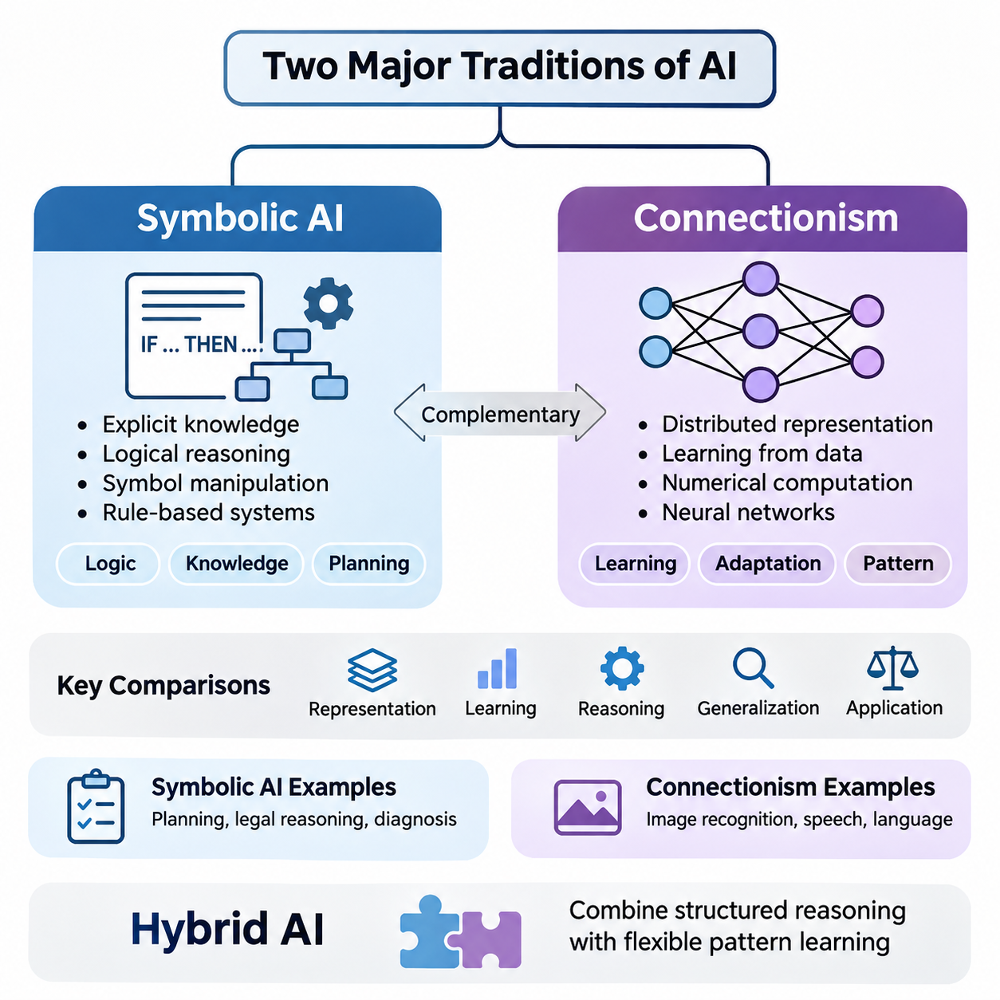
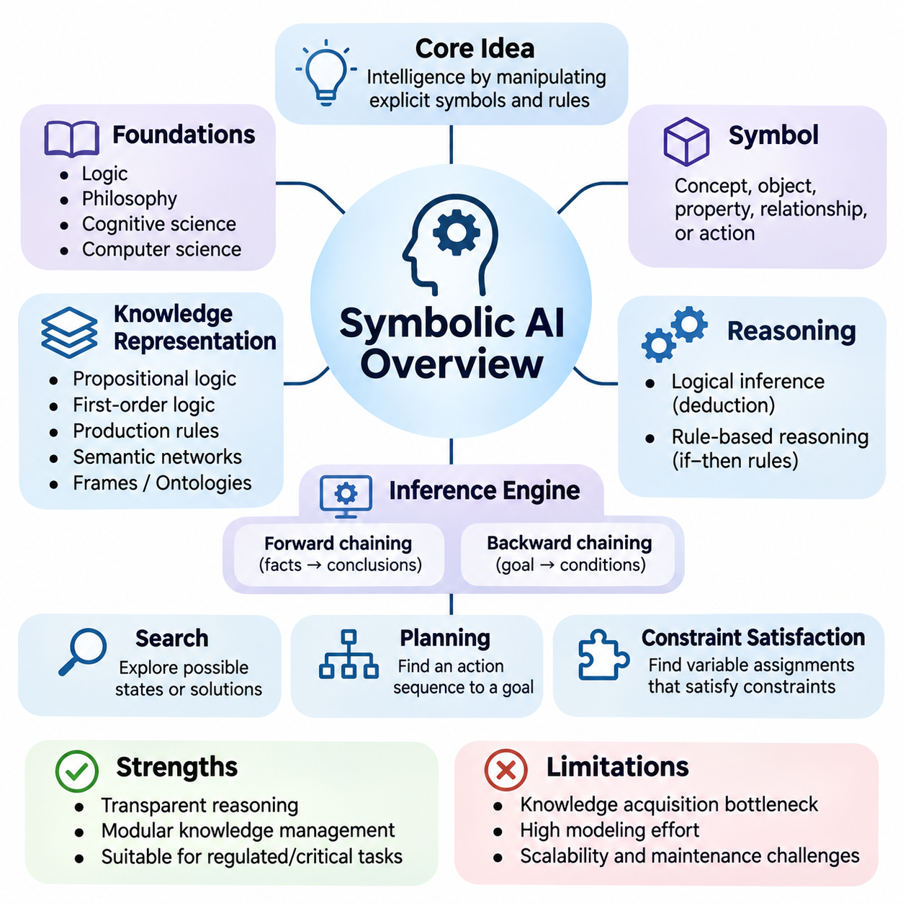
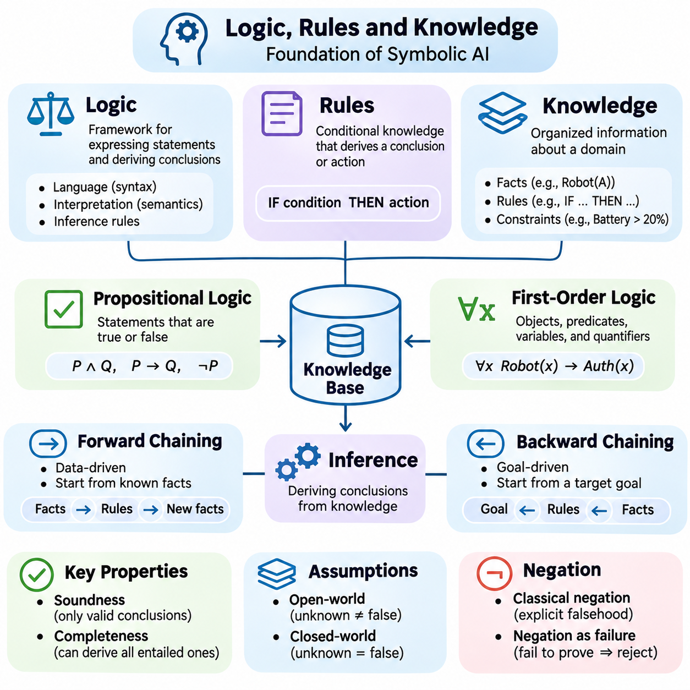
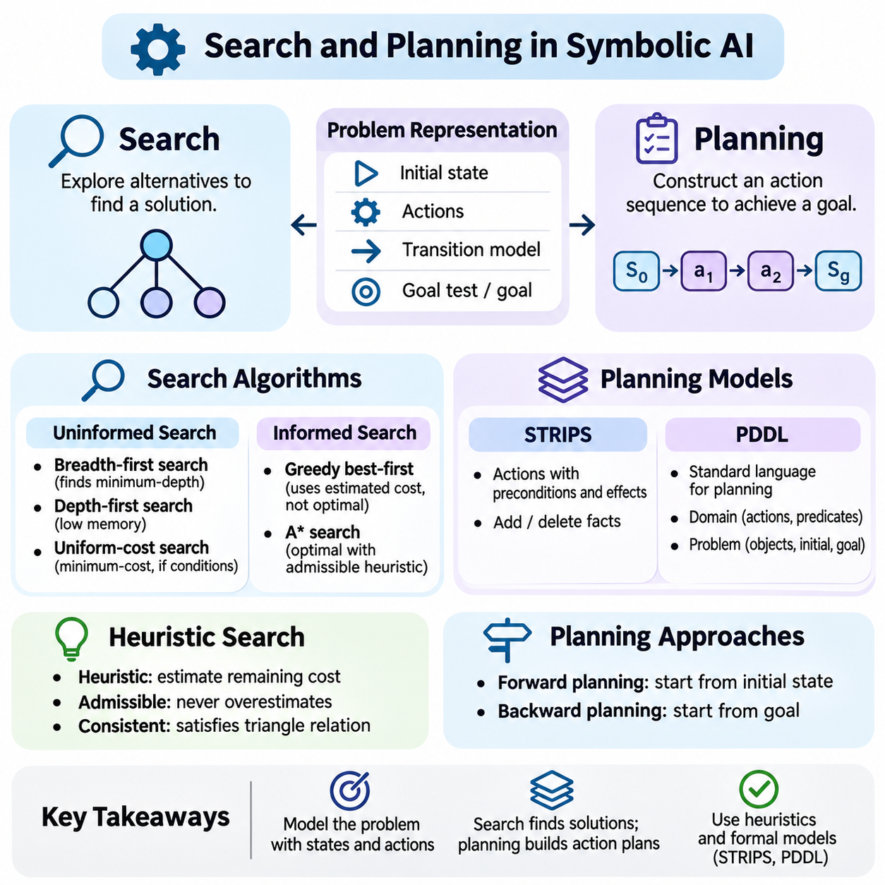
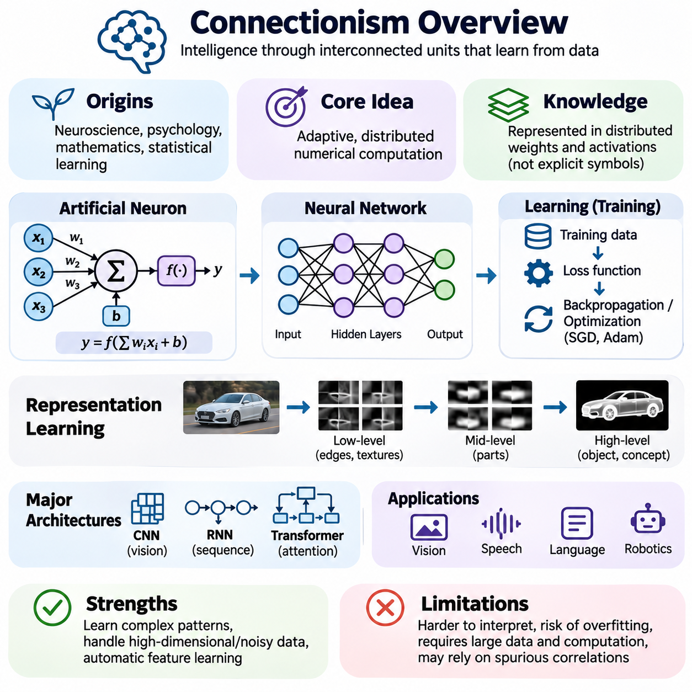
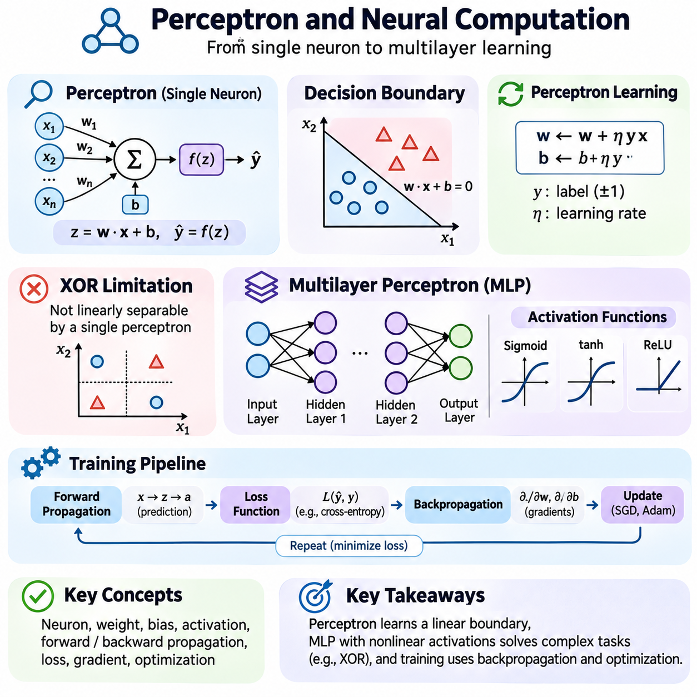
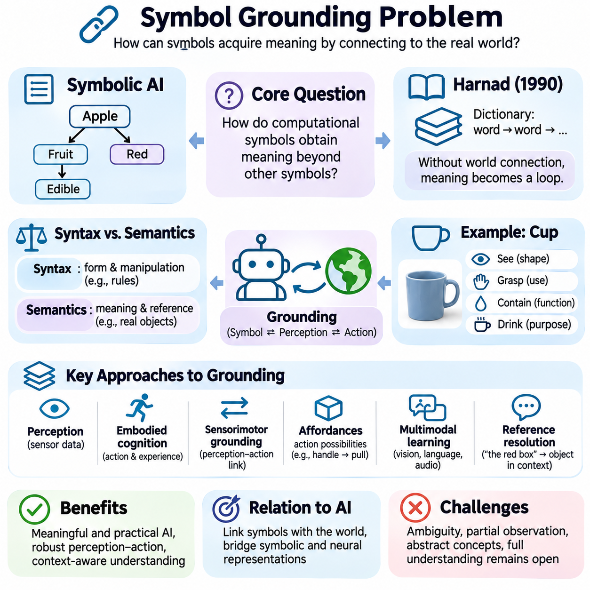
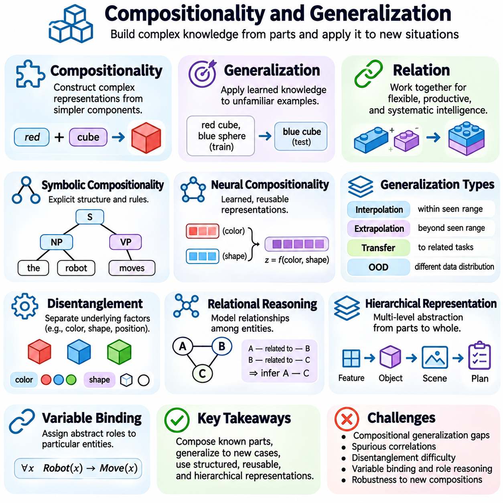
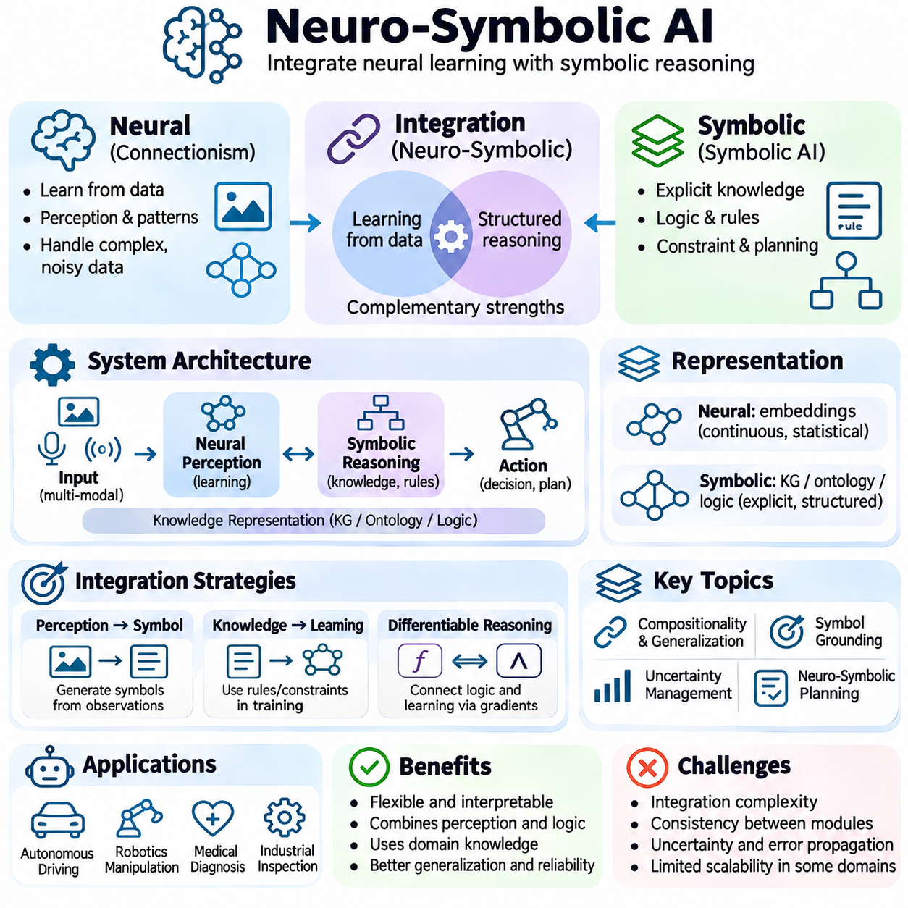
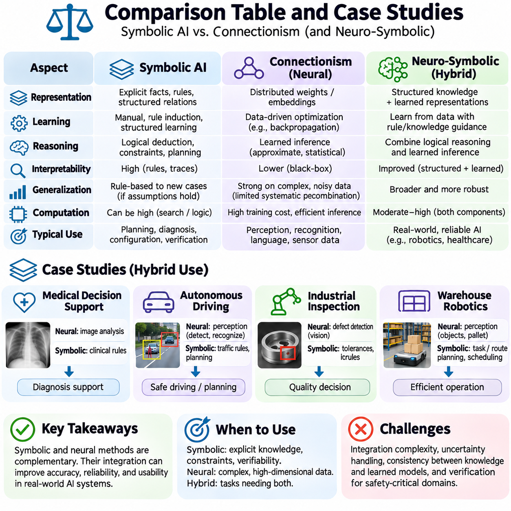

**Volume 04. Artificial Intelligence**

# 03. Symbolic AI vs Connectionism

## 03.00 Two Major Traditions of AI

{width="7.268055555555556in" height="7.268055555555556in"}

Artificial intelligence has developed through two major intellectual traditions: symbolic artificial intelligence and connectionism. Both seek to construct computational systems capable of intelligent behavior, but they differ fundamentally in how knowledge is represented, how learning occurs, and how reasoning is performed. Understanding these traditions provides a conceptual foundation for examining classical AI, neural networks, and modern hybrid intelligence.

Symbolic artificial intelligence assumes that intelligent behavior can emerge from manipulating explicit representations of knowledge. Concepts, objects, relationships, and actions are expressed through symbols governed by logical rules. A symbolic system solves problems by applying inference procedures to structured information, allowing it to derive conclusions, evaluate conditions, and construct sequences of actions according to predefined reasoning mechanisms.

Connectionism approaches intelligence through networks of interconnected computational units inspired by biological neural systems. Rather than requiring every concept or relationship to be explicitly programmed, connectionist models acquire internal representations by adjusting numerical parameters during learning. Knowledge is distributed across network connections, and intelligent behavior emerges from coordinated numerical transformations.

The distinction between these traditions reflects different assumptions about the nature of intelligence. Symbolic AI emphasizes explicit knowledge, logical structure, and deliberate reasoning, while connectionism emphasizes adaptation, distributed representation, and learning from experience. These approaches are not necessarily incompatible, because intelligent systems may require both structured reasoning and flexible pattern recognition.

The intellectual foundations of symbolic AI are closely associated with formal logic, mathematics, linguistics, and cognitive theories of reasoning. Early researchers proposed that aspects of human thought could be modeled as operations over symbolic structures. This perspective encouraged the development of theorem provers, rule-based systems, planning algorithms, and knowledge representation languages capable of expressing complex relationships.

Connectionism draws inspiration from neuroscience, psychology, statistical learning, and mathematical optimization. Its central hypothesis is that computational networks can acquire useful representations through interactions among simple processing units. Early artificial neurons and perceptrons demonstrated how numerical inputs, weighted connections, and activation mechanisms could support elementary classification and adaptive decision-making.

Symbolic systems typically separate knowledge representation from the procedures that operate upon it. A knowledge base may contain facts describing the environment, while an inference engine applies logical rules to determine additional facts or appropriate actions. This separation supports modularity, inspection, and systematic modification, although constructing and maintaining comprehensive knowledge bases can require substantial effort.

Connectionist systems generally encode acquired knowledge within numerical parameters distributed across network layers. During training, optimization algorithms adjust these parameters to reduce discrepancies between predicted and desired outputs or to optimize other learning objectives. The resulting representations may capture statistical regularities, semantic relationships, and complex patterns without requiring programmers to specify each relationship individually.

Consider an intelligent system designed to identify animals. A symbolic approach might represent an animal through properties such as feathers, wings, scales, or habitat, then apply classification rules. A connectionist approach might learn visual features from labeled images and predict animal categories directly. Both can produce classifications, but their internal representations and methods of acquiring knowledge differ substantially.

The symbolic approach becomes especially valuable when a problem requires explicit constraints, formal verification, or logically traceable decisions. Applications such as automated planning, configuration management, legal rule processing, and knowledge-based diagnosis benefit from structured representations. Their reliability nevertheless depends on the completeness, consistency, and correctness of the underlying knowledge and inference procedures.

Connectionist methods are particularly effective when relevant information is high-dimensional, noisy, ambiguous, or difficult to describe through manually constructed rules. Image recognition, speech processing, language modeling, and sensory interpretation frequently involve patterns that cannot be captured conveniently through explicit symbolic descriptions. Neural networks can learn such patterns from sufficiently informative training data.

Learning represents another fundamental difference between the traditions. Traditional symbolic systems often depend on knowledge supplied by human experts, although symbolic machine learning can also induce rules and structures from observations. Connectionist systems generally emphasize parameter adaptation through data-driven optimization. Consequently, the distinction concerns dominant representation and computation mechanisms rather than the presence or absence of learning.

Generalization is essential to both approaches, but it emerges through different mechanisms. Symbolic systems can apply abstract rules to previously unseen combinations of known concepts when their representations and inference procedures support those combinations. Connectionist systems generalize through learned relationships in parameter space, allowing them to respond to new inputs that share relevant statistical structure with training examples.

Reasoning in symbolic AI commonly involves deduction, logical inference, constraint propagation, or explicit search through possible states. These mechanisms can provide identifiable sequences of operations leading from premises to conclusions. Connectionist reasoning may instead occur through successive transformations of distributed representations, making its internal computational processes more difficult to interpret as conventional logical steps.

Uncertainty introduces additional challenges. Classical symbolic logic often operates with propositions that are treated as true or false, whereas real environments contain incomplete observations and uncertain relationships. Probabilistic graphical models, fuzzy logic, and uncertainty-aware reasoning extend structured approaches beyond strict Boolean representations. Connectionist systems can model uncertainty statistically, although reliable confidence estimation requires careful design and evaluation.

Both traditions face limitations when deployed independently. Symbolic systems may struggle with perceptual ambiguity, incomplete knowledge, and the effort required to construct extensive rule sets. Connectionist systems may struggle with systematic compositional generalization, transparent reasoning, and dependable adherence to explicit constraints. Neither tradition automatically guarantees correctness, robustness, or adaptability across unfamiliar environments.

The symbol grounding problem illustrates a particularly important conceptual challenge. Symbols can be manipulated according to formal rules without necessarily establishing how their meanings relate to physical objects, sensory experiences, or real-world interactions. Connectionist perception can help associate representations with observations, but statistical association alone does not completely resolve questions about meaning, reference, and grounded understanding.

Compositionality provides another important dimension of comparison. Human reasoning frequently combines familiar concepts into unfamiliar structures while preserving meaningful relationships. Symbolic representations naturally support certain forms of compositional manipulation through variables, operators, and logical expressions. Neural architectures can also develop compositional capabilities, but their reliability across novel combinations depends on architecture, training, and task characteristics.

Historically, symbolic AI dominated many early research programs because explicit reasoning appeared to offer a direct route toward computational intelligence. Systems demonstrated achievements in theorem proving, game playing, planning, and expert decision support. However, difficulties involving knowledge acquisition, uncertain environments, and computational complexity exposed important limitations in attempts to reproduce broad intelligence through symbolic manipulation alone.

Connectionist research experienced periods of enthusiasm and reduced attention before becoming central to modern AI. Advances in learning algorithms, computing hardware, training datasets, and neural architectures enabled substantial improvements in perception and representation learning. Deep learning extended connectionist principles through multiple computational layers capable of learning increasingly complex transformations from large-scale data.

Modern foundation models demonstrate the extraordinary representational capacity of connectionist architectures. Transformer-based systems can process language, images, audio, and other modalities using learned numerical representations. Their capabilities include generation, classification, retrieval assistance, and certain forms of reasoning. Nevertheless, fluent outputs and successful predictions do not establish that these systems consistently perform valid logical inference.

The emergence of neuro-symbolic AI reflects growing recognition that these traditions offer complementary capabilities. Hybrid architectures seek to integrate neural representation learning with symbolic knowledge, logical constraints, and structured reasoning. Such systems may use neural networks to interpret sensory observations while employing symbolic mechanisms to enforce rules, construct plans, or verify selected conclusions.

A practical neuro-symbolic system might begin with a neural perception module that identifies objects and estimates their attributes. These observations can be converted into structured representations describing entities and relationships. A symbolic reasoning component can then evaluate constraints, infer relevant conditions, and determine permissible actions. Feedback from execution may subsequently improve perception, knowledge, or decision policies.

Autonomous robotics illustrates the value of combining these approaches. Neural models can interpret camera images, estimate environmental features, and recognize objects under variable conditions. Symbolic planners can represent missions, operational rules, and task dependencies. Integrating both capabilities enables robots to connect uncertain sensory information with structured decisions, although real-world operation also requires robust control and safety mechanisms.

Industrial AI provides another useful example. A neural inspection model may identify potential manufacturing defects from images, while a symbolic rule engine evaluates inspection standards, product specifications, and maintenance requirements. The combined system can transform perceptual predictions into operational recommendations. Its effectiveness depends on calibrated predictions, reliable rules, and careful management of conflicting evidence.

The relationship between symbolic AI and connectionism should therefore be understood as a continuing architectural and scientific question rather than a competition with a single winner. Different applications impose different requirements for representation, learning, inference, transparency, and computational efficiency. Selecting an appropriate approach requires examining these requirements instead of assuming that one computational tradition is universally superior.

Future AI systems may increasingly combine explicit knowledge structures, distributed neural representations, probabilistic reasoning, and adaptive control. Such integration offers opportunities to improve interpretability, generalization, and operational reliability, but it also introduces challenges involving representation alignment, uncertainty propagation, computational cost, and system validation. Hybridization is a design strategy rather than an automatic solution.

Ultimately, symbolic AI and connectionism represent two foundational perspectives on computational intelligence. One emphasizes the manipulation of structured knowledge, while the other emphasizes learning distributed representations through numerical computation. Their historical development, complementary strengths, and unresolved limitations provide essential context for understanding modern AI and designing systems that integrate perception, reasoning, learning, and action.

## 03.01 Symbolic AI Overview

{width="7.268055555555556in" height="7.268055555555556in"}

Symbolic artificial intelligence is a foundational approach to computational intelligence in which knowledge is represented through explicit symbols, logical expressions, and structured relationships. Its central assumption is that intelligent behavior can be produced by manipulating meaningful representations according to formal rules. This approach emphasizes reasoning, knowledge organization, and systematic problem solving rather than learning exclusively from numerical data.

The intellectual foundations of symbolic AI originate from mathematical logic, philosophy, cognitive science, and early computer science. Researchers proposed that aspects of human reasoning could be expressed as computational operations over symbols. This perspective encouraged the development of formal languages and inference mechanisms capable of representing facts, evaluating propositions, and deriving conclusions through well-defined computational procedures.

A symbol represents an identifiable concept, object, property, relationship, or action within a computational system. Symbols may describe physical entities, abstract categories, environmental conditions, or logical states. Their significance comes from the interpretation assigned to them and the rules governing their manipulation. Symbolic AI therefore depends on structured representations that preserve meaningful relationships among different elements of knowledge.

Knowledge representation is a central component of symbolic intelligence. Information may be organized through propositional logic, first-order logic, production rules, semantic networks, frames, or ontologies. Each representation provides a different mechanism for describing entities and their relationships. Selecting an appropriate representation influences the expressiveness, computational complexity, and reasoning capabilities of the resulting intelligent system.

Logical reasoning enables symbolic systems to derive new information from existing knowledge. Deductive inference applies valid logical rules to established premises, allowing conclusions to follow from formally specified assumptions. For example, if every autonomous vehicle requires operational authorization and a particular robot is classified as an autonomous vehicle, the system can infer that the robot requires operational authorization.

Rule-based reasoning provides another important mechanism for symbolic computation. A rule typically specifies conditions under which a particular conclusion or action becomes applicable. When the conditions are satisfied, an inference engine may activate the corresponding rule. This structure supports expert systems, diagnostic applications, automated decision procedures, and operational control systems where knowledge can be expressed through explicit conditions.

An inference engine is responsible for applying reasoning procedures to a knowledge base. The knowledge base stores facts, rules, and relationships, while the inference engine determines which conclusions can be derived. Forward chaining begins with available facts and repeatedly applies applicable rules. Backward chaining starts with a desired conclusion and searches for supporting conditions that would establish its validity.

Symbolic AI also relies heavily on search algorithms to explore alternative states, decisions, or solutions. A problem can be represented through an initial state, available actions, transition rules, and a goal condition. Search procedures systematically investigate possible paths toward the goal. Breadth-first search, depth-first search, and heuristic search demonstrate how symbolic representations can support structured problem-solving strategies.

Planning extends symbolic reasoning by constructing sequences of actions that achieve specified objectives. A planning system represents the current environment, available operations, action preconditions, and expected effects. It then identifies a sequence that transforms the initial state into a desired goal state. Classical planning frameworks such as STRIPS and PDDL provide formal mechanisms for describing planning domains and problems.

Constraint satisfaction represents another important application of symbolic intelligence. A constraint satisfaction problem defines variables, possible values, and restrictions governing acceptable combinations. Solving the problem requires finding assignments that satisfy the specified constraints. Scheduling, resource allocation, configuration management, and logistics planning frequently benefit from this approach because their requirements can be expressed explicitly.

One important strength of symbolic AI is its capacity to support transparent reasoning. Because knowledge and inference procedures are represented explicitly, developers can often inspect the rules and reconstruct the logical steps behind a conclusion. This characteristic is valuable in regulated environments, engineering systems, and applications requiring accountability. However, transparency depends on the complexity and implementation of the reasoning architecture.

Symbolic systems also support modular knowledge management. Individual rules, facts, or relationships can often be modified without retraining an entire computational model. This makes symbolic approaches attractive when domain knowledge changes through regulations, engineering requirements, or operational procedures. Nevertheless, modifications must be checked for logical consistency because interacting rules can introduce contradictions or unexpected consequences.

The knowledge acquisition bottleneck is a major limitation of traditional symbolic AI. Constructing comprehensive knowledge bases often requires experts to identify relevant concepts, formulate rules, and encode exceptions. As the application domain expands, the number of required relationships can become difficult to manage. Incomplete or incorrectly specified knowledge may produce conclusions that are logically consistent with the rules but inappropriate for reality.

Symbolic reasoning also encounters difficulties when information is uncertain, ambiguous, or continuously changing. Classical logical systems commonly operate with discrete propositions and precisely defined relationships, while real environments contain noisy observations and incomplete evidence. Extensions involving probabilistic reasoning, fuzzy logic, and nonmonotonic reasoning help address these challenges by supporting uncertainty and revisions to previously accepted conclusions.

Computational complexity creates another practical challenge. Search and inference procedures may require examining extremely large combinations of possible states or logical assignments. Certain planning and constraint satisfaction problems become computationally expensive as their dimensions increase. Heuristics, pruning strategies, efficient representations, and specialized solvers are therefore essential for making symbolic reasoning practical in demanding applications.

The relationship between symbolic AI and human cognition has been influential throughout the history of artificial intelligence. Symbolic cognitive theories propose that aspects of thinking involve structured representations and operations resembling logical manipulation. Such models can explain certain forms of deliberate reasoning and problem solving. However, human intelligence also includes perception, intuition, adaptation, and embodied interaction that cannot be fully characterized by explicit symbolic rules alone.

Expert systems demonstrate the historical importance of symbolic approaches. These systems encode specialized domain knowledge through rules and apply inference mechanisms to provide recommendations or diagnoses. Early medical and engineering expert systems illustrated how structured expertise could support complex decisions. Their limitations also revealed the difficulties of maintaining extensive rule bases and adapting to situations outside predefined knowledge.

Modern knowledge graphs extend symbolic representation by organizing information into entities and relationships. Graph structures support semantic queries, relationship exploration, and certain forms of logical inference. Ontologies can define classes, properties, and constraints that provide a shared conceptual structure. These technologies remain important in enterprise information systems, scientific knowledge management, semantic integration, and knowledge-intensive AI applications.

Symbolic AI continues to contribute to autonomous systems and robotics. Task planners can represent mission objectives, action dependencies, operational restrictions, and resource requirements. Rule-based components can enforce safety conditions or determine permissible behaviors. When integrated with perception and control modules, symbolic reasoning helps transform high-level objectives into structured operational decisions while maintaining explicit constraints.

Large language models and other neural systems have renewed interest in symbolic reasoning as a complementary capability. Neural models can interpret natural language and generate candidate plans, while symbolic components can evaluate formal constraints, execute structured searches, or verify selected conclusions. Such integration does not guarantee correctness, but it can provide mechanisms for reducing certain reasoning errors and improving consistency.

Neuro-symbolic AI combines explicit knowledge structures with learned numerical representations. Neural networks may identify objects, extract relationships, or estimate uncertain environmental conditions, while symbolic mechanisms organize the resulting information and perform rule-based inference. This division of responsibilities can support applications requiring both flexible perception and structured decision-making, although reliable integration remains a significant engineering challenge.

The effectiveness of symbolic AI depends strongly on problem formulation and representation quality. Developers must identify relevant entities, define meaningful relationships, specify valid operations, and establish appropriate reasoning objectives. A poorly designed symbolic model can produce inefficient searches or misleading conclusions even when its inference engine operates correctly. Representation engineering is therefore a fundamental aspect of symbolic system design.

Evaluating symbolic systems requires more than checking whether they produce expected answers. Important considerations include logical soundness, completeness relative to the selected inference system, computational efficiency, scalability, and consistency of the knowledge base. Application-level evaluation must also determine whether encoded assumptions accurately describe the operating environment and whether the system behaves appropriately when information is missing.

Symbolic artificial intelligence remains a fundamental component of the broader AI landscape because explicit representation and structured reasoning address requirements that statistical prediction alone may not satisfy. Its methods provide foundations for logic programming, automated planning, constraint solving, knowledge representation, and explainable decision processes. Understanding these principles is essential for designing intelligent systems that combine formal reasoning with modern learning technologies.

## 03.02 Logic Rules and Knowledge

{width="7.268055555555556in" height="7.268055555555556in"}

Logic, rules, and knowledge form the conceptual foundation of symbolic artificial intelligence. They enable computational systems to represent facts, describe relationships, and derive conclusions through explicit reasoning procedures. Unlike approaches that primarily learn numerical patterns from data, symbolic systems organize information into meaningful structures whose interpretation and manipulation are governed by formal principles.

Logic provides a mathematical framework for expressing statements and determining whether conclusions follow from established premises. A logical system defines a language, an interpretation of expressions, and inference rules. These components distinguish the syntax of knowledge representations from their semantics. This distinction allows reasoning procedures to operate systematically while preserving clearly specified relationships between statements.

Propositional logic represents knowledge through statements that are either true or false under a particular interpretation. Logical operators such as conjunction, disjunction, negation, and implication combine propositions into more complex expressions. For example, a system may represent that a robot is operational and that its battery is sufficiently charged. These propositions can support decisions when combined with additional logical conditions.

First-order logic extends propositional reasoning by introducing objects, predicates, variables, and quantifiers. It can express general relationships rather than requiring every statement to describe a specific situation. For example, a rule may state that every robot assigned to a restricted area requires authorization. Universal quantification expresses this general requirement, while individual facts identify robots and their assignments.

Knowledge representation determines how information about a domain is organized for computational reasoning. A knowledge base may contain facts describing objects, rules governing relationships, and constraints defining acceptable conditions. Its effectiveness depends on whether the representation captures distinctions relevant to the task. An overly simplified representation may omit important relationships, while excessive detail can increase computational complexity.

Rules provide a practical mechanism for encoding domain knowledge as conditional relationships. A production rule typically connects an antecedent, representing required conditions, with a consequent, representing a conclusion or action. When the antecedent is satisfied, the system may derive the consequent or activate an associated procedure. Such rules are widely used in expert systems, configuration engines, and automated decision support.

Logical implication and operational rule execution must be distinguished. A logical implication describes a relationship between propositions, whereas an executable rule specifies how a reasoning engine should process information. The two may share similar notation but differ in computational behavior. Understanding this distinction is essential when translating declarative knowledge into reliable software implementations.

Inference is the process of deriving conclusions from available knowledge according to defined rules. A sound inference procedure produces conclusions that logically follow from its premises. Completeness, relative to a chosen logic, means that every entailed conclusion can in principle be derived. These properties provide theoretical foundations for evaluating reasoning systems, although computational resource limitations remain important in practice.

Forward chaining is a data-driven inference strategy that begins with known facts and repeatedly applies rules whose conditions are satisfied. Each successful application may add new information to the knowledge base. The process continues until a target conclusion is obtained or no additional facts can be derived. Forward chaining is useful in monitoring systems, event processing, and applications requiring continuous evaluation of changing conditions.

Backward chaining follows a goal-driven strategy. Instead of deriving every possible conclusion, it begins with a target proposition and searches for rules that could establish it. The conditions of those rules become subgoals that must be verified through facts or further inference. This approach is particularly useful in diagnostic systems, query answering, and logic programming environments where specific conclusions must be investigated.

Knowledge bases require mechanisms for maintaining consistency and controlling the interaction of rules. Contradictory statements may create invalid conclusions in classical logic, while overlapping rules may produce conflicting operational recommendations. Validation procedures, priority mechanisms, and explicit conflict-resolution policies help manage these difficulties. However, rule priorities are implementation choices rather than universal properties of formal logic.

The distinction between open-world and closed-world assumptions significantly affects symbolic reasoning. Under an open-world assumption, information that is not known to be true is not automatically considered false. Under a closed-world assumption, missing information may be treated as false within a defined domain. Knowledge graphs and databases often adopt different assumptions, making their reasoning behavior dependent on the chosen semantic framework.

Negation also requires careful interpretation. Classical negation explicitly represents the falsity of a proposition, whereas negation as failure treats an unsuccessful attempt to prove a statement as grounds for rejecting it under specified assumptions. These mechanisms behave differently when knowledge is incomplete. Selecting an appropriate treatment of negation is therefore important for systems operating with partial information.

Ontologies organize knowledge through formally defined concepts, categories, properties, and relationships. They provide shared vocabularies that help different applications interpret information consistently. An ontology may describe classes of robots, their capabilities, operational environments, and permissible relationships. Logical axioms can support classification, consistency checking, and the derivation of relationships not explicitly asserted.

Semantic networks and knowledge graphs provide graph-based representations of entities and their relationships. Nodes typically represent objects or concepts, while edges describe associations between them. Such structures support relational queries and knowledge integration. When combined with formal semantics and inference rules, they can also support reasoning over hierarchical relationships, property restrictions, and domain-specific constraints.

Frames and schemas offer alternative mechanisms for organizing structured knowledge. A frame represents an object or situation through attributes, expected values, and associated relationships. Schemas describe recurring patterns of information or activity. These representations are useful when knowledge has recognizable organizational structure, although their reasoning capabilities depend on the formal interpretation and procedures attached to them.

Knowledge engineering involves acquiring, formalizing, validating, and maintaining information required by an intelligent system. Domain experts may provide rules, operational constraints, and conceptual definitions, while engineers translate them into machine-processable representations. This process requires careful attention to ambiguity, exceptions, and changing requirements because errors in encoded knowledge can propagate through subsequent inference.

The expressiveness of a knowledge representation influences the complexity of reasoning. More expressive logical languages can describe richer relationships but may require substantially greater computational resources. Some restricted logical fragments support efficient inference, while more general formulations can become computationally expensive or undecidable. Practical symbolic AI therefore balances representational flexibility against predictable reasoning performance.

Uncertainty presents challenges because real-world observations rarely provide perfectly complete or reliable information. Probabilistic reasoning extends knowledge-based systems by associating uncertainty with events or relationships. Fuzzy logic represents graded membership or truth under suitable semantics. These approaches address different forms of uncertainty and should not be treated as interchangeable mechanisms for managing incomplete knowledge.

Nonmonotonic reasoning allows conclusions to be revised when new information becomes available. Classical monotonic logic preserves previously derived conclusions when additional premises are introduced, assuming the original premises remain unchanged. In contrast, default reasoning may withdraw an earlier conclusion after discovering an exception. This capability is valuable in dynamic environments where assumptions must be updated as evidence changes.

Consider a mobile robot operating inside an industrial facility. Its knowledge base may describe restricted zones, authorized personnel, battery requirements, and task dependencies. Rules can determine whether movement into a particular area is permitted or whether charging is required before executing a mission. Logical inference connects these operational facts with explicit policies, producing decisions that can be inspected and validated.

A practical reasoning architecture typically separates knowledge storage, inference execution, and application interfaces. The knowledge repository maintains facts and rules, while the reasoning engine evaluates relevant conditions and derives conclusions. Application components translate these conclusions into recommendations or actions. Clear interfaces help maintain modularity and allow knowledge representations to evolve without unnecessarily modifying every subsystem.

Modern AI increasingly combines symbolic knowledge with learned representations. Neural models may extract entities, classify observations, or interpret natural-language instructions, while symbolic components verify constraints and reason over structured information. Knowledge graphs can provide explicit relationships that complement vector embeddings. Such integration offers opportunities to combine flexible learning with controlled inference and traceable decision processes.

Evaluating logic-based AI requires examining both formal correctness and practical effectiveness. Soundness, consistency, inference coverage, response latency, scalability, and knowledge maintenance costs are relevant considerations. Tests should include contradictory facts, missing information, unexpected rule interactions, and changes in domain assumptions. Reliable performance depends on both valid reasoning procedures and accurate representations of the operating environment.

Logic, rules, and knowledge remain essential to symbolic artificial intelligence because they transform domain information into structures that support systematic reasoning. Their value lies not only in deriving conclusions but also in making assumptions, relationships, and constraints explicit. Understanding these mechanisms provides the foundation for advanced knowledge representation, automated planning, expert systems, and hybrid AI architectures that integrate learning with formal reasoning.

## 03.03 Search and Planning in Symbolic AI

{width="7.268055555555556in" height="7.268055555555556in"}

Search and planning are fundamental mechanisms of symbolic artificial intelligence, enabling intelligent systems to explore alternatives and construct actions that achieve defined objectives. Search identifies possible solutions within a structured problem space, while planning determines how actions transform an initial situation into a desired outcome. Both rely on explicit representations of states, actions, goals, and constraints.

A search problem is typically formulated through an initial state, a set of possible actions, a transition model, and a goal test. The initial state describes the starting situation, while the transition model specifies how actions change the environment. The goal test determines whether a candidate state satisfies the objective. This formulation converts an abstract problem into a computational structure that algorithms can systematically explore.

State-space representation is central to symbolic search. Each state describes relevant properties of the problem, and transitions connect states through permissible actions. A state space may represent robot positions, puzzle configurations, resource assignments, or operational conditions. The quality of this representation directly affects search efficiency because unnecessary details can greatly increase the number of possible states.

Search trees and search graphs provide different perspectives on problem exploration. A search tree represents sequences of actions, potentially containing repeated occurrences of the same underlying state. A search graph represents distinct states and their connections. Graph-search algorithms can track previously explored states to avoid redundant processing, although the effectiveness of duplicate detection depends on accurate state identification.

Uninformed search algorithms explore a problem without using domain-specific estimates of goal proximity. Breadth-first search expands the shallowest nodes first and finds a minimum-depth solution when branching is finite and a solution exists. Depth-first search follows one branch before backtracking and often requires less memory. However, its completeness depends on the search space and implementation.

Uniform-cost search expands states according to accumulated path cost rather than search depth. It can find a minimum-cost solution when step costs satisfy appropriate positive lower-bound conditions. This approach is useful when actions have different costs, such as travel distance, energy consumption, or execution time. Its computational expense can increase substantially when many low-cost alternatives exist.

Informed search incorporates heuristic functions that estimate the remaining cost or distance to a goal. A heuristic guides exploration toward promising states without requiring exhaustive examination of every alternative. Effective heuristics exploit structural properties of the problem while remaining computationally inexpensive. Their quality strongly influences search performance, especially in large state spaces.

Greedy best-first search prioritizes states according to estimated remaining cost. It may reach a goal quickly when the heuristic provides useful guidance, but it does not generally guarantee an optimal solution. A\\\* search combines accumulated path cost with estimated remaining cost. With suitable admissible heuristics and appropriate search conditions, A\\\* can identify optimal solutions while reducing unnecessary exploration.

Heuristic admissibility means that an estimate never exceeds the true minimum remaining cost. Consistency additionally requires estimates to satisfy a triangle-like relationship across transitions. These properties are important for establishing optimality guarantees under particular A\\\* implementations. Designing effective heuristics often involves relaxed problems, abstraction, domain knowledge, or previously computed solution patterns.

Planning extends search by explicitly representing actions and their effects on the world. A planning problem defines an initial state, a goal description, and a collection of available actions. Each action specifies conditions required for execution and changes produced afterward. The planner seeks an action sequence that satisfies the goal while respecting the transition rules and constraints of the modeled environment.

Classical planning commonly assumes deterministic actions, complete state information, and a static environment during planning. These assumptions simplify reasoning by allowing action outcomes to be predicted precisely. Although they do not describe every real-world application, they provide a useful foundation for studying planning algorithms and understanding how complex tasks can be decomposed into structured operations.

STRIPS represents actions through preconditions and effects, often expressed as additions and deletions of logical facts. An action is applicable when its preconditions hold, and its execution updates the symbolic state according to its effects. For example, a robot may move between locations only when a connecting path is available. Executing the movement action changes the robot\'s recorded location.

The Planning Domain Definition Language, or PDDL, provides a standardized framework for describing planning domains and problem instances. Domain descriptions define predicates, action schemas, and supported planning features. Problem descriptions specify objects, initial conditions, and goals. This separation allows general-purpose planning algorithms to operate across different applications without requiring complete redesign.

Forward planning begins with the initial state and explores applicable actions until a goal state is reached. Backward planning begins with the desired goal and reasons about actions capable of establishing it. The planner then identifies conditions that must hold before those actions can execute. Both strategies can be effective, but their performance depends on action structure, goal complexity, and search-space characteristics.

Partial-order planning represents dependencies between actions without immediately imposing a complete execution sequence. Independent actions may remain unordered until their relationships require specific ordering constraints. This flexibility can reduce unnecessary commitments and expose opportunities for parallel execution. However, maintaining causal dependencies and resolving conflicts introduces additional planning complexity.

Hierarchical task planning organizes complex objectives into smaller tasks and subtasks. High-level activities are decomposed through domain-specific methods until executable actions are identified. This approach can improve planning efficiency by incorporating procedural knowledge about how tasks are normally performed. Its effectiveness depends on the completeness and suitability of the available decomposition methods.

Constraint satisfaction is closely related to symbolic planning because many decisions must satisfy explicit restrictions. Scheduling tasks may require precedence relationships, resource limits, and time windows. Constraint propagation can eliminate invalid assignments before extensive search occurs. Combining search with constraint reasoning often improves efficiency when planning problems contain tightly coupled operational requirements.

Planning under uncertainty extends classical methods to environments where actions may have unpredictable outcomes or observations may be incomplete. Contingent planning constructs policies that respond to different observations, while probabilistic planning evaluates uncertain transitions and outcomes. These methods are important in robotics and autonomous systems, where real-world conditions rarely match perfectly deterministic assumptions.

Replanning allows intelligent systems to adapt when the environment changes or an expected action fails. Instead of executing an obsolete plan, the system updates its state representation and searches for a revised sequence of actions. Continuous planning architectures may alternate between planning, execution, monitoring, and correction. This feedback process supports more reliable operation in dynamic environments.

Consider an autonomous mobile robot assigned to deliver materials inside a factory. Symbolic search can identify routes between locations, while task planning determines the sequence of pickup, transportation, and delivery operations. Constraints may restrict access to certain areas or require sufficient battery capacity. A combined planner can evaluate these conditions before generating an executable mission.

The computational complexity of search and planning is a major engineering concern. Large branching factors, long solution paths, and extensive state descriptions can produce combinatorial growth. Heuristics, abstraction, pruning, decomposition, and efficient data structures help control this expansion. Practical systems must balance solution quality, computational resources, response latency, and operational reliability.

Search and planning also require careful evaluation. Important measures include solution validity, path cost, planning time, memory consumption, completeness, and robustness to environmental changes. Optimality guarantees should be interpreted according to the assumptions of each algorithm. In deployed systems, a computationally efficient plan is valuable only when its actions remain feasible and satisfy operational safety requirements.

Modern AI architectures increasingly combine symbolic planning with neural perception and learned decision models. Neural networks may estimate environmental conditions or propose candidate actions, while symbolic planners enforce explicit constraints and construct structured action sequences. This integration can support interpretable task execution, although uncertainty in perception and errors in the symbolic model must be carefully managed.

Search and planning demonstrate how symbolic artificial intelligence transforms explicit knowledge into goal-directed behavior. Search provides systematic exploration of possible solutions, while planning organizes actions according to preconditions, effects, and objectives. Together, they establish essential foundations for automated reasoning, robotics, logistics, scheduling, and intelligent agents capable of making structured decisions in complex environments.

## 03.04 Connectionism Overview

{width="7.268055555555556in" height="7.268055555555556in"}

Connectionism is a major paradigm of artificial intelligence that explains intelligent behavior through networks of interconnected computational units. Rather than relying primarily on explicitly programmed logical rules, connectionist systems learn representations and transformations from data. Their central principle is that complex cognitive capabilities can emerge from distributed numerical computations and adaptive interactions among relatively simple processing elements.

The intellectual origins of connectionism lie in neuroscience, cognitive psychology, mathematics, and statistical learning. Early researchers investigated whether simplified models of biological neurons could reproduce aspects of perception and learning. Although artificial neural networks are not faithful simulations of biological brains, their interconnected structures and adaptive parameters provide computational mechanisms inspired by neural information processing.

An artificial neuron receives numerical inputs, combines them using adjustable weights, adds a bias, and applies an activation function. The resulting output is transmitted to other computational units or used to produce a prediction. Individual neurons typically perform relatively simple operations, but networks containing many such units can represent complex relationships through coordinated computation across multiple layers.

Weights determine how strongly signals influence subsequent computations, while biases adjust the operating conditions of individual units. Activation functions introduce nonlinear transformations that allow networks to represent relationships beyond simple linear mappings. Common activation functions include sigmoid, hyperbolic tangent, and rectified linear units. Their mathematical properties influence optimization behavior and information propagation.

Connectionist knowledge is generally distributed across numerical parameters rather than stored as explicit symbolic statements. A concept may be represented through patterns of activity involving many neurons, while individual neurons can participate in multiple representations. This distributed organization supports flexible pattern recognition, although interpreting precisely how a network represents a particular concept can be difficult.

Learning occurs when network parameters are adjusted to improve performance on a defined objective. During supervised learning, the system compares predicted outputs with reference targets and calculates a loss function. Optimization algorithms update parameters to reduce this loss. Repeated exposure to training examples gradually changes the network\'s internal representations and its ability to map inputs to desired outputs.

Backpropagation is a central mechanism for training differentiable neural networks. It efficiently computes gradients of a loss function with respect to network parameters by applying the chain rule of calculus. Optimization methods such as stochastic gradient descent and Adam use these gradients to update weights. Training effectiveness depends on architecture, initialization, data quality, and optimization settings.

Representation learning is one of the defining capabilities of connectionist systems. Instead of requiring engineers to specify every relevant feature manually, neural networks can discover useful transformations from training data. Early layers may capture relatively simple patterns, while deeper layers can construct increasingly abstract representations. The exact organization depends on network architecture, training objectives, and data characteristics.

The perceptron represents an important historical milestone in connectionist research. It combines weighted inputs with a threshold-based decision mechanism to perform linear classification. Although a single-layer perceptron cannot solve problems requiring nonlinear decision boundaries, multilayer neural networks with suitable activation functions can represent much richer mappings. These developments established foundations for modern neural computation.

Connectionist research experienced periods of optimism and reduced attention before the widespread adoption of deep learning. Advances in computational hardware, large datasets, improved optimization methods, and effective network architectures enabled substantial progress. Deep learning expanded neural approaches into computer vision, speech recognition, natural language processing, and many other domains requiring complex statistical representations.

Different neural architectures incorporate structural assumptions suited to particular problems. Convolutional neural networks exploit local spatial relationships and parameter sharing, making them useful for image analysis. Recurrent neural networks process sequential information through evolving internal states. Transformers use attention mechanisms to model relationships among elements and have become central to many language and multimodal systems.

Generalization describes a network\'s ability to perform effectively on examples not encountered during training. Successful generalization requires learning relationships that remain useful beyond the training dataset. However, networks may overfit by memorizing training-specific patterns or exploiting accidental correlations. Regularization, appropriate validation procedures, and representative datasets help reduce these risks without guaranteeing reliable performance.

Connectionist models are especially effective when information is high-dimensional, noisy, or difficult to describe through explicit rules. Images, audio signals, sensor measurements, and natural language contain patterns that are challenging to encode manually. Neural networks can learn statistical relationships within such data and produce useful predictions. Their effectiveness nevertheless depends on whether training conditions adequately represent deployment environments.

Uncertainty is an important consideration in neural prediction. Many networks produce numerical scores that can be transformed into probability-like outputs, but these values are not automatically well calibrated. Confidence estimates may become unreliable under distribution shifts or unfamiliar inputs. Calibration techniques, uncertainty estimation, and out-of-distribution detection help evaluate prediction reliability in practical applications.

The distributed nature of neural representations creates challenges for interpretability. A model may classify an object accurately without providing an explicit logical explanation of its decision. Feature attribution, activation analysis, probing, and mechanistic interpretability methods attempt to investigate internal computations. These techniques can reveal useful evidence about model behavior, but their explanations may remain incomplete or sensitive to methodology.

Connectionist learning also introduces substantial computational requirements. Training large networks involves repeated numerical operations, memory-intensive parameter updates, and extensive data processing. GPUs and specialized accelerators support parallel computation, while distributed training enables larger models. Practical design must consider energy consumption, memory capacity, training duration, inference latency, and deployment constraints.

Data quality strongly influences connectionist performance. Incorrect labels, sampling bias, insufficient diversity, and inconsistent preprocessing can distort learned relationships. Models may also reproduce unwanted correlations present in training datasets. Effective dataset engineering therefore requires careful collection, annotation, validation, and monitoring. Evaluation should examine performance across relevant operating conditions rather than relying only on aggregate accuracy.

Transfer learning allows knowledge acquired during one training process to support related tasks. A pretrained network may provide useful representations that can be adapted through fine-tuning or additional training. Self-supervised learning extends this principle by constructing training objectives from the structure of available data. These approaches can reduce dependence on manually labeled examples, although adaptation quality varies across domains.

Connectionism differs from traditional symbolic AI in how knowledge is represented and manipulated. Symbolic systems use explicit facts, logical relationships, and inference rules, while neural systems encode learned relationships through numerical parameters and activation patterns. Symbolic reasoning often supports transparent constraint enforcement, whereas connectionist models excel at flexible perception and statistical pattern learning. Neither approach universally replaces the other.

Modern foundation models demonstrate the scalability of connectionist methods. Large neural architectures trained on extensive datasets can acquire representations useful across multiple tasks. Language models, vision transformers, and multimodal networks illustrate this flexibility. Nevertheless, strong statistical performance does not inherently guarantee logical consistency, factual correctness, causal understanding, or reliable behavior in unfamiliar situations.

Connectionist systems increasingly interact with symbolic reasoning, planning, and structured knowledge representations. Neural components may convert sensory observations into object descriptions or estimate environmental states, while symbolic modules evaluate constraints and construct action plans. Such neuro-symbolic architectures seek to combine adaptive learning with explicit reasoning, although integration introduces challenges involving uncertainty, representation alignment, and verification.

In autonomous robotics, connectionist models can support object detection, scene understanding, localization, and learned control policies. Sensor measurements are transformed into numerical representations that inform decisions about the surrounding environment. However, safe operation also requires constraints, uncertainty management, and dependable system integration. Neural perception alone cannot guarantee correct mission execution or compliance with operational requirements.

Evaluating connectionist systems requires examining predictive accuracy, robustness, calibration, generalization, computational efficiency, and behavior under distribution shifts. Controlled benchmarks provide useful comparisons, but deployment testing must reflect realistic environmental variability. Reproducibility also depends on documenting datasets, model configurations, random seeds, training procedures, and evaluation protocols.

Connectionism remains a central foundation of modern artificial intelligence because it enables systems to learn complex representations directly from experience and data. Its contributions extend from early perceptrons to deep neural networks and large foundation models. Understanding distributed representation, gradient-based learning, generalization, and architectural design provides essential preparation for studying neural computation and hybrid intelligent systems.

## 03.05 Perceptron and Neural Computation [w/Code]

{width="7.268055555555556in" height="7.268055555555556in"}

The perceptron is one of the earliest computational models of artificial neural intelligence and provides a foundation for understanding modern neural computation. It represents a simplified processing unit that transforms numerical inputs into an output through weighted combinations and a decision function. Although elementary compared with deep neural networks, the perceptron demonstrates how adaptive parameters enable machines to learn decision boundaries from examples.

The perceptron emerged from research seeking computational explanations of biological learning and perception. Frank Rosenblatt introduced the model in the 1950s as a trainable pattern recognition mechanism. Its significance was not biological realism but the demonstration that a machine could modify its behavior through experience. This concept established an important connection between numerical computation, learning algorithms, and intelligent classification.

A perceptron receives an input vector containing numerical features that describe an observation. Each feature is multiplied by a corresponding weight, and the resulting values are summed with a bias term. The weighted sum determines the neuron\'s activation before the decision function is applied. This structure converts multiple input measurements into a single computational response representing a classification decision.

The mathematical operation of a perceptron can be expressed as z = w·x + b, where x represents the input vector, w denotes the weight vector, and b is the bias. A threshold function converts z into a discrete prediction, commonly representing one of two classes. The weights determine the orientation of the decision boundary, while the bias determines its position within the feature space.

The geometric interpretation of the perceptron is especially important. In a two-dimensional feature space, its decision boundary forms a straight line. In higher dimensions, the boundary becomes a hyperplane separating regions assigned to different classes. This linear structure makes the model computationally simple and interpretable, but it also limits the types of classification problems that a single perceptron can solve.

Perceptron learning adjusts weights and bias when the model makes an incorrect classification. For labels represented as positive and negative values, an update moves the parameters toward a boundary that better separates the misclassified example. The learning rate controls the magnitude of this adjustment. Repeated updates gradually modify the decision surface according to the observed training examples.

The perceptron convergence theorem establishes that the learning algorithm converges after finitely many mistakes when the training examples are linearly separable and appropriate conditions hold. However, convergence is not guaranteed for datasets that cannot be separated by a linear boundary. This distinction reveals how the mathematical structure of a model determines which problems its learning procedure can solve.

The exclusive-or problem, commonly called XOR, illustrates the limitations of a single-layer perceptron. XOR assigns positive outputs to input combinations that cannot be separated from the negative combinations by one straight line. Consequently, a single linear threshold unit cannot represent the required mapping. Introducing hidden layers and nonlinear transformations allows multilayer networks to represent such relationships.

A multilayer perceptron consists of interconnected computational units organized into an input layer, one or more hidden layers, and an output layer. Each hidden layer transforms the representation received from the preceding layer. By combining multiple transformations, the network can learn nonlinear relationships between inputs and outputs. Its representational capacity depends on architecture, activation functions, and parameter configuration.

Activation functions determine how weighted inputs are transformed into neuron outputs. A purely linear network remains equivalent to a single linear transformation regardless of its depth. Nonlinear activation functions overcome this limitation by enabling more complex mappings. Sigmoid, hyperbolic tangent, and rectified linear units are common examples, each influencing gradient propagation and training behavior differently.

Forward propagation describes the process through which input information moves across successive neural network layers. Each layer computes weighted combinations, adds biases, and applies activation functions to produce intermediate representations. The final layer generates a prediction or numerical output. This sequence forms the computational foundation of neural inference and provides the quantities required for evaluating training objectives.

Training multilayer neural networks requires measuring the difference between predictions and desired outcomes. A loss function quantifies this difference and defines the objective minimized during learning. Cross-entropy is commonly used for classification, while mean squared error is often applied to regression. Selecting an appropriate loss function aligns parameter optimization with the intended behavior of the model.

Backpropagation enables efficient computation of gradients throughout a differentiable network. Beginning with the loss, it applies the chain rule to propagate derivative information backward through the computational graph. Each parameter receives a gradient describing how a small change affects the objective. Gradient-based optimizers then use this information to update weights and biases across the network.

Stochastic gradient descent updates parameters using individual examples or minibatches rather than evaluating the entire dataset for every update. Minibatch training supports efficient parallel computation and introduces variability into optimization. Momentum and adaptive methods such as Adam modify how gradients influence updates. Their effectiveness depends on learning rates, batch sizes, data characteristics, and model architecture.

Neural computation also depends on parameter initialization and numerical stability. Poor initialization may cause activations or gradients to grow excessively or diminish across layers. Normalization techniques, suitable activation functions, and carefully designed architectures can improve training behavior. These considerations become increasingly important as networks become deeper and their computational dependencies become more complex.

The expressive power of multilayer neural networks extends far beyond linear classification. Under suitable conditions, networks with nonlinear activations can approximate broad classes of continuous functions. However, representational capability does not guarantee that training will discover an accurate solution. Optimization difficulty, limited data, overfitting, and computational constraints influence the performance achieved in practice.

Neural computation is naturally expressed through matrix and tensor operations. Instead of evaluating every neuron separately, implementations combine many weighted calculations into parallel linear algebra operations. This organization allows GPUs and specialized accelerators to process large batches efficiently. Modern deep learning frameworks automate differentiation and provide optimized numerical kernels for training and inference.

A practical perceptron experiment may begin with two-dimensional labeled samples and a randomly initialized linear classifier. During training, each misclassified sample triggers a parameter update, gradually shifting the decision boundary. Visualizing the boundary after successive iterations helps demonstrate how learning occurs. Repeating the experiment with XOR data reveals the representational limitations of a single-layer model.

A corresponding multilayer experiment can use a small network with a hidden layer and nonlinear activation. Training the network on XOR demonstrates how hidden representations transform the original feature space into a form that supports classification. Comparing training losses and predicted outputs between the two models illustrates the relationship between network architecture, expressiveness, and optimization.

Practical neural implementations require attention to reproducibility and evaluation. Random seeds, dataset partitions, initialization methods, optimizer settings, and training duration should be documented. Accuracy on training examples alone is insufficient because memorization may not translate into generalization. Separate validation and test datasets help assess performance on previously unseen observations.

The perceptron also provides a conceptual bridge between symbolic and connectionist artificial intelligence. A symbolic classifier may rely on explicitly defined logical conditions, whereas a perceptron learns a numerical decision rule from examples. Both produce structured decisions, but their knowledge representations and adaptation mechanisms differ. Multilayer neural computation extends this distinction through distributed representations learned across interconnected units.

In robotics and industrial automation, perceptron-based concepts support the broader understanding of learned classification and control. Neural networks may interpret sensor measurements, identify objects, or estimate operational conditions. Nevertheless, dependable deployment requires appropriate data, robustness testing, uncertainty management, and explicit safety constraints. Numerical prediction must be integrated with the surrounding engineering system.

Evaluating neural computation involves examining predictive performance, convergence behavior, computational cost, and sensitivity to hyperparameters. Learning curves reveal optimization progress, while confusion matrices and class-specific metrics expose classification errors. Experiments should also investigate distribution shifts and noisy inputs. Such analysis distinguishes successful numerical optimization from reliable performance under realistic conditions.

The perceptron establishes the essential principles of weighted computation, adaptive learning, and decision-boundary formation. Multilayer networks extend these principles through nonlinear transformations, gradient-based optimization, and distributed representation learning. Together, they provide the conceptual and mathematical foundations for modern neural networks and explain how connectionist systems transform numerical experience into increasingly sophisticated computational behavior.

## 03.06 Symbol Grounding Problem

{width="7.268055555555556in" height="7.268055555555556in"}

The symbol grounding problem addresses a fundamental question in artificial intelligence: how can computational symbols acquire meaning beyond their relationships with other symbols? A symbolic system may manipulate words, categories, and logical expressions according to formal rules, yet correct manipulation does not necessarily establish an understanding of what those representations refer to. Grounding concerns the connection between internal representations and the world they describe.

Traditional symbolic AI represents knowledge through explicitly defined concepts and relationships. A system may encode that an apple is a fruit, that fruits are edible, and that apples can be red. These statements support logical inference, but their meanings depend on an interpretation supplied by designers or users. The symbol grounding problem asks how a machine could establish such meanings through its own perceptual and interactive capabilities.

Stevan Harnad formally articulated the symbol grounding problem in 1990, emphasizing the limitations of systems whose symbols are defined only through other symbols. A dictionary illustrates this difficulty because every definition refers to additional words that themselves require interpretation. Without a connection to something beyond the symbolic network, the system risks an endless cycle of definitions without independently established reference.

The distinction between syntax and semantics is central to grounding. Syntax specifies how symbols are structured and manipulated, while semantics concerns their meaning and reference. A computer can execute formally correct transformations without determining whether the symbols correspond to actual objects or situations. Grounding therefore examines how computational representations become connected to perceptual evidence, physical interactions, and meaningful environmental relationships.

Perception provides one possible foundation for grounding symbols in observable experience. Cameras, microphones, tactile sensors, and other sensing devices convert environmental signals into numerical measurements. Perceptual models can associate these measurements with object categories, properties, or events. However, recognizing statistical patterns does not automatically establish complete semantic understanding, especially when observations are ambiguous or context dependent.

Consider a robot learning the concept of a cup. A purely symbolic description might specify that a cup is a container used for drinking. A grounded system could additionally observe cups through cameras, identify their shapes, estimate their physical properties, and interact with them. Repeated experiences may connect the internal concept with visual appearance, graspability, containment, and practical use across different situations.

Embodied cognition emphasizes the relationship between intelligence, physical interaction, and environmental experience. From this perspective, meaning develops partly through the actions an agent can perform and the consequences it observes. A robot may associate the concept of an obstacle with blocked movement, collision risk, and avoidance behavior. Such associations connect symbolic descriptions with sensorimotor experience rather than relying exclusively on definitions.

Sensorimotor grounding links internal representations to patterns of perception and action. An agent learns that particular movements produce predictable sensory changes and that environmental objects support different interactions. These regularities can provide operational meaning for concepts such as distance, contact, movement, and containment. Nevertheless, sensorimotor associations alone may not explain every aspect of abstract or linguistic meaning.

Affordances provide another useful perspective on grounding. An affordance describes an action possibility arising from the relationship between an agent and its environment. A handle may afford pulling, while a flat surface may afford supporting an object. Because affordances depend on the capabilities of the agent, grounding involves more than identifying physical properties. It also concerns how objects participate in purposeful behavior.

Multimodal learning connects information from different sensory and representational channels. Images, language, audio, and physical measurements may provide complementary evidence about the same object or event. A model can learn associations between spoken descriptions and visual observations, supporting cross-modal recognition. However, successful alignment between modalities does not necessarily demonstrate causal understanding or reliable grounding in physical reality.

Language-only learning raises important questions about semantic grounding. Large language models acquire extensive statistical knowledge from linguistic data and can describe many objects and relationships without direct physical experience. Their capabilities show that language contains substantial information about the world. Nevertheless, linguistic competence alone does not settle whether internal representations possess independently grounded meaning or human-like understanding.

Grounding also involves reference resolution, which determines what a particular expression identifies in a given context. The phrase "the red box" may refer to different objects depending on the surrounding environment. A grounded agent must combine linguistic descriptions with perceptual observations and contextual information. Reference becomes especially challenging when multiple objects share similar properties or when relevant entities are partially hidden.

The symbol grounding problem is closely related to the distinction between recognition and understanding. A classifier may correctly identify a hammer from an image without knowing how to use it or what consequences follow from striking an object. Functional knowledge requires relationships among objects, actions, goals, and outcomes. Grounding research therefore examines whether representations support meaningful interaction beyond accurate category prediction.

Causal learning may strengthen grounding by connecting concepts to interventions and their consequences. An agent that observes a door opening after pushing it can learn more than a visual association between doors and motion. Repeated interventions help distinguish causal relationships from coincidental correlations. Such experience can support predictions about what actions will accomplish, although causal inference remains difficult under incomplete observations.

Grounding abstract concepts presents challenges beyond those encountered with physical objects. Ideas such as fairness, responsibility, probability, and permission do not correspond to simple sensory patterns. Their meanings depend on social practices, formal definitions, contextual reasoning, and relationships among other concepts. Consequently, grounding cannot be reduced to attaching every word to a directly observable physical object.

Social interaction provides another potential source of semantic grounding. Humans learn many concepts through communication, demonstration, correction, and shared attention. Artificial agents may similarly use feedback from people to connect expressions with objects, actions, and intended outcomes. Interactive learning can clarify ambiguous references and refine category boundaries, but it also depends on the reliability and consistency of the feedback received.

Symbol grounding is particularly important in robotics because incorrect interpretations can produce physical consequences. A robot instructed to place a fragile object on a stable surface must connect linguistic categories with perceptual estimates and operational constraints. Misidentifying an object or misunderstanding a spatial relationship can cause task failure. Reliable grounding therefore requires coordination among perception, reasoning, planning, and control.

Grounding must also remain robust when environments change. Objects may appear under unfamiliar lighting, from different viewpoints, or in configurations absent from training data. A system that associates concepts only with narrow visual patterns may fail despite performing well on familiar examples. Generalizable grounding requires representations that preserve relevant relationships across changing contexts, although achieving this remains an open research challenge.

Neuro-symbolic AI offers a possible framework for integrating grounding with explicit reasoning. Neural networks can extract perceptual features and estimate object identities, while symbolic systems organize entities, relationships, and task constraints. The resulting architecture may connect learned sensory representations with logical structures. However, assigning symbolic labels to neural outputs does not by itself resolve the deeper question of semantic grounding.

World models provide another perspective by representing environmental states and predicting how they evolve. A grounded agent may use a world model to anticipate the consequences of actions and compare predictions with observations. Prediction errors can support revisions to internal representations. Such mechanisms connect concepts with temporal experience, although accurate prediction alone does not guarantee comprehensive semantic understanding.

Evaluating grounding requires more than measuring classification accuracy or language fluency. Tests may examine whether an agent can identify referents, manipulate unfamiliar objects, transfer concepts across modalities, and respond appropriately to changing environments. Interactive evaluation can reveal whether representations support practical behavior. Nevertheless, no single benchmark conclusively establishes that a system possesses genuine semantic understanding.

The symbol grounding problem highlights a fundamental limitation of treating intelligence solely as formal symbol manipulation. Meaningful computational representations may require connections to perception, action, causal structure, language, and social context. Different grounding theories emphasize different combinations of these mechanisms, and no universally accepted solution has emerged. The problem remains central to research on artificial understanding and embodied intelligence.

For intelligent system engineering, grounding can be approached as a requirement for connecting internal representations with verifiable environmental evidence. Designers can establish sensor-to-concept mappings, maintain uncertainty estimates, validate action consequences, and detect inconsistencies between predictions and observations. These measures improve operational reliability without claiming to resolve every philosophical question about meaning or understanding.

Ultimately, the symbol grounding problem connects symbolic AI, connectionism, cognitive science, and embodied robotics through the question of how representations acquire significance. It explains why formal reasoning and statistical recognition, although powerful, do not automatically establish complete understanding. Studying grounding provides an essential foundation for developing AI systems that relate language and knowledge to perception, interaction, and the physical world.

## 03.07 Compositionality and Generalization

{width="7.268055555555556in" height="7.268055555555556in"}

Compositionality and generalization are fundamental principles for understanding how intelligent systems represent knowledge and apply learned capabilities to unfamiliar situations. Compositionality describes the ability to construct complex representations from simpler components, while generalization concerns successful performance beyond previously observed examples. Together, these principles explain how intelligence can extend beyond memorized patterns toward flexible reasoning and adaptation.

The principle of compositionality originates from philosophy of language, formal logic, and cognitive science. It proposes that the meaning of a complex expression depends on the meanings of its constituent parts and the rules governing their combination. For example, understanding individual concepts such as objects, properties, and actions allows a system to interpret new statements formed from familiar elements. This principle supports productive and systematic language use.

Symbolic AI naturally incorporates compositionality through structured representations and explicit combination rules. Logical expressions, syntax trees, and knowledge graphs organize concepts into reusable components. A symbolic system can combine known predicates and relationships to construct unfamiliar propositions without learning every possible combination separately. However, successful composition still depends on accurate representations and appropriately defined rules.

In formal logic, compositional structure allows complex propositions to be evaluated through their constituent expressions. Logical operators such as conjunction, disjunction, and negation combine simpler statements into larger formulas. Their semantics determine how the truth values of compound expressions relate to those of their components. This systematic organization enables automated reasoning, theorem proving, and structured knowledge manipulation.

Neural networks approach compositionality differently because knowledge is represented through distributed numerical parameters and activation patterns. Rather than explicitly storing every concept as a discrete symbol, connectionist systems learn representations from data. These representations may encode reusable features and relationships, but the extent to which neural networks systematically combine familiar elements into unfamiliar structures depends on architecture and training conditions.

Systematic generalization refers to the ability to apply learned rules or relationships to novel combinations of familiar components. A model that understands the commands "walk twice" and "jump once" should ideally interpret "jump twice" without requiring direct exposure to that exact expression. Such behavior indicates that the model has learned reusable operations rather than merely memorizing complete training examples.

Productivity is closely related to systematicity. Productivity describes the capacity to generate or interpret an extensive range of expressions from a limited collection of elements and combination rules. Human language demonstrates this property because speakers routinely understand sentences they have never encountered. Artificial intelligence systems seek comparable flexibility, although successful performance on familiar patterns does not automatically establish productive compositional reasoning.

Generalization encompasses several distinct forms of adaptation. Interpolation involves predictions within regions represented by training examples, while extrapolation extends predictions beyond observed conditions. Transfer learning applies acquired representations to related tasks, and out-of-distribution generalization concerns performance when deployment data differs from training data. These distinctions are important because success in one setting does not guarantee success in another.

Compositional generalization specifically examines whether learned components can be recombined in ways absent from training. A visual model might recognize red cubes and blue spheres separately but struggle with a blue cube if that combination was never observed. This failure suggests dependence on correlations between attributes rather than independent representations of color and shape. Carefully designed evaluation datasets can reveal such weaknesses.

Disentangled representation learning attempts to separate underlying factors of variation within learned features. Ideally, properties such as color, shape, position, and motion can change independently in the representation. Such separation may facilitate recombination and transfer across contexts. However, disentanglement does not automatically emerge from arbitrary data, and independent factors may be difficult to identify without suitable assumptions or supervision.

Relational reasoning provides another mechanism for compositional intelligence. Instead of representing objects only through isolated features, a system models relationships among entities. Graph neural networks can propagate information across connected nodes, while attention mechanisms can capture dependencies between elements. These architectures support structured interactions, although their ability to generalize to unfamiliar relational configurations requires empirical evaluation.

Hierarchical representations organize knowledge across multiple levels of abstraction. Simple features may combine into objects, objects into scenes, and actions into complex plans. Hierarchical structures can reduce the need to learn every possible configuration independently. In robotics, reusable motion primitives may be combined into manipulation sequences, enabling an agent to construct new behaviors from previously learned capabilities.

Variable binding is a central challenge in compositional reasoning. A system must distinguish abstract roles from the particular entities occupying those roles. For example, the relationship "A follows B" should remain meaningful when different objects replace A and B. Symbolic systems implement variable binding explicitly, while neural architectures employ mechanisms such as attention, structured memory, and role-sensitive representations to approximate similar functionality.

The relationship between compositionality and generalization is important but not absolute. Compositional representations can support generalization by allowing familiar elements to be reused in novel contexts. However, a system may possess compositional structure yet fail because of incorrect rules, ambiguous concepts, or unreliable perception. Conversely, statistical models can generalize effectively in many domains without exhibiting fully systematic symbolic composition.

Training data strongly influences whether compositional behavior emerges. Datasets containing numerous combinations may encourage models to learn reusable factors, but they can also permit memorization of superficial correlations. Training objectives, architectural constraints, and curriculum design affect which regularities are learned. Effective experimental design must distinguish genuine recombination from success caused by overlap between training and evaluation examples.

Compositional generalization benchmarks deliberately separate combinations observed during training from those used for testing. Language-based tasks may require interpreting unfamiliar command structures, while visual benchmarks examine unseen attribute combinations. Such evaluations are more informative than random dataset splits when the objective is systematic recombination. Nevertheless, benchmark results must be interpreted in relation to task design and possible shortcuts.

Large language models exhibit substantial generalization across linguistic tasks, programming problems, and structured instructions. Their attention-based architectures can represent relationships among tokens and support flexible contextual processing. However, strong aggregate performance does not establish reliable systematic generalization. Models may remain sensitive to changes in wording, structural complexity, or combinations that differ from their training distributions.

Neuro-symbolic AI offers a framework for combining learned representations with explicit compositional structures. Neural components can extract concepts from sensory inputs, while symbolic modules manipulate variables, relations, and logical constraints. Such systems may benefit from both adaptive perception and systematic reasoning. Their effectiveness depends on accurate interfaces between representations and the ability to manage uncertainty across components.

Causal models can also contribute to compositional generalization by representing mechanisms that remain meaningful across changing environments. When a system distinguishes causal relationships from incidental correlations, it may better predict outcomes under new combinations of conditions. Interventions provide evidence about how components interact. Nevertheless, learning reliable causal structures from incomplete or biased observations remains a substantial challenge.

In autonomous robotics, compositionality supports the reuse of perception, planning, and control capabilities across different missions. A robot that can identify objects, navigate to locations, and manipulate items may combine these abilities into new task sequences. Such flexibility requires consistent representations of objects, spatial relationships, action preconditions, and expected effects. Failures in any component can disrupt the complete behavior.

Evaluating compositional intelligence requires examining both component-level competence and system-level performance. A model may recognize individual objects accurately but fail when relationships become unfamiliar. Tests should vary combinations, task lengths, environmental conditions, and structural complexity. Error analysis can reveal whether failures arise from perception, representation, reasoning, or execution rather than treating all incorrect outcomes as equivalent.

Robust compositional systems also require mechanisms for uncertainty management and error recovery. When an unfamiliar combination produces ambiguous interpretations, an agent should avoid treating uncertain predictions as established facts. Confidence estimation, consistency checking, and feedback-driven correction can improve reliability. These mechanisms are particularly important when generated plans or interpretations lead to physical actions.

The engineering value of compositionality lies in modularity, reuse, and scalable adaptation. Systems built from well-defined capabilities can be extended without retraining every possible task combination. However, modular interfaces must preserve semantic consistency, and integration testing must verify interactions among components. Compositional design therefore complements rather than replaces careful validation and deployment-specific evaluation.

Compositionality and generalization connect symbolic reasoning, connectionist learning, and modern hybrid intelligence. Symbolic systems provide explicit structures for combining knowledge, while neural systems learn flexible representations from experience. Their integration offers promising approaches to systematic adaptation, but fundamental challenges remain in variable binding, abstraction, causal understanding, and robustness. Understanding these principles is essential for developing AI that operates beyond familiar examples.

## 03.08 Neuro Symbolic AI

{width="7.268055555555556in" height="7.268055555555556in"}

Neuro-symbolic artificial intelligence integrates neural learning with symbolic reasoning to develop systems that combine adaptive perception and structured knowledge manipulation. Neural networks learn statistical representations from data, while symbolic methods express concepts, relationships, and logical constraints explicitly. Their integration seeks to overcome limitations associated with either approach alone and establish more flexible, interpretable, and reliable intelligent behavior.

The motivation for neuro-symbolic AI arises from the complementary strengths of connectionism and symbolic artificial intelligence. Neural models perform effectively on complex sensory data but may struggle with systematic reasoning and explicit constraint satisfaction. Symbolic systems support logical inference and structured planning but often depend on manually defined knowledge. Hybrid architectures attempt to combine these capabilities within coordinated computational processes.

A neuro-symbolic system typically contains components for perception, representation, reasoning, and action. Neural modules transform images, language, or sensor measurements into learned features and candidate concepts. Symbolic modules organize these concepts into entities, predicates, rules, and relationships. Information flows between the components to support decisions that depend on both uncertain observations and explicit domain knowledge.

Knowledge representation is central to neuro-symbolic integration. Symbolic structures such as knowledge graphs, ontologies, and logical formulas provide explicit descriptions of entities and their relationships. Neural embeddings encode statistical similarities and contextual patterns in continuous vector spaces. Combining these representations allows systems to connect learned features with structured concepts, although maintaining consistent meanings across representations remains challenging.

One integration strategy uses neural networks to generate symbolic descriptions from raw observations. An object detector may identify vehicles, pedestrians, and traffic signals, while a symbolic reasoning engine evaluates relationships among them. The neural component estimates what exists in the environment, and the symbolic component determines which rules apply. This arrangement separates perceptual uncertainty from explicit reasoning while allowing coordinated decision-making.

Another strategy introduces logical knowledge directly into neural learning. Constraints derived from rules or domain relationships can influence training objectives, model architectures, or prediction procedures. A network may be encouraged to produce outputs consistent with known relationships rather than optimizing predictive accuracy alone. Such methods can improve consistency, but soft constraints do not necessarily guarantee that every logical requirement will be satisfied.

Differentiable reasoning attempts to connect symbolic operations with gradient-based optimization. Logical relationships may be represented through continuous relaxations that permit derivatives to propagate across reasoning steps. This enables learning algorithms to adjust neural parameters using signals associated with structured knowledge. However, approximating discrete logic with continuous functions can introduce semantic differences and numerical optimization difficulties.

Neural theorem proving explores how learned representations can support logical inference. Traditional theorem provers manipulate explicit formulas using formally defined inference rules. Neural approaches may estimate relationships, retrieve relevant premises, or guide the selection of proof steps. Combining these mechanisms can improve search efficiency in some settings, but probabilistic guidance must be distinguished from formally verified logical conclusions.

Knowledge graphs provide a practical interface between neural and symbolic computation. Nodes represent entities, while edges describe relationships among them. Graph neural networks learn representations by exchanging information across connected structures. Symbolic queries and logical rules can then operate on graph relationships. Such architectures support relational learning, although incomplete graphs and uncertain predictions can propagate errors through subsequent reasoning.

Neuro-symbolic approaches also address compositionality and systematic generalization. Explicit structures enable systems to represent reusable concepts, variables, and relationships, while neural learning provides adaptable representations of complex observations. A hybrid system may recognize unfamiliar objects and apply previously learned rules to new combinations. Nevertheless, systematic generalization depends on the quality of concept extraction and the correctness of symbolic operations.

Symbol grounding remains a fundamental challenge for neuro-symbolic AI. Neural perception may associate sensory patterns with symbolic labels, but assigning a label does not automatically establish complete semantic understanding. Grounding requires reliable connections among observations, concepts, actions, and environmental consequences. Interactive learning and embodied experience can strengthen these connections, particularly in systems operating within physical environments.

Uncertainty management is essential because neural predictions are rarely perfectly reliable. A symbolic reasoning engine may treat an incorrectly detected object as a definite fact unless confidence and ambiguity are explicitly represented. Probabilistic logic, weighted rules, and uncertainty-aware inference provide mechanisms for handling incomplete evidence. Effective integration must preserve uncertainty rather than converting every estimated observation into an unquestioned proposition.

Neuro-symbolic planning combines learned environmental representations with explicit models of actions and goals. Neural components may estimate object states or predict action outcomes, while symbolic planners evaluate preconditions, effects, and task constraints. This division supports structured decision-making under complex observations. However, planning reliability depends on the accuracy of learned state estimates and the validity of the symbolic action model.

In robotics, neuro-symbolic AI can connect perception with task execution. A mobile robot may identify a delivery object using neural vision, determine its location, and generate a symbolic plan for transportation. The planner can enforce navigation restrictions and task ordering, while feedback from sensors updates the estimated environment. This interaction illustrates how learning and reasoning can contribute to coordinated autonomous behavior.

Industrial automation provides another application domain. Neural models can detect manufacturing defects, classify components, and estimate equipment conditions. Symbolic rules can represent inspection requirements, operational procedures, and safety constraints. Combining these capabilities supports decisions informed by both sensor evidence and engineering knowledge. Nevertheless, safety-critical functions require independent validation and appropriately designed enforcement mechanisms.

Natural language understanding also benefits from neuro-symbolic integration. Language models can extract entities, relationships, and candidate intentions from unstructured text. Symbolic representations can organize this information into queries, executable plans, or logical constraints. Such combinations may improve consistency in structured tasks, but errors in language interpretation can still affect downstream reasoning and require verification.

Explainability is a major motivation for hybrid intelligence. Symbolic modules can expose rules, intermediate conclusions, and planning steps that are easier to inspect than distributed neural activations. However, an interpretable reasoning trace does not necessarily explain why the neural component produced its original predictions. Complete system-level explanations must account for both learned representations and symbolic decisions.

Training neuro-symbolic systems introduces challenges involving heterogeneous representations and optimization methods. Neural networks commonly rely on gradient-based learning, while symbolic engines use discrete search, logical inference, or constraint solving. Coordinating these mechanisms may require alternating optimization, differentiable approximations, or modular training procedures. Each approach introduces tradeoffs among computational cost, flexibility, and correctness.

Evaluation must examine neural and symbolic components individually and as an integrated system. Perception accuracy, logical consistency, constraint satisfaction, planning success, and computational efficiency provide complementary measurements. Tests should include ambiguous observations, unfamiliar combinations, and changing environments. Strong performance on isolated modules does not guarantee reliable behavior when errors propagate across component interfaces.

Architectural design requires careful specification of information exchanged between neural and symbolic modules. Interfaces must define entity identities, confidence values, temporal relationships, and valid data structures. Versioned knowledge representations and explicit validation rules can reduce integration failures. These engineering considerations become especially important in distributed systems where components operate asynchronously or under different computational constraints.

Neuro-symbolic AI is closely related to world models, causal reasoning, and agent-based intelligence. Learned models can estimate environmental dynamics, while symbolic structures represent goals, dependencies, and operational rules. Causal knowledge may help distinguish meaningful mechanisms from statistical correlations. Integrating these capabilities offers a path toward more structured autonomy, although reliable causal understanding remains an open research challenge.

Scalability presents difficulties as knowledge bases, neural models, and reasoning spaces grow. Symbolic inference may become computationally expensive, while neural training and inference demand substantial hardware resources. Hybrid systems must balance reasoning depth, memory consumption, latency, and accuracy. Practical solutions may use selective reasoning, hierarchical representations, caching, and task-specific allocation of computational resources.

The future development of neuro-symbolic AI depends on improving representation alignment, grounding, uncertainty propagation, and verifiable reasoning. Research continues to investigate how learned concepts can interact with formal knowledge without sacrificing adaptability. Progress also requires evaluation methods that distinguish genuine reasoning from memorized patterns and measure reliability under realistic operating conditions.

Neuro-symbolic artificial intelligence represents an important direction for integrating the strengths of symbolic and connectionist traditions. It combines data-driven representation learning with explicit knowledge structures, logical inference, and planning mechanisms. Although integration does not eliminate the limitations of either paradigm, it provides a foundation for intelligent systems that connect perception, reasoning, and action within more coherent computational architectures.

## 03.09 Comparison Table and Case Studies

{width="7.268055555555556in" height="7.268055555555556in"}

Comparing symbolic AI and connectionism reveals two complementary approaches to representing knowledge, learning from experience, and producing intelligent behavior. Symbolic systems manipulate explicit concepts and logical relationships, while connectionist systems learn distributed numerical representations. A systematic comparison examines knowledge representation, reasoning, learning, interpretability, generalization, and computational requirements rather than treating either paradigm as universally superior.

Knowledge representation provides the first major distinction. Symbolic AI expresses information through facts, predicates, rules, and structured relationships that can be inspected directly. Connectionist models encode learned information within weights, activations, and vector representations. Symbolic structures make explicit relationships accessible, whereas neural representations support flexible statistical associations. Both approaches require appropriate assumptions about the domain.

Learning mechanisms differ substantially between the two traditions. Symbolic systems may acquire knowledge through manual encoding, rule induction, or structured learning procedures. Neural networks typically adjust numerical parameters through optimization over training examples. Symbolic learning can produce explicit rules, while neural learning can discover complex features from raw data. Their effectiveness depends on the available evidence and the structure of the learning problem.

Reasoning capabilities provide another important comparison dimension. Symbolic AI supports logical deduction, constraint satisfaction, and explicit planning through formally defined operations. Connectionist systems perform inference through learned numerical transformations and can approximate complex relationships. Neural models may exhibit reasoning-like behavior, but their predictions do not automatically satisfy formal logical requirements. Hybrid systems can combine these mechanisms when appropriate.

Interpretability differs because the two paradigms expose information in different forms. Symbolic systems can provide inspectable rules and inference traces, although large rule bases may still become difficult to understand. Neural models distribute information across many parameters, making individual decisions harder to explain. Feature attribution and probing can provide useful evidence about neural behavior, but such methods do not necessarily establish complete explanations.

Generalization is another area where the approaches exhibit different strengths and limitations. Symbolic systems can apply explicit rules to unfamiliar combinations when their representations and assumptions remain valid. Neural networks often generalize effectively across noisy observations and complex statistical patterns. However, symbolic rules may fail under incomplete knowledge, while neural models may struggle with systematic recombination or distribution shifts.

Computational requirements depend on the chosen algorithms and problem structures. Symbolic reasoning can become expensive when search spaces or combinations of constraints grow rapidly. Neural training may require extensive numerical computation, large datasets, and specialized hardware. Once trained, neural inference can be efficient for certain tasks. Consequently, practical comparisons must consider training cost, inference latency, memory consumption, and operational constraints.

A useful conceptual comparison can be organized around representation, learning, inference, transparency, adaptability, and deployment. Symbolic methods emphasize explicit structure, rule manipulation, and verifiable constraints. Connectionist methods emphasize distributed representation, statistical optimization, and learned pattern recognition. Neuro-symbolic methods combine selected characteristics of both. These categories describe tendencies rather than rigid boundaries between all possible systems.

A medical decision-support case illustrates the importance of complementary capabilities. A neural model may analyze medical images and identify patterns associated with possible abnormalities. A symbolic component can apply clinical rules, represent contraindications, and organize diagnostic relationships. The combined system may support structured review, but clinical reliability requires validated evidence, uncertainty management, and qualified human oversight.

In autonomous driving, neural perception systems can detect vehicles, pedestrians, road markings, and traffic signals. Symbolic planning components can represent traffic rules, maneuver constraints, and operational priorities. A hybrid architecture may transform uncertain sensory observations into structured environmental descriptions used for planning. However, safety depends on validated perception, reliable state estimation, robust control, and independent safety mechanisms.

Industrial inspection provides another practical comparison. A connectionist vision model can recognize surface defects, irregular textures, or unexpected visual patterns that are difficult to describe through fixed rules. Symbolic logic can evaluate dimensional tolerances, inspection sequences, and acceptance criteria. Combining the approaches allows statistical defect recognition to interact with explicit engineering requirements, provided uncertainty and measurement validity are preserved.

Warehouse robotics demonstrates the interaction between learned perception and symbolic planning. A mobile robot may use neural networks to identify pallets, obstacles, and storage locations. A symbolic planner can determine task ordering, route constraints, and resource dependencies. Fleet coordination may additionally require scheduling and conflict resolution. Reliable execution depends on consistent interfaces between perception, planning, control, and monitoring.

Natural language processing reveals different forms of linguistic intelligence. Traditional symbolic approaches use grammars, dictionaries, and explicitly defined semantic structures. Neural language models learn contextual representations from large text collections and generate flexible responses. Hybrid methods can extract structured information from language and apply logical constraints to downstream tasks. Nevertheless, linguistic fluency does not guarantee factual accuracy or formal reasoning correctness.

Game-playing systems provide a historically important case study. Symbolic search algorithms such as minimax and alpha-beta pruning explore possible actions using explicit game rules. Neural networks can estimate position values or suggest promising actions from learned patterns. Systems combining search with learned evaluation demonstrate how statistical prediction and structured exploration can reinforce one another, although performance depends on the game and computational budget.

The AlphaGo system offers a prominent example of neural learning combined with search. Deep neural networks estimated promising moves and board positions, while Monte Carlo tree search organized exploration of possible continuations. This integration contributed to strong performance in the game of Go. The example demonstrates a practical combination of learned evaluation and explicit search, although it does not establish a universal solution to general reasoning.

A manufacturing scheduling case highlights the value of symbolic constraints. Production systems must satisfy machine availability, task precedence, deadlines, and resource limitations. Constraint programming and symbolic optimization can represent these requirements explicitly. Neural models may estimate processing durations, equipment conditions, or future demand. Combining predictions with constraint-based scheduling can improve adaptability while retaining enforceable operational requirements.

Robotic manipulation introduces additional challenges involving symbol grounding and uncertainty. A neural vision system may identify an object and estimate its pose, while symbolic planning determines which manipulation steps are required. Motion planning and feedback control translate those steps into physical actions. The system must account for uncertain measurements, contact dynamics, and execution failures. Neither symbolic reasoning nor neural recognition alone guarantees successful manipulation.

Case studies should be evaluated through consistent criteria rather than anecdotal success. Relevant measurements include task accuracy, logical consistency, robustness, computational efficiency, explainability, and operational reliability. Comparisons should use equivalent datasets, realistic constraints, and clearly documented evaluation procedures. Hybrid architectures should also be tested for integration overhead and error propagation between their components.

Failure analysis reveals limitations that aggregate performance metrics may conceal. Symbolic systems may fail because their rules are incomplete, contradictory, or based on incorrect assumptions. Neural systems may fail under distribution shifts, ambiguous observations, or misleading correlations. Hybrid systems can inherit both categories of failure while introducing interface errors. Identifying the origin of each failure is essential for meaningful system improvement.

The selection of an AI paradigm should begin with the requirements of the application. Problems involving explicit regulations, logical consistency, and verifiable constraints may benefit from symbolic techniques. Tasks dominated by high-dimensional sensory information often favor neural learning. Applications requiring both perception and structured decision-making may justify hybrid architectures. The appropriate design depends on measurable requirements rather than methodological preference.

Neuro-symbolic integration also introduces engineering tradeoffs. Translating neural outputs into symbolic facts can discard uncertainty or create incorrect assumptions. Logical constraints may improve consistency but increase computational complexity. Differentiable reasoning can support joint optimization while approximating discrete operations. These tradeoffs require careful interface design, confidence representation, and evaluation across realistic operating conditions.

A comprehensive comparison must distinguish model-level capabilities from complete system behavior. A neural classifier may achieve high recognition accuracy without supporting dependable planning. A symbolic planner may generate logically valid actions from an inaccurate environmental model. System reliability emerges from coordinated perception, representation, reasoning, execution, and feedback. End-to-end testing is therefore necessary even when individual components perform well.

The broader lesson of these case studies is that symbolic AI and connectionism address different aspects of intelligence. Symbolic methods provide explicit structures for reasoning and constraint management, while connectionist methods learn adaptable representations from complex data. Their combination can support more capable intelligent systems, but it does not eliminate uncertainty or guarantee correctness. Understanding their complementary roles enables principled architecture selection and reliable AI system design.
