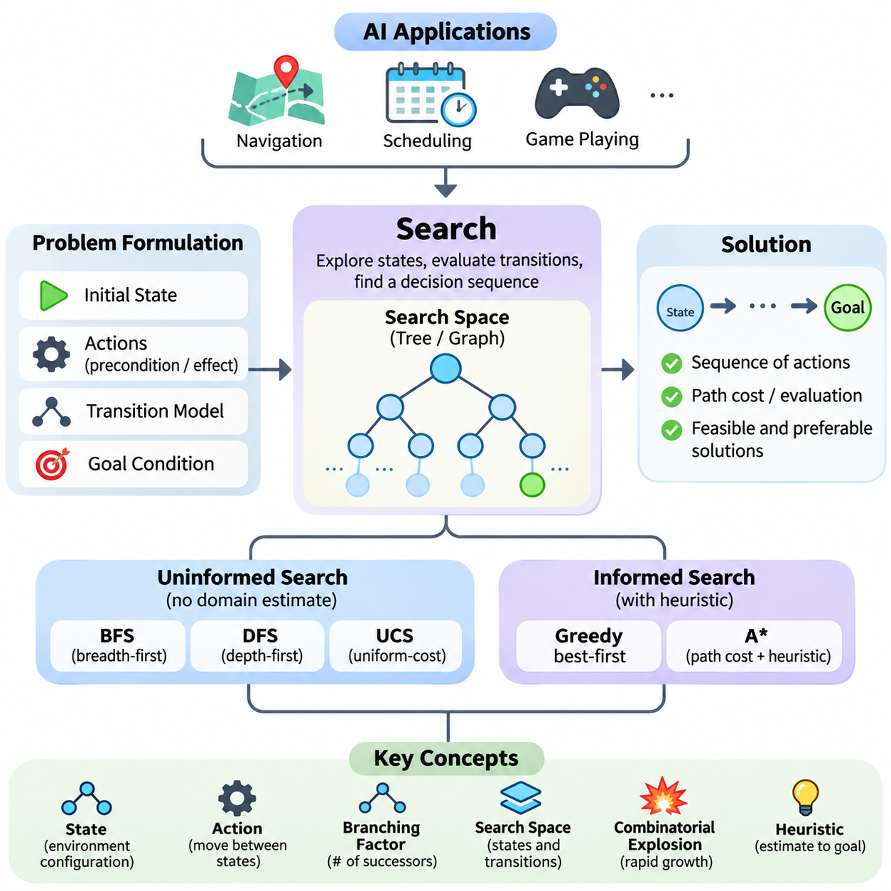
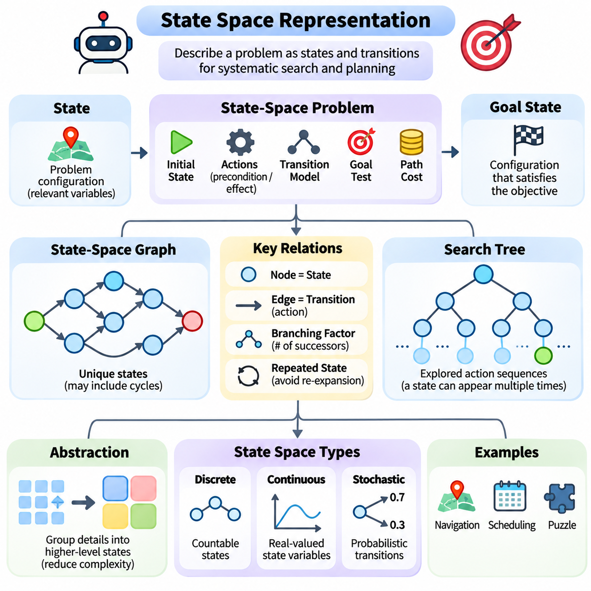
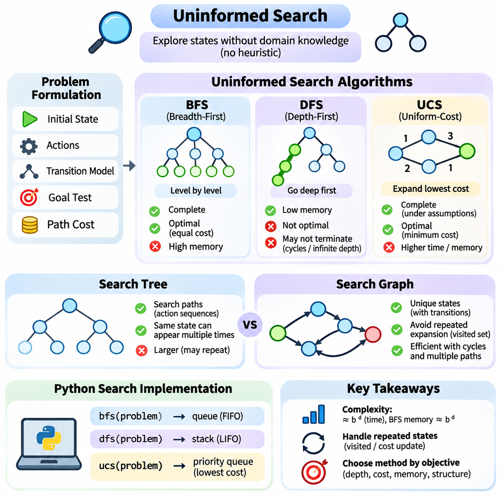
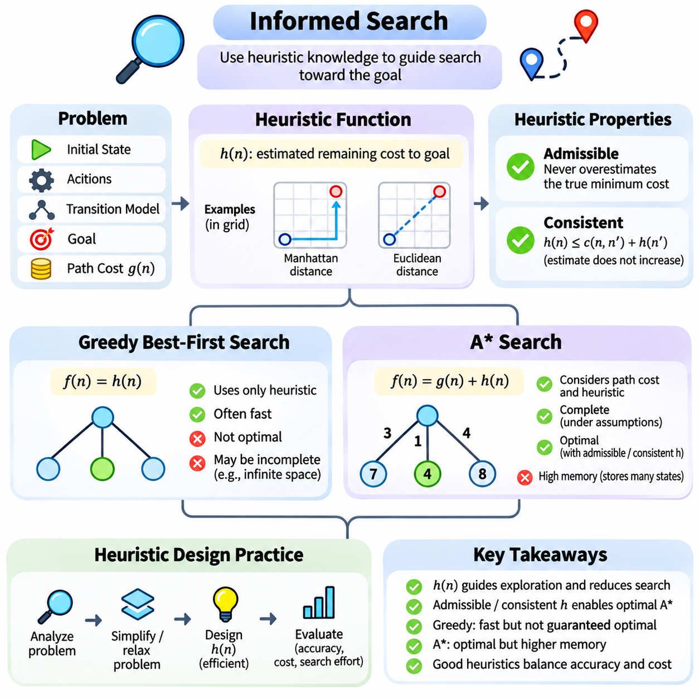
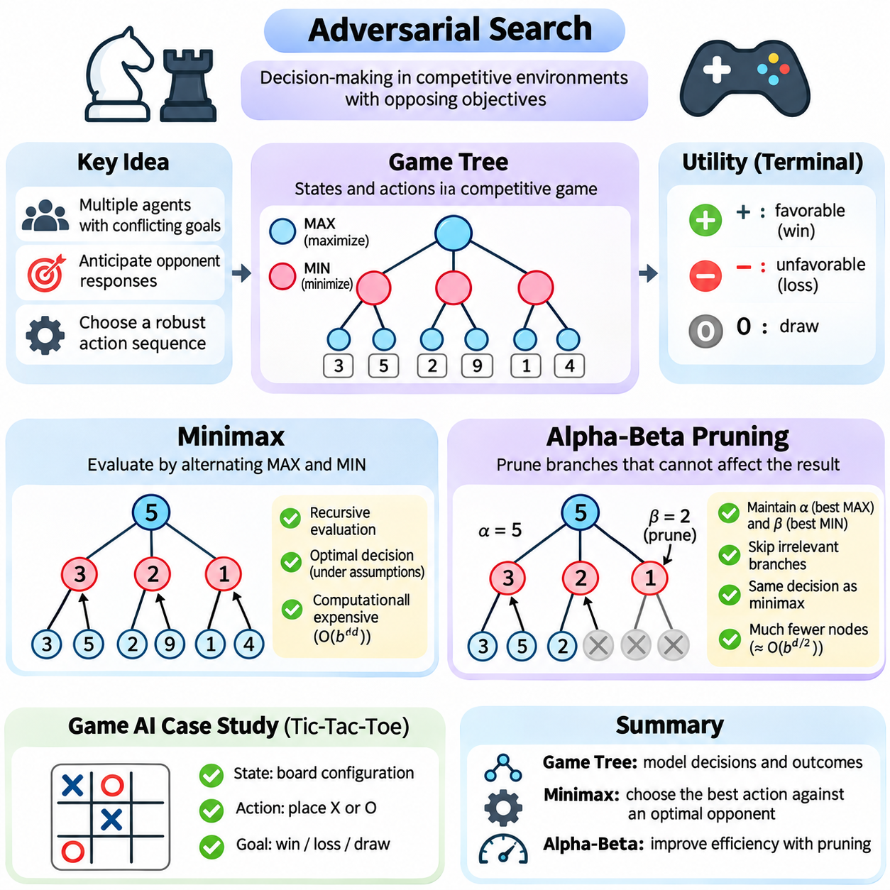
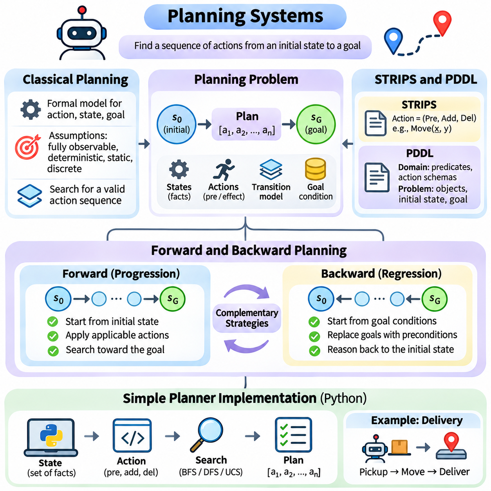
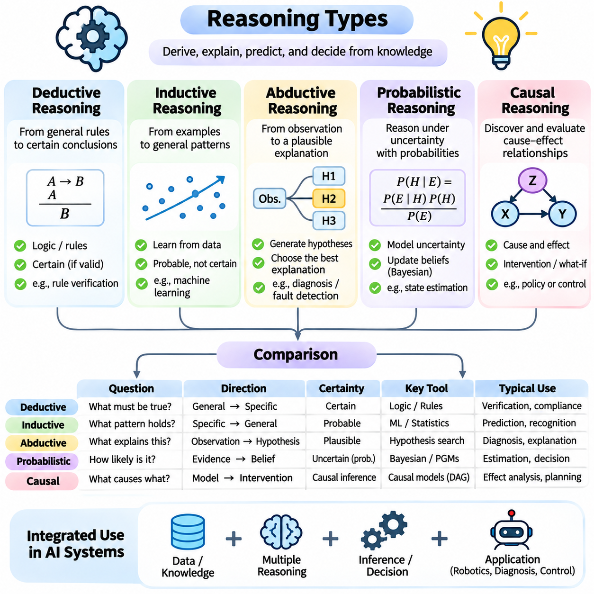

**Volume 04. Artificial Intelligence**

# 04. Search Planning and Reasoning

## 04.00 Search as Core AI Mechanism

{width="7.268055555555556in" height="7.268055555555556in"}

Search is one of the fundamental mechanisms of artificial intelligence because intelligent behavior frequently requires selecting an appropriate action from many possible alternatives. Rather than relying exclusively on predefined responses, an AI system explores candidate states, evaluates possible transitions, and identifies sequences of decisions that lead toward a desired objective. This process transforms abstract goals into computationally manageable problems.

The importance of search becomes evident when an intelligent agent encounters a situation in which the correct action is not immediately known. A navigation system must determine a route, a scheduling system must allocate limited resources, and a game-playing agent must anticipate future moves. Although these applications differ considerably, they share a common computational challenge: discovering useful solutions within a potentially enormous space of possibilities.

Search provides a systematic framework for addressing this challenge. A problem is represented through an initial state, a collection of available actions, transition rules, and a goal condition. By applying actions to existing states, the system generates new candidate states and gradually explores the relationships among them. The resulting structure may be represented as a tree or graph, depending on the characteristics of the problem.

A state describes the relevant configuration of an environment at a particular moment. In a robotic navigation problem, it may include the robot\'s position, orientation, and surrounding obstacles. In a puzzle, it may describe the arrangement of individual components. Effective state representation is essential because unnecessary details increase computational complexity, while missing information may prevent the system from identifying valid solutions.

Actions define how an intelligent agent can move between states. Each action may have preconditions determining whether it is permitted and effects describing how the environment changes. For example, a warehouse robot can move forward only when the corresponding path is traversable. By combining states and actions, an AI system constructs a transition model that supports systematic exploration and prediction.

The goal condition determines whether a candidate state satisfies the intended objective. Some problems require reaching a particular destination, while others involve satisfying multiple constraints or maximizing a performance measure. A search algorithm repeatedly examines candidate states until it discovers an acceptable solution, exhausts the available possibilities, or reaches a predefined computational limit.

A solution commonly consists of a sequence of actions connecting the initial state to a goal state. However, not every valid solution is equally desirable. One route may be shorter, another may consume less energy, and another may avoid hazardous conditions. Consequently, search systems often incorporate path costs or evaluation functions that distinguish feasible solutions from solutions that are preferable under specified objectives.

The search space represents the collection of states and transitions that may be encountered during problem solving. Its size strongly influences computational difficulty. Even relatively simple environments can produce enormous search spaces when numerous actions are available at each decision point. This phenomenon is closely associated with combinatorial explosion, where the number of candidate sequences grows rapidly as decision depth increases.

The branching factor describes the number of successor states generated from a typical state. When the branching factor is large, the number of possible paths can increase exponentially with search depth. This explains why exhaustive exploration becomes impractical for many realistic problems. Intelligent search therefore requires strategies that determine which possibilities deserve computational attention and which can be postponed or discarded.

Uninformed search algorithms explore a problem without using domain-specific estimates of the distance to a goal. Breadth-first search expands states according to their depth, while depth-first search follows individual branches before exploring alternatives. Uniform-cost search prioritizes paths with lower accumulated costs. These methods establish important foundations for understanding completeness, optimality, and computational efficiency.

Breadth-first search can discover a shallowest solution when actions have equal cost, but its memory requirements may become substantial. Depth-first search generally requires less memory, although it can become trapped in deep or cyclic regions without appropriate safeguards. Uniform-cost search accommodates nonuniform action costs and can identify minimum-cost solutions under suitable assumptions, including nonnegative edge costs.

Informed search introduces additional knowledge to guide exploration toward promising regions of the search space. This knowledge is commonly expressed through a heuristic function that estimates the remaining cost or distance from a state to the goal. A useful heuristic reduces unnecessary exploration by prioritizing states that appear more likely to contribute to an effective solution.

Greedy best-first search selects states according to their estimated proximity to the goal. This strategy can produce rapid progress, but it does not generally guarantee an optimal solution. A\\\* search combines accumulated path cost with estimated remaining cost, balancing progress already achieved against anticipated future effort. Under appropriate conditions, A\\\* provides completeness and optimality guarantees.

The effectiveness of informed search depends heavily on heuristic quality. A heuristic that consistently underestimates the true remaining cost is called admissible. A consistent heuristic additionally satisfies a condition relating estimates across neighboring states. These properties are important for establishing optimality guarantees, although their practical significance depends on the particular search algorithm and implementation.

Search is closely connected to planning, but the two concepts emphasize different aspects of intelligent problem solving. Search concerns the exploration of possible states and decisions, whereas planning emphasizes the construction of action sequences that achieve objectives under specified conditions. Planning systems frequently employ search algorithms, together with explicit models of actions, dependencies, constraints, and expected outcomes.

Classical planning typically assumes a defined initial state, deterministic actions, and a known environment. Under these assumptions, a planner can reason about which actions must occur before others. Representations such as STRIPS describe actions through preconditions and effects, while PDDL provides a standardized language for expressing planning domains and problems.

Forward planning begins with the initial state and explores actions that may lead toward the goal. Backward planning begins with desired goal conditions and reasons about the actions needed to establish them. Both approaches can be understood as structured forms of search. Their relative effectiveness depends on the number of applicable actions, the specificity of goals, and the organization of the planning domain.

Reasoning extends the significance of search beyond physical actions and navigation. An intelligent system may search through logical deductions, alternative explanations, possible diagnoses, or hypothetical consequences. In these situations, candidate states can represent knowledge configurations rather than physical environments. Search therefore provides a computational foundation for exploring relationships among facts, hypotheses, and conclusions.

Deductive reasoning derives conclusions from established premises and inference rules. Inductive reasoning develops generalizations from observations, while abductive reasoning searches for plausible explanations of available evidence. Probabilistic reasoning evaluates alternatives under uncertainty, and causal reasoning examines relationships involving interventions and consequences. These reasoning processes can incorporate search, although their underlying mechanisms are not limited to search algorithms.

Adversarial search introduces another important dimension by considering environments containing competing decision-makers. In strategic games, an agent must evaluate not only its own possible actions but also the responses available to an opponent. Game trees represent alternating decisions, allowing algorithms such as minimax to identify actions according to assumptions about opposing strategies.

Minimax evaluates possible outcomes by assuming that competing agents pursue conflicting objectives. Alpha-beta pruning improves computational efficiency by eliminating branches that cannot affect the final minimax decision. These techniques demonstrate how knowledge about decision structure can reduce unnecessary exploration while preserving the selected result under the same evaluation assumptions.

Search also plays an important role in optimization, where the objective is to identify configurations that minimize cost or maximize utility. Optimization methods may explore candidate solutions through local modifications, probabilistic transitions, or population-based strategies. Although optimization and classical state-space search are not identical, both involve navigating a structured set of alternatives according to evaluation criteria.

In practical AI systems, computational resources impose significant restrictions on search depth and breadth. Processing time, available memory, energy consumption, and response deadlines determine how extensively an agent can explore alternatives. Real-time applications often require satisfactory decisions within strict latency constraints rather than theoretically optimal solutions obtained after excessive computation.

Autonomous robots illustrate the importance of balancing search quality with operational constraints. A mobile robot may use graph search to determine a global route and local planning to avoid newly detected obstacles. As sensor observations change, previously valid paths may become unsafe or inaccessible. The system must therefore update its internal representation and revise decisions while maintaining operational continuity.

Search becomes more challenging when the environment is partially observable or uncertain. An agent may not know its exact state, and actions may produce unpredictable outcomes. In such situations, reasoning can involve probability distributions over possible states, commonly called belief states. Searching through belief states or contingent policies enables decision-making that accounts for uncertainty and future observations.

Modern AI increasingly combines learned representations with explicit search procedures. Neural networks can estimate state values, predict useful actions, or provide heuristic guidance. Search algorithms can then evaluate alternatives using these learned estimates. This integration combines the generalization capabilities of machine learning with the structured exploration and constraint handling associated with classical AI.

Large language models can also participate in search-oriented systems by generating candidate plans, proposing intermediate reasoning steps, and interacting with external tools. However, generated plans may contain invalid assumptions or inconsistent dependencies. Explicit verification, environmental feedback, and constraint checking remain important when language-based reasoning is used to support reliable decision-making.

The quality of a search system cannot be assessed solely by whether it finds a solution. Important evaluation criteria include completeness, solution optimality, execution time, memory consumption, scalability, and robustness. These properties frequently involve tradeoffs. An algorithm that guarantees optimality may require more computational resources than an approximate method that produces sufficiently effective results.

Search performance also depends on how the original problem is formulated. Poorly chosen state variables, redundant actions, weak constraints, and inaccurate cost functions can make even sophisticated algorithms inefficient. Conversely, a well-designed representation can substantially reduce the effective search space. Problem formulation is therefore as important as algorithm selection in engineering practical intelligent systems.

The fundamental contribution of search to artificial intelligence is its ability to convert uncertainty about what to do next into a structured process of evaluating alternatives. Through state representation, action modeling, heuristic guidance, planning, and reasoning, search connects knowledge with purposeful behavior. It remains an essential mechanism for building AI systems capable of making decisions in complex environments.

## 04.01 State Space Representation

{width="7.268055555555556in" height="7.268055555555556in"}

State space representation is a fundamental concept in artificial intelligence because it provides a structured description of all possible configurations that a problem-solving system may encounter. By expressing an environment as a collection of states and transitions, an intelligent agent can systematically explore alternatives, predict the consequences of actions, and identify sequences of decisions that lead toward a specified goal.

A state represents the information necessary to describe a problem at a particular moment. It does not necessarily include every physical detail of the environment, but it must contain the variables relevant to future decisions. For example, a navigation problem may represent a robot through its position, orientation, and available movement directions, while a scheduling problem may represent assigned tasks, resource availability, and remaining deadlines.

The state space is the set of all states considered possible under a particular problem formulation. Each state corresponds to a distinct configuration, and relationships between states are established through available actions. When an action transforms one state into another, the resulting connection forms part of a transition structure. This structure provides the computational foundation for search algorithms and automated planning systems.

A formal state-space problem typically contains an initial state, a set of applicable actions, a transition model, a goal test, and a path-cost function. The initial state describes where the problem-solving process begins, while the goal test determines whether a desired condition has been achieved. The transition model specifies how actions modify states, and the cost function evaluates the resources or penalties associated with transitions.

The initial state plays an important role because it establishes the starting configuration from which exploration proceeds. In a warehouse robot application, the initial state may specify the robot\'s current location and the arrangement of nearby obstacles. In a puzzle-solving application, it may describe the starting arrangement of tiles. Different initial states can produce substantially different search requirements even when the goal remains unchanged.

A goal state represents a configuration that satisfies the intended objective. Some problems define a single exact goal state, while others permit multiple acceptable configurations. For instance, a delivery robot may complete its mission by reaching any authorized unloading position. Representing goals as logical conditions rather than fixed configurations can improve flexibility and allow search algorithms to recognize several valid solutions.

Actions define the possible operations that transform states. Each action may require specific preconditions and produce particular effects. A robotic movement action might require an unobstructed destination and sufficient energy, while its effects update the robot\'s location and remaining battery capacity. Explicit action definitions prevent search algorithms from generating transitions that violate the underlying rules of the environment.

The transition model describes the relationship between a state, an action, and the resulting state. In deterministic environments, a given state-action pair produces a single predictable successor. In stochastic environments, the same action may lead to several possible outcomes with associated probabilities. This distinction determines whether conventional deterministic search is sufficient or more advanced decision-making methods are required.

State spaces are frequently represented as graphs, where nodes correspond to states and directed edges correspond to valid transitions. This representation supports systematic exploration and enables algorithms to track connectivity, reachability, and accumulated costs. Although search procedures may construct trees during exploration, the underlying state space often contains cycles and multiple paths leading to the same state.

A search tree records the sequences of actions explored by an algorithm, whereas a state-space graph represents relationships among unique states. Consequently, the same state may appear multiple times in a search tree when different action sequences reach it. Recognizing repeated states is important because unnecessary re-expansion increases computational cost and may cause infinite exploration in environments containing cycles.

State representation strongly influences the branching factor, which measures the number of successor states available from a typical state. A representation that introduces unnecessary variables or actions can dramatically increase the number of possibilities. As search depth grows, this expansion may produce combinatorial explosion. Efficient representations therefore attempt to preserve essential information while minimizing redundant distinctions between states.

Abstraction is a powerful technique for reducing state-space complexity. Instead of representing every detail of an environment, an AI system may group similar configurations into higher-level states. A navigation system, for example, may initially represent buildings as connected regions rather than individual coordinates. Such abstraction can accelerate planning, provided that important constraints and relevant distinctions are not lost.

The appropriate level of abstraction depends on the task being solved. A global route planner may require only road connectivity and approximate travel costs, while a local motion planner must consider precise geometry, obstacle clearance, and vehicle dynamics. Using different representations at different planning levels enables intelligent systems to balance computational efficiency with the accuracy required for safe execution.

Discrete state spaces contain configurations that can be represented as separate elements, such as board positions, logical assignments, or grid locations. Continuous state spaces contain variables that vary over real-valued ranges, including position, velocity, and orientation. Continuous representations are especially important in robotics and control, where physical motion cannot always be adequately described through a finite collection of symbolic states.

Hybrid state spaces combine discrete and continuous variables within a unified model. An autonomous vehicle, for example, may operate in discrete modes such as driving, stopping, and charging while maintaining continuous estimates of position, speed, and battery level. Hybrid representations are useful when intelligent behavior depends simultaneously on symbolic operating conditions and physical system dynamics.

The choice of state variables must satisfy the information requirements of the decision process. Ideally, the current state contains sufficient information to predict relevant future behavior when an action is applied. This principle is closely related to the Markov property, under which future state probabilities depend on the current state and action rather than the complete history of previous states.

When important historical information is omitted, a state representation may become inadequate. For example, a robot\'s current position alone may not determine its future motion if velocity and steering configuration also matter. Including these variables can restore predictive accuracy. Alternatively, a system may maintain internal memory or estimated hidden states when direct observations cannot fully describe the environment.

Partial observability introduces additional complexity because an agent may not know the true environmental state. Sensor measurements may be noisy, incomplete, or ambiguous. Instead of maintaining a single known state, the system can represent uncertainty through a belief state, which describes a probability distribution over possible states. This approach supports decision-making when observations provide only partial information.

Belief-state representations are particularly relevant to autonomous navigation, localization, and diagnosis. A mobile robot may maintain several possible location hypotheses until additional sensor observations reduce uncertainty. Similarly, a diagnostic system may assign probabilities to alternative fault conditions. Searching or planning over belief states allows an intelligent agent to consider uncertainty explicitly rather than assuming perfect environmental knowledge.

State-space representation is also closely connected to knowledge representation and logical reasoning. Symbolic states may consist of predicates describing relationships among objects, such as whether a robot occupies a location or whether a container is available. Actions modify these predicates according to defined rules. Such representations provide a foundation for classical planning languages, including STRIPS and PDDL.

In planning systems, a state can be described as a collection of logical facts that are currently true. An action becomes applicable when its preconditions are satisfied, and its effects determine which facts are added or removed. This approach supports explicit reasoning about action dependencies and goal achievement. It also enables planners to generate action sequences without enumerating every possible state in advance.

State representations can incorporate numerical costs, constraints, and resource information. A delivery system may track remaining fuel, elapsed time, payload capacity, and route restrictions. These variables influence both the feasibility and desirability of future actions. However, adding variables increases state-space dimensionality, making it necessary to distinguish essential decision information from unnecessary descriptive detail.

The dimensionality of a state space describes the number of independent variables required to characterize a state. High-dimensional spaces can become difficult to explore because the number of distinguishable configurations grows rapidly with additional dimensions. This challenge is related to the curse of dimensionality, which affects search, optimization, planning, and learning algorithms operating over complex environments.

Several techniques can reduce the practical burden of large state spaces. State aggregation combines similar configurations, hierarchical decomposition separates complex tasks into manageable subproblems, and constraint-based filtering removes invalid alternatives. Heuristic guidance can prioritize promising states, while compact data structures and repeated-state detection reduce unnecessary computation during exploration.

State representation also affects the correctness of search results. If two states are treated as equivalent despite having different future possibilities, an algorithm may discard a necessary solution path. Conversely, representing functionally identical configurations as separate states wastes computational resources. A well-designed representation must therefore preserve distinctions that influence reachability, action applicability, path costs, and goal satisfaction.

In real-world applications, state spaces are often dynamic because environmental conditions change during operation. A warehouse robot may encounter moving obstacles, newly assigned tasks, or unavailable corridors. Its internal state representation must be updated using current observations, and the planning process may need to restart or revise previously generated paths. This continuous interaction connects state-space reasoning with perception and control.

Modern artificial intelligence increasingly combines explicit state representations with learned latent representations. Neural networks can compress high-dimensional observations into compact feature vectors that capture information relevant to prediction or decision-making. These learned states may support model-based reinforcement learning, world modeling, and planning, although their usefulness depends on whether they preserve the information necessary for reliable action selection.

The central purpose of state-space representation is to transform a complex problem into a structured collection of configurations and possible transitions. Its effectiveness depends on selecting appropriate variables, defining valid actions, preserving relevant constraints, and controlling computational complexity. A carefully constructed state space provides the foundation upon which search, planning, and reasoning algorithms can operate systematically and efficiently.

## 04.02 Uninformed Search

{width="7.268055555555556in" height="7.268055555555556in"}

Uninformed search is a fundamental category of artificial intelligence algorithms that explores possible states without relying on domain-specific knowledge about the location of a goal. These algorithms use the problem definition, available actions, transition rules, and path costs to determine which states should be examined. Their systematic behavior provides an essential foundation for understanding more advanced search and planning methods.

The central principle of uninformed search is that exploration proceeds without heuristic estimates of the remaining distance to the goal. Instead, algorithms organize candidate states according to predefined expansion strategies. Breadth-first search, depth-first search, and uniform-cost search represent three important approaches, each offering different characteristics concerning completeness, optimality, computational complexity, and memory requirements.

Breadth-first search, commonly abbreviated as BFS, explores states in order of increasing search depth. Beginning with the initial state, it examines all reachable states at one depth before expanding states at the next depth. This level-by-level exploration is particularly useful when the objective is to identify a solution requiring the fewest actions and every action has the same cost.

BFS typically maintains its frontier using a first-in, first-out queue. Newly discovered states are inserted at the end of the queue, while the oldest pending state is selected for expansion. This ordering ensures that shallower states are processed before deeper states. Under finite branching conditions, BFS is complete, although its memory consumption can become substantial as the search depth increases.

Depth-first search, or DFS, follows a different exploration strategy by expanding the deepest available state before returning to alternative branches. It proceeds along one path until reaching a goal, a dead end, or a predefined depth limit. When further expansion is impossible, the algorithm backtracks to the most recent state containing unexplored alternatives and continues the search.

DFS commonly uses a last-in, first-out stack or recursive function calls to manage exploration. Its primary advantage is relatively low memory consumption compared with breadth-first search. However, DFS does not generally guarantee the shortest solution and may fail to terminate in infinite-depth spaces or environments containing cycles unless suitable safeguards are implemented.

Uniform-cost search, abbreviated as UCS, prioritizes states according to the total path cost accumulated from the initial state. Unlike BFS, which considers the number of actions, UCS explicitly accounts for differences in transition costs. This characteristic makes it suitable for navigation, transportation, and resource allocation problems where individual actions may have different costs.

UCS typically uses a priority queue that selects the frontier node with the lowest accumulated cost. Whenever a cheaper route to an existing state is discovered, the corresponding cost record can be updated. With nonnegative edge costs and appropriate termination conditions, UCS can identify minimum-cost solutions. Completeness additionally requires suitable assumptions, such as positive lower bounds on action costs.

The distinction between BFS, DFS, and UCS becomes especially important when evaluating solution quality. BFS guarantees a minimum-depth solution under appropriate assumptions, while UCS seeks a minimum-cost solution. DFS emphasizes memory efficiency and deep exploration rather than optimality. Selecting an appropriate algorithm therefore requires understanding the objective, action costs, state-space structure, and available computational resources.

Search complexity is commonly analyzed through the branching factor and solution depth. If each state produces approximately b successors, the number of states at depth d can grow on the order of b raised to d. BFS may require exponential time and memory in the solution depth, while conventional DFS requires substantially less memory when the branching factor and maximum search depth are bounded.

A search tree represents the sequence of exploration decisions made by an algorithm. Each tree node corresponds to a particular search path, including the state reached, the action taken, and potentially the accumulated cost. Because different action sequences can reach the same underlying state, a search tree may contain multiple nodes representing identical environmental configurations.

A search graph, by contrast, represents unique states and the transitions connecting them. Graph-based search can recognize previously encountered states and avoid unnecessary repeated expansion. This distinction is important in environments containing cycles, reversible actions, or multiple routes to the same destination. Without repeated-state detection, search algorithms may waste resources exploring equivalent configurations.

Tree search and graph search therefore differ primarily in how they manage repeated states. Tree search generally treats each generated path as a separate candidate, while graph search maintains information about visited or discovered states. A graph-search implementation may use a visited set, an explored set, or a cost table depending on the algorithm and whether alternative paths can improve an existing solution.

Repeated-state detection must be implemented carefully because different algorithms have different correctness requirements. For BFS with uniform action costs, recording states when they are first discovered can prevent redundant insertions. For UCS, however, a previously discovered state may later be reached through a cheaper path. Consequently, cost comparisons and priority updates are necessary to preserve optimality.

Cycles introduce additional challenges because actions may return an agent to a previously visited configuration. For example, a mobile robot can move between adjacent locations repeatedly without approaching its destination. A search tree without cycle prevention may generate increasingly long redundant paths. Graph search addresses this issue by tracking state identities and controlling repeated exploration.

The distinction between a search node and a state is also essential. A state describes an environmental configuration, whereas a search node contains information about the path used to reach that configuration. A node may store its parent, generating action, search depth, and accumulated path cost. Separating these concepts allows algorithms to reconstruct solutions while maintaining efficient state comparisons.

Python provides a practical environment for implementing uninformed search algorithms because its standard library includes suitable data structures. The collections.deque class supports efficient queue operations for BFS, while ordinary Python lists can implement stacks for DFS. The heapq module provides a binary heap suitable for priority-based exploration in UCS.

A typical Python search implementation begins by defining a problem interface that provides an initial state, a goal-testing function, and a successor-generation function. The successor function returns valid neighboring states together with associated actions and transition costs. This separation between problem definition and search strategy makes the implementation reusable across navigation, puzzles, and planning applications.

In a BFS implementation, the initial state is inserted into a queue and recorded as discovered. The algorithm repeatedly removes the oldest state, checks whether it satisfies the goal condition, and generates valid successors. Newly discovered states are added to the queue, while parent references are recorded for later path reconstruction. The procedure terminates when a goal is found or the frontier becomes empty.

A DFS implementation follows a similar structure but replaces the queue with a stack. Successor states are pushed onto the stack, causing the most recently inserted state to be explored first. Iterative DFS implementations can avoid recursion-depth limitations, while depth-limited search provides explicit control over exploration depth. The ordering of successors can significantly influence which solution is discovered first.

A UCS implementation maintains a priority queue containing candidate states and their accumulated costs. Each expansion selects the entry with the smallest current path cost. When a successor is generated, the algorithm calculates its tentative cost and compares it with the best recorded cost for that state. Improved paths update the cost record and are inserted into the priority queue.

Python\'s heapq module does not automatically remove outdated entries when a cheaper path is discovered. A common implementation therefore inserts a new entry and ignores obsolete entries when they are eventually removed from the heap. This lazy-update strategy simplifies implementation while preserving correct cost ordering when combined with appropriate best-cost checks.

Path reconstruction is another essential component of practical search systems. Rather than storing complete action sequences in every frontier entry, an implementation can maintain a parent mapping that records how each state was reached. Once the goal is discovered, the algorithm follows parent references backward to the initial state and reverses the resulting sequence to obtain the final solution.

Correctness testing should include simple graphs with known solutions, unreachable goals, cycles, and alternative paths with different costs. BFS should be checked for minimum-depth behavior, DFS for expected traversal order and termination safeguards, and UCS for minimum-cost behavior. Tests should also verify that repeated states are handled correctly and that reconstructed paths correspond to valid transitions.

Performance evaluation can measure expanded nodes, generated nodes, frontier size, execution time, and solution cost. These metrics reveal differences between search strategies that may not be apparent from successful goal discovery alone. Memory consumption is particularly important for BFS, while cost management and priority queue operations are central considerations for UCS.

In practical applications, uninformed search algorithms serve both as operational tools and as reference baselines for more sophisticated methods. BFS can support shortest-path discovery in unweighted networks, DFS can explore dependency structures, and UCS can solve weighted routing problems. Their limitations also motivate heuristic search, hierarchical planning, and other approaches designed for larger or more complex environments.

The fundamental value of uninformed search lies in its clear separation between problem representation and exploration strategy. By understanding BFS, DFS, UCS, search trees, search graphs, and their Python implementations, developers gain a rigorous foundation for constructing reliable search systems. These principles remain central to artificial intelligence because they explain how structured exploration transforms possible actions into goal-directed solutions.

## 04.03 Informed Search

{width="7.268055555555556in" height="7.268055555555556in"}

Informed search is an artificial intelligence approach that uses additional knowledge about a problem to guide exploration toward promising states. Unlike uninformed search, which relies primarily on structural properties such as depth or accumulated cost, informed search estimates how close candidate states are to a goal. This guidance can substantially reduce unnecessary exploration and improve computational efficiency in large state spaces.

The central mechanism of informed search is the heuristic function, commonly denoted as h(n). This function estimates the remaining cost from a state n to a goal state. A heuristic does not necessarily provide the exact cost, but it offers useful information for prioritizing alternatives. Its effectiveness depends on how accurately it reflects the underlying problem while remaining computationally inexpensive to evaluate.

Heuristic functions are often derived from simplified versions of the original problem. In grid navigation, Manhattan distance estimates travel distance when movement is restricted to horizontal and vertical directions. Euclidean distance measures straight-line separation between positions. These estimates can guide exploration efficiently, although their suitability depends on movement rules, obstacles, and the definition of path cost.

A heuristic should capture relevant characteristics of the search environment without requiring the same computational effort as solving the original problem. If evaluating a heuristic is excessively expensive, the resulting reduction in explored states may not improve overall performance. Effective heuristic design therefore balances estimation accuracy, computational overhead, and the amount of search effort avoided.

Two important heuristic properties are admissibility and consistency. An admissible heuristic never overestimates the true minimum remaining cost. A consistent heuristic satisfies a relationship in which the estimate at a state does not exceed the cost of reaching a successor plus that successor\'s estimate. These properties support important optimality guarantees for algorithms such as A\\\* search.

Admissibility is especially valuable when the objective is to discover a minimum-cost solution. By avoiding overestimation, the heuristic provides a lower bound on the remaining cost. Consistency additionally ensures that estimated total costs do not decrease along a path. In graph-search implementations of A\\\*, consistency supports optimality without requiring previously expanded states to be reopened.

Greedy best-first search is a straightforward informed search strategy that selects states according to their estimated remaining cost. Its evaluation function is f(n) = h(n), meaning that the algorithm prioritizes whichever frontier state appears closest to the goal. This approach often reaches promising regions quickly because it concentrates exploration on immediate heuristic estimates rather than accumulated path costs.

The main advantage of greedy search is its potential computational efficiency when the heuristic provides useful directional information. However, greedy search does not account for the cost already incurred while reaching a state. As a result, it may select an apparently attractive route that ultimately produces an expensive solution. Its performance can also deteriorate when heuristic estimates are misleading.

Greedy search is not generally optimal, and its completeness depends on the search space and implementation. In finite graphs with appropriate repeated-state detection, it can eventually find a reachable goal. In infinite spaces, however, exploration may continue indefinitely. These limitations demonstrate why heuristic guidance alone does not guarantee reliable or economically efficient decision-making.

A\\\* search addresses an important weakness of greedy search by combining accumulated path cost with estimated remaining cost. Its evaluation function is f(n) = g(n) + h(n), where g(n) represents the known cost from the initial state to n. The algorithm prioritizes states according to the estimated total cost of a complete solution passing through them.

The relationship between g(n) and h(n) explains the behavior of A\\\*. The accumulated cost reflects resources already consumed, while the heuristic estimates the effort still required. When h(n) equals zero for every state, A\\\* behaves like uniform-cost search. When heuristic estimates are informative, A\\\* can prioritize promising paths and avoid expanding many states that uninformed methods would examine.

A\\\* commonly maintains a priority queue containing frontier states ordered by their f-values. During expansion, the algorithm generates valid successors and calculates tentative path costs. If a cheaper route to a state is discovered, its best-known cost and parent information are updated. This process continues until an appropriate goal is selected for expansion or the frontier becomes empty.

Under suitable assumptions, A\\\* can guarantee a minimum-cost solution. For graph search without reopening expanded states, a consistent heuristic is sufficient for optimality when edge costs are nonnegative. With an admissible but inconsistent heuristic, optimality can still be maintained through appropriate reopening and cost-update procedures. Completeness requires additional conditions concerning branching and action costs.

Despite its advantages, A\\\* can consume substantial memory because it stores frontier states and information about previously explored configurations. In difficult problems, the number of generated states may grow exponentially. Consequently, heuristic quality and state representation remain critical. More informative estimates can reduce exploration, but they do not eliminate the fundamental complexity of large search spaces.

Heuristic design practice begins with understanding the structure and constraints of the original problem. Developers identify the variables that determine movement, action feasibility, and transition cost. They then construct simplified models that retain useful cost information while removing selected constraints. The optimal cost of a relaxed problem can provide an admissible heuristic for the original problem.

For example, a navigation heuristic may ignore obstacles while preserving geometric travel distance. Because removing obstacles cannot increase the minimum possible travel cost, the resulting estimate can serve as a lower bound when movement and cost assumptions are compatible. Similarly, puzzle-solving heuristics may estimate the number of misplaced elements or the minimum movements required under relaxed rules.

Heuristic functions can also be constructed using precomputed information. Pattern databases store exact solution costs for abstracted subproblems and reuse those values during search. This approach can produce informative admissible estimates, although database construction and storage introduce additional costs. The effectiveness of pattern databases depends on selecting abstractions that capture important problem structure.

Combining multiple heuristics is another practical technique. Taking the maximum of several admissible heuristics preserves admissibility and can provide stronger guidance than using any weaker estimate alone. Adding heuristic values requires greater care because overlapping cost contributions may cause overestimation. Additive combinations are justified only when the underlying cost partitioning supports them.

Heuristic quality can be evaluated by comparing estimated remaining costs with known optimal costs on representative problem instances. Useful measurements include estimation error, expanded-node count, execution time, peak memory consumption, and solution cost. A heuristic that is more accurate may still perform poorly if its evaluation overhead is excessive, making end-to-end benchmarking essential.

Python implementations of informed search commonly use the heapq module to maintain a priority queue. A greedy search implementation orders entries by h(n), while A\\\* orders them by g(n) + h(n). A dictionary can store the best-known cost for each state, and parent mappings can support solution reconstruction. Outdated priority queue entries must be handled carefully when improved paths are discovered.

Practical implementation also requires precise definitions of state identity, goal testing, and transition costs. A heuristic must use the same cost interpretation as the search objective. For example, geometric distance may be inappropriate when route costs primarily reflect energy consumption, risk, or travel restrictions. A mismatch between heuristic assumptions and actual costs can weaken guidance or invalidate admissibility.

In robotics, informed search supports global path planning through occupancy grids, road networks, and topological maps. A mobile robot can use A\\\* to find a low-cost route while considering obstacle locations and traversable regions. The resulting path may subsequently require smoothing, collision checking, and dynamic feasibility verification before execution by a motion controller.

Informed search also appears in scheduling, automated planning, puzzle solving, and resource optimization. Heuristics may estimate remaining task duration, unresolved constraints, or minimum resource consumption. Although the state representations differ, the underlying principle remains consistent: use inexpensive estimates of future effort to allocate computational attention toward alternatives likely to produce effective solutions.

The fundamental contribution of informed search is its integration of problem-specific knowledge with systematic exploration. Heuristic functions provide directional guidance, greedy search emphasizes estimated proximity to the goal, and A\\\* balances accumulated and remaining costs. Careful heuristic design, correctness analysis, and practical benchmarking allow these methods to support efficient and reliable intelligent decision-making.

## 04.04 Adversarial Search

{width="7.268055555555556in" height="7.268055555555556in"}

Adversarial search is a fundamental artificial intelligence technique for decision-making in environments where multiple agents pursue conflicting objectives. Unlike conventional search, which assumes that actions lead toward a goal without deliberate opposition, adversarial search considers how an opponent may respond. This framework is particularly important in competitive games, strategic planning, cybersecurity, and multi-agent decision systems.

A game tree represents the possible sequences of decisions made by competing players. Each node corresponds to a game state, while each edge represents a legal action that transforms one state into another. The root describes the current configuration, and successive levels represent alternating decisions. Terminal nodes indicate completed games or situations where no further legal actions are available.

Game trees provide a structured method for analyzing future consequences rather than evaluating only immediate rewards. In a two-player game, one player attempts to maximize the outcome while the opponent attempts to minimize it. This alternating structure allows an intelligent agent to anticipate counteractions and evaluate decisions according to their consequences under rational opposition.

The size of a game tree depends on the branching factor and the number of future moves considered. If each position offers approximately b legal actions and the search examines d levels, the number of possible nodes can grow exponentially with depth. Complex games therefore require selective exploration, efficient evaluation functions, and computational strategies that avoid examining every possible continuation.

A terminal utility function assigns numerical values to completed game outcomes. In a zero-sum game, one player\'s gain corresponds to the opponent\'s loss. A common convention assigns positive values to favorable outcomes, negative values to unfavorable outcomes, and zero to draws. These values provide the mathematical foundation for comparing alternative strategies and determining preferred actions.

Minimax is a classical adversarial search algorithm designed for deterministic, turn-based, two-player zero-sum games with perfect information. It assumes that both players select actions rationally according to opposing objectives. The maximizing player chooses actions that produce the highest achievable utility, while the minimizing player chooses actions that reduce the maximizing player\'s outcome.

The minimax procedure evaluates a game tree recursively, beginning with terminal positions or states at a predefined search limit. At maximizing nodes, the algorithm selects the largest value among successor states. At minimizing nodes, it selects the smallest value. These values propagate backward through the tree until the root receives an evaluation representing the best achievable outcome against optimal opposition.

The strategic significance of minimax is that it evaluates decisions according to an opponent\'s strongest possible response. An action that appears immediately advantageous may be rejected if it allows a damaging counterattack. Conversely, a defensive move may be preferred when it prevents a severe future loss. This reasoning makes minimax particularly suitable for competitive environments where anticipating opposition is essential.

Minimax produces an optimal decision under its assumptions when the complete finite game tree can be evaluated accurately. However, exhaustive exploration becomes computationally expensive as branching factors and search depths increase. For practical applications, algorithms frequently stop at a limited depth and estimate the value of intermediate states using heuristic evaluation functions.

A heuristic evaluation function estimates the strategic quality of a nonterminal game position. In chess, such a function may consider material balance, mobility, king safety, and positional control. In other games, relevant features may include territory, available resources, or future action opportunities. Evaluation quality strongly influences decision-making when the complete game tree cannot be explored.

Depth-limited minimax introduces an important tradeoff between computational cost and strategic accuracy. Searching deeper allows the algorithm to anticipate more distant consequences but requires additional processing time. Shallow searches may suffer from the horizon effect, where significant events occur just beyond the search boundary. Quiescence search can reduce this problem by extending exploration through tactically unstable positions.

Alpha-beta pruning improves minimax efficiency by eliminating branches that cannot influence the final decision. It maintains two bounds during exploration: alpha represents the best value currently guaranteed to the maximizing player, while beta represents the best value currently guaranteed to the minimizing player. When the bounds establish that a branch cannot improve the relevant decision, further exploration becomes unnecessary.

The pruning condition occurs when alpha becomes greater than or equal to beta. At that point, the remaining successors of the current node cannot affect the choice made by an appropriate ancestor. The algorithm can therefore skip those branches without changing the minimax result. Alpha-beta pruning preserves the decision quality of complete minimax while potentially reducing the number of evaluated states substantially.

The effectiveness of alpha-beta pruning depends strongly on move ordering. If promising moves are examined early, useful bounds become available sooner and more branches can be eliminated. With ideal ordering, alpha-beta pruning can reduce effective search complexity from approximately O(b\^d) toward O(b\^(d/2)). Poor ordering may provide little improvement over ordinary minimax.

Practical game-playing systems use several techniques to improve move ordering and search efficiency. Iterative deepening repeatedly searches the same position with increasing depth limits, allowing results from earlier searches to guide later exploration. Transposition tables store evaluations of previously examined positions, reducing repeated computation when different move sequences reach equivalent game states.

A transposition table typically uses a compact state identifier, often generated through Zobrist hashing, to associate positions with stored search information. Entries may include evaluation scores, search depths, and bound classifications. Because identical positions can occur through different action sequences, reusing these results can substantially reduce search effort while requiring careful handling of stored bounds.

A practical game AI case study can be developed using Tic-Tac-Toe, where the state space is small enough to demonstrate complete minimax search. The board configuration identifies the current state, legal moves define successor states, and terminal evaluation distinguishes wins, losses, and draws. By recursively examining alternative moves, an AI agent can select actions that prevent defeat against an optimal opponent.

In a Tic-Tac-Toe implementation, the maximizing player may receive a utility of positive one for victory, negative one for defeat, and zero for a draw. The algorithm alternates maximizing and minimizing decisions until reaching terminal states. Since the game has a manageable number of configurations, exhaustive minimax can demonstrate optimal strategic behavior without requiring complex heuristic evaluation.

Alpha-beta pruning can be introduced into the same Tic-Tac-Toe system without changing its strategic objective. The implementation tracks alpha and beta values during recursive evaluation and stops examining branches once further exploration cannot affect the selected action. Comparing the number of visited nodes before and after pruning provides a direct demonstration of its computational benefits.

A more demanding case study involves Connect Four, where the larger game tree makes exhaustive search impractical in many positions. A depth-limited minimax system can evaluate potential winning sequences, defensive threats, and control of strategically important columns. Alpha-beta pruning and move ordering allow the system to search more deeply while respecting computational constraints.

Python implementations commonly represent game states using arrays, tuples, or compact integer encodings. A legal-move generator identifies valid actions, a transition function produces successor states, and a terminal test determines whether play has ended. Separating these components from minimax and alpha-beta procedures improves modularity and supports reuse across different competitive games.

Testing adversarial search requires more than checking whether an agent can win against weak opponents. Evaluation should include forced wins, unavoidable losses, drawing positions, and strategically deceptive moves. Correctness can be verified against known optimal outcomes, while performance can be measured through expanded nodes, search depth, execution time, and memory consumption.

Real-world competitive environments may violate the assumptions of classical minimax. Some games contain hidden information, stochastic outcomes, simultaneous actions, or more than two players. These conditions require extensions such as expectiminimax, belief-state reasoning, or alternative game-theoretic methods. The appropriate framework depends on how uncertainty, information availability, and player objectives are represented.

Adversarial search also extends beyond recreational games. Cybersecurity systems may anticipate attacker responses, negotiation agents may evaluate competing strategies, and autonomous systems may reason about conflicting objectives. Although real-world opponents are not always perfectly rational, game-tree reasoning provides a useful framework for evaluating actions under strategic uncertainty and deliberate opposition.

The central contribution of adversarial search is its ability to incorporate opponent behavior into systematic decision-making. Game trees represent possible interactions, minimax identifies robust decisions against optimal opposition, and alpha-beta pruning improves computational efficiency without changing the underlying result. Together, these methods establish a foundation for intelligent competitive agents and advanced multi-agent reasoning systems.

## 04.05 Planning Systems

{width="7.268055555555556in" height="7.268055555555556in"}

Planning systems enable intelligent agents to determine sequences of actions that transform an initial situation into a desired goal state. Unlike simple reactive systems, which select actions based primarily on immediate observations, planning systems explicitly consider future consequences and dependencies. This capability is fundamental to robotics, automated logistics, workflow management, and autonomous decision-making.

Classical planning provides a formal framework for reasoning about actions, states, and goals under simplified environmental assumptions. It typically assumes a fully observable, deterministic, static, and discrete environment with a known action model. Within this framework, a planner searches for an action sequence that satisfies specified goal conditions while respecting the preconditions and effects of available actions.

A classical planning problem consists of an initial state, a goal description, and a collection of action definitions. The initial state specifies facts that are initially true, while the goal describes conditions that must eventually hold. Actions define permissible state transformations. Planning algorithms use these elements to construct valid sequences that move the environment from its starting configuration toward the intended outcome.

The distinction between planning and ordinary search lies primarily in the representation of actions and goals. Conventional search may treat states as abstract nodes connected by transitions, whereas planning systems often describe states using logical predicates and actions using explicit preconditions and effects. This structured representation allows planners to reason about dependencies without enumerating every possible configuration beforehand.

Classical planning commonly represents states as sets of logical propositions. For example, a warehouse environment may include facts indicating that a robot occupies a location, a package is stored on a shelf, or a destination is available. An action changes the truth values of selected propositions. This symbolic representation supports transparent reasoning about which actions are applicable and how their execution affects the environment.

STRIPS, originally developed as the Stanford Research Institute Problem Solver, introduced an influential representation for automated planning. In its classical form, each action contains preconditions, an add list, and a delete list. Preconditions determine when an action is executable, while add and delete lists specify which propositions become true or false after execution.

Consider a robot movement action in a warehouse. Its preconditions may require the robot to occupy a starting location and the destination to be connected and accessible. Its add effects establish that the robot occupies the destination, while its delete effects remove the previous location fact. Such definitions allow a planner to simulate actions symbolically without executing them physically.

The Planning Domain Definition Language, or PDDL, extends standardized descriptions of planning domains and problem instances. A domain file defines predicates, action schemas, and supported planning features, while a problem file specifies objects, the initial state, and goal conditions. Separating reusable domain knowledge from individual problems allows planning algorithms to operate across different scenarios.

PDDL action schemas describe parameterized operations that can be instantiated with specific objects. For example, a movement schema may accept a robot, source location, and destination location as parameters. Preconditions determine whether the instantiated action is valid, and effects specify its consequences. More expressive PDDL variants can represent numerical fluents, conditional effects, temporal actions, and additional planning requirements.

STRIPS and PDDL provide a declarative approach to planning because they describe what actions mean rather than prescribing exactly how to search for a solution. This separation allows different planning algorithms to operate on the same domain model. It also supports systematic testing, model reuse, and comparison of planning strategies across standardized problem descriptions.

Forward planning, also called progression planning, begins with the initial state and explores applicable actions toward the goal. At each step, the planner identifies actions whose preconditions are satisfied and generates successor states by applying their effects. This process resembles state-space search, but the transition structure is derived from symbolic action descriptions rather than explicitly enumerated connections.

Forward planning is intuitive because it follows the same direction as real execution. A robot planner can begin with its current configuration, simulate available movements, and gradually construct a route toward a delivery destination. However, forward exploration may generate many states unrelated to the goal, especially when numerous actions are applicable in each configuration.

Backward planning, also called regression planning, begins with the desired goal conditions and reasons backward toward the initial state. Instead of asking which actions can execute now, it asks which actions could establish the required conditions. The planner replaces selected goals with the preconditions necessary to achieve them, gradually constructing a sequence of required dependencies.

Regression planning can reduce irrelevant exploration by focusing on actions that contribute directly to the goal. However, it must carefully handle interactions among goal conditions and action effects. An action that establishes one required fact may invalidate another. Correct regression therefore considers both the conditions achieved by an action and those potentially destroyed during execution.

Forward and backward planning offer complementary perspectives on the same planning problem. Forward planning emphasizes reachable states, while backward planning emphasizes conditions required for goal achievement. Their relative efficiency depends on the branching structure, action definitions, and goal specificity. Some planning systems combine both directions or use heuristic estimates to guide exploration.

A simple planner implementation can be developed in Python using sets of propositions to represent states and structured objects to represent actions. Each action stores its preconditions, positive effects, and negative effects. The planner determines applicability through set inclusion and computes successor states by removing negative effects and adding positive effects.

A basic forward planner can use breadth-first search to discover a valid action sequence. The initial state is inserted into a queue, and applicable actions generate successor states. Previously visited states are recorded to prevent repeated exploration. When the goal propositions are satisfied, parent references reconstruct the sequence of actions leading from the initial state to the goal.

For example, a simplified delivery problem may require a robot to collect a package from storage and transport it to a destination. The planner must first establish that the robot and package occupy compatible locations, execute a pickup action, move toward the destination, and perform delivery. Preconditions enforce ordering constraints without requiring the complete action sequence to be manually specified.

A backward planner can be implemented by representing the current planning objective as a set of required propositions. The algorithm selects actions whose effects support outstanding goals and replaces those goals with appropriate preconditions. It must reject actions that conflict with required conditions and detect repeated goal sets to avoid cycles. A solution is found when the regressed requirements hold in the initial state.

Practical planner implementations should distinguish action applicability, goal satisfaction, and state identity. States can be represented using immutable collections such as frozenset objects, allowing efficient storage in visited-state tables. Actions can be represented through classes or data structures. Clear interfaces make it easier to extend the planner with alternative search strategies and richer domain descriptions.

Planning correctness depends on the accuracy of the action model. Missing preconditions may permit impossible actions, while incorrect effects may produce invalid successor states. Developers should test individual action definitions before evaluating complete plans. Validation should confirm that every generated action is applicable when executed and that the final state satisfies the specified goal conditions.

Classical planning becomes more challenging when environments contain uncertainty, changing conditions, limited resources, or concurrent actions. Deterministic action models may fail to capture unexpected obstacles, sensor errors, or execution failures. Practical autonomous systems therefore often combine symbolic planning with monitoring, replanning, probabilistic reasoning, and feedback control.

Modern planning systems increasingly integrate classical symbolic methods with learned models and heuristic guidance. Neural networks may estimate action costs or predict useful subgoals, while symbolic planners enforce explicit logical constraints. In robotics, high-level task planning can determine what should happen, while motion planning and control determine how physical actions should be executed safely.

The fundamental purpose of planning systems is to convert desired outcomes into executable sequences of logically consistent actions. Classical planning establishes the formal foundation, STRIPS and PDDL provide structured action representations, and forward and backward planning offer complementary search strategies. Simple Python implementations demonstrate how these concepts support systematic, explainable, and goal-directed intelligent behavior.

## 04.06 Reasoning Types

{width="7.268055555555556in" height="7.268055555555556in"}

Reasoning is a fundamental capability of artificial intelligence that enables systems to derive conclusions, interpret evidence, and make decisions from available knowledge. Different reasoning methods address different forms of uncertainty, logical structure, and explanatory requirements. Deductive, inductive, abductive, probabilistic, and causal reasoning provide complementary foundations for intelligent problem-solving across symbolic and data-driven systems.

Deductive reasoning derives conclusions from established premises through logically valid inference rules. When the premises are true and the inference is valid, the conclusion must also be true. For example, if every autonomous robot requires an operational controller and a particular machine is an autonomous robot, deduction establishes that the machine requires an operational controller.

Deductive reasoning is commonly implemented through propositional logic, first-order logic, and rule-based inference systems. Logical statements describe facts and relationships, while inference procedures determine which conclusions follow from them. Techniques such as modus ponens, resolution, and logical unification support automated theorem proving, knowledge-base querying, and verification of formal system properties.

The strength of deductive reasoning lies in its logical certainty under valid assumptions. However, deduction cannot independently establish whether its premises accurately describe the real world. Incorrect or incomplete knowledge may produce conclusions that are formally valid but practically misleading. Consequently, reliable deductive systems require carefully constructed knowledge bases and mechanisms for maintaining factual consistency.

Inductive reasoning moves from specific observations toward broader generalizations. Rather than guaranteeing conclusions through logical necessity, induction identifies patterns that are likely to hold beyond the observed examples. A robot that repeatedly detects reduced traction on wet surfaces may infer that similar conditions generally increase the risk of wheel slippage.

Inductive reasoning forms an important conceptual foundation for machine learning. Classification models, regression algorithms, and neural networks learn relationships from training examples and apply them to previously unseen data. Their predictions depend on the representativeness of observations, the assumptions embedded in model structures, and the degree to which learned patterns generalize.

The central challenge of induction is that observed regularities do not guarantee future outcomes. Limited samples, biased datasets, measurement noise, and changing environmental conditions can produce misleading generalizations. Statistical validation, cross-validation, uncertainty estimation, and distribution-shift analysis help evaluate whether inductive conclusions remain reliable outside the original observations.

Abductive reasoning seeks plausible explanations for observed facts. Unlike deduction, which derives necessary consequences, abduction begins with an observation and identifies hypotheses that could explain it. For example, if an autonomous vehicle suddenly reports inconsistent wheel speeds, possible explanations include sensor malfunction, wheel slippage, or differences in road surface conditions.

Abductive reasoning is especially useful in diagnosis, fault detection, scientific discovery, and interpretation of ambiguous observations. A diagnostic system may generate several competing explanations and evaluate their consistency with available evidence. The preferred explanation is not necessarily proven correct; it is selected because it provides a reasonable account of the observations under the system\'s assumptions.

A major limitation of abductive reasoning is that multiple hypotheses can explain the same evidence. Selecting an explanation therefore requires additional criteria, such as simplicity, prior plausibility, explanatory coverage, and consistency with known constraints. Further observations or targeted experiments can distinguish competing hypotheses and progressively improve diagnostic confidence.

Probabilistic reasoning represents uncertainty using probabilities rather than treating every proposition as strictly true or false. It allows intelligent systems to compare uncertain hypotheses, incorporate noisy observations, and revise beliefs as new evidence becomes available. This capability is essential when environmental information is incomplete or outcomes cannot be predicted with certainty.

Bayesian reasoning provides a formal mechanism for updating beliefs using observed evidence. Bayes\' theorem combines prior probabilities with the likelihood of observations to calculate posterior probabilities. For example, a robot may revise its estimate of a component failure after receiving an abnormal vibration measurement, accounting for both the sensor\'s reliability and the failure\'s prior probability.

Probabilistic graphical models represent dependencies among uncertain variables. Bayesian networks use directed acyclic graphs to describe conditional probability relationships, while Markov random fields represent dependencies through undirected structures. These models support inference over complex systems by exploiting conditional independence and organizing probability distributions into manageable components.

Probabilistic reasoning also supports sequential decision-making under uncertainty. Hidden Markov models estimate evolving hidden states from observations, while partially observable Markov decision processes combine uncertain state estimates with actions and rewards. Such frameworks are particularly relevant to autonomous navigation, tracking, robotics, and adaptive control.

Causal reasoning investigates how events and variables influence one another through cause-and-effect relationships. Unlike purely statistical association, causal analysis attempts to determine whether changing one variable would produce a change in another. This distinction is essential because correlated observations do not necessarily establish a causal mechanism.

Causal models often represent relationships using directed graphs and structural equations. A causal graph may describe how road friction influences wheel slippage, which subsequently affects vehicle stability. Such representations support reasoning about interventions and help distinguish direct effects, indirect effects, and relationships created by common causes.

Interventional reasoning asks what would happen if a variable were deliberately changed. In causal inference, interventions are commonly expressed through the do-operator, which distinguishes actively setting a variable from merely observing its value. For example, reducing vehicle speed may decrease instability risk, but estimating this effect requires accounting for other variables that influence both speed and stability.

Counterfactual reasoning extends causal analysis by considering alternative outcomes under conditions that did not actually occur. A safety system might ask whether an accident would have been avoided if braking had begun earlier. Answering such questions requires assumptions about the underlying causal mechanisms and the relationship between observed events and hypothetical alternatives.

Deductive, inductive, abductive, probabilistic, and causal reasoning differ in the questions they answer. Deduction determines what necessarily follows from premises, induction identifies patterns supported by observations, and abduction proposes explanations. Probabilistic reasoning quantifies uncertainty, while causal reasoning investigates the effects of interventions and alternative conditions.

These reasoning methods are not mutually exclusive. An autonomous diagnostic system may use induction to learn normal operating patterns, abduction to generate fault hypotheses, and probabilistic inference to rank possible explanations. Deductive rules can enforce safety constraints, while causal models help determine which corrective actions are likely to eliminate the underlying problem.

The integration of multiple reasoning methods is particularly important in physical artificial intelligence systems. Perception modules produce uncertain observations, learned models recognize recurring patterns, symbolic rules enforce operational constraints, and causal models support intervention planning. Combining these capabilities allows intelligent agents to move beyond simple prediction toward explanation, diagnosis, and informed action.

Knowledge representation strongly influences reasoning performance. Logical predicates are suitable for explicit deduction, probability distributions support uncertainty-aware inference, and causal graphs describe intervention relationships. Learned feature representations can capture complex patterns but may require additional interpretation mechanisms. Choosing an appropriate representation is therefore inseparable from selecting a reasoning strategy.

Reasoning systems must also address computational complexity and scalability. Exact logical inference can become difficult in large knowledge bases, while exact probabilistic inference may be computationally intractable in complex graphical models. Approximate inference, heuristic search, sampling, and structured decomposition help manage these challenges while preserving useful decision-making capabilities.

Evaluating reasoning quality requires more than measuring whether a system produces a plausible answer. Deductive systems should be tested for logical validity and soundness relative to their premises. Inductive systems require generalization testing, abductive systems require explanatory assessment, probabilistic systems require calibration, and causal systems require evidence supporting their causal assumptions.

Modern artificial intelligence increasingly combines neural learning with structured reasoning. Large language models can generate hypotheses and perform approximate reasoning, while symbolic solvers, probabilistic models, and causal frameworks provide additional mechanisms for verification and uncertainty management. Such hybrid architectures seek to combine flexible pattern recognition with explicit, inspectable decision structures.

The fundamental purpose of reasoning is to transform information into justified conclusions and effective decisions. Deduction provides logical consequences, induction supports generalization, abduction generates explanations, probabilistic inference manages uncertainty, and causal reasoning evaluates interventions. Together, these approaches establish a comprehensive foundation for intelligent systems that must understand, predict, explain, and act within complex environments.
