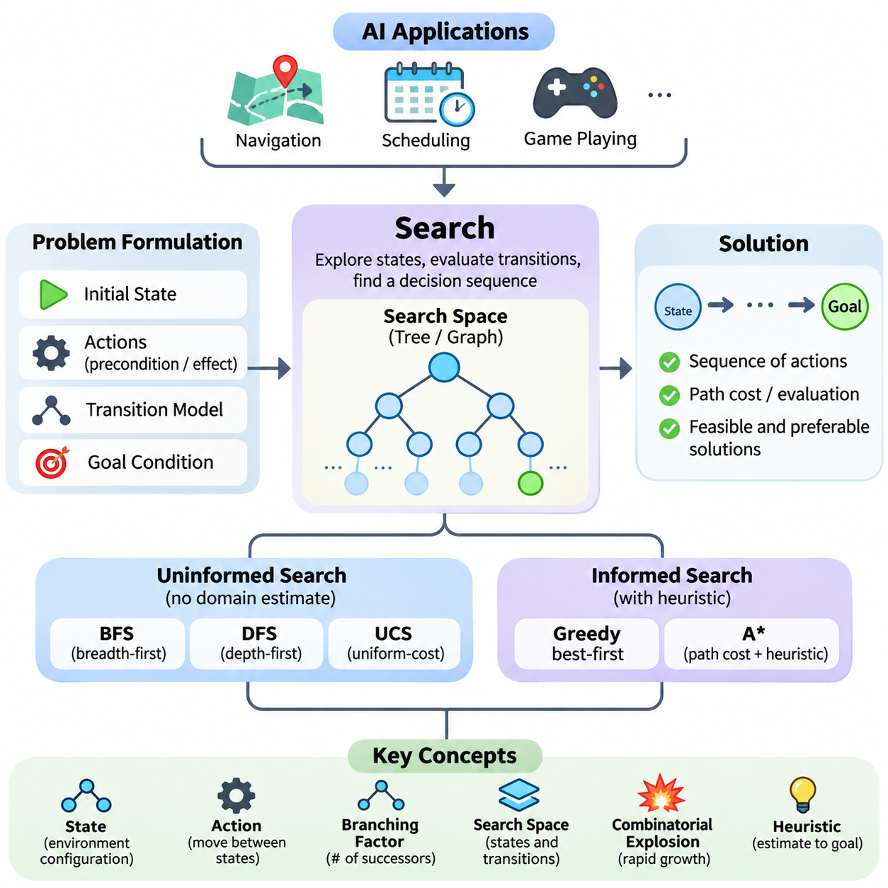
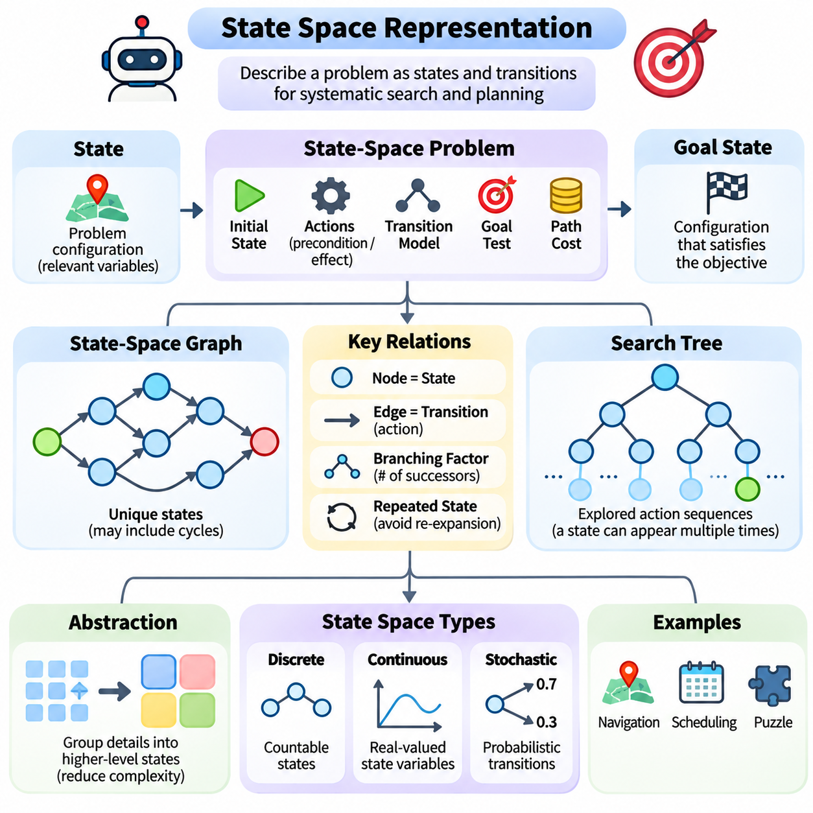
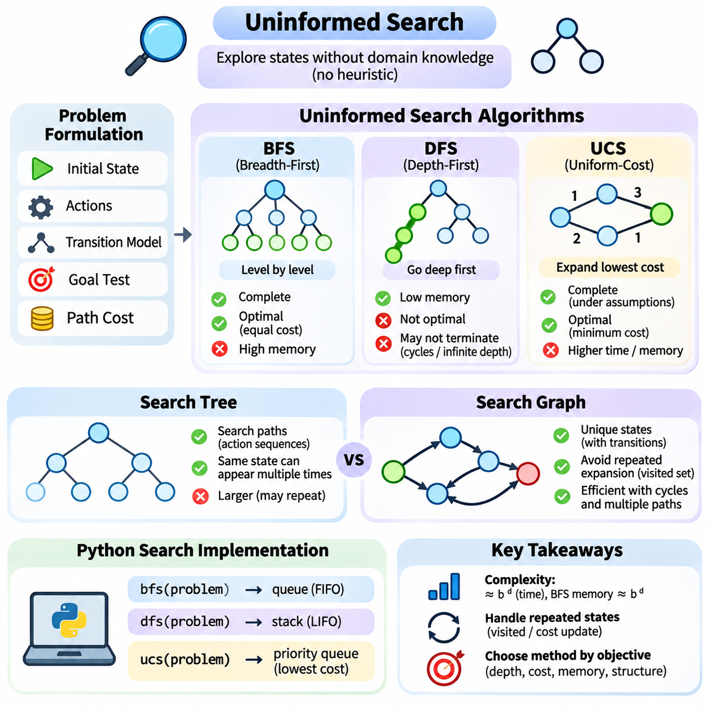
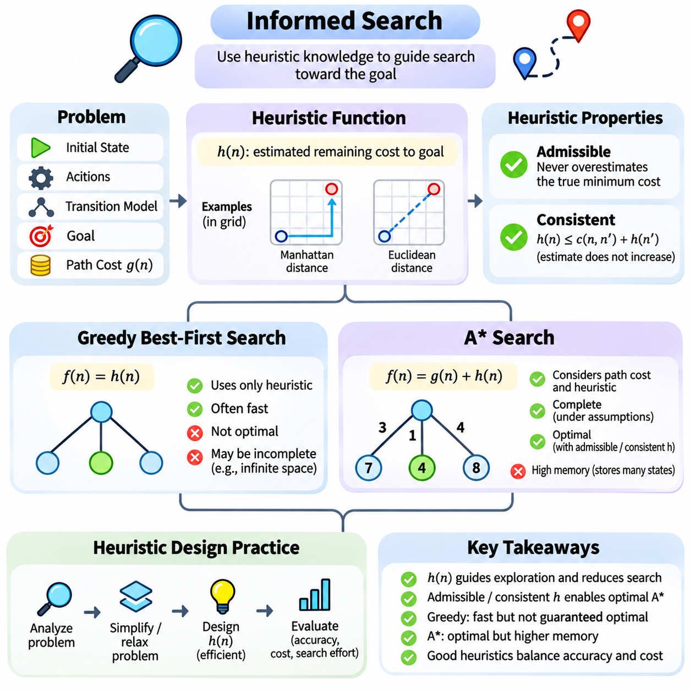
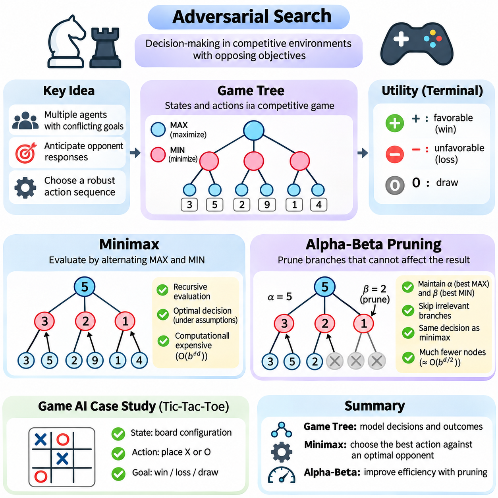
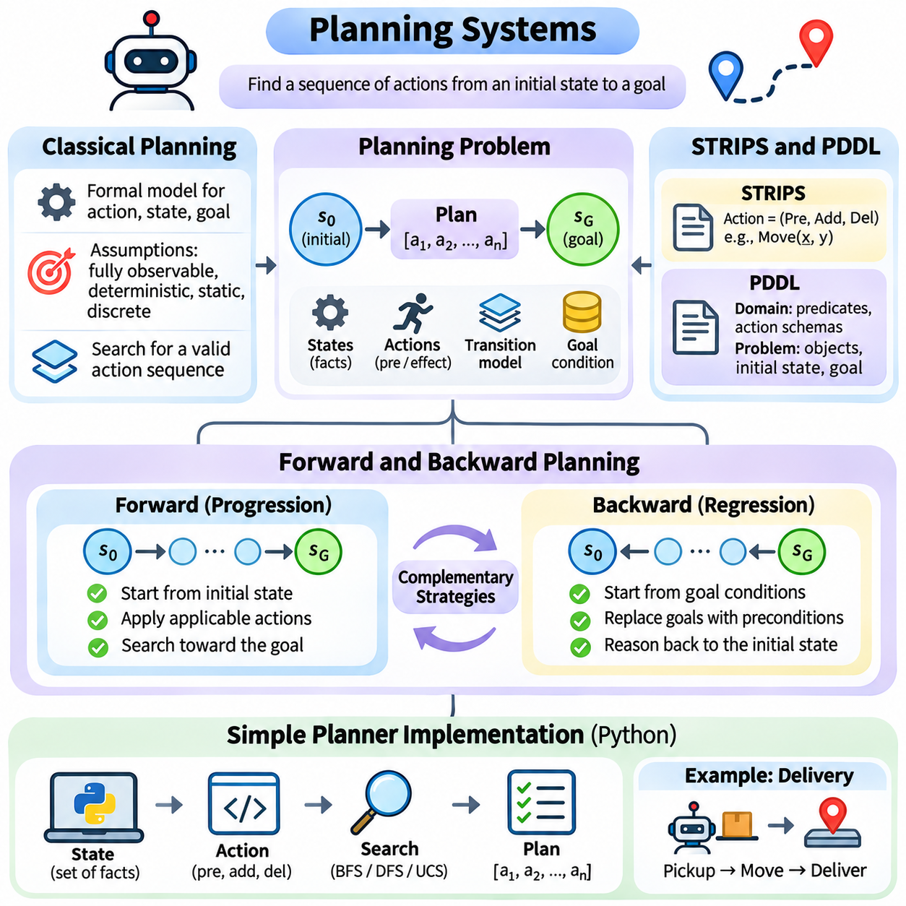
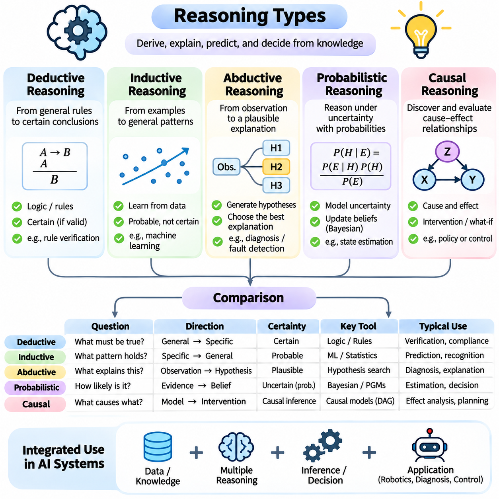

**Volume 04. Artificial Intelligence**

# 04. Search Planning and Reasoning

## 04.00 Search as Core AI Mechanism

{width="7.268055555555556in" height="7.268055555555556in"}

탐색(Search)은 지능적 행동(Intelligent Behavior)이 수많은 대안 중에서 적절한 행동(Action)을 선택해야 하는 경우가 많기 때문에 인공지능(Artificial Intelligence)의 핵심 메커니즘(Core Mechanism) 중 하나로 간주된다. 인공지능 시스템(AI System)은 사전에 정의된 응답에만 의존하지 않고 후보 상태(Candidate State)를 탐색하고, 가능한 상태 전이(State Transition)를 평가하며, 원하는 목표(Goal)에 도달할 수 있는 의사결정 순서(Decision Sequence)를 식별한다. 이러한 과정은 추상적인 목표를 계산적으로 처리할 수 있는 문제로 변환한다.

탐색(Search)의 중요성은 지능형 에이전트(Intelligent Agent)가 올바른 행동을 즉시 판단할 수 없는 상황에서 명확하게 나타난다. 내비게이션 시스템(Navigation System)은 이동 경로를 결정해야 하고, 일정 관리 시스템(Scheduling System)은 제한된 자원을 할당해야 하며, 게임 인공지능(Game AI)은 미래의 상대 행동을 예측해야 한다. 이러한 응용 분야는 서로 다르지만, 잠재적으로 방대한 가능성의 공간에서 유용한 해결책을 발견해야 한다는 공통적인 계산 문제(Computational Challenge)를 가진다.

탐색(Search)은 이러한 문제를 해결하기 위한 체계적인 프레임워크(Systematic Framework)를 제공한다. 문제는 초기 상태(Initial State), 사용 가능한 행동(Action), 상태 전이 규칙(Transition Rule), 목표 조건(Goal Condition)을 통해 표현된다. 시스템은 기존 상태에 행동을 적용하여 새로운 후보 상태를 생성하고, 상태 사이의 관계를 점진적으로 탐색한다. 이렇게 형성된 구조는 문제의 특성에 따라 트리(Tree) 또는 그래프(Graph)로 표현할 수 있다.

상태(State)는 특정 시점에서 환경(Environment)의 관련 구성을 설명한다. 로봇 내비게이션(Robot Navigation) 문제에서는 로봇의 위치(Position), 방향(Orientation), 주변 장애물(Obstacle) 정보가 포함될 수 있다. 퍼즐(Puzzle)에서는 개별 구성 요소의 배열을 나타낼 수 있다. 효과적인 상태 표현(State Representation)은 필수적이다. 불필요한 세부 정보는 계산 복잡도(Computational Complexity)를 증가시키고, 중요한 정보가 누락되면 시스템이 유효한 해결책을 찾지 못할 수 있기 때문이다.

행동(Action)은 지능형 에이전트(Intelligent Agent)가 상태 사이를 이동하는 방법을 정의한다. 각 행동에는 실행 가능 여부를 결정하는 전제조건(Precondition)과 환경이 어떻게 변화하는지를 설명하는 효과(Effect)가 존재할 수 있다. 예를 들어 창고 로봇(Warehouse Robot)은 이동 경로가 통과 가능한 경우에만 전진할 수 있다. 인공지능 시스템은 상태와 행동을 결합하여 체계적인 탐색과 예측을 지원하는 상태 전이 모델(Transition Model)을 구성한다.

목표 조건(Goal Condition)은 후보 상태(Candidate State)가 의도한 목적을 충족하는지 판단한다. 일부 문제는 특정 목적지에 도달해야 하지만, 다른 문제는 여러 제약조건(Constraint)을 만족하거나 성능 지표(Performance Measure)를 최대화해야 한다. 탐색 알고리즘(Search Algorithm)은 허용 가능한 해결책을 발견하거나, 가능한 후보를 모두 소진하거나, 사전에 정의된 계산 한계(Computational Limit)에 도달할 때까지 후보 상태를 반복적으로 조사한다.

해결책(Solution)은 일반적으로 초기 상태(Initial State)에서 목표 상태(Goal State)까지 연결되는 일련의 행동으로 구성된다. 그러나 모든 유효한 해결책이 동일하게 바람직한 것은 아니다. 어떤 경로는 더 짧고, 다른 경로는 에너지를 적게 소비하며, 또 다른 경로는 위험한 상황을 회피할 수 있다. 따라서 탐색 시스템(Search System)은 실행 가능한 해결책과 주어진 목적에 더 적합한 해결책을 구별하기 위해 경로 비용(Path Cost) 또는 평가 함수(Evaluation Function)를 활용한다.

탐색 공간(Search Space)은 문제 해결 과정에서 마주할 수 있는 상태와 상태 전이의 집합을 의미한다. 탐색 공간의 크기는 계산 난이도(Computational Difficulty)에 큰 영향을 미친다. 각 의사결정 단계에서 선택할 수 있는 행동이 많으면 비교적 단순한 환경에서도 탐색 공간이 매우 커질 수 있다. 이러한 현상은 의사결정 깊이가 증가함에 따라 후보 행동 순서의 수가 급격하게 증가하는 조합 폭발(Combinatorial Explosion)과 밀접하게 관련된다.

분기 계수(Branching Factor)는 일반적인 상태에서 생성되는 후속 상태(Successor State)의 수를 나타낸다. 분기 계수가 크면 가능한 경로의 수가 탐색 깊이(Search Depth)에 따라 지수적으로 증가할 수 있다. 이러한 특성은 많은 현실 문제에서 모든 가능성을 탐색하는 완전 탐색(Exhaustive Search)이 비현실적인 이유를 설명한다. 따라서 지능형 탐색(Intelligent Search)은 어떤 가능성에 계산 자원을 집중하고 어떤 가능성을 연기하거나 제외할지 결정하는 전략이 필요하다.

비정보 탐색(Uninformed Search) 알고리즘은 목표까지의 거리를 추정하는 도메인 특화 정보(Domain-Specific Information)를 사용하지 않고 문제를 탐색한다. 너비 우선 탐색(Breadth-First Search)은 깊이에 따라 상태를 확장하고, 깊이 우선 탐색(Depth-First Search)은 다른 대안을 탐색하기 전에 개별 분기를 따라 진행한다. 균일 비용 탐색(Uniform-Cost Search)은 누적 비용이 낮은 경로를 우선한다. 이러한 방법은 완전성(Completeness), 최적성(Optimality), 계산 효율성(Computational Efficiency)을 이해하는 기초를 제공한다.

너비 우선 탐색(Breadth-First Search)은 모든 행동의 비용이 동일할 때 가장 얕은 깊이의 해결책을 발견할 수 있지만, 메모리 요구량(Memory Requirement)이 상당히 커질 수 있다. 깊이 우선 탐색(Depth-First Search)은 일반적으로 메모리를 적게 사용하지만, 적절한 보호 장치가 없으면 깊거나 순환적인 영역에 빠질 수 있다. 균일 비용 탐색(Uniform-Cost Search)은 서로 다른 행동 비용을 처리하며, 음수가 아닌 간선 비용(Nonnegative Edge Cost) 등 적절한 가정이 충족되면 최소 비용 해결책을 찾을 수 있다.

정보 탐색(Informed Search)은 유망한 탐색 영역으로 탐색 과정을 유도하기 위해 추가적인 지식을 도입한다. 이러한 지식은 일반적으로 특정 상태에서 목표까지 남아 있는 비용이나 거리를 추정하는 휴리스틱 함수(Heuristic Function)로 표현된다. 유용한 휴리스틱(Heuristic)은 효과적인 해결책에 기여할 가능성이 높은 상태를 우선적으로 선택하여 불필요한 탐색을 줄인다.

탐욕적 최선 우선 탐색(Greedy Best-First Search)은 목표까지의 추정 거리를 기준으로 상태를 선택한다. 이러한 전략은 빠른 진행을 가능하게 하지만 일반적으로 최적 해결책(Optimal Solution)을 보장하지 않는다. A\\\* 탐색(A\\\* Search)은 누적 경로 비용과 추정 잔여 비용을 결합하여 이미 진행한 탐색 비용과 앞으로 필요한 비용 사이의 균형을 유지한다. 적절한 조건에서 A\\\*는 완전성(Completeness)과 최적성(Optimality)을 보장한다.

정보 탐색(Informed Search)의 효과는 휴리스틱 품질(Heuristic Quality)에 크게 의존한다. 실제 잔여 비용을 초과하여 추정하지 않는 휴리스틱을 허용적 휴리스틱(Admissible Heuristic)이라고 한다. 일관적 휴리스틱(Consistent Heuristic)은 인접 상태 사이의 추정값에 관한 추가적인 조건을 만족한다. 이러한 특성은 최적성 보장(Optimality Guarantee)을 확립하는 데 중요하지만, 실제 의미는 특정 탐색 알고리즘과 구현 방식에 따라 달라진다.

탐색(Search)은 계획(Planning)과 밀접하게 연결되어 있지만, 두 개념은 지능적 문제 해결의 서로 다른 측면을 강조한다. 탐색은 가능한 상태와 의사결정의 탐색 과정에 초점을 맞추는 반면, 계획은 지정된 조건에서 목표를 달성하는 행동 순서(Action Sequence)의 구성에 중점을 둔다. 계획 시스템(Planning System)은 명시적인 행동 모델(Action Model), 의존성(Dependency), 제약조건(Constraint), 예상 결과(Expected Outcome)와 함께 탐색 알고리즘을 자주 활용한다.

고전적 계획(Classical Planning)은 일반적으로 정의된 초기 상태(Initial State), 결정론적 행동(Deterministic Action), 알려진 환경(Known Environment)을 가정한다. 이러한 조건에서 계획기(Planner)는 어떤 행동이 다른 행동보다 먼저 수행되어야 하는지 추론할 수 있다. STRIPS와 같은 표현 방식은 전제조건(Precondition)과 효과(Effect)를 통해 행동을 설명하며, PDDL은 계획 도메인(Planning Domain)과 문제를 표현하기 위한 표준화된 언어를 제공한다.

전방 계획(Forward Planning)은 초기 상태에서 시작하여 목표에 도달할 수 있는 행동을 탐색한다. 후방 계획(Backward Planning)은 원하는 목표 조건에서 시작하여 이를 성립시키기 위해 필요한 행동을 역방향으로 추론한다. 두 접근 방식 모두 구조화된 탐색(Structured Search)의 형태로 이해할 수 있다. 상대적인 효율성은 적용 가능한 행동의 수, 목표의 구체성, 계획 도메인의 구성에 따라 달라진다.

추론(Reasoning)은 탐색(Search)의 의미를 물리적 행동과 내비게이션을 넘어 확장한다. 지능형 시스템은 논리적 연역(Logical Deduction), 대안적 설명(Alternative Explanation), 가능한 진단(Possible Diagnosis), 가상적 결과(Hypothetical Consequence)를 탐색할 수 있다. 이러한 상황에서 후보 상태는 물리적 환경이 아니라 지식 구성(Knowledge Configuration)을 나타낼 수 있다. 따라서 탐색은 사실, 가설, 결론 사이의 관계를 조사하기 위한 계산적 기반을 제공한다.

연역적 추론(Deductive Reasoning)은 확립된 전제(Premise)와 추론 규칙(Inference Rule)으로부터 결론을 도출한다. 귀납적 추론(Inductive Reasoning)은 관찰을 통해 일반화를 형성하며, 가설적 추론(Abductive Reasoning)은 이용 가능한 증거에 대한 타당한 설명을 탐색한다. 확률적 추론(Probabilistic Reasoning)은 불확실성 아래에서 대안을 평가하고, 인과적 추론(Causal Reasoning)은 개입(Intervention)과 결과(Consequence)를 포함하는 관계를 분석한다. 이러한 추론 과정은 탐색을 포함할 수 있지만, 기본 메커니즘이 탐색 알고리즘에만 한정되지는 않는다.

적대적 탐색(Adversarial Search)은 경쟁하는 의사결정자가 존재하는 환경을 고려함으로써 또 다른 중요한 차원을 도입한다. 전략 게임(Strategic Game)에서 에이전트는 자신의 가능한 행동뿐 아니라 상대방이 선택할 수 있는 대응도 평가해야 한다. 게임 트리(Game Tree)는 교대로 이루어지는 의사결정을 표현하며, 미니맥스(Minimax)와 같은 알고리즘이 상대 전략에 관한 가정을 바탕으로 행동을 선택하도록 지원한다.

미니맥스(Minimax)는 경쟁하는 에이전트가 서로 상충하는 목표를 추구한다고 가정하여 가능한 결과를 평가한다. 알파-베타 가지치기(Alpha-Beta Pruning)는 최종 미니맥스 결정에 영향을 미칠 수 없는 분기를 제거하여 계산 효율성을 향상시킨다. 이러한 기법은 의사결정 구조(Decision Structure)에 관한 지식을 활용하면 동일한 평가 가정에서 선택 결과를 유지하면서 불필요한 탐색을 줄일 수 있음을 보여준다.

탐색(Search)은 비용을 최소화하거나 효용(Utility)을 최대화하는 구성을 찾는 최적화(Optimization)에서도 중요한 역할을 수행한다. 최적화 방법은 국소적 수정(Local Modification), 확률적 전이(Probabilistic Transition), 집단 기반 전략(Population-Based Strategy)을 통해 후보 해결책을 탐색할 수 있다. 최적화와 고전적 상태 공간 탐색(Classical State-Space Search)은 동일한 개념은 아니지만, 두 방법 모두 평가 기준에 따라 구조화된 대안의 집합을 탐색한다.

실제 인공지능 시스템에서는 계산 자원(Computational Resource)이 탐색 깊이와 너비에 상당한 제약을 부과한다. 처리 시간(Processing Time), 사용 가능한 메모리(Available Memory), 에너지 소비(Energy Consumption), 응답 마감시간(Response Deadline)은 에이전트가 대안을 얼마나 광범위하게 탐색할 수 있는지 결정한다. 실시간 응용(Real-Time Application)은 과도한 계산 이후 얻어지는 이론적 최적 해결책보다 엄격한 지연시간 제약(Latency Constraint) 내에서 충분히 만족스러운 결정을 요구하는 경우가 많다.

자율 로봇(Autonomous Robot)은 탐색 품질(Search Quality)과 운영 제약(Operational Constraint) 사이의 균형이 중요하다는 사실을 보여준다. 이동 로봇(Mobile Robot)은 전역 경로(Global Route)를 결정하기 위해 그래프 탐색(Graph Search)을 사용하고, 새롭게 감지된 장애물을 회피하기 위해 국소 계획(Local Planning)을 활용할 수 있다. 센서 관측(Sensor Observation)이 변화하면 기존에 유효했던 경로가 위험하거나 접근 불가능해질 수 있다. 따라서 시스템은 운영 연속성(Operational Continuity)을 유지하면서 내부 표현을 갱신하고 의사결정을 수정해야 한다.

환경(Environment)이 부분적으로 관측 가능하거나 불확실할 때 탐색(Search)은 더욱 어려워진다. 에이전트는 자신의 정확한 상태를 알지 못할 수 있으며, 행동은 예측하기 어려운 결과를 발생시킬 수 있다. 이러한 상황에서 추론은 가능한 상태에 대한 확률 분포(Probability Distribution)를 포함할 수 있으며, 이를 일반적으로 신념 상태(Belief State)라고 한다. 신념 상태나 조건부 정책(Contingent Policy)을 탐색하면 불확실성과 미래 관측을 고려하는 의사결정이 가능해진다.

현대 인공지능(Modern AI)은 학습된 표현(Learned Representation)과 명시적 탐색 절차(Explicit Search Procedure)를 점점 더 많이 결합하고 있다. 신경망(Neural Network)은 상태 가치(State Value)를 추정하거나 유용한 행동을 예측하고 휴리스틱 지침(Heuristic Guidance)을 제공할 수 있다. 이후 탐색 알고리즘은 이러한 학습된 추정값을 활용하여 대안을 평가한다. 이러한 통합은 기계학습(Machine Learning)의 일반화 능력(Generalization Capability)과 고전적 인공지능(Classical AI)의 구조화된 탐색 및 제약조건 처리 능력을 결합한다.

대규모 언어 모델(Large Language Model, LLM)도 후보 계획(Candidate Plan)을 생성하고, 중간 추론 단계(Intermediate Reasoning Step)를 제안하며, 외부 도구(External Tool)와 상호작용함으로써 탐색 지향 시스템(Search-Oriented System)에 참여할 수 있다. 그러나 생성된 계획에는 잘못된 가정이나 일관되지 않은 의존성이 포함될 수 있다. 따라서 언어 기반 추론(Language-Based Reasoning)을 신뢰할 수 있는 의사결정에 활용하려면 명시적 검증(Explicit Verification), 환경 피드백(Environmental Feedback), 제약조건 검사(Constraint Checking)가 중요하다.

탐색 시스템(Search System)의 품질은 단순히 해결책을 발견했는지만으로 평가할 수 없다. 중요한 평가 기준(Evaluation Criteria)에는 완전성(Completeness), 해결책 최적성(Solution Optimality), 실행 시간(Execution Time), 메모리 소비(Memory Consumption), 확장성(Scalability), 강건성(Robustness)이 포함된다. 이러한 특성 사이에는 상충관계(Tradeoff)가 존재하는 경우가 많다. 최적성을 보장하는 알고리즘은 충분히 효과적인 결과를 제공하는 근사 방법(Approximate Method)보다 더 많은 계산 자원을 요구할 수 있다.

탐색 성능(Search Performance)은 최초 문제가 어떻게 정식화되는지에도 영향을 받는다. 부적절하게 선택된 상태 변수(State Variable), 중복 행동(Redundant Action), 약한 제약조건(Weak Constraint), 부정확한 비용 함수(Cost Function)는 정교한 알고리즘조차 비효율적으로 만들 수 있다. 반대로 잘 설계된 표현은 실질적인 탐색 공간(Effective Search Space)을 크게 줄일 수 있다. 따라서 문제 정식화(Problem Formulation)는 실용적인 지능형 시스템을 설계할 때 알고리즘 선택만큼 중요하다.

인공지능에서 탐색(Search)의 근본적인 기여는 다음에 수행할 행동에 대한 불확실성을 대안을 평가하는 구조화된 과정으로 변환하는 능력에 있다. 탐색은 상태 표현(State Representation), 행동 모델링(Action Modeling), 휴리스틱 지침(Heuristic Guidance), 계획(Planning), 추론(Reasoning)을 통해 지식(Knowledge)과 목적 지향적 행동(Goal-Directed Behavior)을 연결한다. 따라서 탐색은 복잡한 환경에서 의사결정을 수행할 수 있는 인공지능 시스템을 구축하는 데 필수적인 메커니즘으로 남아 있다.

## 04.01 State Space Representation

{width="7.268055555555556in" height="7.268055555555556in"}

상태 공간 표현(State Space Representation)은 문제 해결 시스템(Problem-Solving System)이 마주할 수 있는 모든 가능한 구성(Configuration)을 구조적으로 설명하기 때문에 인공지능(Artificial Intelligence)의 핵심 개념이다. 환경(Environment)을 상태(State)와 상태 전이(Transition)의 집합으로 표현하면 지능형 에이전트(Intelligent Agent)는 다양한 대안을 체계적으로 탐색하고, 행동(Action)의 결과를 예측하며, 지정된 목표(Goal)에 도달하는 의사결정 순서(Decision Sequence)를 식별할 수 있다.

상태(State)는 특정 시점에서 문제를 설명하는 데 필요한 정보를 나타낸다. 상태에 환경의 모든 물리적 세부 정보가 반드시 포함될 필요는 없지만, 미래의 의사결정(Future Decision)에 관련된 변수는 포함되어야 한다. 예를 들어 내비게이션 문제(Navigation Problem)는 로봇의 위치(Position), 방향(Orientation), 이동 가능한 방향을 통해 상태를 표현할 수 있으며, 일정 관리 문제(Scheduling Problem)는 할당된 작업(Assigned Task), 자원 가용성(Resource Availability), 남은 마감시간(Remaining Deadline)을 통해 상태를 표현할 수 있다.

상태 공간(State Space)은 특정 문제 정식화(Problem Formulation)에서 가능하다고 간주되는 모든 상태의 집합이다. 각 상태는 서로 다른 구성을 나타내며, 상태 사이의 관계는 사용 가능한 행동(Action)을 통해 설정된다. 하나의 행동이 특정 상태를 다른 상태로 변환하면 그 연결은 상태 전이 구조(Transition Structure)의 일부가 된다. 이러한 구조는 탐색 알고리즘(Search Algorithm)과 자동 계획 시스템(Automated Planning System)의 계산적 기반을 제공한다.

형식적인 상태 공간 문제(State-Space Problem)는 일반적으로 초기 상태(Initial State), 적용 가능한 행동(Applicable Action)의 집합, 상태 전이 모델(Transition Model), 목표 검사(Goal Test), 경로 비용 함수(Path-Cost Function)로 구성된다. 초기 상태는 문제 해결 과정이 시작되는 위치를 설명하고, 목표 검사는 원하는 조건의 달성 여부를 판단한다. 상태 전이 모델은 행동이 상태를 어떻게 변경하는지 정의하며, 비용 함수는 상태 전이에 수반되는 자원 소비나 불이익을 평가한다.

초기 상태(Initial State)는 탐색이 시작되는 구성을 설정하기 때문에 중요한 역할을 수행한다. 창고 로봇(Warehouse Robot) 응용에서는 초기 상태에 로봇의 현재 위치와 주변 장애물의 배치가 포함될 수 있다. 퍼즐 해결(Puzzle Solving)에서는 타일(Tile)의 시작 배열을 설명할 수 있다. 목표가 동일하게 유지되더라도 초기 상태가 달라지면 탐색 요구사항(Search Requirement)은 상당히 달라질 수 있다.

목표 상태(Goal State)는 의도한 목적을 충족하는 구성을 나타낸다. 일부 문제는 하나의 정확한 목표 상태를 정의하지만, 다른 문제에서는 여러 개의 허용 가능한 구성을 인정한다. 예를 들어 배송 로봇(Delivery Robot)은 승인된 하역 위치(Authorized Unloading Position) 중 어느 한 곳에 도달하면 임무를 완료할 수 있다. 목표를 고정된 구성보다 논리적 조건(Logical Condition)으로 표현하면 유연성이 향상되고 탐색 알고리즘이 여러 유효한 해결책을 인식할 수 있다.

행동(Action)은 상태를 변환할 수 있는 연산(Operation)을 정의한다. 각 행동에는 특정 전제조건(Precondition)이 필요할 수 있으며, 실행 결과로 특정 효과(Effect)가 발생한다. 로봇 이동 행동(Robotic Movement Action)은 장애물이 없는 목적지와 충분한 에너지를 요구할 수 있으며, 실행 효과로 로봇의 위치와 남은 배터리 용량이 갱신된다. 명시적인 행동 정의(Explicit Action Definition)는 탐색 알고리즘이 환경의 기본 규칙을 위반하는 상태 전이를 생성하지 않도록 한다.

상태 전이 모델(Transition Model)은 상태(State), 행동(Action), 결과 상태(Resulting State) 사이의 관계를 설명한다. 결정론적 환경(Deterministic Environment)에서는 주어진 상태와 행동의 조합이 하나의 예측 가능한 후속 상태(Successor State)를 생성한다. 확률적 환경(Stochastic Environment)에서는 동일한 행동이 관련 확률(Probability)을 가진 여러 결과로 이어질 수 있다. 이러한 차이는 기존의 결정론적 탐색(Deterministic Search)으로 충분한지 또는 더 발전된 의사결정 방법이 필요한지를 결정한다.

상태 공간(State Space)은 일반적으로 그래프(Graph)로 표현되며, 노드(Node)는 상태를 나타내고 방향 간선(Directed Edge)은 유효한 상태 전이를 나타낸다. 이러한 표현은 체계적인 탐색을 지원하고 알고리즘이 연결성(Connectivity), 도달 가능성(Reachability), 누적 비용(Accumulated Cost)을 추적하도록 한다. 탐색 절차가 탐색 과정에서 트리(Tree)를 구성하더라도 기본 상태 공간에는 순환(Cycle)과 동일한 상태에 도달하는 여러 경로가 존재할 수 있다.

탐색 트리(Search Tree)는 알고리즘이 탐색한 행동 순서를 기록하는 반면, 상태 공간 그래프(State-Space Graph)는 고유한 상태 사이의 관계를 표현한다. 따라서 서로 다른 행동 순서가 동일한 상태에 도달하면 탐색 트리에는 같은 상태가 여러 번 나타날 수 있다. 반복 상태(Repeated State)를 인식하는 것은 중요하다. 불필요한 재확장(Re-Expansion)은 계산 비용을 증가시키고, 순환이 존재하는 환경에서는 무한 탐색(Infinite Exploration)을 유발할 수 있기 때문이다.

상태 표현(State Representation)은 일반적인 상태에서 생성되는 후속 상태의 수를 나타내는 분기 계수(Branching Factor)에 큰 영향을 미친다. 불필요한 변수나 행동을 도입하는 표현 방식은 가능한 상태의 수를 급격하게 증가시킬 수 있다. 탐색 깊이(Search Depth)가 증가하면 이러한 확장은 조합 폭발(Combinatorial Explosion)을 발생시킬 수 있다. 따라서 효율적인 표현은 필수 정보를 보존하면서 상태 사이의 중복된 구분을 최소화해야 한다.

추상화(Abstraction)는 상태 공간 복잡도(State-Space Complexity)를 줄이는 강력한 기법이다. 인공지능 시스템은 환경의 모든 세부 정보를 표현하는 대신 유사한 구성을 상위 수준 상태(Higher-Level State)로 묶을 수 있다. 예를 들어 내비게이션 시스템(Navigation System)은 처음에 개별 좌표(Coordinate) 대신 연결된 영역(Connected Region)으로 건물을 표현할 수 있다. 이러한 추상화는 중요한 제약조건과 관련된 차이를 잃지 않는다면 계획 속도를 높일 수 있다.

적절한 추상화 수준(Abstraction Level)은 해결하려는 작업에 따라 달라진다. 전역 경로 계획기(Global Route Planner)는 도로 연결성(Road Connectivity)과 대략적인 이동 비용만 필요할 수 있지만, 국소 운동 계획기(Local Motion Planner)는 정밀한 기하학적 구조(Geometry), 장애물 이격거리(Obstacle Clearance), 차량 동역학(Vehicle Dynamics)을 고려해야 한다. 서로 다른 계획 수준에서 다른 표현을 사용하면 계산 효율성과 안전한 실행에 필요한 정확성 사이의 균형을 유지할 수 있다.

이산 상태 공간(Discrete State Space)은 보드 위치(Board Position), 논리적 할당(Logical Assignment), 격자 위치(Grid Location)처럼 개별 요소로 표현할 수 있는 구성을 포함한다. 연속 상태 공간(Continuous State Space)은 위치(Position), 속도(Velocity), 방향(Orientation)과 같이 실수 범위에서 변화하는 변수를 포함한다. 연속 표현(Continuous Representation)은 물리적 움직임을 유한한 기호 상태(Symbolic State)의 집합으로 충분히 설명하기 어려운 로봇공학(Robotics)과 제어(Control) 분야에서 특히 중요하다.

하이브리드 상태 공간(Hybrid State Space)은 이산 변수(Discrete Variable)와 연속 변수(Continuous Variable)를 하나의 통합 모델로 결합한다. 예를 들어 자율주행차(Autonomous Vehicle)는 주행(Driving), 정지(Stopping), 충전(Charging)과 같은 이산적 운용 모드(Discrete Operating Mode)를 가지면서 위치, 속도, 배터리 수준에 대한 연속적인 추정값을 유지할 수 있다. 하이브리드 표현은 지능적 행동이 기호적 운용 조건과 물리 시스템 동역학(Physical System Dynamics)에 동시에 의존할 때 유용하다.

상태 변수(State Variable)의 선택은 의사결정 과정(Decision Process)에 필요한 정보 요구사항을 충족해야 한다. 이상적으로 현재 상태(Current State)는 행동이 적용되었을 때 관련된 미래 행동과 상태 변화를 예측하기에 충분한 정보를 포함해야 한다. 이러한 원칙은 미래 상태 확률(Future State Probability)이 과거 상태의 전체 이력이 아니라 현재 상태와 행동에 의존한다는 마르코프 속성(Markov Property)과 밀접하게 관련된다.

중요한 과거 정보(Historical Information)가 누락되면 상태 표현(State Representation)이 부적절해질 수 있다. 예를 들어 속도(Velocity)와 조향 구성(Steering Configuration)이 미래 움직임에 영향을 미친다면 로봇의 현재 위치만으로는 미래 운동을 결정할 수 없다. 이러한 변수를 포함하면 예측 정확도(Predictive Accuracy)를 회복할 수 있다. 또는 직접 관측만으로 환경을 완전히 설명할 수 없는 경우 시스템은 내부 메모리(Internal Memory)나 추정된 숨겨진 상태(Estimated Hidden State)를 유지할 수 있다.

부분 관측 가능성(Partial Observability)은 에이전트가 실제 환경 상태(True Environmental State)를 알지 못할 수 있기 때문에 추가적인 복잡성을 도입한다. 센서 측정값(Sensor Measurement)은 잡음이 있거나 불완전하거나 모호할 수 있다. 시스템은 하나의 알려진 상태를 유지하는 대신 가능한 상태에 대한 확률 분포(Probability Distribution)를 설명하는 신념 상태(Belief State)를 통해 불확실성을 표현할 수 있다. 이러한 접근 방식은 관측이 부분적인 정보만 제공하는 상황에서 의사결정을 지원한다.

신념 상태 표현(Belief-State Representation)은 자율 내비게이션(Autonomous Navigation), 위치 추정(Localization), 진단(Diagnosis)에서 특히 중요하다. 이동 로봇(Mobile Robot)은 추가적인 센서 관측이 불확실성을 줄일 때까지 여러 가능한 위치 가설(Location Hypothesis)을 유지할 수 있다. 마찬가지로 진단 시스템(Diagnostic System)은 대안적인 고장 조건(Fault Condition)에 확률을 할당할 수 있다. 신념 상태를 기반으로 탐색하거나 계획하면 지능형 에이전트가 완전한 환경 지식을 가정하지 않고 불확실성을 명시적으로 고려할 수 있다.

상태 공간 표현(State Space Representation)은 지식 표현(Knowledge Representation) 및 논리적 추론(Logical Reasoning)과도 밀접하게 연결된다. 기호적 상태(Symbolic State)는 로봇이 특정 위치를 점유하는지 또는 컨테이너를 사용할 수 있는지와 같이 객체 사이의 관계를 설명하는 술어(Predicate)로 구성될 수 있다. 행동은 정의된 규칙에 따라 이러한 술어를 변경한다. 이러한 표현은 STRIPS와 PDDL을 포함하는 고전적 계획 언어(Classical Planning Language)의 기반을 제공한다.

계획 시스템(Planning System)에서 상태는 현재 참(True)인 논리적 사실(Logical Fact)의 집합으로 설명할 수 있다. 행동은 전제조건(Precondition)이 충족되면 적용 가능해지며, 행동의 효과(Effect)는 어떤 사실이 추가되거나 제거되는지를 결정한다. 이러한 접근 방식은 행동 의존성(Action Dependency)과 목표 달성(Goal Achievement)에 관한 명시적 추론을 지원한다. 또한 모든 가능한 상태를 미리 열거하지 않고도 계획기가 행동 순서를 생성할 수 있도록 한다.

상태 표현(State Representation)에는 수치적 비용(Numerical Cost), 제약조건(Constraint), 자원 정보(Resource Information)를 포함할 수 있다. 배송 시스템(Delivery System)은 남은 연료(Remaining Fuel), 경과 시간(Elapsed Time), 적재 용량(Payload Capacity), 경로 제한(Route Restriction)을 추적할 수 있다. 이러한 변수는 미래 행동의 실행 가능성(Feasibility)과 바람직함(Desirability)에 모두 영향을 미친다. 그러나 변수를 추가하면 상태 공간 차원(State-Space Dimensionality)이 증가하므로 필수적인 의사결정 정보와 불필요한 설명 정보를 구별해야 한다.

상태 공간의 차원(Dimensionality)은 하나의 상태를 특징짓는 데 필요한 독립 변수(Independent Variable)의 수를 의미한다. 고차원 공간(High-Dimensional Space)은 차원이 추가될수록 구별 가능한 구성의 수가 빠르게 증가하기 때문에 탐색하기 어려워질 수 있다. 이러한 문제는 차원의 저주(Curse of Dimensionality)와 관련되며, 복잡한 환경에서 작동하는 탐색(Search), 최적화(Optimization), 계획(Planning), 학습(Learning) 알고리즘에 영향을 미친다.

여러 기법을 활용하면 대규모 상태 공간(Large State Space)의 실질적인 계산 부담을 줄일 수 있다. 상태 집계(State Aggregation)는 유사한 구성을 결합하고, 계층적 분해(Hierarchical Decomposition)는 복잡한 작업을 관리 가능한 하위 문제(Subproblem)로 분리하며, 제약조건 기반 필터링(Constraint-Based Filtering)은 유효하지 않은 대안을 제거한다. 휴리스틱 지침(Heuristic Guidance)은 유망한 상태를 우선하며, 압축된 자료구조(Compact Data Structure)와 반복 상태 검출(Repeated-State Detection)은 탐색 과정의 불필요한 계산을 줄인다.

상태 표현(State Representation)은 탐색 결과의 정확성(Correctness)에도 영향을 미친다. 서로 다른 미래 가능성을 가진 두 상태를 동일한 것으로 처리하면 알고리즘이 필요한 해결 경로(Solution Path)를 제거할 수 있다. 반대로 기능적으로 동일한 구성을 별도 상태로 표현하면 계산 자원이 낭비된다. 따라서 잘 설계된 표현은 도달 가능성(Reachability), 행동 적용 가능성(Action Applicability), 경로 비용(Path Cost), 목표 충족(Goal Satisfaction)에 영향을 주는 차이를 보존해야 한다.

실제 응용 환경에서는 운영 중 환경 조건이 변화하기 때문에 상태 공간(State Space)이 동적(Dynamic)인 경우가 많다. 창고 로봇(Warehouse Robot)은 이동 장애물(Moving Obstacle), 새롭게 할당된 작업(Newly Assigned Task), 이용할 수 없는 통로(Unavailable Corridor)를 마주할 수 있다. 로봇의 내부 상태 표현(Internal State Representation)은 현재 관측을 활용하여 갱신되어야 하며, 계획 과정은 기존에 생성된 경로를 다시 탐색하거나 수정해야 할 수 있다. 이러한 지속적인 상호작용은 상태 공간 추론(State-Space Reasoning)을 인식(Perception) 및 제어(Control)와 연결한다.

현대 인공지능(Modern Artificial Intelligence)은 명시적 상태 표현(Explicit State Representation)과 학습된 잠재 표현(Learned Latent Representation)을 점점 더 많이 결합하고 있다. 신경망(Neural Network)은 고차원 관측(High-Dimensional Observation)을 예측이나 의사결정에 관련된 정보를 포착하는 압축된 특징 벡터(Feature Vector)로 변환할 수 있다. 이러한 학습된 상태는 모델 기반 강화학습(Model-Based Reinforcement Learning), 세계 모델링(World Modeling), 계획(Planning)을 지원할 수 있지만, 그 유용성은 신뢰할 수 있는 행동 선택에 필요한 정보를 보존하는지에 따라 달라진다.

상태 공간 표현(State Space Representation)의 핵심 목적은 복잡한 문제를 구조화된 구성(Configuration)과 가능한 상태 전이(Possible Transition)의 집합으로 변환하는 것이다. 그 효과는 적절한 변수 선택(Variable Selection), 유효한 행동 정의(Action Definition), 관련 제약조건 보존(Constraint Preservation), 계산 복잡도 제어(Computational Complexity Control)에 달려 있다. 신중하게 구성된 상태 공간은 탐색(Search), 계획(Planning), 추론(Reasoning) 알고리즘이 체계적이고 효율적으로 작동할 수 있는 기반을 제공한다.

## 04.02 Uninformed Search

{width="7.268055555555556in" height="7.268055555555556in"}

비정보 탐색(Uninformed Search)은 목표(Goal)의 위치에 관한 도메인 특화 지식(Domain-Specific Knowledge)에 의존하지 않고 가능한 상태(State)를 탐색하는 인공지능 알고리즘(Artificial Intelligence Algorithm)의 기본적인 범주이다. 이러한 알고리즘은 문제 정의(Problem Definition), 사용 가능한 행동(Action), 상태 전이 규칙(Transition Rule), 경로 비용(Path Cost)을 활용하여 어떤 상태를 조사할지 결정한다. 체계적인 탐색 방식은 더욱 발전된 탐색(Search) 및 계획(Planning) 방법을 이해하는 데 필수적인 기반을 제공한다.

비정보 탐색(Uninformed Search)의 핵심 원리는 목표까지 남은 거리를 추정하는 휴리스틱(Heuristic)을 사용하지 않고 탐색을 진행하는 것이다. 대신 알고리즘은 사전에 정의된 확장 전략(Expansion Strategy)에 따라 후보 상태(Candidate State)를 구성한다. 너비 우선 탐색(Breadth-First Search, BFS), 깊이 우선 탐색(Depth-First Search, DFS), 균일 비용 탐색(Uniform-Cost Search, UCS)은 세 가지 중요한 접근 방식이며, 각각 완전성(Completeness), 최적성(Optimality), 계산 복잡도(Computational Complexity), 메모리 요구량(Memory Requirement)에서 서로 다른 특성을 가진다.

일반적으로 BFS라고 부르는 너비 우선 탐색(Breadth-First Search)은 탐색 깊이(Search Depth)가 증가하는 순서로 상태를 탐색한다. 초기 상태(Initial State)에서 시작하여 특정 깊이에서 도달 가능한 모든 상태를 조사한 다음, 다음 깊이의 상태를 확장한다. 이러한 수준별 탐색(Level-by-Level Exploration)은 모든 행동의 비용이 동일하고 최소한의 행동으로 해결책을 찾는 것이 목표일 때 특히 유용하다.

BFS는 일반적으로 선입선출 큐(First-In, First-Out Queue, FIFO Queue)를 사용하여 프런티어(Frontier)를 관리한다. 새롭게 발견된 상태는 큐의 끝에 삽입되고, 가장 오래 대기한 상태가 확장 대상으로 선택된다. 이러한 순서는 깊이가 얕은 상태가 깊은 상태보다 먼저 처리되도록 보장한다. 유한한 분기 조건(Finite Branching Condition)에서 BFS는 완전성(Completeness)을 가지지만, 탐색 깊이가 증가하면 메모리 소비량이 상당히 커질 수 있다.

깊이 우선 탐색(Depth-First Search, DFS)은 대안적인 분기로 돌아가기 전에 가장 깊은 위치의 상태를 확장하는 다른 탐색 전략을 사용한다. 목표 상태(Goal State), 막다른 경로(Dead End), 또는 사전에 정의된 깊이 제한(Depth Limit)에 도달할 때까지 하나의 경로를 따라 진행한다. 더 이상 확장할 수 없으면 알고리즘은 아직 탐색하지 않은 대안이 존재하는 가장 최근 상태로 역추적(Backtracking)하여 탐색을 계속한다.

DFS는 일반적으로 후입선출 스택(Last-In, First-Out Stack, LIFO Stack)이나 재귀 함수 호출(Recursive Function Call)을 사용하여 탐색을 관리한다. 주요 장점은 너비 우선 탐색(Breadth-First Search)보다 상대적으로 적은 메모리를 사용한다는 것이다. 그러나 DFS는 일반적으로 최단 해결책(Shortest Solution)을 보장하지 않으며, 적절한 보호 장치가 없다면 무한 깊이 공간(Infinite-Depth Space)이나 순환(Cycle)이 포함된 환경에서 종료되지 않을 수 있다.

균일 비용 탐색(Uniform-Cost Search, UCS)은 초기 상태(Initial State)에서 누적된 전체 경로 비용(Total Path Cost)에 따라 상태의 우선순위를 결정한다. 행동의 수를 고려하는 BFS와 달리 UCS는 상태 전이 비용(Transition Cost)의 차이를 명시적으로 반영한다. 이러한 특성으로 인해 개별 행동의 비용이 서로 다를 수 있는 내비게이션(Navigation), 운송(Transportation), 자원 할당(Resource Allocation) 문제에 적합하다.

UCS는 일반적으로 누적 비용(Accumulated Cost)이 가장 낮은 프런티어 노드(Frontier Node)를 선택하는 우선순위 큐(Priority Queue)를 사용한다. 기존 상태에 도달하는 더 저렴한 경로가 발견되면 해당 비용 기록(Cost Record)을 갱신할 수 있다. 음수가 아닌 간선 비용(Nonnegative Edge Cost)과 적절한 종료 조건(Termination Condition)에서 UCS는 최소 비용 해결책(Minimum-Cost Solution)을 찾을 수 있다. 완전성(Completeness)을 위해서는 행동 비용에 양의 하한(Positive Lower Bound)이 존재하는 등의 적절한 가정이 추가로 필요하다.

BFS, DFS, UCS의 차이는 해결책 품질(Solution Quality)을 평가할 때 특히 중요하다. BFS는 적절한 가정에서 최소 깊이 해결책(Minimum-Depth Solution)을 보장하는 반면, UCS는 최소 비용 해결책(Minimum-Cost Solution)을 탐색한다. DFS는 최적성(Optimality)보다 메모리 효율성(Memory Efficiency)과 깊은 탐색(Deep Exploration)을 강조한다. 따라서 적절한 알고리즘을 선택하려면 목표(Objective), 행동 비용(Action Cost), 상태 공간 구조(State-Space Structure), 사용 가능한 계산 자원(Computational Resource)을 이해해야 한다.

탐색 복잡도(Search Complexity)는 일반적으로 분기 계수(Branching Factor)와 해결책 깊이(Solution Depth)를 통해 분석한다. 각 상태가 대략 b개의 후속 상태(Successor State)를 생성한다면 깊이 d에서 상태의 수는 b의 d제곱 수준으로 증가할 수 있다. BFS는 해결책 깊이에 따라 지수적인 시간 및 메모리를 요구할 수 있지만, 일반적인 DFS는 분기 계수와 최대 탐색 깊이가 제한된 경우 훨씬 적은 메모리를 필요로 한다.

탐색 트리(Search Tree)는 알고리즘이 수행한 탐색 의사결정(Exploration Decision)의 순서를 나타낸다. 각 트리 노드(Tree Node)는 도달한 상태, 수행한 행동, 경우에 따라 누적 비용을 포함하는 특정 탐색 경로(Search Path)에 대응한다. 서로 다른 행동 순서(Action Sequence)가 동일한 기본 상태(Underlying State)에 도달할 수 있으므로 탐색 트리에는 동일한 환경 구성을 나타내는 여러 노드가 포함될 수 있다.

반면 탐색 그래프(Search Graph)는 고유한 상태(Unique State)와 이를 연결하는 상태 전이(Transition)를 표현한다. 그래프 기반 탐색(Graph-Based Search)은 이전에 방문한 상태를 인식하고 불필요한 반복 확장(Repeated Expansion)을 방지할 수 있다. 이러한 차이는 순환(Cycle), 되돌릴 수 있는 행동(Reversible Action), 동일한 목적지로 향하는 여러 경로가 존재하는 환경에서 중요하다. 반복 상태 검출(Repeated-State Detection)이 없으면 탐색 알고리즘은 동등한 구성을 반복적으로 탐색하면서 자원을 낭비할 수 있다.

따라서 트리 탐색(Tree Search)과 그래프 탐색(Graph Search)은 주로 반복 상태(Repeated State)를 관리하는 방식에서 차이가 있다. 트리 탐색은 일반적으로 생성된 각 경로를 별도의 후보로 처리하지만, 그래프 탐색은 방문하거나 발견한 상태에 관한 정보를 유지한다. 그래프 탐색 구현(Graph-Search Implementation)은 알고리즘의 특성과 대체 경로가 기존 해결책을 개선할 수 있는지에 따라 방문 집합(Visited Set), 탐색 완료 집합(Explored Set), 비용 테이블(Cost Table)을 사용할 수 있다.

반복 상태 검출(Repeated-State Detection)은 알고리즘마다 정확성 요구사항(Correctness Requirement)이 다르므로 신중하게 구현해야 한다. 행동 비용이 동일한 BFS에서는 상태를 처음 발견할 때 기록하여 중복 삽입(Redundant Insertion)을 방지할 수 있다. 그러나 UCS에서는 이전에 발견된 상태에 나중에 더 저렴한 경로로 도달할 수 있다. 따라서 최적성(Optimality)을 유지하려면 비용 비교(Cost Comparison)와 우선순위 갱신(Priority Update)이 필요하다.

순환(Cycle)은 행동을 통해 에이전트(Agent)가 이전에 방문한 구성으로 돌아갈 수 있기 때문에 추가적인 문제를 발생시킨다. 예를 들어 이동 로봇(Mobile Robot)은 목적지에 가까워지지 않은 채 인접한 위치 사이를 반복적으로 이동할 수 있다. 순환 방지(Cycle Prevention)가 없는 탐색 트리는 점점 더 긴 중복 경로(Redundant Path)를 생성할 수 있다. 그래프 탐색(Graph Search)은 상태 식별 정보(State Identity)를 추적하고 반복 탐색을 제어하여 이러한 문제를 해결한다.

탐색 노드(Search Node)와 상태(State)를 구분하는 것도 필수적이다. 상태는 환경 구성(Environmental Configuration)을 설명하지만, 탐색 노드는 해당 구성에 도달하기 위해 사용된 경로 정보를 포함한다. 노드에는 부모 노드(Parent Node), 생성 행동(Generating Action), 탐색 깊이(Search Depth), 누적 경로 비용(Accumulated Path Cost)이 저장될 수 있다. 이러한 개념을 분리하면 알고리즘이 효율적인 상태 비교(State Comparison)를 유지하면서 해결 경로를 재구성할 수 있다.

파이썬(Python)은 표준 라이브러리(Standard Library)에 적합한 자료구조(Data Structure)가 포함되어 있어 비정보 탐색 알고리즘(Uninformed Search Algorithm)을 구현하기 위한 실용적인 환경을 제공한다. collections.deque 클래스는 BFS를 위한 효율적인 큐 연산(Queue Operation)을 지원하며, 일반적인 파이썬 리스트(Python List)는 DFS를 위한 스택(Stack)으로 사용할 수 있다. heapq 모듈은 UCS의 우선순위 기반 탐색(Priority-Based Exploration)에 적합한 이진 힙(Binary Heap)을 제공한다.

일반적인 파이썬 탐색 구현(Python Search Implementation)은 초기 상태(Initial State), 목표 검사 함수(Goal-Testing Function), 후속 상태 생성 함수(Successor-Generation Function)를 제공하는 문제 인터페이스(Problem Interface)를 정의하는 것에서 시작한다. 후속 상태 생성 함수는 관련 행동(Action)과 상태 전이 비용(Transition Cost)을 함께 반환한다. 문제 정의와 탐색 전략(Search Strategy)을 분리하면 내비게이션, 퍼즐, 계획 응용에서 구현을 재사용할 수 있다.

BFS 구현에서는 초기 상태(Initial State)를 큐(Queue)에 삽입하고 발견된 상태(Discovered State)로 기록한다. 알고리즘은 가장 오래된 상태를 반복적으로 꺼내 목표 조건(Goal Condition)을 만족하는지 검사하고 유효한 후속 상태를 생성한다. 새롭게 발견된 상태는 큐에 추가하며, 이후 경로 재구성(Path Reconstruction)을 위해 부모 참조(Parent Reference)를 기록한다. 목표가 발견되거나 프런티어(Frontier)가 비어 있으면 절차가 종료된다.

DFS 구현은 유사한 구조를 따르지만 큐(Queue)를 스택(Stack)으로 대체한다. 후속 상태는 스택에 삽입되며, 가장 최근에 삽입된 상태가 먼저 탐색된다. 반복형 DFS(Iterative DFS) 구현은 재귀 깊이 제한(Recursion-Depth Limitation)을 피할 수 있으며, 깊이 제한 탐색(Depth-Limited Search)은 탐색 깊이를 명시적으로 제어한다. 후속 상태의 순서(Successor Ordering)는 어떤 해결책이 먼저 발견되는지에 상당한 영향을 미칠 수 있다.

UCS 구현은 후보 상태(Candidate State)와 누적 비용(Accumulated Cost)을 포함하는 우선순위 큐(Priority Queue)를 유지한다. 각 확장 단계에서는 현재 경로 비용(Current Path Cost)이 가장 작은 항목을 선택한다. 후속 상태가 생성되면 알고리즘은 잠정 비용(Tentative Cost)을 계산하고 해당 상태에 대해 기록된 최적 비용(Best Recorded Cost)과 비교한다. 개선된 경로는 비용 기록을 갱신하고 우선순위 큐에 삽입된다.

파이썬의 heapq 모듈은 더 저렴한 경로가 발견되더라도 오래된 항목(Outdated Entry)을 자동으로 제거하지 않는다. 따라서 일반적인 구현에서는 새로운 항목을 삽입하고, 오래된 항목이 나중에 힙(Heap)에서 제거될 때 이를 무시한다. 이러한 지연 갱신 전략(Lazy-Update Strategy)은 적절한 최적 비용 검사(Best-Cost Check)와 결합하면 올바른 비용 순서(Cost Ordering)를 유지하면서 구현을 단순화한다.

경로 재구성(Path Reconstruction)은 실용적인 탐색 시스템의 또 다른 필수 구성 요소이다. 모든 프런티어 항목(Frontier Entry)에 완전한 행동 순서(Action Sequence)를 저장하는 대신, 구현에서는 각 상태에 어떻게 도달했는지를 기록하는 부모 매핑(Parent Mapping)을 유지할 수 있다. 목표가 발견되면 알고리즘은 부모 참조(Parent Reference)를 따라 초기 상태까지 역방향으로 이동한 후, 얻어진 순서를 뒤집어 최종 해결책(Final Solution)을 생성한다.

정확성 검증(Correctness Testing)에는 알려진 해결책을 가진 단순 그래프(Simple Graph), 도달할 수 없는 목표(Unreachable Goal), 순환(Cycle), 서로 다른 비용을 가진 대체 경로(Alternative Path)가 포함되어야 한다. BFS는 최소 깊이 동작(Minimum-Depth Behavior)을, DFS는 예상 탐색 순서(Expected Traversal Order)와 종료 보호 장치(Termination Safeguard)를, UCS는 최소 비용 동작(Minimum-Cost Behavior)을 검증해야 한다. 또한 반복 상태가 올바르게 처리되고 재구성된 경로가 유효한 상태 전이에 대응하는지도 확인해야 한다.

성능 평가(Performance Evaluation)에서는 확장 노드 수(Expanded Nodes), 생성 노드 수(Generated Nodes), 프런티어 크기(Frontier Size), 실행 시간(Execution Time), 해결책 비용(Solution Cost)을 측정할 수 있다. 이러한 지표는 목표를 성공적으로 발견했다는 사실만으로는 드러나지 않는 탐색 전략 사이의 차이를 보여준다. 메모리 소비(Memory Consumption)는 BFS에서 특히 중요하며, 비용 관리(Cost Management)와 우선순위 큐 연산(Priority Queue Operation)은 UCS의 핵심 고려사항이다.

실제 응용에서 비정보 탐색 알고리즘(Uninformed Search Algorithm)은 운영 도구(Operational Tool)이자 더욱 정교한 방법을 평가하기 위한 기준선(Baseline)으로 활용된다. BFS는 비가중치 네트워크(Unweighted Network)에서 최단 경로 탐색(Shortest-Path Discovery)을 지원하고, DFS는 의존성 구조(Dependency Structure)를 탐색하며, UCS는 가중치 경로 탐색(Weighted Routing) 문제를 해결할 수 있다. 이러한 알고리즘의 한계는 더 크고 복잡한 환경을 위한 휴리스틱 탐색(Heuristic Search), 계층적 계획(Hierarchical Planning), 기타 발전된 접근 방식의 필요성을 보여준다.

비정보 탐색(Uninformed Search)의 근본적인 가치는 문제 표현(Problem Representation)과 탐색 전략(Exploration Strategy)을 명확하게 분리한다는 점에 있다. BFS, DFS, UCS, 탐색 트리(Search Tree), 탐색 그래프(Search Graph), 그리고 이들의 파이썬 구현(Python Implementation)을 이해하면 개발자는 신뢰할 수 있는 탐색 시스템(Search System)을 구축하기 위한 엄밀한 기반을 확보할 수 있다. 이러한 원리는 구조화된 탐색(Structured Exploration)이 가능한 행동을 목표 지향적 해결책(Goal-Directed Solution)으로 변환하는 과정을 설명하므로 인공지능의 핵심으로 남아 있다.

## 04.03 Informed Search

{width="7.268055555555556in" height="7.268055555555556in"}

정보 탐색(Informed Search)은 문제에 관한 추가적인 지식(Additional Knowledge)을 활용하여 유망한 상태(Promising State)로 탐색을 유도하는 인공지능(Artificial Intelligence) 접근 방식이다. 깊이(Depth)나 누적 비용(Accumulated Cost)과 같은 구조적 특성에 주로 의존하는 비정보 탐색(Uninformed Search)과 달리, 정보 탐색은 후보 상태(Candidate State)가 목표(Goal)에 얼마나 가까운지 추정한다. 이러한 지침은 불필요한 탐색을 상당히 줄이고 대규모 상태 공간(Large State Space)에서 계산 효율성(Computational Efficiency)을 향상시킬 수 있다.

정보 탐색(Informed Search)의 핵심 메커니즘은 일반적으로 h(n)으로 표시되는 휴리스틱 함수(Heuristic Function)이다. 이 함수는 상태 n에서 목표 상태(Goal State)까지 남아 있는 비용(Remaining Cost)을 추정한다. 휴리스틱은 반드시 정확한 비용을 제공하지는 않지만, 대안의 우선순위를 결정하는 데 유용한 정보를 제공한다. 그 효과는 계산 비용을 낮게 유지하면서 실제 문제의 특성을 얼마나 정확하게 반영하는지에 따라 달라진다.

휴리스틱 함수(Heuristic Function)는 원래 문제를 단순화한 형태에서 도출되는 경우가 많다. 격자 내비게이션(Grid Navigation)에서 맨해튼 거리(Manhattan Distance)는 이동이 수평 및 수직 방향으로 제한될 때 이동 거리를 추정한다. 유클리드 거리(Euclidean Distance)는 위치 사이의 직선 거리를 측정한다. 이러한 추정값은 탐색을 효율적으로 유도할 수 있지만, 적합성은 이동 규칙(Movement Rule), 장애물(Obstacle), 경로 비용(Path Cost)의 정의에 따라 달라진다.

휴리스틱(Heuristic)은 원래 문제를 해결하는 것과 동일한 수준의 계산을 요구하지 않으면서 탐색 환경(Search Environment)의 관련 특성을 포착해야 한다. 휴리스틱을 평가하는 비용이 지나치게 크면 탐색 상태 수가 감소하더라도 전체 성능(Overall Performance)은 개선되지 않을 수 있다. 따라서 효과적인 휴리스틱 설계(Heuristic Design)는 추정 정확도(Estimation Accuracy), 계산 오버헤드(Computational Overhead), 절감되는 탐색 작업량(Search Effort) 사이의 균형을 고려해야 한다.

휴리스틱의 두 가지 중요한 특성은 허용성(Admissibility)과 일관성(Consistency)이다. 허용적 휴리스틱(Admissible Heuristic)은 실제 최소 잔여 비용(True Minimum Remaining Cost)을 절대로 과대평가하지 않는다. 일관적 휴리스틱(Consistent Heuristic)은 특정 상태의 추정값이 후속 상태(Successor State)까지의 이동 비용과 해당 후속 상태의 추정값을 합한 값보다 크지 않아야 한다는 관계를 만족한다. 이러한 특성은 A\\\* 탐색(A\\\* Search)과 같은 알고리즘의 최적성 보장(Optimality Guarantee)을 뒷받침한다.

허용성(Admissibility)은 최소 비용 해결책(Minimum-Cost Solution)을 발견하는 것이 목표일 때 특히 중요하다. 과대평가를 방지함으로써 휴리스틱은 남은 비용에 대한 하한값(Lower Bound)을 제공한다. 일관성(Consistency)은 경로를 따라 이동할 때 추정 총비용(Estimated Total Cost)이 감소하지 않도록 보장한다. A\\\*의 그래프 탐색 구현(Graph-Search Implementation)에서 일관성은 이미 확장한 상태를 다시 열지 않고도 최적성을 유지하도록 지원한다.

탐욕적 최선 우선 탐색(Greedy Best-First Search)은 추정 잔여 비용(Estimated Remaining Cost)에 따라 상태를 선택하는 간단한 정보 탐색 전략(Informed Search Strategy)이다. 평가 함수(Evaluation Function)는 f(n) = h(n)이며, 이는 목표에 가장 가까운 것으로 추정되는 프런티어 상태(Frontier State)를 우선한다는 의미이다. 이러한 접근 방식은 누적 경로 비용(Accumulated Path Cost)보다 즉각적인 휴리스틱 추정값에 집중하므로 유망한 영역에 빠르게 도달하는 경우가 많다.

탐욕적 탐색(Greedy Search)의 주요 장점은 휴리스틱이 유용한 방향 정보(Directional Information)를 제공할 때 높은 계산 효율성(Computational Efficiency)을 달성할 수 있다는 것이다. 그러나 탐욕적 탐색은 특정 상태에 도달하기까지 이미 발생한 비용을 고려하지 않는다. 따라서 겉보기에 매력적인 경로를 선택하더라도 최종적으로 비용이 큰 해결책을 생성할 수 있다. 휴리스틱 추정값이 잘못된 방향으로 유도하면 성능도 저하될 수 있다.

탐욕적 탐색(Greedy Search)은 일반적으로 최적성(Optimality)을 보장하지 않으며, 완전성(Completeness)은 탐색 공간(Search Space)과 구현 방식에 따라 달라진다. 적절한 반복 상태 검출(Repeated-State Detection)을 적용한 유한 그래프(Finite Graph)에서는 도달 가능한 목표를 결국 발견할 수 있다. 그러나 무한 공간(Infinite Space)에서는 탐색이 무기한 계속될 수 있다. 이러한 한계는 휴리스틱 지침(Heuristic Guidance)만으로 신뢰할 수 있거나 경제적으로 효율적인 의사결정을 보장할 수 없음을 보여준다.

A\\\* 탐색(A\\\* Search)은 누적 경로 비용(Accumulated Path Cost)과 추정 잔여 비용(Estimated Remaining Cost)을 결합하여 탐욕적 탐색의 중요한 약점을 해결한다. 평가 함수(Evaluation Function)는 f(n) = g(n) + h(n)이며, 여기서 g(n)은 초기 상태(Initial State)에서 상태 n까지의 알려진 비용(Known Cost)을 나타낸다. 알고리즘은 해당 상태를 통과하는 완전한 해결책(Complete Solution)의 추정 총비용(Estimated Total Cost)에 따라 우선순위를 결정한다.

g(n)과 h(n)의 관계는 A\\\*의 동작을 설명한다. 누적 비용(Accumulated Cost)은 이미 소비한 자원을 반영하며, 휴리스틱(Heuristic)은 앞으로 필요한 작업량을 추정한다. 모든 상태에서 h(n)이 0이면 A\\\*는 균일 비용 탐색(Uniform-Cost Search)처럼 동작한다. 휴리스틱 추정값이 유용한 정보를 제공하면 A\\\*는 유망한 경로를 우선하고 비정보 탐색 방법이 조사해야 할 많은 상태의 확장을 피할 수 있다.

A\\\*는 일반적으로 f값(f-value)에 따라 정렬된 프런티어 상태(Frontier State)를 저장하는 우선순위 큐(Priority Queue)를 유지한다. 확장 과정에서 알고리즘은 유효한 후속 상태(Successor State)를 생성하고 잠정 경로 비용(Tentative Path Cost)을 계산한다. 특정 상태에 도달하는 더 저렴한 경로가 발견되면 현재까지 알려진 최적 비용(Best-Known Cost)과 부모 정보(Parent Information)를 갱신한다. 이러한 과정은 적절한 목표 상태가 확장 대상으로 선택되거나 프런티어가 비워질 때까지 계속된다.

적절한 가정이 충족되면 A\\\*는 최소 비용 해결책(Minimum-Cost Solution)을 보장할 수 있다. 확장 완료 상태(Expanded State)를 다시 열지 않는 그래프 탐색(Graph Search)에서는 간선 비용(Edge Cost)이 음수가 아닐 때 일관적 휴리스틱(Consistent Heuristic)이 최적성을 보장하기에 충분하다. 허용적이지만 비일관적인 휴리스틱(Admissible but Inconsistent Heuristic)을 사용하는 경우에도 적절한 재확장(Reopening)과 비용 갱신(Cost Update)을 통해 최적성을 유지할 수 있다. 완전성(Completeness)을 위해서는 분기(Branching)와 행동 비용(Action Cost)에 관한 추가 조건이 필요하다.

A\\\*는 여러 장점에도 불구하고 프런티어 상태(Frontier State)와 이전에 탐색한 구성에 관한 정보를 저장하므로 상당한 메모리를 소비할 수 있다. 어려운 문제에서는 생성 상태(Generated State)의 수가 지수적으로 증가할 수 있다. 따라서 휴리스틱 품질(Heuristic Quality)과 상태 표현(State Representation)은 여전히 중요하다. 더 유용한 추정값은 탐색량을 줄일 수 있지만, 대규모 탐색 공간의 근본적인 복잡성을 완전히 제거하지는 못한다.

휴리스틱 설계 실습(Heuristic Design Practice)은 원래 문제의 구조(Structure)와 제약조건(Constraint)을 이해하는 것에서 시작한다. 개발자는 이동(Movement), 행동 실행 가능성(Action Feasibility), 상태 전이 비용(Transition Cost)을 결정하는 변수를 식별한다. 그런 다음 선택된 제약조건을 제거하면서 유용한 비용 정보를 유지하는 단순화 모델(Simplified Model)을 구성한다. 완화된 문제(Relaxed Problem)의 최적 비용은 원래 문제에 대한 허용적 휴리스틱(Admissible Heuristic)을 제공할 수 있다.

예를 들어 내비게이션 휴리스틱(Navigation Heuristic)은 기하학적 이동 거리(Geometric Travel Distance)를 유지하면서 장애물을 무시할 수 있다. 장애물을 제거해도 가능한 최소 이동 비용(Minimum Travel Cost)이 증가하지 않으므로, 이동 및 비용에 관한 가정이 서로 일치한다면 결과 추정값은 하한값(Lower Bound)으로 활용될 수 있다. 마찬가지로 퍼즐 해결 휴리스틱(Puzzle-Solving Heuristic)은 잘못 배치된 요소(Misplaced Element)의 수나 완화된 규칙에서 필요한 최소 이동 횟수를 추정할 수 있다.

휴리스틱 함수(Heuristic Function)는 사전 계산된 정보(Precomputed Information)를 활용하여 구성할 수도 있다. 패턴 데이터베이스(Pattern Database)는 추상화된 하위 문제(Abstracted Subproblem)에 대한 정확한 해결 비용(Exact Solution Cost)을 저장하고, 탐색 과정에서 해당 값을 재사용한다. 이러한 접근 방식은 유용한 허용적 추정값(Admissible Estimate)을 생성할 수 있지만, 데이터베이스 구축(Database Construction)과 저장(Storage)에 추가 비용이 발생한다. 패턴 데이터베이스의 효과는 중요한 문제 구조를 포착하는 추상화(Abstraction)를 선택하는 데 달려 있다.

여러 휴리스틱을 결합하는 것도 실용적인 기법이다. 여러 허용적 휴리스틱(Admissible Heuristic) 중 최댓값(Maximum Value)을 선택하면 허용성이 유지되며, 개별적으로 약한 추정값을 사용하는 것보다 강력한 지침을 제공할 수 있다. 그러나 휴리스틱 값을 더하는 경우에는 더욱 주의해야 한다. 중복되는 비용 기여(Cost Contribution)로 인해 과대평가(Overestimation)가 발생할 수 있기 때문이다. 가산적 결합(Additive Combination)은 기본 비용 분할(Cost Partitioning)이 이를 뒷받침할 때에만 정당화된다.

휴리스틱 품질(Heuristic Quality)은 대표적인 문제 사례(Representative Problem Instance)에서 추정 잔여 비용(Estimated Remaining Cost)을 알려진 최적 비용(Known Optimal Cost)과 비교하여 평가할 수 있다. 유용한 측정 지표에는 추정 오차(Estimation Error), 확장 노드 수(Expanded-Node Count), 실행 시간(Execution Time), 최대 메모리 소비량(Peak Memory Consumption), 해결책 비용(Solution Cost)이 포함된다. 더 정확한 휴리스틱이라도 평가 오버헤드(Evaluation Overhead)가 지나치게 크면 성능이 나쁠 수 있으므로 종단 간 벤치마킹(End-to-End Benchmarking)이 필수적이다.

정보 탐색(Informed Search)의 파이썬 구현(Python Implementation)은 일반적으로 heapq 모듈을 사용하여 우선순위 큐(Priority Queue)를 관리한다. 탐욕적 탐색(Greedy Search)은 h(n)에 따라 항목을 정렬하며, A\\\*는 g(n) + h(n)에 따라 정렬한다. 딕셔너리(Dictionary)는 각 상태에 대해 현재까지 알려진 최적 비용(Best-Known Cost)을 저장할 수 있으며, 부모 매핑(Parent Mapping)은 해결 경로 재구성(Solution Reconstruction)을 지원한다. 개선된 경로가 발견되면 오래된 우선순위 큐 항목(Outdated Priority Queue Entry)을 신중하게 처리해야 한다.

실용적인 구현(Practical Implementation)에서는 상태 식별(State Identity), 목표 검사(Goal Testing), 상태 전이 비용(Transition Cost)을 정확하게 정의해야 한다. 휴리스틱은 탐색 목표(Search Objective)와 동일한 비용 해석(Cost Interpretation)을 사용해야 한다. 예를 들어 경로 비용이 주로 에너지 소비(Energy Consumption), 위험(Risk), 이동 제한(Travel Restriction)을 반영한다면 기하학적 거리(Geometric Distance)는 적절하지 않을 수 있다. 휴리스틱의 가정과 실제 비용이 일치하지 않으면 탐색 지침이 약화되거나 허용성(Admissibility)이 무효화될 수 있다.

로봇공학(Robotics)에서 정보 탐색(Informed Search)은 점유 격자(Occupancy Grid), 도로 네트워크(Road Network), 위상 지도(Topological Map)를 활용하는 전역 경로 계획(Global Path Planning)을 지원한다. 이동 로봇(Mobile Robot)은 장애물 위치(Obstacle Location)와 주행 가능 영역(Traversable Region)을 고려하면서 A\\\*를 사용하여 저비용 경로(Low-Cost Route)를 찾을 수 있다. 생성된 경로는 운동 제어기(Motion Controller)가 실행하기 전에 경로 평활화(Path Smoothing), 충돌 검사(Collision Checking), 동역학적 실행 가능성 검증(Dynamic Feasibility Verification)이 추가로 필요할 수 있다.

정보 탐색(Informed Search)은 일정 관리(Scheduling), 자동 계획(Automated Planning), 퍼즐 해결(Puzzle Solving), 자원 최적화(Resource Optimization)에도 활용된다. 휴리스틱은 남은 작업 시간(Remaining Task Duration), 해결되지 않은 제약조건(Unresolved Constraint), 최소 자원 소비량(Minimum Resource Consumption)을 추정할 수 있다. 상태 표현(State Representation)은 서로 다르지만 기본 원리는 동일하다. 미래에 필요한 작업량을 저비용으로 추정하여 효과적인 해결책을 생성할 가능성이 높은 대안에 계산 자원을 집중하는 것이다.

정보 탐색(Informed Search)의 근본적인 기여는 문제 특화 지식(Problem-Specific Knowledge)과 체계적인 탐색(Systematic Exploration)을 통합한다는 점에 있다. 휴리스틱 함수(Heuristic Function)는 방향성 지침(Directional Guidance)을 제공하고, 탐욕적 탐색(Greedy Search)은 목표까지의 추정 근접성(Estimated Proximity)을 강조하며, A\\\*는 누적 비용(Accumulated Cost)과 잔여 비용(Remaining Cost)의 균형을 유지한다. 신중한 휴리스틱 설계(Heuristic Design), 정확성 분석(Correctness Analysis), 실용적인 벤치마킹(Practical Benchmarking)을 통해 이러한 방법은 효율적이고 신뢰할 수 있는 지능형 의사결정(Intelligent Decision-Making)을 지원할 수 있다.

## 04.04 Adversarial Search

{width="7.268055555555556in" height="7.268055555555556in"}

적대적 탐색(Adversarial Search)은 여러 에이전트(Agent)가 서로 상충하는 목표(Conflicting Objective)를 추구하는 환경에서 의사결정(Decision-Making)을 수행하기 위한 핵심적인 인공지능 기법(Artificial Intelligence Technique)이다. 의도적인 반대 없이 행동이 목표를 향해 진행된다고 가정하는 일반적인 탐색(Conventional Search)과 달리, 적대적 탐색은 상대방(Opponent)이 어떻게 대응할 수 있는지를 고려한다. 이러한 프레임워크(Framework)는 경쟁 게임(Competitive Game), 전략적 계획(Strategic Planning), 사이버 보안(Cybersecurity), 다중 에이전트 의사결정 시스템(Multi-Agent Decision System)에서 특히 중요하다.

게임 트리(Game Tree)는 경쟁하는 플레이어(Player)가 수행할 수 있는 의사결정의 가능한 순서(Decision Sequence)를 표현한다. 각 노드(Node)는 게임 상태(Game State)에 대응하며, 각 간선(Edge)은 하나의 상태를 다른 상태로 변환하는 합법적 행동(Legal Action)을 나타낸다. 루트 노드(Root Node)는 현재 구성을 설명하고, 연속되는 계층(Level)은 번갈아 수행되는 의사결정을 표현한다. 단말 노드(Terminal Node)는 게임이 종료되었거나 더 이상 수행할 수 있는 합법적 행동이 없는 상황을 나타낸다.

게임 트리(Game Tree)는 즉각적인 보상(Immediate Reward)만 평가하는 대신 미래의 결과(Future Consequence)를 분석하는 구조화된 방법을 제공한다. 2인 게임(Two-Player Game)에서는 한 플레이어가 결과를 최대화(Maximize)하려고 하는 반면, 상대방은 이를 최소화(Minimize)하려고 한다. 이러한 교대 구조(Alternating Structure)를 통해 지능형 에이전트(Intelligent Agent)는 상대의 대응 행동(Counteraction)을 예상하고 합리적인 상대의 저항(Rational Opposition)을 고려하여 의사결정을 평가할 수 있다.

게임 트리(Game Tree)의 크기는 분기 계수(Branching Factor)와 고려하는 미래 이동 횟수(Future Move)에 따라 달라진다. 각 위치에서 대략 b개의 합법적 행동(Legal Action)이 가능하고 탐색이 d개의 계층을 조사한다면, 가능한 노드의 수는 깊이에 따라 지수적으로 증가할 수 있다. 따라서 복잡한 게임(Complex Game)에서는 선택적 탐색(Selective Exploration), 효율적인 평가 함수(Evaluation Function), 모든 가능한 후속 진행을 조사하지 않도록 하는 계산 전략(Computational Strategy)이 필요하다.

단말 효용 함수(Terminal Utility Function)는 완료된 게임 결과(Completed Game Outcome)에 수치적 값(Numerical Value)을 할당한다. 제로섬 게임(Zero-Sum Game)에서는 한 플레이어의 이득(Gain)이 상대방의 손실(Loss)에 대응한다. 일반적인 규칙에서는 유리한 결과(Favorable Outcome)에 양의 값(Positive Value), 불리한 결과(Unfavorable Outcome)에 음의 값(Negative Value), 무승부(Draw)에 0을 할당한다. 이러한 값은 대안적인 전략(Alternative Strategy)을 비교하고 선호하는 행동(Preferred Action)을 결정하기 위한 수학적 기반(Mathematical Foundation)을 제공한다.

미니맥스(Minimax)는 완전 정보(Perfect Information)를 가진 결정론적(Deterministic), 턴 기반(Turn-Based), 2인 제로섬 게임(Two-Player Zero-Sum Game)을 위해 설계된 고전적인 적대적 탐색 알고리즘(Adversarial Search Algorithm)이다. 이 알고리즘은 두 플레이어가 서로 반대되는 목표에 따라 합리적으로 행동을 선택한다고 가정한다. 최대화 플레이어(Maximizing Player)는 달성 가능한 효용(Utility)이 가장 높은 행동을 선택하고, 최소화 플레이어(Minimizing Player)는 최대화 플레이어의 결과를 감소시키는 행동을 선택한다.

미니맥스 절차(Minimax Procedure)는 단말 위치(Terminal Position) 또는 사전에 정의된 탐색 제한(Search Limit)에 도달한 상태에서 시작하여 게임 트리(Game Tree)를 재귀적으로 평가한다. 최대화 노드(Maximizing Node)에서는 후속 상태(Successor State) 중 가장 큰 값을 선택하고, 최소화 노드(Minimizing Node)에서는 가장 작은 값을 선택한다. 이러한 값은 트리를 따라 역방향으로 전파되어 루트 노드(Root Node)가 최적의 상대 대응(Optimal Opposition)에 대해 달성 가능한 최선의 결과를 나타내는 평가값을 얻을 때까지 계속된다.

미니맥스(Minimax)의 전략적 중요성은 상대방의 가장 강력한 대응(Strongest Possible Response)을 기준으로 의사결정을 평가한다는 점에 있다. 즉각적으로 유리해 보이는 행동이라도 심각한 반격(Counterattack)을 허용한다면 거부될 수 있다. 반대로 미래의 큰 손실(Future Loss)을 방지할 수 있다면 방어적 행동(Defensive Move)이 선호될 수 있다. 이러한 추론 방식은 상대방의 대응을 예측하는 것이 필수적인 경쟁 환경(Competitive Environment)에 특히 적합하다.

미니맥스(Minimax)는 완전한 유한 게임 트리(Complete Finite Game Tree)를 정확하게 평가할 수 있고 관련 가정이 충족되면 최적의 의사결정(Optimal Decision)을 생성한다. 그러나 분기 계수(Branching Factor)와 탐색 깊이(Search Depth)가 증가하면 완전 탐색(Exhaustive Exploration)의 계산 비용이 매우 커진다. 따라서 실제 응용에서는 탐색을 제한된 깊이(Limited Depth)에서 중단하고 휴리스틱 평가 함수(Heuristic Evaluation Function)를 사용하여 중간 상태(Intermediate State)의 가치를 추정하는 경우가 많다.

휴리스틱 평가 함수(Heuristic Evaluation Function)는 비단말 게임 위치(Nonterminal Game Position)의 전략적 품질(Strategic Quality)을 추정한다. 체스(Chess)에서는 기물 가치 균형(Material Balance), 이동 가능성(Mobility), 킹의 안전성(King Safety), 위치적 통제(Positional Control)를 고려할 수 있다. 다른 게임에서는 영역(Territory), 사용 가능한 자원(Available Resource), 미래 행동 기회(Future Action Opportunity) 등이 중요한 특징이 될 수 있다. 전체 게임 트리를 탐색할 수 없는 경우 평가 품질(Evaluation Quality)은 의사결정에 큰 영향을 미친다.

깊이 제한 미니맥스(Depth-Limited Minimax)는 계산 비용(Computational Cost)과 전략적 정확성(Strategic Accuracy) 사이에 중요한 절충 관계(Tradeoff)를 도입한다. 더 깊은 탐색은 먼 미래의 결과를 예상할 수 있게 하지만 추가적인 처리 시간(Processing Time)을 요구한다. 얕은 탐색(Shallow Search)은 중요한 사건이 탐색 경계(Search Boundary) 바로 너머에서 발생하는 수평선 효과(Horizon Effect)를 겪을 수 있다. 정적 탐색(Quiescence Search)은 전술적으로 불안정한 위치(Tactically Unstable Position)에 대한 탐색을 연장하여 이러한 문제를 줄일 수 있다.

알파-베타 가지치기(Alpha-Beta Pruning)는 최종 의사결정(Final Decision)에 영향을 줄 수 없는 분기(Branch)를 제거하여 미니맥스의 효율성을 향상시킨다. 탐색 과정에서 두 개의 경계값(Bound)을 유지하는데, 알파(Alpha)는 최대화 플레이어(Maximizing Player)가 현재까지 보장받을 수 있는 최선의 값을 나타내고, 베타(Beta)는 최소화 플레이어(Minimizing Player)가 현재까지 보장받을 수 있는 최선의 값을 나타낸다. 경계값을 통해 특정 분기가 관련 의사결정을 개선할 수 없다고 판단되면 추가 탐색이 불필요해진다.

가지치기 조건(Pruning Condition)은 알파(Alpha)가 베타(Beta)보다 크거나 같아질 때 발생한다. 이 시점에서 현재 노드(Current Node)의 나머지 후속 상태(Successor State)는 관련 상위 노드(Ancestor Node)가 선택하는 행동에 영향을 미칠 수 없다. 따라서 알고리즘은 미니맥스 결과(Minimax Result)를 변경하지 않고 해당 분기를 건너뛸 수 있다. 알파-베타 가지치기(Alpha-Beta Pruning)는 완전한 미니맥스의 의사결정 품질(Decision Quality)을 유지하면서 평가해야 하는 상태의 수를 상당히 줄일 수 있다.

알파-베타 가지치기(Alpha-Beta Pruning)의 효과는 이동 순서(Move Ordering)에 크게 의존한다. 유망한 이동(Promising Move)을 먼저 조사하면 유용한 경계값(Bound)을 더 일찍 확보할 수 있으며, 더 많은 분기를 제거할 수 있다. 이상적인 순서(Ideal Ordering)에서는 알파-베타 가지치기가 실질적인 탐색 복잡도(Search Complexity)를 대략 O(b\^d)에서 O(b\^(d/2)) 수준으로 줄일 수 있다. 반대로 이동 순서가 좋지 않으면 일반적인 미니맥스(Minimax)에 비해 개선 효과가 거의 없을 수 있다.

실용적인 게임 인공지능 시스템(Game-Playing AI System)은 이동 순서(Move Ordering)와 탐색 효율성(Search Efficiency)을 향상시키기 위해 여러 기법을 사용한다. 반복 심화 탐색(Iterative Deepening)은 탐색 깊이 제한(Depth Limit)을 점진적으로 증가시키면서 동일한 위치를 반복적으로 탐색하고, 이전 탐색 결과를 활용하여 이후 탐색을 유도한다. 전이 테이블(Transposition Table)은 이전에 조사한 위치의 평가값을 저장하여 서로 다른 이동 순서가 동등한 게임 상태에 도달했을 때 반복 계산을 줄인다.

전이 테이블(Transposition Table)은 일반적으로 조브리스트 해싱(Zobrist Hashing)을 통해 생성한 압축된 상태 식별자(Compact State Identifier)를 사용하여 위치와 저장된 탐색 정보(Search Information)를 연결한다. 항목에는 평가 점수(Evaluation Score), 탐색 깊이(Search Depth), 경계 분류(Bound Classification)가 포함될 수 있다. 동일한 위치가 서로 다른 행동 순서(Action Sequence)를 통해 발생할 수 있으므로 이러한 결과를 재사용하면 탐색 작업량을 상당히 줄일 수 있지만, 저장된 경계값을 신중하게 처리해야 한다.

실용적인 게임 인공지능 사례 연구(Game AI Case Study)는 전체 미니맥스 탐색(Complete Minimax Search)을 설명하기에 상태 공간(State Space)이 충분히 작은 틱택토(Tic-Tac-Toe)를 활용하여 개발할 수 있다. 보드 구성(Board Configuration)은 현재 상태를 식별하고, 합법적 이동(Legal Move)은 후속 상태(Successor State)를 정의하며, 단말 평가(Terminal Evaluation)는 승리, 패배, 무승부를 구별한다. 대안적인 이동을 재귀적으로 조사함으로써 인공지능 에이전트(AI Agent)는 최적의 상대방(Optimal Opponent)에 대해서도 패배를 방지하는 행동을 선택할 수 있다.

틱택토 구현(Tic-Tac-Toe Implementation)에서 최대화 플레이어(Maximizing Player)는 승리에 양의 1, 패배에 음의 1, 무승부에 0의 효용값(Utility Value)을 부여받을 수 있다. 알고리즘은 단말 상태(Terminal State)에 도달할 때까지 최대화 결정(Maximizing Decision)과 최소화 결정(Minimizing Decision)을 번갈아 수행한다. 게임의 구성 수가 관리 가능한 수준이므로 완전 미니맥스(Exhaustive Minimax)는 복잡한 휴리스틱 평가(Heuristic Evaluation) 없이도 최적의 전략적 행동(Optimal Strategic Behavior)을 보여줄 수 있다.

알파-베타 가지치기(Alpha-Beta Pruning)는 전략적 목표(Strategic Objective)를 변경하지 않고 동일한 틱택토 시스템(Tic-Tac-Toe System)에 도입할 수 있다. 구현에서는 재귀 평가(Recursive Evaluation) 중 알파(Alpha)와 베타(Beta) 값을 추적하고, 추가 탐색이 선택된 행동에 영향을 미칠 수 없게 되면 분기 조사를 중단한다. 가지치기 적용 전후의 방문 노드 수(Visited Node Count)를 비교하면 계산상 이점(Computational Benefit)을 직접 확인할 수 있다.

더 복잡한 사례 연구(Case Study)로는 커넥트 포(Connect Four)가 있으며, 이 게임은 더 큰 게임 트리(Game Tree)를 가지므로 많은 위치에서 완전 탐색(Exhaustive Search)이 비현실적이다. 깊이 제한 미니맥스 시스템(Depth-Limited Minimax System)은 잠재적인 승리 연결(Potential Winning Sequence), 방어적 위협(Defensive Threat), 전략적으로 중요한 열(Column)의 통제력을 평가할 수 있다. 알파-베타 가지치기(Alpha-Beta Pruning)와 이동 순서 최적화(Move Ordering)를 사용하면 계산 제약조건(Computational Constraint)을 준수하면서 더 깊은 탐색을 수행할 수 있다.

파이썬 구현(Python Implementation)에서는 일반적으로 배열(Array), 튜플(Tuple), 압축된 정수 인코딩(Compact Integer Encoding)을 사용하여 게임 상태(Game State)를 표현한다. 합법적 이동 생성기(Legal-Move Generator)는 유효한 행동을 식별하고, 상태 전이 함수(Transition Function)는 후속 상태를 생성하며, 단말 검사(Terminal Test)는 게임 종료 여부를 판단한다. 이러한 구성 요소를 미니맥스(Minimax) 및 알파-베타 절차(Alpha-Beta Procedure)와 분리하면 모듈성(Modularity)이 향상되고 서로 다른 경쟁 게임에서 재사용할 수 있다.

적대적 탐색(Adversarial Search)의 검증(Testing)은 에이전트가 약한 상대방을 이길 수 있는지만 확인하는 수준을 넘어야 한다. 평가에는 강제 승리(Forced Win), 피할 수 없는 패배(Unavoidable Loss), 무승부 위치(Drawing Position), 전략적으로 기만적인 이동(Strategically Deceptive Move)이 포함되어야 한다. 정확성(Correctness)은 알려진 최적 결과(Known Optimal Outcome)와 비교하여 검증할 수 있으며, 성능(Performance)은 확장 노드 수(Expanded Node Count), 탐색 깊이(Search Depth), 실행 시간(Execution Time), 메모리 소비량(Memory Consumption)을 통해 측정할 수 있다.

실제 경쟁 환경(Real-World Competitive Environment)은 고전적인 미니맥스(Classical Minimax)의 가정을 충족하지 않을 수 있다. 일부 게임에는 숨겨진 정보(Hidden Information), 확률적 결과(Stochastic Outcome), 동시 행동(Simultaneous Action), 또는 세 명 이상의 플레이어가 존재한다. 이러한 조건에서는 기대 미니맥스(Expectiminimax), 신념 상태 추론(Belief-State Reasoning), 대안적인 게임 이론적 방법(Game-Theoretic Method)과 같은 확장이 필요하다. 적절한 프레임워크는 불확실성(Uncertainty), 정보 가용성(Information Availability), 플레이어 목표(Player Objective)를 어떻게 표현하는지에 따라 달라진다.

적대적 탐색(Adversarial Search)은 오락용 게임(Recreational Game)을 넘어 다양한 분야에 적용된다. 사이버 보안 시스템(Cybersecurity System)은 공격자의 대응(Attacker Response)을 예측할 수 있고, 협상 에이전트(Negotiation Agent)는 경쟁 전략(Competing Strategy)을 평가할 수 있으며, 자율 시스템(Autonomous System)은 상충하는 목표(Conflicting Objective)를 추론할 수 있다. 실제 상대방이 항상 완벽하게 합리적이지는 않지만, 게임 트리 추론(Game-Tree Reasoning)은 전략적 불확실성(Strategic Uncertainty)과 의도적인 반대(Deliberate Opposition) 상황에서 행동을 평가하기 위한 유용한 프레임워크를 제공한다.

적대적 탐색(Adversarial Search)의 핵심 기여는 상대방의 행동(Opponent Behavior)을 체계적인 의사결정(Systematic Decision-Making)에 통합할 수 있다는 점이다. 게임 트리(Game Tree)는 가능한 상호작용(Possible Interaction)을 표현하고, 미니맥스(Minimax)는 최적의 상대 대응(Optimal Opposition)에 대해 강건한 의사결정(Robust Decision)을 식별하며, 알파-베타 가지치기(Alpha-Beta Pruning)는 기본 결과를 변경하지 않고 계산 효율성(Computational Efficiency)을 향상시킨다. 이러한 방법은 지능형 경쟁 에이전트(Intelligent Competitive Agent)와 고급 다중 에이전트 추론 시스템(Advanced Multi-Agent Reasoning System)의 기반을 형성한다.

## 04.05 Planning Systems

{width="7.268055555555556in" height="7.268055555555556in"}

계획 시스템(Planning System)은 지능형 에이전트(Intelligent Agent)가 초기 상황(Initial Situation)을 원하는 목표 상태(Goal State)로 변환하는 행동 순서(Action Sequence)를 결정할 수 있도록 한다. 주로 즉각적인 관측(Immediate Observation)을 기반으로 행동을 선택하는 단순 반응형 시스템(Reactive System)과 달리, 계획 시스템은 미래의 결과(Future Consequence)와 의존 관계(Dependency)를 명시적으로 고려한다. 이러한 능력은 로봇공학(Robotics), 자동화 물류(Automated Logistics), 작업 흐름 관리(Workflow Management), 자율적 의사결정(Autonomous Decision-Making)의 핵심 기반이다.

고전적 계획(Classical Planning)은 단순화된 환경 가정(Environmental Assumption) 아래에서 행동(Action), 상태(State), 목표(Goal)에 관해 추론하기 위한 형식적 프레임워크(Formal Framework)를 제공한다. 일반적으로 완전 관측 가능(Fully Observable), 결정론적(Deterministic), 정적(Static), 이산적(Discrete) 환경과 알려진 행동 모델(Known Action Model)을 가정한다. 이러한 프레임워크에서 계획기(Planner)는 사용 가능한 행동의 전제조건(Precondition)과 효과(Effect)를 준수하면서 지정된 목표 조건(Goal Condition)을 만족하는 행동 순서를 탐색한다.

고전적 계획 문제(Classical Planning Problem)는 초기 상태(Initial State), 목표 설명(Goal Description), 행동 정의(Action Definition)의 집합으로 구성된다. 초기 상태는 처음에 참(True)인 사실을 지정하고, 목표는 최종적으로 충족되어야 하는 조건을 설명한다. 행동은 허용 가능한 상태 변환(State Transformation)을 정의한다. 계획 알고리즘(Planning Algorithm)은 이러한 요소를 사용하여 환경을 시작 구성(Starting Configuration)에서 의도한 결과로 이동시키는 유효한 행동 순서를 구성한다.

계획(Planning)과 일반적인 탐색(Ordinary Search)의 차이는 주로 행동과 목표를 표현하는 방식에 있다. 기존 탐색(Conventional Search)은 상태를 상태 전이(Transition)로 연결된 추상적 노드(Abstract Node)로 처리할 수 있지만, 계획 시스템은 논리적 술어(Logical Predicate)를 사용하여 상태를 설명하고 명시적인 전제조건(Precondition)과 효과(Effect)를 사용하여 행동을 설명하는 경우가 많다. 이러한 구조화된 표현(Structured Representation)을 통해 계획기는 모든 가능한 구성을 미리 열거하지 않고도 의존 관계를 추론할 수 있다.

고전적 계획(Classical Planning)은 일반적으로 상태를 논리적 명제(Logical Proposition)의 집합으로 표현한다. 예를 들어 창고 환경(Warehouse Environment)에는 로봇이 특정 위치를 점유하고 있다는 사실, 패키지가 선반에 보관되어 있다는 사실, 목적지를 사용할 수 있다는 사실이 포함될 수 있다. 행동(Action)은 선택된 명제의 진리값(Truth Value)을 변경한다. 이러한 기호적 표현(Symbolic Representation)은 어떤 행동을 적용할 수 있는지와 행동 실행이 환경에 어떤 영향을 미치는지에 관한 투명한 추론(Transparent Reasoning)을 지원한다.

STRIPS는 원래 스탠퍼드 연구소 문제 해결기(Stanford Research Institute Problem Solver)로 개발되었으며, 자동 계획(Automated Planning)에 영향력 있는 표현 방식을 도입하였다. 고전적인 형태에서 각 행동은 전제조건(Precondition), 추가 목록(Add List), 삭제 목록(Delete List)을 포함한다. 전제조건은 행동을 실행할 수 있는 시점을 결정하고, 추가 목록과 삭제 목록은 실행 이후 어떤 명제가 참 또는 거짓(False)이 되는지를 지정한다.

창고에서 로봇의 이동 행동(Robot Movement Action)을 고려해 볼 수 있다. 전제조건(Precondition)은 로봇이 출발 위치(Source Location)에 있어야 하고 목적지(Destination)가 연결되어 있으며 접근 가능해야 한다는 조건을 요구할 수 있다. 추가 효과(Add Effect)는 로봇이 목적지에 위치한다는 사실을 설정하고, 삭제 효과(Delete Effect)는 이전 위치에 관한 사실을 제거한다. 이러한 정의를 통해 계획기(Planner)는 행동을 물리적으로 실행하지 않고도 기호적으로 시뮬레이션(Symbolic Simulation)할 수 있다.

계획 도메인 정의 언어(Planning Domain Definition Language, PDDL)는 계획 도메인(Planning Domain)과 문제 인스턴스(Problem Instance)에 대한 표준화된 설명을 확장한다. 도메인 파일(Domain File)은 술어(Predicate), 행동 스키마(Action Schema), 지원되는 계획 기능(Planning Feature)을 정의하며, 문제 파일(Problem File)은 객체(Object), 초기 상태(Initial State), 목표 조건(Goal Condition)을 지정한다. 재사용 가능한 도메인 지식(Domain Knowledge)을 개별 문제와 분리하면 계획 알고리즘을 다양한 시나리오에 적용할 수 있다.

PDDL 행동 스키마(PDDL Action Schema)는 특정 객체를 사용하여 구체화할 수 있는 매개변수화된 연산(Parameterized Operation)을 설명한다. 예를 들어 이동 스키마(Movement Schema)는 로봇(Robot), 출발 위치(Source Location), 목적지(Destination)를 매개변수(Parameter)로 받을 수 있다. 전제조건은 구체화된 행동(Instantiated Action)의 유효성을 결정하고, 효과는 실행 결과를 지정한다. 더 표현력이 높은 PDDL 변형(PDDL Variant)은 수치 유동 변수(Numerical Fluent), 조건부 효과(Conditional Effect), 시간적 행동(Temporal Action), 추가적인 계획 요구사항을 표현할 수 있다.

STRIPS와 PDDL은 해결책을 탐색하는 정확한 방법을 지정하는 대신 행동의 의미를 설명하기 때문에 선언적 접근 방식(Declarative Approach)을 제공한다. 이러한 분리를 통해 서로 다른 계획 알고리즘(Planning Algorithm)이 동일한 도메인 모델(Domain Model)에서 작동할 수 있다. 또한 체계적인 검증(Systematic Testing), 모델 재사용(Model Reuse), 표준화된 문제 설명(Standardized Problem Description)을 기반으로 한 계획 전략(Planning Strategy)의 비교를 지원한다.

전방 계획(Forward Planning)은 진행 계획(Progression Planning)이라고도 하며, 초기 상태(Initial State)에서 시작하여 목표를 향해 적용 가능한 행동(Applicable Action)을 탐색한다. 각 단계에서 계획기는 전제조건이 충족되는 행동을 식별하고, 해당 효과를 적용하여 후속 상태(Successor State)를 생성한다. 이 과정은 상태 공간 탐색(State-Space Search)과 유사하지만, 상태 전이 구조(Transition Structure)가 명시적으로 열거된 연결 관계가 아니라 기호적 행동 설명(Symbolic Action Description)에서 도출된다는 차이가 있다.

전방 계획(Forward Planning)은 실제 실행(Real Execution)과 동일한 방향으로 진행되므로 직관적이다. 로봇 계획기(Robot Planner)는 현재 구성(Current Configuration)에서 시작하여 사용 가능한 이동을 시뮬레이션하고, 배송 목적지(Delivery Destination)를 향한 경로를 점진적으로 구성할 수 있다. 그러나 각 구성에서 적용 가능한 행동이 많으면 전방 탐색(Forward Exploration)은 목표와 관련 없는 상태를 대량으로 생성할 수 있다.

후방 계획(Backward Planning)은 회귀 계획(Regression Planning)이라고도 하며, 원하는 목표 조건(Goal Condition)에서 시작하여 초기 상태를 향해 역방향으로 추론한다. 현재 어떤 행동을 실행할 수 있는지 질문하는 대신, 필요한 조건을 어떤 행동이 성립시킬 수 있는지 질문한다. 계획기는 선택된 목표를 해당 목표를 달성하는 데 필요한 전제조건(Precondition)으로 대체하면서 요구되는 의존 관계(Required Dependency)의 순서를 점진적으로 구성한다.

회귀 계획(Regression Planning)은 목표에 직접적으로 기여하는 행동에 집중함으로써 관련 없는 탐색을 줄일 수 있다. 그러나 목표 조건 사이의 상호작용(Interaction)과 행동 효과(Action Effect)를 신중하게 처리해야 한다. 하나의 필수 사실(Required Fact)을 성립시키는 행동이 다른 사실을 무효화할 수 있기 때문이다. 따라서 올바른 회귀(Regression)는 행동이 달성하는 조건뿐만 아니라 실행 과정에서 제거할 가능성이 있는 조건도 고려한다.

전방 계획(Forward Planning)과 후방 계획(Backward Planning)은 동일한 계획 문제(Planning Problem)에 대해 상호 보완적인 관점을 제공한다. 전방 계획은 도달 가능한 상태(Reachable State)를 강조하고, 후방 계획은 목표 달성(Goal Achievement)에 필요한 조건을 강조한다. 상대적인 효율성은 분기 구조(Branching Structure), 행동 정의(Action Definition), 목표의 구체성(Goal Specificity)에 따라 달라진다. 일부 계획 시스템은 두 방향을 결합하거나 휴리스틱 추정값(Heuristic Estimate)을 사용하여 탐색을 유도한다.

간단한 계획기 구현(Simple Planner Implementation)은 파이썬(Python)에서 명제(Proposition)의 집합을 사용하여 상태를 표현하고, 구조화된 객체(Structured Object)를 사용하여 행동을 표현하는 방식으로 개발할 수 있다. 각 행동은 전제조건(Precondition), 긍정 효과(Positive Effect), 부정 효과(Negative Effect)를 저장한다. 계획기는 집합 포함 관계(Set Inclusion)를 통해 적용 가능성(Applicability)을 판단하고, 부정 효과를 제거한 후 긍정 효과를 추가하여 후속 상태(Successor State)를 계산한다.

기본적인 전방 계획기(Forward Planner)는 너비 우선 탐색(Breadth-First Search, BFS)을 사용하여 유효한 행동 순서(Action Sequence)를 발견할 수 있다. 초기 상태(Initial State)를 큐(Queue)에 삽입하고, 적용 가능한 행동을 통해 후속 상태를 생성한다. 이전에 방문한 상태(Visited State)를 기록하여 반복 탐색(Repeated Exploration)을 방지한다. 목표 명제(Goal Proposition)가 충족되면 부모 참조(Parent Reference)를 통해 초기 상태에서 목표까지 이어지는 행동 순서를 재구성한다.

예를 들어 단순화된 배송 문제(Delivery Problem)에서는 로봇이 보관 장소(Storage Location)에서 패키지(Package)를 수거하여 목적지(Destination)로 운송해야 할 수 있다. 계획기는 먼저 로봇과 패키지가 수거 가능한 위치 관계에 있다는 조건을 성립시키고, 수거 행동(Pickup Action)을 실행한 다음, 목적지로 이동하여 배송 행동(Delivery Action)을 수행해야 한다. 전제조건(Precondition)은 전체 행동 순서를 수동으로 지정하지 않아도 순서 제약조건(Ordering Constraint)을 강제한다.

후방 계획기(Backward Planner)는 현재 계획 목표(Planning Objective)를 필수 명제(Required Proposition)의 집합으로 표현하여 구현할 수 있다. 알고리즘은 미해결 목표(Outstanding Goal)를 지원하는 효과를 가진 행동을 선택하고, 해당 목표를 적절한 전제조건으로 대체한다. 필수 조건과 충돌하는 행동을 거부하고, 순환(Cycle)을 방지하기 위해 반복되는 목표 집합(Repeated Goal Set)을 검출해야 한다. 회귀된 요구사항(Regressed Requirement)이 초기 상태에서 충족되면 해결책을 찾은 것이다.

실용적인 계획기 구현(Practical Planner Implementation)에서는 행동 적용 가능성(Action Applicability), 목표 충족(Goal Satisfaction), 상태 식별(State Identity)을 명확하게 구분해야 한다. 상태는 frozenset 객체와 같은 불변 컬렉션(Immutable Collection)을 사용하여 표현할 수 있으며, 이를 통해 방문 상태 테이블(Visited-State Table)에 효율적으로 저장할 수 있다. 행동은 클래스(Class)나 자료구조(Data Structure)로 표현할 수 있다. 명확한 인터페이스(Interface)는 대안적인 탐색 전략과 더욱 풍부한 도메인 설명으로 계획기를 확장하기 쉽게 만든다.

계획 정확성(Planning Correctness)은 행동 모델(Action Model)의 정확도에 따라 달라진다. 누락된 전제조건(Missing Precondition)은 불가능한 행동을 허용할 수 있으며, 잘못된 효과(Incorrect Effect)는 유효하지 않은 후속 상태(Invalid Successor State)를 생성할 수 있다. 개발자는 완전한 계획(Complete Plan)을 평가하기 전에 개별 행동 정의(Action Definition)를 검증해야 한다. 검증(Validation)에서는 생성된 모든 행동이 실행 시점에 적용 가능하며, 최종 상태(Final State)가 지정된 목표 조건을 만족하는지 확인해야 한다.

고전적 계획(Classical Planning)은 환경에 불확실성(Uncertainty), 변화하는 조건(Changing Condition), 제한된 자원(Limited Resource), 동시 행동(Concurrent Action)이 존재할 때 더욱 어려워진다. 결정론적 행동 모델(Deterministic Action Model)은 예상하지 못한 장애물(Unexpected Obstacle), 센서 오류(Sensor Error), 실행 실패(Execution Failure)를 충분히 반영하지 못할 수 있다. 따라서 실용적인 자율 시스템(Autonomous System)은 기호적 계획(Symbolic Planning)을 모니터링(Monitoring), 재계획(Replanning), 확률적 추론(Probabilistic Reasoning), 피드백 제어(Feedback Control)와 결합하는 경우가 많다.

현대 계획 시스템(Modern Planning System)은 고전적인 기호적 방법(Classical Symbolic Method)을 학습된 모델(Learned Model) 및 휴리스틱 지침(Heuristic Guidance)과 점점 더 많이 통합하고 있다. 신경망(Neural Network)은 행동 비용(Action Cost)을 추정하거나 유용한 하위 목표(Subgoal)를 예측할 수 있으며, 기호적 계획기(Symbolic Planner)는 명시적인 논리적 제약조건(Logical Constraint)을 강제한다. 로봇공학(Robotics)에서 상위 수준 작업 계획(High-Level Task Planning)은 무엇을 수행해야 하는지 결정하고, 운동 계획(Motion Planning)과 제어(Control)는 물리적 행동을 안전하게 실행하는 방법을 결정한다.

계획 시스템(Planning System)의 근본적인 목적은 원하는 결과(Desired Outcome)를 논리적으로 일관되고 실행 가능한 행동 순서(Executable Action Sequence)로 변환하는 것이다. 고전적 계획(Classical Planning)은 형식적 기반(Formal Foundation)을 확립하고, STRIPS와 PDDL은 구조화된 행동 표현(Structured Action Representation)을 제공하며, 전방 계획(Forward Planning)과 후방 계획(Backward Planning)은 상호 보완적인 탐색 전략(Search Strategy)을 제공한다. 간단한 파이썬 구현(Simple Python Implementation)은 이러한 개념이 체계적이고 설명 가능하며 목표 지향적인 지능적 행동(Goal-Directed Intelligent Behavior)을 어떻게 지원하는지 보여준다.

## 04.06 Reasoning Types

{width="7.268055555555556in" height="7.268055555555556in"}

추론(Reasoning)은 인공지능(Artificial Intelligence)이 사용 가능한 지식(Available Knowledge)으로부터 결론(Conclusion)을 도출하고, 증거(Evidence)를 해석하며, 의사결정(Decision-Making)을 수행할 수 있도록 하는 핵심 능력이다. 서로 다른 추론 방법(Reasoning Method)은 다양한 형태의 불확실성(Uncertainty), 논리적 구조(Logical Structure), 설명 요구사항(Explanatory Requirement)을 다룬다. 연역적 추론(Deductive Reasoning), 귀납적 추론(Inductive Reasoning), 가설적 추론(Abductive Reasoning), 확률적 추론(Probabilistic Reasoning), 인과적 추론(Causal Reasoning)은 기호 기반 시스템(Symbolic System)과 데이터 기반 시스템(Data-Driven System) 전반에서 지능형 문제 해결(Intelligent Problem-Solving)을 위한 상호 보완적인 기반을 제공한다.

연역적 추론(Deductive Reasoning)은 확립된 전제(Premise)로부터 논리적으로 유효한 추론 규칙(Logically Valid Inference Rule)을 통해 결론을 도출한다. 전제가 참(True)이고 추론이 유효하다면 결론 역시 반드시 참이어야 한다. 예를 들어 모든 자율 로봇(Autonomous Robot)에 정상적으로 작동하는 제어기(Operational Controller)가 필요하고 특정 기계가 자율 로봇이라면, 연역적 추론을 통해 해당 기계에도 정상적으로 작동하는 제어기가 필요하다는 결론을 도출할 수 있다.

연역적 추론(Deductive Reasoning)은 일반적으로 명제 논리(Propositional Logic), 일차 논리(First-Order Logic), 규칙 기반 추론 시스템(Rule-Based Inference System)을 통해 구현된다. 논리적 문장(Logical Statement)은 사실(Fact)과 관계(Relationship)를 설명하고, 추론 절차(Inference Procedure)는 이러한 정보로부터 어떤 결론이 도출되는지 판단한다. 긍정 논법(Modus Ponens), 해결 원리(Resolution), 논리적 단일화(Logical Unification)와 같은 기법은 자동 정리 증명(Automated Theorem Proving), 지식 베이스 질의(Knowledge-Base Querying), 형식적 시스템 속성 검증(Formal System Property Verification)을 지원한다.

연역적 추론(Deductive Reasoning)의 강점은 유효한 가정(Valid Assumption) 아래에서 논리적 확실성(Logical Certainty)을 제공한다는 점이다. 그러나 연역 자체는 전제가 실제 세계(Real World)를 정확하게 설명하는지 독립적으로 확인할 수 없다. 잘못되거나 불완전한 지식(Incorrect or Incomplete Knowledge)은 형식적으로는 유효하지만 실제로는 오해를 유발하는 결론을 생성할 수 있다. 따라서 신뢰할 수 있는 연역 시스템(Deductive System)에는 신중하게 구성된 지식 베이스(Knowledge Base)와 사실적 일관성(Factual Consistency)을 유지하기 위한 메커니즘이 필요하다.

귀납적 추론(Inductive Reasoning)은 구체적인 관측(Specific Observation)에서 출발하여 보다 일반적인 일반화(Generalization)로 나아간다. 논리적 필연성(Logical Necessity)을 통해 결론을 보장하는 대신, 귀납은 관측된 사례를 넘어 적용될 가능성이 높은 패턴(Pattern)을 식별한다. 예를 들어 로봇이 젖은 노면(Wet Surface)에서 접지력(Traction)이 감소하는 현상을 반복적으로 감지한다면, 유사한 조건에서 일반적으로 바퀴 미끄러짐(Wheel Slippage)의 위험이 증가한다고 추론할 수 있다.

귀납적 추론(Inductive Reasoning)은 기계학습(Machine Learning)의 중요한 개념적 기반(Conceptual Foundation)을 형성한다. 분류 모델(Classification Model), 회귀 알고리즘(Regression Algorithm), 신경망(Neural Network)은 학습 사례(Training Example)에서 관계를 학습하고 이를 이전에 관측하지 않은 데이터(Unseen Data)에 적용한다. 예측(Prediction)의 신뢰성은 관측의 대표성(Representativeness), 모델 구조(Model Structure)에 포함된 가정, 학습된 패턴의 일반화 능력(Generalization Ability)에 따라 달라진다.

귀납적 추론(Inductive Reasoning)의 핵심 과제는 관측된 규칙성(Observed Regularity)이 미래 결과(Future Outcome)를 보장하지 않는다는 점이다. 제한된 표본(Limited Sample), 편향된 데이터셋(Biased Dataset), 측정 잡음(Measurement Noise), 변화하는 환경 조건(Changing Environmental Condition)은 잘못된 일반화를 생성할 수 있다. 통계적 검증(Statistical Validation), 교차 검증(Cross-Validation), 불확실성 추정(Uncertainty Estimation), 분포 이동 분석(Distribution-Shift Analysis)은 귀납적 결론이 기존 관측 범위를 벗어난 상황에서도 신뢰할 수 있는지 평가하는 데 도움을 준다.

가설적 추론(Abductive Reasoning)은 관측된 사실(Observed Fact)에 대한 그럴듯한 설명(Plausible Explanation)을 탐색한다. 필연적인 결과를 도출하는 연역(Deduction)과 달리, 가설적 추론은 관측에서 시작하여 해당 현상을 설명할 수 있는 가설(Hypothesis)을 식별한다. 예를 들어 자율주행차(Autonomous Vehicle)가 갑자기 일관되지 않은 바퀴 속도(Inconsistent Wheel Speed)를 보고한다면, 가능한 설명에는 센서 오작동(Sensor Malfunction), 바퀴 미끄러짐(Wheel Slippage), 노면 상태 차이(Road Surface Condition Difference)가 포함될 수 있다.

가설적 추론(Abductive Reasoning)은 진단(Diagnosis), 고장 검출(Fault Detection), 과학적 발견(Scientific Discovery), 모호한 관측(Ambiguous Observation)의 해석에서 특히 유용하다. 진단 시스템(Diagnostic System)은 여러 경쟁 가설(Competing Hypothesis)을 생성하고 사용 가능한 증거(Evidence)와의 일관성을 평가할 수 있다. 선호되는 설명(Preferred Explanation)이 반드시 옳다고 증명된 것은 아니며, 시스템의 가정 아래에서 관측을 합리적으로 설명하기 때문에 선택된다.

가설적 추론(Abductive Reasoning)의 주요 한계는 여러 가설(Multiple Hypotheses)이 동일한 증거를 설명할 수 있다는 점이다. 따라서 설명을 선택하려면 단순성(Simplicity), 사전 개연성(Prior Plausibility), 설명 범위(Explanatory Coverage), 알려진 제약조건(Known Constraint)과의 일관성과 같은 추가 기준이 필요하다. 추가 관측(Additional Observation)이나 목표 지향적 실험(Targeted Experiment)을 통해 경쟁 가설을 구별하고 진단 신뢰도(Diagnostic Confidence)를 점진적으로 향상시킬 수 있다.

확률적 추론(Probabilistic Reasoning)은 모든 명제를 엄격하게 참 또는 거짓으로 처리하는 대신 확률(Probability)을 사용하여 불확실성(Uncertainty)을 표현한다. 이를 통해 지능형 시스템(Intelligent System)은 불확실한 가설(Uncertain Hypothesis)을 비교하고, 잡음이 포함된 관측(Noisy Observation)을 반영하며, 새로운 증거가 확보될 때 믿음(Belief)을 수정할 수 있다. 이러한 능력은 환경 정보(Environmental Information)가 불완전하거나 결과를 확실하게 예측할 수 없는 상황에서 필수적이다.

베이지안 추론(Bayesian Reasoning)은 관측된 증거(Observed Evidence)를 사용하여 믿음을 갱신하는 형식적 메커니즘(Formal Mechanism)을 제공한다. 베이즈 정리(Bayes\' Theorem)는 사전 확률(Prior Probability)과 관측의 우도(Likelihood)를 결합하여 사후 확률(Posterior Probability)을 계산한다. 예를 들어 로봇은 비정상적인 진동 측정값(Abnormal Vibration Measurement)을 수신한 후 센서의 신뢰성(Sensor Reliability)과 고장의 사전 확률을 함께 고려하여 부품 고장(Component Failure)에 대한 추정값을 수정할 수 있다.

확률적 그래프 모델(Probabilistic Graphical Model)은 불확실한 변수(Uncertain Variable) 사이의 의존 관계(Dependency)를 표현한다. 베이지안 네트워크(Bayesian Network)는 방향성 비순환 그래프(Directed Acyclic Graph)를 사용하여 조건부 확률 관계(Conditional Probability Relationship)를 설명하고, 마르코프 랜덤 필드(Markov Random Field)는 무방향 구조(Undirected Structure)를 통해 의존 관계를 표현한다. 이러한 모델은 조건부 독립성(Conditional Independence)을 활용하고 확률 분포(Probability Distribution)를 관리 가능한 구성 요소로 조직하여 복잡한 시스템의 추론을 지원한다.

확률적 추론(Probabilistic Reasoning)은 불확실성 아래에서 순차적 의사결정(Sequential Decision-Making)도 지원한다. 은닉 마르코프 모델(Hidden Markov Model)은 관측을 통해 시간에 따라 변화하는 숨겨진 상태(Hidden State)를 추정하고, 부분 관측 마르코프 의사결정 과정(Partially Observable Markov Decision Process, POMDP)은 불확실한 상태 추정(State Estimation)을 행동(Action) 및 보상(Reward)과 결합한다. 이러한 프레임워크는 자율 내비게이션(Autonomous Navigation), 추적(Tracking), 로봇공학(Robotics), 적응형 제어(Adaptive Control)와 특히 관련이 깊다.

인과적 추론(Causal Reasoning)은 사건(Event)과 변수(Variable)가 원인과 결과의 관계(Cause-and-Effect Relationship)를 통해 서로 어떤 영향을 미치는지 조사한다. 순수한 통계적 연관성(Statistical Association)과 달리, 인과 분석(Causal Analysis)은 하나의 변수를 변경하면 다른 변수에 변화가 발생하는지 판단하려고 한다. 이러한 구분은 상관관계(Correlation)가 존재한다는 사실만으로 인과 메커니즘(Causal Mechanism)이 성립한다고 볼 수 없기 때문에 필수적이다.

인과 모델(Causal Model)은 일반적으로 방향 그래프(Directed Graph)와 구조 방정식(Structural Equation)을 사용하여 관계를 표현한다. 인과 그래프(Causal Graph)는 노면 마찰력(Road Friction)이 바퀴 미끄러짐(Wheel Slippage)에 영향을 미치고, 이것이 다시 차량 안정성(Vehicle Stability)에 영향을 미치는 과정을 설명할 수 있다. 이러한 표현은 개입(Intervention)에 관한 추론을 지원하며, 직접 효과(Direct Effect), 간접 효과(Indirect Effect), 공통 원인(Common Cause)에 의해 형성된 관계를 구별하는 데 도움을 준다.

개입적 추론(Interventional Reasoning)은 특정 변수를 의도적으로 변경하면 어떤 일이 발생하는지 질문한다. 인과 추론(Causal Inference)에서 개입은 일반적으로 do 연산자(do-Operator)를 사용하여 표현하며, 이는 변수를 단순히 관측하는 것과 적극적으로 특정 값으로 설정하는 것을 구분한다. 예를 들어 차량 속도(Vehicle Speed)를 낮추면 불안정성 위험(Instability Risk)이 감소할 수 있지만, 이러한 효과를 추정하려면 속도와 안정성 모두에 영향을 미치는 다른 변수도 고려해야 한다.

반사실적 추론(Counterfactual Reasoning)은 실제로 발생하지 않은 조건에서 가능한 대안적 결과(Alternative Outcome)를 고려함으로써 인과 분석(Causal Analysis)을 확장한다. 안전 시스템(Safety System)은 제동(Braking)을 더 일찍 시작했다면 사고를 피할 수 있었는지 질문할 수 있다. 이러한 질문에 답하려면 기본적인 인과 메커니즘(Underlying Causal Mechanism)과 관측된 사건(Observed Event), 가상적인 대안(Hypothetical Alternative) 사이의 관계에 관한 가정이 필요하다.

연역적 추론(Deductive Reasoning), 귀납적 추론(Inductive Reasoning), 가설적 추론(Abductive Reasoning), 확률적 추론(Probabilistic Reasoning), 인과적 추론(Causal Reasoning)은 각각 답하려는 질문이 다르다. 연역은 전제로부터 필연적으로 도출되는 결론을 결정하고, 귀납은 관측이 뒷받침하는 패턴을 식별하며, 가설적 추론은 설명을 제안한다. 확률적 추론은 불확실성을 정량화하고, 인과적 추론은 개입과 대안적 조건의 효과를 조사한다.

이러한 추론 방법(Reasoning Method)은 상호 배타적(Mutually Exclusive)이지 않다. 자율 진단 시스템(Autonomous Diagnostic System)은 귀납(Induction)을 사용하여 정상 작동 패턴(Normal Operating Pattern)을 학습하고, 가설적 추론(Abduction)을 통해 고장 가설(Fault Hypothesis)을 생성하며, 확률적 추론(Probabilistic Inference)을 통해 가능한 설명의 우선순위를 결정할 수 있다. 연역적 규칙(Deductive Rule)은 안전 제약조건(Safety Constraint)을 강제하고, 인과 모델(Causal Model)은 어떤 시정 조치(Corrective Action)가 근본적인 문제를 제거할 가능성이 높은지 판단하는 데 도움을 줄 수 있다.

여러 추론 방법의 통합(Integration)은 물리 인공지능 시스템(Physical Artificial Intelligence System)에서 특히 중요하다. 인식 모듈(Perception Module)은 불확실한 관측(Uncertain Observation)을 생성하고, 학습된 모델(Learned Model)은 반복되는 패턴을 인식하며, 기호적 규칙(Symbolic Rule)은 운용 제약조건(Operational Constraint)을 강제하고, 인과 모델(Causal Model)은 개입 계획(Intervention Planning)을 지원한다. 이러한 능력을 결합하면 지능형 에이전트(Intelligent Agent)는 단순한 예측(Prediction)을 넘어 설명(Explanation), 진단(Diagnosis), 정보에 기반한 행동(Informed Action)을 수행할 수 있다.

지식 표현(Knowledge Representation)은 추론 성능(Reasoning Performance)에 큰 영향을 미친다. 논리적 술어(Logical Predicate)는 명시적 연역(Explicit Deduction)에 적합하고, 확률 분포(Probability Distribution)는 불확실성을 고려한 추론(Uncertainty-Aware Inference)을 지원하며, 인과 그래프(Causal Graph)는 개입 관계(Intervention Relationship)를 설명한다. 학습된 특징 표현(Learned Feature Representation)은 복잡한 패턴을 포착할 수 있지만 추가적인 해석 메커니즘(Interpretation Mechanism)이 필요할 수 있다. 따라서 적절한 표현을 선택하는 것은 추론 전략(Reasoning Strategy)을 선택하는 것과 분리할 수 없다.

추론 시스템(Reasoning System)은 계산 복잡도(Computational Complexity)와 확장성(Scalability) 문제도 해결해야 한다. 대규모 지식 베이스(Knowledge Base)에서는 정확한 논리적 추론(Exact Logical Inference)이 어려워질 수 있으며, 복잡한 그래프 모델(Graphical Model)에서는 정확한 확률적 추론(Exact Probabilistic Inference)이 계산적으로 다루기 어려울 수 있다. 근사 추론(Approximate Inference), 휴리스틱 탐색(Heuristic Search), 샘플링(Sampling), 구조적 분해(Structured Decomposition)는 유용한 의사결정 능력(Decision-Making Capability)을 유지하면서 이러한 문제를 관리하는 데 도움을 준다.

추론 품질(Reasoning Quality)을 평가하려면 시스템이 그럴듯한 답변(Plausible Answer)을 생성하는지만 측정해서는 안 된다. 연역 시스템(Deductive System)은 논리적 유효성(Logical Validity)과 전제에 대한 건전성(Soundness)을 검증해야 한다. 귀납 시스템(Inductive System)은 일반화 검증(Generalization Testing)이 필요하고, 가설적 추론 시스템(Abductive System)은 설명 평가(Explanatory Assessment)가 필요하며, 확률적 시스템(Probabilistic System)은 확률 보정(Calibration)이 필요하다. 인과 시스템(Causal System)은 인과적 가정(Causal Assumption)을 뒷받침하는 증거가 필요하다.

현대 인공지능(Modern Artificial Intelligence)은 신경망 학습(Neural Learning)과 구조화된 추론(Structured Reasoning)을 점점 더 많이 결합하고 있다. 대규모 언어 모델(Large Language Model, LLM)은 가설을 생성하고 근사적 추론(Approximate Reasoning)을 수행할 수 있으며, 기호적 해결기(Symbolic Solver), 확률 모델(Probabilistic Model), 인과적 프레임워크(Causal Framework)는 검증(Verification)과 불확실성 관리(Uncertainty Management)를 위한 추가 메커니즘을 제공한다. 이러한 하이브리드 아키텍처(Hybrid Architecture)는 유연한 패턴 인식(Flexible Pattern Recognition)과 명시적이고 검토 가능한 의사결정 구조(Inspectable Decision Structure)를 결합하는 것을 목표로 한다.

추론(Reasoning)의 근본적인 목적은 정보를 정당화된 결론(Justified Conclusion)과 효과적인 의사결정(Effective Decision)으로 변환하는 것이다. 연역(Deduction)은 논리적 귀결(Logical Consequence)을 제공하고, 귀납(Induction)은 일반화(Generalization)를 지원하며, 가설적 추론(Abduction)은 설명(Explanation)을 생성하고, 확률적 추론(Probabilistic Inference)은 불확실성(Uncertainty)을 관리하며, 인과적 추론(Causal Reasoning)은 개입(Intervention)을 평가한다. 이러한 접근 방식은 복잡한 환경(Complex Environment)을 이해하고, 예측하고, 설명하며, 그 안에서 행동해야 하는 지능형 시스템(Intelligent System)을 위한 포괄적인 기반을 확립한다.
