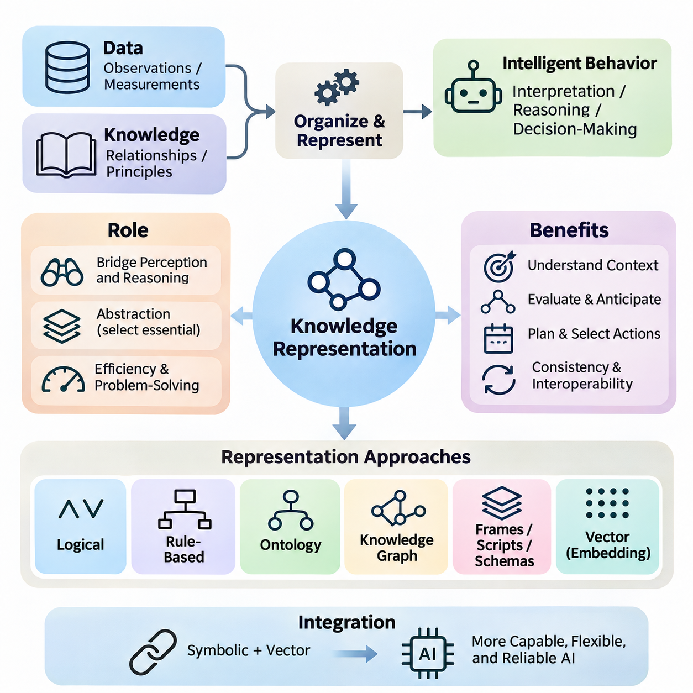
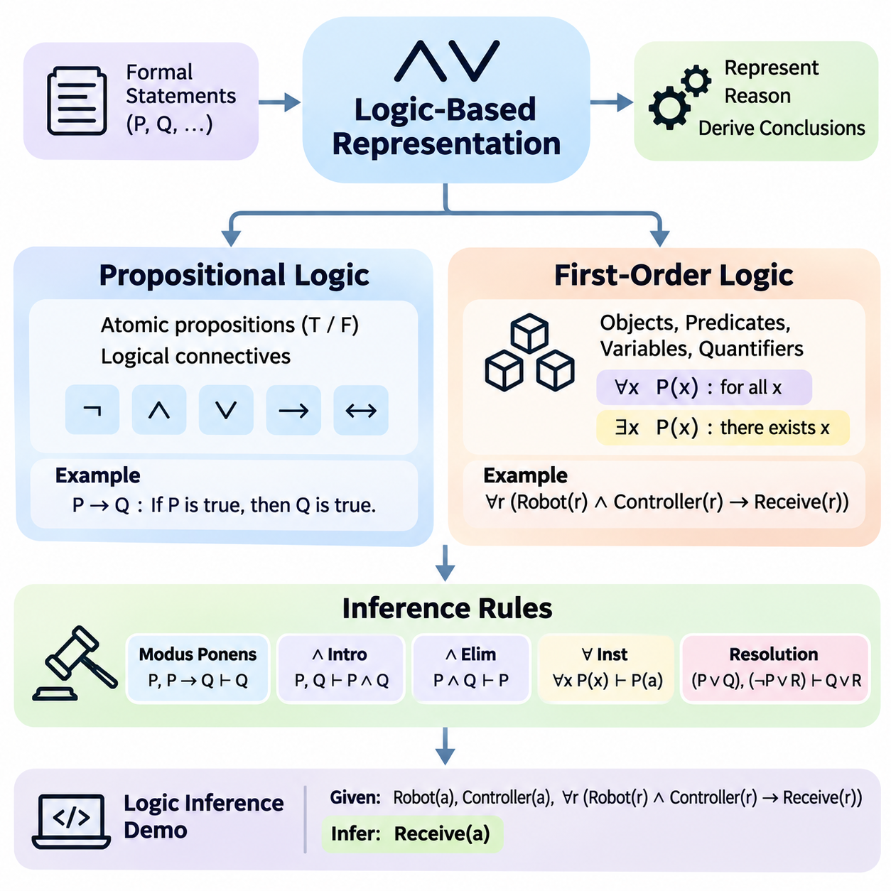
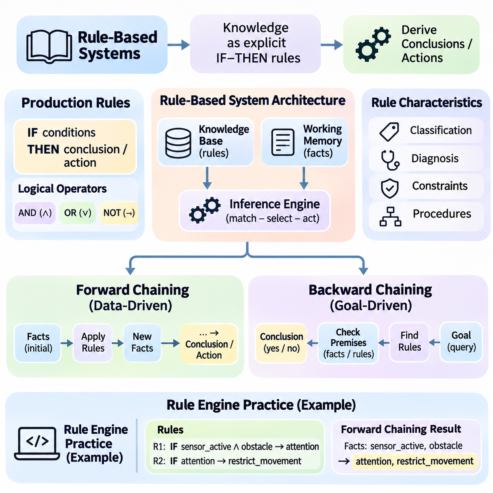
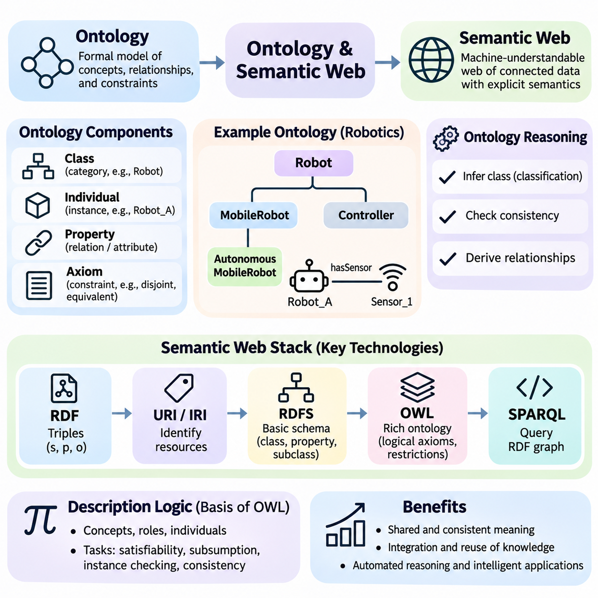
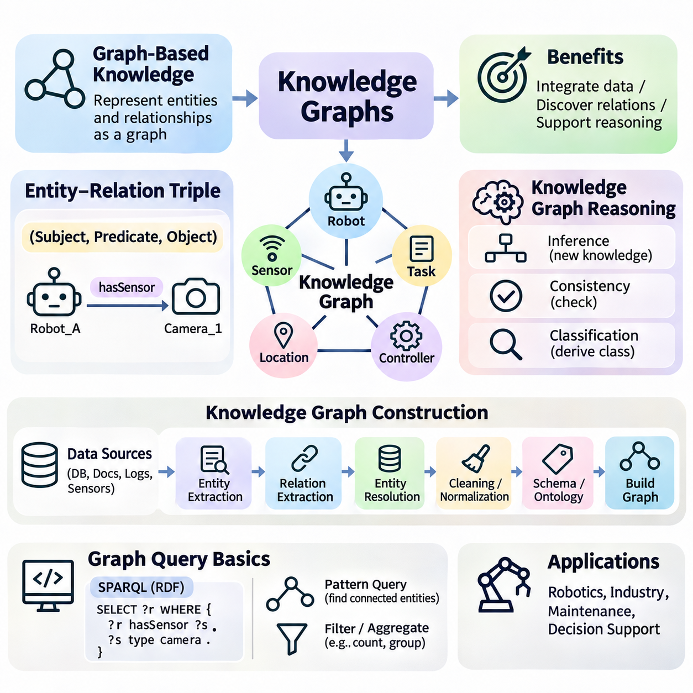
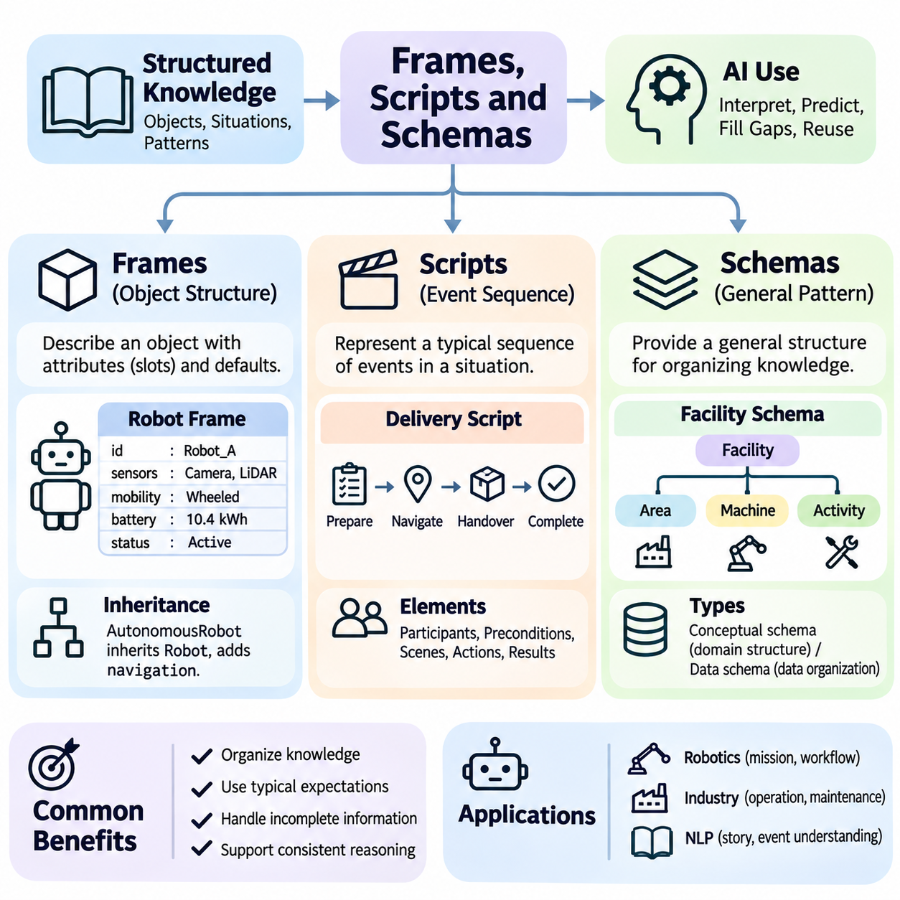
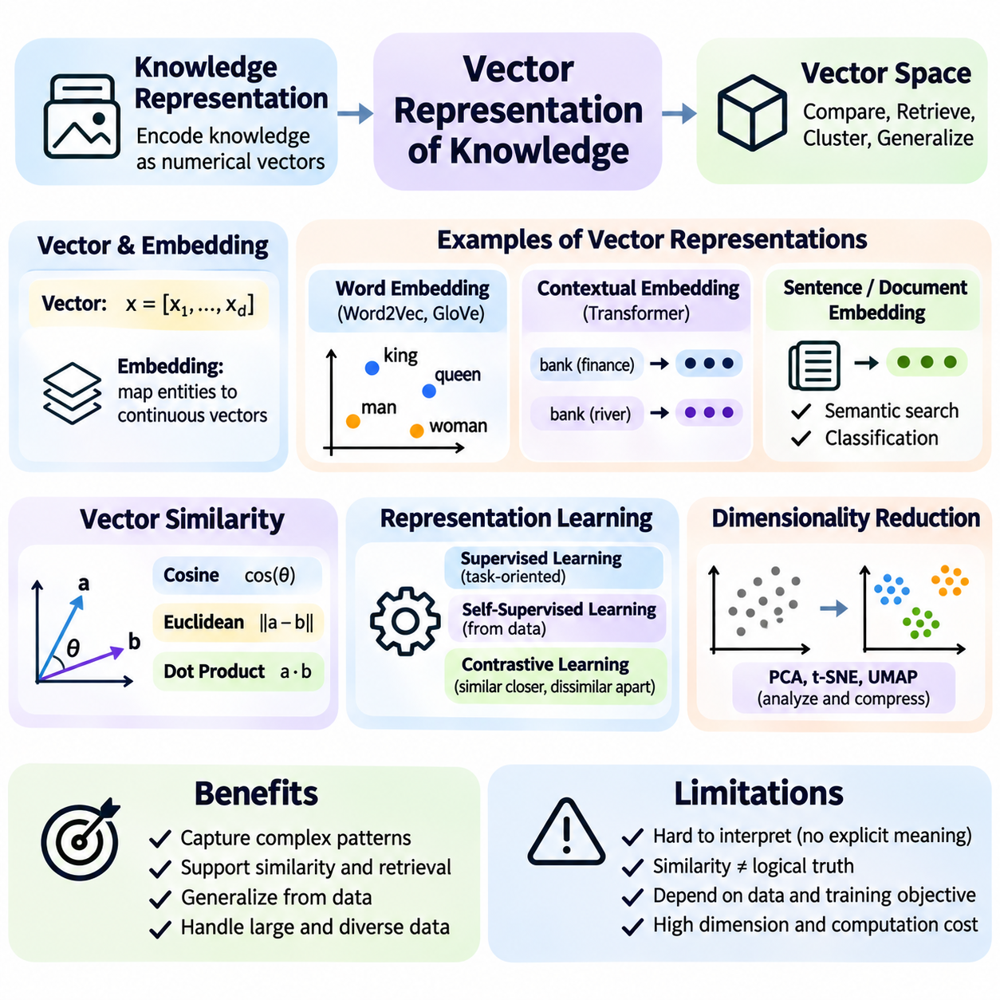
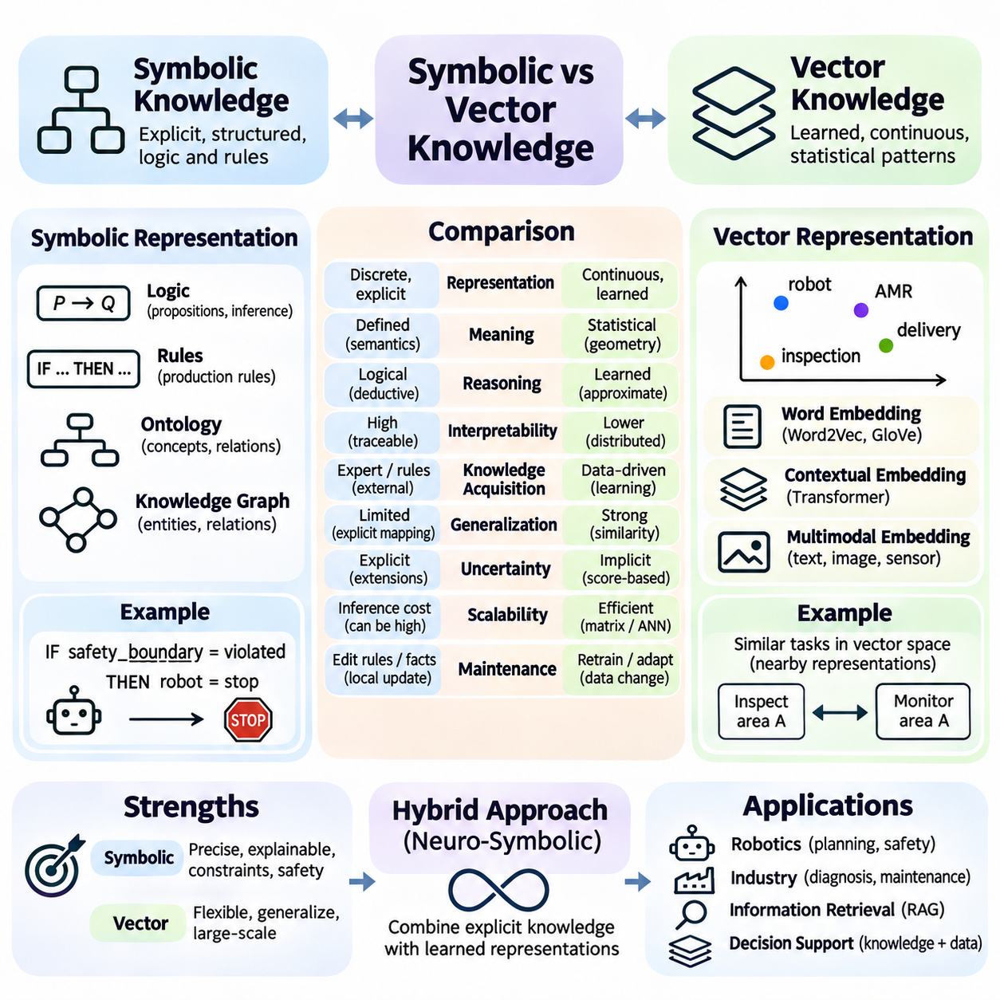
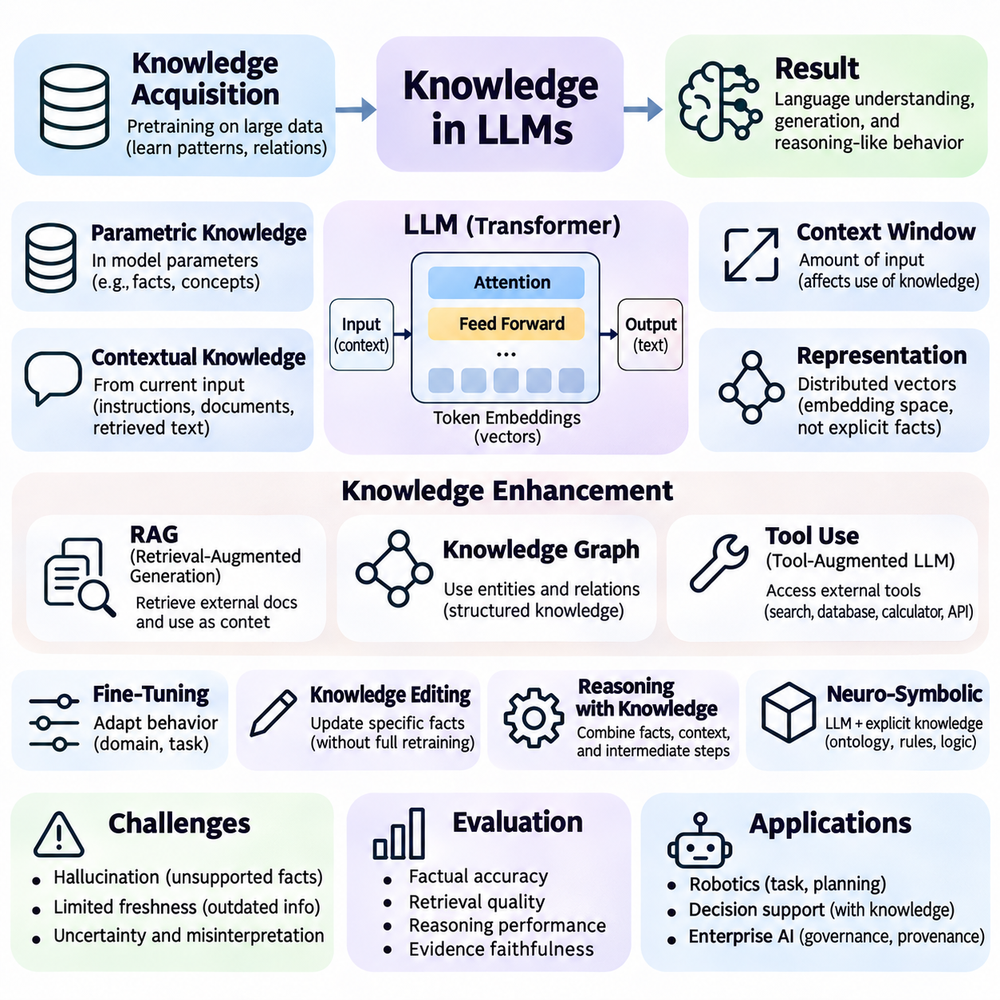

**Volume 04. Artificial Intelligence**

# 05. Knowledge Representation

## 05.00 Why Knowledge Representation Matters

{width="7.268055555555556in" height="7.268055555555556in"}

Knowledge representation is a fundamental component of artificial intelligence because intelligent behavior requires more than processing raw data or recognizing statistical patterns. An AI system must organize information about objects, events, properties, relationships, and constraints in forms that support interpretation and reasoning. Knowledge representation provides the conceptual structure through which information becomes useful for decision-making and problem-solving.

Data and knowledge are closely related but serve different purposes in intelligent systems. Data consists of observations, measurements, symbols, or recorded events, whereas knowledge incorporates meaningful relationships, contextual interpretations, and principles that explain how information should be used. For example, a temperature measurement becomes operationally meaningful when connected to equipment conditions, acceptable operating ranges, and possible consequences.

The importance of knowledge representation becomes evident when an AI system encounters situations requiring interpretation rather than simple classification. Recognizing an object as a vehicle is different from understanding that the vehicle occupies a road, follows traffic regulations, and may interact with pedestrians. These additional relationships allow an intelligent system to evaluate circumstances, anticipate consequences, and select actions consistent with its objectives.

Knowledge representation establishes a bridge between perception and reasoning. Perception systems transform sensory observations into descriptions of the environment, while reasoning mechanisms use those descriptions to derive conclusions or determine appropriate actions. Without a suitable representation, observations may remain disconnected measurements. Structured knowledge enables an AI system to combine individual observations into a coherent interpretation of its surroundings.

A central challenge in artificial intelligence is determining which aspects of reality should be represented explicitly. Real-world environments contain enormous quantities of information, but only a subset is relevant to a particular task. Effective knowledge representation therefore requires abstraction, allowing a system to preserve essential properties while ignoring unnecessary details. The appropriate abstraction depends on the intended reasoning process and operational requirements.

Representational choices directly influence computational efficiency and problem-solving capability. A representation that exposes useful relationships can simplify inference, search, and planning, while an unsuitable representation may make otherwise straightforward problems computationally expensive. For example, representing navigation environments as connected locations allows pathfinding algorithms to operate on meaningful states rather than processing every possible physical configuration.

Logical representation provides one approach to expressing knowledge through propositions, predicates, and formal relationships. Statements can describe conditions that are true or false, while inference rules establish how additional conclusions follow from existing information. This approach is particularly valuable when consistency, explicit constraints, and traceable reasoning are important. However, its effectiveness depends on the completeness and suitability of the encoded knowledge.

Rule-based representation organizes knowledge into conditional relationships connecting circumstances with conclusions or actions. An industrial monitoring system might associate abnormal temperature and vibration measurements with potential equipment faults. Such rules provide understandable decision procedures and support systematic inference. Nevertheless, maintaining large rule collections can become difficult when interactions, exceptions, and changing operational conditions increase.

Ontologies introduce a more structured description of concepts, categories, attributes, and relationships within a particular domain. They establish shared meanings that allow different systems to interpret information consistently. For example, an industrial ontology may distinguish machines, sensors, components, maintenance activities, and operational states. These definitions support semantic interoperability and reduce ambiguity when knowledge is exchanged across applications.

Knowledge graphs represent entities and their relationships through interconnected structures. A graph may connect a robot to its sensors, assigned tasks, operating environment, and maintenance records. This organization allows systems to explore relationships that would otherwise remain distributed across separate databases. Graph-based representations are especially useful when understanding dependencies and interactions is essential to intelligent decision-making.

Frames, scripts, and schemas provide additional mechanisms for organizing knowledge around familiar structures and recurring situations. A frame can describe an object through attributes and expected values, while a script can represent a typical sequence of events. Such structures allow intelligent systems to apply contextual expectations, fill in missing details cautiously, and organize information according to recurring patterns encountered in practical environments.

Modern artificial intelligence also represents knowledge through numerical vectors and learned embeddings. Rather than explicitly encoding every relationship, neural networks learn distributed representations from training data. Similar concepts may occupy nearby regions of a learned representation space, enabling similarity search, classification, and generalization. These representations are powerful but do not automatically provide explicit logical consistency or transparent explanations.

Symbolic and vector-based representations offer complementary capabilities. Symbolic approaches express discrete entities, rules, and relationships in forms that can support explicit reasoning. Vector representations capture statistical associations and continuous similarities that are difficult to describe through manually constructed rules. Combining these approaches can help intelligent systems connect learned patterns with structured constraints, although reliable integration remains a significant engineering challenge.

Knowledge representation is also essential for managing uncertainty and incomplete information. Intelligent systems rarely possess a complete description of their environments, and observations may be noisy, ambiguous, or contradictory. Representations must distinguish established facts from assumptions, hypotheses, and uncertain estimates. Probabilistic reasoning can complement structured knowledge by expressing degrees of belief and supporting decisions when complete certainty is unavailable.

Temporal knowledge introduces another important dimension because environments and relationships change over time. A robot\'s position, a machine\'s operating condition, and a customer\'s preferences may differ between observations. Representing timestamps, event sequences, state transitions, and historical context allows an AI system to distinguish previous conditions from current circumstances. Without temporal awareness, outdated information may lead to inappropriate conclusions.

Causal knowledge extends representation beyond describing correlations or relationships. It concerns how changes in one condition may influence another and how interventions can affect outcomes. For example, identifying that equipment overheating is associated with reduced performance differs from understanding the mechanisms producing that reduction. Causal representations can support diagnosis, intervention planning, and counterfactual analysis when their underlying assumptions are justified.

Knowledge representation plays a critical role in autonomous systems that must connect environmental understanding with physical action. A mobile robot needs information about obstacles, traversable areas, destinations, operating constraints, and other agents. These elements must be represented in compatible forms so perception, localization, planning, and control can exchange meaningful information. Inconsistent representations can produce failures even when individual algorithms perform correctly.

Large language models introduce a different perspective on knowledge representation. Their parameters encode learned statistical patterns acquired during training, allowing them to generate explanations, answer questions, and perform many language-based tasks. However, information encoded in model parameters is not equivalent to a verified knowledge database. Generated statements may be inaccurate, outdated, or inconsistent, particularly when reliable external evidence is unavailable.

External knowledge resources can complement language models by providing structured and retrievable information. Knowledge graphs, document repositories, databases, and retrieval-augmented generation systems allow models to access information beyond their fixed parameters. This separation supports updating knowledge without necessarily retraining the underlying model. Nevertheless, retrieval quality, source reliability, and the correct interpretation of retrieved information remain essential.

An important benefit of explicit knowledge representation is improved explainability. When a system maintains identifiable facts, relationships, and inference rules, developers can inspect portions of the reasoning process and investigate unexpected conclusions. This visibility is valuable in engineering, healthcare, finance, and other domains where decisions require justification. Learned representations may also be interpretable, but their internal relationships are generally less directly accessible.

Knowledge representation also contributes to maintainability and interoperability throughout the AI system lifecycle. Shared schemas and consistent terminology help separate components exchange information without repeatedly redefining its meaning. Version control, provenance tracking, validation, and conflict resolution become important as knowledge evolves. These mechanisms allow organizations to manage complex knowledge resources while preserving traceability and reducing inconsistencies.

The quality of a knowledge representation should be evaluated according to its intended purpose rather than its complexity alone. Important considerations include expressive capability, computational cost, scalability, interpretability, and compatibility with available reasoning mechanisms. A highly detailed representation may be unnecessary for a simple task, while an overly simplified representation may omit critical constraints. Effective design requires balancing these competing requirements.

Knowledge representation ultimately determines how an AI system connects information with understanding, reasoning, and action. It provides the structural foundation for logical inference, rule-based systems, ontologies, knowledge graphs, distributed embeddings, and knowledge-enhanced language models. As artificial intelligence advances toward more autonomous and context-aware systems, the ability to represent, integrate, update, and validate knowledge remains central to reliable intelligent behavior.

## 05.01 Logic Based Representation

{width="7.268055555555556in" height="7.268055555555556in"}

Logic-based representation is a foundational approach to artificial intelligence that expresses knowledge through formal statements and relationships governed by precise mathematical rules. Unlike representations that rely primarily on statistical associations, logical systems distinguish between syntax, meaning, and valid inference. This separation allows intelligent systems to represent facts, evaluate consistency, and derive conclusions through explicitly defined reasoning procedures.

The central purpose of logical knowledge representation is to transform informal descriptions into expressions that computers can interpret systematically. Natural language often contains ambiguity, implicit assumptions, and context-dependent meanings. Formal logic reduces these difficulties by introducing a restricted vocabulary and precise interpretation rules. However, the usefulness of a logical representation depends on whether the formalized statements accurately reflect the intended domain.

Propositional logic represents knowledge through atomic propositions, each of which has a truth value of either true or false. A proposition may express that a machine is operating, a sensor is active, or an alarm has been triggered. Complex statements are constructed using logical connectives such as negation, conjunction, disjunction, implication, and equivalence. These operators allow multiple conditions to be combined into expressions that can be evaluated systematically.

The meaning of a propositional formula is determined by the truth values assigned to its atomic propositions and the semantics of its logical operators. For example, the implication P → Q is false only when P is true and Q is false. A truth table enumerates possible assignments and determines the resulting truth value of an expression. This provides a rigorous foundation for examining logical equivalence, contradictions, and valid consequences.

Propositional logic supports important concepts such as satisfiability, validity, and logical entailment. A formula is satisfiable when at least one truth assignment makes it true, while a valid formula is true under every possible assignment. A knowledge base entails a conclusion when every interpretation satisfying the knowledge base also satisfies that conclusion. These distinctions are essential for determining whether information is consistent and whether a conclusion follows logically.

Despite its simplicity and mathematical clarity, propositional logic has limited expressive power. It treats statements as indivisible units and cannot directly represent internal relationships among objects or quantify over collections of entities. Expressing that every robot has a controller would require separate propositions for individual robots in a purely propositional system. This limitation motivates more expressive logical languages capable of describing structured domains.

First-order logic extends propositional logic by introducing objects, predicates, variables, functions, and quantifiers. Predicates describe properties of objects or relationships among them, while variables allow statements to refer to unspecified entities. Universal quantification expresses conditions applying to every object within a domain, whereas existential quantification expresses that at least one object satisfies a condition. These mechanisms enable compact representations of general knowledge.

For example, the statement that every robot equipped with a functioning controller can receive commands may be represented using universally quantified predicates. A separate fact can establish that a particular robot possesses a functioning controller. Logical inference can then determine that the robot can receive commands. This illustrates how first-order logic combines general rules with specific facts to derive conclusions about individual entities.

The interpretation of first-order logic depends on a domain of discourse and the meanings assigned to constants, predicates, and functions. A constant identifies an object, while a predicate determines whether a specified property or relationship holds. Quantifiers range over objects in the domain. Correct modeling therefore requires careful attention to vocabulary, quantifier scope, and assumptions about object identity and existence.

First-order logic offers greater expressive capability than propositional logic but introduces additional computational challenges. General first-order logical validity is undecidable, meaning no algorithm can determine the validity of every possible formula while always terminating. Nevertheless, practical inference engines can solve many useful problems through restricted logical fragments, structured rule systems, and search procedures designed for particular applications.

Inference rules specify how new logical statements can be derived from existing premises. Modus ponens is a fundamental example: when P is true and P implies Q, Q can be concluded. Other inference mechanisms include conjunction introduction, conjunction elimination, universal instantiation, and resolution. Each rule preserves logical correctness when applied under its formal conditions, enabling complex arguments to be constructed from simpler reasoning steps.

A distinction must be maintained between logical entailment and syntactic derivation. Entailment concerns whether a conclusion is true in every model satisfying the premises, while derivation concerns whether a proof procedure can produce that conclusion. A sound inference system derives only logically entailed conclusions. A complete system can derive every conclusion entailed within the relevant logical framework. These properties establish important standards for reasoning reliability.

Resolution is a widely studied inference technique that operates on logical clauses and supports automated theorem proving. Propositional formulas can be transformed into conjunctive normal form, allowing resolution to identify contradictions or establish consequences through refutation. First-order resolution additionally requires unification, which determines substitutions that make logical expressions compatible. Together, these mechanisms support systematic proof search.

Unification plays an essential role in first-order inference because logical rules often contain variables rather than fixed objects. For example, a rule describing all robots may be matched against a fact describing Robot_A by substituting Robot_A for the appropriate variable. The inference engine can then apply the rule to that specific entity. Correct unification must respect term structure and prevent invalid substitutions that would compromise logical reasoning.

A practical logic inference demonstration can begin with a small knowledge base containing facts about robots, sensors, and operational conditions. The system may encode that Robot_A has an active sensor and that every robot with an active sensor satisfies a particular monitoring condition. By applying an appropriate inference rule, the engine derives the monitoring condition for Robot_A. The example demonstrates how explicit facts and general rules produce new knowledge.

In a simple Python implementation, propositional inference can be demonstrated by representing facts as Boolean variables and implications as conditional rules. A forward-chaining procedure repeatedly examines rules whose premises are satisfied and adds their conclusions to the known fact set. The process continues until no additional facts can be derived. This approach provides an accessible introduction to automated reasoning without requiring a complete theorem prover.

A more advanced demonstration can represent predicates as structured expressions containing symbols and arguments. Rules can then be matched against known facts through variable substitution, enabling limited first-order reasoning. For example, the engine may infer a robot\'s operational capability from its component status and a general capability rule. Such demonstrations must define their supported logical fragment clearly because a basic rule engine does not implement unrestricted first-order logic.

Forward chaining and backward chaining provide two complementary strategies for applying inference rules. Forward chaining begins with known facts and derives additional conclusions until a goal is reached or no further progress is possible. Backward chaining begins with a target conclusion and searches for rules and premises that could establish it. The preferred strategy depends on whether the application emphasizes continuous knowledge updates or answering specific queries.

Logic-based reasoning also requires careful treatment of missing information and negative statements. Under the open-world assumption, the absence of a fact does not establish that the fact is false. Some practical rule systems instead adopt a closed-world assumption, treating facts that cannot be established as false under specified conditions. Confusing these assumptions can produce incorrect conclusions, particularly when integrating information from incomplete databases.

The effectiveness of logical inference depends on the consistency and quality of the underlying knowledge base. Contradictory statements can undermine classical reasoning because, in classical logic, a contradiction permits arbitrary conclusions through the principle of explosion. Practical systems therefore require knowledge validation, contradiction detection, and controlled update procedures. Applications involving uncertain observations may additionally need probabilistic or nonclassical reasoning mechanisms.

Logic-based representation remains valuable in expert systems, configuration management, access control, automated planning, and knowledge graph reasoning. Its explicit semantics and inspectable inference procedures support applications requiring verifiable decisions and clearly defined constraints. Although purely logical approaches may struggle with noisy perception and incomplete real-world knowledge, they provide essential reasoning capabilities that complement statistical learning and modern neural models.

The broader significance of logic-based knowledge representation lies in its ability to connect structured knowledge with mathematically justified conclusions. Propositional logic establishes the foundations of truth-functional reasoning, first-order logic introduces objects and quantified relationships, and inference rules provide mechanisms for deriving new statements. Practical inference demonstrations reveal how these principles become computational procedures, forming a foundation for explainable and reliable AI systems.

## 05.02 Rule Based Systems

{width="7.268055555555556in" height="7.268055555555556in"}

Rule-based systems represent knowledge through explicit conditional statements that connect observed conditions with conclusions or actions. They constitute an important tradition in symbolic artificial intelligence because reasoning can be expressed through understandable and inspectable rules. Rather than learning every decision directly from numerical data, these systems apply encoded domain knowledge to facts, allowing conclusions to be derived through systematic inference procedures.

A typical rule-based system contains a knowledge base, working memory, and an inference engine. The knowledge base stores general rules describing relationships within a domain, while working memory maintains facts representing the current situation. The inference engine evaluates applicable rules and determines which conclusions or actions should follow. This separation allows domain knowledge to be modified without necessarily changing the underlying reasoning mechanism.

Production rules are commonly expressed through an IF--THEN structure, where the IF component specifies conditions and the THEN component defines a conclusion or action. For example, a maintenance rule may state that if motor temperature exceeds an operational threshold and vibration is abnormal, an inspection warning should be generated. Such rules translate domain expertise into executable decision logic while preserving a relatively transparent relationship between conditions and outcomes.

The condition portion of a production rule may contain multiple predicates connected through logical operators. Conjunction requires several conditions to hold simultaneously, while disjunction permits alternative conditions to activate a rule. Negation may represent the absence or falsity of a condition, depending on the reasoning system\'s semantics. Clearly defining these operators is essential because ambiguous conditions can produce unexpected rule activation and inconsistent decisions.

Production rules can represent classification knowledge, diagnostic relationships, operational constraints, and procedural decisions. A manufacturing system may classify equipment states, while a medical decision-support system may identify conditions requiring further investigation. In autonomous robotics, rules may define operational restrictions or safety responses. Their effectiveness depends on whether the encoded rules accurately capture the relevant domain assumptions and exceptions.

Forward chaining is a data-driven reasoning strategy that begins with available facts and repeatedly applies rules whose conditions are satisfied. Each successful rule application may introduce additional facts into working memory, potentially enabling other rules to execute. This process continues until a specified goal is reached, no additional rules are applicable, or another termination condition is satisfied. Forward chaining is especially suitable for continuous monitoring and event-driven applications.

Consider a robotic monitoring system that initially knows a sensor is active and an obstacle has been detected. One rule may infer that the environment requires attention, while another may conclude that movement should be restricted when attention is required. Forward chaining progressively derives these conclusions from the initial observations. The example demonstrates how several simple rules can collectively produce a higher-level operational decision.

A forward-chaining engine typically performs repeated matching, selection, and execution. During matching, the engine identifies rules whose conditions correspond to current facts. During selection, it chooses which applicable rule should execute when multiple rules are available. During execution, it applies the selected rule and updates working memory. This operational cycle is commonly called the match--select--act cycle and forms the foundation of many production-rule engines.

When multiple rules are simultaneously applicable, the inference engine must resolve conflicts through a defined strategy. Conflict resolution may consider rule priority, specificity, recency of facts, or application-specific policies. Without a consistent strategy, the execution order may become unpredictable, particularly when rules modify shared facts. Deterministic conflict resolution improves reproducibility, debugging, and the reliability of operational decisions.

Forward chaining must also address repeated activation and potential infinite execution. If a rule continually produces facts already present, the engine may waste computational resources or repeatedly trigger the same action. Practical implementations can use duplicate detection, activation histories, execution limits, and explicit termination conditions. These mechanisms are especially important when rule consequences modify the environment or initiate physical operations.

Backward chaining follows a goal-driven reasoning strategy that starts with a desired conclusion and searches for rules capable of establishing it. The engine identifies the premises required by those rules and attempts to verify them using existing facts or additional rules. This recursive process continues until the goal is supported, cannot be established, or a defined search limit is reached. Backward chaining is particularly useful for targeted queries and diagnostic reasoning.

For example, an equipment diagnostic system may begin with the question of whether a cooling subsystem has failed. It searches for rules that conclude cooling failure and examines their required conditions, such as excessive temperature or abnormal fan operation. If these conditions are already known, the system can establish the conclusion. Otherwise, it may recursively investigate supporting facts or request additional observations.

Backward chaining can reduce unnecessary inference when only a specific conclusion is required. Instead of deriving every possible consequence of the knowledge base, it focuses on rules relevant to the requested goal. However, its performance depends on rule organization, search order, and the complexity of dependencies. Cyclic rules and repeated subgoals may require memoization, cycle detection, or bounded search to prevent redundant computation.

Forward chaining and backward chaining differ primarily in the direction of reasoning rather than the logical meaning of their rules. Forward chaining asks what conclusions follow from available information, while backward chaining asks which information is needed to establish a particular conclusion. Both strategies can operate over compatible rule representations, although their implementation details and operational efficiency may differ considerably across applications.

A practical rule-engine implementation begins by defining a consistent representation for facts and production rules. Facts may be stored as structured records, symbolic predicates, or key-value relationships. Rules contain conditions and consequences, while the inference engine provides matching and execution procedures. Separating these components makes the system easier to test, extend, and maintain as the number of rules increases.

In a simple Python demonstration, facts can be represented as a set of symbolic statements, and rules can be represented as pairs containing prerequisite facts and derived conclusions. The forward-chaining engine repeatedly checks whether every prerequisite is present in the fact set. When a rule becomes applicable, its conclusion is added if it is not already known. The procedure terminates when an iteration produces no new facts.

A corresponding backward-chaining demonstration can use recursive goal evaluation. When a requested goal is already present among known facts, the procedure succeeds immediately. Otherwise, it searches for rules whose conclusions match the goal and recursively evaluates their prerequisites. The goal succeeds when all required premises of at least one applicable rule are established. Tracking visited goals helps prevent infinite recursion caused by cyclic dependencies.

A more advanced rule engine may introduce variable binding, pattern matching, priorities, and explanation tracing. Variable binding allows general rules to operate on multiple entities, while pattern matching identifies compatible facts efficiently. Priorities support conflict resolution, and explanation tracing records which rules produced each conclusion. These capabilities transform a simple educational demonstration into a more practical reasoning framework.

Efficient rule matching becomes increasingly important as the number of rules and facts grows. Naive implementations repeatedly evaluate every condition against the entire working memory, potentially creating substantial computational overhead. Algorithms such as Rete reduce repeated matching by retaining intermediate results and sharing common condition evaluations. Their benefits depend on workload characteristics, memory availability, and the frequency of fact updates.

Rule-based systems require explicit policies for handling uncertainty, missing facts, and contradictory information. A missing condition should not automatically be interpreted as false unless the system adopts an appropriate closed-world assumption. Conflicting rules may require priority mechanisms or additional consistency constraints. When observations are uncertain, confidence measures or probabilistic reasoning may complement deterministic rules, provided their interpretation is carefully defined.

Rule-engine practice should include verification of individual rules and validation of complete reasoning behavior. Unit tests can confirm that expected conditions activate the correct rules, while integration tests examine interactions among multiple rules. Additional tests should address conflicting conclusions, cyclic dependencies, missing facts, and termination behavior. Recording inference traces makes it easier to identify incorrect assumptions and diagnose unexpected results.

The principal strengths of rule-based systems include transparency, modularity, and direct incorporation of domain expertise. Their limitations include knowledge acquisition costs, maintenance complexity, and difficulty handling highly variable environments through manually specified rules alone. Modern AI architectures can combine rule engines with machine learning, knowledge graphs, and language models, allowing learned predictions to interact with explicit constraints and decision policies.

Rule-based systems demonstrate how structured knowledge can be transformed into executable reasoning. Production rules define conditional relationships, forward chaining derives consequences from available facts, and backward chaining investigates the premises required for specific conclusions. Practical rule-engine implementations connect these theoretical mechanisms with software architecture, providing a foundation for interpretable decision support, automated diagnosis, and knowledge-driven intelligent systems.

## 05.03 Ontology and Semantic Web

{width="7.268055555555556in" height="7.268055555555556in"}

Ontology provides a formal framework for representing the concepts, relationships, and constraints that define a knowledge domain. In artificial intelligence, an ontology establishes a shared conceptual model that allows different systems to interpret information consistently. Rather than storing isolated facts, ontological representation organizes knowledge according to explicit meanings, enabling automated reasoning, semantic integration, and systematic reuse across applications.

An ontology typically defines classes, individuals, properties, and logical axioms. Classes represent categories of entities, while individuals identify specific instances belonging to those categories. Properties describe attributes or relationships, and axioms establish constraints governing valid interpretations. For example, a robotics ontology may define robots, sensors, controllers, and tasks, together with relationships describing how components are connected and how operational responsibilities are assigned.

The distinction between classes and individuals is fundamental to ontology modeling. A class such as MobileRobot describes a general category, while Robot_A identifies a particular instance. Subclass relationships establish conceptual hierarchies, allowing specialized categories to inherit broader classifications. For example, AutonomousMobileRobot may be defined as a subclass of MobileRobot, enabling reasoning systems to recognize that every autonomous mobile robot also belongs to the more general mobile robot category.

Ontological properties express meaningful connections among entities. Object properties relate individuals to other individuals, while datatype properties associate individuals with literal values such as numbers or strings. A robot may have an object property connecting it to a sensor and a datatype property describing its maximum speed. These distinctions help systems preserve the intended meaning of information rather than treating every relationship as an unstructured data field.

Logical axioms make ontologies more expressive than simple classification hierarchies. They can describe class equivalence, disjointness, property restrictions, and relationships among concepts. For example, two equipment categories may be declared disjoint, indicating that no individual can belong to both categories in a consistent interpretation. Such constraints allow automated reasoners to detect modeling conflicts and infer classifications that were not explicitly asserted.

The Semantic Web extends traditional web technologies by enabling information to be represented in machine-interpretable forms. Conventional web pages primarily communicate content to human readers, whereas Semantic Web technologies describe entities and relationships using standardized data structures. The objective is not to replace the existing web but to enrich digital information with explicit semantics that support automated discovery, integration, querying, and reasoning.

Resource Description Framework, or RDF, is a foundational standard for representing Semantic Web data. RDF expresses information through triples consisting of a subject, predicate, and object. A triple may state that Robot_A hasSensor Sensor_1, representing a directed relationship between two resources. Collections of RDF triples form graphs in which entities and their connections can be combined across different datasets and information systems.

Uniform Resource Identifiers, or URIs, provide a mechanism for identifying resources within RDF-based systems. By assigning stable identifiers to entities and relationships, different datasets can refer to the same conceptual resources without relying exclusively on ambiguous names. Internationalized Resource Identifiers extend this approach to broader character sets. Consistent identifier design is essential for linking distributed knowledge and reducing accidental duplication.

RDF Schema, commonly abbreviated RDFS, introduces basic vocabulary for describing classes, properties, subclass relationships, and property hierarchies. It also supports domain and range declarations that help establish the intended interpretation of relationships. RDFS reasoning can derive additional classifications from these declarations. However, domain and range statements primarily support inference rather than functioning as ordinary database validation constraints.

The Web Ontology Language, or OWL, provides richer logical constructs for defining ontologies. OWL supports expressive class descriptions, property characteristics, equivalence, disjointness, and quantified restrictions. Its formal semantics are grounded in description logics, enabling automated reasoners to perform consistency checking and classification. Different OWL profiles balance expressive capability against computational complexity for practical applications.

Ontology reasoning derives implicit knowledge from explicitly defined facts and axioms. A reasoner may determine that an individual belongs to a particular class because it satisfies the necessary logical conditions. It may also identify inconsistent classifications or infer relationships from property characteristics. Such reasoning differs from statistical prediction because conclusions follow from formal semantics and asserted knowledge rather than learned numerical correlations.

Description logics provide a mathematical foundation for many ontology languages. They represent concepts, roles, and individuals through formal expressions with precisely defined meanings. Reasoning tasks include concept satisfiability, subsumption, instance checking, and ontology consistency. The computational difficulty of these tasks depends on the expressiveness of the selected logic, making language selection an important architectural decision.

SPARQL is a standardized query language for RDF graphs that enables applications to retrieve information based on graph patterns. A query can identify robots equipped with particular sensors or determine which components are associated with a maintenance task. SPARQL supports filtering, aggregation, optional patterns, and queries across multiple graph sources. Its graph-oriented approach makes it particularly useful for navigating relationships within interconnected knowledge resources.

Ontology engineering begins by identifying the purpose, scope, and competency questions that the ontology must support. Competency questions describe the kinds of queries or reasoning tasks that the knowledge model should answer. Engineers then define relevant concepts, relationships, naming conventions, and logical constraints. This requirements-driven approach helps prevent unnecessary complexity and ensures that the ontology remains aligned with practical information needs.

Ontology development also requires careful consideration of reuse and interoperability. Existing vocabularies and established ontologies can provide common definitions that reduce duplicated modeling effort. However, independently developed ontologies may represent similar concepts using different terminology or structural assumptions. Ontology alignment and mapping techniques establish correspondences between these models, enabling information exchange while preserving important semantic distinctions.

The open-world assumption is a central characteristic of many Semantic Web reasoning frameworks. Under this assumption, the absence of a statement does not imply that the statement is false. If a robot has no recorded battery specification, the ontology does not automatically conclude that the robot lacks a battery. This interpretation supports incomplete and distributed knowledge but differs from the closed-world assumptions commonly used in conventional databases.

Ontology validation must distinguish logical consistency from data completeness and application-specific correctness. An ontology may be logically consistent while still lacking required operational information. Technologies such as the Shapes Constraint Language, or SHACL, allow RDF graphs to be checked against structural and value constraints. Combining ontology reasoning with explicit validation procedures helps ensure that knowledge resources satisfy both semantic requirements and practical data-quality expectations.

In robotics and industrial artificial intelligence, ontologies can organize knowledge about devices, capabilities, environments, tasks, and operational constraints. A shared ontology may connect sensor specifications with robot configurations and mission requirements. This supports semantic interoperability among perception systems, planning modules, fleet management platforms, and maintenance applications. However, ontology reasoning must be integrated carefully when applications impose strict real-time execution requirements.

Knowledge graphs frequently use ontologies to provide semantic structure for interconnected data. The graph stores entities and relationships, while the ontology defines how those entities and relationships should be interpreted. This combination supports meaningful queries, inference, and integration across heterogeneous sources. Nevertheless, not every knowledge graph requires a formal ontology, and the appropriate modeling depth depends on application objectives.

Modern language models can interact with ontologies and Semantic Web resources to improve access to structured knowledge. A language model may translate natural-language questions into graph queries or summarize information retrieved from an ontology-backed knowledge base. Conversely, ontology constraints can support validation of generated statements. These integrations require safeguards because language models may produce incorrect queries, unsupported relationships, or explanations that exceed the available evidence.

Practical ontology systems must address scalability, version management, provenance, and governance. Large RDF graphs may contain millions of statements, requiring specialized storage and query optimization. Ontology revisions can affect existing applications and inferred classifications, making compatibility management important. Provenance records identify information sources, while governance procedures establish responsibility for definitions, updates, and quality control across participating organizations.

The significance of ontology and Semantic Web technologies lies in their ability to make knowledge explicit, shareable, and computationally meaningful. Ontologies define conceptual structures and logical constraints, while RDF, RDFS, OWL, and SPARQL provide standardized mechanisms for representing, reasoning over, and querying connected information. Together, these technologies establish an important foundation for semantic interoperability, knowledge-driven automation, and explainable intelligent systems.

## 05.04 Knowledge Graphs

{width="7.268055555555556in" height="7.268055555555556in"}

Knowledge graphs represent information as interconnected entities and relationships, providing a structured foundation for organizing and reasoning about complex knowledge. Unlike isolated records, graph-based representations emphasize how objects, events, and concepts are connected. This approach enables artificial intelligence systems to discover relationships, integrate heterogeneous information, and support reasoning across multiple domains.

Graph-based knowledge is commonly modeled through nodes and edges. Nodes represent entities such as people, machines, locations, or concepts, while edges describe relationships connecting those entities. A robotics knowledge graph may connect robots to sensors, controllers, missions, and operating environments. By preserving these connections explicitly, the graph supports navigation through relationships that would otherwise remain distributed across separate data structures.

Knowledge graphs can represent hierarchical, associative, temporal, and functional relationships within a unified structure. Hierarchical edges may express category membership, while functional edges describe capabilities or dependencies. Temporal relationships can associate events with operational periods or state changes. This flexibility makes graph-based representation suitable for domains where understanding interactions is as important as describing individual objects.

The fundamental unit of many knowledge graphs is the entity--relation triple, consisting of a subject, predicate, and object. The subject identifies an entity, the predicate describes a relationship or property, and the object specifies the related entity or value. For example, Robot_A hasSensor Camera_1 expresses a relationship between a robot and a camera. Collections of triples form a connected graph that supports structured querying and inference.

Entities require consistent identifiers to distinguish individual objects from their names or descriptions. Two sensors may share the same model name while representing different physical devices. Stable identifiers prevent accidental merging and enable information from multiple sources to refer to the correct entity. Properties and relationships also require consistent definitions so that graph connections preserve their intended meaning across applications.

Knowledge graphs may follow different data models, including RDF graphs and labeled property graphs. RDF represents knowledge through standardized triples and supports Semantic Web technologies. Labeled property graphs associate labels and attributes with nodes and relationships, providing flexible structures for graph databases. These models share graph-oriented principles but differ in their semantics, query languages, and approaches to representing metadata.

Knowledge graph construction begins by identifying the entities, relationships, and information sources relevant to an application. Source materials may include relational databases, documents, sensor records, application logs, and existing ontologies. Engineers define a graph schema or ontology to establish the meaning of entities and relationships. This conceptual foundation helps ensure that information extracted from different sources can be integrated consistently.

Entity extraction identifies relevant objects or concepts within source information, while relation extraction determines how those entities are connected. Structured databases may provide explicit relationships through keys and tables, whereas unstructured documents often require natural language processing. Machine learning models can assist extraction, but their outputs require validation because ambiguous language and incomplete context can produce incorrect relationships.

Entity resolution is a critical construction step that determines whether different records refer to the same real-world object. For example, a device identifier in a maintenance database may correspond to a differently named component in an operational log. Entity resolution uses identifiers, attributes, contextual relationships, and matching rules to establish correspondence. Incorrect merging can introduce false connections, while missed matches can fragment the graph.

Graph construction also involves data cleaning, normalization, and provenance management. Cleaning removes malformed records and identifies inconsistencies, while normalization standardizes terminology, units, and relationship structures. Provenance records document where information originated and how it was transformed. These practices improve graph reliability and allow downstream applications to distinguish verified knowledge from uncertain or automatically extracted statements.

A practical knowledge graph construction exercise can begin with a small robotics dataset containing robots, sensors, and assigned tasks. Each record is transformed into nodes and relationships, such as a robot having a sensor or performing a mission. Python libraries can create and inspect the resulting graph, while graph databases support persistent storage. The exercise demonstrates how ordinary structured records become interconnected knowledge.

Graph queries retrieve information by matching patterns of nodes and relationships. Instead of searching only for individual records, a graph query can follow connections across multiple entities. For example, an application may identify all robots assigned to missions requiring a particular sensor type. This capability is valuable when answering questions that depend on relationships spanning several categories of information.

SPARQL is commonly used to query RDF knowledge graphs through triple patterns. A query specifies relationships that matching resources must satisfy, potentially combining multiple patterns to discover connected information. Filtering, aggregation, and optional matching extend its capabilities. In labeled property graph systems, languages such as Cypher express graph patterns using nodes, relationships, and property constraints.

Graph traversal is another fundamental querying operation. Breadth-first search explores neighboring nodes level by level, while depth-first search follows paths before returning to alternative branches. Shortest-path algorithms identify efficient connections between entities under specified edge costs. These methods support dependency analysis, relationship discovery, and navigation, although graph connectivity alone does not establish semantic or causal significance.

Efficient graph querying depends on storage organization, indexing, and query planning. Large knowledge graphs may contain millions of entities and relationships, making unrestricted traversal computationally expensive. Graph databases use indexes and optimized execution strategies to reduce unnecessary searches. Query designers should consider relationship selectivity, traversal depth, intermediate result sizes, and available computational resources.

Knowledge graph reasoning extends querying by deriving relationships or classifications that are not explicitly stored. Rule-based reasoning may infer that a robot is eligible for a mission when its capabilities satisfy required conditions. Ontology-based reasoning can derive class membership from subclass relationships or property restrictions. These mechanisms transform graphs from connected information repositories into systems capable of generating additional knowledge.

Logical inference over knowledge graphs depends on the semantics of the underlying representation. RDF Schema and OWL provide formal mechanisms for deriving classifications and relationships. Custom rules may express application-specific dependencies, while graph algorithms identify structural patterns. It is important to distinguish logically entailed conclusions from heuristic predictions, since structural similarity does not necessarily establish a valid logical implication.

Knowledge graph embeddings represent entities and relationships as numerical vectors learned from graph structure. These representations support link prediction, similarity estimation, and knowledge graph completion. A model may suggest that an unobserved relationship is plausible based on learned patterns. However, predicted links are hypotheses rather than established facts and should be validated before being used in safety-critical decisions.

Graph neural networks extend graph-based learning by aggregating information from connected nodes and edges. Through message passing, a node representation incorporates information from its surrounding graph neighborhood. This enables classification, relationship prediction, and representation learning over relational structures. Unlike symbolic inference, graph neural networks generally learn statistical transformations and do not automatically guarantee logically valid conclusions.

Knowledge graph reasoning can also support multi-hop questions that require several connected relationships. A system may determine which robots can execute a mission by connecting mission requirements, sensor capabilities, and robot configurations. Each relationship contributes to a chain of reasoning. Explanation paths can make the result more interpretable, provided that the underlying relationships and inference rules are trustworthy.

Maintaining knowledge graphs requires mechanisms for updates, consistency checking, access control, and version management. Real-world entities change, relationships become obsolete, and new observations may contradict earlier information. Temporal metadata and provenance tracking help preserve historical context. Validation rules and governance policies ensure that graph evolution does not silently compromise the quality of operational knowledge.

Knowledge graphs are increasingly combined with language models to provide structured context for question answering and reasoning. Graph retrieval can supply relevant entities and relationships, while language models generate natural-language explanations or translate questions into graph queries. This integration can improve grounding and traceability, but generated answers must remain consistent with retrieved evidence and should not treat predicted relationships as verified facts.

The significance of knowledge graphs lies in their ability to integrate structured relationships, computational queries, and multiple forms of reasoning within a common knowledge architecture. Graph-based knowledge establishes connectivity, entity--relation triples provide basic representation units, construction pipelines organize information, and query mechanisms retrieve relevant patterns. Symbolic inference and graph learning further extend these capabilities, supporting explainable and knowledge-driven AI systems.

## 05.05 Frames Scripts and Schemas

{width="7.268055555555556in" height="7.268055555555556in"}

Frames, scripts, and schemas are classical knowledge representation structures that organize information around familiar objects, situations, and recurring patterns. Rather than describing every fact independently, these approaches capture the expected organization of knowledge within a particular context. They help artificial intelligence systems interpret incomplete observations, establish relationships among concepts, and apply previously structured knowledge to new situations.

A frame represents a structured description of an object, concept, or situation through a collection of attributes called slots. Each slot describes a property or relationship and may contain a value, default assumption, constraint, or associated procedure. For example, a robot frame may contain slots for its identifier, sensors, mobility type, battery capacity, and operational status. This organization provides a reusable template for representing related entities consistently.

Frames distinguish between general knowledge about categories and specific information about individual instances. A general MobileRobot frame may define common properties, while a particular robot instance supplies concrete values for those properties. This separation reduces repeated descriptions and supports systematic knowledge organization. Frame-based representations are especially useful when objects share a recognizable structure but differ in their individual characteristics.

Inheritance is an important mechanism in frame-based knowledge representation. A specialized frame can inherit slots and default values from a more general frame while introducing additional properties or overriding selected assumptions. For example, an AutonomousMobileRobot frame may inherit mobility attributes from MobileRobot and add autonomous navigation capabilities. Inheritance reduces duplication but requires clear rules for handling exceptions and conflicting values.

Default values allow frames to represent typical properties without requiring every detail to be specified explicitly. A mobile robot frame might assume that the robot operates on a rechargeable battery unless a particular instance provides different information. Such assumptions support reasoning with incomplete descriptions, but they must remain distinguishable from verified facts. When new observations contradict defaults, the representation should permit appropriate revisions.

Frames may also include procedural attachments that associate specific operations with slots or events. A procedure might calculate remaining operating time when battery capacity and power consumption are available. Another procedure could validate whether a sensor configuration satisfies a required capability. These mechanisms connect structured knowledge with executable behavior, although excessive procedural dependencies can make frame systems difficult to inspect and maintain.

Scripts represent stereotypical sequences of events that occur within familiar situations. While frames primarily describe structured entities or states, scripts emphasize temporal organization and expected actions. A restaurant visit, maintenance procedure, or robotic delivery mission may follow a recognizable sequence of stages. Scripts allow intelligent systems to anticipate likely events and interpret observations according to their position within a broader activity.

A script typically describes participants, preconditions, scenes, actions, and expected results. In a robotic delivery scenario, participants may include a mobile robot, a dispatch system, and a receiving station. Preconditions establish that the robot is available and a delivery request exists. The script then organizes navigation, arrival, handover, and completion into an expected sequence, helping the system interpret the progress of the mission.

Scripts are useful for understanding narratives because many descriptions omit routine events that readers implicitly assume. When a story states that a customer entered a restaurant and later paid the bill, a restaurant script provides expectations about ordering and receiving food. However, these intermediate events remain assumptions rather than established facts. Intelligent systems must avoid treating stereotypical sequences as proof that every expected action occurred.

In autonomous systems, scripts can describe recurring operational workflows such as inspection, charging, docking, and task execution. An inspection script may specify preparation, movement to inspection points, sensor acquisition, result recording, and mission completion. This structured sequence supports progress tracking and exception handling. Nevertheless, real environments may require scripts to accommodate interruptions, alternative paths, and unexpected events.

Schemas provide generalized structures that organize knowledge according to recurring patterns and conceptual relationships. In cognitive science, schemas describe organized expectations that influence perception, memory, and interpretation. In artificial intelligence, the term may refer to conceptual structures or formal specifications governing data organization. These meanings are related but not identical, so their interpretation should be established within the application context.

A conceptual schema may describe the typical organization of an industrial facility, including production areas, machines, operators, and maintenance activities. Such a schema helps an intelligent system interpret newly encountered information by relating it to an existing conceptual structure. A data schema, by contrast, may define required fields, data types, and relationships within a database. Both promote consistency, but they operate at different levels of abstraction.

Frames, scripts, and schemas share an emphasis on structured expectations, yet each highlights a different aspect of knowledge. Frames organize attributes associated with entities or situations, scripts organize expected event sequences, and schemas describe broader conceptual or structural patterns. Their boundaries are not always rigid, and practical knowledge systems may combine them. The appropriate choice depends on whether the task emphasizes objects, temporal activities, or general organization.

These representations support reasoning under incomplete information by providing contextual expectations. If a robot is identified as a warehouse transport robot, a frame may suggest relevant attributes, while a script may indicate typical transport stages. A warehouse schema can establish relationships among storage areas, routes, and handling stations. Together, these structures help organize observations, but inferred expectations must be checked against actual evidence.

Exception handling is a central challenge in structured knowledge representation. A frame may contain a default that does not apply to a specialized object, while a script may encounter an event that violates its expected sequence. A schema may also fail to accommodate unusual relationships. Robust systems distinguish defaults from mandatory constraints and support revision when observations contradict prior assumptions, preventing rigid representations from producing inappropriate conclusions.

The construction of frames begins by identifying recurring entity types and their essential attributes. Designers define slots, permitted values, defaults, and inheritance relationships before creating specific instances. Script construction similarly requires identifying participants, preconditions, event sequences, and possible outcomes. Schema development focuses on the concepts and structural relationships necessary for a domain. Each process benefits from explicit requirements and representative examples.

Practical implementations can represent frames using objects, dictionaries, or structured records in programming languages such as Python. Inheritance may be implemented through class hierarchies or explicit prototype relationships. Scripts can be represented as ordered states and transitions, while schemas may be encoded through structured definitions and validation rules. These implementations illustrate the underlying concepts, although programming constructs do not automatically provide complete semantic reasoning.

Frames and scripts also connect naturally with rule-based systems and planning mechanisms. A frame can supply structured facts used by an inference engine, while a script can provide a high-level expectation of task progression. Rules may determine whether script preconditions are satisfied or whether an exceptional situation requires an alternative action. Planning systems can use these structures as guidance while generating or adapting concrete action sequences.

Modern knowledge graphs and ontologies provide additional mechanisms for representing structured concepts and relationships. Frame slots can correspond to graph properties, and inheritance relationships can be expressed through class hierarchies. Script events may be represented as connected activities with temporal constraints. However, translating frames or scripts into graph structures requires careful preservation of defaults, procedural behavior, and assumptions that may not have direct equivalents in formal ontology languages.

Machine learning and language models can complement frames, scripts, and schemas by identifying recurring patterns from data. A language model may recognize a familiar event sequence or extract attributes from documents to populate structured representations. Conversely, explicit schemas can constrain generated outputs and support validation. Such combinations are useful, but learned expectations may contain errors and should not replace verified operational knowledge.

The effectiveness of these structures depends on the balance between reuse and flexibility. Highly general frames may omit important domain-specific details, while overly specialized frames can create unnecessary duplication. Rigid scripts may fail in dynamic environments, and excessively restrictive schemas may reject legitimate variations. Effective knowledge engineering therefore requires clear abstraction boundaries, controlled exceptions, and regular updates as domain requirements evolve.

Frames, scripts, and schemas remain important because they demonstrate how structured expectations contribute to intelligent interpretation and reasoning. Frames capture organized properties, scripts capture recurring event sequences, and schemas capture general conceptual patterns. By combining these representations with inference, planning, and learning mechanisms, artificial intelligence systems can organize complex information, interpret incomplete situations, and support more context-aware decisions.

## 05.06 Vector Representation of Knowledge

{width="7.268055555555556in" height="7.268055555555556in"}

Vector representation of knowledge expresses information as numerical coordinates within a multidimensional space. Unlike symbolic representations that describe entities through explicit rules and relationships, vector representations encode statistical patterns learned from data. This approach allows artificial intelligence systems to compare concepts, measure similarity, and process large collections of information through efficient mathematical operations.

A vector is an ordered collection of numerical values representing selected characteristics of an entity or observation. Traditional feature vectors may contain explicitly designed measurements, such as temperature, velocity, or sensor intensity. Learned representations instead derive numerical features through training. These learned vectors can capture complex patterns that are difficult to specify manually, although their individual dimensions may lack direct human interpretation.

The mathematical foundation of vector representation is linear algebra, which provides operations for manipulating multidimensional numerical structures. Vectors can be added, scaled, normalized, and compared through inner products or distance functions. Their dimensionality determines the number of coordinates used to represent information. Higher-dimensional spaces offer additional representational capacity but may increase storage requirements, computational costs, and sensitivity to irrelevant features.

Embedding is the process of mapping discrete entities or complex observations into continuous vector spaces. Words, documents, images, graph nodes, and sensor observations can all be represented through embeddings. The mapping function is typically learned so that selected relationships in the original data correspond to meaningful geometric patterns. However, the interpretation of these patterns depends on the training objective, data distribution, and representation model.

Word embeddings provide a classical example of vector-based knowledge representation. Methods such as Word2Vec and GloVe learn numerical representations from statistical patterns of word usage. Words appearing in similar linguistic contexts often acquire related vector representations. This reflects the distributional hypothesis that linguistic meaning is associated with patterns of contextual occurrence, although similar contexts do not guarantee identical meanings.

Word2Vec commonly learns embeddings through predictive objectives such as continuous bag-of-words and skip-gram. These methods use surrounding words to predict a target word or use a target word to predict surrounding words. GloVe instead incorporates global word co-occurrence statistics into its learning objective. Both approaches produce static word embeddings, meaning that a word generally receives the same representation regardless of its immediate sentence context.

Static embeddings have limitations when words possess multiple meanings. A word such as bank may refer to a financial institution or the side of a river, yet a static embedding usually combines these usages into one representation. Contextual embeddings address this limitation by generating representations conditioned on surrounding text. Transformer-based language models produce token representations that vary according to sentence structure, linguistic context, and learned attention patterns.

Sentence and document embeddings extend vector representation beyond individual words. An embedding model transforms a passage into a fixed-dimensional vector intended to capture information relevant to its training objective. These representations support semantic search, clustering, classification, and document retrieval. Their effectiveness depends on whether the model preserves the distinctions required by the application, including terminology, context, and domain-specific meaning.

Vector similarity provides a mechanism for comparing learned representations. Cosine similarity measures the angular relationship between vectors, while Euclidean distance measures geometric separation. Dot products are also widely used, particularly in neural network operations and retrieval systems. These measures are not interchangeable in every setting because vector magnitude, normalization, and training objectives influence their interpretation.

A central assumption in many embedding systems is that geometrically related vectors represent entities with meaningful statistical relationships. Nearby vectors may correspond to similar concepts, related documents, or observations sharing common features. Nevertheless, geometric proximity does not automatically establish logical equivalence, factual correctness, or causal relationships. Similarity scores should therefore be interpreted as model-dependent signals rather than definitive statements of knowledge.

Representation learning determines which properties of data become visible in vector space. Supervised learning encourages embeddings to preserve distinctions relevant to labeled tasks, while self-supervised learning constructs training objectives from the data itself. Contrastive learning often brings related examples closer while separating selected negative examples. The resulting geometry reflects these optimization choices and may omit information not required by the learning objective.

Dimensionality reduction helps analyze and compress high-dimensional vector representations. Principal component analysis identifies directions of major variance, while methods such as t-SNE and UMAP construct lower-dimensional representations for exploration. These techniques can reveal clusters or broad patterns, but visual distances may distort relationships in the original space. Consequently, dimensionality reduction should support interpretation rather than serve as independent proof of semantic structure.

Vector databases provide specialized mechanisms for storing embeddings and retrieving nearby vectors. Approximate nearest-neighbor algorithms reduce search costs by trading some retrieval accuracy for computational efficiency. Indexing approaches such as hierarchical navigable small-world graphs and inverted-file structures support large-scale similarity search. Their performance depends on index configuration, embedding dimensionality, data distribution, and latency requirements.

Retrieval-augmented generation combines vector retrieval with language model generation. Documents are divided into retrievable units, transformed into embeddings, and indexed for similarity search. A user query is embedded, relevant passages are retrieved, and their contents are supplied as context to a language model. This process can improve access to external knowledge, but retrieval errors, missing evidence, and unsupported generation remain important limitations.

Multimodal embeddings extend vector representation across text, images, audio, and other information modalities. Models trained with alignment objectives can place related observations into compatible representation spaces. For example, an image of a robotic arm and a textual description of that arm may receive related embeddings. Such alignment supports cross-modal retrieval, but compatible vectors do not necessarily encode every physical property or operational constraint.

In robotics, vector representations can encode visual observations, sensor measurements, environmental features, and task descriptions. Learned representations may support object recognition, localization, navigation, and policy learning. Combining multiple sensor modalities can produce richer state descriptions than individual measurements alone. However, safety-critical control requires additional validation because compact embeddings may discard details essential for detecting hazards or interpreting rare conditions.

Knowledge graph embeddings represent entities and relationships within continuous vector spaces. Models such as TransE learn geometric patterns associated with relational triples, while other approaches use more expressive scoring functions. These representations support link prediction and graph completion by estimating the plausibility of unobserved relationships. Predicted connections remain statistical hypotheses and should not be confused with logically established facts.

Vector representation also introduces challenges involving bias, uncertainty, and distribution shifts. Training data may contain systematic imbalances that influence similarity relationships and downstream decisions. Embeddings generated under unfamiliar operating conditions may behave differently from those observed during training. Evaluating representations therefore requires attention to robustness, calibration, domain coverage, and the consequences of incorrect similarity judgments.

The interpretability of vector knowledge is generally lower than that of explicitly defined symbolic relationships. A symbolic rule can identify the conditions supporting a conclusion, whereas an embedding often distributes relevant information across many dimensions. Attribution methods and probing techniques can help investigate learned representations, but they do not necessarily provide complete explanations. Hybrid systems can combine vector retrieval with explicit constraints and symbolic verification.

Effective vector representation requires careful selection of embedding models, training objectives, normalization strategies, and evaluation datasets. Retrieval quality should be assessed using relevant queries and verified reference results rather than relying only on visual inspection or generic benchmarks. Operational systems must also manage embedding version changes, indexing updates, storage costs, and privacy considerations when representing sensitive information.

Vector representations are especially valuable when knowledge is large-scale, ambiguous, or difficult to describe through manually constructed rules. They enable efficient similarity computation, semantic retrieval, and generalization from learned patterns. Their limitations become apparent when applications demand exact logical constraints, reliable provenance, or formal guarantees. Understanding these strengths and weaknesses is essential for choosing appropriate knowledge representation architectures.

The significance of vector-based knowledge representation lies in transforming complex information into numerical structures suitable for learning and computation. Embeddings connect statistical representation learning with search, classification, multimodal integration, and intelligent decision support. When combined with symbolic knowledge, ontologies, and knowledge graphs, vector representations contribute to AI systems that can exploit learned similarity while preserving explicit relationships and verifiable constraints.

## 05.07 Symbolic vs Vector Knowledge

{width="7.268055555555556in" height="7.268055555555556in"}

Symbolic and vector knowledge represent two fundamental approaches to organizing information in artificial intelligence. Symbolic representations describe knowledge through explicit entities, relationships, rules, and logical structures, while vector representations encode learned patterns as numerical coordinates. Both approaches support intelligent behavior, but they differ in how meaning is represented, how conclusions are produced, and how knowledge is acquired and maintained.

Symbolic knowledge relies on discrete structures whose meanings are explicitly defined. Logical propositions, production rules, ontologies, and knowledge graphs can represent facts and relationships in forms that support formal interpretation. For example, a rule may state that a robot must stop when a safety boundary is violated. Such representations make conditions and dependencies visible, allowing reasoning systems to evaluate conclusions against declared knowledge.

Vector knowledge represents information through continuous numerical structures learned from observations or training objectives. Words, images, documents, and sensor measurements can be transformed into embeddings that capture statistical relationships. A model may position descriptions of similar robotic tasks near one another in vector space. This organization supports similarity-based retrieval and generalization without requiring every relationship to be specified manually.

The distinction between explicit semantics and learned geometry is central to comparing these approaches. Symbolic systems assign meaning through definitions, predicates, and logical interpretations. Vector systems derive representational structure from optimization over data. Consequently, a symbolic relationship may have a precise logical interpretation, whereas proximity between embeddings generally indicates a model-dependent statistical association rather than a guaranteed fact.

Symbolic reasoning applies defined inference rules to established premises. Deductive systems can derive conclusions that logically follow from their assumptions, provided the representation and inference procedures are sound. Vector-based systems typically use numerical transformations and learned decision boundaries to estimate relationships or predict outputs. Their conclusions may be useful and statistically reliable, but they do not automatically carry formal logical guarantees.

Interpretability is often a strength of symbolic knowledge representation. A rule-based system can identify which conditions triggered a decision, while an ontology reasoner can trace classifications to relevant axioms. Vector representations distribute information across many dimensions, making individual coordinates difficult to interpret. Although attribution methods can provide useful insights, they rarely offer the same direct explanation as explicitly defined logical relationships.

Knowledge acquisition also differs substantially. Symbolic systems traditionally depend on domain experts, structured databases, or information extraction pipelines to define concepts and rules. Vector systems learn representations from training data through supervised, self-supervised, or contrastive objectives. Symbolic knowledge engineering may require significant manual effort, while vector learning may require extensive datasets and computational resources.

Generalization illustrates an important advantage of vector representations. A learned embedding model can identify similarities among previously unseen descriptions, even when their wording differs substantially. Symbolic systems usually require explicit rules, mappings, or inference mechanisms to connect unfamiliar expressions. However, vector generalization may introduce incorrect associations, while carefully designed symbolic systems can enforce exact distinctions within their defined scope.

Handling uncertainty presents another important contrast. Classical symbolic logic generally evaluates statements according to formal truth conditions, although probabilistic and nonmonotonic extensions support uncertainty and exceptions. Vector models naturally produce continuous scores and learned representations, but these scores are not necessarily calibrated probabilities. Neither approach automatically guarantees reliable uncertainty estimates without appropriate modeling and evaluation.

Symbolic representations are particularly effective when applications require precise constraints, auditable decisions, and explicit relationships. Regulatory compliance, configuration validation, and safety rule checking benefit from clearly defined conditions. Vector representations are advantageous for semantic search, perception, language understanding, and pattern recognition. The appropriate choice depends on whether correctness is primarily defined by formal constraints or learned statistical performance.

Scalability involves different tradeoffs for the two approaches. Large symbolic knowledge bases may require expensive logical inference, especially when expressive ontologies introduce complex reasoning tasks. Vector systems can use optimized matrix operations and approximate nearest-neighbor search to process large datasets efficiently. Nevertheless, training, storing, and updating high-dimensional embeddings can impose substantial computational and memory costs.

Knowledge maintenance reveals further differences. Symbolic knowledge can be updated by modifying facts, rules, or ontology definitions, although changes may propagate through dependent inferences. Vector knowledge may require embedding regeneration, model adaptation, or retraining when data distributions and concepts change. Both approaches need version control, consistency checks, and evaluation procedures to prevent outdated information from influencing operational decisions.

Symbolic knowledge graphs and vector embeddings can describe the same domain from complementary perspectives. A knowledge graph may explicitly state that a robot carries a particular sensor, while an embedding model estimates similarities among robot configurations. Graph relations support precise queries, whereas embeddings help retrieve semantically related entities. Their combination enables systems to exploit both established relationships and patterns inferred from data.

Neuro-symbolic artificial intelligence integrates neural representation learning with symbolic structures and reasoning. A neural model may extract entities from documents, while a symbolic component validates relationships against an ontology. Alternatively, logical constraints may guide training or restrict candidate outputs. These architectures aim to combine flexible pattern recognition with explicit reasoning, although integration introduces challenges involving representation alignment and error propagation.

Retrieval-augmented generation illustrates a practical hybrid architecture. Vector search can identify passages relevant to a natural-language question, while structured knowledge graphs provide explicit entities and relationships. A language model then generates an explanation using retrieved evidence. Symbolic validation can check selected claims or constraints, but the overall system still requires safeguards against retrieval failures, unsupported statements, and inconsistent source information.

Robotics provides a useful setting for comparing symbolic and vector knowledge. Perception models transform camera images and sensor measurements into learned features, while symbolic representations describe missions, capabilities, and operational restrictions. A robot may use embeddings to recognize an obstacle and explicit safety rules to determine permitted actions. Combining these functions separates statistical interpretation from constraints that must remain enforceable.

In autonomous planning, symbolic representations can define states, actions, preconditions, and effects. Vector models can estimate environmental conditions, action values, or task similarities from observations. A planning system may use learned predictions to evaluate possible actions while enforcing symbolic restrictions on allowable behavior. Such integration requires careful handling of prediction errors because an incorrect learned state estimate can undermine otherwise valid symbolic reasoning.

Evaluation criteria should reflect the distinct purposes of these representations. Symbolic systems can be assessed through logical consistency, inference correctness, rule coverage, and constraint satisfaction. Vector systems require measures such as retrieval accuracy, classification performance, robustness, and generalization. Hybrid systems need additional tests examining whether learned outputs remain compatible with symbolic definitions and operational requirements.

The distinction between symbolic and vector knowledge should not be treated as an absolute separation. Symbolic structures can incorporate probabilities and uncertain evidence, while vector models can learn representations that reflect relational or logical patterns. However, learned regularities are not equivalent to formally verified rules. Recognizing this difference prevents systems from confusing plausible predictions with conclusions supported by explicit knowledge.

Selecting a knowledge representation architecture requires consideration of domain complexity, data availability, explainability, latency, and safety requirements. Applications dominated by structured constraints may favor symbolic approaches, while perception-intensive tasks often benefit from learned vectors. Many practical systems require both. Architecture design should assign each representation responsibilities consistent with its strengths and establish clear interfaces for exchanging information.

The long-term significance of symbolic and vector knowledge lies in their complementary contributions to intelligent systems. Symbolic representations provide explicit meaning, structured reasoning, and verifiable constraints, while vector representations provide flexible learning, similarity estimation, and generalization. Integrating these capabilities creates opportunities for AI architectures that combine statistical intelligence with transparent knowledge structures and dependable decision processes.

## 05.08 Knowledge in LLMs

{width="7.268055555555556in" height="7.268055555555556in"}

Large language models represent knowledge through distributed numerical patterns learned from extensive training data. Unlike traditional knowledge bases that store explicit facts and relationships, language models encode statistical regularities within neural network parameters. These representations support language understanding, generation, and reasoning-like behavior, but they do not constitute a complete or directly accessible database of verified facts.

Knowledge acquisition in large language models begins during pretraining, when models learn to predict tokens from surrounding context. Training exposes the network to linguistic structures, factual associations, conceptual relationships, and recurring patterns of reasoning. Optimization adjusts model parameters to improve prediction performance. As a result, knowledge emerges indirectly through learned representations rather than through the deliberate insertion of individual facts.

Transformer architectures provide the computational foundation for most modern large language models. Token embeddings convert discrete text units into numerical vectors, while attention mechanisms integrate information across contextual positions. Multiple neural network layers transform these representations into increasingly context-dependent features. This architecture enables models to combine linguistic information with patterns acquired during training.

Parametric knowledge refers to information encoded within a model\'s learned parameters. A language model may answer questions about historical events, scientific concepts, or technical relationships without consulting an external database. However, the relevant information is distributed across many parameters rather than stored as independently addressable records. Consequently, retrieving a fact through generation is not equivalent to querying a verified knowledge repository.

Contextual knowledge differs from parametric knowledge because it is supplied through the model\'s current input. Instructions, documents, retrieved passages, and conversation history can provide information that influences generation without modifying model parameters. This distinction is important for applications requiring frequently updated information. Contextual knowledge can be changed dynamically, although its effective use depends on attention, context length, and model reliability.

The context window determines how much input information a language model can process within a single inference operation. Larger context windows allow models to examine longer documents and more extensive interaction histories. Nevertheless, the presence of information in context does not guarantee accurate retrieval or interpretation. Position effects, competing instructions, irrelevant material, and complex dependencies may reduce the model\'s ability to use supplied knowledge consistently.

Knowledge representation in language models is closely related to embedding spaces and distributed features. Concepts may correspond to patterns of neural activation rather than isolated symbolic units. Related expressions can produce representations that share statistical structure, supporting semantic generalization. However, individual dimensions and activation patterns rarely correspond to complete, human-readable definitions, making direct interpretation challenging.

Attention mechanisms help models integrate information from different token positions during processing. They can support relationships between entities, references, and contextual dependencies. However, attention weights should not be interpreted as complete explanations of model knowledge or reasoning. Information is transformed through multiple interacting components, and a model\'s final output depends on more than any single attention pattern.

Factual recall in language models is influenced by training frequency, contextual cues, and learned associations. Frequently represented facts may be easier to reproduce, while rare or ambiguous information can be less reliable. Models may also combine partially related patterns into statements that appear plausible but are incorrect. This phenomenon demonstrates why fluent generation must be distinguished from verified knowledge retrieval.

Hallucination occurs when a language model generates information that is unsupported, fabricated, or inconsistent with reliable evidence. Such errors can arise from incomplete training coverage, ambiguous prompts, conflicting sources, or generation processes that favor plausible continuations. Reducing hallucination requires grounding, verification, and appropriate uncertainty handling. No general prompting technique guarantees that every generated statement is factually correct.

Retrieval-augmented generation connects language models with external knowledge sources. Documents are indexed and retrieved according to their relevance to a query, and selected passages are provided as additional context. This architecture allows applications to incorporate updated information without retraining the entire model. Its effectiveness depends on document quality, retrieval accuracy, contextual integration, and the model\'s ability to remain faithful to the evidence.

Knowledge graphs provide another mechanism for supplying structured information to language models. Entities and relationships can be retrieved through graph queries and translated into contextual evidence. A model may use these relationships to answer multi-hop questions involving several connected facts. Graph-based grounding improves structural transparency, but generated explanations still require verification because the model may misinterpret relationships or introduce unsupported conclusions.

Tool-augmented language models extend knowledge access through external computational systems. Search engines, databases, calculators, and specialized APIs can provide information or perform operations beyond the model\'s internal capabilities. The model may select a tool, construct a request, interpret its result, and incorporate that result into an answer. Reliable operation requires input validation, permission controls, error handling, and clear separation between tool evidence and generated interpretation.

Fine-tuning modifies model parameters using additional training data to adapt behavior or domain performance. It can improve terminology, response structure, and task-specific patterns, but it is not always an efficient mechanism for storing frequently changing facts. Retrieval systems are often better suited to dynamic information, while fine-tuning is useful for stable behavioral requirements. The choice depends on update frequency, reliability needs, and available resources.

Knowledge editing attempts to modify selected factual associations within a trained model without complete retraining. Research methods may identify parameter regions associated with particular outputs and apply targeted changes. However, knowledge is distributed and interconnected, so editing one association can affect related behaviors. Evaluating locality, generalization, persistence, and unintended consequences is essential before applying such methods in operational systems.

Reasoning with knowledge requires more than recalling individual facts. A language model may combine contextual evidence, learned patterns, and intermediate computations to answer complex questions. Yet successful reasoning-like output does not guarantee that every intermediate step follows valid logical rules. Formal verification, symbolic solvers, and structured planning mechanisms can provide additional safeguards when applications require precise conclusions.

Neuro-symbolic architectures combine language models with explicit knowledge representations and inference systems. A language model may translate natural-language questions into logical queries, while an ontology or rule engine determines valid conclusions. The results can then be converted into understandable explanations. This division of responsibilities allows statistical language processing to complement symbolic reasoning without treating generated text as formal proof.

In robotics and physical artificial intelligence, language models can interpret task descriptions, retrieve operational procedures, and assist high-level planning. Structured knowledge bases may describe robot capabilities, environmental constraints, and mission requirements. Language models can help connect user instructions to these representations, while deterministic controllers and safety mechanisms enforce operational limits. Direct physical actions require additional validation beyond linguistic plausibility.

Knowledge freshness is a persistent challenge because parametric information reflects patterns available during training. New regulations, device specifications, research findings, and operational conditions may not be represented accurately. External retrieval and regularly maintained databases help address this limitation. Applications should record information timestamps, source versions, and retrieval context when current knowledge is necessary for dependable decisions.

Evaluating knowledge in language models requires separating factual accuracy, retrieval quality, reasoning performance, and evidence faithfulness. Benchmarks may test question answering, multi-hop inference, uncertainty calibration, and resistance to misleading context. Domain-specific evaluations are particularly important because general benchmark performance may not reflect specialized operational requirements. Human review and automated checks can complement each other.

Knowledge provenance and governance become increasingly important when language models operate within enterprise systems. Responses may combine parametric associations, user-provided information, retrieved documents, and external tool outputs. Maintaining source attribution helps distinguish supported statements from model-generated interpretations. Access controls, data protection, version management, and audit records support responsible deployment in environments where knowledge quality has operational consequences.

The significance of knowledge in large language models lies in the interaction between learned representations and externally structured information. Parametric knowledge provides broad statistical generalization, contextual knowledge supplies task-specific evidence, and symbolic resources offer explicit relationships and constraints. Integrating retrieval, verification, and controlled reasoning enables language models to function as more reliable interfaces to complex knowledge systems.
