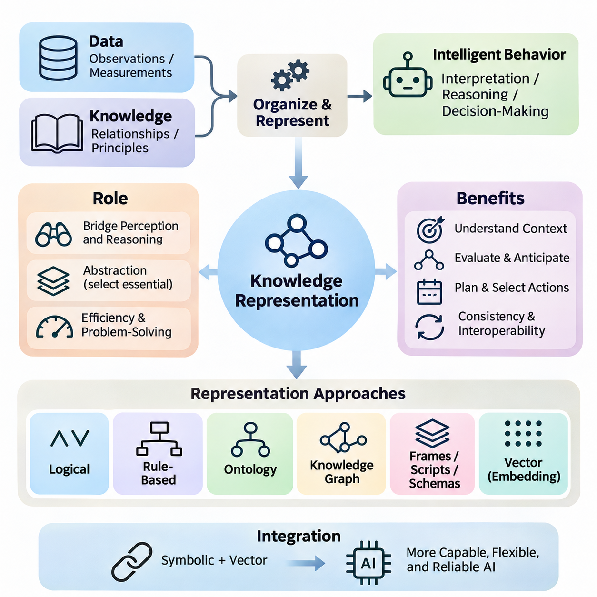
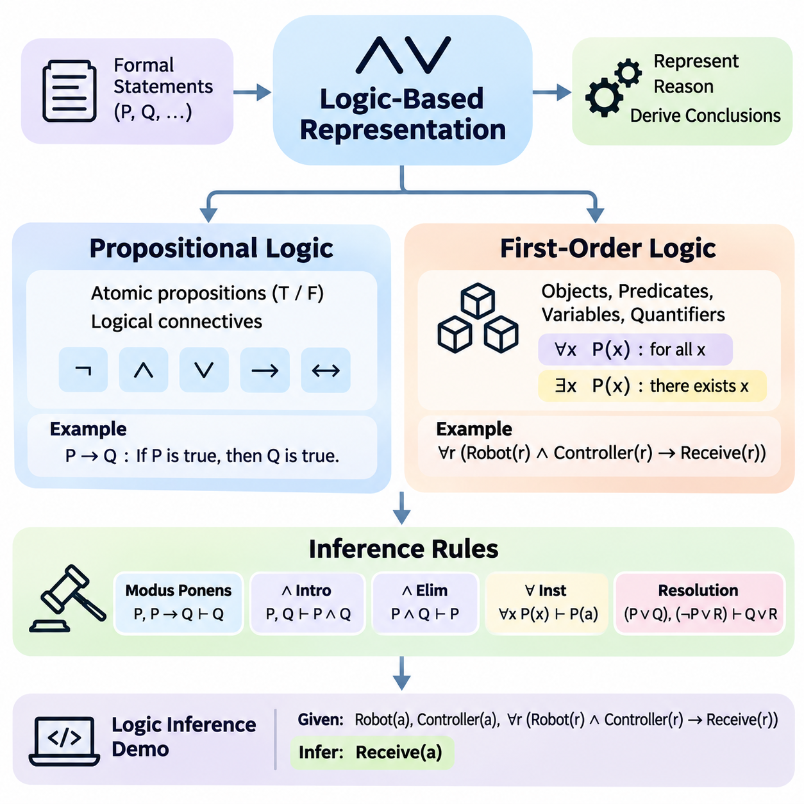
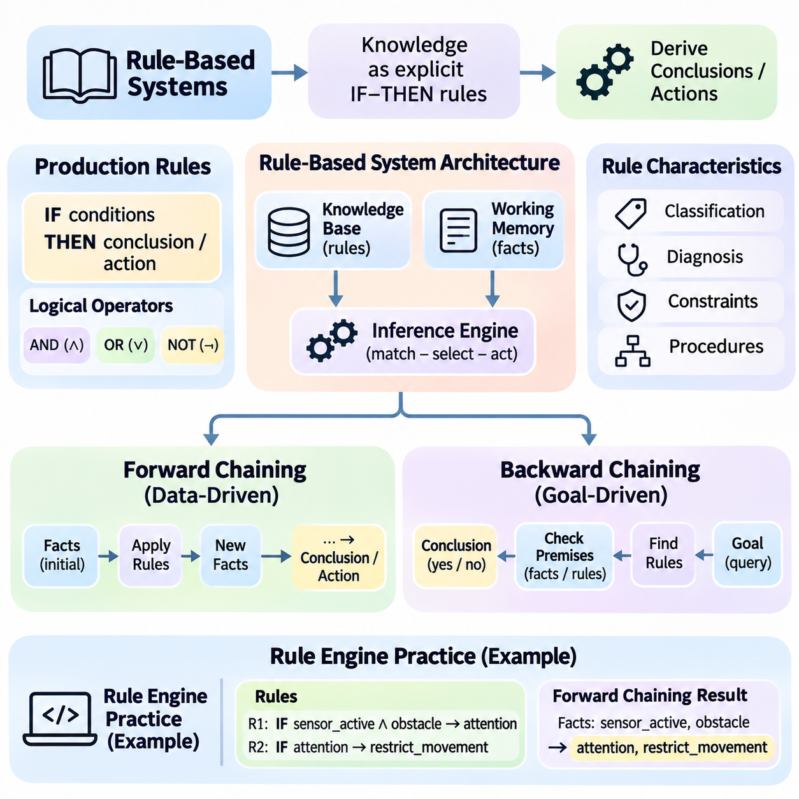
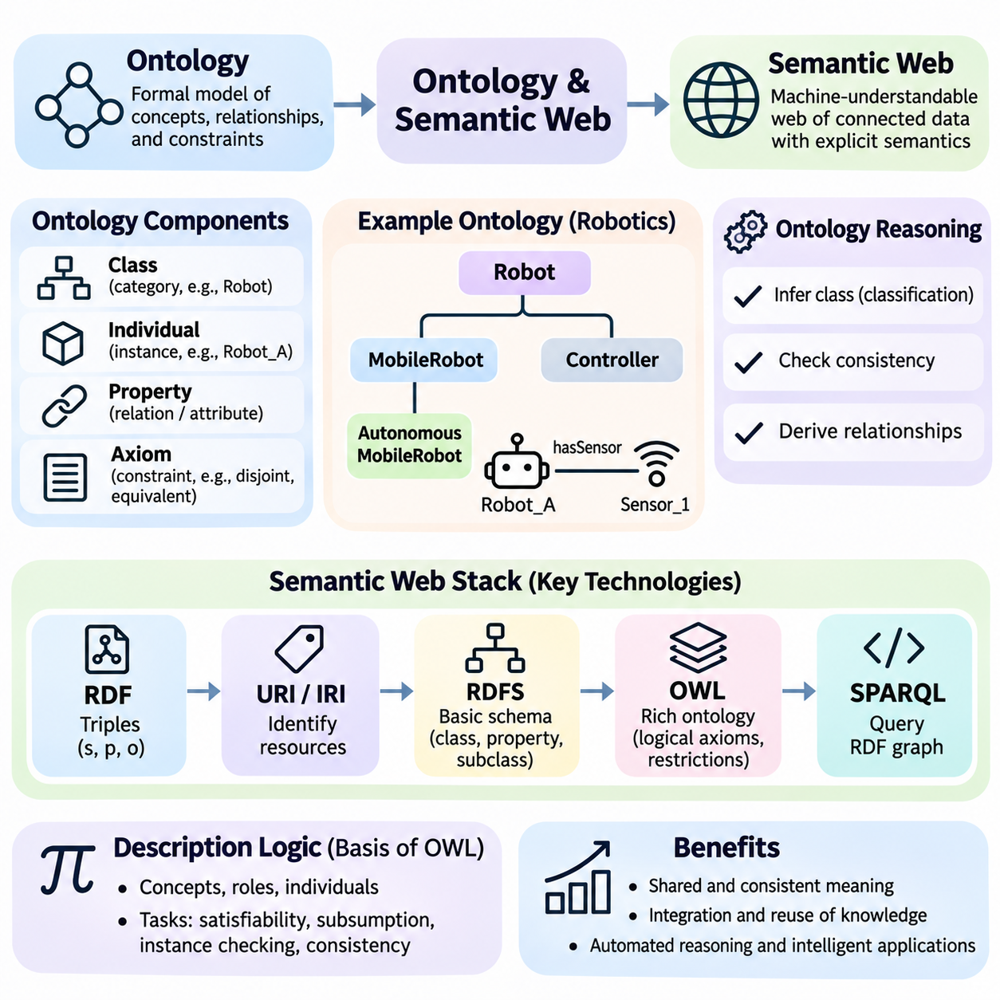
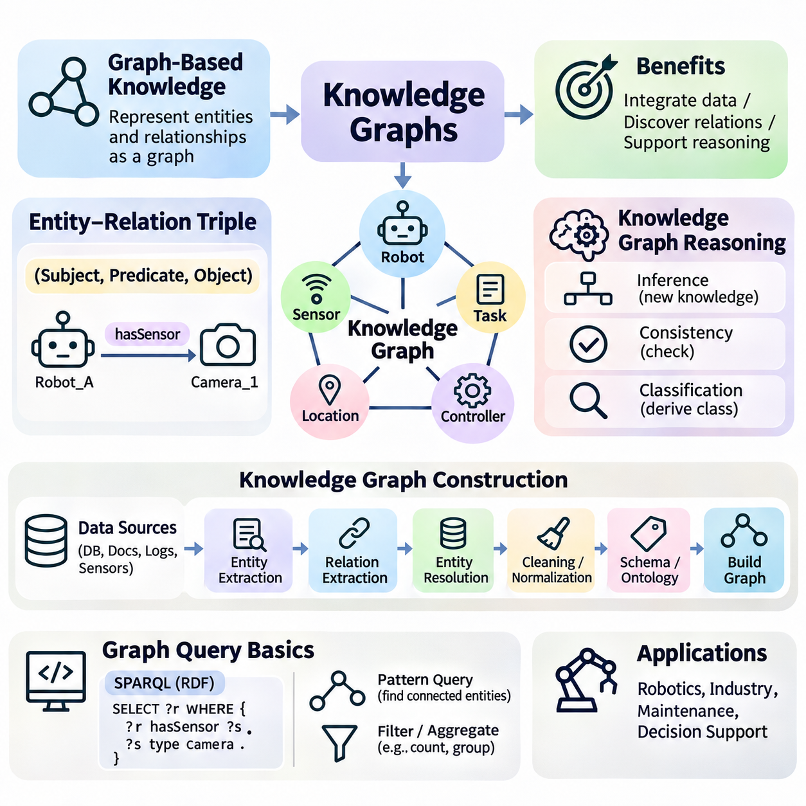
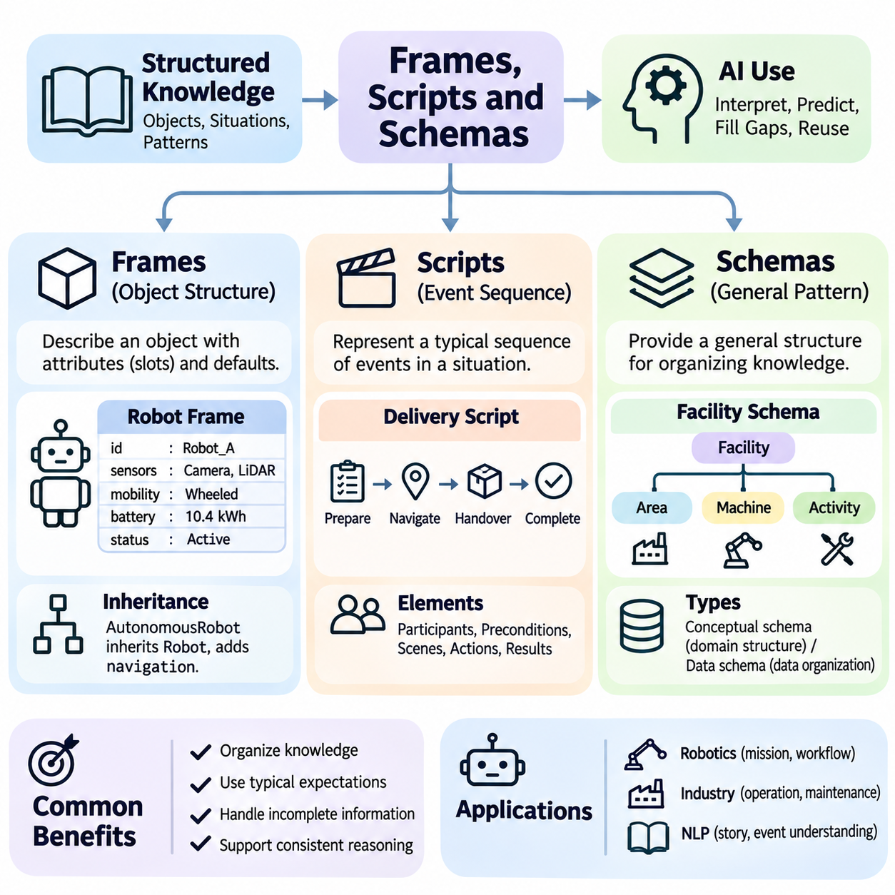
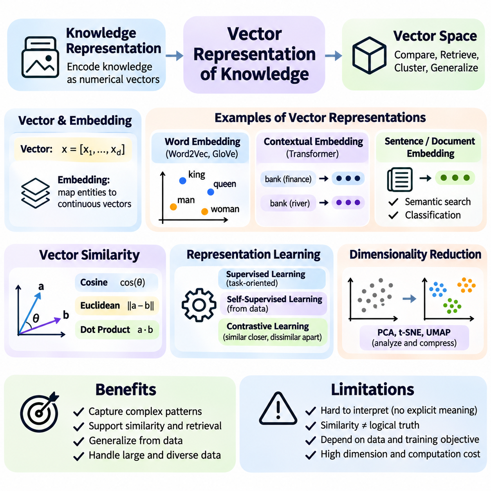
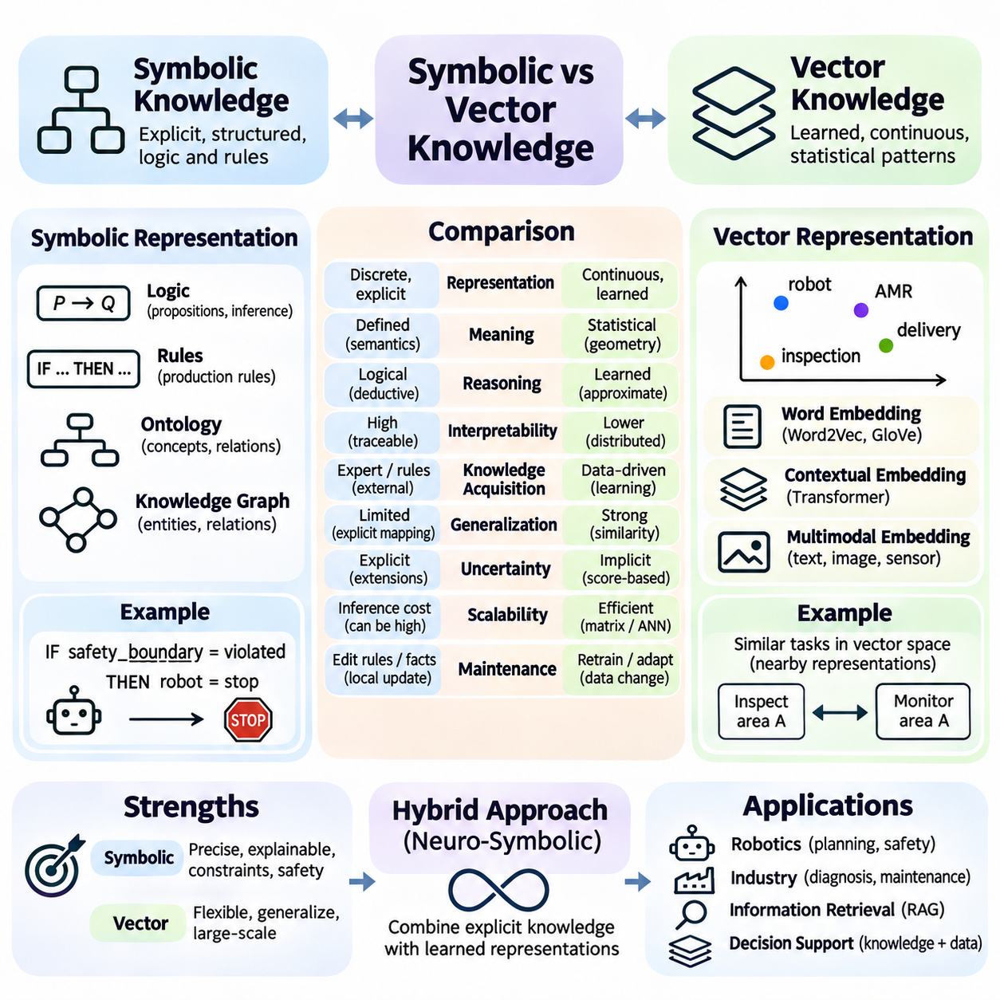
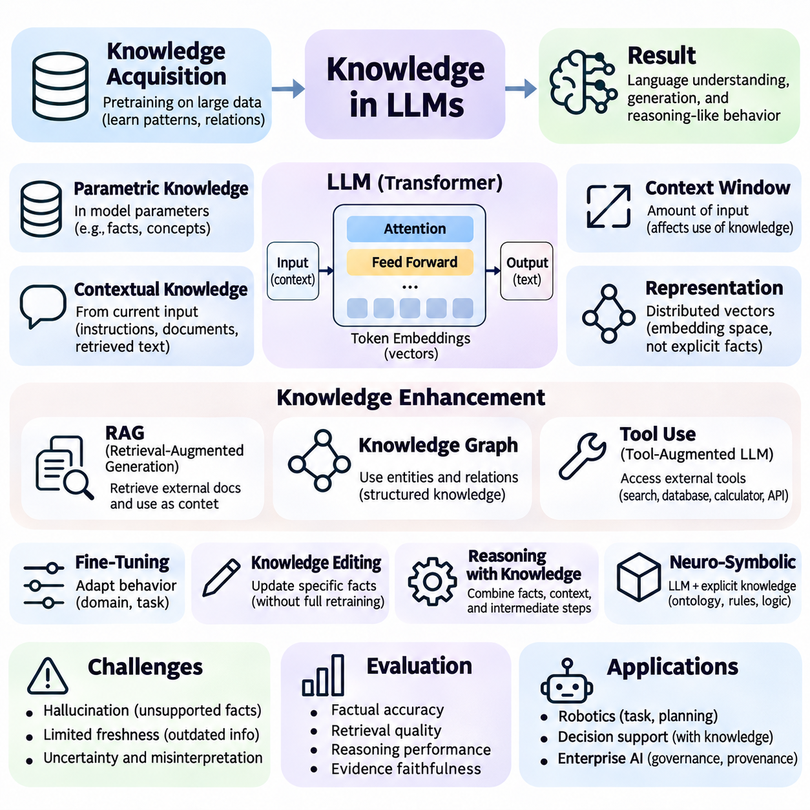

**Volume 04. Artificial Intelligence**

# 05. Knowledge Representation

## 05.00 Why Knowledge Representation Matters

{width="7.268055555555556in" height="7.268055555555556in"}

지식 표현(Knowledge Representation)은 지능적 행동(Intelligent Behavior)이 단순한 원시 데이터(Raw Data)의 처리나 통계적 패턴(Statistical Patterns)의 인식만으로 구현될 수 없기 때문에 인공지능(Artificial Intelligence)의 핵심 구성 요소이다. 인공지능 시스템(AI System)은 객체(Objects), 사건(Events), 속성(Properties), 관계(Relationships), 제약조건(Constraints)에 관한 정보를 해석과 추론이 가능한 형태로 조직해야 한다. 지식 표현은 정보를 의사결정(Decision-Making)과 문제 해결(Problem-Solving)에 활용할 수 있도록 하는 개념적 구조(Conceptual Structure)를 제공한다.

데이터(Data)와 지식(Knowledge)은 밀접하게 관련되어 있지만 지능형 시스템(Intelligent Systems)에서 서로 다른 역할을 수행한다. 데이터는 관측값(Observations), 측정값(Measurements), 기호(Symbols), 기록된 사건(Recorded Events)으로 구성되며, 지식은 정보의 활용 방법을 설명하는 의미 있는 관계(Meaningful Relationships), 맥락적 해석(Contextual Interpretations), 원리(Principles)를 포함한다. 예를 들어 온도 측정값은 장비 상태(Equipment Conditions), 허용 운전 범위(Acceptable Operating Ranges), 잠재적 결과(Possible Consequences)와 연결될 때 운영상 의미를 갖는다.

지식 표현의 중요성은 인공지능 시스템이 단순한 분류(Classification)가 아니라 해석(Interpretation)이 필요한 상황에 직면할 때 더욱 명확해진다. 객체를 차량(Vehicle)으로 인식하는 것과 해당 차량이 도로(Road)를 점유하고, 교통 규칙(Traffic Regulations)을 따르며, 보행자(Pedestrians)와 상호작용할 수 있음을 이해하는 것은 서로 다르다. 이러한 추가적인 관계 정보는 지능형 시스템이 상황을 평가하고, 결과를 예측하며, 목표(Objectives)에 부합하는 행동을 선택하도록 지원한다.

지식 표현은 인지(Perception)와 추론(Reasoning)을 연결하는 가교 역할을 수행한다. 인지 시스템(Perception Systems)은 감각 관측(Sensory Observations)을 환경에 대한 설명으로 변환하고, 추론 메커니즘(Reasoning Mechanisms)은 이러한 설명을 활용하여 결론을 도출하거나 적절한 행동을 결정한다. 적절한 표현 체계가 없다면 관측 정보는 서로 연결되지 않은 측정값으로 남을 수 있다. 구조화된 지식(Structured Knowledge)은 개별 관측을 통합하여 주변 환경에 대한 일관된 해석을 가능하게 한다.

인공지능의 핵심 과제 중 하나는 현실 세계(Real World)의 어떤 측면을 명시적으로 표현해야 하는지 결정하는 것이다. 실제 환경에는 방대한 정보가 존재하지만 특정 작업(Task)과 관련된 정보는 그중 일부에 불과하다. 따라서 효과적인 지식 표현에는 불필요한 세부 사항을 제외하면서 핵심 속성을 보존하는 추상화(Abstraction)가 필요하다. 적절한 추상화 수준(Abstraction Level)은 목표로 하는 추론 과정(Reasoning Process)과 운영 요구사항(Operational Requirements)에 따라 달라진다.

표현 방식(Representation Method)의 선택은 계산 효율성(Computational Efficiency)과 문제 해결 능력(Problem-Solving Capability)에 직접적인 영향을 미친다. 유용한 관계를 명확하게 드러내는 표현은 추론(Inference), 탐색(Search), 계획(Planning)을 단순화하지만, 부적절한 표현은 비교적 간단한 문제도 계산 비용이 높은 문제로 만들 수 있다. 예를 들어 항법 환경(Navigation Environment)을 연결된 위치(Connected Locations)로 표현하면 경로 탐색 알고리즘(Pathfinding Algorithms)이 모든 물리적 구성을 처리하지 않고 의미 있는 상태(States)를 기반으로 동작할 수 있다.

논리 기반 표현(Logical Representation)은 명제(Propositions), 술어(Predicates), 형식적 관계(Formal Relationships)를 통해 지식을 표현하는 방법이다. 명제는 참(True) 또는 거짓(False)인 조건을 기술하며, 추론 규칙(Inference Rules)은 기존 정보에서 추가적인 결론이 어떻게 도출되는지 정의한다. 이러한 접근 방식은 일관성(Consistency), 명시적 제약조건(Explicit Constraints), 추적 가능한 추론(Traceable Reasoning)이 중요한 상황에서 특히 유용하다. 다만 그 효과는 인코딩된 지식(Encoded Knowledge)의 완전성과 적합성에 따라 달라진다.

규칙 기반 표현(Rule-Based Representation)은 상황과 결론 또는 행동을 연결하는 조건부 관계(Conditional Relationships)를 중심으로 지식을 조직한다. 산업용 모니터링 시스템(Industrial Monitoring System)은 비정상적인 온도와 진동 측정값을 잠재적인 장비 고장(Equipment Faults)과 연결할 수 있다. 이러한 규칙은 이해하기 쉬운 의사결정 절차(Decision Procedures)와 체계적인 추론을 지원한다. 그러나 상호작용, 예외 상황(Exceptions), 변화하는 운영 조건이 증가하면 대규모 규칙 집합(Rule Sets)을 유지하고 관리하기 어려워질 수 있다.

온톨로지(Ontology)는 특정 도메인(Domain)의 개념(Concepts), 범주(Categories), 속성(Attributes), 관계(Relationships)를 보다 체계적으로 정의한다. 온톨로지는 서로 다른 시스템이 정보를 일관되게 해석하도록 공통 의미(Shared Meanings)를 확립한다. 예를 들어 산업용 온톨로지는 기계(Machines), 센서(Sensors), 구성 요소(Components), 유지보수 활동(Maintenance Activities), 운영 상태(Operational States)를 구분할 수 있다. 이러한 정의는 의미적 상호운용성(Semantic Interoperability)을 지원하고 응용 시스템 간 지식 교환에서 발생하는 모호성(Ambiguity)을 줄인다.

지식 그래프(Knowledge Graphs)는 개체(Entities)와 개체 사이의 관계를 상호 연결된 구조(Interconnected Structures)로 표현한다. 하나의 그래프는 로봇(Robot)을 센서, 할당된 작업(Assigned Tasks), 운영 환경(Operating Environment), 유지보수 기록(Maintenance Records)과 연결할 수 있다. 이러한 조직 방식은 별도의 데이터베이스(Databases)에 분산된 관계를 탐색하도록 지원한다. 그래프 기반 표현(Graph-Based Representation)은 의존성(Dependencies)과 상호작용(Interactions)을 이해하는 것이 지능적 의사결정에 필수적인 상황에서 특히 유용하다.

프레임(Frames), 스크립트(Scripts), 스키마(Schemas)는 익숙한 구조와 반복적으로 발생하는 상황을 중심으로 지식을 조직하는 추가적인 메커니즘을 제공한다. 프레임은 속성과 예상값(Expected Values)을 통해 객체를 설명하고, 스크립트는 일반적인 사건의 순서(Event Sequences)를 표현한다. 이러한 구조를 활용하면 지능형 시스템이 맥락적 기대(Contextual Expectations)를 적용하고, 누락된 세부 정보를 신중하게 보완하며, 실제 환경에서 반복적으로 관찰되는 패턴에 따라 정보를 조직할 수 있다.

현대 인공지능은 수치 벡터(Numerical Vectors)와 학습된 임베딩(Learned Embeddings)을 통해서도 지식을 표현한다. 신경망(Neural Networks)은 모든 관계를 명시적으로 인코딩하는 대신 학습 데이터(Training Data)로부터 분산 표현(Distributed Representations)을 학습한다. 유사한 개념은 학습된 표현 공간(Representation Space)에서 가까운 영역에 위치할 수 있으며, 이를 통해 유사도 검색(Similarity Search), 분류(Classification), 일반화(Generalization)가 가능해진다. 이러한 표현은 강력하지만 명시적인 논리적 일관성(Logical Consistency)이나 투명한 설명(Transparent Explanations)을 자동으로 제공하지는 않는다.

기호 기반 표현(Symbolic Representation)과 벡터 기반 표현(Vector-Based Representation)은 상호 보완적인 능력을 제공한다. 기호적 접근(Symbolic Approaches)은 이산적인 개체(Discrete Entities), 규칙(Rules), 관계를 명시적 추론이 가능한 형태로 표현한다. 반면 벡터 표현(Vector Representations)은 수작업으로 구성한 규칙만으로 설명하기 어려운 통계적 연관성(Statistical Associations)과 연속적 유사성(Continuous Similarities)을 포착한다. 두 접근 방식을 결합하면 학습된 패턴과 구조화된 제약조건을 연결할 수 있지만, 신뢰성 있는 통합(Reliable Integration)은 여전히 중요한 공학적 과제이다.

지식 표현은 불확실성(Uncertainty)과 불완전한 정보(Incomplete Information)를 관리하는 데에도 필수적이다. 지능형 시스템은 환경에 대한 완전한 설명을 확보하기 어렵고, 관측 정보에는 잡음(Noise), 모호성(Ambiguity), 모순(Contradictions)이 포함될 수 있다. 따라서 표현 체계는 확립된 사실(Established Facts)을 가정(Assumptions), 가설(Hypotheses), 불확실한 추정값(Uncertain Estimates)과 구분해야 한다. 확률적 추론(Probabilistic Reasoning)은 믿음의 정도(Degrees of Belief)를 표현하고 완전한 확실성이 없는 상황에서 의사결정을 지원함으로써 구조화된 지식을 보완할 수 있다.

시간적 지식(Temporal Knowledge)은 환경과 관계가 시간에 따라 변화한다는 점에서 또 다른 중요한 차원을 제공한다. 로봇의 위치(Robot Position), 기계의 작동 상태(Operating Condition), 고객의 선호도(Customer Preferences)는 관측 시점에 따라 달라질 수 있다. 타임스탬프(Timestamps), 사건 순서(Event Sequences), 상태 전이(State Transitions), 과거 맥락(Historical Context)을 표현하면 인공지능 시스템은 이전 상태와 현재 상황을 구분할 수 있다. 시간적 인식(Temporal Awareness)이 부족하면 오래된 정보가 부적절한 결론으로 이어질 수 있다.

인과적 지식(Causal Knowledge)은 단순한 상관관계(Correlations)나 관계의 기술을 넘어 지식 표현의 범위를 확장한다. 이는 하나의 조건 변화가 다른 조건에 어떤 영향을 미치는지, 그리고 개입(Interventions)이 결과를 어떻게 변화시키는지 다룬다. 예를 들어 장비 과열(Equipment Overheating)이 성능 저하(Reduced Performance)와 관련되어 있음을 확인하는 것과 성능 저하를 발생시키는 메커니즘(Mechanisms)을 이해하는 것은 다르다. 인과적 표현(Causal Representations)은 기본 가정이 타당할 때 진단(Diagnosis), 개입 계획(Intervention Planning), 반사실적 분석(Counterfactual Analysis)을 지원한다.

지식 표현은 환경 이해(Environmental Understanding)를 물리적 행동(Physical Action)과 연결해야 하는 자율 시스템(Autonomous Systems)에서 중요한 역할을 수행한다. 이동 로봇(Mobile Robot)은 장애물(Obstacles), 주행 가능 영역(Traversable Areas), 목적지(Destinations), 운영 제약조건(Operating Constraints), 다른 에이전트(Agents)에 관한 정보가 필요하다. 이러한 요소는 인지, 위치 추정(Localization), 계획, 제어(Control)가 의미 있는 정보를 교환할 수 있도록 호환 가능한 형태로 표현되어야 한다. 개별 알고리즘의 성능이 우수하더라도 표현 체계가 일관되지 않으면 시스템 오류가 발생할 수 있다.

대규모 언어 모델(Large Language Models, LLMs)은 지식 표현에 대한 다른 관점을 제공한다. 모델의 매개변수(Parameters)는 학습 과정에서 획득한 통계적 패턴을 인코딩하며, 이를 통해 설명 생성(Explanation Generation), 질문 응답(Question Answering), 다양한 언어 기반 작업(Language-Based Tasks)을 수행할 수 있다. 그러나 모델 매개변수에 인코딩된 정보가 검증된 지식 데이터베이스(Verified Knowledge Database)와 동일한 것은 아니다. 생성된 문장은 특히 신뢰할 수 있는 외부 근거(External Evidence)가 부족할 때 부정확하거나 오래되었거나 일관성이 없을 수 있다.

외부 지식 자원(External Knowledge Resources)은 구조화되고 검색 가능한 정보를 제공함으로써 언어 모델을 보완할 수 있다. 지식 그래프, 문서 저장소(Document Repositories), 데이터베이스, 검색 증강 생성(Retrieval-Augmented Generation, RAG) 시스템은 모델이 고정된 매개변수에 저장된 정보 외의 지식에 접근하도록 지원한다. 이러한 분리 구조는 기본 모델을 반드시 재학습하지 않고도 지식을 갱신할 수 있게 한다. 다만 검색 품질(Retrieval Quality), 출처 신뢰성(Source Reliability), 검색된 정보의 올바른 해석은 여전히 필수적이다.

명시적 지식 표현(Explicit Knowledge Representation)의 중요한 장점 중 하나는 설명 가능성(Explainability)의 향상이다. 시스템이 식별 가능한 사실(Facts), 관계(Relationships), 추론 규칙을 유지하면 개발자는 추론 과정의 일부를 검토하고 예상하지 못한 결론의 원인을 조사할 수 있다. 이러한 가시성(Visibility)은 의사결정의 정당화(Justification)가 필요한 공학(Engineering), 의료(Healthcare), 금융(Finance) 등의 분야에서 중요하다. 학습된 표현 역시 해석할 수 있지만 내부 관계에 직접 접근하는 것은 일반적으로 더 어렵다.

지식 표현은 인공지능 시스템 생명주기(AI System Lifecycle) 전반에서 유지보수성(Maintainability)과 상호운용성(Interoperability)에도 기여한다. 공유 스키마(Shared Schemas)와 일관된 용어 체계(Consistent Terminology)는 서로 다른 구성 요소가 의미를 반복적으로 재정의하지 않고 정보를 교환하도록 지원한다. 지식이 발전함에 따라 버전 관리(Version Control), 출처 추적(Provenance Tracking), 검증(Validation), 충돌 해결(Conflict Resolution)이 중요해진다. 이러한 메커니즘은 조직이 복잡한 지식 자원을 관리하면서 추적 가능성(Traceability)을 유지하고 불일치를 줄이도록 한다.

지식 표현의 품질(Quality)은 복잡성 자체가 아니라 의도된 목적(Intended Purpose)에 따라 평가되어야 한다. 주요 고려사항에는 표현 능력(Expressive Capability), 계산 비용(Computational Cost), 확장성(Scalability), 해석 가능성(Interpretability), 사용 가능한 추론 메커니즘과의 호환성(Compatibility)이 포함된다. 지나치게 상세한 표현은 단순한 작업에 불필요할 수 있으며, 과도하게 단순화된 표현은 핵심 제약조건을 누락할 수 있다. 효과적인 설계에는 이러한 상충 요구사항(Competing Requirements)의 균형이 필요하다.

궁극적으로 지식 표현은 인공지능 시스템이 정보를 이해(Understanding), 추론(Reasoning), 행동(Action)과 연결하는 방식을 결정한다. 지식 표현은 논리적 추론(Logical Inference), 규칙 기반 시스템(Rule-Based Systems), 온톨로지, 지식 그래프, 분산 임베딩(Distributed Embeddings), 지식 강화 언어 모델(Knowledge-Enhanced Language Models)의 구조적 기반을 제공한다. 인공지능이 더욱 자율적이고 맥락을 인식하는 시스템(Context-Aware Systems)으로 발전함에 따라 지식을 표현하고, 통합하고, 갱신하고, 검증하는 능력은 신뢰할 수 있는 지능적 행동(Reliable Intelligent Behavior)을 구현하는 핵심 요소로 남게 된다.

## 05.01 Logic Based Representation

{width="7.268055555555556in" height="7.268055555555556in"}

논리 기반 표현(Logic-Based Representation)은 정밀한 수학적 규칙(Mathematical Rules)에 따라 정의되는 형식적 명제(Formal Statements)와 관계(Relationships)를 통해 지식을 표현하는 인공지능(Artificial Intelligence)의 기초적인 접근 방식이다. 주로 통계적 연관성(Statistical Associations)에 의존하는 표현 방식과 달리 논리 시스템(Logical Systems)은 구문(Syntax), 의미(Semantics), 유효한 추론(Valid Inference)을 구분한다. 이러한 구분을 통해 지능형 시스템(Intelligent Systems)은 사실(Facts)을 표현하고, 일관성(Consistency)을 평가하며, 명시적으로 정의된 추론 절차(Reasoning Procedures)를 통해 결론을 도출할 수 있다.

논리적 지식 표현(Logical Knowledge Representation)의 핵심 목적은 비형식적 설명(Informal Descriptions)을 컴퓨터가 체계적으로 해석할 수 있는 표현식(Expressions)으로 변환하는 것이다. 자연어(Natural Language)에는 모호성(Ambiguity), 암묵적 가정(Implicit Assumptions), 문맥 의존적 의미(Context-Dependent Meanings)가 포함되는 경우가 많다. 형식 논리(Formal Logic)는 제한된 어휘 체계(Restricted Vocabulary)와 정밀한 해석 규칙(Interpretation Rules)을 도입하여 이러한 문제를 줄인다. 그러나 논리적 표현의 유용성은 형식화된 명제(Formalized Statements)가 의도된 도메인(Domain)을 얼마나 정확하게 반영하는지에 따라 달라진다.

명제 논리(Propositional Logic)는 각각 참(True) 또는 거짓(False)의 진리값(Truth Value)을 갖는 원자 명제(Atomic Propositions)를 통해 지식을 표현한다. 명제는 기계가 작동 중이거나, 센서가 활성화되어 있거나, 경보가 발생했다는 사실을 나타낼 수 있다. 복합 명제(Complex Statements)는 부정(Negation), 논리곱(Conjunction), 논리합(Disjunction), 함의(Implication), 동치(Equivalence)와 같은 논리 연결사(Logical Connectives)를 사용하여 구성된다. 이러한 연산자는 여러 조건을 체계적으로 평가할 수 있는 표현식으로 결합하도록 지원한다.

명제 논리식(Propositional Formula)의 의미는 원자 명제에 할당된 진리값과 논리 연산자(Logical Operators)의 의미론(Semantics)에 따라 결정된다. 예를 들어 함의(Implication) P → Q는 P가 참이고 Q가 거짓인 경우에만 거짓이 된다. 진리표(Truth Table)는 가능한 진리값 할당(Truth Assignments)을 열거하고 표현식의 결과 진리값을 결정한다. 이는 논리적 동치(Logical Equivalence), 모순(Contradictions), 타당한 논리적 귀결(Valid Consequences)을 검토하기 위한 엄밀한 기반을 제공한다.

명제 논리는 충족 가능성(Satisfiability), 타당성(Validity), 논리적 함축(Logical Entailment)과 같은 중요한 개념을 지원한다. 논리식(Formula)은 적어도 하나의 진리값 할당에서 참이 되면 충족 가능하며, 가능한 모든 진리값 할당에서 참이면 타당한 논리식(Valid Formula)이 된다. 지식 베이스(Knowledge Base)를 만족하는 모든 해석(Interpretations)이 특정 결론도 만족할 때 지식 베이스가 해당 결론을 논리적으로 함축한다고 한다. 이러한 구분은 정보의 일관성과 결론의 논리적 정당성을 판단하는 데 필수적이다.

명제 논리는 단순성과 수학적 명확성(Mathematical Clarity)을 갖지만 표현 능력(Expressive Power)에는 한계가 있다. 명제 논리는 문장을 더 이상 분해하지 않는 단위로 취급하므로 객체 사이의 내부 관계를 직접 표현하거나 개체 집합(Collections of Entities)에 대해 양화(Quantification)할 수 없다. 모든 로봇이 제어기를 갖는다는 사실을 순수한 명제 논리 시스템으로 표현하려면 개별 로봇마다 별도의 명제가 필요하다. 이러한 한계는 구조화된 도메인(Structured Domains)을 기술할 수 있는 보다 표현력이 높은 논리 언어(Logical Languages)의 필요성을 제기한다.

일차 논리(First-Order Logic)는 객체(Objects), 술어(Predicates), 변수(Variables), 함수(Functions), 양화사(Quantifiers)를 도입하여 명제 논리를 확장한다. 술어는 객체의 속성(Properties)이나 객체 사이의 관계를 기술하며, 변수는 특정되지 않은 개체를 참조할 수 있도록 한다. 전칭 양화(Universal Quantification)는 도메인 내 모든 객체에 적용되는 조건을 표현하고, 존재 양화(Existential Quantification)는 특정 조건을 만족하는 객체가 적어도 하나 존재함을 나타낸다. 이러한 메커니즘은 일반적인 지식(General Knowledge)을 간결하게 표현하도록 지원한다.

예를 들어 정상적으로 작동하는 제어기(Functioning Controller)를 갖춘 모든 로봇이 명령을 수신할 수 있다는 명제는 전칭 양화된 술어(Universally Quantified Predicates)를 사용하여 표현할 수 있다. 별도의 사실은 특정 로봇이 정상적인 제어기를 보유하고 있음을 정의할 수 있다. 이후 논리적 추론(Logical Inference)을 통해 해당 로봇이 명령을 수신할 수 있다는 결론을 도출할 수 있다. 이는 일차 논리가 일반 규칙(General Rules)과 구체적 사실(Specific Facts)을 결합하여 개별 개체에 대한 결론을 도출하는 방식을 보여준다.

일차 논리의 해석은 논의 영역(Domain of Discourse)과 상수(Constants), 술어, 함수에 부여된 의미에 따라 달라진다. 상수는 특정 객체를 식별하고, 술어는 지정된 속성이나 관계가 성립하는지 결정한다. 양화사는 논의 영역에 속한 객체를 대상으로 적용된다. 따라서 올바른 모델링(Modeling)을 위해서는 어휘 체계(Vocabulary), 양화사의 적용 범위(Quantifier Scope), 객체의 동일성(Object Identity)과 존재(Existence)에 관한 가정을 신중하게 고려해야 한다.

일차 논리는 명제 논리보다 높은 표현 능력을 제공하지만 추가적인 계산적 과제(Computational Challenges)를 수반한다. 일반적인 일차 논리의 타당성 판정(First-Order Logical Validity)은 결정 불가능(Undecidable)한 문제이므로, 모든 가능한 논리식의 타당성을 항상 종료하면서 판정하는 알고리즘은 존재하지 않는다. 그럼에도 실제 추론 엔진(Inference Engines)은 제한된 논리 단편(Restricted Logical Fragments), 구조화된 규칙 시스템(Structured Rule Systems), 특정 응용 분야에 맞게 설계된 탐색 절차(Search Procedures)를 통해 많은 실용적인 문제를 해결할 수 있다.

추론 규칙(Inference Rules)은 기존 전제(Premises)로부터 새로운 논리적 명제(Logical Statements)를 도출하는 방법을 정의한다. 긍정 논법(Modus Ponens)은 대표적인 사례로, P가 참이고 P가 Q를 함의하면 Q를 결론으로 도출할 수 있다. 다른 추론 메커니즘에는 논리곱 도입(Conjunction Introduction), 논리곱 제거(Conjunction Elimination), 전칭 예화(Universal Instantiation), 해결법(Resolution)이 포함된다. 각 규칙은 형식적 조건에 따라 적용될 때 논리적 정확성을 보존하며, 단순한 추론 단계들을 결합하여 복잡한 논증(Arguments)을 구성할 수 있도록 한다.

논리적 함축(Logical Entailment)과 구문적 도출(Syntactic Derivation)은 명확하게 구분되어야 한다. 논리적 함축은 전제를 만족하는 모든 모델(Models)에서 결론이 참인지에 관한 것이며, 구문적 도출은 증명 절차(Proof Procedure)가 해당 결론을 생성할 수 있는지에 관한 것이다. 건전한 추론 시스템(Sound Inference System)은 논리적으로 함축되는 결론만 도출한다. 완전한 추론 시스템(Complete Inference System)은 해당 논리 체계에서 논리적으로 함축되는 모든 결론을 도출할 수 있다. 이러한 성질은 추론 신뢰성(Reasoning Reliability)을 평가하는 중요한 기준을 제공한다.

해결법(Resolution)은 논리 절(Clauses)을 대상으로 작동하며 자동 정리 증명(Automated Theorem Proving)을 지원하는 대표적인 추론 기법이다. 명제 논리식은 논리곱 정규형(Conjunctive Normal Form, CNF)으로 변환할 수 있으며, 이를 통해 해결법은 귀류법(Refutation)을 사용하여 모순을 식별하거나 논리적 귀결을 입증할 수 있다. 일차 논리의 해결법에는 논리 표현식을 서로 일치시키는 치환(Substitutions)을 결정하는 단일화(Unification)가 추가로 필요하다. 이러한 메커니즘은 체계적인 증명 탐색(Proof Search)을 지원한다.

단일화는 논리 규칙에 고정된 객체 대신 변수가 포함되는 경우가 많기 때문에 일차 논리 추론에서 핵심적인 역할을 수행한다. 예를 들어 모든 로봇을 설명하는 규칙은 적절한 변수를 Robot_A로 치환하여 Robot_A에 관한 사실과 일치시킬 수 있다. 이후 추론 엔진은 해당 규칙을 특정 개체에 적용할 수 있다. 올바른 단일화는 항 구조(Term Structure)를 준수하고 논리적 추론의 정확성을 훼손하는 잘못된 치환(Invalid Substitutions)을 방지해야 한다.

실용적인 논리 추론 시연(Logic Inference Demonstration)은 로봇, 센서, 운영 조건(Operational Conditions)에 관한 사실을 포함하는 소규모 지식 베이스에서 시작할 수 있다. 시스템은 Robot_A에 활성 센서(Active Sensor)가 존재하며, 활성 센서를 가진 모든 로봇이 특정 모니터링 조건(Monitoring Condition)을 만족한다는 규칙을 인코딩할 수 있다. 적절한 추론 규칙을 적용하면 추론 엔진은 Robot_A가 해당 모니터링 조건을 만족한다는 결론을 도출한다. 이 사례는 명시적 사실과 일반 규칙이 새로운 지식을 생성하는 과정을 보여준다.

간단한 파이썬(Python) 구현에서는 사실을 불리언 변수(Boolean Variables)로 표현하고 함의 관계를 조건부 규칙(Conditional Rules)으로 표현하여 명제 추론(Propositional Inference)을 시연할 수 있다. 전방 연쇄(Forward Chaining) 절차는 전제가 충족된 규칙을 반복적으로 검사하고 그 결론을 알려진 사실 집합(Known Fact Set)에 추가한다. 이 과정은 더 이상 새로운 사실을 도출할 수 없을 때까지 계속된다. 이러한 접근 방식은 완전한 정리 증명기(Theorem Prover)를 구현하지 않고도 자동 추론(Automated Reasoning)의 기본 원리를 이해할 수 있도록 한다.

보다 발전된 시연에서는 기호(Symbols)와 인수(Arguments)를 포함하는 구조화된 표현식(Structured Expressions)으로 술어를 표현할 수 있다. 이후 변수 치환(Variable Substitution)을 통해 규칙을 알려진 사실과 일치시켜 제한적인 일차 논리 추론을 수행할 수 있다. 예를 들어 추론 엔진은 구성 요소 상태(Component Status)와 일반적인 능력 규칙(Capability Rule)을 기반으로 로봇의 운영 능력(Operational Capability)을 추론할 수 있다. 이러한 시연에서는 기본적인 규칙 엔진(Rule Engine)이 제한 없는 일차 논리 전체를 구현하는 것은 아니므로 지원하는 논리 단편을 명확하게 정의해야 한다.

전방 연쇄(Forward Chaining)와 후방 연쇄(Backward Chaining)는 추론 규칙을 적용하는 두 가지 상호 보완적인 전략이다. 전방 연쇄는 알려진 사실에서 시작하여 목표에 도달하거나 더 이상 진행할 수 없을 때까지 추가적인 결론을 도출한다. 후방 연쇄는 목표 결론(Target Conclusion)에서 시작하여 이를 입증할 수 있는 규칙과 전제를 탐색한다. 어떤 전략을 선택할지는 응용 시스템이 지속적인 지식 갱신(Continuous Knowledge Updates)을 중시하는지, 특정 질의(Specific Queries)에 대한 응답을 중시하는지에 따라 달라진다.

논리 기반 추론에서는 누락된 정보(Missing Information)와 부정 명제(Negative Statements)를 신중하게 처리해야 한다. 개방 세계 가정(Open-World Assumption)에서는 특정 사실이 존재하지 않는다고 해서 그 사실이 거짓이라고 판단하지 않는다. 반면 일부 실용적인 규칙 시스템은 폐쇄 세계 가정(Closed-World Assumption)을 채택하여 지정된 조건에서 입증할 수 없는 사실을 거짓으로 취급한다. 이러한 가정을 혼동하면 특히 불완전한 데이터베이스(Incomplete Databases)의 정보를 통합할 때 잘못된 결론이 발생할 수 있다.

논리적 추론의 효과는 기반이 되는 지식 베이스의 일관성과 품질(Quality)에 따라 달라진다. 모순된 명제(Contradictory Statements)는 고전 논리(Classical Logic)에서 폭발 원리(Principle of Explosion)에 따라 임의의 결론을 도출할 수 있기 때문에 추론의 신뢰성을 훼손할 수 있다. 따라서 실제 시스템에는 지식 검증(Knowledge Validation), 모순 탐지(Contradiction Detection), 통제된 갱신 절차(Controlled Update Procedures)가 필요하다. 불확실한 관측 정보를 다루는 응용 시스템에서는 확률적 추론(Probabilistic Reasoning)이나 비고전 논리 추론(Nonclassical Reasoning) 메커니즘이 추가로 필요할 수 있다.

논리 기반 표현은 전문가 시스템(Expert Systems), 구성 관리(Configuration Management), 접근 제어(Access Control), 자동 계획(Automated Planning), 지식 그래프 추론(Knowledge Graph Reasoning)에서 여전히 중요한 가치를 갖는다. 명시적 의미론(Explicit Semantics)과 검토 가능한 추론 절차(Inspectable Inference Procedures)는 검증 가능한 의사결정(Verifiable Decisions)과 명확하게 정의된 제약조건을 요구하는 응용 분야를 지원한다. 순수한 논리적 접근 방식은 잡음이 포함된 인지 정보(Noisy Perception)와 불완전한 현실 세계 지식(Incomplete Real-World Knowledge)을 처리하는 데 어려움이 있을 수 있지만, 통계적 학습(Statistical Learning)과 현대 신경망 모델(Neural Models)을 보완하는 필수적인 추론 능력을 제공한다.

논리 기반 지식 표현의 보다 폭넓은 의의는 구조화된 지식(Structured Knowledge)을 수학적으로 정당화된 결론(Mathematically Justified Conclusions)과 연결할 수 있다는 점에 있다. 명제 논리는 진리 함수적 추론(Truth-Functional Reasoning)의 기초를 확립하고, 일차 논리는 객체와 양화된 관계(Quantified Relationships)를 도입하며, 추론 규칙은 새로운 명제를 도출하는 메커니즘을 제공한다. 실용적인 추론 시연은 이러한 원리가 계산 절차(Computational Procedures)로 구현되는 방식을 보여주며, 설명 가능하고 신뢰할 수 있는 인공지능 시스템(Explainable and Reliable AI Systems)의 기반을 형성한다.

## 05.02 Rule Based Systems

{width="7.268055555555556in" height="7.268055555555556in"}

규칙 기반 시스템(Rule-Based Systems)은 관측된 조건(Observed Conditions)을 결론(Conclusions)이나 행동(Actions)과 연결하는 명시적인 조건문(Conditional Statements)을 통해 지식을 표현한다. 이러한 시스템은 이해하고 검토할 수 있는 규칙을 통해 추론(Reasoning)을 표현할 수 있다는 점에서 기호적 인공지능(Symbolic Artificial Intelligence)의 중요한 전통을 형성한다. 모든 의사결정을 수치 데이터(Numerical Data)로부터 직접 학습하는 대신, 규칙 기반 시스템은 인코딩된 도메인 지식(Domain Knowledge)을 사실(Facts)에 적용하여 체계적인 추론 절차(Inference Procedures)를 통해 결론을 도출한다.

일반적인 규칙 기반 시스템은 지식 베이스(Knowledge Base), 작업 기억(Working Memory), 추론 엔진(Inference Engine)으로 구성된다. 지식 베이스는 특정 도메인 내 관계를 설명하는 일반적인 규칙(General Rules)을 저장하고, 작업 기억은 현재 상황을 나타내는 사실을 유지한다. 추론 엔진은 적용 가능한 규칙(Applicable Rules)을 평가하고 어떤 결론이나 행동이 뒤따라야 하는지 결정한다. 이러한 구성 요소의 분리는 기본 추론 메커니즘(Reasoning Mechanism)을 반드시 변경하지 않고도 도메인 지식을 수정할 수 있도록 한다.

생산 규칙(Production Rules)은 일반적으로 IF--THEN 구조로 표현되며, IF 부분은 조건(Conditions)을 지정하고 THEN 부분은 결론이나 행동을 정의한다. 예를 들어 유지보수 규칙(Maintenance Rule)은 모터 온도(Motor Temperature)가 운영 임계값(Operational Threshold)을 초과하고 진동(Vibration)이 비정상적이면 점검 경고(Inspection Warning)를 생성해야 한다고 정의할 수 있다. 이러한 규칙은 조건과 결과 사이의 비교적 투명한 관계를 유지하면서 도메인 전문 지식(Domain Expertise)을 실행 가능한 의사결정 논리(Executable Decision Logic)로 변환한다.

생산 규칙의 조건 부분에는 논리 연산자(Logical Operators)로 연결된 여러 술어(Predicates)가 포함될 수 있다. 논리곱(Conjunction)은 여러 조건이 동시에 성립해야 함을 요구하고, 논리합(Disjunction)은 대안적인 조건을 통해 규칙이 활성화되도록 허용한다. 부정(Negation)은 추론 시스템의 의미론(Semantics)에 따라 특정 조건의 부재(Absence) 또는 거짓(False)을 나타낼 수 있다. 이러한 연산자를 명확하게 정의하는 것은 모호한 조건이 예상하지 못한 규칙 활성화(Rule Activation)와 일관되지 않은 의사결정(Inconsistent Decisions)을 초래할 수 있기 때문에 필수적이다.

생산 규칙은 분류 지식(Classification Knowledge), 진단 관계(Diagnostic Relationships), 운영 제약조건(Operational Constraints), 절차적 의사결정(Procedural Decisions)을 표현할 수 있다. 제조 시스템(Manufacturing System)은 장비 상태(Equipment States)를 분류할 수 있으며, 의료 의사결정 지원 시스템(Medical Decision-Support System)은 추가적인 조사가 필요한 상태를 식별할 수 있다. 자율 로봇(Autonomous Robotics)에서는 규칙을 통해 운영 제한(Operational Restrictions)이나 안전 대응(Safety Responses)을 정의할 수 있다. 규칙의 효과는 인코딩된 규칙이 관련 도메인의 가정과 예외를 얼마나 정확하게 반영하는지에 따라 달라진다.

전방 연쇄(Forward Chaining)는 사용 가능한 사실에서 시작하여 조건이 충족된 규칙을 반복적으로 적용하는 데이터 주도 추론 전략(Data-Driven Reasoning Strategy)이다. 규칙이 성공적으로 적용될 때마다 새로운 사실이 작업 기억에 추가될 수 있으며, 이는 다른 규칙의 실행을 가능하게 한다. 이러한 과정은 지정된 목표(Goal)에 도달하거나, 더 이상 적용 가능한 규칙이 없거나, 다른 종료 조건(Termination Condition)이 충족될 때까지 계속된다. 전방 연쇄는 지속적인 모니터링(Continuous Monitoring)과 이벤트 기반 응용 시스템(Event-Driven Applications)에 특히 적합하다.

초기 상태에서 센서가 활성화되어 있고 장애물(Obstacle)이 감지되었다는 사실을 알고 있는 로봇 모니터링 시스템(Robotic Monitoring System)을 고려할 수 있다. 하나의 규칙은 환경에 주의가 필요하다는 결론을 도출하고, 다른 규칙은 주의가 필요한 상황에서 이동을 제한해야 한다는 결론을 도출할 수 있다. 전방 연쇄는 초기 관측값(Initial Observations)으로부터 이러한 결론을 단계적으로 도출한다. 이 사례는 여러 개의 단순한 규칙이 결합되어 상위 수준의 운영 의사결정(Higher-Level Operational Decision)을 생성하는 방식을 보여준다.

전방 연쇄 엔진(Forward-Chaining Engine)은 일반적으로 반복적인 매칭(Matching), 선택(Selection), 실행(Execution) 과정을 수행한다. 매칭 단계에서는 현재 사실과 조건이 일치하는 규칙을 식별한다. 선택 단계에서는 여러 규칙을 적용할 수 있을 때 어떤 규칙을 실행할지 결정한다. 실행 단계에서는 선택된 규칙을 적용하고 작업 기억을 갱신한다. 이러한 운영 주기는 일반적으로 매칭--선택--실행 주기(Match--Select--Act Cycle)라고 하며, 많은 생산 규칙 엔진(Production-Rule Engines)의 기초를 형성한다.

여러 규칙을 동시에 적용할 수 있는 경우 추론 엔진은 정의된 전략에 따라 충돌을 해결해야 한다. 충돌 해결(Conflict Resolution)은 규칙 우선순위(Rule Priority), 구체성(Specificity), 사실의 최신성(Recency of Facts), 응용 분야별 정책(Application-Specific Policies)을 고려할 수 있다. 일관된 전략이 없다면 특히 여러 규칙이 공유된 사실(Shared Facts)을 수정하는 경우 실행 순서가 예측하기 어려워질 수 있다. 결정적 충돌 해결(Deterministic Conflict Resolution)은 재현성(Reproducibility), 디버깅(Debugging), 운영 의사결정의 신뢰성(Reliability)을 향상시킨다.

전방 연쇄는 반복적인 규칙 활성화(Repeated Activation)와 잠재적인 무한 실행(Infinite Execution) 문제도 해결해야 한다. 규칙이 이미 존재하는 사실을 계속 생성하면 추론 엔진은 계산 자원(Computational Resources)을 낭비하거나 동일한 행동을 반복적으로 실행할 수 있다. 실제 구현에서는 중복 탐지(Duplicate Detection), 활성화 이력(Activation Histories), 실행 제한(Execution Limits), 명시적 종료 조건(Explicit Termination Conditions)을 사용할 수 있다. 이러한 메커니즘은 규칙의 결과가 환경을 변경하거나 물리적 동작(Physical Operations)을 시작하는 경우 특히 중요하다.

후방 연쇄(Backward Chaining)는 원하는 결론에서 시작하여 해당 결론을 입증할 수 있는 규칙을 탐색하는 목표 주도 추론 전략(Goal-Driven Reasoning Strategy)이다. 추론 엔진은 해당 규칙에 필요한 전제(Premises)를 식별하고, 기존 사실이나 추가 규칙을 사용하여 이를 검증한다. 이러한 재귀적 과정(Recursive Process)은 목표가 입증되거나, 입증할 수 없거나, 정의된 탐색 제한(Search Limit)에 도달할 때까지 계속된다. 후방 연쇄는 특정 질의(Targeted Queries)와 진단 추론(Diagnostic Reasoning)에 특히 유용하다.

예를 들어 장비 진단 시스템(Equipment Diagnostic System)은 냉각 하위 시스템(Cooling Subsystem)에 고장이 발생했는지에 관한 질문에서 시작할 수 있다. 시스템은 냉각 고장(Cooling Failure)을 결론으로 도출하는 규칙을 탐색하고, 과도한 온도(Excessive Temperature)나 비정상적인 팬 작동(Abnormal Fan Operation)과 같은 필수 조건을 검사한다. 이러한 조건이 이미 알려져 있다면 시스템은 해당 결론을 입증할 수 있다. 그렇지 않다면 이를 뒷받침하는 사실을 재귀적으로 조사하거나 추가적인 관측(Additional Observations)을 요청할 수 있다.

후방 연쇄는 특정 결론만 필요한 경우 불필요한 추론(Unnecessary Inference)을 줄일 수 있다. 지식 베이스에서 가능한 모든 결과를 도출하는 대신 요청된 목표와 관련된 규칙에 집중하기 때문이다. 그러나 성능은 규칙 구성(Rule Organization), 탐색 순서(Search Order), 의존성의 복잡도(Complexity of Dependencies)에 따라 달라진다. 순환 규칙(Cyclic Rules)과 반복되는 하위 목표(Repeated Subgoals)는 중복 계산(Redundant Computation)을 방지하기 위해 메모이제이션(Memoization), 순환 탐지(Cycle Detection), 제한된 탐색(Bounded Search)이 필요할 수 있다.

전방 연쇄와 후방 연쇄는 규칙의 논리적 의미(Logical Meaning)보다는 추론 방향(Direction of Reasoning)에서 주로 차이가 나타난다. 전방 연쇄는 사용 가능한 정보로부터 어떤 결론이 도출되는지를 질문하고, 후방 연쇄는 특정 결론을 입증하기 위해 어떤 정보가 필요한지를 질문한다. 두 전략은 호환 가능한 규칙 표현(Compatible Rule Representations)을 기반으로 동작할 수 있지만, 구현 세부 사항(Implementation Details)과 운영 효율성(Operational Efficiency)은 응용 분야에 따라 상당한 차이가 발생할 수 있다.

실용적인 규칙 엔진 구현(Rule-Engine Implementation)은 사실과 생산 규칙에 대한 일관된 표현 체계를 정의하는 것에서 시작한다. 사실은 구조화된 레코드(Structured Records), 기호적 술어(Symbolic Predicates), 키-값 관계(Key-Value Relationships)로 저장할 수 있다. 규칙은 조건과 결과를 포함하며, 추론 엔진은 매칭과 실행 절차를 제공한다. 이러한 구성 요소를 분리하면 규칙의 수가 증가하더라도 시스템을 보다 쉽게 테스트(Test), 확장(Extend), 유지보수(Maintain)할 수 있다.

간단한 파이썬(Python) 시연에서는 사실을 기호적 명제(Symbolic Statements)의 집합(Set)으로 표현하고, 규칙을 필수 사실(Prerequisite Facts)과 도출된 결론(Derived Conclusions)을 포함하는 쌍(Pairs)으로 표현할 수 있다. 전방 연쇄 엔진은 모든 필수 사실이 사실 집합에 존재하는지 반복적으로 확인한다. 규칙을 적용할 수 있게 되면 해당 결론이 아직 알려져 있지 않은 경우에만 사실 집합에 추가한다. 이 절차는 반복 과정에서 새로운 사실이 더 이상 생성되지 않을 때 종료된다.

이에 대응하는 후방 연쇄 시연(Backward-Chaining Demonstration)은 재귀적 목표 평가(Recursive Goal Evaluation)를 사용할 수 있다. 요청된 목표가 이미 알려진 사실에 포함되어 있다면 절차는 즉시 성공한다. 그렇지 않다면 목표와 일치하는 결론을 가진 규칙을 탐색하고, 해당 규칙의 필수 조건을 재귀적으로 평가한다. 적용 가능한 규칙 중 적어도 하나의 모든 필수 전제가 입증되면 목표가 성립한다. 방문한 목표(Visited Goals)를 추적하면 순환 의존성(Cyclic Dependencies)으로 인한 무한 재귀(Infinite Recursion)를 방지하는 데 도움이 된다.

보다 발전된 규칙 엔진은 변수 바인딩(Variable Binding), 패턴 매칭(Pattern Matching), 우선순위(Priorities), 설명 추적(Explanation Tracing)을 도입할 수 있다. 변수 바인딩은 일반 규칙을 여러 개체에 적용하도록 지원하고, 패턴 매칭은 호환 가능한 사실을 효율적으로 식별한다. 우선순위는 충돌 해결을 지원하며, 설명 추적은 각 결론을 생성한 규칙을 기록한다. 이러한 기능은 단순한 교육용 시연(Educational Demonstration)을 보다 실용적인 추론 프레임워크(Reasoning Framework)로 발전시킨다.

규칙과 사실의 수가 증가할수록 효율적인 규칙 매칭(Efficient Rule Matching)이 더욱 중요해진다. 단순한 구현(Naive Implementation)은 모든 조건을 전체 작업 기억과 반복적으로 비교하므로 상당한 계산 오버헤드(Computational Overhead)가 발생할 수 있다. 레테 알고리즘(Rete Algorithm)과 같은 기법은 중간 결과(Intermediate Results)를 유지하고 공통 조건 평가(Common Condition Evaluations)를 공유함으로써 반복적인 매칭을 줄인다. 이러한 기법의 효과는 작업 부하 특성(Workload Characteristics), 사용 가능한 메모리(Memory Availability), 사실 갱신 빈도(Frequency of Fact Updates)에 따라 달라진다.

규칙 기반 시스템에는 불확실성(Uncertainty), 누락된 사실(Missing Facts), 모순된 정보(Contradictory Information)를 처리하기 위한 명시적인 정책이 필요하다. 시스템이 적절한 폐쇄 세계 가정(Closed-World Assumption)을 채택하지 않는 한 누락된 조건을 자동으로 거짓이라고 해석해서는 안 된다. 서로 충돌하는 규칙에는 우선순위 메커니즘(Priority Mechanisms)이나 추가적인 일관성 제약조건(Consistency Constraints)이 필요할 수 있다. 관측 정보가 불확실한 경우에는 해석 방법을 신중하게 정의한다는 전제하에 신뢰도 척도(Confidence Measures)나 확률적 추론(Probabilistic Reasoning)을 결정적 규칙(Deterministic Rules)과 결합할 수 있다.

규칙 엔진 실습(Rule-Engine Practice)에는 개별 규칙의 검증(Verification)과 전체 추론 동작의 유효성 확인(Validation)이 포함되어야 한다. 단위 테스트(Unit Tests)는 예상된 조건이 올바른 규칙을 활성화하는지 확인하고, 통합 테스트(Integration Tests)는 여러 규칙 사이의 상호작용을 검사한다. 추가 테스트에서는 충돌하는 결론(Conflicting Conclusions), 순환 의존성, 누락된 사실, 종료 동작(Termination Behavior)을 다루어야 한다. 추론 추적(Inference Traces)을 기록하면 잘못된 가정을 식별하고 예상하지 못한 결과의 원인을 진단하기가 쉬워진다.

규칙 기반 시스템의 주요 장점은 투명성(Transparency), 모듈성(Modularity), 도메인 전문 지식(Domain Expertise)의 직접적인 통합이다. 반면 주요 한계에는 지식 획득 비용(Knowledge Acquisition Costs), 유지보수 복잡성(Maintenance Complexity), 수작업으로 정의된 규칙만으로 변화가 심한 환경(Highly Variable Environments)을 처리하기 어렵다는 점이 포함된다. 현대 인공지능 아키텍처(Modern AI Architectures)는 규칙 엔진을 기계학습(Machine Learning), 지식 그래프(Knowledge Graphs), 언어 모델(Language Models)과 결합하여 학습된 예측(Learned Predictions)이 명시적 제약조건(Explicit Constraints) 및 의사결정 정책(Decision Policies)과 상호작용하도록 구성할 수 있다.

규칙 기반 시스템은 구조화된 지식(Structured Knowledge)이 실행 가능한 추론(Executable Reasoning)으로 변환되는 방식을 보여준다. 생산 규칙은 조건부 관계(Conditional Relationships)를 정의하고, 전방 연쇄는 사용 가능한 사실로부터 결과를 도출하며, 후방 연쇄는 특정 결론을 입증하는 데 필요한 전제를 조사한다. 실용적인 규칙 엔진 구현은 이러한 이론적 메커니즘을 소프트웨어 아키텍처(Software Architecture)와 연결하며, 해석 가능한 의사결정 지원(Interpretable Decision Support), 자동 진단(Automated Diagnosis), 지식 주도 지능형 시스템(Knowledge-Driven Intelligent Systems)의 기반을 제공한다.

## 05.03 Ontology and Semantic Web

{width="7.268055555555556in" height="7.268055555555556in"}

온톨로지(Ontology)는 지식 도메인(Knowledge Domain)을 정의하는 개념(Concepts), 관계(Relationships), 제약조건(Constraints)을 표현하기 위한 형식적 프레임워크(Formal Framework)를 제공한다. 인공지능(Artificial Intelligence)에서 온톨로지는 서로 다른 시스템이 정보를 일관되게 해석할 수 있도록 공유 개념 모델(Shared Conceptual Model)을 확립한다. 온톨로지 기반 표현(Ontological Representation)은 개별 사실(Isolated Facts)을 단순히 저장하는 대신 명시적인 의미(Explicit Meanings)에 따라 지식을 조직하여 자동 추론(Automated Reasoning), 의미적 통합(Semantic Integration), 응용 시스템 간 체계적인 재사용(Systematic Reuse)을 가능하게 한다.

온톨로지는 일반적으로 클래스(Classes), 개체(Individuals), 속성(Properties), 논리적 공리(Logical Axioms)를 정의한다. 클래스는 개체의 범주(Categories)를 나타내고, 개체는 해당 범주에 속하는 구체적인 인스턴스(Instances)를 식별한다. 속성은 특성(Attributes)이나 관계를 기술하며, 공리는 유효한 해석(Valid Interpretations)을 규정하는 제약조건을 설정한다. 예를 들어 로봇 온톨로지(Robotics Ontology)는 로봇, 센서, 제어기, 작업을 정의하고, 구성 요소의 연결 방식과 운영 책임(Operational Responsibilities)의 할당 방식을 설명하는 관계를 함께 정의할 수 있다.

클래스와 개체의 구분은 온톨로지 모델링(Ontology Modeling)의 기본 원칙이다. MobileRobot과 같은 클래스는 일반적인 범주를 설명하지만, Robot_A는 특정 인스턴스를 식별한다. 하위 클래스 관계(Subclass Relationships)는 개념적 계층 구조(Conceptual Hierarchies)를 형성하여 특수화된 범주가 상위 범주의 분류를 상속하도록 한다. 예를 들어 AutonomousMobileRobot을 MobileRobot의 하위 클래스로 정의하면 추론 시스템은 모든 자율 이동 로봇이 보다 일반적인 이동 로봇 범주에도 속한다는 사실을 인식할 수 있다.

온톨로지 속성(Ontological Properties)은 개체 사이의 의미 있는 연결을 표현한다. 객체 속성(Object Properties)은 개체를 다른 개체와 연결하고, 데이터형 속성(Datatype Properties)은 개체를 숫자나 문자열(Strings)과 같은 리터럴 값(Literal Values)과 연결한다. 로봇은 센서와 연결되는 객체 속성과 최대 속도(Maximum Speed)를 설명하는 데이터형 속성을 가질 수 있다. 이러한 구분은 시스템이 모든 관계를 구조화되지 않은 데이터 필드(Unstructured Data Fields)로 취급하는 대신 정보의 의도된 의미(Intended Meaning)를 보존하도록 지원한다.

논리적 공리는 온톨로지가 단순한 분류 계층 구조(Classification Hierarchies)보다 풍부한 표현 능력(Expressiveness)을 갖도록 한다. 공리는 클래스 동치(Class Equivalence), 상호 배타성(Disjointness), 속성 제한(Property Restrictions), 개념 사이의 관계를 기술할 수 있다. 예를 들어 두 장비 범주가 상호 배타적이라고 선언하면 일관된 해석에서 하나의 개체가 두 범주에 동시에 속할 수 없음을 의미한다. 이러한 제약조건을 통해 자동 추론기(Automated Reasoners)는 모델링 충돌(Modeling Conflicts)을 탐지하고 명시적으로 선언되지 않은 분류를 추론할 수 있다.

시맨틱 웹(Semantic Web)은 정보를 기계가 해석할 수 있는 형태(Machine-Interpretable Forms)로 표현할 수 있도록 기존 웹 기술(Traditional Web Technologies)을 확장한다. 일반적인 웹 페이지(Web Pages)는 주로 사람에게 콘텐츠를 전달하지만, 시맨틱 웹 기술은 표준화된 데이터 구조(Standardized Data Structures)를 사용하여 개체와 관계를 설명한다. 그 목적은 기존 웹을 대체하는 것이 아니라 자동 발견(Automated Discovery), 통합(Integration), 질의(Querying), 추론을 지원하는 명시적 의미론(Explicit Semantics)을 디지털 정보에 추가하는 것이다.

자원 기술 프레임워크(Resource Description Framework, RDF)는 시맨틱 웹 데이터를 표현하기 위한 기본 표준(Foundational Standard)이다. RDF는 주어(Subject), 술어(Predicate), 목적어(Object)로 구성된 트리플(Triple)을 통해 정보를 표현한다. 예를 들어 Robot_A hasSensor Sensor_1이라는 트리플은 두 자원(Resources) 사이의 방향성 관계(Directed Relationship)를 나타낸다. RDF 트리플의 집합은 서로 다른 데이터셋(Datasets)과 정보 시스템(Information Systems)의 개체 및 연결 관계를 통합할 수 있는 그래프(Graph)를 형성한다.

통합 자원 식별자(Uniform Resource Identifiers, URIs)는 RDF 기반 시스템에서 자원을 식별하는 메커니즘을 제공한다. 개체와 관계에 안정적인 식별자(Stable Identifiers)를 부여하면 서로 다른 데이터셋이 모호한 이름에만 의존하지 않고 동일한 개념적 자원(Conceptual Resources)을 참조할 수 있다. 국제화 자원 식별자(Internationalized Resource Identifiers, IRIs)는 이러한 접근 방식을 더 폭넓은 문자 집합(Character Sets)으로 확장한다. 일관된 식별자 설계(Identifier Design)는 분산된 지식(Distributed Knowledge)을 연결하고 의도하지 않은 중복(Accidental Duplication)을 줄이는 데 필수적이다.

RDF 스키마(RDF Schema, RDFS)는 클래스, 속성, 하위 클래스 관계, 속성 계층 구조(Property Hierarchies)를 설명하기 위한 기본 어휘 체계(Vocabulary)를 도입한다. 또한 관계의 의도된 해석을 정의하는 데 도움이 되는 도메인(Domain)과 치역(Range) 선언을 지원한다. RDFS 추론(RDFS Reasoning)은 이러한 선언으로부터 추가적인 분류를 도출할 수 있다. 그러나 도메인과 치역 선언은 일반적인 데이터베이스 검증 제약조건(Database Validation Constraints)으로 작동하기보다는 주로 추론을 지원한다.

웹 온톨로지 언어(Web Ontology Language, OWL)는 온톨로지를 정의하기 위한 보다 풍부한 논리적 구성 요소(Logical Constructs)를 제공한다. OWL은 표현력이 높은 클래스 기술(Class Descriptions), 속성 특성(Property Characteristics), 동치(Equivalence), 상호 배타성, 양화 제한(Quantified Restrictions)을 지원한다. OWL의 형식 의미론(Formal Semantics)은 기술 논리(Description Logics)에 기반하며, 자동 추론기가 일관성 검사(Consistency Checking)와 분류(Classification)를 수행할 수 있도록 한다. 서로 다른 OWL 프로파일(OWL Profiles)은 실제 응용 분야에서 표현 능력과 계산 복잡도(Computational Complexity) 사이의 균형을 제공한다.

온톨로지 추론(Ontology Reasoning)은 명시적으로 정의된 사실과 공리로부터 암묵적 지식(Implicit Knowledge)을 도출한다. 추론기는 특정 개체가 필요한 논리적 조건(Logical Conditions)을 충족한다는 이유로 해당 클래스에 속한다고 판단할 수 있다. 또한 일관되지 않은 분류(Inconsistent Classifications)를 식별하거나 속성 특성으로부터 관계를 추론할 수 있다. 이러한 추론은 학습된 수치적 상관관계(Learned Numerical Correlations)가 아니라 형식 의미론과 선언된 지식(Asserted Knowledge)에 따라 결론이 도출된다는 점에서 통계적 예측(Statistical Prediction)과 구별된다.

기술 논리(Description Logics)는 많은 온톨로지 언어(Ontology Languages)의 수학적 기반(Mathematical Foundation)을 제공한다. 기술 논리는 개념(Concepts), 역할(Roles), 개체를 정밀하게 정의된 의미를 갖는 형식적 표현식(Formal Expressions)으로 나타낸다. 주요 추론 작업(Reasoning Tasks)에는 개념 충족 가능성(Concept Satisfiability), 포섭(Subsumption), 인스턴스 검사(Instance Checking), 온톨로지 일관성(Ontology Consistency)이 포함된다. 이러한 작업의 계산적 난이도(Computational Difficulty)는 선택한 논리 체계의 표현력에 따라 달라지므로 언어 선택은 중요한 아키텍처 의사결정(Architectural Decision)이 된다.

SPARQL은 그래프 패턴(Graph Patterns)을 기반으로 정보를 검색할 수 있도록 하는 RDF 그래프용 표준 질의 언어(Standardized Query Language)이다. 질의(Query)는 특정 센서가 장착된 로봇을 식별하거나 유지보수 작업(Maintenance Task)과 연결된 구성 요소를 확인할 수 있다. SPARQL은 필터링(Filtering), 집계(Aggregation), 선택적 패턴(Optional Patterns), 여러 그래프 자원(Graph Sources)에 대한 질의를 지원한다. 이러한 그래프 중심 접근 방식(Graph-Oriented Approach)은 상호 연결된 지식 자원(Interconnected Knowledge Resources) 내의 관계를 탐색하는 데 특히 유용하다.

온톨로지 공학(Ontology Engineering)은 온톨로지가 지원해야 하는 목적(Purpose), 범위(Scope), 역량 질문(Competency Questions)을 식별하는 것에서 시작한다. 역량 질문은 지식 모델(Knowledge Model)이 응답해야 하는 질의나 추론 작업의 유형을 설명한다. 이후 엔지니어는 관련 개념, 관계, 명명 규칙(Naming Conventions), 논리적 제약조건(Logical Constraints)을 정의한다. 이러한 요구사항 주도 접근 방식(Requirements-Driven Approach)은 불필요한 복잡성을 방지하고 온톨로지가 실질적인 정보 요구사항(Information Needs)에 부합하도록 지원한다.

온톨로지 개발(Ontology Development)에서는 재사용(Reuse)과 상호운용성(Interoperability)도 신중하게 고려해야 한다. 기존 어휘 체계(Existing Vocabularies)와 확립된 온톨로지(Established Ontologies)는 중복된 모델링 작업(Duplicated Modeling Effort)을 줄이는 공통 정의를 제공할 수 있다. 그러나 독립적으로 개발된 온톨로지는 유사한 개념을 서로 다른 용어나 구조적 가정(Structural Assumptions)으로 표현할 수 있다. 온톨로지 정렬(Ontology Alignment)과 매핑(Mapping) 기법은 이러한 모델 사이의 대응 관계(Correspondences)를 설정하여 중요한 의미적 차이(Semantic Distinctions)를 보존하면서 정보 교환을 가능하게 한다.

개방 세계 가정(Open-World Assumption)은 많은 시맨틱 웹 추론 프레임워크(Semantic Web Reasoning Frameworks)의 핵심 특성이다. 이 가정에서는 특정 명제가 존재하지 않는다고 해서 해당 명제가 거짓이라는 의미가 되지 않는다. 예를 들어 로봇의 배터리 사양(Battery Specification)이 기록되어 있지 않더라도 온톨로지는 해당 로봇에 배터리가 없다고 자동으로 결론 내리지 않는다. 이러한 해석은 불완전하고 분산된 지식(Incomplete and Distributed Knowledge)을 지원하지만, 일반적인 데이터베이스에서 흔히 사용하는 폐쇄 세계 가정(Closed-World Assumptions)과는 다르다.

온톨로지 검증(Ontology Validation)에서는 논리적 일관성(Logical Consistency)을 데이터 완전성(Data Completeness) 및 응용 분야별 정확성(Application-Specific Correctness)과 구분해야 한다. 온톨로지가 논리적으로 일관되더라도 필요한 운영 정보(Operational Information)가 누락되어 있을 수 있다. 형태 제약 언어(Shapes Constraint Language, SHACL)와 같은 기술은 RDF 그래프가 구조적 제약조건(Structural Constraints)과 값 제약조건(Value Constraints)을 만족하는지 검사할 수 있도록 한다. 온톨로지 추론과 명시적 검증 절차(Explicit Validation Procedures)를 결합하면 지식 자원이 의미적 요구사항(Semantic Requirements)과 실질적인 데이터 품질 요구사항(Data-Quality Expectations)을 모두 충족하도록 지원할 수 있다.

로봇공학(Robotics)과 산업 인공지능(Industrial Artificial Intelligence)에서 온톨로지는 장치(Devices), 능력(Capabilities), 환경(Environments), 작업(Tasks), 운영 제약조건(Operational Constraints)에 관한 지식을 조직할 수 있다. 공유 온톨로지(Shared Ontology)는 센서 사양(Sensor Specifications)을 로봇 구성(Robot Configurations) 및 임무 요구사항(Mission Requirements)과 연결할 수 있다. 이는 인지 시스템(Perception Systems), 계획 모듈(Planning Modules), 군집 관리 플랫폼(Fleet Management Platforms), 유지보수 응용 시스템(Maintenance Applications) 사이의 의미적 상호운용성(Semantic Interoperability)을 지원한다. 다만 엄격한 실시간 실행 요구사항(Real-Time Execution Requirements)이 존재하는 경우 온톨로지 추론을 신중하게 통합해야 한다.

지식 그래프(Knowledge Graphs)는 상호 연결된 데이터(Interconnected Data)에 의미적 구조(Semantic Structure)를 제공하기 위해 온톨로지를 자주 활용한다. 그래프는 개체와 관계를 저장하고, 온톨로지는 이러한 개체와 관계를 어떻게 해석해야 하는지 정의한다. 이러한 결합은 의미 있는 질의(Meaningful Queries), 추론(Inference), 이질적인 데이터 소스(Heterogeneous Sources) 사이의 통합을 지원한다. 그러나 모든 지식 그래프에 형식적 온톨로지(Formal Ontology)가 필요한 것은 아니며, 적절한 모델링 깊이(Modeling Depth)는 응용 시스템의 목표(Application Objectives)에 따라 달라진다.

현대 언어 모델(Language Models)은 구조화된 지식(Structured Knowledge)에 대한 접근성을 향상시키기 위해 온톨로지 및 시맨틱 웹 자원(Semantic Web Resources)과 상호작용할 수 있다. 언어 모델은 자연어 질문(Natural-Language Questions)을 그래프 질의(Graph Queries)로 변환하거나 온톨로지 기반 지식 베이스(Ontology-Backed Knowledge Base)에서 검색한 정보를 요약할 수 있다. 반대로 온톨로지 제약조건(Ontology Constraints)은 생성된 명제(Generated Statements)의 검증을 지원할 수 있다. 이러한 통합에는 언어 모델이 잘못된 질의, 근거 없는 관계(Unsupported Relationships), 사용 가능한 증거(Available Evidence)를 넘어서는 설명을 생성할 수 있으므로 보호 장치(Safeguards)가 필요하다.

실용적인 온톨로지 시스템(Practical Ontology Systems)은 확장성(Scalability), 버전 관리(Version Management), 출처 추적(Provenance), 거버넌스(Governance)를 다루어야 한다. 대규모 RDF 그래프에는 수백만 개의 명제(Statements)가 포함될 수 있으므로 특수한 저장 기술(Specialized Storage)과 질의 최적화(Query Optimization)가 필요하다. 온톨로지 개정(Ontology Revisions)은 기존 응용 시스템과 추론된 분류(Inferred Classifications)에 영향을 줄 수 있으므로 호환성 관리(Compatibility Management)가 중요하다. 출처 기록(Provenance Records)은 정보의 원천(Information Sources)을 식별하고, 거버넌스 절차(Governance Procedures)는 참여 조직 간 정의, 갱신, 품질 관리(Quality Control)에 대한 책임을 확립한다.

온톨로지와 시맨틱 웹 기술(Ontology and Semantic Web Technologies)의 의의는 지식을 명시적(Explicit)이고 공유 가능(Shareable)하며 계산적으로 의미 있는(Computationally Meaningful) 형태로 만들 수 있다는 점에 있다. 온톨로지는 개념적 구조(Conceptual Structures)와 논리적 제약조건(Logical Constraints)을 정의하고, RDF, RDFS, OWL, SPARQL은 연결된 정보(Connected Information)를 표현하고 추론하며 질의하기 위한 표준화된 메커니즘(Standardized Mechanisms)을 제공한다. 이러한 기술은 의미적 상호운용성(Semantic Interoperability), 지식 주도 자동화(Knowledge-Driven Automation), 설명 가능한 지능형 시스템(Explainable Intelligent Systems)을 구현하기 위한 중요한 기반을 형성한다.

## 05.04 Knowledge Graphs

{width="7.268055555555556in" height="7.268055555555556in"}

지식 그래프(Knowledge Graphs)는 정보를 상호 연결된 개체(Entities)와 관계(Relationships)로 표현하여 복잡한 지식을 조직하고 추론하기 위한 구조화된 기반(Structured Foundation)을 제공한다. 개별적으로 분리된 레코드(Isolated Records)와 달리 그래프 기반 표현(Graph-Based Representations)은 객체(Objects), 사건(Events), 개념(Concepts)이 서로 어떻게 연결되는지를 강조한다. 이러한 접근 방식은 인공지능 시스템(Artificial Intelligence Systems)이 관계를 발견하고, 이질적인 정보(Heterogeneous Information)를 통합하며, 여러 도메인(Domains)에 걸친 추론(Reasoning)을 지원하도록 한다.

그래프 기반 지식(Graph-Based Knowledge)은 일반적으로 노드(Nodes)와 엣지(Edges)를 통해 모델링된다. 노드는 사람, 기계, 위치, 개념과 같은 개체를 나타내며, 엣지는 이러한 개체를 연결하는 관계를 설명한다. 로봇 지식 그래프(Robotics Knowledge Graph)는 로봇을 센서(Sensors), 제어기(Controllers), 임무(Missions), 운영 환경(Operating Environments)과 연결할 수 있다. 이러한 연결을 명시적으로 보존하면 그래프는 별도의 데이터 구조(Data Structures)에 분산되어 있을 관계를 탐색할 수 있도록 지원한다.

지식 그래프는 계층적 관계(Hierarchical Relationships), 연관 관계(Associative Relationships), 시간적 관계(Temporal Relationships), 기능적 관계(Functional Relationships)를 통합된 구조(Unified Structure)로 표현할 수 있다. 계층적 엣지는 범주 소속(Category Membership)을 나타내고, 기능적 엣지는 능력(Capabilities)이나 의존성(Dependencies)을 설명할 수 있다. 시간적 관계는 사건을 운영 기간(Operational Periods)이나 상태 변화(State Changes)와 연결할 수 있다. 이러한 유연성은 개별 객체의 설명만큼 상호작용(Interactions)의 이해가 중요한 도메인에서 그래프 기반 표현을 유용하게 만든다.

많은 지식 그래프의 기본 단위는 주어(Subject), 술어(Predicate), 목적어(Object)로 구성되는 개체--관계 트리플(Entity--Relation Triple)이다. 주어는 개체를 식별하고, 술어는 관계나 속성(Property)을 설명하며, 목적어는 관련 개체 또는 값(Value)을 지정한다. 예를 들어 Robot_A hasSensor Camera_1은 로봇과 카메라 사이의 관계를 표현한다. 트리플의 집합(Collections of Triples)은 구조화된 질의(Structured Querying)와 추론을 지원하는 연결 그래프(Connected Graph)를 형성한다.

개체에는 개별 객체를 이름이나 설명과 구분할 수 있는 일관된 식별자(Consistent Identifiers)가 필요하다. 두 센서가 동일한 모델명(Model Name)을 사용하더라도 서로 다른 물리적 장치(Physical Devices)를 나타낼 수 있다. 안정적인 식별자(Stable Identifiers)는 의도하지 않은 병합(Accidental Merging)을 방지하고 여러 정보 출처(Information Sources)가 올바른 개체를 참조하도록 한다. 속성과 관계 역시 응용 시스템 전반에서 그래프 연결이 의도된 의미(Intended Meaning)를 유지할 수 있도록 일관된 정의(Consistent Definitions)가 필요하다.

지식 그래프는 RDF 그래프(RDF Graphs)와 레이블 속성 그래프(Labeled Property Graphs)를 포함한 다양한 데이터 모델(Data Models)을 사용할 수 있다. RDF는 표준화된 트리플(Standardized Triples)을 통해 지식을 표현하며 시맨틱 웹 기술(Semantic Web Technologies)을 지원한다. 레이블 속성 그래프는 노드와 관계에 레이블(Labels) 및 속성(Attributes)을 연결하여 그래프 데이터베이스(Graph Databases)를 위한 유연한 구조를 제공한다. 이러한 모델은 그래프 중심 원칙(Graph-Oriented Principles)을 공유하지만 의미론(Semantics), 질의 언어(Query Languages), 메타데이터(Metadata) 표현 방식에서는 차이가 있다.

지식 그래프 구축(Knowledge Graph Construction)은 응용 시스템과 관련된 개체, 관계, 정보 출처를 식별하는 것에서 시작한다. 데이터 출처(Source Materials)에는 관계형 데이터베이스(Relational Databases), 문서(Documents), 센서 기록(Sensor Records), 응용 프로그램 로그(Application Logs), 기존 온톨로지(Existing Ontologies)가 포함될 수 있다. 엔지니어는 개체와 관계의 의미를 정의하기 위해 그래프 스키마(Graph Schema) 또는 온톨로지(Ontology)를 설계한다. 이러한 개념적 기반(Conceptual Foundation)은 서로 다른 출처에서 추출한 정보를 일관되게 통합하도록 지원한다.

개체 추출(Entity Extraction)은 원본 정보(Source Information)에서 관련 객체나 개념을 식별하고, 관계 추출(Relation Extraction)은 이러한 개체가 어떻게 연결되는지 결정한다. 구조화된 데이터베이스(Structured Databases)는 키(Keys)와 테이블(Tables)을 통해 명시적인 관계를 제공할 수 있지만, 비정형 문서(Unstructured Documents)는 자연어 처리(Natural Language Processing)가 필요한 경우가 많다. 기계학습 모델(Machine Learning Models)은 추출 과정을 지원할 수 있지만 모호한 언어(Ambiguous Language)와 불완전한 문맥(Incomplete Context)이 잘못된 관계를 생성할 수 있으므로 결과에 대한 검증(Validation)이 필요하다.

개체 식별 및 통합(Entity Resolution)은 서로 다른 레코드가 동일한 현실 세계 객체(Real-World Object)를 참조하는지 결정하는 핵심 구축 단계이다. 예를 들어 유지보수 데이터베이스(Maintenance Database)의 장치 식별자(Device Identifier)는 운영 로그(Operational Log)에서 다른 이름으로 기록된 구성 요소(Component)에 해당할 수 있다. 개체 식별 및 통합은 식별자, 속성, 문맥적 관계(Contextual Relationships), 매칭 규칙(Matching Rules)을 활용하여 대응 관계(Correspondence)를 확립한다. 잘못된 병합은 허위 연결(False Connections)을 생성하고, 누락된 매칭(Missed Matches)은 그래프를 단편화(Fragmentation)할 수 있다.

그래프 구축에는 데이터 정제(Data Cleaning), 정규화(Normalization), 출처 관리(Provenance Management)도 포함된다. 데이터 정제는 형식이 잘못된 레코드(Malformed Records)를 제거하고 불일치(Inconsistencies)를 식별하며, 정규화는 용어(Terminology), 단위(Units), 관계 구조(Relationship Structures)를 표준화한다. 출처 기록(Provenance Records)은 정보가 어디에서 생성되었고 어떤 변환 과정을 거쳤는지 문서화한다. 이러한 절차는 그래프의 신뢰성(Reliability)을 향상시키고 후속 응용 시스템(Downstream Applications)이 검증된 지식(Verified Knowledge)과 불확실하거나 자동 추출된 명제(Automatically Extracted Statements)를 구분하도록 한다.

실용적인 지식 그래프 구축 실습(Knowledge Graph Construction Exercise)은 로봇, 센서, 할당된 작업(Assigned Tasks)을 포함하는 소규모 로봇 데이터셋(Robotics Dataset)에서 시작할 수 있다. 각 레코드는 로봇이 센서를 보유하거나 임무를 수행하는 관계와 같은 노드 및 관계로 변환된다. 파이썬 라이브러리(Python Libraries)는 생성된 그래프를 구축하고 검사할 수 있으며, 그래프 데이터베이스는 영구 저장(Persistent Storage)을 지원한다. 이 실습은 일반적인 구조화된 레코드(Structured Records)가 상호 연결된 지식으로 변환되는 과정을 보여준다.

그래프 질의(Graph Queries)는 노드와 관계의 패턴(Patterns)을 매칭하여 정보를 검색한다. 개별 레코드만 검색하는 대신 그래프 질의는 여러 개체 사이의 연결을 따라갈 수 있다. 예를 들어 응용 시스템은 특정 센서 유형(Sensor Type)이 필요한 임무에 할당된 모든 로봇을 식별할 수 있다. 이러한 기능은 여러 정보 범주(Information Categories)에 걸친 관계에 의존하는 질문에 응답할 때 유용하다.

SPARQL은 일반적으로 트리플 패턴(Triple Patterns)을 통해 RDF 지식 그래프를 질의하는 데 사용된다. 질의는 일치하는 자원(Matching Resources)이 충족해야 하는 관계를 지정하며, 여러 패턴을 결합하여 연결된 정보를 발견할 수 있다. 필터링(Filtering), 집계(Aggregation), 선택적 매칭(Optional Matching)은 질의 기능을 확장한다. 레이블 속성 그래프 시스템(Labeled Property Graph Systems)에서는 사이퍼(Cypher)와 같은 언어가 노드, 관계, 속성 제약조건(Property Constraints)을 사용하여 그래프 패턴을 표현한다.

그래프 순회(Graph Traversal)는 또 다른 기본적인 질의 연산(Querying Operation)이다. 너비 우선 탐색(Breadth-First Search, BFS)은 인접 노드(Neighboring Nodes)를 단계별로 탐색하고, 깊이 우선 탐색(Depth-First Search, DFS)은 대체 경로로 되돌아가기 전에 하나의 경로를 따라 탐색한다. 최단 경로 알고리즘(Shortest-Path Algorithms)은 지정된 엣지 비용(Edge Costs)을 기준으로 개체 사이의 효율적인 연결을 식별한다. 이러한 방법은 의존성 분석(Dependency Analysis), 관계 발견(Relationship Discovery), 탐색(Navigation)을 지원하지만 그래프 연결성(Graph Connectivity)만으로 의미적 또는 인과적 중요성(Semantic or Causal Significance)이 입증되는 것은 아니다.

효율적인 그래프 질의(Efficient Graph Querying)는 저장 구조(Storage Organization), 인덱싱(Indexing), 질의 계획(Query Planning)에 따라 달라진다. 대규모 지식 그래프에는 수백만 개의 개체와 관계가 포함될 수 있으므로 제한 없는 그래프 순회(Unrestricted Traversal)는 계산 비용이 높아질 수 있다. 그래프 데이터베이스는 인덱스(Indexes)와 최적화된 실행 전략(Optimized Execution Strategies)을 사용하여 불필요한 탐색을 줄인다. 질의 설계자는 관계 선택도(Relationship Selectivity), 순회 깊이(Traversal Depth), 중간 결과 크기(Intermediate Result Sizes), 사용 가능한 계산 자원(Computational Resources)을 고려해야 한다.

지식 그래프 추론(Knowledge Graph Reasoning)은 명시적으로 저장되지 않은 관계나 분류(Classifications)를 도출함으로써 질의 기능을 확장한다. 규칙 기반 추론(Rule-Based Reasoning)은 로봇의 능력이 필요한 조건을 충족할 때 해당 로봇이 특정 임무를 수행할 자격이 있다고 추론할 수 있다. 온톨로지 기반 추론(Ontology-Based Reasoning)은 하위 클래스 관계(Subclass Relationships)나 속성 제한(Property Restrictions)으로부터 클래스 소속(Class Membership)을 도출할 수 있다. 이러한 메커니즘은 그래프를 연결된 정보 저장소(Information Repositories)에서 추가적인 지식을 생성할 수 있는 시스템으로 발전시킨다.

지식 그래프에 대한 논리적 추론(Logical Inference)은 기반 표현 체계(Underlying Representation)의 의미론에 따라 달라진다. RDF 스키마(RDF Schema)와 OWL은 분류와 관계를 도출하기 위한 형식적 메커니즘(Formal Mechanisms)을 제공한다. 사용자 정의 규칙(Custom Rules)은 응용 분야별 의존성(Application-Specific Dependencies)을 표현할 수 있으며, 그래프 알고리즘(Graph Algorithms)은 구조적 패턴(Structural Patterns)을 식별한다. 구조적 유사성(Structural Similarity)이 반드시 유효한 논리적 함의(Valid Logical Implication)를 의미하지는 않으므로 논리적으로 함축된 결론(Logically Entailed Conclusions)과 휴리스틱 예측(Heuristic Predictions)을 구분하는 것이 중요하다.

지식 그래프 임베딩(Knowledge Graph Embeddings)은 그래프 구조(Graph Structure)로부터 학습한 수치 벡터(Numerical Vectors)로 개체와 관계를 표현한다. 이러한 표현은 링크 예측(Link Prediction), 유사도 추정(Similarity Estimation), 지식 그래프 완성(Knowledge Graph Completion)을 지원한다. 모델은 학습된 패턴(Learned Patterns)을 기반으로 관측되지 않은 관계(Unobserved Relationship)가 존재할 가능성을 제안할 수 있다. 그러나 예측된 링크(Predicted Links)는 확립된 사실이 아니라 가설(Hypotheses)이므로 안전 필수 의사결정(Safety-Critical Decisions)에 활용하기 전에 검증해야 한다.

그래프 신경망(Graph Neural Networks, GNNs)은 연결된 노드와 엣지의 정보를 집계(Aggregation)함으로써 그래프 기반 학습(Graph-Based Learning)을 확장한다. 메시지 전달(Message Passing)을 통해 노드 표현(Node Representation)은 주변 그래프 이웃(Graph Neighborhood)의 정보를 통합한다. 이를 통해 관계 구조(Relational Structures)에 대한 분류(Classification), 관계 예측(Relationship Prediction), 표현 학습(Representation Learning)이 가능해진다. 기호적 추론(Symbolic Inference)과 달리 그래프 신경망은 일반적으로 통계적 변환(Statistical Transformations)을 학습하며 논리적으로 유효한 결론(Logically Valid Conclusions)을 자동으로 보장하지 않는다.

지식 그래프 추론은 여러 연결 관계가 필요한 다중 홉 질문(Multi-Hop Questions)도 지원할 수 있다. 시스템은 임무 요구사항(Mission Requirements), 센서 능력(Sensor Capabilities), 로봇 구성(Robot Configurations)을 연결하여 어떤 로봇이 특정 임무를 수행할 수 있는지 판단할 수 있다. 각 관계는 추론 사슬(Chain of Reasoning)의 일부를 구성한다. 설명 경로(Explanation Paths)는 기반 관계와 추론 규칙이 신뢰할 수 있다는 전제하에 결과의 해석 가능성(Interpretability)을 높일 수 있다.

지식 그래프 유지보수(Knowledge Graph Maintenance)에는 갱신(Updates), 일관성 검사(Consistency Checking), 접근 제어(Access Control), 버전 관리(Version Management)를 위한 메커니즘이 필요하다. 현실 세계의 개체는 변화하고, 관계는 더 이상 유효하지 않게 되며, 새로운 관측 정보(New Observations)는 이전 정보와 모순될 수 있다. 시간적 메타데이터(Temporal Metadata)와 출처 추적(Provenance Tracking)은 과거 문맥(Historical Context)을 보존하도록 지원한다. 검증 규칙(Validation Rules)과 거버넌스 정책(Governance Policies)은 그래프의 변화가 운영 지식(Operational Knowledge)의 품질을 조용히 훼손하지 않도록 한다.

지식 그래프는 질문 응답(Question Answering)과 추론에 구조화된 문맥(Structured Context)을 제공하기 위해 언어 모델(Language Models)과 점점 더 많이 결합되고 있다. 그래프 검색(Graph Retrieval)은 관련 개체와 관계를 제공할 수 있으며, 언어 모델은 자연어 설명(Natural-Language Explanations)을 생성하거나 질문을 그래프 질의로 변환할 수 있다. 이러한 통합은 근거 기반 생성(Grounding)과 추적 가능성(Traceability)을 향상시킬 수 있지만 생성된 답변은 검색된 증거(Retrieved Evidence)와 일치해야 하며 예측된 관계를 검증된 사실로 취급해서는 안 된다.

지식 그래프의 중요성은 구조화된 관계(Structured Relationships), 계산적 질의(Computational Queries), 다양한 추론 방식(Forms of Reasoning)을 공통 지식 아키텍처(Common Knowledge Architecture) 내에 통합할 수 있다는 점에 있다. 그래프 기반 지식은 연결성(Connectivity)을 확립하고, 개체--관계 트리플(Entity--Relation Triples)은 기본 표현 단위(Basic Representation Units)를 제공하며, 구축 파이프라인(Construction Pipelines)은 정보를 조직하고, 질의 메커니즘(Query Mechanisms)은 관련 패턴을 검색한다. 기호적 추론(Symbolic Inference)과 그래프 학습(Graph Learning)은 이러한 능력을 더욱 확장하여 설명 가능하고 지식 주도적인 인공지능 시스템(Explainable and Knowledge-Driven AI Systems)을 지원한다.

## 05.05 Frames Scripts and Schemas

{width="7.268055555555556in" height="7.268055555555556in"}

프레임(Frames), 스크립트(Scripts), 스키마(Schemas)는 익숙한 객체(Objects), 상황(Situations), 반복적인 패턴(Recurring Patterns)을 중심으로 정보를 조직하는 고전적인 지식 표현 구조(Classical Knowledge Representation Structures)이다. 이러한 접근 방식은 모든 사실을 독립적으로 설명하는 대신 특정 맥락(Context)에서 예상되는 지식의 조직 구조(Expected Organization of Knowledge)를 포착한다. 이를 통해 인공지능 시스템(Artificial Intelligence Systems)은 불완전한 관측(Incomplete Observations)을 해석하고, 개념 사이의 관계를 확립하며, 기존에 구조화된 지식을 새로운 상황에 적용할 수 있다.

프레임(Frame)은 슬롯(Slots)이라고 하는 속성(Attribute)의 집합을 통해 객체, 개념 또는 상황을 구조적으로 설명한다. 각 슬롯은 속성이나 관계(Relationship)를 기술하며 값(Value), 기본 가정(Default Assumption), 제약조건(Constraint), 관련 절차(Associated Procedure)를 포함할 수 있다. 예를 들어 로봇 프레임(Robot Frame)은 식별자(Identifier), 센서(Sensors), 이동 방식(Mobility Type), 배터리 용량(Battery Capacity), 운영 상태(Operational Status)에 관한 슬롯을 포함할 수 있다. 이러한 구성은 관련 개체(Entities)를 일관되게 표현하기 위한 재사용 가능한 템플릿(Reusable Template)을 제공한다.

프레임은 범주(Categories)에 관한 일반적인 지식과 개별 인스턴스(Individual Instances)에 관한 구체적인 정보를 구분한다. 일반적인 MobileRobot 프레임은 공통 속성(Common Properties)을 정의할 수 있으며, 특정 로봇 인스턴스는 이러한 속성에 대한 구체적인 값(Concrete Values)을 제공한다. 이러한 분리는 반복적인 설명을 줄이고 체계적인 지식 조직(Systematic Knowledge Organization)을 지원한다. 프레임 기반 표현(Frame-Based Representations)은 객체들이 공통적으로 인식 가능한 구조를 공유하면서도 개별 특성(Individual Characteristics)에서 차이를 보이는 경우 특히 유용하다.

상속(Inheritance)은 프레임 기반 지식 표현(Frame-Based Knowledge Representation)의 중요한 메커니즘이다. 특수화된 프레임(Specialized Frame)은 보다 일반적인 프레임에서 슬롯과 기본값(Default Values)을 상속하면서 추가 속성을 도입하거나 선택된 가정(Assumptions)을 재정의(Override)할 수 있다. 예를 들어 AutonomousMobileRobot 프레임은 MobileRobot의 이동 속성(Mobility Attributes)을 상속하고 자율 항법 능력(Autonomous Navigation Capabilities)을 추가할 수 있다. 상속은 중복을 줄이지만 예외(Exceptions)와 충돌하는 값(Conflicting Values)을 처리하기 위한 명확한 규칙이 필요하다.

기본값(Default Values)은 모든 세부 사항을 명시적으로 지정하지 않고도 프레임이 일반적인 속성(Typical Properties)을 표현할 수 있도록 한다. 이동 로봇 프레임(Mobile Robot Frame)은 특정 인스턴스가 다른 정보를 제공하지 않는 한 로봇이 충전식 배터리(Rechargeable Battery)로 작동한다고 가정할 수 있다. 이러한 가정은 불완전한 설명(Incomplete Descriptions)을 기반으로 한 추론을 지원하지만 검증된 사실(Verified Facts)과는 구분되어야 한다. 새로운 관측(New Observations)이 기본값과 모순되는 경우 표현 체계는 적절한 수정(Revisions)을 허용해야 한다.

프레임에는 특정 연산(Operations)을 슬롯이나 이벤트(Events)와 연결하는 절차적 부착(Procedural Attachments)이 포함될 수도 있다. 예를 들어 배터리 용량과 전력 소비량(Power Consumption)이 제공되면 남은 작동 시간(Remaining Operating Time)을 계산하는 절차를 연결할 수 있다. 또 다른 절차는 센서 구성(Sensor Configuration)이 필요한 능력(Required Capability)을 충족하는지 검증할 수 있다. 이러한 메커니즘은 구조화된 지식(Structured Knowledge)을 실행 가능한 동작(Executable Behavior)과 연결하지만 과도한 절차적 의존성(Procedural Dependencies)은 프레임 시스템의 검사와 유지보수를 어렵게 만들 수 있다.

스크립트(Scripts)는 익숙한 상황에서 발생하는 전형적인 사건 순서(Stereotypical Sequences of Events)를 표현한다. 프레임이 주로 구조화된 개체나 상태(States)를 설명하는 반면, 스크립트는 시간적 조직(Temporal Organization)과 예상되는 행동(Expected Actions)을 강조한다. 식당 방문(Restaurant Visit), 유지보수 절차(Maintenance Procedure), 로봇 배송 임무(Robotic Delivery Mission)는 인식 가능한 단계의 순서(Sequence of Stages)를 따를 수 있다. 스크립트는 지능형 시스템이 발생 가능성이 높은 사건을 예상하고 더 넓은 활동 맥락(Broader Activity Context)에서 관측을 해석하도록 지원한다.

스크립트는 일반적으로 참여자(Participants), 사전조건(Preconditions), 장면(Scenes), 행동(Actions), 예상 결과(Expected Results)를 설명한다. 로봇 배송 시나리오(Robotic Delivery Scenario)에서 참여자는 이동 로봇(Mobile Robot), 배차 시스템(Dispatch System), 수령 스테이션(Receiving Station)을 포함할 수 있다. 사전조건은 로봇이 사용 가능한 상태이며 배송 요청(Delivery Request)이 존재함을 정의한다. 이후 스크립트는 항법(Navigation), 도착(Arrival), 인계(Handover), 완료(Completion)를 예상되는 순서로 조직하여 시스템이 임무 진행 상태(Mission Progress)를 해석하도록 지원한다.

스크립트는 많은 서술(Narratives)이 독자가 암묵적으로 가정하는 일상적인 사건(Routine Events)을 생략하기 때문에 이야기 이해(Narrative Understanding)에 유용하다. 어떤 이야기가 고객이 식당에 들어갔다가 나중에 계산했다는 사실을 설명하면 식당 스크립트(Restaurant Script)는 주문(Ordering)과 음식 제공(Receiving Food)에 관한 기대를 제공한다. 그러나 이러한 중간 사건(Intermediate Events)은 확립된 사실(Established Facts)이 아니라 가정(Assumptions)으로 남는다. 지능형 시스템은 전형적인 사건 순서가 모든 예상 행동이 실제로 발생했다는 증거라고 취급해서는 안 된다.

자율 시스템(Autonomous Systems)에서 스크립트는 검사(Inspection), 충전(Charging), 도킹(Docking), 작업 실행(Task Execution)과 같은 반복적인 운영 워크플로(Operational Workflows)를 설명할 수 있다. 검사 스크립트(Inspection Script)는 준비(Preparation), 검사 지점(Inspection Points)으로의 이동, 센서 데이터 획득(Sensor Acquisition), 결과 기록(Result Recording), 임무 완료(Mission Completion)를 지정할 수 있다. 이러한 구조화된 순서는 진행 상태 추적(Progress Tracking)과 예외 처리(Exception Handling)를 지원한다. 그러나 실제 환경에서는 중단(Interruptions), 대체 경로(Alternative Paths), 예상하지 못한 사건(Unexpected Events)을 수용하도록 스크립트를 설계해야 할 수 있다.

스키마(Schemas)는 반복적인 패턴과 개념적 관계(Conceptual Relationships)에 따라 지식을 조직하는 일반화된 구조(Generalized Structures)를 제공한다. 인지과학(Cognitive Science)에서 스키마는 지각(Perception), 기억(Memory), 해석(Interpretation)에 영향을 미치는 조직화된 기대(Organized Expectations)를 설명한다. 인공지능에서 스키마라는 용어는 개념적 구조(Conceptual Structures) 또는 데이터 조직(Data Organization)을 규정하는 형식적 명세(Formal Specifications)를 의미할 수 있다. 이러한 의미들은 서로 관련되어 있지만 동일하지 않으므로 응용 맥락(Application Context)에서 해석을 명확하게 정의해야 한다.

개념 스키마(Conceptual Schema)는 생산 구역(Production Areas), 기계(Machines), 작업자(Operators), 유지보수 활동(Maintenance Activities)을 포함하는 산업 시설(Industrial Facility)의 일반적인 조직 구조를 설명할 수 있다. 이러한 스키마는 지능형 시스템이 새롭게 접한 정보를 기존 개념 구조(Existing Conceptual Structure)와 연결하여 해석하도록 지원한다. 반면 데이터 스키마(Data Schema)는 데이터베이스(Database) 내 필수 필드(Required Fields), 데이터 유형(Data Types), 관계를 정의할 수 있다. 두 방식 모두 일관성(Consistency)을 향상시키지만 서로 다른 추상화 수준(Abstraction Levels)에서 작동한다.

프레임, 스크립트, 스키마는 구조화된 기대(Structured Expectations)를 강조한다는 공통점이 있지만 각각 지식의 서로 다른 측면을 중점적으로 다룬다. 프레임은 개체나 상황에 연결된 속성을 조직하고, 스크립트는 예상되는 사건 순서(Expected Event Sequences)를 조직하며, 스키마는 보다 광범위한 개념적 또는 구조적 패턴(Conceptual or Structural Patterns)을 설명한다. 이들 사이의 경계가 항상 엄격한 것은 아니며 실제 지식 시스템(Knowledge Systems)은 여러 방식을 결합할 수 있다. 적절한 선택은 작업이 객체, 시간적 활동(Temporal Activities), 일반적인 조직 구조 중 무엇을 강조하는지에 따라 달라진다.

이러한 표현 방식은 문맥적 기대(Contextual Expectations)를 제공함으로써 불완전한 정보(Incomplete Information)에 대한 추론을 지원한다. 로봇이 창고 운송 로봇(Warehouse Transport Robot)으로 식별되면 프레임은 관련 속성을 제시하고, 스크립트는 일반적인 운송 단계(Transport Stages)를 나타낼 수 있다. 창고 스키마(Warehouse Schema)는 보관 구역(Storage Areas), 이동 경로(Routes), 물품 취급 스테이션(Handling Stations) 사이의 관계를 정의할 수 있다. 이러한 구조는 관측 정보를 조직하는 데 도움이 되지만 추론된 기대(Inferred Expectations)는 실제 증거(Actual Evidence)와 대조하여 검증해야 한다.

예외 처리(Exception Handling)는 구조화된 지식 표현(Structured Knowledge Representation)의 핵심 과제이다. 프레임의 기본값이 특수한 객체(Specialized Object)에 적용되지 않을 수 있으며, 스크립트는 예상된 순서를 위반하는 사건을 만날 수 있다. 스키마 역시 비정상적인 관계(Unusual Relationships)를 수용하지 못할 수 있다. 견고한 시스템(Robust Systems)은 기본값과 필수 제약조건(Mandatory Constraints)을 구분하고 관측이 기존 가정과 모순될 때 수정을 지원함으로써 경직된 표현(Rigid Representations)이 부적절한 결론을 생성하지 않도록 해야 한다.

프레임 구축(Frame Construction)은 반복적으로 나타나는 개체 유형(Entity Types)과 핵심 속성(Essential Attributes)을 식별하는 것에서 시작한다. 설계자는 구체적인 인스턴스를 생성하기 전에 슬롯, 허용값(Permitted Values), 기본값, 상속 관계(Inheritance Relationships)를 정의한다. 스크립트 구축(Script Construction) 역시 참여자, 사전조건, 사건 순서, 가능한 결과(Possible Outcomes)를 식별해야 한다. 스키마 개발(Schema Development)은 도메인에 필요한 개념과 구조적 관계(Structural Relationships)에 초점을 맞춘다. 각 과정은 명시적인 요구사항(Explicit Requirements)과 대표적인 사례(Representative Examples)를 활용할 때 효과적이다.

실용적인 구현(Practical Implementations)에서는 파이썬(Python)과 같은 프로그래밍 언어(Programming Languages)의 객체(Objects), 딕셔너리(Dictionaries), 구조화된 레코드(Structured Records)를 사용하여 프레임을 표현할 수 있다. 상속은 클래스 계층 구조(Class Hierarchies)나 명시적인 프로토타입 관계(Prototype Relationships)를 통해 구현할 수 있다. 스크립트는 순서가 있는 상태(Ordered States)와 전이(Transitions)로 표현할 수 있으며, 스키마는 구조화된 정의(Structured Definitions)와 검증 규칙(Validation Rules)을 통해 인코딩할 수 있다. 이러한 구현은 기본 개념을 보여주지만 프로그래밍 구성 요소만으로 완전한 의미적 추론(Semantic Reasoning)이 자동으로 제공되는 것은 아니다.

프레임과 스크립트는 규칙 기반 시스템(Rule-Based Systems) 및 계획 메커니즘(Planning Mechanisms)과도 자연스럽게 연결된다. 프레임은 추론 엔진(Inference Engine)이 사용하는 구조화된 사실(Structured Facts)을 제공할 수 있으며, 스크립트는 작업 진행(Task Progression)에 대한 상위 수준의 기대(High-Level Expectations)를 제공할 수 있다. 규칙은 스크립트의 사전조건이 충족되었는지 또는 예외 상황(Exceptional Situation)에 대체 행동(Alternative Action)이 필요한지를 판단할 수 있다. 계획 시스템(Planning Systems)은 이러한 구조를 지침으로 활용하면서 구체적인 행동 순서(Action Sequences)를 생성하거나 조정할 수 있다.

현대 지식 그래프(Knowledge Graphs)와 온톨로지(Ontologies)는 구조화된 개념과 관계를 표현하기 위한 추가적인 메커니즘을 제공한다. 프레임 슬롯(Frame Slots)은 그래프 속성(Graph Properties)에 대응할 수 있으며, 상속 관계는 클래스 계층 구조(Class Hierarchies)를 통해 표현할 수 있다. 스크립트 사건(Script Events)은 시간적 제약조건(Temporal Constraints)을 갖는 연결된 활동(Connected Activities)으로 표현할 수 있다. 그러나 프레임이나 스크립트를 그래프 구조(Graph Structures)로 변환할 때는 형식 온톨로지 언어(Formal Ontology Languages)에서 직접적인 대응 요소가 없을 수 있는 기본값, 절차적 동작(Procedural Behavior), 가정을 신중하게 보존해야 한다.

기계학습(Machine Learning)과 언어 모델(Language Models)은 데이터에서 반복적인 패턴을 식별함으로써 프레임, 스크립트, 스키마를 보완할 수 있다. 언어 모델은 익숙한 사건 순서를 인식하거나 문서(Documents)에서 속성을 추출하여 구조화된 표현(Structured Representations)을 채울 수 있다. 반대로 명시적 스키마(Explicit Schemas)는 생성된 출력(Generated Outputs)에 제약조건을 적용하고 검증을 지원할 수 있다. 이러한 결합은 유용하지만 학습된 기대(Learned Expectations)에 오류가 포함될 수 있으므로 검증된 운영 지식(Verified Operational Knowledge)을 대체해서는 안 된다.

이러한 구조의 효과는 재사용성(Reuse)과 유연성(Flexibility) 사이의 균형에 따라 달라진다. 지나치게 일반적인 프레임(Highly General Frames)은 중요한 도메인별 세부 사항(Domain-Specific Details)을 누락할 수 있으며, 과도하게 특수화된 프레임(Overly Specialized Frames)은 불필요한 중복을 발생시킬 수 있다. 경직된 스크립트(Rigid Scripts)는 동적 환경(Dynamic Environments)에서 제대로 작동하지 않을 수 있고, 지나치게 제한적인 스키마(Restrictive Schemas)는 정당한 변형(Legitimate Variations)을 거부할 수 있다. 따라서 효과적인 지식 공학(Knowledge Engineering)에는 명확한 추상화 경계(Abstraction Boundaries), 통제된 예외(Controlled Exceptions), 도메인 요구사항(Domain Requirements)의 변화에 따른 정기적인 갱신(Regular Updates)이 필요하다.

프레임, 스크립트, 스키마는 구조화된 기대가 지능적 해석(Intelligent Interpretation)과 추론에 어떻게 기여하는지 보여준다는 점에서 여전히 중요하다. 프레임은 조직화된 속성(Organized Properties)을 포착하고, 스크립트는 반복적인 사건 순서(Recurring Event Sequences)를 포착하며, 스키마는 일반적인 개념 패턴(General Conceptual Patterns)을 포착한다. 이러한 표현을 추론(Inference), 계획(Planning), 학습(Learning) 메커니즘과 결합하면 인공지능 시스템은 복잡한 정보를 조직하고, 불완전한 상황을 해석하며, 보다 맥락을 인식하는 의사결정(Context-Aware Decisions)을 지원할 수 있다.

## 05.06 Vector Representation of Knowledge

{width="7.268055555555556in" height="7.268055555555556in"}

지식의 벡터 표현(Vector Representation of Knowledge)은 정보를 다차원 공간(Multidimensional Space) 내의 수치 좌표(Numerical Coordinates)로 나타내는 방식이다. 명시적인 규칙(Explicit Rules)과 관계(Relationships)를 통해 개체를 설명하는 기호적 표현(Symbolic Representations)과 달리, 벡터 표현(Vector Representations)은 데이터에서 학습한 통계적 패턴(Statistical Patterns)을 인코딩한다. 이러한 접근 방식은 인공지능 시스템(Artificial Intelligence Systems)이 개념을 비교하고, 유사도(Similarity)를 측정하며, 효율적인 수학적 연산(Mathematical Operations)을 통해 대규모 정보 집합을 처리하도록 한다.

벡터(Vector)는 개체(Entity)나 관측(Observation)의 선택된 특성(Characteristics)을 나타내는 순서가 있는 수치 값의 집합(Ordered Collection of Numerical Values)이다. 전통적인 특징 벡터(Feature Vectors)는 온도(Temperature), 속도(Velocity), 센서 강도(Sensor Intensity)와 같이 명시적으로 설계된 측정값을 포함할 수 있다. 반면 학습된 표현(Learned Representations)은 학습 과정(Training)을 통해 수치적 특징(Numerical Features)을 도출한다. 이러한 학습 벡터는 수작업으로 명세하기 어려운 복잡한 패턴을 포착할 수 있지만, 개별 차원(Individual Dimensions)이 사람이 직접 해석할 수 있는 의미를 갖지 않을 수도 있다.

벡터 표현의 수학적 기반(Mathematical Foundation)은 다차원 수치 구조(Multidimensional Numerical Structures)를 조작하기 위한 연산을 제공하는 선형대수학(Linear Algebra)이다. 벡터는 덧셈(Addition), 스케일링(Scaling), 정규화(Normalization), 내적(Inner Products), 거리 함수(Distance Functions)를 통해 연산하거나 비교할 수 있다. 차원성(Dimensionality)은 정보를 표현하는 데 사용되는 좌표의 개수를 결정한다. 고차원 공간(Higher-Dimensional Spaces)은 추가적인 표현 용량(Representational Capacity)을 제공하지만 저장 요구사항(Storage Requirements), 계산 비용(Computational Costs), 무관한 특징(Irrelevant Features)에 대한 민감도를 증가시킬 수 있다.

임베딩(Embedding)은 이산적인 개체(Discrete Entities)나 복잡한 관측(Complex Observations)을 연속 벡터 공간(Continuous Vector Spaces)에 매핑(Mapping)하는 과정이다. 단어(Words), 문서(Documents), 이미지(Images), 그래프 노드(Graph Nodes), 센서 관측(Sensor Observations)은 모두 임베딩으로 표현할 수 있다. 매핑 함수(Mapping Function)는 일반적으로 원본 데이터(Original Data)의 특정 관계가 의미 있는 기하학적 패턴(Geometric Patterns)에 대응하도록 학습된다. 그러나 이러한 패턴의 해석은 학습 목표(Training Objective), 데이터 분포(Data Distribution), 표현 모델(Representation Model)에 따라 달라진다.

단어 임베딩(Word Embeddings)은 벡터 기반 지식 표현(Vector-Based Knowledge Representation)의 고전적인 사례이다. Word2Vec과 GloVe 같은 방법은 단어 사용의 통계적 패턴(Statistical Patterns of Word Usage)으로부터 수치적 표현(Numerical Representations)을 학습한다. 유사한 언어적 문맥(Linguistic Contexts)에서 나타나는 단어들은 관련된 벡터 표현을 갖는 경우가 많다. 이는 언어적 의미(Linguistic Meaning)가 문맥적 출현 패턴(Contextual Occurrence Patterns)과 관련된다는 분포 가설(Distributional Hypothesis)을 반영하지만, 유사한 문맥이 반드시 동일한 의미를 보장하는 것은 아니다.

Word2Vec은 일반적으로 연속 단어 주머니(Continuous Bag-of-Words, CBOW)와 스킵그램(Skip-Gram) 같은 예측 목표(Predictive Objectives)를 통해 임베딩을 학습한다. 이러한 방법은 주변 단어(Surrounding Words)를 사용하여 대상 단어(Target Word)를 예측하거나, 대상 단어를 사용하여 주변 단어를 예측한다. 반면 GloVe는 전역 단어 동시 출현 통계(Global Word Co-Occurrence Statistics)를 학습 목표에 반영한다. 두 접근 방식 모두 정적 단어 임베딩(Static Word Embeddings)을 생성하며, 이는 단어가 문장 내의 직접적인 문맥과 관계없이 일반적으로 동일한 표현을 갖는다는 의미이다.

정적 임베딩(Static Embeddings)은 단어가 여러 의미(Multiple Meanings)를 가질 때 한계를 드러낸다. 예를 들어 bank라는 단어는 금융기관(Financial Institution)이나 강둑(River Bank)을 의미할 수 있지만, 정적 임베딩은 일반적으로 이러한 용례를 하나의 표현으로 결합한다. 문맥적 임베딩(Contextual Embeddings)은 주변 텍스트(Surrounding Text)에 따라 표현을 생성함으로써 이러한 한계를 해결한다. 트랜스포머 기반 언어 모델(Transformer-Based Language Models)은 문장 구조(Sentence Structure), 언어적 문맥(Linguistic Context), 학습된 어텐션 패턴(Learned Attention Patterns)에 따라 달라지는 토큰 표현(Token Representations)을 생성한다.

문장 임베딩(Sentence Embeddings)과 문서 임베딩(Document Embeddings)은 벡터 표현을 개별 단어 이상으로 확장한다. 임베딩 모델(Embedding Model)은 텍스트 구간(Passage)을 학습 목표와 관련된 정보를 포착하도록 설계된 고정 차원 벡터(Fixed-Dimensional Vector)로 변환한다. 이러한 표현은 의미 검색(Semantic Search), 군집화(Clustering), 분류(Classification), 문서 검색(Document Retrieval)을 지원한다. 그 효과는 모델이 용어(Terminology), 문맥(Context), 도메인별 의미(Domain-Specific Meaning)를 포함하여 응용 시스템에서 요구하는 구분(Distinctions)을 얼마나 잘 보존하는지에 따라 달라진다.

벡터 유사도(Vector Similarity)는 학습된 표현(Learned Representations)을 비교하기 위한 메커니즘을 제공한다. 코사인 유사도(Cosine Similarity)는 벡터 사이의 각도 관계(Angular Relationship)를 측정하고, 유클리드 거리(Euclidean Distance)는 기하학적 거리(Geometric Separation)를 측정한다. 내적(Dot Products) 역시 특히 신경망 연산(Neural Network Operations)과 검색 시스템(Retrieval Systems)에서 널리 사용된다. 벡터 크기(Vector Magnitude), 정규화, 학습 목표가 해석에 영향을 미치므로 이러한 측정 방법을 모든 상황에서 서로 대체할 수 있는 것은 아니다.

많은 임베딩 시스템(Embedding Systems)의 핵심 가정은 기하학적으로 관련된 벡터(Geometrically Related Vectors)가 의미 있는 통계적 관계(Meaningful Statistical Relationships)를 가진 개체를 나타낸다는 것이다. 가까운 벡터(Nearby Vectors)는 유사한 개념(Similar Concepts), 관련 문서(Related Documents), 공통 특징(Common Features)을 공유하는 관측에 대응할 수 있다. 그러나 기하학적 근접성(Geometric Proximity)이 논리적 동치(Logical Equivalence), 사실적 정확성(Factual Correctness), 인과관계(Causal Relationships)를 자동으로 입증하는 것은 아니다. 따라서 유사도 점수(Similarity Scores)는 지식에 대한 확정적인 진술이 아니라 모델 의존적 신호(Model-Dependent Signals)로 해석해야 한다.

표현 학습(Representation Learning)은 데이터의 어떤 속성이 벡터 공간(Vector Space)에서 드러나는지를 결정한다. 지도학습(Supervised Learning)은 레이블이 지정된 작업(Labeled Tasks)에 필요한 구분을 임베딩이 보존하도록 유도하며, 자기지도학습(Self-Supervised Learning)은 데이터 자체에서 학습 목표를 구성한다. 대조학습(Contrastive Learning)은 일반적으로 관련된 예제(Related Examples)를 가깝게 배치하고 선택된 부정 예제(Negative Examples)를 분리한다. 결과적으로 형성되는 기하학적 구조(Resulting Geometry)는 이러한 최적화 선택(Optimization Choices)을 반영하며 학습 목표에 필요하지 않은 정보는 누락할 수 있다.

차원 축소(Dimensionality Reduction)는 고차원 벡터 표현(High-Dimensional Vector Representations)을 분석하고 압축하는 데 도움이 된다. 주성분 분석(Principal Component Analysis, PCA)은 주요 분산(Major Variance)의 방향을 식별하며, t-SNE와 UMAP 같은 방법은 탐색을 위한 저차원 표현(Lower-Dimensional Representations)을 구성한다. 이러한 기법은 군집(Clusters)이나 전반적인 패턴(Broad Patterns)을 드러낼 수 있지만 시각화된 거리(Visual Distances)가 원래 공간(Original Space)의 관계를 왜곡할 수 있다. 따라서 차원 축소는 해석(Interpretation)을 지원하는 수단으로 사용해야 하며 의미 구조(Semantic Structure)에 대한 독립적인 증거로 간주해서는 안 된다.

벡터 데이터베이스(Vector Databases)는 임베딩을 저장하고 가까운 벡터를 검색하기 위한 특수한 메커니즘을 제공한다. 근사 최근접 이웃 알고리즘(Approximate Nearest-Neighbor Algorithms)은 일부 검색 정확도(Retrieval Accuracy)를 계산 효율성(Computational Efficiency)과 교환하여 검색 비용(Search Costs)을 줄인다. 계층적 탐색 가능 소규모 세계 그래프(Hierarchical Navigable Small-World Graphs, HNSW)와 역파일 구조(Inverted-File Structures) 같은 인덱싱 접근 방식(Indexing Approaches)은 대규모 유사도 검색(Large-Scale Similarity Search)을 지원한다. 성능은 인덱스 설정(Index Configuration), 임베딩 차원(Embedding Dimensionality), 데이터 분포, 지연시간 요구사항(Latency Requirements)에 따라 달라진다.

검색 증강 생성(Retrieval-Augmented Generation, RAG)은 벡터 검색(Vector Retrieval)과 언어 모델 생성(Language Model Generation)을 결합한다. 문서는 검색 가능한 단위(Retrievable Units)로 분할되고 임베딩으로 변환된 후 유사도 검색을 위해 인덱싱(Indexing)된다. 사용자 질의(User Query)도 임베딩으로 변환되며, 관련 문단(Relevant Passages)을 검색하여 그 내용을 언어 모델의 문맥으로 제공한다. 이러한 과정은 외부 지식(External Knowledge)에 대한 접근성을 향상시킬 수 있지만 검색 오류(Retrieval Errors), 누락된 증거(Missing Evidence), 근거 없는 생성(Unsupported Generation)은 여전히 중요한 한계로 남는다.

멀티모달 임베딩(Multimodal Embeddings)은 텍스트(Text), 이미지(Images), 오디오(Audio), 기타 정보 양식(Information Modalities)에 걸쳐 벡터 표현을 확장한다. 정렬 목표(Alignment Objectives)를 사용하여 학습된 모델은 관련 관측을 호환 가능한 표현 공간(Compatible Representation Spaces)에 배치할 수 있다. 예를 들어 로봇 팔(Robotic Arm)의 이미지와 해당 로봇 팔에 대한 텍스트 설명(Textual Description)은 서로 관련된 임베딩을 가질 수 있다. 이러한 정렬(Alignment)은 교차 모달 검색(Cross-Modal Retrieval)을 지원하지만 호환 가능한 벡터가 모든 물리적 속성(Physical Properties)이나 운영 제약조건(Operational Constraints)을 반드시 인코딩하는 것은 아니다.

로봇공학(Robotics)에서 벡터 표현은 시각적 관측(Visual Observations), 센서 측정값(Sensor Measurements), 환경 특징(Environmental Features), 작업 설명(Task Descriptions)을 인코딩할 수 있다. 학습된 표현은 객체 인식(Object Recognition), 위치 추정(Localization), 항법(Navigation), 정책 학습(Policy Learning)을 지원할 수 있다. 여러 센서 양식(Sensor Modalities)을 결합하면 개별 측정값만 사용하는 것보다 풍부한 상태 설명(State Descriptions)을 생성할 수 있다. 그러나 압축된 임베딩(Compact Embeddings)은 위험 감지(Hazard Detection)나 드문 상황(Rare Conditions)의 해석에 필수적인 세부 정보를 버릴 수 있으므로 안전 필수 제어(Safety-Critical Control)에는 추가적인 검증이 필요하다.

지식 그래프 임베딩(Knowledge Graph Embeddings)은 개체와 관계를 연속 벡터 공간(Continuous Vector Spaces)에 표현한다. TransE와 같은 모델은 관계형 트리플(Relational Triples)과 관련된 기하학적 패턴(Geometric Patterns)을 학습하며, 다른 접근 방식은 보다 표현력이 높은 점수 함수(Scoring Functions)를 사용한다. 이러한 표현은 관측되지 않은 관계(Unobserved Relationships)의 개연성(Plausibility)을 추정하여 링크 예측(Link Prediction)과 그래프 완성(Graph Completion)을 지원한다. 예측된 연결(Predicted Connections)은 통계적 가설(Statistical Hypotheses)로 남으며 논리적으로 확립된 사실(Logically Established Facts)과 혼동해서는 안 된다.

벡터 표현은 편향(Bias), 불확실성(Uncertainty), 분포 변화(Distribution Shifts)와 관련된 문제도 발생시킨다. 학습 데이터(Training Data)에는 유사도 관계(Similarity Relationships)와 후속 의사결정(Downstream Decisions)에 영향을 미치는 체계적인 불균형(Systematic Imbalances)이 포함될 수 있다. 익숙하지 않은 운영 조건(Unfamiliar Operating Conditions)에서 생성된 임베딩은 학습 과정에서 관측된 임베딩과 다르게 동작할 수 있다. 따라서 표현 평가(Representation Evaluation)에서는 강건성(Robustness), 보정(Calibration), 도메인 포괄성(Domain Coverage), 잘못된 유사도 판단(Incorrect Similarity Judgments)의 결과를 고려해야 한다.

벡터 지식(Vector Knowledge)의 해석 가능성(Interpretability)은 일반적으로 명시적으로 정의된 기호적 관계(Symbolic Relationships)보다 낮다. 기호적 규칙(Symbolic Rule)은 결론을 뒷받침하는 조건을 식별할 수 있지만, 임베딩은 관련 정보를 여러 차원에 분산시키는 경우가 많다. 기여도 분석 방법(Attribution Methods)과 프로빙 기법(Probing Techniques)은 학습된 표현을 조사하는 데 도움이 될 수 있지만 반드시 완전한 설명(Complete Explanations)을 제공하는 것은 아니다. 하이브리드 시스템(Hybrid Systems)은 벡터 검색을 명시적 제약조건(Explicit Constraints) 및 기호적 검증(Symbolic Verification)과 결합할 수 있다.

효과적인 벡터 표현(Effective Vector Representation)을 위해서는 임베딩 모델(Embedding Models), 학습 목표(Training Objectives), 정규화 전략(Normalization Strategies), 평가 데이터셋(Evaluation Datasets)을 신중하게 선택해야 한다. 검색 품질(Retrieval Quality)은 시각적 검사(Visual Inspection)나 일반적인 벤치마크(Generic Benchmarks)에만 의존하지 않고 관련 질의(Relevant Queries)와 검증된 기준 결과(Verified Reference Results)를 사용하여 평가해야 한다. 운영 시스템(Operational Systems)은 임베딩 버전 변경(Embedding Version Changes), 인덱스 갱신(Indexing Updates), 저장 비용(Storage Costs), 민감한 정보(Sensitive Information)를 표현할 때의 개인정보 보호 고려사항(Privacy Considerations)도 관리해야 한다.

벡터 표현은 지식이 대규모(Large-Scale)이거나 모호(Ambiguous)하거나 수작업으로 구성한 규칙(Manually Constructed Rules)을 통해 설명하기 어려운 경우 특히 유용하다. 벡터 표현은 효율적인 유사도 계산(Similarity Computation), 의미 검색(Semantic Retrieval), 학습된 패턴으로부터의 일반화(Generalization)를 가능하게 한다. 반면 응용 시스템이 정확한 논리적 제약조건(Exact Logical Constraints), 신뢰할 수 있는 출처 정보(Reliable Provenance), 형식적 보장(Formal Guarantees)을 요구할 때는 한계가 드러난다. 이러한 장점과 약점을 이해하는 것은 적절한 지식 표현 아키텍처(Knowledge Representation Architectures)를 선택하는 데 필수적이다.

벡터 기반 지식 표현(Vector-Based Knowledge Representation)의 중요성은 복잡한 정보를 학습과 계산에 적합한 수치 구조(Numerical Structures)로 변환한다는 점에 있다. 임베딩은 통계적 표현 학습(Statistical Representation Learning)을 검색(Search), 분류(Classification), 멀티모달 통합(Multimodal Integration), 지능형 의사결정 지원(Intelligent Decision Support)과 연결한다. 벡터 표현을 기호적 지식(Symbolic Knowledge), 온톨로지(Ontologies), 지식 그래프(Knowledge Graphs)와 결합하면 명시적인 관계(Explicit Relationships)와 검증 가능한 제약조건(Verifiable Constraints)을 보존하면서 학습된 유사도(Learned Similarity)를 활용할 수 있는 인공지능 시스템을 구현하는 데 기여한다.

## 05.07 Symbolic vs Vector Knowledge

{width="7.268055555555556in" height="7.268055555555556in"}

기호적 지식(Symbolic Knowledge)과 벡터 지식(Vector Knowledge)은 인공지능(Artificial Intelligence)에서 정보를 조직하는 두 가지 기본적인 접근 방식이다. 기호적 표현(Symbolic Representations)은 명시적인 개체(Entities), 관계(Relationships), 규칙(Rules), 논리적 구조(Logical Structures)를 통해 지식을 설명하는 반면, 벡터 표현(Vector Representations)은 학습된 패턴(Learned Patterns)을 수치 좌표(Numerical Coordinates)로 인코딩한다. 두 접근 방식 모두 지능적 행동(Intelligent Behavior)을 지원하지만 의미를 표현하는 방식, 결론을 도출하는 방식, 지식을 획득하고 유지하는 방식에서 차이가 있다.

기호적 지식은 의미가 명시적으로 정의된 이산적 구조(Discrete Structures)에 기반한다. 논리 명제(Logical Propositions), 생성 규칙(Production Rules), 온톨로지(Ontologies), 지식 그래프(Knowledge Graphs)는 형식적 해석(Formal Interpretation)을 지원하는 형태로 사실과 관계를 표현할 수 있다. 예를 들어 안전 경계(Safety Boundary)를 위반하면 로봇이 반드시 정지해야 한다는 규칙을 정의할 수 있다. 이러한 표현은 조건(Conditions)과 의존성(Dependencies)을 명확하게 드러내므로 추론 시스템(Reasoning Systems)이 선언된 지식(Declared Knowledge)에 근거하여 결론을 평가할 수 있다.

벡터 지식은 관측(Observations)이나 학습 목표(Training Objectives)로부터 학습한 연속적인 수치 구조(Continuous Numerical Structures)를 통해 정보를 표현한다. 단어(Words), 이미지(Images), 문서(Documents), 센서 측정값(Sensor Measurements)은 통계적 관계(Statistical Relationships)를 포착하는 임베딩(Embeddings)으로 변환될 수 있다. 모델은 유사한 로봇 작업(Robotic Tasks)에 대한 설명을 벡터 공간(Vector Space)에서 서로 가까운 위치에 배치할 수 있다. 이러한 조직 방식은 모든 관계를 수작업으로 지정하지 않고도 유사도 기반 검색(Similarity-Based Retrieval)과 일반화(Generalization)를 지원한다.

명시적 의미론(Explicit Semantics)과 학습된 기하학적 구조(Learned Geometry)의 차이는 두 접근 방식을 비교하는 핵심 요소이다. 기호적 시스템(Symbolic Systems)은 정의(Definitions), 술어(Predicates), 논리적 해석(Logical Interpretations)을 통해 의미를 부여한다. 벡터 시스템(Vector Systems)은 데이터에 대한 최적화(Optimization)를 통해 표현 구조(Representational Structure)를 도출한다. 따라서 기호적 관계(Symbolic Relationship)는 정확한 논리적 해석(Precise Logical Interpretation)을 가질 수 있지만, 임베딩 사이의 근접성(Proximity)은 일반적으로 보장된 사실(Guaranteed Fact)이 아니라 모델에 의존하는 통계적 연관성(Model-Dependent Statistical Association)을 나타낸다.

기호적 추론(Symbolic Reasoning)은 확립된 전제(Established Premises)에 정의된 추론 규칙(Inference Rules)을 적용한다. 연역 시스템(Deductive Systems)은 표현 체계와 추론 절차(Inference Procedures)가 건전하다면 가정으로부터 논리적으로 도출되는 결론을 생성할 수 있다. 벡터 기반 시스템(Vector-Based Systems)은 일반적으로 수치적 변환(Numerical Transformations)과 학습된 결정 경계(Learned Decision Boundaries)를 사용하여 관계를 추정하거나 출력을 예측한다. 이러한 결론은 유용하고 통계적으로 신뢰할 수 있지만 형식적 논리 보장(Formal Logical Guarantees)을 자동으로 제공하지는 않는다.

해석 가능성(Interpretability)은 기호적 지식 표현(Symbolic Knowledge Representation)의 강점인 경우가 많다. 규칙 기반 시스템(Rule-Based System)은 어떤 조건이 의사결정(Decision)을 유발했는지 식별할 수 있으며, 온톨로지 추론기(Ontology Reasoner)는 관련 공리(Axioms)를 통해 분류(Classifications)의 근거를 추적할 수 있다. 벡터 표현은 정보를 여러 차원(Dimensions)에 분산시키므로 개별 좌표(Individual Coordinates)를 해석하기 어렵다. 기여도 분석 방법(Attribution Methods)이 유용한 통찰을 제공할 수는 있지만 명시적으로 정의된 논리적 관계와 동일한 수준의 직접적인 설명을 제공하는 경우는 드물다.

지식 획득(Knowledge Acquisition) 방식에서도 상당한 차이가 존재한다. 기호적 시스템은 전통적으로 도메인 전문가(Domain Experts), 구조화된 데이터베이스(Structured Databases), 정보 추출 파이프라인(Information Extraction Pipelines)에 의존하여 개념과 규칙을 정의한다. 벡터 시스템은 지도학습(Supervised Learning), 자기지도학습(Self-Supervised Learning), 대조학습(Contrastive Learning)의 목표를 통해 학습 데이터(Training Data)에서 표현을 학습한다. 기호적 지식 공학(Symbolic Knowledge Engineering)은 상당한 수작업을 요구할 수 있으며, 벡터 학습(Vector Learning)은 방대한 데이터셋(Datasets)과 계산 자원(Computational Resources)을 필요로 할 수 있다.

일반화(Generalization)는 벡터 표현의 중요한 장점을 보여준다. 학습된 임베딩 모델(Embedding Model)은 표현 방식이나 문구가 상당히 다르더라도 이전에 접하지 못한 설명(Unseen Descriptions) 사이의 유사성을 식별할 수 있다. 기호적 시스템은 일반적으로 익숙하지 않은 표현(Unfamiliar Expressions)을 연결하기 위해 명시적인 규칙, 매핑(Mappings), 추론 메커니즘(Inference Mechanisms)이 필요하다. 그러나 벡터 일반화는 잘못된 연관성(Incorrect Associations)을 생성할 수 있는 반면, 신중하게 설계된 기호적 시스템은 정의된 범위(Defined Scope) 내에서 정확한 구분(Exact Distinctions)을 강제할 수 있다.

불확실성 처리(Handling Uncertainty)는 또 다른 중요한 차이를 나타낸다. 고전적 기호 논리(Classical Symbolic Logic)는 일반적으로 형식적 진리 조건(Formal Truth Conditions)에 따라 명제를 평가하지만, 확률적 확장(Probabilistic Extensions)과 비단조적 확장(Nonmonotonic Extensions)은 불확실성과 예외(Exceptions)를 지원한다. 벡터 모델(Vector Models)은 연속적인 점수(Continuous Scores)와 학습된 표현을 자연스럽게 생성하지만 이러한 점수가 반드시 보정된 확률(Calibrated Probabilities)을 의미하는 것은 아니다. 어느 접근 방식도 적절한 모델링(Modeling)과 평가(Evaluation) 없이는 신뢰할 수 있는 불확실성 추정(Uncertainty Estimates)을 자동으로 보장하지 않는다.

기호적 표현은 응용 시스템이 정확한 제약조건(Precise Constraints), 감사 가능한 의사결정(Auditable Decisions), 명시적인 관계(Explicit Relationships)를 요구할 때 특히 효과적이다. 규제 준수(Regulatory Compliance), 구성 검증(Configuration Validation), 안전 규칙 검사(Safety Rule Checking)는 명확하게 정의된 조건으로부터 이점을 얻는다. 벡터 표현은 의미 검색(Semantic Search), 인지(Perception), 언어 이해(Language Understanding), 패턴 인식(Pattern Recognition)에 유리하다. 적절한 선택은 정확성(Correctness)이 주로 형식적 제약조건(Formal Constraints)에 의해 정의되는지, 학습된 통계적 성능(Learned Statistical Performance)에 의해 정의되는지에 따라 달라진다.

확장성(Scalability)은 두 접근 방식에서 서로 다른 절충 관계(Tradeoffs)를 수반한다. 대규모 기호적 지식 베이스(Symbolic Knowledge Bases)는 특히 표현력이 높은 온톨로지(Expressive Ontologies)가 복잡한 추론 작업(Complex Reasoning Tasks)을 도입하는 경우 높은 논리적 추론 비용(Logical Inference Costs)을 요구할 수 있다. 벡터 시스템은 최적화된 행렬 연산(Optimized Matrix Operations)과 근사 최근접 이웃 검색(Approximate Nearest-Neighbor Search)을 활용하여 대규모 데이터셋을 효율적으로 처리할 수 있다. 그러나 고차원 임베딩(High-Dimensional Embeddings)의 학습, 저장, 갱신에도 상당한 계산 비용과 메모리 비용(Computational and Memory Costs)이 발생할 수 있다.

지식 유지보수(Knowledge Maintenance)에서도 추가적인 차이가 나타난다. 기호적 지식은 사실(Facts), 규칙, 온톨로지 정의(Ontology Definitions)를 수정하여 갱신할 수 있지만 이러한 변경이 의존적인 추론 결과(Dependent Inferences)에 전파될 수 있다. 벡터 지식은 데이터 분포(Data Distributions)와 개념이 변화할 때 임베딩 재생성(Embedding Regeneration), 모델 적응(Model Adaptation), 재학습(Retraining)이 필요할 수 있다. 두 접근 방식 모두 오래된 정보(Outdated Information)가 운영 의사결정(Operational Decisions)에 영향을 미치지 않도록 버전 관리(Version Control), 일관성 검사(Consistency Checks), 평가 절차(Evaluation Procedures)가 필요하다.

기호적 지식 그래프(Symbolic Knowledge Graphs)와 벡터 임베딩(Vector Embeddings)은 동일한 도메인(Domain)을 상호 보완적인 관점(Complementary Perspectives)에서 설명할 수 있다. 지식 그래프는 로봇이 특정 센서를 탑재하고 있다는 사실을 명시적으로 표현할 수 있으며, 임베딩 모델은 로봇 구성(Robot Configurations) 사이의 유사성을 추정할 수 있다. 그래프 관계(Graph Relations)는 정확한 질의(Precise Queries)를 지원하고, 임베딩은 의미적으로 관련된 개체(Semantically Related Entities)를 검색하도록 돕는다. 두 방식을 결합하면 시스템은 확립된 관계(Established Relationships)와 데이터에서 추론된 패턴(Inferred Patterns)을 모두 활용할 수 있다.

신경기호 인공지능(Neuro-Symbolic Artificial Intelligence)은 신경망 표현 학습(Neural Representation Learning)을 기호적 구조(Symbolic Structures) 및 추론과 통합한다. 신경망 모델(Neural Model)은 문서에서 개체를 추출하고, 기호적 구성 요소(Symbolic Component)는 온톨로지를 기준으로 관계를 검증할 수 있다. 또는 논리적 제약조건(Logical Constraints)이 학습을 유도하거나 후보 출력(Candidate Outputs)을 제한할 수도 있다. 이러한 아키텍처(Architectures)는 유연한 패턴 인식(Flexible Pattern Recognition)과 명시적 추론(Explicit Reasoning)을 결합하는 것을 목표로 하지만 표현 정렬(Representation Alignment)과 오류 전파(Error Propagation)에 관한 과제를 수반한다.

검색 증강 생성(Retrieval-Augmented Generation, RAG)은 실용적인 하이브리드 아키텍처(Hybrid Architecture)의 사례이다. 벡터 검색(Vector Search)은 자연어 질문(Natural-Language Question)과 관련된 문단(Passages)을 식별하고, 구조화된 지식 그래프(Structured Knowledge Graphs)는 명시적인 개체와 관계를 제공한다. 이후 언어 모델(Language Model)은 검색된 증거(Retrieved Evidence)를 사용하여 설명을 생성한다. 기호적 검증(Symbolic Validation)은 선택된 주장(Claims)이나 제약조건을 검사할 수 있지만 전체 시스템에는 여전히 검색 실패(Retrieval Failures), 근거 없는 진술(Unsupported Statements), 일관되지 않은 출처 정보(Inconsistent Source Information)에 대한 보호 장치(Safeguards)가 필요하다.

로봇공학(Robotics)은 기호적 지식과 벡터 지식을 비교하기에 유용한 환경을 제공한다. 인지 모델(Perception Models)은 카메라 이미지(Camera Images)와 센서 측정값(Sensor Measurements)을 학습된 특징(Learned Features)으로 변환하는 반면, 기호적 표현은 임무(Missions), 능력(Capabilities), 운영 제한조건(Operational Restrictions)을 설명한다. 로봇은 장애물(Obstacle)을 인식하기 위해 임베딩을 사용하고 허용되는 행동(Permitted Actions)을 결정하기 위해 명시적인 안전 규칙(Explicit Safety Rules)을 사용할 수 있다. 이러한 기능의 결합은 통계적 해석(Statistical Interpretation)을 반드시 강제되어야 하는 제약조건(Enforceable Constraints)과 분리한다.

자율 계획(Autonomous Planning)에서 기호적 표현은 상태(States), 행동(Actions), 사전조건(Preconditions), 효과(Effects)를 정의할 수 있다. 벡터 모델은 관측으로부터 환경 조건(Environmental Conditions), 행동 가치(Action Values), 작업 유사도(Task Similarities)를 추정할 수 있다. 계획 시스템(Planning System)은 학습된 예측(Learned Predictions)을 사용하여 가능한 행동을 평가하면서 허용 가능한 행동(Allowable Behavior)에 대한 기호적 제한조건(Symbolic Restrictions)을 강제할 수 있다. 이러한 통합에서는 잘못된 학습 기반 상태 추정(Learned State Estimate)이 다른 측면에서는 유효한 기호적 추론을 훼손할 수 있으므로 예측 오류(Prediction Errors)를 신중하게 처리해야 한다.

평가 기준(Evaluation Criteria)은 각 표현 방식의 서로 다른 목적을 반영해야 한다. 기호적 시스템은 논리적 일관성(Logical Consistency), 추론 정확성(Inference Correctness), 규칙 포괄성(Rule Coverage), 제약조건 충족(Constraint Satisfaction)을 통해 평가할 수 있다. 벡터 시스템에는 검색 정확도(Retrieval Accuracy), 분류 성능(Classification Performance), 강건성(Robustness), 일반화 성능(Generalization)과 같은 측정 지표(Measures)가 필요하다. 하이브리드 시스템은 학습된 출력(Learned Outputs)이 기호적 정의(Symbolic Definitions) 및 운영 요구사항(Operational Requirements)과 호환되는지를 검사하는 추가적인 테스트가 필요하다.

기호적 지식과 벡터 지식의 차이를 절대적인 분리(Absolute Separation)로 간주해서는 안 된다. 기호적 구조는 확률(Probabilities)과 불확실한 증거(Uncertain Evidence)를 포함할 수 있으며, 벡터 모델은 관계적 패턴(Relational Patterns)이나 논리적 패턴(Logical Patterns)을 반영하는 표현을 학습할 수 있다. 그러나 학습된 규칙성(Learned Regularities)이 형식적으로 검증된 규칙(Formally Verified Rules)과 동일한 것은 아니다. 이러한 차이를 인식하면 시스템이 그럴듯한 예측(Plausible Predictions)을 명시적 지식(Explicit Knowledge)에 의해 뒷받침되는 결론과 혼동하는 것을 방지할 수 있다.

지식 표현 아키텍처(Knowledge Representation Architecture)를 선택하려면 도메인 복잡도(Domain Complexity), 데이터 가용성(Data Availability), 설명 가능성(Explainability), 지연시간(Latency), 안전 요구사항(Safety Requirements)을 고려해야 한다. 구조화된 제약조건(Structured Constraints)이 중심인 응용 시스템은 기호적 접근 방식(Symbolic Approaches)을 선호할 수 있으며, 인지 집약적 작업(Perception-Intensive Tasks)은 학습된 벡터(Learned Vectors)로부터 이점을 얻는 경우가 많다. 많은 실용적인 시스템에는 두 방식이 모두 필요하다. 아키텍처 설계(Architecture Design)는 각 표현 방식의 강점에 부합하는 책임(Responsibilities)을 할당하고 정보 교환(Information Exchange)을 위한 명확한 인터페이스(Interfaces)를 확립해야 한다.

기호적 지식과 벡터 지식의 장기적인 중요성(Long-Term Significance)은 지능형 시스템(Intelligent Systems)에 대한 상호 보완적 기여(Complementary Contributions)에 있다. 기호적 표현은 명시적인 의미(Explicit Meaning), 구조화된 추론(Structured Reasoning), 검증 가능한 제약조건(Verifiable Constraints)을 제공하는 반면, 벡터 표현은 유연한 학습(Flexible Learning), 유사도 추정(Similarity Estimation), 일반화(Generalization)를 제공한다. 이러한 능력을 통합하면 통계적 지능(Statistical Intelligence)을 투명한 지식 구조(Transparent Knowledge Structures) 및 신뢰할 수 있는 의사결정 과정(Dependable Decision Processes)과 결합하는 인공지능 아키텍처를 구현할 수 있는 기회가 만들어진다.

## 05.08 Knowledge in LLMs

{width="7.268055555555556in" height="7.268055555555556in"}

대규모 언어 모델(Large Language Models, LLMs)은 방대한 학습 데이터(Training Data)로부터 학습한 분산된 수치 패턴(Distributed Numerical Patterns)을 통해 지식을 표현한다. 명시적인 사실(Facts)과 관계(Relationships)를 저장하는 전통적인 지식 베이스(Knowledge Bases)와 달리, 언어 모델(Language Models)은 신경망 매개변수(Neural Network Parameters) 내부에 통계적 규칙성(Statistical Regularities)을 인코딩한다. 이러한 표현은 언어 이해(Language Understanding), 언어 생성(Language Generation), 추론과 유사한 행동(Reasoning-Like Behavior)을 지원하지만, 검증된 사실을 완전하게 저장하거나 직접 접근할 수 있는 데이터베이스를 구성하는 것은 아니다.

대규모 언어 모델의 지식 획득(Knowledge Acquisition)은 사전학습(Pretraining) 과정에서 시작되며, 이때 모델은 주변 문맥(Surrounding Context)을 바탕으로 토큰(Token)을 예측하는 방법을 학습한다. 학습 과정에서 신경망(Neural Network)은 언어적 구조(Linguistic Structures), 사실적 연관성(Factual Associations), 개념적 관계(Conceptual Relationships), 반복적으로 나타나는 추론 패턴(Reasoning Patterns)에 노출된다. 최적화(Optimization)는 예측 성능(Prediction Performance)을 향상시키도록 모델 매개변수(Model Parameters)를 조정한다. 그 결과 지식은 개별 사실을 의도적으로 삽입하는 방식이 아니라 학습된 표현(Learned Representations)을 통해 간접적으로 형성된다.

트랜스포머 아키텍처(Transformer Architectures)는 대부분의 현대적인 대규모 언어 모델을 위한 계산적 기반(Computational Foundation)을 제공한다. 토큰 임베딩(Token Embeddings)은 이산적인 텍스트 단위(Discrete Text Units)를 수치 벡터(Numerical Vectors)로 변환하며, 어텐션 메커니즘(Attention Mechanisms)은 문맥 내 여러 위치(Contextual Positions)의 정보를 통합한다. 여러 신경망 계층(Neural Network Layers)은 이러한 표현을 점차 문맥 의존적인 특징(Context-Dependent Features)으로 변환한다. 이러한 아키텍처를 통해 모델은 언어적 정보(Linguistic Information)를 학습 과정에서 획득한 패턴과 결합할 수 있다.

매개변수적 지식(Parametric Knowledge)은 모델이 학습한 매개변수(Learned Parameters) 내부에 인코딩된 정보를 의미한다. 언어 모델은 외부 데이터베이스(External Database)를 참조하지 않고도 역사적 사건(Historical Events), 과학적 개념(Scientific Concepts), 기술적 관계(Technical Relationships)에 관한 질문에 답할 수 있다. 그러나 관련 정보는 독립적으로 접근할 수 있는 레코드(Independently Addressable Records)로 저장되는 것이 아니라 수많은 매개변수에 분산되어 있다. 따라서 생성(Generation)을 통해 사실을 회상하는 것은 검증된 지식 저장소(Verified Knowledge Repository)를 질의하는 것과 동일하지 않다.

문맥적 지식(Contextual Knowledge)은 모델의 현재 입력(Current Input)을 통해 제공된다는 점에서 매개변수적 지식과 구별된다. 지시사항(Instructions), 문서(Documents), 검색된 문단(Retrieved Passages), 대화 기록(Conversation History)은 모델 매개변수를 수정하지 않고도 생성 결과에 영향을 미치는 정보를 제공할 수 있다. 이러한 차이는 자주 갱신되는 정보(Frequently Updated Information)가 필요한 응용 시스템에서 중요하다. 문맥적 지식은 동적으로 변경할 수 있지만, 이를 효과적으로 활용하는 능력은 어텐션(Attention), 문맥 길이(Context Length), 모델 신뢰성(Model Reliability)에 따라 달라진다.

문맥 창(Context Window)은 언어 모델이 단일 추론 연산(Single Inference Operation)에서 처리할 수 있는 입력 정보의 양을 결정한다. 더 큰 문맥 창은 모델이 긴 문서(Long Documents)와 광범위한 상호작용 기록(Interaction Histories)을 검토할 수 있도록 한다. 그러나 정보가 문맥에 포함되어 있다는 사실만으로 정확한 검색(Accurate Retrieval)이나 해석(Interpretation)이 보장되지는 않는다. 위치 효과(Position Effects), 상충하는 지시사항(Competing Instructions), 관련 없는 자료(Irrelevant Material), 복잡한 의존성(Complex Dependencies)은 제공된 지식을 일관되게 활용하는 모델의 능력을 저하시킬 수 있다.

언어 모델의 지식 표현(Knowledge Representation)은 임베딩 공간(Embedding Spaces) 및 분산 특징(Distributed Features)과 밀접하게 관련되어 있다. 개념(Concepts)은 독립적인 기호 단위(Isolated Symbolic Units)가 아니라 신경망 활성화 패턴(Neural Activation Patterns)에 대응할 수 있다. 관련된 표현(Related Expressions)은 통계적 구조(Statistical Structure)를 공유하는 표현을 생성하여 의미적 일반화(Semantic Generalization)를 지원할 수 있다. 그러나 개별 차원(Individual Dimensions)과 활성화 패턴(Activation Patterns)이 완전하고 사람이 읽을 수 있는 정의(Human-Readable Definitions)에 대응하는 경우는 드물기 때문에 직접적인 해석이 어렵다.

어텐션 메커니즘(Attention Mechanisms)은 처리 과정에서 서로 다른 토큰 위치(Token Positions)의 정보를 통합하도록 돕는다. 이러한 메커니즘은 개체(Entities), 참조 관계(References), 문맥적 의존성(Contextual Dependencies) 사이의 관계를 처리하는 데 기여할 수 있다. 그러나 어텐션 가중치(Attention Weights)를 모델의 지식이나 추론에 대한 완전한 설명(Complete Explanations)으로 해석해서는 안 된다. 정보는 상호작용하는 여러 구성 요소(Interacting Components)를 통해 변환되며, 모델의 최종 출력(Final Output)은 특정 어텐션 패턴 하나만으로 결정되지 않는다.

언어 모델의 사실 회상(Factual Recall)은 학습 빈도(Training Frequency), 문맥적 단서(Contextual Cues), 학습된 연관성(Learned Associations)의 영향을 받는다. 학습 데이터에서 자주 나타난 사실은 상대적으로 쉽게 재현될 수 있지만, 드물거나 모호한 정보(Rare or Ambiguous Information)는 신뢰성이 낮을 수 있다. 또한 모델은 부분적으로 관련된 패턴을 결합하여 그럴듯하지만 잘못된 진술(Plausible but Incorrect Statements)을 생성할 수 있다. 이러한 현상은 유창한 생성(Fluent Generation)과 검증된 지식 검색(Verified Knowledge Retrieval)을 구별해야 하는 이유를 보여준다.

환각(Hallucination)은 언어 모델이 신뢰할 수 있는 증거(Reliable Evidence)에 의해 뒷받침되지 않거나, 조작되었거나, 증거와 일치하지 않는 정보를 생성하는 현상이다. 이러한 오류는 불완전한 학습 데이터 범위(Incomplete Training Coverage), 모호한 프롬프트(Ambiguous Prompts), 상충하는 출처(Conflicting Sources), 그럴듯한 후속 표현(Plausible Continuations)을 선호하는 생성 과정(Generation Processes)에서 발생할 수 있다. 환각을 줄이려면 근거 기반 생성(Grounding), 검증(Verification), 적절한 불확실성 처리(Uncertainty Handling)가 필요하다. 어떤 일반적인 프롬프팅 기법(Prompting Technique)도 생성된 모든 진술의 사실적 정확성(Factual Correctness)을 보장하지는 않는다.

검색 증강 생성(Retrieval-Augmented Generation, RAG)은 언어 모델을 외부 지식 소스(External Knowledge Sources)와 연결한다. 문서는 질의(Query)와의 관련성(Relevance)에 따라 인덱싱(Indexing)되고 검색되며, 선택된 문단은 추가적인 문맥(Additional Context)으로 제공된다. 이러한 아키텍처(Architecture)를 통해 전체 모델을 재학습하지 않고도 갱신된 정보를 응용 시스템에 반영할 수 있다. 효과는 문서 품질(Document Quality), 검색 정확도(Retrieval Accuracy), 문맥 통합(Contextual Integration), 증거에 충실하게 응답하는 모델의 능력(Evidence Faithfulness)에 따라 달라진다.

지식 그래프(Knowledge Graphs)는 언어 모델에 구조화된 정보(Structured Information)를 제공하는 또 다른 메커니즘이다. 개체와 관계는 그래프 질의(Graph Queries)를 통해 검색되고 문맥적 증거(Contextual Evidence)로 변환될 수 있다. 모델은 이러한 관계를 활용하여 여러 연결된 사실(Connected Facts)이 포함된 다중 홉 질문(Multi-Hop Questions)에 답할 수 있다. 그래프 기반 근거 제공(Graph-Based Grounding)은 구조적 투명성(Structural Transparency)을 향상시키지만, 모델이 관계를 잘못 해석하거나 근거 없는 결론(Unsupported Conclusions)을 도입할 수 있으므로 생성된 설명에는 여전히 검증이 필요하다.

도구 증강 언어 모델(Tool-Augmented Language Models)은 외부 계산 시스템(External Computational Systems)을 통해 지식 접근 능력(Knowledge Access)을 확장한다. 검색 엔진(Search Engines), 데이터베이스(Databases), 계산기(Calculators), 특수 목적 응용 프로그래밍 인터페이스(Specialized Application Programming Interfaces, APIs)는 모델 내부 능력을 넘어서는 정보를 제공하거나 연산을 수행할 수 있다. 모델은 도구(Tool)를 선택하고, 요청(Request)을 구성하고, 결과(Result)를 해석한 다음 이를 응답에 반영할 수 있다. 신뢰할 수 있는 운영을 위해서는 입력 검증(Input Validation), 권한 제어(Permission Controls), 오류 처리(Error Handling), 도구가 제공한 증거(Tool Evidence)와 생성된 해석(Generated Interpretation)의 명확한 분리가 필요하다.

미세조정(Fine-Tuning)은 추가적인 학습 데이터(Additional Training Data)를 사용하여 모델 매개변수를 수정함으로써 행동(Behavior)이나 도메인 성능(Domain Performance)을 적응시키는 과정이다. 미세조정은 전문 용어(Terminology), 응답 구조(Response Structure), 작업별 패턴(Task-Specific Patterns)을 개선할 수 있지만, 자주 변경되는 사실을 저장하는 데 항상 효율적인 방법은 아니다. 검색 시스템(Retrieval Systems)은 동적인 정보(Dynamic Information)에 더 적합한 경우가 많으며, 미세조정은 안정적인 행동 요구사항(Stable Behavioral Requirements)에 유용하다. 선택은 갱신 빈도(Update Frequency), 신뢰성 요구사항(Reliability Needs), 가용 자원(Available Resources)에 따라 달라진다.

지식 편집(Knowledge Editing)은 전체 재학습(Complete Retraining) 없이 학습된 모델 내부의 특정 사실적 연관성(Factual Associations)을 수정하려는 접근 방식이다. 연구 단계의 방법(Research Methods)은 특정 출력과 관련된 매개변수 영역(Parameter Regions)을 식별하고 목표 지향적 변경(Targeted Changes)을 적용할 수 있다. 그러나 지식은 분산되어 있고 상호 연결되어 있으므로 하나의 연관성을 편집하면 관련 행동(Related Behaviors)에 영향을 미칠 수 있다. 이러한 방법을 운영 시스템(Operational Systems)에 적용하기 전에 국소성(Locality), 일반화(Generalization), 지속성(Persistence), 의도하지 않은 결과(Unintended Consequences)를 평가하는 것이 필수적이다.

지식을 활용한 추론(Reasoning with Knowledge)은 개별 사실을 회상하는 것 이상의 능력을 요구한다. 언어 모델은 문맥적 증거(Contextual Evidence), 학습된 패턴(Learned Patterns), 중간 계산(Intermediate Computations)을 결합하여 복잡한 질문(Complex Questions)에 답할 수 있다. 그러나 추론과 유사한 출력(Reasoning-Like Output)이 성공적으로 생성되었다고 해서 모든 중간 단계(Intermediate Steps)가 유효한 논리 규칙(Valid Logical Rules)을 따른다는 보장은 없다. 응용 시스템이 정확한 결론(Precise Conclusions)을 요구할 때는 형식적 검증(Formal Verification), 기호적 해결기(Symbolic Solvers), 구조화된 계획 메커니즘(Structured Planning Mechanisms)이 추가적인 안전장치(Safeguards)를 제공할 수 있다.

신경기호 아키텍처(Neuro-Symbolic Architectures)는 언어 모델을 명시적인 지식 표현(Explicit Knowledge Representations) 및 추론 시스템(Inference Systems)과 결합한다. 언어 모델은 자연어 질문(Natural-Language Questions)을 논리적 질의(Logical Queries)로 변환하고, 온톨로지(Ontology)나 규칙 엔진(Rule Engine)은 유효한 결론(Valid Conclusions)을 결정할 수 있다. 이후 결과를 이해하기 쉬운 설명(Understandable Explanations)으로 변환할 수 있다. 이러한 역할 분담(Division of Responsibilities)은 생성된 텍스트를 형식적 증명(Formal Proof)으로 간주하지 않으면서 통계적 언어 처리(Statistical Language Processing)가 기호적 추론(Symbolic Reasoning)을 보완하도록 한다.

로봇공학(Robotics)과 피지컬 인공지능(Physical Artificial Intelligence)에서 언어 모델은 작업 설명(Task Descriptions)을 해석하고, 운영 절차(Operational Procedures)를 검색하며, 상위 수준 계획(High-Level Planning)을 지원할 수 있다. 구조화된 지식 베이스(Structured Knowledge Bases)는 로봇의 능력(Robot Capabilities), 환경 제약조건(Environmental Constraints), 임무 요구사항(Mission Requirements)을 설명할 수 있다. 언어 모델은 사용자 지시사항(User Instructions)을 이러한 표현과 연결하도록 지원하고, 결정론적 제어기(Deterministic Controllers)와 안전 메커니즘(Safety Mechanisms)은 운영 제한조건(Operational Limits)을 강제한다. 직접적인 물리적 행동(Direct Physical Actions)에는 언어적 개연성(Linguistic Plausibility)을 넘어서는 추가적인 검증이 필요하다.

지식의 최신성(Knowledge Freshness)은 매개변수적 정보(Parametric Information)가 학습 시점에 이용 가능했던 패턴을 반영하기 때문에 지속적인 과제로 남는다. 새로운 규정(Regulations), 장치 사양(Device Specifications), 연구 결과(Research Findings), 운영 조건(Operational Conditions)은 정확하게 표현되지 않을 수 있다. 외부 검색(External Retrieval)과 정기적으로 유지관리되는 데이터베이스(Regularly Maintained Databases)는 이러한 한계를 해결하는 데 도움이 된다. 신뢰할 수 있는 의사결정(Dependable Decisions)에 최신 지식(Current Knowledge)이 필요한 경우, 응용 시스템은 정보의 타임스탬프(Information Timestamps), 출처 버전(Source Versions), 검색 문맥(Retrieval Context)을 기록해야 한다.

언어 모델의 지식을 평가(Evaluating Knowledge)하려면 사실적 정확성(Factual Accuracy), 검색 품질(Retrieval Quality), 추론 성능(Reasoning Performance), 증거 충실성(Evidence Faithfulness)을 구분해야 한다. 벤치마크(Benchmarks)는 질의응답(Question Answering), 다중 홉 추론(Multi-Hop Inference), 불확실성 보정(Uncertainty Calibration), 오해를 유발하는 문맥(Misleading Context)에 대한 저항성을 평가할 수 있다. 일반적인 벤치마크 성능(General Benchmark Performance)이 전문적인 운영 요구사항(Specialized Operational Requirements)을 반영하지 못할 수 있으므로 도메인별 평가(Domain-Specific Evaluations)가 특히 중요하다. 사람에 의한 검토(Human Review)와 자동화된 검사(Automated Checks)는 상호 보완적으로 활용될 수 있다.

지식 출처 추적(Knowledge Provenance)과 거버넌스(Governance)는 언어 모델이 기업 시스템(Enterprise Systems) 내에서 운영될 때 더욱 중요해진다. 응답은 매개변수적 연관성(Parametric Associations), 사용자가 제공한 정보(User-Provided Information), 검색된 문서(Retrieved Documents), 외부 도구 출력(External Tool Outputs)을 결합할 수 있다. 출처 귀속(Source Attribution)을 유지하면 근거가 있는 진술(Supported Statements)과 모델이 생성한 해석(Model-Generated Interpretations)을 구별하는 데 도움이 된다. 접근 제어(Access Controls), 데이터 보호(Data Protection), 버전 관리(Version Management), 감사 기록(Audit Records)은 지식 품질(Knowledge Quality)이 운영상 중요한 결과를 초래하는 환경에서 책임 있는 배포(Responsible Deployment)를 지원한다.

대규모 언어 모델에서 지식의 중요성은 학습된 표현(Learned Representations)과 외부의 구조화된 정보(Externally Structured Information) 사이의 상호작용에 있다. 매개변수적 지식(Parametric Knowledge)은 광범위한 통계적 일반화(Statistical Generalization)를 제공하고, 문맥적 지식(Contextual Knowledge)은 작업별 증거(Task-Specific Evidence)를 제공하며, 기호적 자원(Symbolic Resources)은 명시적인 관계(Explicit Relationships)와 제약조건(Constraints)을 제공한다. 검색(Retrieval), 검증(Verification), 통제된 추론(Controlled Reasoning)을 통합하면 언어 모델이 복잡한 지식 시스템(Complex Knowledge Systems)에 접근하기 위한 더욱 신뢰할 수 있는 인터페이스(Reliable Interfaces)로 기능할 수 있다.
