**Volume 04. Artificial Intelligence**


# 06. Modern AI Landscape

## 06.00 Modern AI Field Map

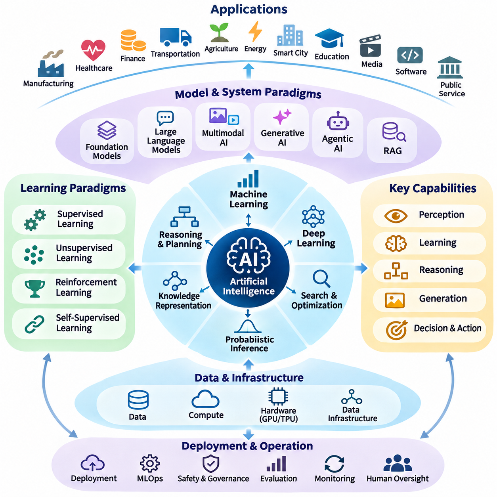{width="7.268055555555556in" height="7.268055555555556in"}

Modern artificial intelligence represents a broad and interconnected field of computational methods designed to perceive information, learn patterns, reason about situations, generate content, and support intelligent actions. Its modern landscape extends beyond individual algorithms to include data infrastructure, learning architectures, knowledge systems, autonomous agents, and deployment environments. Understanding this landscape requires examining how these components interact within complete AI systems.

Artificial intelligence serves as the overarching discipline, while machine learning provides methods for improving performance through experience and data. Deep learning forms a major branch of machine learning by using multilayer neural networks to discover hierarchical representations. However, AI also includes symbolic reasoning, search algorithms, planning, optimization, probabilistic inference, and knowledge representation. These approaches remain important even as neural models dominate many applications.

Machine learning occupies a central position in modern AI because it enables systems to infer useful relationships from examples rather than relying exclusively on manually specified rules. Supervised learning uses labeled observations, unsupervised learning discovers structures without explicit targets, and reinforcement learning develops decision policies through interaction. Self-supervised learning further expands this foundation by extracting training signals from the structure of available data.

Deep learning extends machine learning through representation learning, allowing computational models to transform raw inputs into increasingly abstract features. Convolutional neural networks support spatial analysis, recurrent architectures process sequential information, and transformers model relationships through attention mechanisms. These architectures have enabled substantial advances in computer vision, natural language processing, speech recognition, and scientific modeling.

Foundation models introduce a different organizational principle by training adaptable models on large and diverse datasets before applying them to specialized tasks. Instead of developing a separate architecture for every application, developers can reuse pretrained representations through prompting, fine-tuning, or adaptation. This approach supports broader transfer across tasks, although successful deployment still depends on domain compatibility, evaluation quality, computational resources, and operational constraints.

Large language models represent a prominent category of foundation models specialized in processing and generating linguistic sequences. Through large-scale pretraining, they acquire statistical representations of language, concepts, and relationships that support translation, summarization, question answering, programming, and conversational interaction. Their apparent reasoning capabilities can be useful, but generated responses may contain factual errors, inconsistent logic, or unsupported conclusions.

Multimodal artificial intelligence expands computational understanding beyond a single information format. These systems combine text, images, audio, video, spatial measurements, or structured sensor data to establish relationships across modalities. Vision-language models, for example, connect visual observations with linguistic descriptions, while audio-visual systems integrate sound and imagery. Effective multimodal intelligence requires alignment, synchronization, fusion, and appropriate handling of missing information.

Generative artificial intelligence focuses on producing new content from learned statistical distributions and contextual conditions. Autoregressive models generate sequences incrementally, diffusion models progressively construct samples through denoising, and other generative architectures learn structured latent representations. Applications include document generation, image synthesis, software development, simulation, and design assistance. Output quality must be evaluated separately from factual correctness and practical usefulness.

Agentic AI introduces systems that organize model capabilities around goals, actions, tools, and environmental feedback. Rather than generating a single response, an AI agent may interpret an objective, formulate intermediate steps, retrieve information, invoke software tools, and evaluate results. Agent architectures often combine language models with planning mechanisms, memory systems, execution environments, and control policies. Their autonomy must remain bounded by permissions and verification procedures.

Retrieval-augmented generation connects generative models with external information sources to improve contextual relevance and factual grounding. A retrieval component identifies potentially useful documents or records, while a generation component incorporates selected evidence into its response. Knowledge graphs, vector databases, search indexes, and structured repositories provide complementary retrieval mechanisms. Reliable implementations also require source validation, access control, freshness management, and evidence-based evaluation.

Knowledge representation remains essential because intelligent behavior requires more than recognizing statistical patterns. Logical expressions, ontologies, semantic networks, and knowledge graphs encode entities, relationships, constraints, and domain assumptions. Vector embeddings represent semantic similarities in continuous spaces, while symbolic structures support explicit interpretation and logical operations. Hybrid architectures can combine these complementary representations to support retrieval, inference, planning, and explanation.

Reasoning and planning form another major dimension of the AI landscape. Deductive reasoning derives conclusions from established premises, probabilistic reasoning handles uncertainty, and causal reasoning examines relationships between interventions and outcomes. Search and planning algorithms evaluate possible states and actions to achieve objectives. Modern systems increasingly combine these established mechanisms with learned representations, creating opportunities for more adaptable decision-making under complex conditions.

Embodied AI extends intelligence into physical environments where perception and action continuously influence one another. Robots and autonomous machines must interpret sensor measurements, estimate their states, predict environmental changes, and execute actions under physical constraints. Their intelligence depends on integrating computer vision, localization, planning, control, and learning. Unlike purely digital applications, embodied systems must also account for motion dynamics, uncertainty, latency, energy consumption, and safety.

World models provide a mechanism for representing how environments evolve over time and how actions may affect future states. Such models can support prediction, simulation, planning, and decision-making under uncertainty. In robotics, a world model may integrate visual observations, spatial relationships, object dynamics, and interaction histories. Its usefulness depends on prediction accuracy, temporal consistency, generalization, and the ability to recognize situations outside the model\'s experience.

Edge AI and real-time AI address the practical requirements of deploying intelligence near sensors, machines, and users. Instead of transferring every observation to remote infrastructure, edge devices perform selected computations locally to reduce communication dependence and improve responsiveness. These systems must balance inference accuracy, latency, memory capacity, power consumption, and hardware availability. Real-time applications additionally require predictable execution behavior and carefully managed processing deadlines.

Cloud and distributed AI infrastructures complement edge intelligence by providing scalable computation, centralized data management, large-model training, and coordinated services. Hybrid architectures distribute workloads according to latency requirements, computational complexity, privacy constraints, and communication conditions. A physical robot may perform immediate obstacle avoidance locally while using remote services for historical analysis, fleet coordination, or model updates. Effective system design requires clear responsibility boundaries.

The modern AI ecosystem also depends on data engineering and operational infrastructure. Data collection, labeling, preprocessing, storage, versioning, and quality control determine the reliability of learning pipelines. Model development requires experimentation, optimization, validation, and reproducibility, while production operation introduces deployment, monitoring, drift detection, and lifecycle management. These engineering activities transform experimental algorithms into maintainable systems capable of operating under changing conditions.

AI evaluation must reflect the diversity of modern system capabilities. Classification models may be assessed through accuracy, precision, recall, and calibration, while generative systems require assessments of coherence, factuality, usefulness, and safety. Autonomous agents must also be evaluated through task completion, tool correctness, recovery behavior, and resource consumption. Robotics introduces additional measures involving physical safety, trajectory quality, operational reliability, and real-time performance.

Safety, alignment, and governance operate across every layer of the AI landscape rather than forming isolated application categories. Data practices influence privacy and fairness, model architectures affect interpretability and robustness, and autonomous execution introduces risks associated with unintended actions. Responsible AI engineering therefore requires threat analysis, evaluation procedures, human oversight, security controls, and mechanisms for correcting failures. Governance establishes accountability throughout the system lifecycle.

Industrial applications demonstrate how these fields converge into practical solutions. Manufacturing systems combine visual inspection with anomaly detection and process optimization. Healthcare applications integrate predictive modeling with clinical information, while logistics platforms use forecasting, scheduling, and autonomous navigation. Intelligent transportation systems coordinate perception, planning, and control. Each domain introduces distinct reliability requirements, regulatory conditions, data characteristics, and operational objectives.

Modern AI should consequently be understood as an interconnected ecosystem rather than a simple hierarchy of competing technologies. Machine learning supplies adaptive capabilities, deep learning provides powerful representations, foundation models enable reuse, and reasoning systems support structured decisions. Agents coordinate actions, knowledge systems provide context, and embodied platforms connect intelligence with physical reality. Infrastructure, evaluation, and governance determine whether these capabilities can operate reliably.

The continuing development of artificial intelligence increasingly emphasizes integration across previously separate research areas. Symbolic reasoning can complement neural representations, generative models can support simulation, and reinforcement learning can improve sequential decision policies. Multimodal perception can inform world models, while agent architectures connect predictions with executable operations. These combinations illustrate a transition from isolated predictive models toward increasingly integrated intelligent systems.

A comprehensive field map therefore provides a conceptual foundation for understanding both current capabilities and future research directions. It reveals how algorithms, representations, learning paradigms, system architectures, and application domains contribute different functions to intelligent behavior. More importantly, it encourages evaluating AI technologies according to their roles within complete systems, where adaptability, reasoning, efficiency, reliability, and responsible operation must be considered together.

현대 인공지능(Modern Artificial Intelligence)은 정보를 인식하고, 패턴을 학습하며, 상황을 추론하고, 콘텐츠를 생성하며, 지능적인 행동을 지원하도록 설계된 광범위하고 상호 연결된 계산 방법(Computational Methods)의 분야를 의미한다. 현대 인공지능의 기술 영역은 개별 알고리즘(Algorithm)을 넘어 데이터 인프라(Data Infrastructure), 학습 아키텍처(Learning Architecture), 지식 시스템(Knowledge System), 자율 에이전트(Autonomous Agent), 배포 환경(Deployment Environment)까지 확장된다. 이러한 기술 영역을 이해하려면 각 구성 요소가 완전한 인공지능 시스템(AI System) 내부에서 어떻게 상호작용하는지 살펴보아야 한다.

인공지능(Artificial Intelligence)은 전체 학문 분야를 포괄하는 개념이며, 기계학습(Machine Learning)은 경험과 데이터를 통해 성능을 개선하는 방법을 제공한다. 딥러닝(Deep Learning)은 다층 신경망(Multilayer Neural Network)을 이용하여 계층적 표현(Hierarchical Representation)을 발견하는 기계학습의 주요 분야이다. 그러나 인공지능에는 기호적 추론(Symbolic Reasoning), 탐색 알고리즘(Search Algorithm), 계획(Planning), 최적화(Optimization), 확률적 추론(Probabilistic Inference), 지식 표현(Knowledge Representation)도 포함된다. 이러한 접근법은 신경망 모델(Neural Model)이 많은 응용 분야에서 주도적인 역할을 수행하는 현재에도 여전히 중요하다.

기계학습(Machine Learning)은 명시적으로 작성된 규칙에만 의존하지 않고 사례로부터 유용한 관계를 추론하도록 지원하기 때문에 현대 인공지능의 중심적인 위치를 차지한다. 지도학습(Supervised Learning)은 레이블이 지정된 관측 데이터를 활용하고, 비지도학습(Unsupervised Learning)은 명시적인 목표값 없이 데이터의 구조를 발견한다. 강화학습(Reinforcement Learning)은 환경과의 상호작용을 통해 의사결정 정책(Decision Policy)을 개발한다. 자기지도학습(Self-Supervised Learning)은 데이터 자체의 구조에서 학습 신호(Training Signal)를 추출함으로써 이러한 기반을 더욱 확장한다.

딥러닝(Deep Learning)은 표현 학습(Representation Learning)을 통해 기계학습을 확장하며, 계산 모델(Computational Model)이 원시 입력(Raw Input)을 점차 추상적인 특징(Abstract Feature)으로 변환할 수 있도록 한다. 합성곱 신경망(Convolutional Neural Network)은 공간적 분석(Spatial Analysis)을 지원하고, 순환 신경망 구조(Recurrent Architecture)는 순차적 정보(Sequential Information)를 처리하며, 트랜스포머(Transformer)는 어텐션 메커니즘(Attention Mechanism)을 통해 관계를 모델링한다. 이러한 아키텍처는 컴퓨터 비전(Computer Vision), 자연어 처리(Natural Language Processing), 음성 인식(Speech Recognition), 과학적 모델링(Scientific Modeling)의 발전을 가능하게 하였다.

파운데이션 모델(Foundation Model)은 크고 다양한 데이터셋(Dataset)으로 적응 가능한 모델을 사전학습(Pretraining)한 후 전문적인 작업에 적용하는 새로운 구성 원리를 도입한다. 개발자는 모든 응용 분야에 별도의 아키텍처를 구축하는 대신 프롬프팅(Prompting), 미세조정(Fine-Tuning), 적응(Adaptation)을 통해 사전학습된 표현을 재사용할 수 있다. 이러한 접근법은 다양한 작업 간 전이(Transfer)를 지원하지만, 성공적인 배포를 위해서는 도메인 호환성(Domain Compatibility), 평가 품질(Evaluation Quality), 계산 자원(Computational Resources), 운영 제약조건(Operational Constraints)을 함께 고려해야 한다.

대규모 언어 모델(Large Language Model, LLM)은 언어 시퀀스(Linguistic Sequence)의 처리와 생성에 특화된 대표적인 파운데이션 모델(Foundation Model)이다. 대규모 사전학습(Large-Scale Pretraining)을 통해 언어, 개념, 관계에 대한 통계적 표현(Statistical Representation)을 획득하며 번역, 요약, 질의응답, 프로그래밍, 대화형 상호작용을 지원한다. 이러한 모델의 추론 능력(Reasoning Capability)은 유용할 수 있지만, 생성된 응답에는 사실적 오류(Factual Error), 논리적 불일치(Logical Inconsistency), 근거가 부족한 결론(Unsupported Conclusion)이 포함될 수 있다.

멀티모달 인공지능(Multimodal AI)은 단일 정보 형식을 넘어 계산적 이해(Computational Understanding)의 범위를 확장한다. 이러한 시스템은 텍스트(Text), 이미지(Image), 오디오(Audio), 비디오(Video), 공간 측정값(Spatial Measurement), 구조화된 센서 데이터(Structured Sensor Data)를 결합하여 서로 다른 모달리티(Modality) 사이의 관계를 형성한다. 예를 들어 비전-언어 모델(Vision-Language Model)은 시각적 관측과 언어적 설명을 연결하며, 오디오-비주얼 시스템(Audio-Visual System)은 소리와 영상을 통합한다. 효과적인 멀티모달 지능(Multimodal Intelligence)을 위해서는 정렬(Alignment), 동기화(Synchronization), 융합(Fusion), 누락 정보 처리(Missing Information Handling)가 필요하다.

생성형 인공지능(Generative AI)은 학습된 통계적 분포(Statistical Distribution)와 문맥적 조건(Contextual Condition)을 기반으로 새로운 콘텐츠를 생성하는 데 중점을 둔다. 자기회귀 모델(Autoregressive Model)은 시퀀스를 점진적으로 생성하고, 확산 모델(Diffusion Model)은 잡음 제거(Denoising)를 통해 샘플을 구성하며, 다른 생성 아키텍처(Generative Architecture)는 구조화된 잠재 표현(Latent Representation)을 학습한다. 주요 응용 분야에는 문서 생성, 이미지 합성, 소프트웨어 개발, 시뮬레이션(Simulation), 설계 지원이 포함된다. 생성 결과의 품질(Output Quality)은 사실적 정확성(Factual Correctness) 및 실용적 유용성(Practical Usefulness)과 구분하여 평가해야 한다.

에이전트형 인공지능(Agentic AI)은 목표(Goal), 행동(Action), 도구(Tool), 환경 피드백(Environmental Feedback)을 중심으로 모델의 기능을 구성하는 시스템을 의미한다. 단일 응답을 생성하는 대신 인공지능 에이전트(AI Agent)는 목표를 해석하고, 중간 단계를 계획하며, 정보를 검색하고, 소프트웨어 도구를 호출하고, 실행 결과를 평가할 수 있다. 에이전트 아키텍처(Agent Architecture)는 언어 모델(Language Model), 계획 메커니즘(Planning Mechanism), 메모리 시스템(Memory System), 실행 환경(Execution Environment), 제어 정책(Control Policy)을 결합하는 경우가 많다. 이러한 자율성(Autonomy)은 권한(Permission)과 검증 절차(Verification Procedure)에 의해 적절하게 제한되어야 한다.

검색 증강 생성(Retrieval-Augmented Generation, RAG)은 생성 모델(Generative Model)을 외부 정보원(External Information Source)과 연결하여 문맥적 관련성(Contextual Relevance)과 사실적 근거(Factual Grounding)를 개선한다. 검색 구성 요소(Retrieval Component)는 유용할 가능성이 있는 문서나 기록을 식별하고, 생성 구성 요소(Generation Component)는 선택된 근거를 응답에 반영한다. 지식 그래프(Knowledge Graph), 벡터 데이터베이스(Vector Database), 검색 인덱스(Search Index), 구조화된 저장소(Structured Repository)는 상호 보완적인 검색 메커니즘을 제공한다. 신뢰할 수 있는 구현을 위해서는 출처 검증(Source Validation), 접근 제어(Access Control), 최신성 관리(Freshness Management), 근거 기반 평가(Evidence-Based Evaluation)가 필요하다.

지식 표현(Knowledge Representation)은 지능적인 행동이 단순히 통계적 패턴을 인식하는 것 이상을 요구하기 때문에 여전히 필수적이다. 논리 표현(Logical Expression), 온톨로지(Ontology), 의미 네트워크(Semantic Network), 지식 그래프(Knowledge Graph)는 개체(Entity), 관계(Relationship), 제약조건(Constraint), 도메인 가정(Domain Assumption)을 인코딩한다. 벡터 임베딩(Vector Embedding)은 연속 공간(Continuous Space)에서 의미적 유사성(Semantic Similarity)을 표현하며, 기호적 구조(Symbolic Structure)는 명시적인 해석과 논리 연산을 지원한다. 하이브리드 아키텍처(Hybrid Architecture)는 이러한 상호 보완적 표현을 결합하여 검색, 추론, 계획, 설명을 지원할 수 있다.

추론(Reasoning)과 계획(Planning)은 인공지능 기술 영역의 또 다른 주요 차원을 형성한다. 연역적 추론(Deductive Reasoning)은 확립된 전제로부터 결론을 도출하고, 확률적 추론(Probabilistic Reasoning)은 불확실성(Uncertainty)을 처리하며, 인과적 추론(Causal Reasoning)은 개입(Intervention)과 결과(Outcome) 사이의 관계를 분석한다. 탐색 및 계획 알고리즘(Search and Planning Algorithm)은 목표를 달성하기 위해 가능한 상태(State)와 행동(Action)을 평가한다. 현대 시스템은 이러한 기존 메커니즘을 학습된 표현(Learned Representation)과 결합하여 복잡한 조건에서 더욱 적응적인 의사결정(Adaptive Decision-Making)을 수행할 가능성을 확대하고 있다.

체화 인공지능(Embodied AI)은 인식(Perception)과 행동(Action)이 지속적으로 상호 영향을 미치는 물리적 환경(Physical Environment)으로 지능의 범위를 확장한다. 로봇(Robot)과 자율 기계(Autonomous Machine)는 센서 측정값(Sensor Measurement)을 해석하고, 자신의 상태를 추정하며, 환경 변화를 예측하고, 물리적 제약조건(Physical Constraint) 아래에서 행동을 실행해야 한다. 이러한 지능은 컴퓨터 비전(Computer Vision), 위치 추정(Localization), 계획(Planning), 제어(Control), 학습(Learning)의 통합에 의존한다. 순수한 디지털 응용과 달리 체화 시스템은 운동 역학(Motion Dynamics), 불확실성(Uncertainty), 지연시간(Latency), 에너지 소비(Energy Consumption), 안전성(Safety)도 고려해야 한다.

월드 모델(World Model)은 환경이 시간에 따라 어떻게 변화하고 행동이 미래 상태(Future State)에 어떤 영향을 미치는지 표현하는 메커니즘을 제공한다. 이러한 모델은 예측(Prediction), 시뮬레이션(Simulation), 계획(Planning), 불확실성 하의 의사결정(Decision-Making Under Uncertainty)을 지원할 수 있다. 로봇공학(Robotics)에서 월드 모델은 시각적 관측(Visual Observation), 공간적 관계(Spatial Relationship), 객체 동역학(Object Dynamics), 상호작용 이력(Interaction History)을 통합할 수 있다. 그 유용성은 예측 정확도(Prediction Accuracy), 시간적 일관성(Temporal Consistency), 일반화(Generalization), 모델이 경험하지 못한 상황을 인식하는 능력에 따라 결정된다.

엣지 인공지능(Edge AI)과 실시간 인공지능(Real-Time AI)은 센서, 기계, 사용자 가까이에 지능을 배포하기 위한 실질적인 요구사항을 다룬다. 모든 관측 데이터를 원격 인프라(Remote Infrastructure)로 전송하는 대신 엣지 장치(Edge Device)는 일부 계산을 로컬(Local)에서 수행하여 통신 의존성(Communication Dependence)을 줄이고 응답성(Responsiveness)을 향상시킨다. 이러한 시스템은 추론 정확도(Inference Accuracy), 지연시간(Latency), 메모리 용량(Memory Capacity), 전력 소비(Power Consumption), 하드웨어 가용성(Hardware Availability) 사이의 균형을 유지해야 한다. 실시간 응용에서는 예측 가능한 실행 동작(Predictable Execution Behavior)과 엄격하게 관리되는 처리 마감시간(Processing Deadline)이 추가로 요구된다.

클라우드 및 분산 인공지능 인프라(Cloud and Distributed AI Infrastructure)는 확장 가능한 계산(Scalable Computation), 중앙집중식 데이터 관리(Centralized Data Management), 대규모 모델 학습(Large-Model Training), 조정된 서비스(Coordinated Service)를 제공함으로써 엣지 지능(Edge Intelligence)을 보완한다. 하이브리드 아키텍처(Hybrid Architecture)는 지연시간 요구사항(Latency Requirement), 계산 복잡도(Computational Complexity), 개인정보 보호 제약조건(Privacy Constraint), 통신 조건(Communication Condition)에 따라 작업 부하(Workload)를 분산한다. 물리적 로봇은 즉각적인 장애물 회피(Obstacle Avoidance)를 로컬에서 수행하면서 과거 데이터 분석, 플릿 조정(Fleet Coordination), 모델 업데이트(Model Update)를 원격 서비스에 맡길 수 있다. 효과적인 시스템 설계에는 명확한 책임 경계(Responsibility Boundary)가 필요하다.

현대 인공지능 생태계(AI Ecosystem)는 데이터 엔지니어링(Data Engineering)과 운영 인프라(Operational Infrastructure)에도 의존한다. 데이터 수집(Data Collection), 레이블링(Labeling), 전처리(Preprocessing), 저장(Storage), 버전 관리(Versioning), 품질 관리(Quality Control)는 학습 파이프라인(Learning Pipeline)의 신뢰성을 결정한다. 모델 개발(Model Development)에는 실험(Experimentation), 최적화(Optimization), 검증(Validation), 재현성(Reproducibility)이 필요하며, 실제 운영에서는 배포(Deployment), 모니터링(Monitoring), 드리프트 탐지(Drift Detection), 생명주기 관리(Lifecycle Management)가 추가된다. 이러한 엔지니어링 활동은 실험적 알고리즘을 변화하는 조건에서도 운영할 수 있는 유지보수 가능한 시스템(Maintainable System)으로 전환한다.

인공지능 평가(AI Evaluation)는 현대 인공지능 시스템이 보유한 다양한 기능을 반영해야 한다. 분류 모델(Classification Model)은 정확도(Accuracy), 정밀도(Precision), 재현율(Recall), 보정도(Calibration)를 통해 평가할 수 있으며, 생성 시스템(Generative System)은 일관성(Coherence), 사실성(Factuality), 유용성(Usefulness), 안전성(Safety)에 대한 평가가 필요하다. 자율 에이전트(Autonomous Agent)는 작업 완료(Task Completion), 도구 사용 정확성(Tool Correctness), 복구 동작(Recovery Behavior), 자원 소비(Resource Consumption)를 통해 평가해야 한다. 로봇공학(Robotics)에서는 물리적 안전성(Physical Safety), 궤적 품질(Trajectory Quality), 운영 신뢰성(Operational Reliability), 실시간 성능(Real-Time Performance)에 관한 추가 지표가 필요하다.

안전성(Safety), 정렬(Alignment), 거버넌스(Governance)는 독립된 응용 분야에 머무르지 않고 인공지능 기술 영역의 모든 계층에 걸쳐 작용한다. 데이터 처리 관행(Data Practice)은 개인정보 보호(Privacy)와 공정성(Fairness)에 영향을 미치고, 모델 아키텍처(Model Architecture)는 해석 가능성(Interpretability)과 강건성(Robustness)에 영향을 주며, 자율 실행(Autonomous Execution)은 의도하지 않은 행동(Unintended Action)과 관련된 위험을 발생시킨다. 따라서 책임 있는 인공지능 엔지니어링(Responsible AI Engineering)에는 위협 분석(Threat Analysis), 평가 절차(Evaluation Procedure), 인간 감독(Human Oversight), 보안 통제(Security Control), 오류 수정 메커니즘(Failure Correction Mechanism)이 필요하다. 거버넌스는 전체 시스템 생명주기(System Lifecycle)에 걸쳐 책임성(Accountability)을 확립한다.

산업 응용(Industrial Application)은 이러한 분야가 실제 솔루션(Practical Solution)으로 어떻게 융합되는지 보여준다. 제조 시스템(Manufacturing System)은 시각적 검사(Visual Inspection), 이상 탐지(Anomaly Detection), 공정 최적화(Process Optimization)를 결합한다. 의료 응용(Healthcare Application)은 예측 모델링(Predictive Modeling)과 임상 정보(Clinical Information)를 통합하며, 물류 플랫폼(Logistics Platform)은 예측(Forecasting), 일정 계획(Scheduling), 자율 항법(Autonomous Navigation)을 활용한다. 지능형 교통 시스템(Intelligent Transportation System)은 인식(Perception), 계획(Planning), 제어(Control)를 조정한다. 각 도메인은 서로 다른 신뢰성 요구사항(Reliability Requirement), 규제 조건(Regulatory Condition), 데이터 특성(Data Characteristic), 운영 목표(Operational Objective)를 가진다.

따라서 현대 인공지능(Modern AI)은 경쟁하는 기술들의 단순한 계층 구조가 아니라 상호 연결된 생태계(Interconnected Ecosystem)로 이해해야 한다. 기계학습(Machine Learning)은 적응 능력(Adaptive Capability)을 제공하고, 딥러닝(Deep Learning)은 강력한 표현(Representation)을 생성하며, 파운데이션 모델(Foundation Model)은 재사용(Reuse)을 가능하게 하고, 추론 시스템(Reasoning System)은 구조화된 의사결정(Structured Decision)을 지원한다. 에이전트(Agent)는 행동을 조정하고, 지식 시스템(Knowledge System)은 문맥(Context)을 제공하며, 체화 플랫폼(Embodied Platform)은 지능을 물리적 현실(Physical Reality)과 연결한다. 인프라(Infrastructure), 평가(Evaluation), 거버넌스(Governance)는 이러한 기능이 신뢰성 있게 작동할 수 있는지를 결정한다.

인공지능의 지속적인 발전은 이전에 분리되어 있던 연구 분야 사이의 통합(Integration)을 점점 더 강조하고 있다. 기호적 추론(Symbolic Reasoning)은 신경망 표현(Neural Representation)을 보완할 수 있으며, 생성 모델(Generative Model)은 시뮬레이션(Simulation)을 지원하고, 강화학습(Reinforcement Learning)은 순차적 의사결정 정책(Sequential Decision Policy)을 개선할 수 있다. 멀티모달 인식(Multimodal Perception)은 월드 모델(World Model)에 정보를 제공하고, 에이전트 아키텍처(Agent Architecture)는 예측(Prediction)을 실행 가능한 작업(Executable Operation)과 연결한다. 이러한 결합은 개별 예측 모델(Isolated Predictive Model)에서 점차 통합된 지능형 시스템(Integrated Intelligent System)으로 발전하는 전환을 보여준다.

따라서 포괄적인 인공지능 분야 지도(AI Field Map)는 현재의 기술적 능력(Current Capability)과 미래 연구 방향(Future Research Direction)을 이해하기 위한 개념적 기반(Conceptual Foundation)을 제공한다. 이는 알고리즘(Algorithm), 표현(Representation), 학습 패러다임(Learning Paradigm), 시스템 아키텍처(System Architecture), 응용 도메인(Application Domain)이 지능적 행동(Intelligent Behavior)에 각각 어떤 기능을 제공하는지 보여준다. 더욱 중요한 점은 인공지능 기술을 완전한 시스템(Complete System) 내부에서 수행하는 역할에 따라 평가하도록 유도한다는 것이다. 이러한 시스템에서는 적응성(Adaptability), 추론(Reasoning), 효율성(Efficiency), 신뢰성(Reliability), 책임 있는 운영(Responsible Operation)을 함께 고려해야 한다.

## 06.01 Machine Learning as AI Core

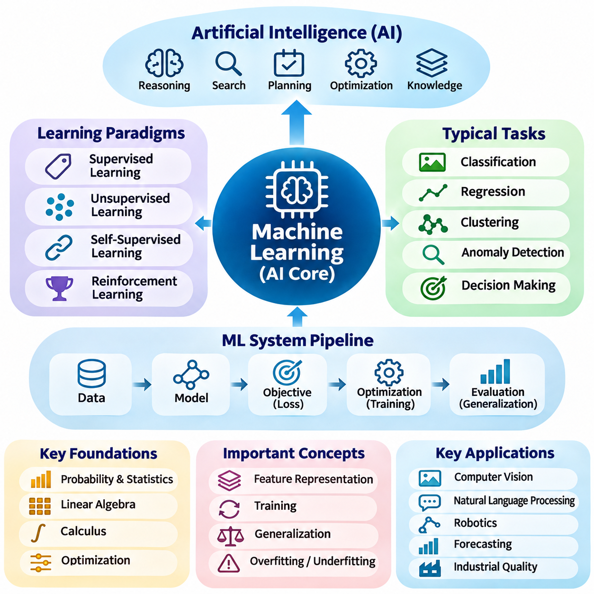{width="7.268055555555556in" height="7.268055555555556in"}

Machine learning has become a central mechanism of modern artificial intelligence because it enables computational systems to improve their performance through data and experience. Instead of requiring developers to specify every decision rule explicitly, machine learning algorithms identify statistical relationships that support prediction, classification, estimation, and decision-making. This capability allows AI systems to adapt to complex environments where manually defining all possible conditions would be impractical.

The importance of machine learning emerges from its ability to transform observations into reusable computational knowledge. Traditional software generally follows predetermined instructions, whereas machine learning systems estimate functions from examples and apply them to previously unseen inputs. This distinction does not eliminate conventional programming, because learning objectives, data pipelines, architectures, and operational constraints must still be designed. Machine learning therefore extends software engineering rather than replacing it.

A machine learning system typically consists of data, a model, an objective function, an optimization procedure, and an evaluation mechanism. Data provides observations from which relationships can be inferred, while the model represents a parameterized mapping between inputs and outputs. The objective function measures the quality of predictions or decisions, and optimization adjusts model parameters to improve performance. Evaluation determines whether the resulting behavior generalizes beyond the training examples.

Supervised learning is one of the most established machine learning paradigms. It uses examples containing input variables and corresponding target values to estimate relationships that can be applied to new observations. Classification predicts discrete categories, while regression estimates continuous quantities. Applications include image recognition, medical risk prediction, demand forecasting, and industrial quality inspection. Successful supervised learning depends on representative datasets, reliable labels, and appropriate evaluation procedures.

Unsupervised learning addresses situations where explicit target labels are unavailable. Its purpose is to identify structures, similarities, distributions, or unusual patterns within observed data. Clustering groups related observations, dimensionality reduction produces compact representations, and density estimation characterizes data distributions. These methods support exploratory analysis, anomaly detection, customer segmentation, and feature discovery, although their outputs require careful interpretation because discovered patterns are not necessarily meaningful.

Self-supervised learning has expanded the practical scope of machine learning by constructing learning objectives from the data itself. A model may predict missing portions of text, reconstruct masked image regions, or distinguish related observations from unrelated examples. Such objectives allow large collections of unlabeled data to contribute to representation learning. The resulting representations can subsequently support classification, retrieval, generation, or specialized downstream tasks through adaptation.

Reinforcement learning introduces a different learning framework in which an agent improves its behavior through interactions with an environment. The agent observes states, selects actions, receives rewards, and updates a policy intended to maximize expected cumulative reward. This approach is particularly relevant to sequential decision-making, robotics, resource allocation, and game-playing. Its practical challenges include exploration, delayed rewards, sample efficiency, safety, and changing environmental conditions.

The mathematical foundation of machine learning involves probability, statistics, linear algebra, calculus, and optimization. Statistical principles describe uncertainty and relationships between observations, while linear algebra supports efficient representation and transformation of data. Calculus and numerical optimization provide mechanisms for adjusting model parameters. These disciplines collectively explain how learning algorithms estimate patterns, minimize errors, quantify uncertainty, and generalize from limited observations.

Feature representation strongly influences the effectiveness of machine learning. A feature is a measurable or computed characteristic used to describe an observation, and its quality affects the information available to a model. Traditional machine learning frequently depends on manually engineered features derived from domain expertise. Modern representation learning increasingly allows models to discover useful features automatically. Nevertheless, feature relevance, data quality, and domain understanding remain fundamental requirements.

Model training is the process of adjusting parameters to improve performance according to a specified learning objective. Optimization algorithms iteratively evaluate errors and update model parameters, often using gradient-based methods when the objective is differentiable. Training behavior depends on initialization, learning rates, regularization, batch composition, and dataset characteristics. A low training error alone does not establish model quality, because the model may have memorized patterns that do not transfer to new data.

Generalization is a defining objective of machine learning because useful systems must perform effectively on observations not encountered during training. Overfitting occurs when a model captures training-specific noise or accidental relationships, while underfitting occurs when it cannot adequately represent important patterns. Model capacity, dataset size, regularization, and training procedures influence this balance. Validation and independent testing provide evidence about performance beyond the training distribution.

Data quality often determines the practical limits of machine learning more strongly than algorithmic complexity alone. Missing observations, incorrect labels, sampling bias, duplicated records, and inconsistent measurements can distort learned relationships. Distribution shifts may also occur when deployment conditions differ from those represented in training data. Reliable machine learning therefore requires systematic data collection, preprocessing, validation, documentation, and continuous monitoring throughout the system lifecycle.

Machine learning models can be understood through several complementary algorithmic families. Linear models provide relatively interpretable relationships, decision trees represent conditional partitions, and ensemble methods combine multiple predictors to improve performance. Kernel methods capture nonlinear relationships through similarity functions, while probabilistic models represent uncertainty explicitly. Neural networks provide flexible function approximation through layered transformations. Each family offers different tradeoffs involving accuracy, complexity, interpretability, and computational cost.

Deep learning represents an important extension of machine learning rather than a separate discipline. By combining multiple trainable layers, deep neural networks can learn hierarchical representations from images, language, audio, and other complex inputs. Their effectiveness has increased with larger datasets, specialized accelerators, improved optimization methods, and scalable architectures. However, conventional machine learning remains valuable for structured data, limited datasets, interpretable models, and computationally constrained applications.

Machine learning also provides the foundation for many modern foundation models and generative AI systems. Large-scale pretraining extracts reusable statistical representations from extensive datasets, while subsequent adaptation enables specialized applications. Language models learn relationships between tokens, vision models learn spatial and semantic patterns, and multimodal models establish associations across information types. These systems demonstrate how learning algorithms can support increasingly general interfaces without guaranteeing universal intelligence.

The relationship between machine learning and symbolic AI is complementary rather than exclusively competitive. Machine learning excels at extracting patterns from uncertain or high-dimensional observations, while symbolic methods support explicit rules, logical constraints, and structured reasoning. Hybrid architectures may use learned models for perception and symbolic mechanisms for planning or verification. Such combinations are valuable when intelligent behavior requires both flexible interpretation and compliance with clearly defined operational requirements.

In practical AI architectures, machine learning often functions as a perception, prediction, or decision-support component within a larger system. An autonomous robot may use learned models to detect objects and estimate environmental conditions while relying on planning algorithms and controllers to execute safe movements. An industrial inspection platform may combine visual classification with rule-based acceptance criteria. These examples demonstrate that learned intelligence becomes operationally useful through integration with surrounding software and hardware.

Evaluation establishes whether a machine learning model satisfies its intended purpose. Classification systems commonly use accuracy, precision, recall, and F1 score, while regression models employ error measures such as mean absolute error and root mean squared error. Probabilistic predictions may require calibration analysis, and deployed systems must also consider latency, memory consumption, robustness, and reliability. Appropriate metrics depend on application objectives and the consequences of different errors.

Responsible machine learning requires attention to fairness, privacy, transparency, security, and human oversight. Models can reproduce biases present in training data, reveal sensitive information, or behave unpredictably under adversarial inputs. Interpretability methods can help examine model behavior, although explanations do not automatically establish correctness. Governance mechanisms should address dataset provenance, access permissions, validation standards, accountability, and procedures for responding to failures.

Machine learning deployment introduces engineering requirements that extend beyond model development. Production systems need reproducible training pipelines, version-controlled datasets, reliable inference services, and mechanisms for detecting performance degradation. Monitoring can identify data drift, unexpected predictions, and operational failures, while controlled updates support continued adaptation. Effective deployment also requires balancing computational resources, maintenance costs, security requirements, and service availability.

The central role of machine learning does not imply that every artificial intelligence problem should be solved through learning alone. Search, planning, logical inference, optimization, and knowledge representation remain essential when tasks involve explicit constraints or verifiable decision procedures. The appropriate approach depends on problem structure, available data, uncertainty, computational limitations, and operational requirements. Modern AI systems frequently achieve stronger results by combining learned components with established algorithmic methods.

Machine learning is therefore best understood as a foundational capability that connects data-driven adaptation with broader artificial intelligence objectives. It enables systems to extract patterns, construct representations, estimate outcomes, and improve decisions through experience. Its effectiveness depends not only on mathematical algorithms but also on data quality, evaluation, system integration, and responsible operation. As AI architectures evolve, machine learning remains a critical component of increasingly capable and interconnected intelligent systems.

기계학습(Machine Learning)은 계산 시스템(Computational System)이 데이터와 경험을 통해 성능을 개선할 수 있도록 지원하기 때문에 현대 인공지능(Modern Artificial Intelligence)의 핵심 메커니즘으로 자리 잡았다. 개발자가 모든 의사결정 규칙(Decision Rule)을 명시적으로 정의하는 대신, 기계학습 알고리즘(Machine Learning Algorithm)은 예측(Prediction), 분류(Classification), 추정(Estimation), 의사결정(Decision-Making)을 지원하는 통계적 관계(Statistical Relationship)를 식별한다. 이러한 능력을 통해 인공지능 시스템(AI System)은 가능한 모든 조건을 수동으로 정의하기 어려운 복잡한 환경(Complex Environment)에 적응할 수 있다.

기계학습(Machine Learning)의 중요성은 관측 데이터(Observation Data)를 재사용 가능한 계산적 지식(Computational Knowledge)으로 변환하는 능력에서 비롯된다. 전통적인 소프트웨어(Traditional Software)는 일반적으로 미리 정의된 명령을 따르지만, 기계학습 시스템은 사례로부터 함수(Function)를 추정하고 이를 이전에 관측하지 못한 입력(Unseen Input)에 적용한다. 이러한 차이가 기존 프로그래밍(Conventional Programming)의 필요성을 없애는 것은 아니다. 학습 목표(Learning Objective), 데이터 파이프라인(Data Pipeline), 아키텍처(Architecture), 운영 제약조건(Operational Constraint)은 여전히 설계되어야 하기 때문이다. 따라서 기계학습은 소프트웨어 엔지니어링(Software Engineering)을 대체하는 것이 아니라 확장한다.

기계학습 시스템(Machine Learning System)은 일반적으로 데이터(Data), 모델(Model), 목적 함수(Objective Function), 최적화 절차(Optimization Procedure), 평가 메커니즘(Evaluation Mechanism)으로 구성된다. 데이터는 관계를 추론할 수 있는 관측값을 제공하며, 모델은 입력(Input)과 출력(Output) 사이의 매개변수화된 매핑(Parameterized Mapping)을 표현한다. 목적 함수는 예측이나 의사결정의 품질을 측정하고, 최적화는 성능을 개선하기 위해 모델 매개변수(Model Parameter)를 조정한다. 평가는 학습된 동작이 학습 사례(Training Example)를 넘어 일반화(Generalization)되는지를 판단한다.

지도학습(Supervised Learning)은 가장 확립된 기계학습 패러다임(Machine Learning Paradigm) 중 하나이다. 지도학습은 입력 변수(Input Variable)와 이에 대응하는 목표값(Target Value)을 포함하는 사례를 사용하여 새로운 관측값에 적용할 수 있는 관계를 추정한다. 분류(Classification)는 이산적인 범주(Discrete Category)를 예측하고, 회귀(Regression)는 연속적인 수량(Continuous Quantity)을 추정한다. 주요 응용 분야에는 이미지 인식(Image Recognition), 의료 위험 예측(Medical Risk Prediction), 수요 예측(Demand Forecasting), 산업 품질 검사(Industrial Quality Inspection)가 포함된다. 성공적인 지도학습을 위해서는 대표성 있는 데이터셋(Representative Dataset), 신뢰할 수 있는 레이블(Reliable Label), 적절한 평가 절차(Evaluation Procedure)가 필요하다.

비지도학습(Unsupervised Learning)은 명시적인 목표 레이블(Target Label)을 사용할 수 없는 상황을 다룬다. 비지도학습의 목적은 관측 데이터 내부의 구조(Structure), 유사성(Similarity), 분포(Distribution), 비정상적인 패턴(Unusual Pattern)을 식별하는 것이다. 군집화(Clustering)는 관련된 관측값을 그룹화하고, 차원 축소(Dimensionality Reduction)는 압축된 표현(Compact Representation)을 생성하며, 밀도 추정(Density Estimation)은 데이터 분포를 특성화한다. 이러한 방법은 탐색적 분석(Exploratory Analysis), 이상 탐지(Anomaly Detection), 고객 세분화(Customer Segmentation), 특징 발견(Feature Discovery)을 지원하지만, 발견된 패턴이 반드시 의미 있는 것은 아니므로 결과를 신중하게 해석해야 한다.

자기지도학습(Self-Supervised Learning)은 데이터 자체에서 학습 목표(Learning Objective)를 구성함으로써 기계학습의 실용적 범위를 확장하였다. 모델은 텍스트의 누락된 부분을 예측하거나, 마스킹된 이미지 영역(Masked Image Region)을 복원하거나, 관련된 관측값과 관련되지 않은 사례를 구별하도록 학습할 수 있다. 이러한 목표를 통해 레이블이 없는 대규모 데이터(Unlabeled Data)를 표현 학습(Representation Learning)에 활용할 수 있다. 학습된 표현은 이후 적응(Adaptation)을 통해 분류(Classification), 검색(Retrieval), 생성(Generation), 특화된 다운스트림 작업(Downstream Task)을 지원할 수 있다.

강화학습(Reinforcement Learning)은 에이전트(Agent)가 환경(Environment)과 상호작용하면서 행동을 개선하는 별도의 학습 프레임워크(Learning Framework)를 도입한다. 에이전트는 상태(State)를 관측하고, 행동(Action)을 선택하고, 보상(Reward)을 받으며, 기대 누적 보상(Expected Cumulative Reward)을 최대화하기 위한 정책(Policy)을 업데이트한다. 이러한 접근법은 순차적 의사결정(Sequential Decision-Making), 로봇공학(Robotics), 자원 할당(Resource Allocation), 게임 플레이(Game-Playing)에 특히 중요하다. 실용적인 과제로는 탐색(Exploration), 지연 보상(Delayed Reward), 샘플 효율성(Sample Efficiency), 안전성(Safety), 변화하는 환경 조건(Changing Environmental Condition)이 있다.

기계학습(Machine Learning)의 수학적 기반(Mathematical Foundation)은 확률론(Probability Theory), 통계학(Statistics), 선형대수학(Linear Algebra), 미적분학(Calculus), 최적화(Optimization)로 구성된다. 통계적 원리(Statistical Principle)는 불확실성과 관측값 사이의 관계를 설명하며, 선형대수학은 데이터의 효율적인 표현과 변환을 지원한다. 미적분학과 수치 최적화(Numerical Optimization)는 모델 매개변수를 조정하는 메커니즘을 제공한다. 이러한 학문은 학습 알고리즘이 패턴을 추정하고, 오류를 최소화하고, 불확실성을 정량화하며, 제한된 관측값으로부터 일반화하는 방법을 종합적으로 설명한다.

특징 표현(Feature Representation)은 기계학습의 효과에 큰 영향을 미친다. 특징(Feature)은 관측값을 설명하는 데 사용되는 측정 가능하거나 계산된 특성이며, 그 품질은 모델이 활용할 수 있는 정보에 영향을 준다. 전통적인 기계학습(Traditional Machine Learning)은 도메인 전문지식(Domain Expertise)을 기반으로 수동 설계된 특징(Handcrafted Feature)에 자주 의존한다. 현대 표현 학습(Modern Representation Learning)은 모델이 유용한 특징을 자동으로 발견할 수 있도록 지원하는 방향으로 발전하고 있다. 그러나 특징의 관련성(Feature Relevance), 데이터 품질(Data Quality), 도메인 이해(Domain Understanding)는 여전히 기본적인 요구사항이다.

모델 학습(Model Training)은 지정된 학습 목표(Learning Objective)에 따라 성능을 개선하기 위해 매개변수(Parameter)를 조정하는 과정이다. 최적화 알고리즘(Optimization Algorithm)은 오류를 반복적으로 평가하고 모델 매개변수를 업데이트하며, 목적 함수가 미분 가능(Differentiable)한 경우 경사 기반 방법(Gradient-Based Method)을 자주 사용한다. 학습 동작은 초기화(Initialization), 학습률(Learning Rate), 정규화(Regularization), 배치 구성(Batch Composition), 데이터셋 특성(Dataset Characteristic)에 따라 달라진다. 학습 오류(Training Error)가 낮다는 사실만으로 모델 품질(Model Quality)이 보장되지는 않는다. 모델이 새로운 데이터로 전이되지 않는 패턴을 단순히 암기했을 가능성이 있기 때문이다.

일반화(Generalization)는 기계학습의 핵심 목표이다. 유용한 시스템은 학습 과정에서 접하지 못한 관측값에 대해서도 효과적으로 작동해야 하기 때문이다. 과적합(Overfitting)은 모델이 학습 데이터에 특화된 잡음(Noise)이나 우연한 관계(Accidental Relationship)를 학습할 때 발생하며, 과소적합(Underfitting)은 중요한 패턴을 충분히 표현하지 못할 때 발생한다. 모델 용량(Model Capacity), 데이터셋 크기(Dataset Size), 정규화(Regularization), 학습 절차(Training Procedure)는 이러한 균형에 영향을 준다. 검증(Validation)과 독립적인 테스트(Independent Testing)는 학습 분포(Training Distribution)를 벗어난 성능에 관한 근거를 제공한다.

데이터 품질(Data Quality)은 알고리즘의 복잡성(Algorithmic Complexity)보다 기계학습의 실질적인 한계를 더 크게 결정하는 경우가 많다. 누락된 관측값(Missing Observation), 잘못된 레이블(Incorrect Label), 표본 편향(Sampling Bias), 중복 기록(Duplicated Record), 일관되지 않은 측정값(Inconsistent Measurement)은 학습된 관계를 왜곡할 수 있다. 배포 조건(Deployment Condition)이 학습 데이터에 반영된 조건과 다를 경우 분포 이동(Distribution Shift)도 발생할 수 있다. 따라서 신뢰할 수 있는 기계학습을 위해서는 전체 시스템 생명주기(System Lifecycle)에 걸쳐 체계적인 데이터 수집(Data Collection), 전처리(Preprocessing), 검증(Validation), 문서화(Documentation), 지속적인 모니터링(Continuous Monitoring)이 필요하다.

기계학습 모델(Machine Learning Model)은 여러 상호 보완적인 알고리즘 계열(Algorithmic Family)을 통해 이해할 수 있다. 선형 모델(Linear Model)은 비교적 해석 가능한 관계를 제공하고, 의사결정 트리(Decision Tree)는 조건부 분할(Conditional Partition)을 표현하며, 앙상블 방법(Ensemble Method)은 여러 예측기를 결합하여 성능을 개선한다. 커널 방법(Kernel Method)은 유사도 함수(Similarity Function)를 통해 비선형 관계(Nonlinear Relationship)를 포착하고, 확률 모델(Probabilistic Model)은 불확실성을 명시적으로 표현한다. 신경망(Neural Network)은 계층적 변환(Layered Transformation)을 통해 유연한 함수 근사(Function Approximation)를 제공한다. 각 계열은 정확도(Accuracy), 복잡성(Complexity), 해석 가능성(Interpretability), 계산 비용(Computational Cost) 사이에서 서로 다른 절충관계(Tradeoff)를 가진다.

딥러닝(Deep Learning)은 독립된 학문 분야가 아니라 기계학습(Machine Learning)의 중요한 확장으로 이해할 수 있다. 여러 학습 가능한 계층(Trainable Layer)을 결합함으로써 심층 신경망(Deep Neural Network)은 이미지, 언어, 오디오 및 기타 복잡한 입력으로부터 계층적 표현(Hierarchical Representation)을 학습할 수 있다. 딥러닝의 효과는 더 큰 데이터셋(Larger Dataset), 특수 목적 가속기(Specialized Accelerator), 개선된 최적화 방법(Optimization Method), 확장 가능한 아키텍처(Scalable Architecture)에 힘입어 증가하였다. 그러나 기존 기계학습(Conventional Machine Learning)은 구조화된 데이터(Structured Data), 제한된 데이터셋(Limited Dataset), 해석 가능한 모델(Interpretable Model), 계산 자원이 제한된 응용(Computationally Constrained Application)에서 여전히 유용하다.

기계학습(Machine Learning)은 현대 파운데이션 모델(Foundation Model)과 생성형 인공지능(Generative AI) 시스템의 기반도 제공한다. 대규모 사전학습(Large-Scale Pretraining)은 방대한 데이터셋에서 재사용 가능한 통계적 표현(Statistical Representation)을 추출하며, 이후 적응(Adaptation)을 통해 특화된 응용을 가능하게 한다. 언어 모델(Language Model)은 토큰(Token) 사이의 관계를 학습하고, 비전 모델(Vision Model)은 공간적 및 의미적 패턴(Spatial and Semantic Pattern)을 학습하며, 멀티모달 모델(Multimodal Model)은 서로 다른 정보 유형 사이의 연관성을 형성한다. 이러한 시스템은 학습 알고리즘이 점점 더 범용적인 인터페이스(General Interface)를 지원할 수 있음을 보여주지만, 보편적 지능(Universal Intelligence)을 보장하지는 않는다.

기계학습(Machine Learning)과 기호적 인공지능(Symbolic AI)의 관계는 배타적인 경쟁 관계가 아니라 상호 보완적인 관계이다. 기계학습은 불확실하거나 고차원적인 관측값(High-Dimensional Observation)에서 패턴을 추출하는 데 강점을 가지며, 기호적 방법(Symbolic Method)은 명시적인 규칙(Explicit Rule), 논리적 제약조건(Logical Constraint), 구조화된 추론(Structured Reasoning)을 지원한다. 하이브리드 아키텍처(Hybrid Architecture)는 인식(Perception)에 학습된 모델을 사용하고, 계획(Planning)이나 검증(Verification)에 기호적 메커니즘을 활용할 수 있다. 이러한 결합은 유연한 해석(Flexible Interpretation)과 명확하게 정의된 운영 요구사항(Operational Requirement)의 준수가 모두 필요한 상황에서 유용하다.

실제 인공지능 아키텍처(AI Architecture)에서 기계학습(Machine Learning)은 더 큰 시스템 내부의 인식(Perception), 예측(Prediction), 의사결정 지원(Decision Support) 구성 요소로 작동하는 경우가 많다. 자율 로봇(Autonomous Robot)은 학습된 모델(Learned Model)을 사용하여 객체를 탐지하고 환경 조건을 추정하는 동시에, 안전한 움직임을 실행하기 위해 계획 알고리즘(Planning Algorithm)과 제어기(Controller)에 의존할 수 있다. 산업 검사 플랫폼(Industrial Inspection Platform)은 시각적 분류(Visual Classification)와 규칙 기반 합격 기준(Rule-Based Acceptance Criteria)을 결합할 수 있다. 이러한 사례는 학습된 지능(Learned Intelligence)이 주변 소프트웨어 및 하드웨어와의 통합을 통해 운영상 유용해진다는 사실을 보여준다.

평가(Evaluation)는 기계학습 모델(Machine Learning Model)이 의도된 목적을 충족하는지를 판단한다. 분류 시스템(Classification System)은 일반적으로 정확도(Accuracy), 정밀도(Precision), 재현율(Recall), F1 점수(F1 Score)를 사용하며, 회귀 모델(Regression Model)은 평균 절대 오차(Mean Absolute Error, MAE)와 평균 제곱근 오차(Root Mean Squared Error, RMSE) 등의 오류 지표(Error Metric)를 활용한다. 확률적 예측(Probabilistic Prediction)에는 보정 분석(Calibration Analysis)이 필요할 수 있으며, 배포된 시스템(Deployed System)은 지연시간(Latency), 메모리 소비(Memory Consumption), 강건성(Robustness), 신뢰성(Reliability)도 고려해야 한다. 적절한 평가 지표(Evaluation Metric)는 응용 목표(Application Objective)와 오류 유형별 결과에 따라 달라진다.

책임 있는 기계학습(Responsible Machine Learning)을 위해서는 공정성(Fairness), 개인정보 보호(Privacy), 투명성(Transparency), 보안(Security), 인간 감독(Human Oversight)에 주의를 기울여야 한다. 모델은 학습 데이터에 존재하는 편향(Bias)을 재생산하거나, 민감한 정보(Sensitive Information)를 노출하거나, 적대적 입력(Adversarial Input)에 대해 예측하기 어려운 동작을 보일 수 있다. 해석 가능성 기법(Interpretability Method)은 모델 동작을 분석하는 데 도움을 줄 수 있지만, 설명(Explanation)이 자동으로 정확성(Correctness)을 보장하지는 않는다. 거버넌스 메커니즘(Governance Mechanism)은 데이터셋 출처(Dataset Provenance), 접근 권한(Access Permission), 검증 기준(Validation Standard), 책임성(Accountability), 오류 대응 절차(Failure Response Procedure)를 다루어야 한다.

기계학습 배포(Machine Learning Deployment)는 모델 개발(Model Development)을 넘어서는 엔지니어링 요구사항(Engineering Requirement)을 도입한다. 운영 시스템(Production System)에는 재현 가능한 학습 파이프라인(Reproducible Training Pipeline), 버전 관리된 데이터셋(Version-Controlled Dataset), 신뢰할 수 있는 추론 서비스(Reliable Inference Service), 성능 저하(Performance Degradation)를 탐지하는 메커니즘이 필요하다. 모니터링(Monitoring)은 데이터 드리프트(Data Drift), 예상하지 못한 예측(Unexpected Prediction), 운영 장애(Operational Failure)를 식별할 수 있으며, 통제된 업데이트(Controlled Update)는 지속적인 적응(Continued Adaptation)을 지원한다. 효과적인 배포를 위해서는 계산 자원(Computational Resource), 유지보수 비용(Maintenance Cost), 보안 요구사항(Security Requirement), 서비스 가용성(Service Availability) 사이의 균형도 필요하다.

기계학습(Machine Learning)이 중심적인 역할을 수행한다는 사실이 모든 인공지능 문제를 학습만으로 해결해야 한다는 의미는 아니다. 탐색(Search), 계획(Planning), 논리적 추론(Logical Inference), 최적화(Optimization), 지식 표현(Knowledge Representation)은 명시적인 제약조건(Explicit Constraint)이나 검증 가능한 의사결정 절차(Verifiable Decision Procedure)가 필요한 작업에서 여전히 필수적이다. 적절한 접근법은 문제 구조(Problem Structure), 사용 가능한 데이터(Available Data), 불확실성(Uncertainty), 계산상의 한계(Computational Limitation), 운영 요구사항(Operational Requirement)에 따라 달라진다. 현대 인공지능 시스템(Modern AI System)은 학습된 구성 요소(Learned Component)와 기존 알고리즘 방법(Established Algorithmic Method)을 결합하여 더 우수한 결과를 얻는 경우가 많다.

따라서 기계학습(Machine Learning)은 데이터 기반 적응(Data-Driven Adaptation)을 보다 광범위한 인공지능 목표(Artificial Intelligence Objective)와 연결하는 기반 능력(Foundational Capability)으로 이해하는 것이 적절하다. 기계학습은 시스템이 패턴을 추출하고, 표현(Representation)을 구성하며, 결과를 추정하고, 경험을 통해 의사결정을 개선할 수 있도록 한다. 그 효과는 수학적 알고리즘(Mathematical Algorithm)뿐만 아니라 데이터 품질(Data Quality), 평가(Evaluation), 시스템 통합(System Integration), 책임 있는 운영(Responsible Operation)에 의존한다. 인공지능 아키텍처(AI Architecture)가 발전함에 따라 기계학습은 점점 더 강력하고 상호 연결된 지능형 시스템(Intelligent System)의 핵심 구성 요소로 남아 있다.

## 06.02 Deep Learning as Representation Learning

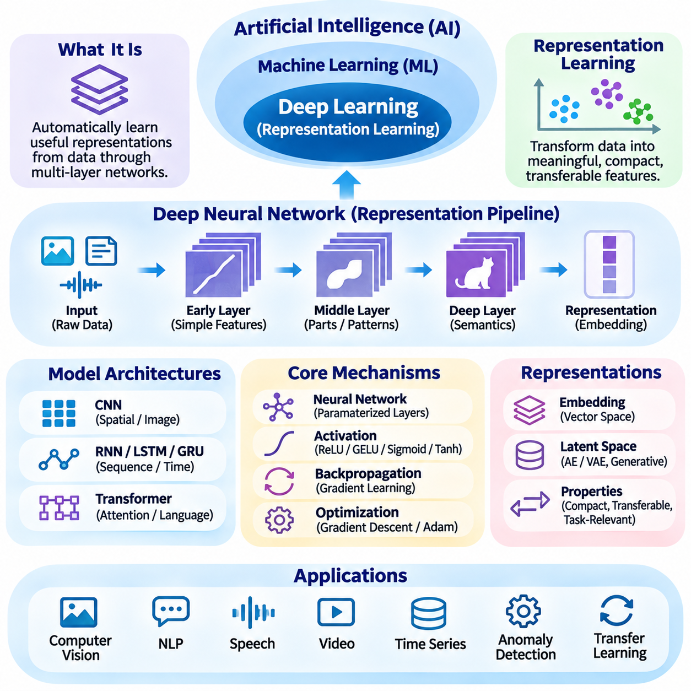{width="7.268055555555556in" height="7.268055555555556in"}

Deep learning is a major branch of machine learning that emphasizes the automatic discovery of useful representations from data. Rather than depending entirely on manually engineered features, deep neural networks transform raw observations through multiple computational layers. Each layer constructs intermediate representations that can capture increasingly complex relationships. This capability has made deep learning particularly effective for images, language, audio, video, and other high-dimensional information.

Representation learning refers to the process of discovering transformations that make information more useful for subsequent computational tasks. A representation may preserve important characteristics while reducing irrelevant variation or emphasizing meaningful relationships. In deep learning, representations are generally optimized through training objectives rather than explicitly programmed. Their usefulness depends on the task, dataset, architecture, and degree to which learned patterns transfer to unfamiliar observations.

The central mechanism of deep representation learning is the composition of multiple parameterized transformations. An input passes through successive layers, where mathematical operations combine learned weights, biases, and nonlinear activation functions. Early layers may identify relatively simple patterns, while deeper layers can construct more abstract combinations. However, the interpretation of individual layers depends on the architecture, and hierarchical abstraction is not guaranteed in every network.

Artificial neural networks provide the computational foundation for deep learning. Neurons receive numerical inputs, apply weighted transformations, and produce outputs through activation functions. Connecting many neurons into layers creates flexible function approximators capable of representing complex nonlinear relationships. Training adjusts network parameters to minimize a specified objective. The resulting internal activations form distributed representations in which information may be encoded across many computational units.

Nonlinear activation functions are essential because repeated linear transformations alone cannot represent general nonlinear mappings. Functions such as ReLU, GELU, sigmoid, and tanh introduce nonlinear behavior that enables networks to learn complex decision boundaries and feature interactions. Their mathematical properties influence gradient propagation, numerical stability, and optimization efficiency. Appropriate activation choices depend on network architecture, training conditions, and the characteristics of the intended application.

Backpropagation enables deep neural networks to learn representations by calculating how model parameters influence the training objective. Using the chain rule of calculus, gradients propagate backward through the computational graph, allowing optimization algorithms to update parameters. Gradient descent and adaptive optimizers iteratively improve model behavior. Although backpropagation is computationally efficient for differentiable models, successful training also depends on initialization, normalization, regularization, and stable numerical computation.

Convolutional neural networks demonstrate how architectural structure influences representation learning. Convolutional filters process local spatial neighborhoods using shared parameters, allowing networks to recognize patterns across different image locations. Early features often respond to edges, textures, or simple shapes, while later representations may encode object parts and semantic characteristics. These properties make convolutional architectures useful for image classification, object detection, segmentation, and visual inspection.

Sequence models extend representation learning to information whose meaning depends on temporal or positional relationships. Recurrent neural networks maintain hidden states that summarize preceding observations, while LSTM and GRU architectures improve the handling of longer dependencies. Such models have been applied to language, speech, sensor measurements, and time-series forecasting. Their representations capture sequential context, although training efficiency and long-range dependencies can remain challenging.

Transformers have substantially expanded representation learning through attention mechanisms that model relationships among elements of an input sequence. Self-attention computes context-dependent interactions between tokens or other representation units, allowing information from different positions to influence each other. Positional information supplies ordering or spatial structure. Transformer architectures now support language understanding, image processing, multimodal integration, and large-scale foundation models.

Embeddings provide a compact numerical form of learned representations. Words, image regions, objects, users, or other entities can be mapped into continuous vector spaces where geometric relationships reflect aspects of learned similarity. These spaces support retrieval, clustering, recommendation, classification, and semantic matching. However, distances between embeddings depend on the training objective and representation geometry, so numerical proximity does not always correspond to meaningful semantic equivalence.

Latent spaces represent information through internal variables that summarize characteristics of observed data. Autoencoders learn compressed representations by reconstructing inputs, while variational autoencoders introduce probabilistic structure into latent variables. Other architectures develop latent representations through predictive, contrastive, or generative objectives. Well-structured latent spaces can support compression, interpolation, anomaly detection, generation, and transfer learning, although their interpretability varies.

Self-supervised learning has become an important strategy for developing general-purpose deep representations without requiring extensive manual labeling. Masked prediction trains models to reconstruct hidden information, while contrastive learning encourages related observations to have compatible representations. Predictive objectives may require models to infer future states or missing contextual elements. These methods extract learning signals from data structure and can support subsequent adaptation to specialized tasks.

Transfer learning demonstrates the practical value of reusable representations. A network pretrained on a large dataset can provide features for a different but related application, reducing the amount of task-specific data and computation required. Developers may freeze pretrained layers, train additional prediction heads, or fine-tune selected parameters. Transfer effectiveness depends on similarities between source and target domains, representation quality, and the extent of distribution shift.

Representation quality cannot be determined solely by the complexity or dimensionality of a neural network. A useful representation should preserve information relevant to the intended task while supporting generalization, robustness, and efficient downstream processing. Excessive sensitivity to noise, irrelevant correlations, or training-specific patterns can reduce reliability. Evaluation therefore requires examining downstream performance, transferability, stability, and behavior under changing data conditions.

Deep learning representations may encode invariance and equivariance, two properties that influence how models respond to transformations. Invariant representations remain relatively stable under changes considered irrelevant to a task, such as certain variations in illumination. Equivariant representations change predictably when inputs undergo structured transformations, such as spatial rotations. Architectural design, data augmentation, and training objectives can encourage these properties when they are appropriate.

Multimodal representation learning seeks to connect information from different sensory or symbolic sources within compatible computational spaces. Text, images, audio, and spatial observations may be encoded separately before being aligned or fused. Shared representations can support cross-modal retrieval, visual question answering, speech understanding, and grounded language processing. Their effectiveness depends on preserving modality-specific information while learning meaningful relationships across modalities.

Deep representation learning also contributes to embodied intelligence and robotics. Visual encoders can extract environmental features, temporal models can summarize motion histories, and learned state representations can support planning or control. World models may use latent variables to predict future observations or environmental transitions. In physical systems, representation quality must be assessed alongside uncertainty, latency, sensor reliability, and safety because prediction errors can influence real-world actions.

Despite its advantages, deep learning introduces substantial engineering challenges. Large models may require extensive training data, specialized accelerators, high memory capacity, and significant energy consumption. Their internal representations can be difficult to interpret, and learned features may fail under unfamiliar conditions. Dataset bias, adversarial sensitivity, catastrophic forgetting, and distribution shift further complicate deployment. Effective systems require careful experimentation, monitoring, and validation.

Deep learning should not be interpreted as a complete replacement for symbolic reasoning or conventional machine learning. Neural representations excel at extracting patterns from complex observations, while symbolic structures can express explicit relationships, constraints, and logical rules. Hybrid systems may combine learned embeddings with knowledge graphs, planning algorithms, or verification mechanisms. Such integration can improve practical functionality when tasks require both perceptual flexibility and structured decision-making.

The relationship between deep learning and foundation models illustrates how representation learning scales across tasks and domains. Large pretrained networks acquire reusable internal structures from extensive datasets, enabling adaptation through prompting, fine-tuning, or additional training. Language models, vision encoders, and multimodal architectures exploit this principle in different ways. Nevertheless, broad transfer capabilities do not guarantee factual accuracy, causal understanding, or reliable reasoning.

Deep learning is therefore best understood as a framework for constructing task-relevant representations through layered computation and data-driven optimization. Its importance lies not simply in network depth but in the ability to transform complex observations into structures that support prediction, generation, retrieval, and decision-making. As AI systems become increasingly integrated, representation learning provides a critical connection between raw information and higher-level intelligent behavior.

딥러닝(Deep Learning)은 데이터로부터 유용한 표현(Representation)을 자동으로 발견하는 데 중점을 두는 기계학습(Machine Learning)의 주요 분야이다. 심층 신경망(Deep Neural Network)은 수동으로 설계된 특징(Handcrafted Feature)에 전적으로 의존하는 대신, 여러 계산 계층(Computational Layer)을 통해 원시 관측 데이터(Raw Observation)를 변환한다. 각 계층은 점점 더 복잡한 관계를 포착할 수 있는 중간 표현(Intermediate Representation)을 구성한다. 이러한 능력으로 인해 딥러닝은 이미지(Image), 언어(Language), 오디오(Audio), 비디오(Video) 및 기타 고차원 정보(High-Dimensional Information)를 처리하는 데 특히 효과적인 기술로 발전하였다.

표현 학습(Representation Learning)은 후속 계산 작업(Computational Task)에 정보를 더욱 유용하게 만드는 변환(Transformation)을 발견하는 과정을 의미한다. 표현(Representation)은 중요한 특성을 보존하면서 관련성이 낮은 변동(Irrelevant Variation)을 줄이거나 의미 있는 관계(Meaningful Relationship)를 강조할 수 있다. 딥러닝에서 표현은 일반적으로 명시적으로 프로그래밍되는 것이 아니라 학습 목표(Training Objective)를 통해 최적화된다. 표현의 유용성은 작업(Task), 데이터셋(Dataset), 아키텍처(Architecture), 학습된 패턴이 익숙하지 않은 관측값으로 전이되는 정도에 따라 달라진다.

심층 표현 학습(Deep Representation Learning)의 핵심 메커니즘은 여러 매개변수화된 변환(Parameterized Transformation)을 합성하는 것이다. 입력(Input)은 연속적인 계층을 통과하며, 각 계층에서는 수학적 연산(Mathematical Operation)을 통해 학습된 가중치(Weight), 편향(Bias), 비선형 활성화 함수(Nonlinear Activation Function)를 결합한다. 초기 계층(Early Layer)은 비교적 단순한 패턴을 식별할 수 있으며, 더 깊은 계층(Deeper Layer)은 더욱 추상적인 조합(Abstract Combination)을 구성할 수 있다. 그러나 개별 계층의 해석은 아키텍처에 따라 달라지며, 모든 신경망에서 계층적 추상화(Hierarchical Abstraction)가 반드시 보장되는 것은 아니다.

인공 신경망(Artificial Neural Network)은 딥러닝(Deep Learning)의 계산적 기반(Computational Foundation)을 제공한다. 뉴런(Neuron)은 수치 입력(Numerical Input)을 받아 가중 변환(Weighted Transformation)을 적용하고, 활성화 함수(Activation Function)를 통해 출력을 생성한다. 많은 뉴런을 계층으로 연결하면 복잡한 비선형 관계(Nonlinear Relationship)를 표현할 수 있는 유연한 함수 근사기(Function Approximator)가 형성된다. 학습(Training)은 지정된 목적 함수(Objective Function)를 최소화하도록 신경망 매개변수(Network Parameter)를 조정한다. 그 결과 생성되는 내부 활성값(Internal Activation)은 정보가 여러 계산 단위(Computational Unit)에 분산되어 인코딩되는 분산 표현(Distributed Representation)을 형성한다.

비선형 활성화 함수(Nonlinear Activation Function)는 선형 변환(Linear Transformation)을 반복하는 것만으로는 일반적인 비선형 매핑(Nonlinear Mapping)을 표현할 수 없기 때문에 필수적이다. ReLU, GELU, 시그모이드(Sigmoid), 쌍곡탄젠트(Tanh)와 같은 함수는 신경망이 복잡한 결정 경계(Decision Boundary)와 특징 상호작용(Feature Interaction)을 학습할 수 있도록 비선형 동작(Nonlinear Behavior)을 도입한다. 이러한 함수의 수학적 특성(Mathematical Property)은 기울기 전파(Gradient Propagation), 수치적 안정성(Numerical Stability), 최적화 효율성(Optimization Efficiency)에 영향을 준다. 적절한 활성화 함수의 선택은 신경망 아키텍처(Network Architecture), 학습 조건(Training Condition), 목표 응용 분야(Application)의 특성에 따라 달라진다.

역전파(Backpropagation)는 모델 매개변수(Model Parameter)가 학습 목표(Training Objective)에 어떤 영향을 미치는지 계산함으로써 심층 신경망(Deep Neural Network)이 표현을 학습할 수 있도록 한다. 미적분학(Calculus)의 연쇄 법칙(Chain Rule)을 이용하여 기울기(Gradient)가 계산 그래프(Computational Graph)를 따라 역방향으로 전파되며, 이를 통해 최적화 알고리즘(Optimization Algorithm)이 매개변수를 업데이트할 수 있다. 경사하강법(Gradient Descent)과 적응형 최적화기(Adaptive Optimizer)는 모델의 동작을 반복적으로 개선한다. 역전파는 미분 가능한 모델(Differentiable Model)에 대해 계산적으로 효율적이지만, 성공적인 학습을 위해서는 초기화(Initialization), 정규화(Normalization), 규제화(Regularization), 안정적인 수치 계산(Numerical Computation)도 필요하다.

합성곱 신경망(Convolutional Neural Network, CNN)은 아키텍처 구조(Architectural Structure)가 표현 학습(Representation Learning)에 어떤 영향을 미치는지 보여준다. 합성곱 필터(Convolutional Filter)는 공유 매개변수(Shared Parameter)를 사용하여 국소적인 공간 영역(Local Spatial Neighborhood)을 처리하므로, 신경망이 서로 다른 이미지 위치에서 패턴을 인식할 수 있다. 초기 특징(Early Feature)은 일반적으로 경계선(Edge), 질감(Texture), 단순한 형태(Simple Shape)에 반응하며, 후속 표현(Later Representation)은 객체의 부분(Object Part)과 의미적 특성(Semantic Characteristic)을 인코딩할 수 있다. 이러한 특성으로 인해 합성곱 아키텍처(Convolutional Architecture)는 이미지 분류(Image Classification), 객체 탐지(Object Detection), 분할(Segmentation), 시각 검사(Visual Inspection)에 유용하다.

시퀀스 모델(Sequence Model)은 의미가 시간적 또는 위치적 관계(Temporal or Positional Relationship)에 의존하는 정보로 표현 학습(Representation Learning)을 확장한다. 순환 신경망(Recurrent Neural Network, RNN)은 이전 관측값을 요약하는 은닉 상태(Hidden State)를 유지하며, 장단기 메모리(Long Short-Term Memory, LSTM)와 게이트 순환 유닛(Gated Recurrent Unit, GRU)은 더 긴 의존성(Longer Dependency)을 처리하는 능력을 개선한다. 이러한 모델은 언어(Language), 음성(Speech), 센서 측정값(Sensor Measurement), 시계열 예측(Time-Series Forecasting)에 적용되어 왔다. 이들의 표현은 순차적 문맥(Sequential Context)을 포착하지만, 학습 효율성(Training Efficiency)과 장거리 의존성(Long-Range Dependency)은 여전히 어려운 과제로 남을 수 있다.

트랜스포머(Transformer)는 입력 시퀀스(Input Sequence)의 요소들 사이의 관계를 모델링하는 어텐션 메커니즘(Attention Mechanism)을 통해 표현 학습(Representation Learning)을 크게 확장하였다. 자기 어텐션(Self-Attention)은 토큰(Token) 또는 다른 표현 단위(Representation Unit) 사이의 문맥 의존적 상호작용(Context-Dependent Interaction)을 계산하여 서로 다른 위치의 정보가 상호 영향을 미칠 수 있도록 한다. 위치 정보(Positional Information)는 순서(Ordering) 또는 공간 구조(Spatial Structure)를 제공한다. 트랜스포머 아키텍처(Transformer Architecture)는 현재 언어 이해(Language Understanding), 이미지 처리(Image Processing), 멀티모달 통합(Multimodal Integration), 대규모 파운데이션 모델(Large-Scale Foundation Model)을 지원한다.

임베딩(Embedding)은 학습된 표현(Learned Representation)을 압축된 수치 형태(Compact Numerical Form)로 제공한다. 단어(Word), 이미지 영역(Image Region), 객체(Object), 사용자(User) 또는 기타 개체(Entity)는 기하학적 관계(Geometric Relationship)가 학습된 유사성(Learned Similarity)의 일부 측면을 반영하는 연속 벡터 공간(Continuous Vector Space)에 매핑될 수 있다. 이러한 공간은 검색(Retrieval), 군집화(Clustering), 추천(Recommendation), 분류(Classification), 의미적 매칭(Semantic Matching)을 지원한다. 그러나 임베딩 사이의 거리(Distance)는 학습 목표(Training Objective)와 표현 공간의 기하학적 구조(Representation Geometry)에 따라 달라지므로, 수치적 근접성(Numerical Proximity)이 항상 의미적 동등성(Semantic Equivalence)에 대응하는 것은 아니다.

잠재 공간(Latent Space)은 관측 데이터(Observed Data)의 특성을 요약하는 내부 변수(Internal Variable)를 통해 정보를 표현한다. 오토인코더(Autoencoder)는 입력을 재구성(Reconstruction)하여 압축된 표현(Compressed Representation)을 학습하며, 변분 오토인코더(Variational Autoencoder, VAE)는 잠재 변수(Latent Variable)에 확률적 구조(Probabilistic Structure)를 도입한다. 다른 아키텍처는 예측적 목표(Predictive Objective), 대조적 목표(Contrastive Objective), 생성적 목표(Generative Objective)를 통해 잠재 표현(Latent Representation)을 개발한다. 잘 구성된 잠재 공간은 압축(Compression), 보간(Interpolation), 이상 탐지(Anomaly Detection), 생성(Generation), 전이학습(Transfer Learning)을 지원할 수 있지만, 해석 가능성(Interpretability)은 모델에 따라 달라진다.

자기지도학습(Self-Supervised Learning)은 광범위한 수동 레이블링(Manual Labeling) 없이 범용 심층 표현(General-Purpose Deep Representation)을 개발하는 중요한 전략으로 자리 잡았다. 마스킹 예측(Masked Prediction)은 숨겨진 정보(Hidden Information)를 복원하도록 모델을 학습시키며, 대조 학습(Contrastive Learning)은 관련된 관측값이 서로 호환되는 표현(Compatible Representation)을 갖도록 유도한다. 예측 목표(Predictive Objective)는 모델이 미래 상태(Future State)나 누락된 문맥 요소(Missing Contextual Element)를 추론하도록 요구할 수 있다. 이러한 방법은 데이터 구조(Data Structure)에서 학습 신호(Learning Signal)를 추출하며, 이후 특화된 작업(Specialized Task)에 대한 적응(Adaptation)을 지원할 수 있다.

전이학습(Transfer Learning)은 재사용 가능한 표현(Reusable Representation)의 실용적 가치를 보여준다. 대규모 데이터셋(Large Dataset)으로 사전학습된 신경망(Pretrained Network)은 서로 다르지만 관련성이 있는 응용 분야에 특징(Feature)을 제공하여 작업별 데이터(Task-Specific Data)와 계산량(Computation)의 요구를 줄일 수 있다. 개발자는 사전학습된 계층(Pretrained Layer)을 고정(Freeze)하거나, 추가적인 예측 헤드(Prediction Head)를 학습하거나, 선택된 매개변수를 미세조정(Fine-Tuning)할 수 있다. 전이 효과(Transfer Effectiveness)는 원본 도메인(Source Domain)과 목표 도메인(Target Domain) 사이의 유사성, 표현 품질(Representation Quality), 분포 이동(Distribution Shift)의 정도에 따라 달라진다.

표현 품질(Representation Quality)은 신경망(Neural Network)의 복잡성이나 차원(Dimensionality)만으로 판단할 수 없다. 유용한 표현은 의도된 작업(Intended Task)에 관련된 정보를 보존하면서 일반화(Generalization), 강건성(Robustness), 효율적인 다운스트림 처리(Downstream Processing)를 지원해야 한다. 잡음(Noise), 관련성이 낮은 상관관계(Irrelevant Correlation), 학습 데이터에 특화된 패턴(Training-Specific Pattern)에 지나치게 민감하면 신뢰성(Reliability)이 감소할 수 있다. 따라서 평가(Evaluation)에서는 다운스트림 성능(Downstream Performance), 전이 가능성(Transferability), 안정성(Stability), 데이터 조건 변화에 따른 동작을 함께 검토해야 한다.

딥러닝 표현(Deep Learning Representation)은 모델이 변환(Transformation)에 어떻게 반응하는지에 영향을 주는 두 가지 특성인 불변성(Invariance)과 등변성(Equivariance)을 인코딩할 수 있다. 불변 표현(Invariant Representation)은 조명 변화(Illumination Variation)와 같이 특정 작업에서 중요하지 않다고 간주되는 변화에도 비교적 안정적으로 유지된다. 등변 표현(Equivariant Representation)은 공간 회전(Spatial Rotation)과 같은 구조화된 변환(Structured Transformation)이 입력에 적용될 때 예측 가능한 방식으로 변화한다. 아키텍처 설계(Architectural Design), 데이터 증강(Data Augmentation), 학습 목표(Training Objective)는 이러한 특성이 적절한 경우 이를 유도할 수 있다.

멀티모달 표현 학습(Multimodal Representation Learning)은 서로 다른 감각적 또는 기호적 정보원(Sensory or Symbolic Source)을 호환 가능한 계산 공간(Computational Space) 안에서 연결하는 것을 목표로 한다. 텍스트(Text), 이미지(Image), 오디오(Audio), 공간 관측값(Spatial Observation)은 정렬(Alignment) 또는 융합(Fusion)되기 전에 개별적으로 인코딩(Encoding)될 수 있다. 공유 표현(Shared Representation)은 교차 모달 검색(Cross-Modal Retrieval), 시각적 질의응답(Visual Question Answering), 음성 이해(Speech Understanding), 근거 기반 언어 처리(Grounded Language Processing)를 지원할 수 있다. 그 효과는 모달리티별 정보(Modality-Specific Information)를 보존하면서 서로 다른 모달리티 사이의 의미 있는 관계를 학습하는 능력에 따라 달라진다.

심층 표현 학습(Deep Representation Learning)은 체화 지능(Embodied Intelligence)과 로봇공학(Robotics)에도 기여한다. 시각 인코더(Visual Encoder)는 환경 특징(Environmental Feature)을 추출하고, 시간적 모델(Temporal Model)은 움직임 이력(Motion History)을 요약하며, 학습된 상태 표현(Learned State Representation)은 계획(Planning)이나 제어(Control)를 지원할 수 있다. 월드 모델(World Model)은 잠재 변수(Latent Variable)를 사용하여 미래 관측값(Future Observation)이나 환경 상태 전이(Environmental Transition)를 예측할 수 있다. 물리적 시스템(Physical System)에서는 예측 오류(Prediction Error)가 실제 행동(Real-World Action)에 영향을 미칠 수 있으므로 표현 품질을 불확실성(Uncertainty), 지연시간(Latency), 센서 신뢰성(Sensor Reliability), 안전성(Safety)과 함께 평가해야 한다.

딥러닝(Deep Learning)은 많은 장점에도 불구하고 상당한 엔지니어링 과제(Engineering Challenge)를 수반한다. 대규모 모델(Large Model)은 방대한 학습 데이터(Training Data), 특수 목적 가속기(Specialized Accelerator), 높은 메모리 용량(Memory Capacity), 상당한 에너지 소비(Energy Consumption)를 요구할 수 있다. 내부 표현(Internal Representation)은 해석하기 어려울 수 있으며, 학습된 특징(Learned Feature)은 익숙하지 않은 조건에서 제대로 작동하지 않을 수 있다. 데이터셋 편향(Dataset Bias), 적대적 민감성(Adversarial Sensitivity), 파국적 망각(Catastrophic Forgetting), 분포 이동(Distribution Shift)은 배포(Deployment)를 더욱 복잡하게 만든다. 효과적인 시스템을 위해서는 신중한 실험(Experimentation), 모니터링(Monitoring), 검증(Validation)이 필요하다.

딥러닝(Deep Learning)을 기호적 추론(Symbolic Reasoning)이나 기존 기계학습(Conventional Machine Learning)을 완전히 대체하는 기술로 해석해서는 안 된다. 신경망 표현(Neural Representation)은 복잡한 관측값에서 패턴을 추출하는 데 강점을 가지며, 기호적 구조(Symbolic Structure)는 명시적인 관계(Explicit Relationship), 제약조건(Constraint), 논리 규칙(Logical Rule)을 표현할 수 있다. 하이브리드 시스템(Hybrid System)은 학습된 임베딩(Learned Embedding)을 지식 그래프(Knowledge Graph), 계획 알고리즘(Planning Algorithm), 검증 메커니즘(Verification Mechanism)과 결합할 수 있다. 이러한 통합은 작업에 인식의 유연성(Perceptual Flexibility)과 구조화된 의사결정(Structured Decision-Making)이 모두 필요한 경우 실용적인 기능을 향상시킬 수 있다.

딥러닝(Deep Learning)과 파운데이션 모델(Foundation Model)의 관계는 표현 학습(Representation Learning)이 작업과 도메인 전반으로 어떻게 확장되는지 보여준다. 대규모 사전학습 신경망(Large Pretrained Network)은 방대한 데이터셋에서 재사용 가능한 내부 구조(Reusable Internal Structure)를 획득하여 프롬프팅(Prompting), 미세조정(Fine-Tuning), 추가 학습(Additional Training)을 통한 적응(Adaptation)을 가능하게 한다. 언어 모델(Language Model), 비전 인코더(Vision Encoder), 멀티모달 아키텍처(Multimodal Architecture)는 이러한 원리를 서로 다른 방식으로 활용한다. 그러나 광범위한 전이 능력(Broad Transfer Capability)이 사실적 정확성(Factual Accuracy), 인과적 이해(Causal Understanding), 신뢰할 수 있는 추론(Reliable Reasoning)을 보장하는 것은 아니다.

따라서 딥러닝(Deep Learning)은 계층적 계산(Layered Computation)과 데이터 기반 최적화(Data-Driven Optimization)를 통해 작업과 관련된 표현(Task-Relevant Representation)을 구성하는 프레임워크(Framework)로 이해하는 것이 적절하다. 딥러닝의 중요성은 단순히 신경망의 깊이(Network Depth)에 있는 것이 아니라, 복잡한 관측값을 예측(Prediction), 생성(Generation), 검색(Retrieval), 의사결정(Decision-Making)을 지원하는 구조로 변환하는 능력에 있다. 인공지능 시스템(AI System)이 점점 더 통합됨에 따라 표현 학습(Representation Learning)은 원시 정보(Raw Information)와 고수준 지능적 행동(Higher-Level Intelligent Behavior)을 연결하는 핵심적인 역할을 수행한다.

## 06.03 Foundation Models

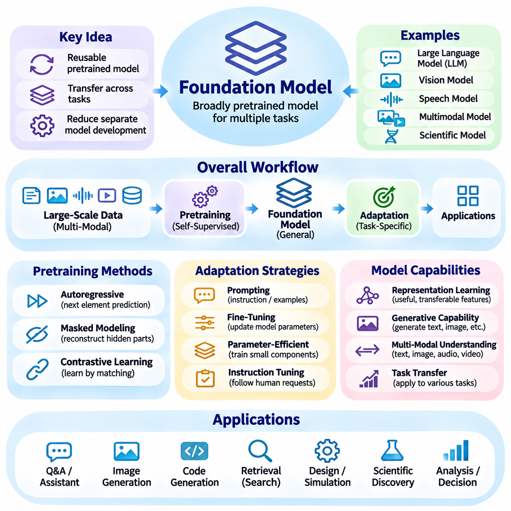{width="7.268055555555556in" height="7.268055555555556in"}

Foundation models represent a major development in artificial intelligence by introducing reusable models trained on large and diverse datasets. Rather than constructing a separate model for every task, developers can adapt a broadly pretrained system to multiple applications. These models acquire statistical representations that support language, vision, audio, and other information types. Their significance lies in transferring learned capabilities across tasks while reducing the need for entirely independent model development.

The foundation model paradigm separates broad pretraining from specialized adaptation. During pretraining, a model learns general patterns from extensive collections of information through objectives such as prediction, reconstruction, or contrastive learning. Subsequent adaptation applies these representations to particular tasks through prompting, fine-tuning, or additional training. This organization creates a shared computational foundation for multiple applications, although its usefulness depends on the quality and relevance of pretrained knowledge.

Large-scale pretraining is central to foundation model development because it enables models to capture statistical relationships across diverse contexts. Text corpora, image collections, audio recordings, video sequences, and structured datasets may provide training information. The resulting capabilities depend on dataset composition, model architecture, training objectives, and computational resources. Increasing scale can improve performance, but it does not automatically guarantee factual accuracy, robustness, or meaningful understanding.

Transformer architectures have played a prominent role in foundation models because attention mechanisms support flexible relationships among input elements. Language-oriented transformers process token sequences, while vision transformers represent images through patches or other visual units. Multimodal architectures extend these mechanisms to information from several modalities. Although transformers are widely used, foundation models are defined by their broad pretraining and adaptability rather than by one mandatory neural architecture.

Self-supervised learning provides an important mechanism for training foundation models without requiring manually labeled examples for every task. Autoregressive objectives predict subsequent tokens or elements, while masked modeling reconstructs hidden information from surrounding context. Contrastive objectives encourage related observations to develop compatible representations. These approaches exploit structure within available data and allow models to learn reusable features that can support multiple downstream applications.

Representation learning explains why foundation models can transfer capabilities between different tasks. During pretraining, internal representations encode statistical regularities, contextual relationships, and useful abstractions. Downstream applications reuse these representations rather than learning every feature from the beginning. However, a representation that works well for one domain may be less effective in another. Transfer quality depends on domain similarity, training diversity, and the requirements of the target application.

Adaptation strategies determine how foundation models are transformed into practical application components. Prompting guides model behavior through instructions or contextual examples without necessarily changing model parameters. Fine-tuning updates selected or all parameters using specialized data, while parameter-efficient methods modify smaller trainable components. Each strategy introduces tradeoffs involving computational cost, customization, maintenance, and the risk of degrading previously learned capabilities.

Instruction tuning further adapts foundation models to interpret and respond to human-oriented requests. Training examples associate instructions with desirable responses, helping models perform tasks that differ from their original pretraining objectives. Preference optimization and feedback-based methods may improve response usefulness, consistency, or adherence to behavioral requirements. Nevertheless, these procedures do not eliminate hallucinations, hidden biases, or failures in unfamiliar situations.

Large language models are among the most visible foundation models, but the category extends beyond text generation. Vision foundation models support image understanding and feature extraction, speech models process acoustic information, and multimodal models connect several information types. Scientific foundation models may represent biological sequences, molecular structures, or other domain-specific observations. Their shared characteristic is reusable pretraining that supports adaptation across related tasks.

Multimodal foundation models attempt to construct meaningful relationships among text, images, audio, video, and spatial information. Separate encoders may transform each modality into compatible representations before alignment or fusion. Other architectures process multiple modalities through shared components. These designs support visual question answering, image description, speech interaction, and cross-modal retrieval. Their reliability depends on synchronization, representation quality, and appropriate handling of incomplete information.

Generative capabilities are prominent in foundation models because pretrained representations can support the production of new content. Autoregressive language models generate sequences incrementally, while diffusion-based models can synthesize images or other structured outputs. Generative foundation models may also support software development, simulation, and design exploration. However, realistic or fluent outputs do not necessarily indicate factual correctness, logical consistency, or suitability for operational use.

Emergent behavior is often discussed when foundation models exhibit capabilities that become more apparent with changes in scale, training, or evaluation. Some abilities may improve gradually, while benchmark thresholds can make improvements appear abrupt. Consequently, claims of emergence require careful experimental interpretation. Model size alone does not establish reasoning competence, and performance should be examined through controlled evaluation rather than assumptions about intelligence.

Scaling foundation models introduces substantial computational and engineering requirements. Training large networks demands accelerators, distributed computation, memory management, high-throughput storage, and reliable communication infrastructure. Optimization techniques address numerical stability, parallel execution, and resource utilization. The overall cost includes data preparation, experimentation, training, evaluation, and deployment. Larger models must therefore be justified by measurable improvements relative to their operational requirements.

Inference efficiency becomes particularly important when foundation models are deployed to real applications. Model compression, quantization, pruning, distillation, caching, and optimized execution can reduce computational demands. Smaller adapted models may provide sufficient performance for specialized tasks while improving latency and resource efficiency. Deployment decisions must balance model quality, memory requirements, energy consumption, service availability, and the sensitivity of application data.

Retrieval-augmented generation connects foundation models with external knowledge sources to supplement information acquired during pretraining. Retrieval systems identify relevant documents, database records, or structured evidence, which the model can use when producing responses. This architecture can improve contextual relevance and support more current information. Nevertheless, retrieval quality, source credibility, access permissions, and evidence verification remain essential because retrieved content can also be incorrect or misleading.

Foundation models increasingly serve as components within agentic AI systems that combine language understanding with planning and tool execution. A model may interpret goals, propose intermediate actions, retrieve information, or generate commands for external software. Supporting components manage permissions, execution state, memory, and verification. Reliable autonomy requires explicit operational boundaries because plausible model outputs do not guarantee that proposed actions are safe, authorized, or correct.

Domain adaptation is necessary when general-purpose foundation models encounter specialized terminology, unfamiliar data distributions, or strict operational requirements. Healthcare, manufacturing, finance, and robotics each introduce distinctive constraints and evaluation criteria. Specialized datasets, retrieval mechanisms, or fine-tuning procedures can improve domain relevance. However, adaptation must be validated against representative scenarios, including rare events, ambiguous inputs, and potentially harmful failures.

Evaluation of foundation models requires more than measuring performance on a single benchmark. Language systems may be assessed for factuality, instruction following, reasoning consistency, and robustness, while vision systems require measures appropriate to perception tasks. Multimodal models must also be tested for cross-modal alignment and grounding. Evaluation should include distribution shifts, adversarial inputs, uncertainty, resource consumption, and realistic application workflows.

Safety and governance are essential because foundation models can influence many applications through a shared pretrained component. Training data may contain biases, copyrighted material, personal information, or inaccurate content. Models can generate misleading statements or behave unexpectedly when integrated with external tools. Responsible development requires data governance, security testing, access control, human oversight, model documentation, and procedures for detecting and correcting failures.

The foundation model ecosystem also introduces questions about openness, reproducibility, and technological dependence. Open-weight models can support local adaptation and independent experimentation, while restricted models may provide managed services with different operational controls. Model licenses, training transparency, infrastructure requirements, and maintenance responsibilities influence adoption. Organizations must evaluate these factors alongside performance when selecting models for long-term systems.

Foundation models should therefore be understood as adaptable computational foundations rather than universally reliable intelligence. Their value emerges from combining reusable representations, broad pretraining, specialized adaptation, and integration with external systems. They complement conventional machine learning, symbolic reasoning, knowledge representation, and planning rather than eliminating these methods. Their effectiveness ultimately depends on evaluation, engineering discipline, and responsible deployment.

As artificial intelligence evolves, foundation models are becoming shared components across language systems, multimodal applications, autonomous agents, and embodied platforms. Their continued development will depend on improving data efficiency, reasoning reliability, adaptation methods, and computational sustainability. The central architectural principle remains the same: broadly learned capabilities become useful when they are carefully adapted, verified, and integrated into systems designed for specific objectives.

파운데이션 모델(Foundation Model)은 크고 다양한 데이터셋(Dataset)으로 학습된 재사용 가능한 모델(Reusable Model)을 도입함으로써 인공지능(Artificial Intelligence)의 중요한 발전을 나타낸다. 개발자는 모든 작업(Task)에 대해 별도의 모델을 구축하는 대신, 광범위하게 사전학습된 시스템(Broadly Pretrained System)을 여러 응용 분야에 맞게 적응시킬 수 있다. 이러한 모델은 언어(Language), 비전(Vision), 오디오(Audio) 및 기타 정보 유형을 지원하는 통계적 표현(Statistical Representation)을 획득한다. 파운데이션 모델의 중요성은 완전히 독립적인 모델 개발의 필요성을 줄이면서 학습된 능력을 여러 작업으로 전이(Transfer)할 수 있다는 데 있다.

파운데이션 모델 패러다임(Foundation Model Paradigm)은 광범위한 사전학습(Pretraining)과 특화된 적응(Specialized Adaptation)을 구분한다. 사전학습 과정에서 모델은 예측(Prediction), 재구성(Reconstruction), 대조 학습(Contrastive Learning)과 같은 목표를 통해 방대한 정보 집합에서 일반적인 패턴을 학습한다. 이후 적응 과정에서는 프롬프팅(Prompting), 미세조정(Fine-Tuning), 추가 학습(Additional Training)을 통해 이러한 표현을 특정 작업에 적용한다. 이러한 구성은 여러 응용 분야를 위한 공유 계산 기반(Shared Computational Foundation)을 형성하지만, 그 유용성은 사전학습된 지식(Pretrained Knowledge)의 품질과 관련성에 따라 달라진다.

대규모 사전학습(Large-Scale Pretraining)은 모델이 다양한 문맥(Context)에 걸친 통계적 관계(Statistical Relationship)를 포착할 수 있도록 하기 때문에 파운데이션 모델 개발의 핵심이다. 텍스트 말뭉치(Text Corpus), 이미지 집합(Image Collection), 오디오 녹음(Audio Recording), 비디오 시퀀스(Video Sequence), 구조화된 데이터셋(Structured Dataset)이 학습 정보를 제공할 수 있다. 결과적으로 형성되는 능력은 데이터셋 구성(Dataset Composition), 모델 아키텍처(Model Architecture), 학습 목표(Training Objective), 계산 자원(Computational Resource)에 따라 달라진다. 규모의 확대는 성능을 향상시킬 수 있지만, 사실적 정확성(Factual Accuracy), 강건성(Robustness), 의미 있는 이해(Meaningful Understanding)를 자동으로 보장하지는 않는다.

트랜스포머 아키텍처(Transformer Architecture)는 어텐션 메커니즘(Attention Mechanism)이 입력 요소(Input Element) 사이의 유연한 관계를 지원하기 때문에 파운데이션 모델에서 중요한 역할을 수행해 왔다. 언어 중심 트랜스포머(Language-Oriented Transformer)는 토큰 시퀀스(Token Sequence)를 처리하며, 비전 트랜스포머(Vision Transformer)는 패치(Patch) 또는 다른 시각적 단위(Visual Unit)를 통해 이미지를 표현한다. 멀티모달 아키텍처(Multimodal Architecture)는 이러한 메커니즘을 여러 모달리티(Modality)의 정보로 확장한다. 트랜스포머가 널리 사용되고 있지만, 파운데이션 모델은 특정 신경망 아키텍처(Neural Architecture)가 아니라 광범위한 사전학습과 적응 가능성(Adaptability)에 의해 정의된다.

자기지도학습(Self-Supervised Learning)은 모든 작업에 대해 수동으로 레이블이 지정된 사례(Manually Labeled Example)를 요구하지 않고 파운데이션 모델을 학습시키는 중요한 메커니즘을 제공한다. 자기회귀 목표(Autoregressive Objective)는 다음 토큰(Token)이나 요소(Element)를 예측하며, 마스킹 모델링(Masked Modeling)은 주변 문맥(Surrounding Context)으로부터 숨겨진 정보(Hidden Information)를 재구성한다. 대조적 목표(Contrastive Objective)는 관련된 관측값(Related Observation)이 호환 가능한 표현(Compatible Representation)을 형성하도록 유도한다. 이러한 접근법은 사용 가능한 데이터 내부의 구조를 활용하여 여러 다운스트림 응용(Downstream Application)을 지원할 수 있는 재사용 가능한 특징(Reusable Feature)을 학습하도록 한다.

표현 학습(Representation Learning)은 파운데이션 모델이 서로 다른 작업 사이에서 능력을 전이할 수 있는 이유를 설명한다. 사전학습(Pretraining) 과정에서 내부 표현(Internal Representation)은 통계적 규칙성(Statistical Regularity), 문맥적 관계(Contextual Relationship), 유용한 추상화(Useful Abstraction)를 인코딩한다. 다운스트림 응용(Downstream Application)은 모든 특징을 처음부터 학습하는 대신 이러한 표현을 재사용한다. 그러나 특정 도메인(Domain)에서 효과적인 표현이 다른 도메인에서도 동일한 성능을 제공하는 것은 아니다. 전이 품질(Transfer Quality)은 도메인 유사성(Domain Similarity), 학습 데이터의 다양성(Training Diversity), 목표 응용(Target Application)의 요구사항에 따라 달라진다.

적응 전략(Adaptation Strategy)은 파운데이션 모델을 실제 응용 구성 요소(Application Component)로 변환하는 방법을 결정한다. 프롬프팅(Prompting)은 모델 매개변수(Model Parameter)를 반드시 변경하지 않고 명령(Instruction)이나 문맥적 사례(Contextual Example)를 통해 모델의 동작을 유도한다. 미세조정(Fine-Tuning)은 특화된 데이터(Specialized Data)를 사용하여 일부 또는 전체 매개변수를 업데이트하며, 매개변수 효율적 방법(Parameter-Efficient Method)은 더 작은 학습 가능 구성 요소(Trainable Component)를 수정한다. 각 전략은 계산 비용(Computational Cost), 맞춤화(Customization), 유지보수(Maintenance), 기존 학습 능력의 저하 위험(Risk of Capability Degradation) 사이에서 서로 다른 절충관계(Tradeoff)를 가진다.

명령어 튜닝(Instruction Tuning)은 파운데이션 모델이 인간 중심의 요청(Human-Oriented Request)을 해석하고 응답하도록 추가적으로 적응시킨다. 학습 사례(Training Example)는 명령어(Instruction)와 바람직한 응답(Desirable Response)을 연결하여 모델이 원래의 사전학습 목표(Pretraining Objective)와 다른 작업을 수행하도록 지원한다. 선호도 최적화(Preference Optimization)와 피드백 기반 방법(Feedback-Based Method)은 응답의 유용성(Usefulness), 일관성(Consistency), 행동 요구사항(Behavioral Requirement) 준수 능력을 개선할 수 있다. 그러나 이러한 절차가 환각(Hallucination), 숨겨진 편향(Hidden Bias), 익숙하지 않은 상황에서의 실패(Failure)를 완전히 제거하지는 못한다.

대규모 언어 모델(Large Language Model, LLM)은 가장 널리 알려진 파운데이션 모델 중 하나이지만, 이 범주는 텍스트 생성(Text Generation)을 넘어선다. 비전 파운데이션 모델(Vision Foundation Model)은 이미지 이해(Image Understanding)와 특징 추출(Feature Extraction)을 지원하고, 음성 모델(Speech Model)은 음향 정보(Acoustic Information)를 처리하며, 멀티모달 모델(Multimodal Model)은 여러 정보 유형을 연결한다. 과학 분야 파운데이션 모델(Scientific Foundation Model)은 생물학적 시퀀스(Biological Sequence), 분자 구조(Molecular Structure), 기타 도메인 특화 관측값(Domain-Specific Observation)을 표현할 수 있다. 이들의 공통적인 특성은 관련된 여러 작업에 적응할 수 있도록 지원하는 재사용 가능한 사전학습(Reusable Pretraining)이다.

멀티모달 파운데이션 모델(Multimodal Foundation Model)은 텍스트(Text), 이미지(Image), 오디오(Audio), 비디오(Video), 공간 정보(Spatial Information) 사이의 의미 있는 관계를 구성하려고 한다. 개별 인코더(Encoder)는 각 모달리티(Modality)를 정렬(Alignment) 또는 융합(Fusion)하기 전에 호환 가능한 표현(Compatible Representation)으로 변환할 수 있다. 다른 아키텍처는 공유 구성 요소(Shared Component)를 통해 여러 모달리티를 처리한다. 이러한 설계는 시각적 질의응답(Visual Question Answering), 이미지 설명(Image Description), 음성 상호작용(Speech Interaction), 교차 모달 검색(Cross-Modal Retrieval)을 지원한다. 신뢰성(Reliability)은 동기화(Synchronization), 표현 품질(Representation Quality), 불완전한 정보(Incomplete Information)의 적절한 처리에 따라 달라진다.

생성 능력(Generative Capability)은 사전학습된 표현(Pretrained Representation)이 새로운 콘텐츠의 생성을 지원할 수 있기 때문에 파운데이션 모델에서 중요한 특징으로 나타난다. 자기회귀 언어 모델(Autoregressive Language Model)은 시퀀스(Sequence)를 점진적으로 생성하며, 확산 기반 모델(Diffusion-Based Model)은 이미지나 다른 구조화된 출력(Structured Output)을 합성할 수 있다. 생성형 파운데이션 모델(Generative Foundation Model)은 소프트웨어 개발(Software Development), 시뮬레이션(Simulation), 설계 탐색(Design Exploration)도 지원할 수 있다. 그러나 사실적인 출력(Realistic Output)이나 유창한 응답(Fluent Response)이 반드시 사실적 정확성(Factual Correctness), 논리적 일관성(Logical Consistency), 운영 적합성(Operational Suitability)을 의미하지는 않는다.

창발적 행동(Emergent Behavior)은 파운데이션 모델이 규모(Scale), 학습(Training), 평가(Evaluation)의 변화에 따라 특정 능력을 더욱 뚜렷하게 나타낼 때 자주 논의된다. 일부 능력은 점진적으로 개선될 수 있지만, 벤치마크 임계값(Benchmark Threshold)으로 인해 개선이 갑작스럽게 나타나는 것처럼 보일 수도 있다. 따라서 창발성(Emergence)에 관한 주장은 신중한 실험적 해석(Experimental Interpretation)을 필요로 한다. 모델 크기(Model Size)만으로 추론 역량(Reasoning Competence)이 입증되는 것은 아니며, 성능은 지능에 관한 가정이 아니라 통제된 평가(Controlled Evaluation)를 통해 검토해야 한다.

파운데이션 모델의 확장(Scaling)은 상당한 계산 및 엔지니어링 요구사항(Computational and Engineering Requirement)을 발생시킨다. 대규모 신경망(Large Neural Network)의 학습에는 가속기(Accelerator), 분산 계산(Distributed Computation), 메모리 관리(Memory Management), 고처리량 저장장치(High-Throughput Storage), 신뢰할 수 있는 통신 인프라(Communication Infrastructure)가 필요하다. 최적화 기법(Optimization Technique)은 수치적 안정성(Numerical Stability), 병렬 실행(Parallel Execution), 자원 활용률(Resource Utilization)을 다룬다. 전체 비용에는 데이터 준비(Data Preparation), 실험(Experimentation), 학습(Training), 평가(Evaluation), 배포(Deployment)가 포함된다. 따라서 더 큰 모델은 운영 요구사항(Operational Requirement) 대비 측정 가능한 개선 효과(Measurable Improvement)를 통해 그 필요성이 정당화되어야 한다.

추론 효율성(Inference Efficiency)은 파운데이션 모델이 실제 응용 분야에 배포될 때 특히 중요해진다. 모델 압축(Model Compression), 양자화(Quantization), 가지치기(Pruning), 지식 증류(Distillation), 캐싱(Caching), 최적화된 실행(Optimized Execution)은 계산 요구량(Computational Demand)을 줄일 수 있다. 더 작은 적응형 모델(Adapted Model)은 특화된 작업에서 충분한 성능을 제공하면서 지연시간(Latency)과 자원 효율성(Resource Efficiency)을 개선할 수 있다. 배포 결정(Deployment Decision)은 모델 품질(Model Quality), 메모리 요구량(Memory Requirement), 에너지 소비(Energy Consumption), 서비스 가용성(Service Availability), 응용 데이터의 민감도(Data Sensitivity) 사이의 균형을 고려해야 한다.

검색 증강 생성(Retrieval-Augmented Generation, RAG)은 파운데이션 모델을 외부 지식원(External Knowledge Source)과 연결하여 사전학습 과정에서 획득한 정보를 보완한다. 검색 시스템(Retrieval System)은 관련 문서(Relevant Document), 데이터베이스 기록(Database Record), 구조화된 근거(Structured Evidence)를 식별하며, 모델은 이를 응답 생성에 활용할 수 있다. 이러한 아키텍처는 문맥적 관련성(Contextual Relevance)을 개선하고 더욱 최신의 정보(Current Information)를 지원할 수 있다. 그러나 검색된 콘텐츠 역시 잘못되거나 오해를 유발할 수 있으므로 검색 품질(Retrieval Quality), 출처 신뢰성(Source Credibility), 접근 권한(Access Permission), 근거 검증(Evidence Verification)은 여전히 필수적이다.

파운데이션 모델(Foundation Model)은 언어 이해(Language Understanding)를 계획(Planning) 및 도구 실행(Tool Execution)과 결합하는 에이전트형 인공지능 시스템(Agentic AI System)의 구성 요소로 점점 더 많이 활용되고 있다. 모델은 목표(Goal)를 해석하고, 중간 행동(Intermediate Action)을 제안하고, 정보를 검색하거나, 외부 소프트웨어(External Software)를 위한 명령(Command)을 생성할 수 있다. 지원 구성 요소(Supporting Component)는 권한(Permission), 실행 상태(Execution State), 메모리(Memory), 검증(Verification)을 관리한다. 그럴듯한 모델 출력(Plausible Model Output)이 제안된 행동의 안전성(Safety), 승인 여부(Authorization), 정확성(Correctness)을 보장하지는 않으므로 신뢰할 수 있는 자율성(Reliable Autonomy)을 위해서는 명시적인 운영 경계(Operational Boundary)가 필요하다.

도메인 적응(Domain Adaptation)은 범용 파운데이션 모델(General-Purpose Foundation Model)이 전문 용어(Specialized Terminology), 익숙하지 않은 데이터 분포(Unfamiliar Data Distribution), 엄격한 운영 요구사항(Strict Operational Requirement)을 접할 때 필요하다. 의료(Healthcare), 제조(Manufacturing), 금융(Finance), 로봇공학(Robotics)은 각각 고유한 제약조건(Constraint)과 평가 기준(Evaluation Criteria)을 가진다. 특화된 데이터셋(Specialized Dataset), 검색 메커니즘(Retrieval Mechanism), 미세조정 절차(Fine-Tuning Procedure)는 도메인 관련성(Domain Relevance)을 개선할 수 있다. 그러나 적응 결과는 드문 사건(Rare Event), 모호한 입력(Ambiguous Input), 잠재적으로 유해한 실패(Potentially Harmful Failure)를 포함한 대표적인 시나리오(Representative Scenario)에 대해 검증되어야 한다.

파운데이션 모델 평가(Foundation Model Evaluation)는 단일 벤치마크(Single Benchmark)의 성능 측정만으로 충분하지 않다. 언어 시스템(Language System)은 사실성(Factuality), 명령 준수(Instruction Following), 추론 일관성(Reasoning Consistency), 강건성(Robustness)을 기준으로 평가할 수 있으며, 비전 시스템(Vision System)은 인식 작업(Perception Task)에 적합한 측정 지표가 필요하다. 멀티모달 모델(Multimodal Model)은 교차 모달 정렬(Cross-Modal Alignment)과 근거 연결(Grounding)에 대해서도 테스트해야 한다. 평가에는 분포 이동(Distribution Shift), 적대적 입력(Adversarial Input), 불확실성(Uncertainty), 자원 소비(Resource Consumption), 실제 응용 워크플로(Realistic Application Workflow)가 포함되어야 한다.

안전성(Safety)과 거버넌스(Governance)는 파운데이션 모델이 공유된 사전학습 구성 요소(Shared Pretrained Component)를 통해 여러 응용 분야에 영향을 미칠 수 있기 때문에 필수적이다. 학습 데이터(Training Data)에는 편향(Bias), 저작권 보호 자료(Copyrighted Material), 개인정보(Personal Information), 부정확한 콘텐츠(Inaccurate Content)가 포함될 수 있다. 모델은 오해를 유발하는 진술(Misleading Statement)을 생성하거나 외부 도구(External Tool)와 통합되었을 때 예상하지 못한 동작을 보일 수 있다. 책임 있는 개발(Responsible Development)을 위해서는 데이터 거버넌스(Data Governance), 보안 테스트(Security Testing), 접근 제어(Access Control), 인간 감독(Human Oversight), 모델 문서화(Model Documentation), 오류 탐지 및 수정 절차(Failure Detection and Correction Procedure)가 필요하다.

파운데이션 모델 생태계(Foundation Model Ecosystem)는 개방성(Openness), 재현성(Reproducibility), 기술적 의존성(Technological Dependence)에 관한 문제도 제기한다. 공개 가중치 모델(Open-Weight Model)은 로컬 적응(Local Adaptation)과 독립적인 실험(Independent Experimentation)을 지원할 수 있으며, 접근이 제한된 모델(Restricted Model)은 서로 다른 운영 통제(Operational Control)를 제공하는 관리형 서비스(Managed Service)를 제공할 수 있다. 모델 라이선스(Model License), 학습 투명성(Training Transparency), 인프라 요구사항(Infrastructure Requirement), 유지보수 책임(Maintenance Responsibility)은 도입 여부에 영향을 준다. 조직은 장기적인 시스템(Long-Term System)을 위한 모델을 선택할 때 성능과 함께 이러한 요소를 평가해야 한다.

따라서 파운데이션 모델(Foundation Model)은 보편적으로 신뢰할 수 있는 지능(Universally Reliable Intelligence)이 아니라 적응 가능한 계산 기반(Adaptable Computational Foundation)으로 이해해야 한다. 그 가치는 재사용 가능한 표현(Reusable Representation), 광범위한 사전학습(Broad Pretraining), 특화된 적응(Specialized Adaptation), 외부 시스템과의 통합(External System Integration)을 결합하는 과정에서 나타난다. 파운데이션 모델은 기존 기계학습(Conventional Machine Learning), 기호적 추론(Symbolic Reasoning), 지식 표현(Knowledge Representation), 계획(Planning)을 제거하는 대신 보완한다. 그 효과는 궁극적으로 평가(Evaluation), 엔지니어링 규율(Engineering Discipline), 책임 있는 배포(Responsible Deployment)에 따라 결정된다.

인공지능(Artificial Intelligence)이 발전함에 따라 파운데이션 모델(Foundation Model)은 언어 시스템(Language System), 멀티모달 응용(Multimodal Application), 자율 에이전트(Autonomous Agent), 체화 플랫폼(Embodied Platform) 전반에서 공유 구성 요소(Shared Component)로 자리 잡고 있다. 향후 발전은 데이터 효율성(Data Efficiency), 추론 신뢰성(Reasoning Reliability), 적응 방법(Adaptation Method), 계산 지속가능성(Computational Sustainability)을 개선하는 데 달려 있다. 핵심 아키텍처 원리(Architectural Principle)는 변하지 않는다. 광범위하게 학습된 능력(Broadly Learned Capability)은 특정 목표(Specific Objective)를 위해 설계된 시스템에 신중하게 적응(Adaptation), 검증(Verification), 통합(Integration)될 때 비로소 실질적인 가치를 발휘한다.

## 06.04 Large Language Models

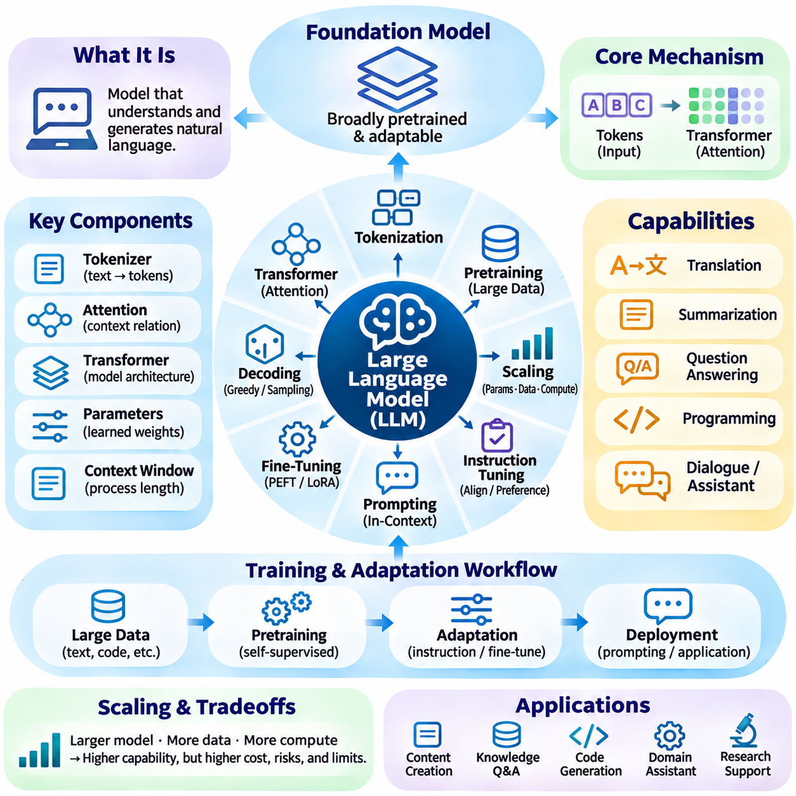{width="7.268055555555556in" height="7.268055555555556in"}

Large language models are a major category of foundation models designed to process, represent, and generate natural language. They learn statistical relationships from extensive text collections and, in some architectures, additional modalities. Their capabilities include translation, summarization, question answering, programming, and dialogue. Rather than following fixed linguistic rules, these models construct context-dependent predictions that support flexible language interaction.

The fundamental operation of most modern large language models involves predicting tokens from preceding or surrounding context. Text is divided into tokens representing words, word fragments, punctuation, or other symbols. A tokenizer converts these elements into numerical identifiers processed by a neural network. During training, the model learns probability distributions over possible tokens, enabling it to generate coherent sequences through repeated prediction.

Transformer architectures provide the primary computational foundation for contemporary large language models. Their attention mechanisms allow representations of individual tokens to incorporate information from other positions in the input. Feedforward layers transform these contextual representations, while residual connections and normalization support stable computation. Decoder-only transformers are widely used for generation, although encoder-decoder and other architectures remain important.

Self-attention enables language models to represent contextual relationships without relying exclusively on sequential recurrence. Queries, keys, and values are derived from token representations to calculate attention weights and aggregate relevant information. Multiple attention heads can capture different interaction patterns. Causal masking prevents autoregressive models from accessing future tokens during prediction, preserving the sequential structure of language generation.

Pretraining establishes the broad linguistic capabilities of large language models through exposure to extensive datasets. Training material may include books, articles, technical documents, software repositories, and other text sources. The model adjusts its parameters to reduce prediction error across many contexts. This process produces reusable representations of syntax, semantics, and recurring relationships, although statistical learning does not guarantee factual correctness or grounded understanding.

Scaling influences language model capabilities through changes in parameter count, training data, and computational resources. Larger models can represent more complex relationships, while broader datasets may improve coverage across topics and linguistic styles. However, performance depends on the balance between model capacity, data quality, and training computation. Increasing scale alone cannot eliminate reasoning failures, dataset bias, or unreliable generation.

Instruction tuning adapts pretrained language models to respond more effectively to user requests. Examples containing instructions and appropriate responses teach models to follow task descriptions, respect formatting requirements, and produce useful explanations. Preference-based optimization can further improve response quality and behavioral consistency. These techniques shape model behavior but do not provide absolute guarantees of truthfulness, safety, or instruction compliance.

Prompting provides a practical interface for controlling language model behavior without necessarily modifying its parameters. A prompt may specify an objective, provide contextual information, establish constraints, or demonstrate examples of expected outputs. In-context learning allows models to adapt their responses using information supplied within the current interaction. Prompt effectiveness depends on clarity, relevant context, model capabilities, and the limits of available context.

Tokenization influences how language models represent information and allocate computational resources. Different tokenization methods divide words, numbers, code, and multilingual text into varying sequences of units. Vocabulary design affects sequence length and processing efficiency. Although tokens are convenient computational symbols, their boundaries do not necessarily correspond to linguistic meaning, and tokenization choices can influence performance across languages and specialized domains.

Context windows determine how much information a language model can process within a single interaction. Longer contexts support document analysis, extended conversations, and complex workflows, but they increase computational and memory requirements. Attention mechanisms must manage relationships across many tokens, and models may not use every part of a long context equally effectively. Context length should therefore be distinguished from reliable information retention and reasoning quality.

Language generation uses decoding strategies to select output tokens from predicted probability distributions. Greedy decoding chooses the most probable token, while sampling introduces controlled variation. Temperature, top-k sampling, and nucleus sampling influence output diversity and determinism. Beam search explores multiple candidate sequences in selected applications. Appropriate decoding settings depend on whether the task prioritizes creativity, consistency, precision, or reproducibility.

Fine-tuning specializes language models by updating parameters using task-specific or domain-specific examples. Full fine-tuning modifies the complete model, while parameter-efficient techniques such as low-rank adaptation update smaller trainable components. These approaches can improve terminology handling, output structure, and domain performance. However, adaptation requires careful validation because narrow training data may reduce general capabilities or reinforce undesirable patterns.

Retrieval-augmented generation extends language models by incorporating external information during response construction. A retrieval system identifies relevant documents or structured records, and the model uses selected evidence to produce contextually grounded outputs. This approach can supplement knowledge acquired during pretraining and improve access to updated information. Reliability still depends on retrieval accuracy, source credibility, access permissions, and verification of generated claims.

Tool use allows language models to interact with software systems beyond text generation. A model may produce structured requests for search engines, databases, calculators, or application programming interfaces. External execution environments perform the requested operations and return results for interpretation. Such integration supports agentic workflows, but reliable operation requires schema validation, permission controls, error handling, and confirmation before consequential actions.

Reasoning capabilities in large language models emerge from learned patterns, contextual computation, and training procedures that encourage structured problem solving. Models can perform mathematical explanations, code analysis, and multistep planning, but their conclusions may contain logical inconsistencies. Additional inference-time computation and verification can improve performance on some tasks. Reliable reasoning requires evaluating intermediate assumptions and final results rather than trusting fluent explanations.

Multimodal language models extend text-based architectures by integrating visual, auditory, or other sensory representations. Images may be converted into visual tokens, while audio encoders produce representations that interact with language processing components. These systems support image interpretation, spoken dialogue, video understanding, and cross-modal question answering. Their effectiveness depends on alignment between modalities and accurate grounding of generated descriptions.

Evaluation of large language models must consider multiple dimensions of performance. Language understanding, factual accuracy, reasoning consistency, instruction following, and coding ability require different assessment methods. Benchmark scores provide useful comparisons but may be affected by dataset contamination or narrow task coverage. Real-world evaluation should additionally examine robustness, latency, cost, uncertainty, and performance under unfamiliar conditions.

Hallucination remains a significant limitation because language models can generate plausible statements unsupported by reliable evidence. Errors may arise from incomplete knowledge, misleading context, ambiguous instructions, or limitations in learned representations. Retrieval, external verification, constrained generation, and calibrated uncertainty can reduce some risks. High-stakes applications require independent validation because linguistic confidence does not establish factual reliability.

Safety and governance are essential when language models are deployed in systems that influence people or operational decisions. Training data may contain personal information, harmful stereotypes, copyrighted material, or inaccurate claims. Models can also be exposed to prompt injection and adversarial manipulation. Responsible deployment requires privacy safeguards, access control, security testing, human oversight, and documented procedures for monitoring and correcting failures.

Efficient deployment requires balancing model capability with memory, latency, throughput, and energy consumption. Quantization reduces numerical precision, distillation transfers capabilities into smaller models, and optimized inference engines improve execution efficiency. Distributed serving can support high request volumes, while local deployment may reduce communication dependence. The appropriate architecture depends on application requirements, hardware resources, and data sensitivity.

Large language models increasingly function as language interfaces within broader artificial intelligence systems. They can connect knowledge retrieval, software tools, planning mechanisms, and domain-specific models through natural language interaction. However, reliable systems must separate generated suggestions from verified actions and enforce explicit operational constraints. Language models are therefore powerful components of intelligent architectures rather than complete substitutes for reasoning, control, or governance.

The continuing development of large language models emphasizes improved reasoning reliability, multimodal integration, computational efficiency, and responsible adaptation. Their long-term value depends on combining flexible language representations with trustworthy information sources, verification mechanisms, and well-designed system boundaries. Understanding these models requires examining both their statistical foundations and their practical limitations within complete AI applications.

대규모 언어 모델(Large Language Model, LLM)은 자연어(Natural Language)를 처리하고, 표현하며, 생성하도록 설계된 파운데이션 모델(Foundation Model)의 주요 범주이다. 이러한 모델은 방대한 텍스트 집합(Text Collection)과 일부 아키텍처에서는 추가적인 모달리티(Modality)로부터 통계적 관계(Statistical Relationship)를 학습한다. 주요 능력에는 번역(Translation), 요약(Summarization), 질의응답(Question Answering), 프로그래밍(Programming), 대화(Dialogue)가 포함된다. 이러한 모델은 고정된 언어 규칙(Fixed Linguistic Rule)을 따르는 대신 문맥 의존적 예측(Context-Dependent Prediction)을 구성하여 유연한 언어 상호작용(Language Interaction)을 지원한다.

대부분의 현대 대규모 언어 모델(Large Language Model)의 기본 동작은 이전 또는 주변 문맥(Context)을 기반으로 토큰(Token)을 예측하는 것이다. 텍스트(Text)는 단어(Word), 단어 조각(Word Fragment), 구두점(Punctuation), 기타 기호(Symbol)를 나타내는 토큰으로 분할된다. 토크나이저(Tokenizer)는 이러한 요소를 신경망(Neural Network)이 처리할 수 있는 수치 식별자(Numerical Identifier)로 변환한다. 학습 과정에서 모델은 가능한 토큰에 대한 확률 분포(Probability Distribution)를 학습하며, 반복적인 예측을 통해 일관성 있는 시퀀스(Coherent Sequence)를 생성할 수 있게 된다.

트랜스포머 아키텍처(Transformer Architecture)는 현대 대규모 언어 모델(LLM)의 주요 계산 기반(Computational Foundation)을 제공한다. 어텐션 메커니즘(Attention Mechanism)은 개별 토큰(Token)의 표현(Representation)이 입력 내 다른 위치의 정보를 반영하도록 한다. 피드포워드 계층(Feedforward Layer)은 이러한 문맥적 표현(Contextual Representation)을 변환하며, 잔차 연결(Residual Connection)과 정규화(Normalization)는 안정적인 계산(Stable Computation)을 지원한다. 디코더 전용 트랜스포머(Decoder-Only Transformer)는 생성 작업에 널리 사용되지만, 인코더-디코더 아키텍처(Encoder-Decoder Architecture) 및 기타 구조도 여전히 중요하다.

자기 어텐션(Self-Attention)은 순차적 순환 처리(Sequential Recurrence)에만 의존하지 않고 언어 모델(Language Model)이 문맥적 관계(Contextual Relationship)를 표현할 수 있도록 한다. 쿼리(Query), 키(Key), 값(Value)은 토큰 표현(Token Representation)으로부터 생성되며, 이를 이용하여 어텐션 가중치(Attention Weight)를 계산하고 관련 정보를 집계한다. 다중 헤드 어텐션(Multi-Head Attention)은 서로 다른 상호작용 패턴(Interaction Pattern)을 포착할 수 있다. 인과적 마스킹(Causal Masking)은 자기회귀 모델(Autoregressive Model)이 예측 과정에서 미래 토큰(Future Token)에 접근하지 못하도록 하여 언어 생성(Language Generation)의 순차적 구조를 유지한다.

사전학습(Pretraining)은 방대한 데이터셋(Dataset)에 노출되는 과정을 통해 대규모 언어 모델의 광범위한 언어 능력(Linguistic Capability)을 형성한다. 학습 자료(Training Material)에는 서적(Book), 기사(Article), 기술 문서(Technical Document), 소프트웨어 저장소(Software Repository), 기타 텍스트 자료가 포함될 수 있다. 모델은 다양한 문맥에서 예측 오류(Prediction Error)를 줄이도록 매개변수(Parameter)를 조정한다. 이 과정은 구문(Syntax), 의미(Semantics), 반복적으로 나타나는 관계(Recurring Relationship)에 대한 재사용 가능한 표현(Reusable Representation)을 생성하지만, 통계적 학습(Statistical Learning)이 사실적 정확성(Factual Correctness)이나 실제 세계에 근거한 이해(Grounded Understanding)를 보장하지는 않는다.

규모 확장(Scaling)은 매개변수 수(Parameter Count), 학습 데이터(Training Data), 계산 자원(Computational Resource)의 변화를 통해 언어 모델의 능력에 영향을 준다. 더 큰 모델은 복잡한 관계(Complex Relationship)를 표현할 수 있으며, 더욱 광범위한 데이터셋은 다양한 주제와 언어적 스타일(Linguistic Style)에 대한 포괄성을 개선할 수 있다. 그러나 성능은 모델 용량(Model Capacity), 데이터 품질(Data Quality), 학습 계산량(Training Computation) 사이의 균형에 따라 달라진다. 규모를 확대하는 것만으로는 추론 실패(Reasoning Failure), 데이터셋 편향(Dataset Bias), 신뢰할 수 없는 생성(Unreliable Generation)을 제거할 수 없다.

명령어 튜닝(Instruction Tuning)은 사전학습된 언어 모델(Pretrained Language Model)이 사용자 요청(User Request)에 더욱 효과적으로 응답하도록 적응시킨다. 명령어(Instruction)와 적절한 응답(Appropriate Response)을 포함하는 사례는 모델이 작업 설명(Task Description)을 따르고, 형식 요구사항(Formatting Requirement)을 준수하며, 유용한 설명을 생성하도록 학습시킨다. 선호도 기반 최적화(Preference-Based Optimization)는 응답 품질(Response Quality)과 행동 일관성(Behavioral Consistency)을 추가로 개선할 수 있다. 이러한 기법은 모델의 동작을 조정하지만 진실성(Truthfulness), 안전성(Safety), 명령 준수(Instruction Compliance)를 절대적으로 보장하지는 않는다.

프롬프팅(Prompting)은 모델 매개변수(Model Parameter)를 반드시 수정하지 않고 언어 모델(Language Model)의 동작을 제어하는 실용적인 인터페이스(Interface)를 제공한다. 프롬프트(Prompt)는 목표(Objective)를 지정하거나, 문맥 정보(Contextual Information)를 제공하거나, 제약조건(Constraint)을 설정하거나, 예상 출력(Expected Output)의 사례를 제시할 수 있다. 문맥 내 학습(In-Context Learning)은 현재 상호작용(Current Interaction)에서 제공된 정보를 사용하여 모델이 응답을 조정하도록 한다. 프롬프트의 효과(Prompt Effectiveness)는 명확성(Clarity), 관련 문맥(Relevant Context), 모델 능력(Model Capability), 사용 가능한 문맥의 한계(Context Limit)에 따라 달라진다.

토큰화(Tokenization)는 언어 모델(Language Model)이 정보를 표현하고 계산 자원(Computational Resource)을 할당하는 방식에 영향을 준다. 서로 다른 토큰화 방법(Tokenization Method)은 단어(Word), 숫자(Number), 코드(Code), 다국어 텍스트(Multilingual Text)를 다양한 단위 시퀀스(Unit Sequence)로 분할한다. 어휘 설계(Vocabulary Design)는 시퀀스 길이(Sequence Length)와 처리 효율성(Processing Efficiency)에 영향을 준다. 토큰(Token)은 편리한 계산 기호(Computational Symbol)이지만, 그 경계가 반드시 언어적 의미(Linguistic Meaning)와 일치하는 것은 아니다. 따라서 토큰화 방식의 선택은 언어와 전문 도메인(Specialized Domain)에 따른 성능 차이를 발생시킬 수 있다.

문맥 창(Context Window)은 언어 모델(Language Model)이 단일 상호작용(Single Interaction)에서 처리할 수 있는 정보의 양을 결정한다. 더 긴 문맥(Longer Context)은 문서 분석(Document Analysis), 장기 대화(Extended Conversation), 복잡한 워크플로(Complex Workflow)를 지원하지만 계산 및 메모리 요구량(Computational and Memory Requirement)을 증가시킨다. 어텐션 메커니즘(Attention Mechanism)은 많은 토큰 사이의 관계를 관리해야 하며, 모델이 긴 문맥의 모든 부분을 동일하게 효과적으로 활용하지는 못할 수 있다. 따라서 문맥 길이(Context Length)는 신뢰할 수 있는 정보 유지(Reliable Information Retention) 및 추론 품질(Reasoning Quality)과 구분하여 이해해야 한다.

언어 생성(Language Generation)은 디코딩 전략(Decoding Strategy)을 사용하여 예측된 확률 분포(Predicted Probability Distribution)에서 출력 토큰(Output Token)을 선택한다. 탐욕적 디코딩(Greedy Decoding)은 가장 높은 확률의 토큰을 선택하며, 샘플링(Sampling)은 통제된 변동(Controlled Variation)을 도입한다. 온도(Temperature), 상위 k 샘플링(Top-k Sampling), 핵 샘플링(Nucleus Sampling)은 출력의 다양성(Output Diversity)과 결정성(Determinism)에 영향을 준다. 빔 탐색(Beam Search)은 특정 응용 분야에서 여러 후보 시퀀스(Candidate Sequence)를 탐색한다. 적절한 디코딩 설정(Decoding Setting)은 작업이 창의성(Creativity), 일관성(Consistency), 정밀성(Precision), 재현성(Reproducibility) 중 무엇을 우선하는지에 따라 달라진다.

미세조정(Fine-Tuning)은 작업별 또는 도메인별 사례(Task-Specific or Domain-Specific Example)를 사용하여 매개변수(Parameter)를 업데이트함으로써 언어 모델(Language Model)을 특화한다. 전체 미세조정(Full Fine-Tuning)은 모델 전체를 수정하지만, 저랭크 적응(Low-Rank Adaptation, LoRA)과 같은 매개변수 효율적 기법(Parameter-Efficient Technique)은 더 작은 학습 가능 구성 요소(Trainable Component)를 업데이트한다. 이러한 접근법은 전문 용어 처리(Terminology Handling), 출력 구조(Output Structure), 도메인 성능(Domain Performance)을 개선할 수 있다. 그러나 제한된 학습 데이터(Narrow Training Data)는 일반적인 능력(General Capability)을 감소시키거나 바람직하지 않은 패턴(Undesirable Pattern)을 강화할 수 있으므로 신중한 검증(Validation)이 필요하다.

검색 증강 생성(Retrieval-Augmented Generation, RAG)은 응답 생성(Response Construction) 과정에 외부 정보(External Information)를 통합함으로써 언어 모델의 기능을 확장한다. 검색 시스템(Retrieval System)은 관련 문서(Relevant Document)나 구조화된 기록(Structured Record)을 식별하고, 모델은 선택된 근거(Selected Evidence)를 활용하여 문맥에 근거한 출력(Contextually Grounded Output)을 생성한다. 이러한 접근법은 사전학습(Pretraining)에서 획득한 지식을 보완하고 최신 정보(Updated Information)에 대한 접근성을 개선할 수 있다. 그러나 신뢰성(Reliability)은 여전히 검색 정확도(Retrieval Accuracy), 출처 신뢰성(Source Credibility), 접근 권한(Access Permission), 생성된 주장(Generated Claim)의 검증에 의존한다.

도구 사용(Tool Use)은 언어 모델(Language Model)이 텍스트 생성(Text Generation)을 넘어 소프트웨어 시스템(Software System)과 상호작용할 수 있도록 한다. 모델은 검색 엔진(Search Engine), 데이터베이스(Database), 계산기(Calculator), 응용 프로그래밍 인터페이스(Application Programming Interface, API)에 대한 구조화된 요청(Structured Request)을 생성할 수 있다. 외부 실행 환경(External Execution Environment)은 요청된 작업을 수행하고 해석을 위한 결과를 반환한다. 이러한 통합은 에이전트형 워크플로(Agentic Workflow)를 지원하지만, 신뢰할 수 있는 운영을 위해서는 스키마 검증(Schema Validation), 권한 제어(Permission Control), 오류 처리(Error Handling), 중요한 행동(Consequential Action)을 실행하기 전의 확인 절차가 필요하다.

대규모 언어 모델(Large Language Model)의 추론 능력(Reasoning Capability)은 학습된 패턴(Learned Pattern), 문맥적 계산(Contextual Computation), 구조화된 문제 해결(Structured Problem Solving)을 유도하는 학습 절차(Training Procedure)에서 비롯된다. 모델은 수학적 설명(Mathematical Explanation), 코드 분석(Code Analysis), 다단계 계획(Multistep Planning)을 수행할 수 있지만, 결론에는 논리적 불일치(Logical Inconsistency)가 포함될 수 있다. 추가적인 추론 시점 계산(Inference-Time Computation)과 검증(Verification)은 일부 작업에서 성능을 개선할 수 있다. 신뢰할 수 있는 추론(Reliable Reasoning)을 위해서는 유창한 설명(Fluent Explanation)을 그대로 신뢰하기보다 중간 가정(Intermediate Assumption)과 최종 결과(Final Result)를 평가해야 한다.

멀티모달 언어 모델(Multimodal Language Model)은 시각적(Visual), 청각적(Auditory), 기타 감각적 표현(Sensory Representation)을 통합하여 텍스트 기반 아키텍처(Text-Based Architecture)를 확장한다. 이미지는 시각 토큰(Visual Token)으로 변환될 수 있으며, 오디오 인코더(Audio Encoder)는 언어 처리 구성 요소(Language Processing Component)와 상호작용하는 표현을 생성한다. 이러한 시스템은 이미지 해석(Image Interpretation), 음성 대화(Spoken Dialogue), 비디오 이해(Video Understanding), 교차 모달 질의응답(Cross-Modal Question Answering)을 지원한다. 그 효과는 모달리티 사이의 정렬(Alignment)과 생성된 설명(Generated Description)이 실제 입력 정보에 정확하게 근거하는 정도(Grounding)에 따라 달라진다.

대규모 언어 모델 평가(Large Language Model Evaluation)는 여러 성능 차원(Performance Dimension)을 고려해야 한다. 언어 이해(Language Understanding), 사실적 정확성(Factual Accuracy), 추론 일관성(Reasoning Consistency), 명령 준수(Instruction Following), 코딩 능력(Coding Ability)은 서로 다른 평가 방법(Assessment Method)을 필요로 한다. 벤치마크 점수(Benchmark Score)는 유용한 비교 정보를 제공하지만, 데이터셋 오염(Dataset Contamination)이나 제한적인 작업 범위(Narrow Task Coverage)의 영향을 받을 수 있다. 실제 환경 평가(Real-World Evaluation)에서는 강건성(Robustness), 지연시간(Latency), 비용(Cost), 불확실성(Uncertainty), 익숙하지 않은 조건에서의 성능도 추가로 검토해야 한다.

환각(Hallucination)은 언어 모델(Language Model)이 신뢰할 수 있는 근거(Reliable Evidence)로 뒷받침되지 않는 그럴듯한 진술(Plausible Statement)을 생성할 수 있기 때문에 중요한 한계로 남아 있다. 오류(Error)는 불완전한 지식(Incomplete Knowledge), 오해를 유발하는 문맥(Misleading Context), 모호한 명령(Ambiguous Instruction), 학습된 표현(Learned Representation)의 한계에서 발생할 수 있다. 검색(Retrieval), 외부 검증(External Verification), 제약된 생성(Constrained Generation), 보정된 불확실성(Calibrated Uncertainty)은 일부 위험을 줄일 수 있다. 높은 위험이 수반되는 응용(High-Stakes Application)에서는 언어적 확신(Linguistic Confidence)이 사실적 신뢰성(Factual Reliability)을 입증하지 못하므로 독립적인 검증(Independent Validation)이 필요하다.

안전성(Safety)과 거버넌스(Governance)는 언어 모델(Language Model)이 사람이나 운영 의사결정(Operational Decision)에 영향을 미치는 시스템에 배포될 때 필수적이다. 학습 데이터(Training Data)에는 개인정보(Personal Information), 유해한 고정관념(Harmful Stereotype), 저작권 보호 자료(Copyrighted Material), 부정확한 주장(Inaccurate Claim)이 포함될 수 있다. 모델은 프롬프트 인젝션(Prompt Injection)과 적대적 조작(Adversarial Manipulation)에 노출될 수도 있다. 책임 있는 배포(Responsible Deployment)를 위해서는 개인정보 보호 조치(Privacy Safeguard), 접근 제어(Access Control), 보안 테스트(Security Testing), 인간 감독(Human Oversight), 오류 모니터링 및 수정 절차(Monitoring and Correction Procedure)의 문서화가 필요하다.

효율적인 배포(Efficient Deployment)를 위해서는 모델 능력(Model Capability)과 메모리(Memory), 지연시간(Latency), 처리량(Throughput), 에너지 소비(Energy Consumption) 사이의 균형을 유지해야 한다. 양자화(Quantization)는 수치 정밀도(Numerical Precision)를 낮추고, 지식 증류(Distillation)는 능력을 더 작은 모델(Smaller Model)로 이전하며, 최적화된 추론 엔진(Optimized Inference Engine)은 실행 효율성(Execution Efficiency)을 개선한다. 분산 서빙(Distributed Serving)은 대량의 요청(High Request Volume)을 지원할 수 있으며, 로컬 배포(Local Deployment)는 통신 의존성(Communication Dependence)을 줄일 수 있다. 적절한 아키텍처(Architecture)는 응용 요구사항(Application Requirement), 하드웨어 자원(Hardware Resource), 데이터 민감도(Data Sensitivity)에 따라 결정된다.

대규모 언어 모델(Large Language Model)은 점점 더 광범위한 인공지능 시스템(AI System) 내부에서 언어 인터페이스(Language Interface)로 기능하고 있다. 이러한 모델은 자연어 상호작용(Natural Language Interaction)을 통해 지식 검색(Knowledge Retrieval), 소프트웨어 도구(Software Tool), 계획 메커니즘(Planning Mechanism), 도메인 특화 모델(Domain-Specific Model)을 연결할 수 있다. 그러나 신뢰할 수 있는 시스템(Reliable System)은 생성된 제안(Generated Suggestion)과 검증된 행동(Verified Action)을 구분하고 명시적인 운영 제약조건(Operational Constraint)을 적용해야 한다. 따라서 언어 모델은 추론(Reasoning), 제어(Control), 거버넌스(Governance)를 완전히 대체하는 존재가 아니라 지능형 아키텍처(Intelligent Architecture)의 강력한 구성 요소이다.

대규모 언어 모델(Large Language Model)의 지속적인 발전은 추론 신뢰성(Reasoning Reliability), 멀티모달 통합(Multimodal Integration), 계산 효율성(Computational Efficiency), 책임 있는 적응(Responsible Adaptation)의 개선을 강조한다. 장기적인 가치(Long-Term Value)는 유연한 언어 표현(Flexible Language Representation)을 신뢰할 수 있는 정보원(Trustworthy Information Source), 검증 메커니즘(Verification Mechanism), 잘 설계된 시스템 경계(System Boundary)와 결합하는 데 달려 있다. 이러한 모델을 이해하려면 통계적 기반(Statistical Foundation)뿐만 아니라 완전한 인공지능 응용(Complete AI Application) 내부에서 나타나는 실질적인 한계(Practical Limitation)도 함께 검토해야 한다.

## 06.05 Multimodal AI

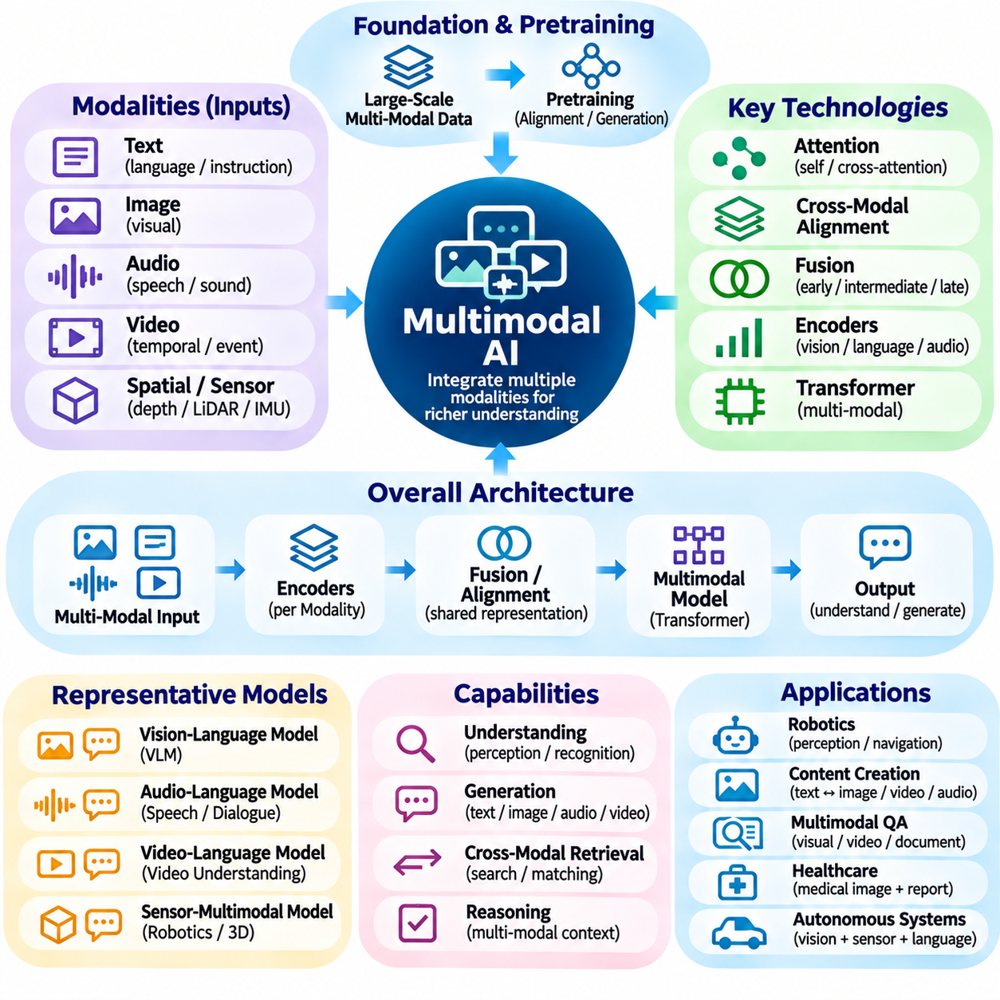{width="7.268055555555556in" height="7.268055555555556in"}

Multimodal artificial intelligence extends machine learning beyond individual information formats by integrating text, images, audio, video, and other sensory data. Its central objective is to establish meaningful relationships among different modalities so that systems can interpret complex situations more comprehensively. Unlike unimodal models, multimodal systems combine complementary evidence, enabling richer perception, contextual understanding, and interaction with digital or physical environments.

A modality represents a particular form of information, such as written language, visual observations, acoustic signals, or spatial measurements. Each modality has distinct statistical properties, temporal characteristics, and representation requirements. Images encode spatial structure, audio captures evolving waveforms, and text expresses symbolic relationships. Multimodal learning must preserve these characteristics while identifying shared information that supports integrated interpretation.

The foundation of multimodal AI lies in representation learning across heterogeneous data sources. Specialized encoders transform raw inputs into numerical features that can be processed by shared computational components. Visual encoders extract spatial patterns, language encoders represent semantic relationships, and audio encoders capture acoustic structure. Effective integration requires representations that retain modality-specific details while supporting meaningful relationships between information types.

Cross-modal alignment establishes correspondences between representations originating from different modalities. A textual description may be associated with an image, while spoken language may be aligned with visual events or written transcripts. Contrastive learning can encourage matching observations to occupy nearby regions in representation space. Alignment quality determines whether a system can reliably connect concepts across modalities rather than merely process multiple inputs independently.

Multimodal fusion combines information from different sources to construct integrated representations or predictions. Early fusion merges features before substantial processing, while late fusion combines outputs from independently trained components. Intermediate fusion integrates information within selected network layers. Each approach offers different tradeoffs involving computational complexity, information preservation, synchronization requirements, and robustness when individual modalities become unavailable.

Attention mechanisms provide flexible tools for modeling relationships across modalities. Cross-attention allows representations from one modality to selectively incorporate information from another, while self-attention captures interactions within a shared sequence. Transformer architectures can process visual patches, text tokens, and audio features through coordinated attention operations. Their effectiveness depends on suitable positional encoding, modality identification, and efficient handling of large input sequences.

Vision-language models represent a prominent category of multimodal AI systems. They associate visual observations with linguistic concepts, enabling image captioning, visual question answering, semantic retrieval, and instruction-based image interpretation. Some architectures use separate visual and language encoders, while others integrate visual tokens into language generation models. Reliable performance requires grounding generated statements in actual image content rather than relying on plausible linguistic associations.

Audio-language systems connect acoustic information with linguistic representations. Speech recognition converts spoken signals into text, while speech synthesis generates acoustic outputs from language. More integrated models can interpret speaker characteristics, environmental sounds, and conversational context. These capabilities support voice assistants, accessibility technologies, and human-machine communication. Practical systems must account for noise, accents, overlapping speakers, and temporal alignment.

Video understanding introduces additional complexity because visual information evolves over time. A video model must capture relationships among frames, object movements, actions, and events while preserving temporal order. Temporal attention, frame sampling, and motion representations help reduce computational requirements. Video-language systems can summarize events, answer questions about recorded activities, and connect descriptions with specific temporal segments, although long-duration reasoning remains challenging.

Spatial and sensor-based modalities extend multimodal learning into physical environments. Depth cameras, LiDAR, radar, inertial sensors, and positioning systems provide complementary measurements of geometry, motion, and location. Combining these signals can improve environmental perception and state estimation. However, sensor fusion requires calibration, coordinate transformations, timestamp synchronization, and explicit treatment of measurement uncertainty.

Multimodal foundation models acquire reusable representations through large-scale pretraining on diverse information sources. Image-text pairs, audio-transcript collections, and synchronized video recordings can provide learning signals for alignment and generation. Pretrained models may subsequently be adapted to specialized tasks through prompting or fine-tuning. Their transfer capabilities depend on dataset diversity, representation quality, modality coverage, and differences between training and deployment environments.

Generative multimodal AI supports content creation and transformation across information formats. A model may generate an image from text, produce spoken responses, describe visual scenes, or synthesize video from structured conditions. Such systems often combine language representations with autoregressive or diffusion-based generation mechanisms. Output realism must be distinguished from semantic accuracy, physical consistency, and faithful adherence to source information.

Missing or degraded modalities create important challenges for multimodal systems. Cameras may fail under poor illumination, microphones may capture excessive noise, and networked sensors may provide incomplete measurements. Robust architectures should detect unreliable inputs and adjust their predictions according to available evidence. Modality dropout, uncertainty estimation, and redundancy-aware fusion can improve resilience, although no combination of sensors guarantees complete reliability.

Temporal synchronization is essential when multimodal observations describe the same evolving event. Audio signals, video frames, and sensor measurements may arrive at different frequencies or experience communication delays. Misaligned timestamps can produce incorrect associations between actions and observations. Real-time systems therefore require synchronization mechanisms, buffering strategies, and latency-aware processing to maintain consistent interpretations of dynamic environments.

Multimodal AI contributes directly to embodied intelligence by connecting perception with action in physical systems. Autonomous robots can combine camera images, depth measurements, language instructions, and motion feedback to interpret tasks and navigate environments. Vision-language-action architectures may map multimodal observations into action representations. Their deployment requires additional safeguards because perception errors or ambiguous instructions can produce unsafe physical behavior.

Multimodal reasoning involves drawing conclusions from complementary information rather than simply recognizing patterns within each modality. A system may interpret a spoken instruction while examining a visual scene, or combine spatial measurements with semantic descriptions to identify relevant objects. Such reasoning requires accurate grounding, consistent representations, and awareness of uncertainty. Apparent fluency does not establish that the model has correctly integrated all available evidence.

Evaluation of multimodal systems must address both individual modality performance and cross-modal integration. Image recognition, speech transcription, temporal localization, and spatial estimation require different metrics. Joint evaluation should examine alignment accuracy, grounding, robustness, and consistency under conflicting inputs. Testing should include missing modalities, distribution shifts, noisy observations, and realistic operational conditions rather than relying exclusively on benchmark averages.

Computational efficiency is a significant concern because multimodal models process several potentially high-dimensional information streams. High-resolution images, long videos, and continuous audio can increase memory requirements and inference latency. Efficient encoders, token reduction, adaptive sampling, and optimized fusion mechanisms help manage these costs. Edge deployment introduces additional constraints involving power consumption, bandwidth, thermal limits, and predictable execution.

Safety and governance become more complex when multimodal AI processes sensitive information from several sources. Images may reveal identities, audio may contain private conversations, and sensor streams may expose behavioral patterns. Systems must enforce appropriate access permissions, data minimization, secure storage, and retention policies. Generated descriptions also require safeguards against misleading interpretations, unsupported inferences, and unintended disclosure of sensitive information.

Multimodal AI should be understood as an integration framework rather than a guarantee of comprehensive intelligence. Combining information sources can improve perception and contextual interpretation, but effectiveness depends on alignment, fusion, data quality, and task-specific validation. Symbolic reasoning, knowledge graphs, planning algorithms, and external tools can complement learned multimodal representations. Complete systems must coordinate these capabilities according to operational objectives.

The continuing development of multimodal AI is moving toward unified models that connect language, perception, temporal understanding, and action. Future progress depends on stronger grounding, efficient representations, reliable sensor integration, and improved reasoning across modalities. Its broader significance lies in enabling artificial intelligence systems to interpret and respond to information in forms closer to those encountered in complex real-world environments.

멀티모달 인공지능(Multimodal Artificial Intelligence)은 텍스트(Text), 이미지(Image), 오디오(Audio), 비디오(Video), 기타 감각 데이터(Sensory Data)를 통합함으로써 기계학습(Machine Learning)의 범위를 개별 정보 형식(Information Format) 이상으로 확장한다. 핵심 목표는 서로 다른 모달리티(Modality) 사이에 의미 있는 관계(Meaningful Relationship)를 형성하여 시스템이 복잡한 상황을 더욱 종합적으로 해석하도록 하는 것이다. 단일 모달리티 모델(Unimodal Model)과 달리 멀티모달 시스템(Multimodal System)은 상호 보완적인 근거(Complementary Evidence)를 결합하여 더욱 풍부한 인식(Perception), 문맥적 이해(Contextual Understanding), 디지털 또는 물리적 환경(Digital or Physical Environment)과의 상호작용을 가능하게 한다.

모달리티(Modality)는 문자 언어(Written Language), 시각적 관측(Visual Observation), 음향 신호(Acoustic Signal), 공간 측정값(Spatial Measurement)과 같은 특정 정보 형태를 의미한다. 각 모달리티는 고유한 통계적 특성(Statistical Property), 시간적 특성(Temporal Characteristic), 표현 요구사항(Representation Requirement)을 가진다. 이미지는 공간 구조(Spatial Structure)를 인코딩하고, 오디오는 시간에 따라 변화하는 파형(Waveform)을 포착하며, 텍스트는 기호적 관계(Symbolic Relationship)를 표현한다. 멀티모달 학습(Multimodal Learning)은 이러한 특성을 보존하면서 통합적 해석(Integrated Interpretation)을 지원하는 공유 정보(Shared Information)를 식별해야 한다.

멀티모달 인공지능(Multimodal AI)의 기반은 이질적인 데이터 소스(Heterogeneous Data Source) 전반에 걸친 표현 학습(Representation Learning)에 있다. 특화된 인코더(Specialized Encoder)는 원시 입력(Raw Input)을 공유 계산 구성 요소(Shared Computational Component)가 처리할 수 있는 수치 특징(Numerical Feature)으로 변환한다. 시각 인코더(Visual Encoder)는 공간적 패턴(Spatial Pattern)을 추출하고, 언어 인코더(Language Encoder)는 의미적 관계(Semantic Relationship)를 표현하며, 오디오 인코더(Audio Encoder)는 음향 구조(Acoustic Structure)를 포착한다. 효과적인 통합(Integration)을 위해서는 모달리티별 세부 정보(Modality-Specific Detail)를 유지하면서 정보 유형 사이의 의미 있는 관계를 지원하는 표현이 필요하다.

교차 모달 정렬(Cross-Modal Alignment)은 서로 다른 모달리티에서 생성된 표현(Representation) 사이의 대응 관계(Correspondence)를 형성한다. 텍스트 설명(Textual Description)은 이미지와 연결될 수 있으며, 음성 언어(Spoken Language)는 시각적 사건(Visual Event)이나 문자 전사(Written Transcript)와 정렬될 수 있다. 대조 학습(Contrastive Learning)은 서로 대응하는 관측값(Matching Observation)이 표현 공간(Representation Space)에서 가까운 영역에 위치하도록 유도할 수 있다. 정렬 품질(Alignment Quality)은 시스템이 여러 입력을 독립적으로 처리하는 수준을 넘어 모달리티 사이의 개념을 신뢰성 있게 연결할 수 있는지를 결정한다.

멀티모달 융합(Multimodal Fusion)은 서로 다른 정보원(Information Source)의 정보를 결합하여 통합 표현(Integrated Representation)이나 예측(Prediction)을 구성한다. 초기 융합(Early Fusion)은 본격적인 처리 이전에 특징(Feature)을 병합하며, 후기 융합(Late Fusion)은 독립적으로 학습된 구성 요소(Component)의 출력을 결합한다. 중간 융합(Intermediate Fusion)은 선택된 신경망 계층(Network Layer) 내부에서 정보를 통합한다. 각 접근법은 계산 복잡도(Computational Complexity), 정보 보존(Information Preservation), 동기화 요구사항(Synchronization Requirement), 개별 모달리티를 사용할 수 없을 때의 강건성(Robustness) 사이에서 서로 다른 절충관계(Tradeoff)를 가진다.

어텐션 메커니즘(Attention Mechanism)은 모달리티 사이의 관계를 모델링하는 유연한 도구를 제공한다. 교차 어텐션(Cross-Attention)은 한 모달리티의 표현이 다른 모달리티의 정보를 선택적으로 반영하도록 하며, 자기 어텐션(Self-Attention)은 공유 시퀀스(Shared Sequence) 내부의 상호작용을 포착한다. 트랜스포머 아키텍처(Transformer Architecture)는 시각 패치(Visual Patch), 텍스트 토큰(Text Token), 오디오 특징(Audio Feature)을 조정된 어텐션 연산(Coordinated Attention Operation)을 통해 처리할 수 있다. 이러한 아키텍처의 효과는 적절한 위치 인코딩(Positional Encoding), 모달리티 식별(Modality Identification), 대규모 입력 시퀀스(Large Input Sequence)의 효율적인 처리에 따라 달라진다.

비전-언어 모델(Vision-Language Model, VLM)은 멀티모달 인공지능 시스템(Multimodal AI System)의 대표적인 범주이다. 이러한 모델은 시각적 관측(Visual Observation)을 언어적 개념(Linguistic Concept)과 연결하여 이미지 캡셔닝(Image Captioning), 시각적 질의응답(Visual Question Answering), 의미 기반 검색(Semantic Retrieval), 명령 기반 이미지 해석(Instruction-Based Image Interpretation)을 가능하게 한다. 일부 아키텍처는 별도의 시각 및 언어 인코더(Visual and Language Encoder)를 사용하며, 다른 아키텍처는 시각 토큰(Visual Token)을 언어 생성 모델(Language Generation Model)에 통합한다. 신뢰할 수 있는 성능을 위해서는 그럴듯한 언어적 연관성(Plausible Linguistic Association)에 의존하지 않고 실제 이미지 내용(Actual Image Content)에 근거하여 생성된 진술(Generated Statement)을 구성해야 한다.

오디오-언어 시스템(Audio-Language System)은 음향 정보(Acoustic Information)를 언어적 표현(Linguistic Representation)과 연결한다. 음성 인식(Speech Recognition)은 발화 신호(Spoken Signal)를 텍스트로 변환하며, 음성 합성(Speech Synthesis)은 언어로부터 음향 출력(Acoustic Output)을 생성한다. 더욱 통합된 모델(Integrated Model)은 화자 특성(Speaker Characteristic), 환경 소리(Environmental Sound), 대화 문맥(Conversational Context)을 해석할 수 있다. 이러한 능력은 음성 비서(Voice Assistant), 접근성 기술(Accessibility Technology), 인간-기계 통신(Human-Machine Communication)을 지원한다. 실제 시스템은 잡음(Noise), 억양(Accent), 중첩 발화(Overlapping Speaker), 시간적 정렬(Temporal Alignment)을 고려해야 한다.

비디오 이해(Video Understanding)는 시각 정보(Visual Information)가 시간에 따라 변화하기 때문에 추가적인 복잡성을 도입한다. 비디오 모델(Video Model)은 시간적 순서(Temporal Order)를 보존하면서 프레임(Frame), 객체 움직임(Object Movement), 행동(Action), 사건(Event) 사이의 관계를 포착해야 한다. 시간적 어텐션(Temporal Attention), 프레임 샘플링(Frame Sampling), 움직임 표현(Motion Representation)은 계산 요구량(Computational Requirement)을 줄이는 데 도움을 준다. 비디오-언어 시스템(Video-Language System)은 사건을 요약하고, 기록된 활동(Recorded Activity)에 관한 질문에 답하며, 설명을 특정 시간 구간(Temporal Segment)과 연결할 수 있지만 장시간 추론(Long-Duration Reasoning)은 여전히 어려운 과제로 남아 있다.

공간 및 센서 기반 모달리티(Spatial and Sensor-Based Modality)는 멀티모달 학습(Multimodal Learning)을 물리적 환경(Physical Environment)으로 확장한다. 깊이 카메라(Depth Camera), 라이다(LiDAR), 레이더(Radar), 관성 센서(Inertial Sensor), 위치 결정 시스템(Positioning System)은 기하학적 구조(Geometry), 움직임(Motion), 위치(Location)에 대한 상호 보완적인 측정값(Complementary Measurement)을 제공한다. 이러한 신호를 결합하면 환경 인식(Environmental Perception)과 상태 추정(State Estimation)을 개선할 수 있다. 그러나 센서 융합(Sensor Fusion)을 위해서는 캘리브레이션(Calibration), 좌표 변환(Coordinate Transformation), 타임스탬프 동기화(Timestamp Synchronization), 측정 불확실성(Measurement Uncertainty)의 명시적인 처리가 필요하다.

멀티모달 파운데이션 모델(Multimodal Foundation Model)은 다양한 정보원(Information Source)에 대한 대규모 사전학습(Large-Scale Pretraining)을 통해 재사용 가능한 표현(Reusable Representation)을 획득한다. 이미지-텍스트 쌍(Image-Text Pair), 오디오-전사 데이터 집합(Audio-Transcript Collection), 동기화된 비디오 녹화(Synchronized Video Recording)는 정렬(Alignment)과 생성(Generation)을 위한 학습 신호(Learning Signal)를 제공할 수 있다. 사전학습된 모델(Pretrained Model)은 이후 프롬프팅(Prompting)이나 미세조정(Fine-Tuning)을 통해 특화된 작업(Specialized Task)에 적응될 수 있다. 전이 능력(Transfer Capability)은 데이터셋 다양성(Dataset Diversity), 표현 품질(Representation Quality), 모달리티 포괄성(Modality Coverage), 학습 환경과 배포 환경 사이의 차이에 따라 달라진다.

생성형 멀티모달 인공지능(Generative Multimodal AI)은 서로 다른 정보 형식(Information Format) 사이의 콘텐츠 생성(Content Creation)과 변환(Transformation)을 지원한다. 모델은 텍스트로부터 이미지를 생성하거나, 음성 응답(Spoken Response)을 생성하거나, 시각적 장면(Visual Scene)을 설명하거나, 구조화된 조건(Structured Condition)을 기반으로 비디오를 합성할 수 있다. 이러한 시스템은 언어 표현(Language Representation)을 자기회귀 생성 메커니즘(Autoregressive Generation Mechanism)이나 확산 기반 생성 메커니즘(Diffusion-Based Generation Mechanism)과 결합하는 경우가 많다. 출력의 사실적 외관(Output Realism)은 의미적 정확성(Semantic Accuracy), 물리적 일관성(Physical Consistency), 원본 정보에 대한 충실성(Faithfulness to Source Information)과 구분해야 한다.

누락되거나 품질이 저하된 모달리티(Missing or Degraded Modality)는 멀티모달 시스템(Multimodal System)에 중요한 과제를 발생시킨다. 카메라(Camera)는 조명이 부족한 환경(Poor Illumination)에서 제대로 작동하지 않을 수 있으며, 마이크로폰(Microphone)은 과도한 잡음(Excessive Noise)을 수집할 수 있고, 네트워크 연결 센서(Networked Sensor)는 불완전한 측정값(Incomplete Measurement)을 제공할 수 있다. 강건한 아키텍처(Robust Architecture)는 신뢰할 수 없는 입력(Unreliable Input)을 탐지하고 사용 가능한 근거(Available Evidence)에 따라 예측을 조정해야 한다. 모달리티 드롭아웃(Modality Dropout), 불확실성 추정(Uncertainty Estimation), 중복성을 고려한 융합(Redundancy-Aware Fusion)은 복원력(Resilience)을 향상시킬 수 있지만, 어떠한 센서 조합도 완전한 신뢰성을 보장하지는 않는다.

시간적 동기화(Temporal Synchronization)는 멀티모달 관측값(Multimodal Observation)이 동일한 시간 변화 사건(Evolving Event)을 설명할 때 필수적이다. 오디오 신호(Audio Signal), 비디오 프레임(Video Frame), 센서 측정값(Sensor Measurement)은 서로 다른 주파수(Frequency)로 도착하거나 통신 지연(Communication Delay)을 경험할 수 있다. 정렬되지 않은 타임스탬프(Misaligned Timestamp)는 행동(Action)과 관측값(Observation) 사이에 잘못된 연관성을 형성할 수 있다. 따라서 실시간 시스템(Real-Time System)은 동적 환경(Dynamic Environment)에 대한 일관된 해석(Consistent Interpretation)을 유지하기 위해 동기화 메커니즘(Synchronization Mechanism), 버퍼링 전략(Buffering Strategy), 지연시간 인식 처리(Latency-Aware Processing)가 필요하다.

멀티모달 인공지능(Multimodal AI)은 물리적 시스템(Physical System)에서 인식(Perception)과 행동(Action)을 연결함으로써 체화 지능(Embodied Intelligence)에 직접적으로 기여한다. 자율 로봇(Autonomous Robot)은 카메라 이미지(Camera Image), 깊이 측정값(Depth Measurement), 언어 명령(Language Instruction), 움직임 피드백(Motion Feedback)을 결합하여 작업을 해석하고 환경을 탐색할 수 있다. 비전-언어-행동 아키텍처(Vision-Language-Action Architecture, VLA)는 멀티모달 관측값(Multimodal Observation)을 행동 표현(Action Representation)으로 매핑할 수 있다. 인식 오류(Perception Error)나 모호한 명령(Ambiguous Instruction)이 안전하지 않은 물리적 행동(Unsafe Physical Behavior)을 유발할 수 있으므로 배포에는 추가적인 안전장치(Safeguard)가 필요하다.

멀티모달 추론(Multimodal Reasoning)은 각 모달리티 내부의 패턴을 단순히 인식하는 것을 넘어 상호 보완적인 정보(Complementary Information)로부터 결론을 도출하는 것을 의미한다. 시스템은 시각적 장면(Visual Scene)을 관찰하면서 음성 명령(Spoken Instruction)을 해석하거나, 공간 측정값(Spatial Measurement)과 의미적 설명(Semantic Description)을 결합하여 관련 객체(Relevant Object)를 식별할 수 있다. 이러한 추론에는 정확한 근거 연결(Accurate Grounding), 일관된 표현(Consistent Representation), 불확실성 인식(Uncertainty Awareness)이 필요하다. 겉으로 드러나는 유창성(Apparent Fluency)만으로 모델이 사용 가능한 모든 근거를 올바르게 통합했다는 사실이 입증되지는 않는다.

멀티모달 시스템 평가(Multimodal System Evaluation)는 개별 모달리티 성능(Individual Modality Performance)과 교차 모달 통합(Cross-Modal Integration)을 모두 다루어야 한다. 이미지 인식(Image Recognition), 음성 전사(Speech Transcription), 시간적 위치 특정(Temporal Localization), 공간 추정(Spatial Estimation)은 서로 다른 평가 지표(Evaluation Metric)를 요구한다. 공동 평가(Joint Evaluation)는 정렬 정확도(Alignment Accuracy), 근거 연결(Grounding), 강건성(Robustness), 충돌하는 입력(Conflicting Input)에서의 일관성(Consistency)을 검토해야 한다. 테스트(Testing)에는 벤치마크 평균(Benchmark Average)에만 의존하지 않고 누락된 모달리티(Missing Modality), 분포 이동(Distribution Shift), 잡음이 포함된 관측값(Noisy Observation), 실제 운영 조건(Realistic Operational Condition)이 포함되어야 한다.

계산 효율성(Computational Efficiency)은 멀티모달 모델(Multimodal Model)이 여러 고차원 정보 스트림(High-Dimensional Information Stream)을 처리하기 때문에 중요한 고려사항이다. 고해상도 이미지(High-Resolution Image), 긴 비디오(Long Video), 연속 오디오(Continuous Audio)는 메모리 요구량(Memory Requirement)과 추론 지연시간(Inference Latency)을 증가시킬 수 있다. 효율적인 인코더(Efficient Encoder), 토큰 축소(Token Reduction), 적응형 샘플링(Adaptive Sampling), 최적화된 융합 메커니즘(Optimized Fusion Mechanism)은 이러한 비용을 관리하는 데 도움을 준다. 엣지 배포(Edge Deployment)는 전력 소비(Power Consumption), 대역폭(Bandwidth), 열적 한계(Thermal Limit), 예측 가능한 실행(Predictable Execution)에 관한 추가적인 제약조건을 도입한다.

안전성(Safety)과 거버넌스(Governance)는 멀티모달 인공지능(Multimodal AI)이 여러 정보원에서 민감한 정보(Sensitive Information)를 처리할 때 더욱 복잡해진다. 이미지는 개인의 신원(Identity)을 드러낼 수 있고, 오디오는 사적인 대화(Private Conversation)를 포함할 수 있으며, 센서 스트림(Sensor Stream)은 행동 패턴(Behavioral Pattern)을 노출할 수 있다. 시스템은 적절한 접근 권한(Access Permission), 데이터 최소화(Data Minimization), 안전한 저장(Secure Storage), 보존 정책(Retention Policy)을 적용해야 한다. 생성된 설명(Generated Description)에 대해서도 오해를 유발하는 해석(Misleading Interpretation), 근거 없는 추론(Unsupported Inference), 민감한 정보의 의도하지 않은 공개(Unintended Disclosure)를 방지하기 위한 안전장치가 필요하다.

멀티모달 인공지능(Multimodal AI)은 포괄적인 지능(Comprehensive Intelligence)을 보장하는 기술이 아니라 통합 프레임워크(Integration Framework)로 이해해야 한다. 정보원을 결합하면 인식(Perception)과 문맥적 해석(Contextual Interpretation)을 개선할 수 있지만, 그 효과는 정렬(Alignment), 융합(Fusion), 데이터 품질(Data Quality), 작업별 검증(Task-Specific Validation)에 따라 달라진다. 기호적 추론(Symbolic Reasoning), 지식 그래프(Knowledge Graph), 계획 알고리즘(Planning Algorithm), 외부 도구(External Tool)는 학습된 멀티모달 표현(Learned Multimodal Representation)을 보완할 수 있다. 완전한 시스템(Complete System)은 운영 목표(Operational Objective)에 따라 이러한 능력을 조정해야 한다.

멀티모달 인공지능(Multimodal AI)의 지속적인 발전은 언어(Language), 인식(Perception), 시간적 이해(Temporal Understanding), 행동(Action)을 연결하는 통합 모델(Unified Model)로 향하고 있다. 향후 발전은 더욱 강력한 근거 연결(Stronger Grounding), 효율적인 표현(Efficient Representation), 신뢰할 수 있는 센서 통합(Reliable Sensor Integration), 모달리티 전반의 개선된 추론(Improved Cross-Modal Reasoning)에 달려 있다. 멀티모달 인공지능의 보다 광범위한 중요성은 인공지능 시스템(AI System)이 복잡한 실제 환경(Complex Real-World Environment)에서 접하는 정보 형태에 더욱 가까운 방식으로 정보를 해석하고 대응할 수 있도록 한다는 데 있다.

## 06.06 Generative AI

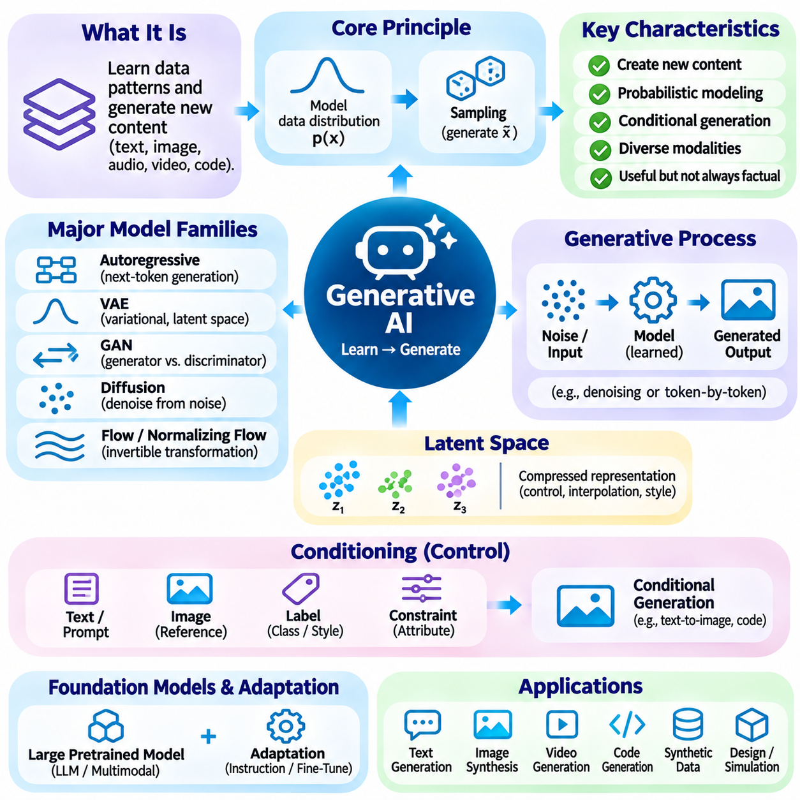{width="7.268055555555556in" height="7.268055555555556in"}

Generative artificial intelligence refers to computational systems that learn patterns from existing data and produce new content resembling the statistical structure of their training distributions. Unlike discriminative models that primarily classify or predict labels, generative models construct text, images, audio, video, code, or structured data. Their purpose is not simply to reproduce examples but to generate plausible outputs conditioned on learned representations and specified requirements.

The theoretical foundation of generative AI lies in probabilistic modeling and representation learning. A generative model approximates a data distribution or learns a process for producing samples from it. Training objectives encourage the model to capture relationships among features, contexts, and latent variables. Different architectures implement this principle through token prediction, latent-space sampling, adversarial learning, or iterative denoising, each with distinct computational properties.

Autoregressive models generate content sequentially by predicting each element from previously available context. In language generation, a model estimates the probability of the next token and repeatedly extends the sequence. Similar approaches can represent images, audio, and other structured outputs as ordered elements. Autoregressive generation provides flexible conditional modeling, although long sequences increase inference latency and may accumulate errors.

Variational autoencoders provide a probabilistic framework for learning compact latent representations of complex data. An encoder maps observations into a distribution over latent variables, while a decoder reconstructs or generates samples from those variables. Training balances reconstruction quality with regularization of the latent distribution. This structure supports controlled sampling, interpolation, and representation analysis, although generated details may sometimes appear less sharp than those from other methods.

Generative adversarial networks introduce competition between a generator and a discriminator. The generator attempts to produce realistic samples, while the discriminator learns to distinguish generated content from training examples. Their adversarial training process can produce detailed synthetic images and other outputs. However, training instability, mode collapse, and sensitivity to optimization settings can limit reliability, motivating alternative generative approaches.

Diffusion models generate data by learning to reverse a progressive noise-corruption process. During training, a model learns to estimate noise or related quantities from perturbed observations. During generation, an iterative sampling procedure transforms random noise into structured content. Diffusion-based methods have achieved strong results in image synthesis and other modalities, although repeated denoising steps can introduce substantial computational costs.

Flow-based generative models learn transformations between simple probability distributions and complex data distributions. Normalizing flows use invertible transformations that permit tractable likelihood evaluation under suitable architectural constraints. Related continuous-time approaches describe generation through learned dynamics. These methods provide useful probabilistic interpretations and alternative sampling strategies, with tradeoffs involving expressiveness, memory consumption, and numerical computation.

Latent spaces play a central role in generative AI by providing compressed representations of meaningful data characteristics. Models can manipulate latent variables to control style, structure, or semantic attributes while preserving broader relationships. Latent diffusion reduces computational requirements by performing generation in compressed feature spaces. However, latent representations may encode unwanted correlations, and changing one attribute can unintentionally affect others.

Conditional generation enables users or external systems to guide generated outputs through prompts, labels, reference data, or structured constraints. Text-to-image systems interpret linguistic descriptions, while code generation models respond to programming specifications. Conditioning mechanisms may include cross-attention, learned embeddings, or specialized control networks. Output quality depends on the clarity of conditions, training coverage, and the model\'s ability to preserve intended relationships.

Foundation models have accelerated generative AI by enabling broad pretraining followed by adaptation to many applications. Large language models generate coherent text and software code, while multimodal foundation models support transformations between language, images, audio, and video. Instruction tuning and preference optimization improve responsiveness to user objectives. Nevertheless, fluent generation does not guarantee factual correctness, logical consistency, or faithful execution of instructions.

Generative AI can support creative and technical workflows by producing drafts, alternative designs, synthetic examples, and candidate solutions. In software engineering, models assist with code completion, documentation, and test generation. In industrial design, they can explore geometric variations or propose configurations. These outputs should be treated as candidates for evaluation rather than verified results, especially when functional correctness or physical constraints are important.

Synthetic data generation provides another application by producing additional training examples when real observations are limited or expensive. Generated images, simulated scenes, and artificial records can improve dataset diversity or support controlled experiments. However, synthetic samples may reproduce biases or introduce unrealistic patterns. Their usefulness depends on distributional fidelity, task relevance, diversity, and validation against independent real-world data.

Evaluation of generative models requires distinguishing perceptual quality, diversity, fidelity, and task-specific usefulness. Image generation may be assessed through distributional metrics and human judgments, while language generation requires factuality, coherence, and instruction adherence. Memorization and unintended reproduction of training examples must also be examined. No single metric fully captures generation quality, making combined quantitative and qualitative evaluation necessary.

Hallucination is a significant concern when generative systems produce convincing outputs without sufficient evidential grounding. Language models may invent references, while image generators may create physically inconsistent objects or misleading visual details. Retrieval, external verification, constrained decoding, and domain-specific validation can reduce selected risks. High-stakes applications require independent checks because apparent realism is not equivalent to truth or operational correctness.

Controllability and consistency remain important technical challenges. Users may require exact object counts, persistent identities, stable temporal sequences, or compliance with detailed specifications. Generative models can struggle to maintain these constraints across complex outputs. Structured conditioning, iterative refinement, planning components, and verification mechanisms can improve reliability, but strict requirements often demand deterministic processing alongside learned generation.

Generative AI introduces substantial computational requirements during training and inference. Large models require accelerator memory, efficient parallel computation, and high-throughput data pipelines. Quantization, distillation, caching, model compression, and optimized sampling can reduce deployment costs. System designers must balance output quality, latency, throughput, energy consumption, and hardware availability, particularly for interactive and edge applications.

Multimodal generation extends synthesis across information formats and enables coordinated production of text, images, speech, music, and video. A system may transform written instructions into visual scenes or generate spoken explanations associated with displayed content. Temporal coherence and cross-modal alignment become essential when outputs evolve over time. These systems require evaluation of synchronization, semantic consistency, and fidelity across modalities.

Generative models also contribute to robotics and embodied AI through simulation, trajectory generation, and predictive environment modeling. World models may generate possible future observations or state transitions to support planning and decision-making. Synthetic environments can expose learning systems to diverse scenarios before physical deployment. However, simulation-to-reality differences and model uncertainty require explicit validation before generated predictions influence real-world actions.

Safety and governance are essential because generative AI can produce misinformation, deceptive media, insecure code, or content containing sensitive information. Training datasets may introduce privacy risks, copyright concerns, and representational biases. Responsible development requires data governance, access controls, content safeguards, provenance mechanisms, and human oversight. Policies must also address misuse, transparency, accountability, and the limitations of automated detection.

The economic and organizational impact of generative AI extends beyond content creation into knowledge work, software development, education, and industrial processes. Effective adoption requires redesigning workflows around human review, measurable quality, and appropriate automation boundaries. Productivity improvements depend on task suitability and verification costs. Organizations should evaluate reliability, integration complexity, security, and long-term maintenance rather than focusing exclusively on generation speed.

Generative AI should ultimately be understood as a family of probabilistic modeling approaches rather than a universal mechanism for intelligence. Its strengths lie in learning reusable data representations and producing diverse outputs under contextual constraints. Its limitations involve uncertainty, controllability, grounding, and verification. Future progress will depend on integrating generative models with reasoning, retrieval, simulation, and reliable system-level safeguards.

생성형 인공지능(Generative Artificial Intelligence)은 기존 데이터(Existing Data)로부터 패턴(Pattern)을 학습하고, 학습 데이터 분포(Training Data Distribution)의 통계적 구조(Statistical Structure)와 유사한 새로운 콘텐츠(New Content)를 생성하는 계산 시스템(Computational System)을 의미한다. 주로 분류(Classification)나 레이블 예측(Label Prediction)을 수행하는 판별 모델(Discriminative Model)과 달리, 생성 모델(Generative Model)은 텍스트(Text), 이미지(Image), 오디오(Audio), 비디오(Video), 코드(Code), 구조화된 데이터(Structured Data)를 생성한다. 그 목적은 단순히 학습 사례(Training Example)를 재현하는 것이 아니라 학습된 표현(Learned Representation)과 지정된 요구사항(Specified Requirement)을 조건으로 그럴듯한 출력(Plausible Output)을 생성하는 데 있다.

생성형 인공지능(Generative AI)의 이론적 기반(Theoretical Foundation)은 확률적 모델링(Probabilistic Modeling)과 표현 학습(Representation Learning)에 있다. 생성 모델(Generative Model)은 데이터 분포(Data Distribution)를 근사하거나 해당 분포에서 샘플(Sample)을 생성하는 과정을 학습한다. 학습 목표(Training Objective)는 모델이 특징(Feature), 문맥(Context), 잠재 변수(Latent Variable) 사이의 관계를 포착하도록 유도한다. 서로 다른 아키텍처(Architecture)는 토큰 예측(Token Prediction), 잠재 공간 샘플링(Latent-Space Sampling), 적대적 학습(Adversarial Learning), 반복적 잡음 제거(Iterative Denoising)를 통해 이러한 원리를 구현하며, 각각 고유한 계산 특성(Computational Property)을 가진다.

자기회귀 모델(Autoregressive Model)은 이전에 사용 가능한 문맥(Context)을 기반으로 각 요소(Element)를 예측하면서 콘텐츠를 순차적으로 생성한다. 언어 생성(Language Generation)에서 모델은 다음 토큰(Next Token)의 확률을 추정하고 시퀀스(Sequence)를 반복적으로 확장한다. 유사한 접근법은 이미지(Image), 오디오(Audio), 기타 구조화된 출력(Structured Output)을 순서가 있는 요소들의 집합으로 표현할 수 있다. 자기회귀 생성(Autoregressive Generation)은 유연한 조건부 모델링(Conditional Modeling)을 제공하지만, 긴 시퀀스(Long Sequence)는 추론 지연시간(Inference Latency)을 증가시키고 오류 누적(Error Accumulation)을 유발할 수 있다.

변분 오토인코더(Variational Autoencoder, VAE)는 복잡한 데이터(Complex Data)의 압축된 잠재 표현(Compact Latent Representation)을 학습하기 위한 확률적 프레임워크(Probabilistic Framework)를 제공한다. 인코더(Encoder)는 관측값(Observation)을 잠재 변수(Latent Variable)에 대한 확률 분포(Probability Distribution)로 매핑하고, 디코더(Decoder)는 이러한 변수로부터 샘플을 재구성하거나 생성한다. 학습은 재구성 품질(Reconstruction Quality)과 잠재 분포(Latent Distribution)의 정규화(Regularization) 사이에서 균형을 유지한다. 이러한 구조는 제어된 샘플링(Controlled Sampling), 보간(Interpolation), 표현 분석(Representation Analysis)을 지원하지만, 생성된 세부 정보가 다른 방법의 결과보다 선명하지 않을 수 있다.

생성적 적대 신경망(Generative Adversarial Network, GAN)은 생성기(Generator)와 판별기(Discriminator) 사이의 경쟁을 도입한다. 생성기는 사실적인 샘플(Realistic Sample)을 생성하려고 시도하고, 판별기는 생성된 콘텐츠(Generated Content)와 학습 사례(Training Example)를 구별하도록 학습한다. 이러한 적대적 학습 과정(Adversarial Training Process)은 세밀한 합성 이미지(Synthetic Image)와 기타 출력을 생성할 수 있다. 그러나 학습 불안정성(Training Instability), 모드 붕괴(Mode Collapse), 최적화 설정(Optimization Setting)에 대한 민감성(Sensitivity)은 신뢰성을 제한할 수 있으며, 이는 대안적인 생성 접근법(Alternative Generative Approach)의 개발을 촉진한다.

확산 모델(Diffusion Model)은 점진적인 잡음 오염 과정(Progressive Noise-Corruption Process)을 역전시키는 방법을 학습하여 데이터를 생성한다. 학습 과정에서 모델은 교란된 관측값(Perturbed Observation)으로부터 잡음(Noise)이나 관련 수량(Related Quantity)을 추정하는 방법을 학습한다. 생성 과정에서는 반복적인 샘플링 절차(Iterative Sampling Procedure)를 통해 무작위 잡음(Random Noise)을 구조화된 콘텐츠(Structured Content)로 변환한다. 확산 기반 방법(Diffusion-Based Method)은 이미지 합성(Image Synthesis)과 기타 모달리티(Modality)에서 우수한 결과를 달성했지만, 반복적인 잡음 제거 단계(Denoising Step)는 상당한 계산 비용(Computational Cost)을 발생시킬 수 있다.

플로우 기반 생성 모델(Flow-Based Generative Model)은 단순한 확률 분포(Simple Probability Distribution)와 복잡한 데이터 분포(Complex Data Distribution) 사이의 변환(Transformation)을 학습한다. 정규화 흐름(Normalizing Flow)은 적절한 아키텍처 제약조건(Architectural Constraint) 아래에서 계산 가능한 우도 평가(Tractable Likelihood Evaluation)를 허용하는 가역 변환(Invertible Transformation)을 사용한다. 관련된 연속시간 접근법(Continuous-Time Approach)은 학습된 동역학(Learned Dynamics)을 통해 생성 과정을 설명한다. 이러한 방법은 유용한 확률적 해석(Probabilistic Interpretation)과 대안적인 샘플링 전략(Alternative Sampling Strategy)을 제공하지만, 표현력(Expressiveness), 메모리 소비(Memory Consumption), 수치 계산(Numerical Computation) 사이에서 절충관계(Tradeoff)가 존재한다.

잠재 공간(Latent Space)은 의미 있는 데이터 특성(Meaningful Data Characteristic)에 대한 압축 표현(Compressed Representation)을 제공함으로써 생성형 인공지능(Generative AI)에서 핵심적인 역할을 수행한다. 모델은 잠재 변수(Latent Variable)를 조작하여 스타일(Style), 구조(Structure), 의미적 속성(Semantic Attribute)을 제어하면서 더 광범위한 관계를 보존할 수 있다. 잠재 확산(Latent Diffusion)은 압축된 특징 공간(Compressed Feature Space)에서 생성 작업을 수행하여 계산 요구량(Computational Requirement)을 줄인다. 그러나 잠재 표현(Latent Representation)은 원하지 않는 상관관계(Unwanted Correlation)를 인코딩할 수 있으며, 하나의 속성을 변경하면 다른 속성에도 의도하지 않은 영향을 줄 수 있다.

조건부 생성(Conditional Generation)은 사용자나 외부 시스템(External System)이 프롬프트(Prompt), 레이블(Label), 참조 데이터(Reference Data), 구조화된 제약조건(Structured Constraint)을 통해 생성 출력을 유도할 수 있도록 한다. 텍스트-이미지 시스템(Text-to-Image System)은 언어적 설명(Linguistic Description)을 해석하며, 코드 생성 모델(Code Generation Model)은 프로그래밍 명세(Programming Specification)에 응답한다. 조건화 메커니즘(Conditioning Mechanism)에는 교차 어텐션(Cross-Attention), 학습된 임베딩(Learned Embedding), 특화된 제어 네트워크(Specialized Control Network)가 포함될 수 있다. 출력 품질(Output Quality)은 조건의 명확성(Clarity), 학습 데이터의 포괄성(Training Coverage), 의도된 관계(Intended Relationship)를 보존하는 모델의 능력에 따라 달라진다.

파운데이션 모델(Foundation Model)은 광범위한 사전학습(Broad Pretraining)과 다양한 응용 분야(Application)에 대한 후속 적응(Adaptation)을 가능하게 함으로써 생성형 인공지능(Generative AI)의 발전을 가속화했다. 대규모 언어 모델(Large Language Model, LLM)은 일관성 있는 텍스트(Coherent Text)와 소프트웨어 코드(Software Code)를 생성하며, 멀티모달 파운데이션 모델(Multimodal Foundation Model)은 언어(Language), 이미지(Image), 오디오(Audio), 비디오(Video) 사이의 변환을 지원한다. 명령어 튜닝(Instruction Tuning)과 선호도 최적화(Preference Optimization)는 사용자 목표(User Objective)에 대한 응답성을 개선한다. 그러나 유창한 생성(Fluent Generation)이 사실적 정확성(Factual Correctness), 논리적 일관성(Logical Consistency), 명령의 충실한 실행(Faithful Execution of Instructions)을 보장하지는 않는다.

생성형 인공지능(Generative AI)은 초안(Draft), 대안 설계(Alternative Design), 합성 사례(Synthetic Example), 후보 솔루션(Candidate Solution)을 생성하여 창의적 및 기술적 워크플로(Creative and Technical Workflow)를 지원할 수 있다. 소프트웨어 엔지니어링(Software Engineering)에서는 코드 완성(Code Completion), 문서화(Documentation), 테스트 생성(Test Generation)을 지원한다. 산업 설계(Industrial Design)에서는 기하학적 변형(Geometric Variation)을 탐색하거나 구성안(Configuration)을 제안할 수 있다. 이러한 출력은 검증된 결과(Verified Result)가 아니라 평가를 위한 후보(Candidate for Evaluation)로 취급해야 하며, 특히 기능적 정확성(Functional Correctness)이나 물리적 제약조건(Physical Constraint)이 중요한 경우에는 더욱 그렇다.

합성 데이터 생성(Synthetic Data Generation)은 실제 관측값(Real Observation)이 제한적이거나 확보 비용이 높은 경우 추가적인 학습 사례(Training Example)를 생성하는 또 다른 응용 분야이다. 생성된 이미지(Generated Image), 시뮬레이션 장면(Simulated Scene), 인공 기록(Artificial Record)은 데이터셋 다양성(Dataset Diversity)을 개선하거나 통제된 실험(Controlled Experiment)을 지원할 수 있다. 그러나 합성 샘플(Synthetic Sample)은 편향(Bias)을 재현하거나 비현실적인 패턴(Unrealistic Pattern)을 도입할 수 있다. 그 유용성은 분포 충실도(Distributional Fidelity), 작업 관련성(Task Relevance), 다양성(Diversity), 독립적인 실제 데이터(Independent Real-World Data)에 대한 검증에 따라 달라진다.

생성 모델 평가(Generative Model Evaluation)는 지각적 품질(Perceptual Quality), 다양성(Diversity), 충실도(Fidelity), 작업별 유용성(Task-Specific Usefulness)을 구분해야 한다. 이미지 생성(Image Generation)은 분포 기반 지표(Distributional Metric)와 인간 평가(Human Judgment)를 통해 평가할 수 있으며, 언어 생성(Language Generation)은 사실성(Factuality), 일관성(Coherence), 명령 준수(Instruction Adherence)를 검토해야 한다. 학습 사례(Training Example)의 암기(Memorization)와 의도하지 않은 재현(Unintended Reproduction)도 조사해야 한다. 단일 평가 지표(Single Metric)만으로는 생성 품질(Generation Quality)을 완전히 설명할 수 없으므로 정량적 평가(Quantitative Evaluation)와 정성적 평가(Qualitative Evaluation)를 결합해야 한다.

환각(Hallucination)은 생성 시스템(Generative System)이 충분한 증거적 근거(Evidential Grounding) 없이 설득력 있는 출력(Convincing Output)을 생성할 수 있기 때문에 중요한 문제이다. 언어 모델(Language Model)은 존재하지 않는 참고문헌(Reference)을 만들어낼 수 있으며, 이미지 생성기(Image Generator)는 물리적으로 일관되지 않은 객체(Physically Inconsistent Object)나 오해를 유발하는 시각적 세부 정보(Misleading Visual Detail)를 생성할 수 있다. 검색(Retrieval), 외부 검증(External Verification), 제약된 디코딩(Constrained Decoding), 도메인별 검증(Domain-Specific Validation)은 일부 위험을 줄일 수 있다. 높은 위험이 수반되는 응용(High-Stakes Application)에서는 겉으로 보이는 사실성(Apparent Realism)이 진실(Truth)이나 운영상 정확성(Operational Correctness)과 동일하지 않으므로 독립적인 검증(Independent Check)이 필요하다.

제어 가능성(Controllability)과 일관성(Consistency)은 여전히 중요한 기술적 과제(Technical Challenge)이다. 사용자는 정확한 객체 수(Exact Object Count), 지속적인 정체성(Persistent Identity), 안정적인 시간적 시퀀스(Stable Temporal Sequence), 상세 명세(Detailed Specification)의 준수를 요구할 수 있다. 생성 모델(Generative Model)은 복잡한 출력(Complex Output) 전반에서 이러한 제약조건을 유지하는 데 어려움을 겪을 수 있다. 구조화된 조건화(Structured Conditioning), 반복적 개선(Iterative Refinement), 계획 구성 요소(Planning Component), 검증 메커니즘(Verification Mechanism)은 신뢰성을 개선할 수 있지만, 엄격한 요구사항(Strict Requirement)은 학습 기반 생성(Learned Generation)과 함께 결정론적 처리(Deterministic Processing)를 필요로 하는 경우가 많다.

생성형 인공지능(Generative AI)은 학습(Training)과 추론(Inference) 과정에서 상당한 계산 요구량(Computational Requirement)을 발생시킨다. 대규모 모델(Large Model)은 가속기 메모리(Accelerator Memory), 효율적인 병렬 계산(Efficient Parallel Computation), 고처리량 데이터 파이프라인(High-Throughput Data Pipeline)을 필요로 한다. 양자화(Quantization), 지식 증류(Distillation), 캐싱(Caching), 모델 압축(Model Compression), 최적화된 샘플링(Optimized Sampling)은 배포 비용(Deployment Cost)을 줄일 수 있다. 시스템 설계자(System Designer)는 특히 대화형 응용(Interactive Application)과 엣지 응용(Edge Application)에서 출력 품질(Output Quality), 지연시간(Latency), 처리량(Throughput), 에너지 소비(Energy Consumption), 하드웨어 가용성(Hardware Availability) 사이의 균형을 유지해야 한다.

멀티모달 생성(Multimodal Generation)은 여러 정보 형식(Information Format)에 걸쳐 합성(Synthesis)을 확장하며, 텍스트(Text), 이미지(Image), 음성(Speech), 음악(Music), 비디오(Video)의 조정된 생성(Coordinated Production)을 가능하게 한다. 시스템은 문자 명령(Written Instruction)을 시각적 장면(Visual Scene)으로 변환하거나 표시된 콘텐츠(Displayed Content)와 연관된 음성 설명(Spoken Explanation)을 생성할 수 있다. 출력이 시간에 따라 변화하는 경우 시간적 일관성(Temporal Coherence)과 교차 모달 정렬(Cross-Modal Alignment)이 필수적이다. 이러한 시스템은 동기화(Synchronization), 의미적 일관성(Semantic Consistency), 모달리티 전반의 충실도(Cross-Modal Fidelity)에 대한 평가를 필요로 한다.

생성 모델(Generative Model)은 시뮬레이션(Simulation), 궤적 생성(Trajectory Generation), 예측적 환경 모델링(Predictive Environment Modeling)을 통해 로봇공학(Robotics)과 체화 인공지능(Embodied AI)에도 기여한다. 월드 모델(World Model)은 계획(Planning)과 의사결정(Decision-Making)을 지원하기 위해 가능한 미래 관측값(Future Observation)이나 상태 전이(State Transition)를 생성할 수 있다. 합성 환경(Synthetic Environment)은 물리적 배포(Physical Deployment) 이전에 학습 시스템(Learning System)을 다양한 시나리오(Scenario)에 노출시킬 수 있다. 그러나 시뮬레이션과 현실 사이의 차이(Simulation-to-Reality Difference) 및 모델 불확실성(Model Uncertainty)을 고려하여, 생성된 예측(Generated Prediction)이 실제 행동(Real-World Action)에 영향을 미치기 전에 명시적인 검증(Explicit Validation)을 수행해야 한다.

안전성(Safety)과 거버넌스(Governance)는 생성형 인공지능(Generative AI)이 허위 정보(Misinformation), 기만적 미디어(Deceptive Media), 보안에 취약한 코드(Insecure Code), 민감한 정보(Sensitive Information)를 포함하는 콘텐츠를 생성할 수 있기 때문에 필수적이다. 학습 데이터셋(Training Dataset)은 개인정보 보호 위험(Privacy Risk), 저작권 문제(Copyright Concern), 표현상의 편향(Representational Bias)을 유발할 수 있다. 책임 있는 개발(Responsible Development)을 위해서는 데이터 거버넌스(Data Governance), 접근 제어(Access Control), 콘텐츠 안전장치(Content Safeguard), 출처 추적 메커니즘(Provenance Mechanism), 인간 감독(Human Oversight)이 필요하다. 정책(Policy)은 오용(Misuse), 투명성(Transparency), 책임성(Accountability), 자동화된 탐지(Automated Detection)의 한계도 다루어야 한다.

생성형 인공지능(Generative AI)의 경제적 및 조직적 영향(Economic and Organizational Impact)은 콘텐츠 생성(Content Creation)을 넘어 지식 노동(Knowledge Work), 소프트웨어 개발(Software Development), 교육(Education), 산업 프로세스(Industrial Process)로 확장된다. 효과적인 도입(Effective Adoption)을 위해서는 인간 검토(Human Review), 측정 가능한 품질(Measurable Quality), 적절한 자동화 경계(Automation Boundary)를 중심으로 워크플로(Workflow)를 재설계해야 한다. 생산성 향상(Productivity Improvement)은 작업 적합성(Task Suitability)과 검증 비용(Verification Cost)에 따라 달라진다. 조직은 생성 속도(Generation Speed)에만 집중하기보다 신뢰성(Reliability), 통합 복잡도(Integration Complexity), 보안(Security), 장기 유지보수(Long-Term Maintenance)를 평가해야 한다.

생성형 인공지능(Generative AI)은 궁극적으로 보편적인 지능 메커니즘(Universal Mechanism for Intelligence)이 아니라 확률적 모델링 접근법(Probabilistic Modeling Approach)의 한 계열로 이해해야 한다. 그 강점은 재사용 가능한 데이터 표현(Reusable Data Representation)을 학습하고 문맥적 제약조건(Contextual Constraint) 아래에서 다양한 출력(Diverse Output)을 생성하는 데 있다. 반면 한계는 불확실성(Uncertainty), 제어 가능성(Controllability), 근거 연결(Grounding), 검증(Verification)과 관련된다. 향후 발전은 생성 모델(Generative Model)을 추론(Reasoning), 검색(Retrieval), 시뮬레이션(Simulation), 신뢰할 수 있는 시스템 수준 안전장치(Reliable System-Level Safeguard)와 통합하는 데 달려 있다.

## 06.07 Agentic AI and Tool Use

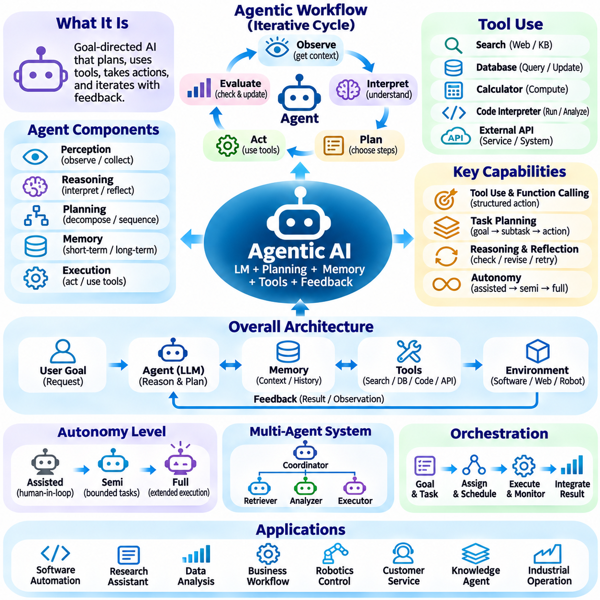{width="7.268055555555556in" height="7.268055555555556in"}

Agentic artificial intelligence refers to AI systems that pursue objectives through sequences of decisions, actions, and interactions with external environments. Unlike models that produce a single response to an isolated request, agentic systems can maintain task context, select tools, evaluate results, and continue execution. Their defining characteristic is goal-directed behavior supported by feedback, although the degree of autonomy depends on system design and operational constraints.

An AI agent can be understood as a computational entity that observes its environment, maintains relevant information, and selects actions intended to achieve specified goals. Its architecture typically includes perception, reasoning, planning, memory, and execution components. Language models may provide flexible interpretation and decision support, while external software performs concrete operations. Reliable agents require explicit boundaries between proposed actions and authorized execution.

The agentic workflow commonly follows an iterative cycle of observation, interpretation, planning, action, and evaluation. An agent receives a request or environmental signal, determines the current state, and identifies possible next steps. After executing an authorized action, it examines the returned information and updates its plan. This feedback loop distinguishes interactive agency from static content generation and allows systems to respond to changing conditions.

Planning enables agents to transform broad objectives into manageable intermediate tasks. A complex request may require information gathering, dependency analysis, resource selection, and ordered execution. Some agents generate plans explicitly, while others select actions incrementally based on current observations. Effective planning must consider task dependencies, uncertainty, execution costs, and stopping conditions rather than assuming that every generated step will succeed.

Tool use connects an agent\'s reasoning capabilities with external computational functions. Tools may include search engines, databases, calculators, code interpreters, document processors, and application programming interfaces. The agent selects an appropriate operation and supplies structured arguments according to a defined interface. Tool execution produces observations that inform subsequent decisions, allowing the system to access information and perform operations beyond its internal model capabilities.

Function calling provides a structured mechanism for integrating language models with software tools. A model generates a request containing a function identifier and arguments that conform to an expected schema. A separate execution component validates the request, checks permissions, invokes the function, and returns its result. This separation is essential because generating a plausible tool call does not establish that the requested operation is valid, safe, or authorized.

Memory supports continuity across the multiple interactions required by agentic workflows. Short-term memory maintains current instructions, observations, and intermediate results, while persistent memory may preserve relevant information across sessions. External stores can retain documents, task states, or summarized histories. Memory systems must manage relevance, freshness, access permissions, and error propagation because outdated or incorrect records can distort future decisions.

Reasoning and reflection mechanisms help agents evaluate whether their actions are advancing the intended objective. An agent may compare intermediate results with expected conditions, identify inconsistencies, or revise a failed plan. Verification can involve deterministic checks, external evidence, tests, or human review. Reflection is useful only when supported by reliable feedback, since repeated model-generated explanations may reinforce errors rather than correct them.

Autonomy exists along a continuum from assisted interaction to extended independent execution. A low-autonomy system may suggest actions for human approval, while a higher-autonomy agent may perform bounded sequences of authorized operations. Greater autonomy increases the importance of monitoring, recoverability, and explicit stopping rules. System designers should match autonomy levels to task risk, environmental uncertainty, and the consequences of incorrect actions.

Multi-agent systems distribute responsibilities among several interacting agents with different roles or capabilities. One agent may coordinate objectives, another may retrieve information, and others may perform specialized analysis or execution. Communication protocols and shared task representations support cooperation. However, multiple agents introduce coordination overhead, inconsistent assumptions, duplicated work, and possible conflicts, making orchestration and verification essential.

Agent orchestration manages the relationships among goals, subtasks, tools, resources, and execution states. An orchestrator may assign responsibilities, track dependencies, schedule operations, and combine partial results. Workflow engines can enforce deterministic sequences where predictable behavior is necessary, while language models handle ambiguous decisions. Hybrid architectures are often preferable because not every operation benefits from probabilistic reasoning or autonomous selection.

Environmental feedback is particularly important when agents interact with dynamic software systems or physical platforms. Web interfaces may change, database records may be updated, and robots may encounter unexpected obstacles. Agents must distinguish intended actions from observed outcomes and avoid assuming success without confirmation. State estimation, event monitoring, retries, and recovery procedures help maintain operational consistency when conditions differ from the original plan.

Tool selection introduces practical challenges involving capability discovery, argument construction, and execution reliability. An agent must determine which tools are available, understand their interfaces, and avoid incompatible operations. Structured schemas reduce ambiguity, while validation prevents malformed requests from reaching execution systems. Timeouts, unavailable services, partial results, and repeated operations require explicit handling to prevent uncontrolled execution loops.

Security becomes critical when agents can access files, external services, or operational infrastructure. Prompt injection may occur when untrusted documents or tool responses contain instructions intended to redirect agent behavior. Systems should separate trusted instructions from external content and enforce permissions independently of model-generated decisions. Sandboxing, credential isolation, restricted tool access, and audit logging reduce the consequences of compromised inputs.

Human oversight provides an important control mechanism for consequential agent actions. Approval checkpoints may be required before financial transactions, destructive file operations, sensitive communications, or physical movements. Human operators should receive sufficient context to understand proposed actions and associated uncertainty. Effective oversight also requires interruption, cancellation, rollback where feasible, and clear accountability for decisions made during execution.

Evaluation of agentic AI requires measuring complete task performance rather than isolated language quality. Relevant criteria include objective completion, tool correctness, execution efficiency, recovery behavior, and compliance with operational constraints. Tests should examine long-running workflows, ambiguous instructions, unexpected tool failures, and adversarial inputs. Successful intermediate actions do not necessarily establish that the overall objective was achieved correctly.

Agent reliability depends on managing uncertainty throughout the execution process. Models may misinterpret goals, select inappropriate tools, or construct invalid plans despite producing convincing explanations. Explicit state tracking, evidence-based verification, and bounded retries can reduce these risks. When confidence is insufficient or an operation exceeds authorized limits, the agent should request clarification or escalate rather than continue with unsupported assumptions.

Agentic AI can support enterprise automation, software engineering, research assistance, and operational coordination. In software development, agents may inspect repositories, modify code, execute tests, and report results. In business workflows, they may retrieve records, prepare documents, and coordinate approved processes. Practical value depends on integration quality, permission management, measurable outcomes, and the ability to recover from partial execution failures.

Embodied agents extend agentic principles into robotics and autonomous physical systems. Their actions influence environments through navigation, manipulation, sensing, and communication. Language-based planning may help interpret human objectives, but physical execution requires real-time control, safety constraints, and reliable state estimation. High-level agents should operate through validated control interfaces rather than directly replacing deterministic safety-critical mechanisms.

The development of agentic AI increasingly combines foundation models, retrieval systems, structured tools, memory services, and workflow orchestration. These components form architectures in which language-based reasoning interacts with deterministic computation and external feedback. Effective integration requires clear interfaces, observable execution states, and enforceable governance. The resulting systems should be judged by verified outcomes rather than the apparent sophistication of their plans.

Agentic AI represents a transition from passive response generation toward controlled, goal-directed interaction with digital and physical environments. Its potential lies in coordinating reasoning, information access, planning, and action across complex workflows. Its limitations arise from uncertain model behavior, imperfect observations, tool failures, and security risks. Reliable progress therefore depends on combining adaptive intelligence with verification, bounded autonomy, and human accountability.

에이전트형 인공지능(Agentic Artificial Intelligence)은 일련의 의사결정(Decision), 행동(Action), 외부 환경(External Environment)과의 상호작용을 통해 목표(Objective)를 추구하는 인공지능 시스템(AI System)을 의미한다. 독립적인 요청에 대해 단일 응답(Single Response)을 생성하는 모델과 달리, 에이전트형 시스템(Agentic System)은 작업 문맥(Task Context)을 유지하고, 도구(Tool)를 선택하고, 결과를 평가하며, 실행을 지속할 수 있다. 이러한 시스템의 핵심 특징은 피드백(Feedback)에 의해 지원되는 목표 지향적 행동(Goal-Directed Behavior)이지만, 자율성(Autonomy)의 수준은 시스템 설계(System Design)와 운영 제약조건(Operational Constraint)에 따라 달라진다.

인공지능 에이전트(AI Agent)는 환경(Environment)을 관측하고, 관련 정보(Relevant Information)를 유지하며, 지정된 목표(Specified Goal)를 달성하기 위한 행동(Action)을 선택하는 계산 개체(Computational Entity)로 이해할 수 있다. 일반적인 아키텍처(Architecture)는 인식(Perception), 추론(Reasoning), 계획(Planning), 메모리(Memory), 실행(Execution) 구성 요소를 포함한다. 언어 모델(Language Model)은 유연한 해석(Flexible Interpretation)과 의사결정 지원(Decision Support)을 제공할 수 있으며, 외부 소프트웨어(External Software)는 구체적인 작업을 수행한다. 신뢰할 수 있는 에이전트(Reliable Agent)를 위해서는 제안된 행동(Proposed Action)과 승인된 실행(Authorized Execution) 사이에 명시적인 경계(Explicit Boundary)가 필요하다.

에이전트형 워크플로(Agentic Workflow)는 일반적으로 관측(Observation), 해석(Interpretation), 계획(Planning), 행동(Action), 평가(Evaluation)의 반복적인 순환 과정(Iterative Cycle)을 따른다. 에이전트(Agent)는 요청(Request)이나 환경 신호(Environmental Signal)를 수신하고, 현재 상태(Current State)를 판단하며, 가능한 다음 단계(Next Step)를 식별한다. 승인된 행동(Authorized Action)을 실행한 후에는 반환된 정보(Returned Information)를 검토하고 계획을 업데이트한다. 이러한 피드백 루프(Feedback Loop)는 상호작용적 에이전트 기능(Interactive Agency)을 정적인 콘텐츠 생성(Static Content Generation)과 구분하며, 시스템이 변화하는 조건(Changing Condition)에 대응할 수 있도록 한다.

계획(Planning)은 에이전트(Agent)가 광범위한 목표(Broad Objective)를 관리 가능한 중간 작업(Intermediate Task)으로 변환하도록 한다. 복잡한 요청(Complex Request)에는 정보 수집(Information Gathering), 의존성 분석(Dependency Analysis), 자원 선택(Resource Selection), 순서화된 실행(Ordered Execution)이 필요할 수 있다. 일부 에이전트는 계획을 명시적으로 생성하지만, 다른 에이전트는 현재 관측값(Current Observation)을 기반으로 행동을 점진적으로 선택한다. 효과적인 계획(Effective Planning)은 생성된 모든 단계가 성공한다고 가정하는 대신 작업 의존성(Task Dependency), 불확실성(Uncertainty), 실행 비용(Execution Cost), 종료 조건(Stopping Condition)을 고려해야 한다.

도구 사용(Tool Use)은 에이전트(Agent)의 추론 능력(Reasoning Capability)을 외부 계산 기능(External Computational Function)과 연결한다. 도구에는 검색 엔진(Search Engine), 데이터베이스(Database), 계산기(Calculator), 코드 인터프리터(Code Interpreter), 문서 처리기(Document Processor), 응용 프로그래밍 인터페이스(Application Programming Interface, API)가 포함될 수 있다. 에이전트는 적절한 연산(Operation)을 선택하고 정의된 인터페이스(Defined Interface)에 따라 구조화된 인자(Structured Argument)를 제공한다. 도구 실행(Tool Execution)은 후속 의사결정(Subsequent Decision)에 활용되는 관측값(Observation)을 생성하여 시스템이 내부 모델 능력(Internal Model Capability)을 넘어 정보에 접근하고 작업을 수행할 수 있도록 한다.

함수 호출(Function Calling)은 언어 모델(Language Model)을 소프트웨어 도구(Software Tool)와 통합하기 위한 구조화된 메커니즘(Structured Mechanism)을 제공한다. 모델은 예상 스키마(Expected Schema)를 준수하는 함수 식별자(Function Identifier)와 인자(Argument)를 포함한 요청(Request)을 생성한다. 별도의 실행 구성 요소(Execution Component)는 요청을 검증하고, 권한(Permission)을 확인하고, 함수를 호출한 후 결과를 반환한다. 이러한 분리(Separation)는 필수적이다. 그럴듯한 도구 호출(Plausible Tool Call)을 생성했다는 사실만으로 요청된 연산이 유효하고(Valid), 안전하며(Safe), 승인되었다(Authorized)는 것이 입증되지는 않기 때문이다.

메모리(Memory)는 에이전트형 워크플로(Agentic Workflow)에 필요한 여러 상호작용(Multiple Interaction) 사이의 연속성(Continuity)을 지원한다. 단기 메모리(Short-Term Memory)는 현재 명령(Current Instruction), 관측값(Observation), 중간 결과(Intermediate Result)를 유지하며, 영속 메모리(Persistent Memory)는 세션(Session) 전반에 걸쳐 관련 정보를 보존할 수 있다. 외부 저장소(External Store)는 문서(Document), 작업 상태(Task State), 요약된 이력(Summarized History)을 유지할 수 있다. 메모리 시스템(Memory System)은 관련성(Relevance), 최신성(Freshness), 접근 권한(Access Permission), 오류 전파(Error Propagation)를 관리해야 한다. 오래되거나 잘못된 기록(Outdated or Incorrect Record)은 이후 의사결정을 왜곡할 수 있기 때문이다.

추론 및 성찰 메커니즘(Reasoning and Reflection Mechanism)은 에이전트(Agent)가 자신의 행동이 의도된 목표(Intended Objective)를 향해 진행되고 있는지 평가하도록 지원한다. 에이전트는 중간 결과(Intermediate Result)를 예상 조건(Expected Condition)과 비교하거나, 불일치(Inconsistency)를 식별하거나, 실패한 계획(Failed Plan)을 수정할 수 있다. 검증(Verification)에는 결정론적 검사(Deterministic Check), 외부 근거(External Evidence), 테스트(Test), 인간 검토(Human Review)가 포함될 수 있다. 성찰(Reflection)은 신뢰할 수 있는 피드백(Reliable Feedback)에 의해 뒷받침될 때만 유용하다. 모델이 생성한 설명을 반복하는 것만으로는 오류를 수정하기보다 강화할 수 있기 때문이다.

자율성(Autonomy)은 보조적 상호작용(Assisted Interaction)에서 장시간 독립 실행(Extended Independent Execution)에 이르는 연속적인 수준(Continuum)으로 존재한다. 낮은 자율성(Low Autonomy)을 가진 시스템은 인간 승인(Human Approval)을 위해 행동을 제안할 수 있으며, 높은 자율성(Higher Autonomy)을 가진 에이전트는 승인된 연산(Authorized Operation)을 제한된 범위 내에서 연속적으로 수행할 수 있다. 자율성이 증가할수록 모니터링(Monitoring), 복구 가능성(Recoverability), 명시적인 종료 규칙(Explicit Stopping Rule)의 중요성이 커진다. 시스템 설계자(System Designer)는 작업 위험(Task Risk), 환경 불확실성(Environmental Uncertainty), 잘못된 행동의 결과(Consequence of Incorrect Action)에 맞춰 자율성 수준(Autonomy Level)을 결정해야 한다.

다중 에이전트 시스템(Multi-Agent System)은 서로 다른 역할(Role)이나 능력(Capability)을 가진 여러 에이전트 사이에 책임(Responsibility)을 분산한다. 하나의 에이전트는 목표(Objective)를 조정하고, 다른 에이전트는 정보를 검색하며, 나머지 에이전트는 특화된 분석(Specialized Analysis)이나 실행(Execution)을 수행할 수 있다. 통신 프로토콜(Communication Protocol)과 공유 작업 표현(Shared Task Representation)은 협업(Cooperation)을 지원한다. 그러나 다중 에이전트(Multi-Agent)는 조정 오버헤드(Coordination Overhead), 일치하지 않는 가정(Inconsistent Assumption), 중복 작업(Duplicated Work), 잠재적 충돌(Potential Conflict)을 유발하므로 오케스트레이션(Orchestration)과 검증(Verification)이 필수적이다.

에이전트 오케스트레이션(Agent Orchestration)은 목표(Goal), 하위 작업(Subtask), 도구(Tool), 자원(Resource), 실행 상태(Execution State) 사이의 관계를 관리한다. 오케스트레이터(Orchestrator)는 책임을 할당하고, 의존성(Dependency)을 추적하고, 연산(Operation)을 스케줄링하며, 부분 결과(Partial Result)를 결합할 수 있다. 워크플로 엔진(Workflow Engine)은 예측 가능한 동작(Predictable Behavior)이 필요한 경우 결정론적 시퀀스(Deterministic Sequence)를 강제할 수 있으며, 언어 모델(Language Model)은 모호한 의사결정(Ambiguous Decision)을 처리한다. 모든 연산이 확률적 추론(Probabilistic Reasoning)이나 자율적 선택(Autonomous Selection)의 이점을 얻는 것은 아니므로 하이브리드 아키텍처(Hybrid Architecture)가 더 적합한 경우가 많다.

환경 피드백(Environmental Feedback)은 에이전트(Agent)가 동적인 소프트웨어 시스템(Dynamic Software System)이나 물리적 플랫폼(Physical Platform)과 상호작용할 때 특히 중요하다. 웹 인터페이스(Web Interface)는 변경될 수 있고, 데이터베이스 기록(Database Record)은 업데이트될 수 있으며, 로봇(Robot)은 예상하지 못한 장애물(Unexpected Obstacle)을 만날 수 있다. 에이전트는 의도된 행동(Intended Action)과 관측된 결과(Observed Outcome)를 구분해야 하며, 확인 없이 성공을 가정해서는 안 된다. 상태 추정(State Estimation), 이벤트 모니터링(Event Monitoring), 재시도(Retry), 복구 절차(Recovery Procedure)는 조건이 원래 계획(Original Plan)과 달라졌을 때 운영 일관성(Operational Consistency)을 유지하는 데 도움을 준다.

도구 선택(Tool Selection)은 기능 탐색(Capability Discovery), 인자 구성(Argument Construction), 실행 신뢰성(Execution Reliability)에 관한 실질적인 과제를 도입한다. 에이전트(Agent)는 어떤 도구가 사용 가능한지 판단하고, 해당 인터페이스(Interface)를 이해하며, 호환되지 않는 연산(Incompatible Operation)을 피해야 한다. 구조화된 스키마(Structured Schema)는 모호성(Ambiguity)을 줄이고, 검증(Validation)은 잘못 구성된 요청(Malformed Request)이 실행 시스템(Execution System)에 전달되는 것을 방지한다. 시간 초과(Timeout), 사용 불가능한 서비스(Unavailable Service), 부분 결과(Partial Result), 반복 연산(Repeated Operation)은 통제되지 않은 실행 루프(Uncontrolled Execution Loop)를 방지하기 위해 명시적으로 처리되어야 한다.

보안(Security)은 에이전트(Agent)가 파일(File), 외부 서비스(External Service), 운영 인프라(Operational Infrastructure)에 접근할 수 있을 때 매우 중요해진다. 프롬프트 인젝션(Prompt Injection)은 신뢰할 수 없는 문서(Untrusted Document)나 도구 응답(Tool Response)에 에이전트의 행동을 다른 방향으로 유도하려는 명령(Instruction)이 포함될 때 발생할 수 있다. 시스템은 신뢰할 수 있는 명령(Trusted Instruction)과 외부 콘텐츠(External Content)를 분리하고, 모델이 생성한 의사결정(Model-Generated Decision)과 독립적으로 권한(Permission)을 적용해야 한다. 샌드박싱(Sandboxing), 자격 증명 격리(Credential Isolation), 제한된 도구 접근(Restricted Tool Access), 감사 로깅(Audit Logging)은 손상되거나 악의적인 입력(Compromised Input)의 영향을 줄인다.

인간 감독(Human Oversight)은 중요한 결과를 초래할 수 있는 에이전트 행동(Consequential Agent Action)에 대해 핵심적인 제어 메커니즘(Control Mechanism)을 제공한다. 금융 거래(Financial Transaction), 파괴적 파일 작업(Destructive File Operation), 민감한 통신(Sensitive Communication), 물리적 이동(Physical Movement)을 수행하기 전에는 승인 체크포인트(Approval Checkpoint)가 필요할 수 있다. 인간 운영자(Human Operator)는 제안된 행동(Proposed Action)과 관련 불확실성(Associated Uncertainty)을 이해할 수 있는 충분한 문맥(Context)을 제공받아야 한다. 효과적인 감독(Effective Oversight)을 위해서는 실행 중단(Interruption), 취소(Cancellation), 가능한 경우 롤백(Rollback), 실행 과정에서 이루어진 의사결정에 대한 명확한 책임성(Accountability)도 필요하다.

에이전트형 인공지능 평가(Agentic AI Evaluation)는 개별 언어 품질(Isolated Language Quality)이 아니라 전체 작업 성능(Complete Task Performance)을 측정해야 한다. 관련 평가 기준(Evaluation Criteria)에는 목표 달성(Objective Completion), 도구 정확성(Tool Correctness), 실행 효율성(Execution Efficiency), 복구 동작(Recovery Behavior), 운영 제약조건 준수(Compliance with Operational Constraints)가 포함된다. 테스트(Test)는 장시간 실행 워크플로(Long-Running Workflow), 모호한 명령(Ambiguous Instruction), 예상하지 못한 도구 실패(Unexpected Tool Failure), 적대적 입력(Adversarial Input)을 검토해야 한다. 중간 행동(Intermediate Action)의 성공이 전체 목표(Overall Objective)가 올바르게 달성되었다는 사실을 반드시 입증하는 것은 아니다.

에이전트 신뢰성(Agent Reliability)은 실행 과정 전반에서 불확실성(Uncertainty)을 관리하는 능력에 달려 있다. 모델은 설득력 있는 설명(Convincing Explanation)을 생성하면서도 목표(Goal)를 잘못 해석하거나, 부적절한 도구(Inappropriate Tool)를 선택하거나, 유효하지 않은 계획(Invalid Plan)을 구성할 수 있다. 명시적인 상태 추적(Explicit State Tracking), 근거 기반 검증(Evidence-Based Verification), 제한된 재시도(Bounded Retry)는 이러한 위험을 줄일 수 있다. 확신 수준(Confidence)이 충분하지 않거나 연산(Operation)이 승인된 범위(Authorized Limit)를 초과하는 경우, 에이전트는 근거 없는 가정(Unsupported Assumption)을 바탕으로 계속 진행하기보다 명확한 설명을 요청하거나 상위 단계로 에스컬레이션(Escalation)해야 한다.

에이전트형 인공지능(Agentic AI)은 기업 자동화(Enterprise Automation), 소프트웨어 엔지니어링(Software Engineering), 연구 지원(Research Assistance), 운영 조정(Operational Coordination)을 지원할 수 있다. 소프트웨어 개발(Software Development)에서 에이전트는 저장소(Repository)를 검사하고, 코드를 수정하고, 테스트(Test)를 실행하며, 결과를 보고할 수 있다. 비즈니스 워크플로(Business Workflow)에서는 기록(Record)을 검색하고, 문서(Document)를 준비하며, 승인된 프로세스(Approved Process)를 조정할 수 있다. 실질적인 가치(Practical Value)는 통합 품질(Integration Quality), 권한 관리(Permission Management), 측정 가능한 결과(Measurable Outcome), 부분 실행 실패(Partial Execution Failure)로부터 복구하는 능력에 따라 달라진다.

체화 에이전트(Embodied Agent)는 에이전트형 원리(Agentic Principle)를 로봇공학(Robotics)과 자율 물리 시스템(Autonomous Physical System)으로 확장한다. 이러한 에이전트의 행동(Action)은 내비게이션(Navigation), 조작(Manipulation), 센싱(Sensing), 통신(Communication)을 통해 환경(Environment)에 영향을 미친다. 언어 기반 계획(Language-Based Planning)은 인간의 목표(Human Objective)를 해석하는 데 도움을 줄 수 있지만, 물리적 실행(Physical Execution)에는 실시간 제어(Real-Time Control), 안전 제약조건(Safety Constraint), 신뢰할 수 있는 상태 추정(Reliable State Estimation)이 필요하다. 상위 수준 에이전트(High-Level Agent)는 결정론적 안전 필수 메커니즘(Deterministic Safety-Critical Mechanism)을 직접 대체하는 대신 검증된 제어 인터페이스(Validated Control Interface)를 통해 동작해야 한다.

에이전트형 인공지능(Agentic AI)의 발전은 파운데이션 모델(Foundation Model), 검색 시스템(Retrieval System), 구조화된 도구(Structured Tool), 메모리 서비스(Memory Service), 워크플로 오케스트레이션(Workflow Orchestration)을 점점 더 긴밀하게 결합하고 있다. 이러한 구성 요소는 언어 기반 추론(Language-Based Reasoning)이 결정론적 계산(Deterministic Computation) 및 외부 피드백(External Feedback)과 상호작용하는 아키텍처(Architecture)를 형성한다. 효과적인 통합(Effective Integration)을 위해서는 명확한 인터페이스(Clear Interface), 관측 가능한 실행 상태(Observable Execution State), 강제 가능한 거버넌스(Enforceable Governance)가 필요하다. 결과적으로 이러한 시스템은 계획의 겉보기 정교함(Apparent Sophistication)이 아니라 검증된 결과(Verified Outcome)를 기준으로 평가되어야 한다.

에이전트형 인공지능(Agentic AI)은 수동적인 응답 생성(Passive Response Generation)에서 디지털 및 물리적 환경(Digital and Physical Environment)과의 통제된 목표 지향적 상호작용(Controlled Goal-Directed Interaction)으로 전환되는 흐름을 나타낸다. 그 잠재력(Potential)은 복잡한 워크플로(Complex Workflow) 전반에서 추론(Reasoning), 정보 접근(Information Access), 계획(Planning), 행동(Action)을 조정하는 데 있다. 반면 한계(Limitation)는 불확실한 모델 동작(Uncertain Model Behavior), 불완전한 관측(Imperfect Observation), 도구 실패(Tool Failure), 보안 위험(Security Risk)에서 발생한다. 따라서 신뢰할 수 있는 발전(Reliable Progress)을 위해서는 적응형 지능(Adaptive Intelligence)을 검증(Verification), 제한된 자율성(Bounded Autonomy), 인간 책임성(Human Accountability)과 결합해야 한다.

## 06.08 RAG and Knowledge Augmented AI [w/Code]

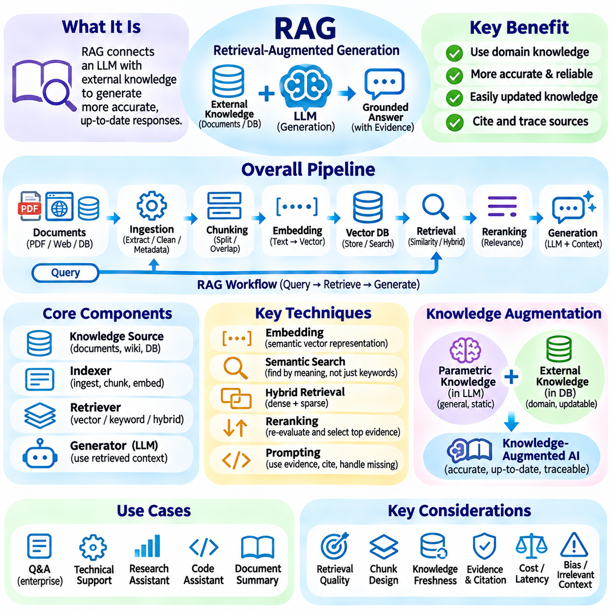{width="7.268055555555556in" height="7.268055555555556in"}

Retrieval-Augmented Generation (RAG) is an approach that enhances large language models by connecting them to external information sources during response generation. Instead of relying exclusively on knowledge acquired during pretraining, a RAG system retrieves relevant information from documents, databases, or knowledge repositories and provides it as contextual evidence. This combination improves access to domain-specific information and helps reduce limitations associated with static model knowledge.

The fundamental motivation behind RAG is the separation between parametric knowledge and external knowledge. Parametric knowledge is encoded within a model\'s learned parameters during training, while external knowledge is maintained in independent information repositories. Updating model parameters whenever new information becomes available can be expensive. RAG addresses this limitation by allowing knowledge to be updated independently of the language model.

A typical RAG architecture consists of a document ingestion process, an indexing mechanism, a retrieval component, and a language generation model. Documents are collected, processed, divided into manageable segments, and converted into searchable representations. When a user submits a query, the retrieval component identifies relevant information and supplies it to the language model. The model then generates a response using both the query and retrieved context.

Document ingestion establishes the foundation of a reliable retrieval system. Information may originate from PDF files, technical manuals, websites, databases, spreadsheets, or internal knowledge repositories. Before indexing, documents require extraction, normalization, metadata identification, and removal of unnecessary content. The quality of this preparation directly influences retrieval accuracy because incomplete extraction or inconsistent formatting can prevent important information from being identified.

Document chunking divides large documents into smaller passages that can be independently indexed and retrieved. Fixed-size chunking uses predefined token or character limits, while semantic chunking attempts to preserve meaningful contextual boundaries. Overlapping chunks can retain relationships between adjacent passages. Chunk size involves a tradeoff between contextual completeness and retrieval precision, requiring careful selection according to document structure and query characteristics.

Embedding models convert textual information into numerical vectors that represent semantic characteristics. These vectors allow retrieval systems to identify passages with similar meanings even when their wording differs from the original query. Embedding quality depends on model training, domain coverage, language characteristics, and document content. For specialized applications, domain-adapted embedding models may improve semantic matching and information retrieval.

Vector databases provide storage and search capabilities for embedding-based retrieval. They maintain numerical representations alongside document identifiers and metadata, enabling efficient similarity searches across large collections. Approximate nearest neighbor algorithms reduce search costs by identifying vectors that are sufficiently close without examining every stored vector. Metadata filtering can further restrict retrieval to specific document types, departments, dates, or categories.

Semantic search retrieves information based on conceptual similarity rather than exact keyword matching. This approach can identify relevant passages even when users employ different terminology from the original documents. However, semantic similarity does not always indicate factual relevance. A retrieved passage may discuss a related concept without answering the actual question. Effective retrieval therefore requires balancing semantic relationships with contextual and factual relevance.

Hybrid retrieval combines dense vector search with sparse keyword-based search. Dense retrieval captures semantic relationships through embeddings, while sparse retrieval identifies exact terms, identifiers, technical expressions, and specialized vocabulary. Combining these methods can improve coverage in technical and enterprise environments where both conceptual meaning and precise terminology matter. Ranking mechanisms subsequently organize candidate passages according to their relevance to the query.

A retrieval pipeline may include query preprocessing, query expansion, candidate retrieval, reranking, and context assembly. Query preprocessing clarifies the user\'s information requirement, while query expansion generates alternative expressions that may improve search coverage. A reranker evaluates retrieved candidates using more detailed relevance criteria. The final context assembly stage selects appropriate passages while respecting the language model\'s context-window limitations.

Reranking improves retrieval quality by reconsidering the relevance of initially retrieved candidates. Cross-encoder models jointly process a query and candidate passage to estimate their relevance more precisely than many independent embedding comparisons. Although reranking introduces additional computational costs, it can reduce irrelevant context and improve the evidence supplied to the generation model. Retrieval quality should therefore be evaluated across the complete pipeline rather than through vector similarity alone.

Generation integrates retrieved evidence with the original user query. The language model interprets the supplied passages, identifies relevant information, and constructs a natural-language response. Appropriate prompting can instruct the model to prioritize retrieved evidence, distinguish explicit facts from assumptions, and acknowledge missing information. The generation process should preserve the meaning of source documents rather than introduce unsupported details.

Knowledge-augmented AI extends the RAG concept by integrating structured and unstructured knowledge into intelligent systems. Structured information may include relational databases, ontologies, knowledge graphs, and formally defined rules. Unstructured information may include technical documents, reports, conversations, and textual records. Combining these representations allows AI systems to use both semantic relationships and explicit knowledge structures when answering questions or supporting decisions.

Knowledge graphs provide an important mechanism for representing relationships among entities. Information is commonly expressed through entities, relations, and attributes, allowing systems to connect concepts across different documents and data sources. Graph-based retrieval can identify indirect relationships that may not be apparent through isolated text passages. Integrating knowledge graphs with language models can improve relational reasoning and provide more structured evidence for complex questions.

Graph-based RAG combines vector retrieval with knowledge graph exploration. Vector search identifies semantically relevant passages, while graph traversal discovers relationships among entities and associated facts. The two approaches can complement each other when questions involve multiple entities, dependencies, or interconnected concepts. However, graph construction, entity resolution, relationship validation, and graph maintenance introduce additional engineering requirements.

RAG evaluation must examine retrieval quality and generation quality separately as well as jointly. Retrieval metrics may include precision, recall, and ranking effectiveness, while generation evaluation examines factual consistency, relevance, completeness, and citation accuracy. End-to-end evaluation determines whether the complete system correctly answers realistic user questions. A fluent response cannot be considered reliable when its supporting evidence is irrelevant, incomplete, or incorrectly interpreted.

Hallucination reduction is one of the important motivations for retrieval-augmented systems. By providing external evidence, RAG can reduce dependence on unsupported information generated from model parameters. However, retrieval does not eliminate hallucination automatically. Incorrect documents, incomplete passages, misleading context, and poor evidence interpretation can still produce inaccurate responses. Reliable systems require source validation, evidence-based prompting, and independent verification.

Source attribution and citation mechanisms improve transparency by connecting generated statements to their supporting documents. A RAG system can retain document identifiers, page references, section headings, and retrieval metadata during context construction. The generation component can then associate relevant claims with their original sources. Accurate attribution supports human verification, technical auditing, and organizational knowledge management.

RAG systems also introduce challenges involving information freshness and knowledge maintenance. External repositories may contain outdated documents, duplicated records, conflicting statements, or obsolete procedures. Indexing pipelines should support document versioning, incremental updates, deletion propagation, and periodic reprocessing. Retrieval systems must distinguish current information from historical records when temporal validity affects the correctness of an answer.

Security and access control are essential when RAG operates over private organizational information. Different users may have different permissions to access documents, databases, and knowledge repositories. Retrieval must enforce these permissions before supplying content to the language model. Sensitive information should not become accessible merely because it exists in an indexed collection. Data isolation, permission-aware retrieval, audit logging, and secure storage are therefore important design requirements.

RAG can be implemented through practical software pipelines that combine document processing, embedding generation, vector storage, retrieval, and language model inference. Common development workflows use document loaders, text splitters, embedding interfaces, vector databases, retrievers, and model APIs. These components can be implemented independently or integrated through application frameworks. A modular design makes it easier to evaluate individual stages and replace components as system requirements evolve.

A basic RAG experiment typically begins by loading a collection of documents and extracting their textual content. The documents are divided into chunks, converted into embeddings, and stored in a vector database. A user query is embedded using the same compatible embedding model, and similarity search retrieves relevant passages. These passages are inserted into a prompt that instructs a language model to generate an evidence-supported answer. This workflow provides a practical foundation for understanding retrieval and generation integration.

Advanced RAG architectures introduce additional techniques such as query routing, multi-query retrieval, contextual compression, recursive retrieval, and adaptive retrieval. Query routing selects appropriate information sources according to the nature of a request. Multi-query retrieval explores alternative formulations, while contextual compression removes unnecessary information from retrieved passages. Adaptive retrieval determines whether additional evidence is required before generation. These techniques improve flexibility but also increase system complexity.

Knowledge-augmented AI is particularly valuable in enterprise environments where organizational knowledge is distributed across technical manuals, operational procedures, engineering records, and internal databases. RAG can connect these information sources to language interfaces, enabling employees to search and interpret complex information more efficiently. Applications include technical support, document analysis, maintenance assistance, engineering knowledge retrieval, and decision support.

RAG also supports intelligent agents by providing access to external knowledge during planning and execution. An agent can retrieve relevant documentation, inspect historical records, identify applicable procedures, and use the resulting evidence when selecting actions. Combining retrieval with tool use and memory creates systems that can maintain contextual knowledge across complex workflows. Nevertheless, retrieved information must be verified before it influences consequential decisions or physical operations.

The effectiveness of RAG depends on the quality of the entire knowledge pipeline rather than the capability of the language model alone. Document preparation, chunking, embedding selection, indexing, retrieval, reranking, context construction, and response generation all contribute to final performance. A failure in any stage can reduce the reliability of the complete system. Consequently, RAG should be engineered and evaluated as an integrated information-processing architecture.

RAG and knowledge-augmented AI represent an important direction for building language systems that interact with external, specialized, and continuously updated information. Their value comes from connecting generative capabilities with retrievable evidence and structured knowledge. When combined with appropriate verification, security, and knowledge management, these approaches provide a practical foundation for more informative, transparent, and reliable AI applications.

검색 증강 생성(Retrieval-Augmented Generation, RAG)은 응답 생성(Response Generation) 과정에서 대규모 언어 모델(Large Language Model, LLM)을 외부 정보원(External Information Source)과 연결하여 성능을 향상시키는 접근법이다. 사전학습(Pretraining) 과정에서 획득한 지식에만 의존하는 대신, RAG 시스템(RAG System)은 문서(Document), 데이터베이스(Database), 지식 저장소(Knowledge Repository)에서 관련 정보를 검색하고 이를 문맥적 근거(Contextual Evidence)로 제공한다. 이러한 결합은 도메인 특화 정보(Domain-Specific Information)에 대한 접근성을 개선하고 정적인 모델 지식(Static Model Knowledge)의 한계를 줄이는 데 도움을 준다.

RAG의 근본적인 도입 배경(Fundamental Motivation)은 파라미터 지식(Parametric Knowledge)과 외부 지식(External Knowledge)의 분리에 있다. 파라미터 지식은 학습 과정에서 모델의 학습된 파라미터(Learned Parameter)에 인코딩되며, 외부 지식은 독립적인 정보 저장소(Independent Information Repository)에 유지된다. 새로운 정보가 제공될 때마다 모델 파라미터(Model Parameter)를 업데이트하는 것은 높은 비용을 발생시킬 수 있다. RAG는 언어 모델(Language Model)과 독립적으로 지식을 업데이트할 수 있도록 하여 이러한 한계를 해결한다.

일반적인 RAG 아키텍처(RAG Architecture)는 문서 수집 및 처리 과정(Document Ingestion Process), 인덱싱 메커니즘(Indexing Mechanism), 검색 구성 요소(Retrieval Component), 언어 생성 모델(Language Generation Model)로 구성된다. 문서는 수집되고 처리된 후 관리 가능한 세그먼트(Segment)로 분할되며, 검색 가능한 표현(Searchable Representation)으로 변환된다. 사용자가 질의(Query)를 제출하면 검색 구성 요소는 관련 정보를 식별하여 언어 모델에 제공한다. 이후 모델은 질의와 검색된 문맥(Retrieved Context)을 함께 사용하여 응답을 생성한다.

문서 수집 및 처리(Document Ingestion)는 신뢰할 수 있는 검색 시스템(Reliable Retrieval System)의 기반을 형성한다. 정보는 PDF 파일(PDF File), 기술 매뉴얼(Technical Manual), 웹사이트(Website), 데이터베이스(Database), 스프레드시트(Spreadsheet), 내부 지식 저장소(Internal Knowledge Repository)에서 제공될 수 있다. 인덱싱(Indexing) 이전에 문서는 정보 추출(Extraction), 정규화(Normalization), 메타데이터 식별(Metadata Identification), 불필요한 콘텐츠 제거(Removal of Unnecessary Content)를 거쳐야 한다. 이러한 준비 과정의 품질은 검색 정확도(Retrieval Accuracy)에 직접적인 영향을 미치며, 불완전한 추출이나 일관되지 않은 형식은 중요한 정보의 식별을 방해할 수 있다.

문서 청킹(Document Chunking)은 대규모 문서(Large Document)를 독립적으로 인덱싱하고 검색할 수 있는 작은 문단(Passage)으로 분할한다. 고정 크기 청킹(Fixed-Size Chunking)은 미리 정의된 토큰(Token) 또는 문자(Character) 제한을 사용하며, 의미 기반 청킹(Semantic Chunking)은 의미 있는 문맥적 경계(Contextual Boundary)를 보존하려고 시도한다. 중첩 청크(Overlapping Chunk)는 인접한 문단 사이의 관계를 유지할 수 있다. 청크 크기(Chunk Size)는 문맥적 완전성(Contextual Completeness)과 검색 정밀도(Retrieval Precision) 사이의 절충관계(Tradeoff)를 포함하므로 문서 구조(Document Structure)와 질의 특성(Query Characteristic)에 따라 신중하게 선택해야 한다.

임베딩 모델(Embedding Model)은 텍스트 정보(Textual Information)를 의미적 특성(Semantic Characteristic)을 나타내는 수치 벡터(Numerical Vector)로 변환한다. 이러한 벡터는 원래 질의와 표현 방식이 다르더라도 유사한 의미를 가진 문단을 검색 시스템(Retrieval System)이 식별할 수 있도록 한다. 임베딩 품질(Embedding Quality)은 모델 학습(Model Training), 도메인 포괄성(Domain Coverage), 언어적 특성(Language Characteristic), 문서 내용(Document Content)에 따라 달라진다. 특화된 응용 분야(Specialized Application)에서는 도메인 적응형 임베딩 모델(Domain-Adapted Embedding Model)이 의미적 매칭(Semantic Matching)과 정보 검색(Information Retrieval)을 개선할 수 있다.

벡터 데이터베이스(Vector Database)는 임베딩 기반 검색(Embedding-Based Retrieval)을 위한 저장 및 검색 기능(Storage and Search Capability)을 제공한다. 벡터 데이터베이스는 수치 표현(Numerical Representation)을 문서 식별자(Document Identifier) 및 메타데이터(Metadata)와 함께 유지하여 대규모 컬렉션(Large Collection)에 대한 효율적인 유사도 검색(Similarity Search)을 가능하게 한다. 근사 최근접 이웃 알고리즘(Approximate Nearest Neighbor Algorithm)은 저장된 모든 벡터를 검사하지 않고 충분히 가까운 벡터를 식별하여 검색 비용(Search Cost)을 줄인다. 메타데이터 필터링(Metadata Filtering)은 검색 범위를 특정 문서 유형(Document Type), 부서(Department), 날짜(Date), 범주(Category)로 추가 제한할 수 있다.

의미 기반 검색(Semantic Search)은 정확한 키워드 일치(Exact Keyword Matching)가 아니라 개념적 유사성(Conceptual Similarity)을 기반으로 정보를 검색한다. 이러한 접근법은 사용자가 원본 문서(Original Document)와 다른 용어(Terminology)를 사용하더라도 관련 문단을 식별할 수 있다. 그러나 의미적 유사성(Semantic Similarity)이 항상 사실적 관련성(Factual Relevance)을 의미하는 것은 아니다. 검색된 문단은 실제 질문에 답하지 않으면서 관련 개념(Related Concept)만 설명할 수 있다. 따라서 효과적인 검색(Effective Retrieval)은 의미적 관계(Semantic Relationship)와 문맥적 및 사실적 관련성(Contextual and Factual Relevance) 사이의 균형을 유지해야 한다.

하이브리드 검색(Hybrid Retrieval)은 밀집 벡터 검색(Dense Vector Search)과 희소 키워드 기반 검색(Sparse Keyword-Based Search)을 결합한다. 밀집 검색(Dense Retrieval)은 임베딩(Embedding)을 통해 의미적 관계(Semantic Relationship)를 포착하며, 희소 검색(Sparse Retrieval)은 정확한 용어(Exact Term), 식별자(Identifier), 기술적 표현(Technical Expression), 전문 어휘(Specialized Vocabulary)를 식별한다. 이러한 방법을 결합하면 개념적 의미(Conceptual Meaning)와 정확한 용어(Precise Terminology)가 모두 중요한 기술 및 기업 환경(Technical and Enterprise Environment)에서 검색 범위를 개선할 수 있다. 이후 순위화 메커니즘(Ranking Mechanism)은 질의와의 관련성(Relevance)에 따라 후보 문단(Candidate Passage)을 정렬한다.

검색 파이프라인(Retrieval Pipeline)은 질의 전처리(Query Preprocessing), 질의 확장(Query Expansion), 후보 검색(Candidate Retrieval), 재순위화(Reranking), 문맥 구성(Context Assembly)을 포함할 수 있다. 질의 전처리는 사용자의 정보 요구사항(Information Requirement)을 명확하게 하며, 질의 확장은 검색 범위(Search Coverage)를 개선할 수 있는 대안적 표현(Alternative Expression)을 생성한다. 재순위화 모델(Reranker)은 더욱 상세한 관련성 기준(Relevance Criteria)을 사용하여 검색된 후보를 평가한다. 최종 문맥 구성 단계(Context Assembly Stage)는 언어 모델의 문맥 창 제한(Context-Window Limitation)을 준수하면서 적절한 문단을 선택한다.

재순위화(Reranking)는 초기에 검색된 후보(Initially Retrieved Candidate)의 관련성을 다시 평가하여 검색 품질(Retrieval Quality)을 개선한다. 교차 인코더 모델(Cross-Encoder Model)은 질의와 후보 문단을 함께 처리하여 많은 독립적인 임베딩 비교(Independent Embedding Comparison)보다 관련성을 더욱 정밀하게 추정한다. 재순위화는 추가적인 계산 비용(Computational Cost)을 발생시키지만, 관련 없는 문맥(Irrelevant Context)을 줄이고 생성 모델(Generation Model)에 제공되는 근거(Evidence)를 개선할 수 있다. 따라서 검색 품질은 벡터 유사도(Vector Similarity)만이 아니라 전체 파이프라인(Complete Pipeline)에 걸쳐 평가되어야 한다.

생성(Generation)은 검색된 근거(Retrieved Evidence)를 원래 사용자 질의(Original User Query)와 통합한다. 언어 모델(Language Model)은 제공된 문단을 해석하고, 관련 정보를 식별하며, 자연어 응답(Natural-Language Response)을 구성한다. 적절한 프롬프팅(Prompting)은 모델이 검색된 근거를 우선적으로 사용하고, 명시적인 사실(Explicit Fact)과 가정(Assumption)을 구분하며, 누락된 정보(Missing Information)를 인정하도록 지시할 수 있다. 생성 과정(Generation Process)은 근거 없는 세부 정보(Unsupported Detail)를 도입하기보다 원본 문서(Source Document)의 의미를 보존해야 한다.

지식 증강 인공지능(Knowledge-Augmented AI)은 구조화된 지식(Structured Knowledge)과 비구조화된 지식(Unstructured Knowledge)을 지능형 시스템(Intelligent System)에 통합함으로써 RAG 개념을 확장한다. 구조화된 정보(Structured Information)에는 관계형 데이터베이스(Relational Database), 온톨로지(Ontology), 지식 그래프(Knowledge Graph), 형식적으로 정의된 규칙(Formally Defined Rule)이 포함될 수 있다. 비구조화된 정보(Unstructured Information)에는 기술 문서(Technical Document), 보고서(Report), 대화(Conversation), 텍스트 기록(Textual Record)이 포함될 수 있다. 이러한 표현을 결합하면 인공지능 시스템이 질문에 답하거나 의사결정을 지원할 때 의미적 관계와 명시적인 지식 구조(Explicit Knowledge Structure)를 함께 활용할 수 있다.

지식 그래프(Knowledge Graph)는 개체(Entity) 사이의 관계(Relationship)를 표현하는 중요한 메커니즘(Mechanism)을 제공한다. 정보는 일반적으로 개체(Entity), 관계(Relation), 속성(Attribute)을 통해 표현되며, 이를 통해 시스템은 서로 다른 문서와 데이터 소스(Data Source)에 걸쳐 개념을 연결할 수 있다. 그래프 기반 검색(Graph-Based Retrieval)은 독립적인 텍스트 문단(Isolated Text Passage)만으로는 명확하게 드러나지 않는 간접적인 관계(Indirect Relationship)를 식별할 수 있다. 지식 그래프를 언어 모델과 통합하면 관계적 추론(Relational Reasoning)을 개선하고 복잡한 질문(Complex Question)에 대해 더욱 구조화된 근거(Structured Evidence)를 제공할 수 있다.

그래프 기반 RAG(Graph-Based RAG)는 벡터 검색(Vector Retrieval)과 지식 그래프 탐색(Knowledge Graph Exploration)을 결합한다. 벡터 검색은 의미적으로 관련된 문단(Semantically Relevant Passage)을 식별하며, 그래프 순회(Graph Traversal)는 개체와 관련 사실(Associated Fact) 사이의 관계를 발견한다. 두 접근법은 여러 개체(Multiple Entity), 의존성(Dependency), 상호 연결된 개념(Interconnected Concept)이 포함된 질문에서 서로 보완할 수 있다. 그러나 그래프 구축(Graph Construction), 개체 식별 및 통합(Entity Resolution), 관계 검증(Relationship Validation), 그래프 유지보수(Graph Maintenance)는 추가적인 엔지니어링 요구사항(Engineering Requirement)을 발생시킨다.

RAG 평가(RAG Evaluation)는 검색 품질(Retrieval Quality)과 생성 품질(Generation Quality)을 개별적으로 검토하는 동시에 통합적으로 평가해야 한다. 검색 평가 지표(Retrieval Metric)에는 정밀도(Precision), 재현율(Recall), 순위화 효과(Ranking Effectiveness)가 포함될 수 있으며, 생성 평가(Generation Evaluation)는 사실적 일관성(Factual Consistency), 관련성(Relevance), 완전성(Completeness), 인용 정확도(Citation Accuracy)를 검토한다. 종단 간 평가(End-to-End Evaluation)는 전체 시스템이 실제 사용자 질문(Realistic User Question)에 올바르게 답하는지 판단한다. 근거가 관련 없거나 불완전하거나 잘못 해석되었다면 유창한 응답(Fluent Response)이라도 신뢰할 수 있는 결과로 간주할 수 없다.

환각 감소(Hallucination Reduction)는 검색 증강 시스템(Retrieval-Augmented System)을 도입하는 중요한 목적 중 하나이다. RAG는 외부 근거(External Evidence)를 제공함으로써 모델 파라미터(Model Parameter)에서 생성되는 근거 없는 정보(Unsupported Information)에 대한 의존도를 줄일 수 있다. 그러나 검색(Retrieval)이 환각(Hallucination)을 자동으로 제거하는 것은 아니다. 잘못된 문서(Incorrect Document), 불완전한 문단(Incomplete Passage), 오해를 유발하는 문맥(Misleading Context), 부정확한 근거 해석(Poor Evidence Interpretation)은 여전히 부정확한 응답(Inaccurate Response)을 생성할 수 있다. 신뢰할 수 있는 시스템(Reliable System)을 위해서는 출처 검증(Source Validation), 근거 기반 프롬프팅(Evidence-Based Prompting), 독립적인 검증(Independent Verification)이 필요하다.

출처 귀속(Source Attribution)과 인용 메커니즘(Citation Mechanism)은 생성된 진술(Generated Statement)을 이를 뒷받침하는 문서(Supporting Document)와 연결하여 투명성(Transparency)을 개선한다. RAG 시스템은 문맥 구성(Context Construction) 과정에서 문서 식별자(Document Identifier), 페이지 참조(Page Reference), 절 제목(Section Heading), 검색 메타데이터(Retrieval Metadata)를 유지할 수 있다. 이후 생성 구성 요소(Generation Component)는 관련 주장(Relevant Claim)을 원래 출처(Original Source)와 연결할 수 있다. 정확한 출처 귀속(Accurate Attribution)은 인간 검증(Human Verification), 기술 감사(Technical Auditing), 조직 지식 관리(Organizational Knowledge Management)를 지원한다.

RAG 시스템(RAG System)은 정보 최신성(Information Freshness)과 지식 유지보수(Knowledge Maintenance)에 관한 과제도 도입한다. 외부 저장소(External Repository)에는 오래된 문서(Outdated Document), 중복 기록(Duplicated Record), 상충하는 진술(Conflicting Statement), 더 이상 유효하지 않은 절차(Obsolete Procedure)가 포함될 수 있다. 인덱싱 파이프라인(Indexing Pipeline)은 문서 버전 관리(Document Versioning), 증분 업데이트(Incremental Update), 삭제 전파(Deletion Propagation), 주기적인 재처리(Periodic Reprocessing)를 지원해야 한다. 시간적 유효성(Temporal Validity)이 응답의 정확성에 영향을 미치는 경우 검색 시스템은 현재 정보(Current Information)와 과거 기록(Historical Record)을 구분해야 한다.

보안(Security)과 접근 제어(Access Control)는 RAG가 조직의 비공개 정보(Private Organizational Information)를 처리할 때 필수적이다. 사용자마다 문서(Document), 데이터베이스(Database), 지식 저장소(Knowledge Repository)에 접근할 수 있는 권한(Permission)이 다를 수 있다. 검색 시스템은 콘텐츠를 언어 모델에 제공하기 전에 이러한 권한을 적용해야 한다. 민감한 정보(Sensitive Information)가 인덱싱된 컬렉션(Indexed Collection)에 존재한다는 이유만으로 접근 가능해져서는 안 된다. 따라서 데이터 격리(Data Isolation), 권한 인식 검색(Permission-Aware Retrieval), 감사 로깅(Audit Logging), 안전한 저장(Secure Storage)은 중요한 설계 요구사항(Design Requirement)이다.

RAG는 문서 처리(Document Processing), 임베딩 생성(Embedding Generation), 벡터 저장(Vector Storage), 검색(Retrieval), 언어 모델 추론(Language Model Inference)을 결합하는 실용적인 소프트웨어 파이프라인(Software Pipeline)을 통해 구현할 수 있다. 일반적인 개발 워크플로(Development Workflow)는 문서 로더(Document Loader), 텍스트 분할기(Text Splitter), 임베딩 인터페이스(Embedding Interface), 벡터 데이터베이스(Vector Database), 검색기(Retriever), 모델 API(Model API)를 사용한다. 이러한 구성 요소는 독립적으로 구현하거나 응용 프레임워크(Application Framework)를 통해 통합할 수 있다. 모듈형 설계(Modular Design)는 개별 단계(Individual Stage)를 평가하고 시스템 요구사항(System Requirement)의 변화에 따라 구성 요소를 교체하기 쉽게 만든다.

기본적인 RAG 실험(Basic RAG Experiment)은 일반적으로 문서 컬렉션(Document Collection)을 불러오고 텍스트 콘텐츠(Textual Content)를 추출하는 것으로 시작한다. 문서는 청크(Chunk)로 분할되고 임베딩(Embedding)으로 변환된 후 벡터 데이터베이스(Vector Database)에 저장된다. 사용자 질의(User Query)는 호환되는 동일한 임베딩 모델(Compatible Embedding Model)을 사용하여 벡터로 변환되며, 유사도 검색(Similarity Search)은 관련 문단(Relevant Passage)을 검색한다. 이러한 문단은 언어 모델이 근거 기반 응답(Evidence-Supported Answer)을 생성하도록 지시하는 프롬프트(Prompt)에 삽입된다. 이 워크플로는 검색과 생성의 통합(Retrieval and Generation Integration)을 이해하기 위한 실용적인 기반을 제공한다.

고급 RAG 아키텍처(Advanced RAG Architecture)는 질의 라우팅(Query Routing), 다중 질의 검색(Multi-Query Retrieval), 문맥 압축(Contextual Compression), 재귀적 검색(Recursive Retrieval), 적응형 검색(Adaptive Retrieval)과 같은 추가적인 기술을 도입한다. 질의 라우팅은 요청(Request)의 특성에 따라 적절한 정보원(Information Source)을 선택한다. 다중 질의 검색은 대안적인 질의 표현(Alternative Query Formulation)을 탐색하며, 문맥 압축은 검색된 문단에서 불필요한 정보(Unnecessary Information)를 제거한다. 적응형 검색은 생성 이전에 추가 근거(Additional Evidence)가 필요한지 판단한다. 이러한 기술은 유연성(Flexibility)을 개선하지만 시스템 복잡도(System Complexity)도 증가시킨다.

지식 증강 인공지능(Knowledge-Augmented AI)은 조직 지식(Organizational Knowledge)이 기술 매뉴얼(Technical Manual), 운영 절차(Operational Procedure), 엔지니어링 기록(Engineering Record), 내부 데이터베이스(Internal Database)에 분산된 기업 환경(Enterprise Environment)에서 특히 가치가 높다. RAG는 이러한 정보원을 언어 인터페이스(Language Interface)와 연결하여 직원이 복잡한 정보를 더욱 효율적으로 검색하고 해석할 수 있도록 한다. 응용 분야(Application)에는 기술 지원(Technical Support), 문서 분석(Document Analysis), 유지보수 지원(Maintenance Assistance), 엔지니어링 지식 검색(Engineering Knowledge Retrieval), 의사결정 지원(Decision Support)이 포함된다.

RAG는 계획(Planning)과 실행(Execution) 과정에서 외부 지식(External Knowledge)에 대한 접근을 제공함으로써 지능형 에이전트(Intelligent Agent)도 지원한다. 에이전트(Agent)는 관련 문서(Relevant Documentation)를 검색하고, 과거 기록(Historical Record)을 검토하고, 적용 가능한 절차(Applicable Procedure)를 식별하며, 그 결과로 얻은 근거(Evidence)를 행동 선택(Action Selection)에 활용할 수 있다. 검색(Retrieval)을 도구 사용(Tool Use) 및 메모리(Memory)와 결합하면 복잡한 워크플로(Complex Workflow) 전반에서 문맥적 지식(Contextual Knowledge)을 유지할 수 있는 시스템을 구축할 수 있다. 그러나 검색된 정보는 중요한 의사결정(Consequential Decision)이나 물리적 작업(Physical Operation)에 영향을 미치기 전에 검증되어야 한다.

RAG의 효과성(Effectiveness)은 언어 모델(Language Model) 자체의 능력만이 아니라 전체 지식 파이프라인(Entire Knowledge Pipeline)의 품질에 따라 달라진다. 문서 준비(Document Preparation), 청킹(Chunking), 임베딩 선택(Embedding Selection), 인덱싱(Indexing), 검색(Retrieval), 재순위화(Reranking), 문맥 구성(Context Construction), 응답 생성(Response Generation)은 모두 최종 성능(Final Performance)에 기여한다. 어느 한 단계에서 발생한 실패(Failure)도 전체 시스템의 신뢰성(Reliability)을 저하시킬 수 있다. 따라서 RAG는 통합된 정보 처리 아키텍처(Integrated Information-Processing Architecture)로서 설계되고 평가되어야 한다.

RAG와 지식 증강 인공지능(Knowledge-Augmented AI)은 외부의 전문적이고 지속적으로 업데이트되는 정보(External, Specialized, and Continuously Updated Information)와 상호작용하는 언어 시스템(Language System)을 구축하기 위한 중요한 발전 방향을 나타낸다. 그 가치는 생성 능력(Generative Capability)을 검색 가능한 근거(Retrievable Evidence) 및 구조화된 지식(Structured Knowledge)과 연결하는 데 있다. 적절한 검증(Verification), 보안(Security), 지식 관리(Knowledge Management)와 결합될 때 이러한 접근법은 더욱 풍부한 정보(Informative), 투명성(Transparency), 신뢰성(Reliability)을 갖춘 인공지능 응용 시스템(AI Application)을 위한 실용적인 기반을 제공한다.

## 06.09 Embodied AI and Robotics

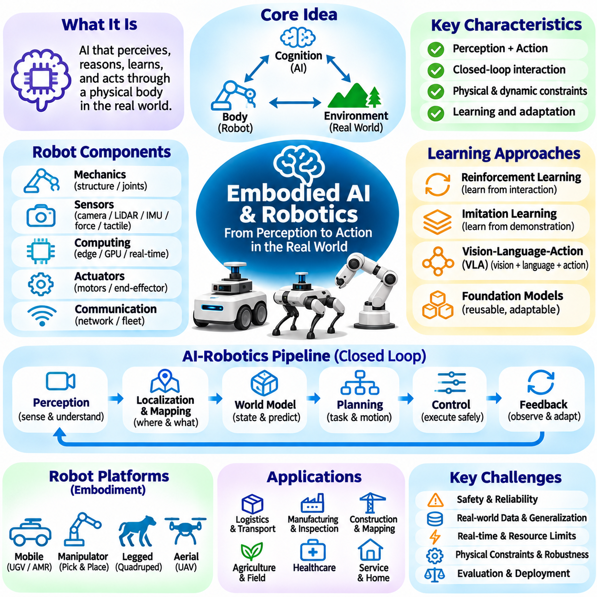{width="7.268055555555556in" height="7.268055555555556in"}

Embodied artificial intelligence refers to intelligent systems that perceive, reason, learn, and act through interaction with physical environments. Unlike AI confined to digital information processing, embodied AI connects computational intelligence with sensors, actuators, and physical dynamics. Robotics provides a major implementation platform, enabling machines to transform environmental observations into actions while continuously responding to the consequences of those actions.

The central principle of embodied intelligence is that cognition develops through interaction between an agent, its body, and its environment. Physical properties such as geometry, mass, friction, and actuator limitations influence what an intelligent system can accomplish. Consequently, intelligence cannot be evaluated solely through abstract reasoning performance. Effective embodied behavior requires coordination among perception, decision-making, movement, and environmental feedback.

A robotic embodiment consists of mechanical structures, sensors, actuators, computing hardware, and communication interfaces. Mobile robots use wheels, tracks, or legs for locomotion, while manipulators employ articulated joints and end effectors to interact with objects. The physical configuration determines reachable states, motion constraints, and operational capabilities. AI algorithms must therefore account for the characteristics and limitations of the platform on which they operate.

Perception enables embodied agents to estimate relevant properties of their surroundings. Cameras provide visual information, LiDAR measures spatial geometry, and inertial sensors capture motion-related signals. Depth sensors, radar, tactile devices, and force sensors contribute additional observations. Sensor fusion combines complementary measurements to improve environmental understanding, although calibration errors, noise, occlusion, and synchronization problems can reduce reliability.

Localization and mapping establish the spatial context required for autonomous behavior. Localization estimates the robot\'s position and orientation, while mapping constructs representations of surrounding environments. Simultaneous Localization and Mapping integrates both processes when reliable prior maps are unavailable. Visual, LiDAR-based, and inertial methods can be combined to reduce uncertainty. Accurate spatial estimation is essential for navigation, manipulation, and coordinated robotic operations.

World models provide internal representations of environmental states, dynamics, and possible future outcomes. A robot may use learned or physics-based models to predict how objects move, how actions change the environment, or which situations may become unsafe. These models support planning under uncertainty by evaluating potential consequences before execution. However, prediction errors and changing physical conditions require continuous correction through real observations.

Planning translates high-level objectives into sequences of feasible physical actions. Task planning determines what operations should occur, while motion planning identifies collision-free trajectories consistent with geometric and dynamic constraints. Hierarchical architectures coordinate these levels by connecting symbolic goals with executable movements. Successful planning must account for obstacles, resource limitations, timing requirements, and unexpected environmental changes.

Robotic control converts planned movements into actuator commands while maintaining stability and tracking accuracy. Classical methods include feedback control, proportional-integral-derivative control, and model predictive control. Learning-based controllers can adapt to complex dynamics or uncertain conditions. In practical systems, high-level AI decisions must remain compatible with deterministic control loops and safety mechanisms that operate under strict timing constraints.

Reinforcement learning provides a framework for learning embodied behavior through interaction and feedback. An agent selects actions, observes state transitions, and receives rewards associated with task objectives. Policies can learn locomotion, grasping, navigation, or coordinated manipulation. However, physical exploration may be expensive or unsafe, making simulation, constrained learning, and carefully designed reward functions important for practical robotic applications.

Imitation learning allows robots to acquire behaviors from demonstrations rather than discovering every action through trial and error. Demonstrations may come from human teleoperation, recorded trajectories, or expert controllers. Behavioral cloning trains policies to reproduce demonstrated actions, while more advanced approaches address distribution shifts and sequential decision-making. Performance depends on demonstration quality, coverage, and the robot\'s ability to generalize beyond observed situations.

Vision-language-action models connect visual perception, language instructions, and robotic actions within a unified learning framework. Such models interpret commands and environmental observations to predict actions or action representations. Their potential lies in transferring broad semantic knowledge into physical task execution. Nevertheless, generated actions must respect robot kinematics, actuator limits, collision constraints, and real-time safety requirements.

Foundation models can contribute to robotics by providing reusable representations of objects, scenes, language, and task relationships. Pretrained vision-language systems may support object identification, instruction interpretation, and semantic navigation. Specialized adaptation is still required because understanding a scene does not automatically imply the ability to manipulate it safely. Physical competence depends on embodiment-specific data, control interfaces, and environmental feedback.

Simulation is a major development tool for embodied AI because it enables repeated experiments without exposing physical hardware to unnecessary risks. Robotic simulators can reproduce geometry, collisions, sensors, and dynamic interactions. Domain randomization introduces variations in lighting, textures, friction, and physical parameters to improve generalization. However, differences between simulated and real environments create a simulation-to-reality gap that must be evaluated experimentally.

Sim-to-real transfer aims to deploy policies or models trained in simulation onto physical robots. Successful transfer requires compatibility between simulated observations, action spaces, dynamics, and real hardware. System identification, sensor calibration, parameter randomization, and limited real-world adaptation can reduce discrepancies. Validation should examine not only task success but also stability, repeatability, failure recovery, and behavior under unfamiliar operating conditions.

Manipulation requires robots to reason about objects, contact, forces, and geometric constraints. Grasp planning identifies suitable contact configurations, while motion planning coordinates arm movements and obstacle avoidance. Tactile feedback and force control become important when handling fragile, deformable, or uncertain objects. Learning-based manipulation can improve adaptability, but physical interaction remains sensitive to sensing errors and model inaccuracies.

Autonomous mobile robots integrate perception, localization, planning, and control to navigate operational environments. Indoor robots commonly rely on mapped structures and local obstacle avoidance, while outdoor systems must handle variable terrain, weather, illumination, and dynamic traffic. Fleet coordination introduces additional requirements for scheduling, communication, and shared resource management. Reliable navigation depends on maintaining consistent state estimates and responding safely to unexpected events.

Multi-robot systems extend embodied intelligence through cooperation among autonomous platforms. Robots may share maps, exchange observations, divide tasks, or coordinate movement in common spaces. Distributed planning and communication protocols support collective operations, while centralized orchestration can manage mission assignments and resource allocation. Communication delays, inconsistent world states, and conflicting actions require explicit coordination and recovery mechanisms.

Real-time computation is fundamental because robotic actions influence continuously evolving physical environments. Perception, planning, and control components operate at different frequencies and have different latency requirements. High-level reasoning may tolerate variable execution times, whereas motor control and emergency responses require predictable deadlines. Hardware acceleration, scheduling, synchronization, and deterministic interfaces help maintain safe and responsive behavior.

Safety engineering is essential when embodied AI operates near humans, equipment, or critical infrastructure. Collision avoidance, emergency stopping, speed limits, operational boundaries, and fault detection provide protective mechanisms. Learned policies should not be treated as substitutes for independently validated safety functions. Risk assessment, redundancy, runtime monitoring, and human supervision are necessary to manage uncertain behavior and physical consequences.

Evaluation of embodied AI must extend beyond isolated model accuracy to complete system behavior. Relevant criteria include task completion, localization error, trajectory tracking, energy consumption, latency, robustness, and safety compliance. Experiments should cover changing environments, sensor failures, unexpected obstacles, and repeated operations. Reproducible benchmarks and physical validation are required because success in simulation does not guarantee reliable real-world performance.

Embodied AI represents an important convergence of machine learning, robotics, control theory, computer vision, and physical system engineering. Its development increasingly combines learned representations with structured planning, predictive world models, and reliable control architectures. The long-term objective is not merely to generate intelligent decisions but to execute useful physical actions safely and consistently. Progress depends on integrating adaptive learning with measurable performance, engineering constraints, and continuous environmental feedback.

체화 인공지능(Embodied Artificial Intelligence)은 물리적 환경(Physical Environment)과의 상호작용을 통해 인식(Perception), 추론(Reasoning), 학습(Learning), 행동(Action)을 수행하는 지능형 시스템(Intelligent System)을 의미한다. 디지털 정보 처리(Digital Information Processing)에 국한된 인공지능과 달리, 체화 인공지능은 계산 지능(Computational Intelligence)을 센서(Sensor), 액추에이터(Actuator), 물리적 동역학(Physical Dynamics)과 연결한다. 로봇공학(Robotics)은 이러한 지능을 구현하는 주요 플랫폼(Implementation Platform)을 제공하며, 기계가 환경 관측값(Environmental Observation)을 행동으로 변환하고 그 행동의 결과에 지속적으로 대응할 수 있도록 한다.

체화 지능(Embodied Intelligence)의 핵심 원리(Central Principle)는 인지(Cognition)가 에이전트(Agent), 신체(Body), 환경(Environment) 사이의 상호작용을 통해 발전한다는 것이다. 기하학적 구조(Geometry), 질량(Mass), 마찰(Friction), 액추에이터 제약조건(Actuator Limitation)과 같은 물리적 특성(Physical Property)은 지능형 시스템이 수행할 수 있는 작업에 영향을 미친다. 따라서 지능(Intelligence)은 추상적 추론 성능(Abstract Reasoning Performance)만으로 평가할 수 없다. 효과적인 체화 행동(Effective Embodied Behavior)을 위해서는 인식(Perception), 의사결정(Decision-Making), 움직임(Movement), 환경 피드백(Environmental Feedback) 사이의 조정이 필요하다.

로봇의 물리적 구현체(Robotic Embodiment)는 기계 구조(Mechanical Structure), 센서(Sensor), 액추에이터(Actuator), 컴퓨팅 하드웨어(Computing Hardware), 통신 인터페이스(Communication Interface)로 구성된다. 이동 로봇(Mobile Robot)은 바퀴(Wheel), 궤도(Track), 다리(Leg)를 사용하여 이동하며, 매니퓰레이터(Manipulator)는 관절형 조인트(Articulated Joint)와 엔드 이펙터(End Effector)를 이용하여 객체(Object)와 상호작용한다. 물리적 구성(Physical Configuration)은 도달 가능한 상태(Reachable State), 운동 제약조건(Motion Constraint), 운영 능력(Operational Capability)을 결정한다. 따라서 인공지능 알고리즘(AI Algorithm)은 자신이 동작하는 플랫폼의 특성과 한계를 고려해야 한다.

인식(Perception)은 체화 에이전트(Embodied Agent)가 주변 환경(Surrounding Environment)의 관련 특성을 추정하도록 한다. 카메라(Camera)는 시각 정보(Visual Information)를 제공하고, 라이다(LiDAR)는 공간 기하학(Spatial Geometry)을 측정하며, 관성 센서(Inertial Sensor)는 움직임 관련 신호(Motion-Related Signal)를 수집한다. 깊이 센서(Depth Sensor), 레이더(Radar), 촉각 장치(Tactile Device), 힘 센서(Force Sensor)는 추가적인 관측값(Observation)을 제공한다. 센서 융합(Sensor Fusion)은 상호 보완적인 측정값(Complementary Measurement)을 결합하여 환경 이해(Environmental Understanding)를 개선하지만, 보정 오류(Calibration Error), 잡음(Noise), 가림(Occlusion), 동기화 문제(Synchronization Problem)는 신뢰성을 저하시킬 수 있다.

위치 추정 및 지도 작성(Localization and Mapping)은 자율 행동(Autonomous Behavior)에 필요한 공간적 문맥(Spatial Context)을 확립한다. 위치 추정(Localization)은 로봇의 위치(Position)와 방향(Orientation)을 추정하며, 지도 작성(Mapping)은 주변 환경의 표현(Representation)을 구축한다. 동시적 위치 추정 및 지도 작성(Simultaneous Localization and Mapping, SLAM)은 신뢰할 수 있는 사전 지도(Prior Map)가 없는 경우 두 과정을 통합한다. 시각 기반(Visual), 라이다 기반(LiDAR-Based), 관성 기반(Inertial) 방법을 결합하면 불확실성(Uncertainty)을 줄일 수 있다. 정확한 공간 추정(Accurate Spatial Estimation)은 내비게이션(Navigation), 조작(Manipulation), 협업 로봇 운영(Coordinated Robotic Operation)에 필수적이다.

월드 모델(World Model)은 환경 상태(Environmental State), 동역학(Dynamics), 가능한 미래 결과(Possible Future Outcome)에 대한 내부 표현(Internal Representation)을 제공한다. 로봇은 학습 기반 모델(Learned Model)이나 물리 기반 모델(Physics-Based Model)을 사용하여 객체가 어떻게 움직이는지, 행동이 환경을 어떻게 변화시키는지, 어떤 상황이 위험해질 수 있는지를 예측할 수 있다. 이러한 모델은 실행 전에 잠재적인 결과(Potential Consequence)를 평가함으로써 불확실성 하의 계획(Planning Under Uncertainty)을 지원한다. 그러나 예측 오류(Prediction Error)와 변화하는 물리적 조건(Changing Physical Condition) 때문에 실제 관측값(Real Observation)을 통한 지속적인 보정(Continuous Correction)이 필요하다.

계획(Planning)은 상위 수준의 목표(High-Level Objective)를 실행 가능한 물리적 행동(Feasible Physical Action)의 시퀀스로 변환한다. 작업 계획(Task Planning)은 어떤 작업이 수행되어야 하는지를 결정하며, 동작 계획(Motion Planning)은 기하학적 및 동역학적 제약조건(Geometric and Dynamic Constraint)을 만족하는 충돌 없는 궤적(Collision-Free Trajectory)을 식별한다. 계층적 아키텍처(Hierarchical Architecture)는 기호적 목표(Symbolic Goal)를 실행 가능한 움직임(Executable Movement)과 연결하여 이러한 수준을 조정한다. 성공적인 계획은 장애물(Obstacle), 자원 제한(Resource Limitation), 시간 요구사항(Timing Requirement), 예상하지 못한 환경 변화(Unexpected Environmental Change)를 고려해야 한다.

로봇 제어(Robotic Control)는 계획된 움직임(Planned Movement)을 액추에이터 명령(Actuator Command)으로 변환하면서 안정성(Stability)과 추종 정확도(Tracking Accuracy)를 유지한다. 고전적인 방법(Classical Method)에는 피드백 제어(Feedback Control), 비례-적분-미분 제어(Proportional-Integral-Derivative Control, PID Control), 모델 예측 제어(Model Predictive Control, MPC)가 포함된다. 학습 기반 제어기(Learning-Based Controller)는 복잡한 동역학(Complex Dynamics)이나 불확실한 조건(Uncertain Condition)에 적응할 수 있다. 실제 시스템에서 상위 수준의 인공지능 의사결정(High-Level AI Decision)은 엄격한 시간 제약조건(Strict Timing Constraint) 아래에서 동작하는 결정론적 제어 루프(Deterministic Control Loop) 및 안전 메커니즘(Safety Mechanism)과 호환되어야 한다.

강화학습(Reinforcement Learning)은 상호작용(Interaction)과 피드백(Feedback)을 통해 체화 행동(Embodied Behavior)을 학습하기 위한 프레임워크(Framework)를 제공한다. 에이전트(Agent)는 행동(Action)을 선택하고, 상태 전이(State Transition)를 관측하며, 작업 목표(Task Objective)와 관련된 보상(Reward)을 받는다. 정책(Policy)은 이동(Locomotion), 파지(Grasping), 내비게이션(Navigation), 협업 조작(Coordinated Manipulation)을 학습할 수 있다. 그러나 물리적 탐색(Physical Exploration)은 비용이 높거나 위험할 수 있으므로 시뮬레이션(Simulation), 제약 기반 학습(Constrained Learning), 신중하게 설계된 보상 함수(Reward Function)가 실제 로봇 응용(Practical Robotic Application)에서 중요하다.

모방학습(Imitation Learning)은 로봇이 모든 행동을 시행착오(Trial and Error)로 발견하는 대신 시연(Demonstration)으로부터 행동을 습득하도록 한다. 시연은 인간 원격 조작(Human Teleoperation), 기록된 궤적(Recorded Trajectory), 전문가 제어기(Expert Controller)에서 제공될 수 있다. 행동 복제(Behavioral Cloning)는 시연된 행동(Demonstrated Action)을 재현하도록 정책(Policy)을 학습하며, 더욱 발전된 접근법(Advanced Approach)은 분포 이동(Distribution Shift)과 순차적 의사결정(Sequential Decision-Making)을 다룬다. 성능(Performance)은 시연 품질(Demonstration Quality), 데이터 포괄성(Coverage), 관측된 상황을 넘어 일반화(Generalization)하는 로봇의 능력에 따라 달라진다.

시각-언어-행동 모델(Vision-Language-Action Model, VLA)은 시각적 인식(Visual Perception), 언어 명령(Language Instruction), 로봇 행동(Robotic Action)을 통합된 학습 프레임워크(Unified Learning Framework)로 연결한다. 이러한 모델은 명령과 환경 관측값(Environmental Observation)을 해석하여 행동 또는 행동 표현(Action Representation)을 예측한다. 그 잠재력(Potential)은 광범위한 의미적 지식(Semantic Knowledge)을 물리적 작업 실행(Physical Task Execution)에 전이하는 데 있다. 그러나 생성된 행동은 로봇 운동학(Robot Kinematics), 액추에이터 제한(Actuator Limit), 충돌 제약조건(Collision Constraint), 실시간 안전 요구사항(Real-Time Safety Requirement)을 준수해야 한다.

파운데이션 모델(Foundation Model)은 객체(Object), 장면(Scene), 언어(Language), 작업 관계(Task Relationship)에 대한 재사용 가능한 표현(Reusable Representation)을 제공함으로써 로봇공학(Robotics)에 기여할 수 있다. 사전학습된 시각-언어 시스템(Pretrained Vision-Language System)은 객체 식별(Object Identification), 명령 해석(Instruction Interpretation), 의미 기반 내비게이션(Semantic Navigation)을 지원할 수 있다. 그러나 장면을 이해하는 능력이 객체를 안전하게 조작할 수 있는 능력을 자동으로 의미하지는 않으므로 특화된 적응(Specialized Adaptation)이 여전히 필요하다. 물리적 작업 능력(Physical Competence)은 구현체별 데이터(Embodiment-Specific Data), 제어 인터페이스(Control Interface), 환경 피드백(Environmental Feedback)에 달려 있다.

시뮬레이션(Simulation)은 물리적 하드웨어(Physical Hardware)를 불필요한 위험에 노출시키지 않고 반복적인 실험(Repeated Experiment)을 수행할 수 있도록 하므로 체화 인공지능(Embodied AI)의 주요 개발 도구(Development Tool)이다. 로봇 시뮬레이터(Robotic Simulator)는 기하학적 구조(Geometry), 충돌(Collision), 센서(Sensor), 동적 상호작용(Dynamic Interaction)을 재현할 수 있다. 도메인 무작위화(Domain Randomization)는 조명(Lighting), 텍스처(Texture), 마찰(Friction), 물리적 파라미터(Physical Parameter)에 변화를 도입하여 일반화(Generalization)를 개선한다. 그러나 시뮬레이션 환경(Simulated Environment)과 실제 환경(Real Environment)의 차이는 시뮬레이션-현실 격차(Simulation-to-Reality Gap)를 발생시키며, 이를 실험적으로 평가해야 한다.

시뮬레이션-현실 전이(Sim-to-Real Transfer)는 시뮬레이션에서 학습된 정책(Policy)이나 모델(Model)을 물리적 로봇(Physical Robot)에 배포하는 것을 목표로 한다. 성공적인 전이를 위해서는 시뮬레이션 관측값(Simulated Observation), 행동 공간(Action Space), 동역학(Dynamics), 실제 하드웨어(Real Hardware) 사이의 호환성이 필요하다. 시스템 식별(System Identification), 센서 보정(Sensor Calibration), 파라미터 무작위화(Parameter Randomization), 제한적인 실제 환경 적응(Limited Real-World Adaptation)은 차이를 줄일 수 있다. 검증(Validation)은 작업 성공(Task Success)뿐만 아니라 안정성(Stability), 반복성(Repeatability), 실패 복구(Failure Recovery), 익숙하지 않은 운영 조건(Unfamiliar Operating Condition)에서의 행동도 검토해야 한다.

조작(Manipulation)은 로봇이 객체(Object), 접촉(Contact), 힘(Force), 기하학적 제약조건(Geometric Constraint)에 대해 추론하도록 요구한다. 파지 계획(Grasp Planning)은 적절한 접촉 구성(Contact Configuration)을 식별하며, 동작 계획(Motion Planning)은 로봇 팔의 움직임(Arm Movement)과 장애물 회피(Obstacle Avoidance)를 조정한다. 깨지기 쉬운 객체(Fragile Object), 변형 가능한 객체(Deformable Object), 상태가 불확실한 객체(Uncertain Object)를 다룰 때는 촉각 피드백(Tactile Feedback)과 힘 제어(Force Control)가 중요해진다. 학습 기반 조작(Learning-Based Manipulation)은 적응성(Adaptability)을 개선할 수 있지만, 물리적 상호작용(Physical Interaction)은 여전히 센싱 오류(Sensing Error)와 모델 부정확성(Model Inaccuracy)에 민감하다.

자율 이동 로봇(Autonomous Mobile Robot, AMR)은 인식(Perception), 위치 추정(Localization), 계획(Planning), 제어(Control)를 통합하여 운영 환경(Operational Environment)을 탐색한다. 실내 로봇(Indoor Robot)은 일반적으로 지도화된 구조(Mapped Structure)와 국소 장애물 회피(Local Obstacle Avoidance)에 의존하지만, 실외 시스템(Outdoor System)은 변화하는 지형(Variable Terrain), 날씨(Weather), 조명(Illumination), 동적 교통 환경(Dynamic Traffic)을 처리해야 한다. 플릿 조정(Fleet Coordination)은 스케줄링(Scheduling), 통신(Communication), 공유 자원 관리(Shared Resource Management)에 대한 추가 요구사항을 도입한다. 신뢰할 수 있는 내비게이션(Reliable Navigation)은 일관된 상태 추정(Consistent State Estimate)을 유지하고 예상하지 못한 사건(Unexpected Event)에 안전하게 대응하는 능력에 달려 있다.

다중 로봇 시스템(Multi-Robot System)은 자율 플랫폼(Autonomous Platform) 사이의 협업(Cooperation)을 통해 체화 지능(Embodied Intelligence)을 확장한다. 로봇은 지도(Map)를 공유하고, 관측값(Observation)을 교환하고, 작업(Task)을 분담하거나, 공통 공간(Common Space)에서 움직임을 조정할 수 있다. 분산 계획(Distributed Planning)과 통신 프로토콜(Communication Protocol)은 집단 운영(Collective Operation)을 지원하며, 중앙집중식 오케스트레이션(Centralized Orchestration)은 임무 할당(Mission Assignment)과 자원 배분(Resource Allocation)을 관리할 수 있다. 통신 지연(Communication Delay), 일치하지 않는 월드 상태(Inconsistent World State), 충돌하는 행동(Conflicting Action)은 명시적인 조정 및 복구 메커니즘(Coordination and Recovery Mechanism)을 필요로 한다.

실시간 계산(Real-Time Computation)은 로봇 행동(Robotic Action)이 지속적으로 변화하는 물리적 환경(Continuously Evolving Physical Environment)에 영향을 미치기 때문에 필수적이다. 인식(Perception), 계획(Planning), 제어(Control) 구성 요소는 서로 다른 주파수(Frequency)로 동작하며 각기 다른 지연시간 요구사항(Latency Requirement)을 가진다. 상위 수준 추론(High-Level Reasoning)은 가변적인 실행 시간(Variable Execution Time)을 허용할 수 있지만, 모터 제어(Motor Control)와 비상 대응(Emergency Response)은 예측 가능한 마감시간(Predictable Deadline)을 요구한다. 하드웨어 가속(Hardware Acceleration), 스케줄링(Scheduling), 동기화(Synchronization), 결정론적 인터페이스(Deterministic Interface)는 안전하고 반응성이 높은 동작(Safe and Responsive Behavior)을 유지하는 데 도움을 준다.

안전 엔지니어링(Safety Engineering)은 체화 인공지능(Embodied AI)이 인간(Human), 장비(Equipment), 핵심 인프라(Critical Infrastructure) 주변에서 동작할 때 필수적이다. 충돌 회피(Collision Avoidance), 비상 정지(Emergency Stopping), 속도 제한(Speed Limit), 운영 경계(Operational Boundary), 결함 탐지(Fault Detection)는 보호 메커니즘(Protective Mechanism)을 제공한다. 학습된 정책(Learned Policy)을 독립적으로 검증된 안전 기능(Independently Validated Safety Function)의 대체 수단으로 취급해서는 안 된다. 불확실한 행동(Uncertain Behavior)과 물리적 결과(Physical Consequence)를 관리하기 위해서는 위험 평가(Risk Assessment), 이중화(Redundancy), 런타임 모니터링(Runtime Monitoring), 인간 감독(Human Supervision)이 필요하다.

체화 인공지능 평가(Embodied AI Evaluation)는 개별 모델 정확도(Isolated Model Accuracy)를 넘어 전체 시스템 동작(Complete System Behavior)을 평가해야 한다. 관련 평가 기준(Evaluation Criteria)에는 작업 완료(Task Completion), 위치 추정 오차(Localization Error), 궤적 추종(Trajectory Tracking), 에너지 소비(Energy Consumption), 지연시간(Latency), 강건성(Robustness), 안전 규정 준수(Safety Compliance)가 포함된다. 실험(Experiment)은 변화하는 환경(Changing Environment), 센서 고장(Sensor Failure), 예상하지 못한 장애물(Unexpected Obstacle), 반복 작업(Repeated Operation)을 포함해야 한다. 시뮬레이션에서의 성공이 실제 환경에서의 신뢰할 수 있는 성능을 보장하지 않으므로 재현 가능한 벤치마크(Reproducible Benchmark)와 물리적 검증(Physical Validation)이 필요하다.

체화 인공지능(Embodied AI)은 머신러닝(Machine Learning), 로봇공학(Robotics), 제어 이론(Control Theory), 컴퓨터 비전(Computer Vision), 물리 시스템 엔지니어링(Physical System Engineering)의 중요한 융합(Convergence)을 나타낸다. 그 발전은 학습된 표현(Learned Representation)을 구조화된 계획(Structured Planning), 예측적 월드 모델(Predictive World Model), 신뢰할 수 있는 제어 아키텍처(Reliable Control Architecture)와 점점 더 긴밀하게 결합하고 있다. 장기적인 목표(Long-Term Objective)는 단순히 지능적인 의사결정(Intelligent Decision)을 생성하는 것이 아니라 유용한 물리적 행동(Useful Physical Action)을 안전하고 일관되게 실행하는 것이다. 이러한 발전은 적응형 학습(Adaptive Learning)을 측정 가능한 성능(Measurable Performance), 엔지니어링 제약조건(Engineering Constraint), 지속적인 환경 피드백(Continuous Environmental Feedback)과 통합하는 데 달려 있다.

## 06.10 Edge AI and Real Time AI

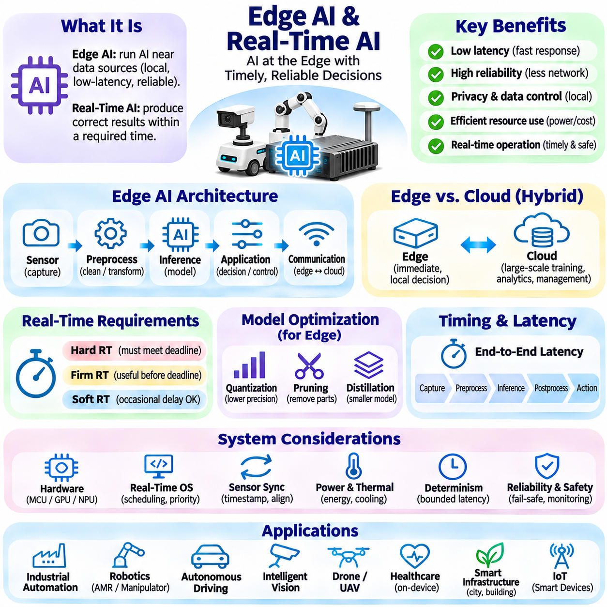{width="7.268055555555556in" height="7.268055555555556in"}

Edge artificial intelligence refers to the execution of AI workloads on computing devices located near the sources of data or physical operations. Instead of transmitting every observation to centralized cloud infrastructure, edge systems process information locally and produce timely decisions. This approach is important for robotics, industrial automation, intelligent cameras, autonomous vehicles, and connected devices where latency, connectivity, privacy, and operational reliability influence system performance.

Real-time AI extends conventional inference by introducing explicit timing requirements for sensing, computation, and action. A system must not only produce a correct result but also deliver it within an acceptable deadline. In safety-critical environments, a late decision may be as harmful as an incorrect one. Real-time performance therefore involves predictable execution, bounded response times, and coordinated scheduling rather than simply maximizing average computational throughput.

The distinction between edge AI and cloud AI concerns where computation occurs and how resources are managed. Cloud platforms provide scalable processing capacity, centralized model management, and access to large datasets. Edge devices offer proximity to sensors, reduced communication dependence, and faster local responses. Hybrid architectures combine these advantages by assigning immediate operational decisions to edge systems while reserving large-scale training and analytics for centralized infrastructure.

An edge AI architecture typically integrates sensors, preprocessing modules, inference accelerators, application logic, and communication interfaces. Sensor observations are converted into suitable representations before being processed by trained models. Inference outputs are interpreted by downstream software that generates alerts, control commands, or operational decisions. System design must account for data movement, memory limitations, processing priorities, and communication delays across these components.

Edge computing hardware ranges from microcontrollers and embedded processors to specialized neural accelerators and high-performance GPUs. Microcontrollers support compact models under strict power and memory constraints, while embedded GPUs and neural processing units execute more demanding workloads. Hardware selection depends on model complexity, sensor bandwidth, inference latency, energy consumption, and environmental conditions rather than theoretical processing capability alone.

Model optimization is essential because edge devices often have limited computational resources. Quantization reduces numerical precision, pruning removes selected model parameters or structures, and knowledge distillation transfers behavior from larger models into smaller networks. Compilation and operator fusion can further reduce execution overhead. These techniques must be evaluated carefully because improvements in speed or memory consumption may introduce accuracy loss or hardware compatibility problems.

Inference latency includes more than the time required to execute a neural network. Sensor acquisition, data transfer, preprocessing, model execution, postprocessing, and application-level communication all contribute to end-to-end response time. A fast model may still produce slow system behavior when data movement or synchronization dominates execution. Accurate performance analysis therefore requires measuring the complete processing pipeline under realistic operating conditions.

Real-time systems distinguish between hard, firm, and soft timing requirements. Hard real-time tasks require deadlines to be met because violations may cause unacceptable consequences. Firm real-time tasks lose their usefulness after a deadline, while soft real-time tasks tolerate occasional delays with degraded service quality. AI workloads must be classified according to their operational consequences, allowing engineers to establish appropriate scheduling policies and deadline guarantees.

Deterministic execution is challenging for modern AI because neural inference often depends on parallel processors, memory hierarchies, and shared computational resources. GPU scheduling, cache behavior, data transfers, and competing workloads can introduce execution-time variability. Average latency alone is insufficient for systems requiring predictable responses. Engineers must examine worst-case behavior, latency distributions, resource contention, and the limits of available timing guarantees.

Real-time operating systems provide mechanisms for managing tasks with different priorities and timing requirements. Priority scheduling, interrupt handling, resource synchronization, and bounded execution paths help maintain responsiveness. However, running an AI model on a real-time operating system does not automatically make its inference deterministic. The complete hardware and software stack must be evaluated to establish whether required deadlines can be satisfied consistently.

Sensor synchronization is particularly important when multiple data streams contribute to a single AI decision. Cameras, LiDAR, radar, inertial sensors, and positioning systems may operate at different sampling rates and experience different communication delays. Timestamping, clock synchronization, and buffering help align observations to a common temporal reference. Poor synchronization can distort environmental interpretation even when individual sensor measurements are accurate.

Edge AI systems frequently operate under strict power and thermal constraints. Continuous inference consumes energy and generates heat, potentially reducing battery life or triggering processor throttling. Dynamic frequency scaling, workload scheduling, efficient model architectures, and thermal management can improve operational sustainability. Designers must evaluate performance under sustained workloads because short benchmark runs may conceal temperature-related degradation.

Memory management strongly influences edge inference performance. Model weights, intermediate activations, sensor buffers, and application processes compete for limited memory capacity and bandwidth. Excessive memory transfers can increase latency and energy consumption, while insufficient memory may prevent models from executing reliably. Efficient memory allocation, reduced precision, operator optimization, and careful pipeline design are therefore central to embedded AI engineering.

Distributed edge intelligence enables multiple devices to cooperate without relying entirely on centralized processing. Individual nodes may perform local perception, exchange compact features, or share selected events with neighboring systems. An edge gateway or local server can aggregate information and coordinate decisions. Distributed architectures must manage network latency, inconsistent observations, communication failures, and the tradeoff between local autonomy and collective coordination.

Robotic edge AI combines perception, planning, and control within a tightly integrated physical system. Vision models may detect obstacles, localization algorithms estimate position, and planning modules determine feasible movements. These components operate at different frequencies and require carefully managed interfaces. High-level AI inference should remain separated from independently validated safety controls so that computational delays do not compromise essential protective functions.

Industrial edge AI supports machine monitoring, visual inspection, predictive maintenance, and automated quality control. Local inference can identify abnormal equipment behavior or defective products without continuously transferring large sensor datasets to remote servers. Integration with industrial controllers and operational networks requires reliable communication and appropriate timing guarantees. Deployment success depends on measurable improvements in production performance and system availability.

Edge AI also provides opportunities for improved data privacy and operational resilience. Processing sensitive observations locally can reduce unnecessary transmission of personal or proprietary information. Systems may continue operating during temporary network disruptions when essential models and data remain available on the device. However, local processing does not eliminate security risks, making encryption, access control, secure boot, and protected model storage important.

Deployment and maintenance introduce additional engineering challenges for edge AI systems. Models must be distributed, versioned, monitored, and updated across potentially large fleets of devices. Over-the-air updates can deliver improvements, but failed installations or incompatible models may interrupt operations. Reliable deployment mechanisms require integrity verification, staged rollout, rollback capabilities, and compatibility checks between models, software, and hardware.

Performance evaluation should measure accuracy, latency, throughput, energy efficiency, memory consumption, and thermal stability under realistic conditions. Tail latency and deadline-miss rates are particularly important for time-sensitive applications. Testing should include sustained workloads, concurrent processes, network disruptions, and environmental variations. Benchmark results must specify hardware configurations and execution conditions to support meaningful comparisons.

Edge AI and real-time AI represent complementary approaches to building intelligent systems that interact efficiently with their environments. Edge deployment places computation near operational data, while real-time engineering ensures that critical responses satisfy timing requirements. Their successful integration requires coordinated hardware selection, model optimization, scheduling, communication, and safety design. The ultimate objective is reliable intelligence that operates within measurable physical and computational constraints.

엣지 인공지능(Edge Artificial Intelligence, Edge AI)은 데이터가 생성되거나 물리적 작업이 수행되는 위치와 가까운 컴퓨팅 장치(Computing Device)에서 인공지능 워크로드(AI Workload)를 실행하는 것을 의미한다. 모든 관측값(Observation)을 중앙집중식 클라우드 인프라(Centralized Cloud Infrastructure)로 전송하는 대신, 엣지 시스템(Edge System)은 정보를 로컬에서 처리하고 적시에 의사결정(Timely Decision)을 수행한다. 이러한 접근법은 지연시간(Latency), 연결성(Connectivity), 개인정보 보호(Privacy), 운영 신뢰성(Operational Reliability)이 시스템 성능(System Performance)에 영향을 미치는 로봇공학(Robotics), 산업 자동화(Industrial Automation), 지능형 카메라(Intelligent Camera), 자율주행 차량(Autonomous Vehicle), 연결형 장치(Connected Device)에서 중요하다.

실시간 인공지능(Real-Time AI)은 센싱(Sensing), 계산(Computation), 행동(Action)에 명시적인 시간 요구사항(Explicit Timing Requirement)을 도입하여 기존 추론(Conventional Inference)을 확장한다. 시스템은 올바른 결과(Correct Result)를 생성할 뿐만 아니라 허용 가능한 마감시간(Acceptable Deadline) 내에 결과를 제공해야 한다. 안전 필수 환경(Safety-Critical Environment)에서는 지연된 의사결정(Late Decision)이 잘못된 의사결정(Incorrect Decision)만큼 위험할 수 있다. 따라서 실시간 성능(Real-Time Performance)은 단순히 평균 계산 처리량(Average Computational Throughput)을 최대화하는 것이 아니라 예측 가능한 실행(Predictable Execution), 제한된 응답시간(Bounded Response Time), 조정된 스케줄링(Coordinated Scheduling)을 포함한다.

엣지 인공지능(Edge AI)과 클라우드 인공지능(Cloud AI)의 차이는 계산이 수행되는 위치와 자원이 관리되는 방식에 있다. 클라우드 플랫폼(Cloud Platform)은 확장 가능한 처리 용량(Scalable Processing Capacity), 중앙집중식 모델 관리(Centralized Model Management), 대규모 데이터셋(Large Dataset)에 대한 접근을 제공한다. 엣지 장치(Edge Device)는 센서와의 근접성(Proximity to Sensor), 통신 의존성 감소(Reduced Communication Dependence), 빠른 로컬 응답(Faster Local Response)을 제공한다. 하이브리드 아키텍처(Hybrid Architecture)는 즉각적인 운영 의사결정(Immediate Operational Decision)을 엣지 시스템에 할당하고 대규모 학습(Large-Scale Training)과 분석(Analytics)을 중앙집중식 인프라(Centralized Infrastructure)에 배치함으로써 두 접근법의 장점을 결합한다.

엣지 인공지능 아키텍처(Edge AI Architecture)는 일반적으로 센서(Sensor), 전처리 모듈(Preprocessing Module), 추론 가속기(Inference Accelerator), 응용 로직(Application Logic), 통신 인터페이스(Communication Interface)를 통합한다. 센서 관측값(Sensor Observation)은 학습된 모델(Trained Model)에 의해 처리되기 전에 적절한 표현(Suitable Representation)으로 변환된다. 추론 출력(Inference Output)은 후속 소프트웨어(Downstream Software)에 의해 해석되어 경고(Alert), 제어 명령(Control Command), 운영 의사결정(Operational Decision)을 생성한다. 시스템 설계(System Design)는 이러한 구성 요소 사이의 데이터 이동(Data Movement), 메모리 제한(Memory Limitation), 처리 우선순위(Processing Priority), 통신 지연(Communication Delay)을 고려해야 한다.

엣지 컴퓨팅 하드웨어(Edge Computing Hardware)는 마이크로컨트롤러(Microcontroller)와 임베디드 프로세서(Embedded Processor)부터 특수 신경망 가속기(Specialized Neural Accelerator)와 고성능 그래픽 처리 장치(High-Performance Graphics Processing Unit, GPU)에 이르기까지 다양하다. 마이크로컨트롤러는 엄격한 전력 및 메모리 제약조건(Power and Memory Constraint) 아래에서 소형 모델(Compact Model)을 지원하며, 임베디드 GPU(Embedded GPU)와 신경망 처리 장치(Neural Processing Unit, NPU)는 더욱 높은 계산량을 요구하는 워크로드(Demanding Workload)를 실행한다. 하드웨어 선택(Hardware Selection)은 이론적인 처리 능력(Theoretical Processing Capability)만이 아니라 모델 복잡도(Model Complexity), 센서 대역폭(Sensor Bandwidth), 추론 지연시간(Inference Latency), 에너지 소비(Energy Consumption), 환경 조건(Environmental Condition)에 따라 결정된다.

모델 최적화(Model Optimization)는 엣지 장치(Edge Device)가 제한된 계산 자원(Computational Resource)을 가지는 경우가 많기 때문에 필수적이다. 양자화(Quantization)는 수치 정밀도(Numerical Precision)를 낮추고, 가지치기(Pruning)는 선택된 모델 파라미터(Model Parameter)나 구조(Structure)를 제거하며, 지식 증류(Knowledge Distillation)는 대형 모델(Larger Model)의 동작을 소형 네트워크(Smaller Network)로 전달한다. 컴파일(Compilation)과 연산자 융합(Operator Fusion)은 실행 오버헤드(Execution Overhead)를 추가로 줄일 수 있다. 그러나 이러한 기술은 속도(Speed)나 메모리 소비(Memory Consumption)를 개선하는 대신 정확도 손실(Accuracy Loss)이나 하드웨어 호환성 문제(Hardware Compatibility Problem)를 발생시킬 수 있으므로 신중하게 평가해야 한다.

추론 지연시간(Inference Latency)은 신경망(Neural Network)을 실행하는 데 필요한 시간만을 의미하지 않는다. 센서 데이터 획득(Sensor Acquisition), 데이터 전송(Data Transfer), 전처리(Preprocessing), 모델 실행(Model Execution), 후처리(Postprocessing), 응용 수준 통신(Application-Level Communication)이 모두 종단 간 응답시간(End-to-End Response Time)에 영향을 미친다. 빠른 모델(Fast Model)이라도 데이터 이동(Data Movement)이나 동기화(Synchronization)가 실행 시간을 지배하면 전체 시스템의 동작이 느려질 수 있다. 따라서 정확한 성능 분석(Accurate Performance Analysis)을 위해서는 실제 운영 조건(Realistic Operating Condition)에서 전체 처리 파이프라인(Complete Processing Pipeline)을 측정해야 한다.

실시간 시스템(Real-Time System)은 경성 실시간(Hard Real-Time), 확정적 실시간(Firm Real-Time), 연성 실시간(Soft Real-Time) 요구사항을 구분한다. 경성 실시간 작업(Hard Real-Time Task)은 마감시간 위반(Deadline Violation)이 허용할 수 없는 결과(Unacceptable Consequence)를 초래할 수 있으므로 반드시 마감시간을 충족해야 한다. 확정적 실시간 작업(Firm Real-Time Task)은 마감시간 이후 결과의 유용성을 상실하며, 연성 실시간 작업(Soft Real-Time Task)은 서비스 품질(Service Quality)이 저하되는 조건에서 간헐적인 지연(Occasional Delay)을 허용한다. 인공지능 워크로드(AI Workload)는 운영상의 결과(Operational Consequence)에 따라 분류되어야 하며, 이를 통해 엔지니어는 적절한 스케줄링 정책(Scheduling Policy)과 마감시간 보장(Deadline Guarantee)을 설정할 수 있다.

결정론적 실행(Deterministic Execution)은 현대 인공지능(Modern AI)의 신경망 추론(Neural Inference)이 병렬 프로세서(Parallel Processor), 메모리 계층 구조(Memory Hierarchy), 공유 계산 자원(Shared Computational Resource)에 의존하는 경우가 많기 때문에 구현하기 어렵다. GPU 스케줄링(GPU Scheduling), 캐시 동작(Cache Behavior), 데이터 전송(Data Transfer), 경쟁 워크로드(Competing Workload)는 실행 시간의 변동성(Execution-Time Variability)을 발생시킬 수 있다. 예측 가능한 응답(Predictable Response)이 필요한 시스템에서는 평균 지연시간(Average Latency)만으로 충분하지 않다. 엔지니어는 최악 조건의 동작(Worst-Case Behavior), 지연시간 분포(Latency Distribution), 자원 경합(Resource Contention), 제공 가능한 시간 보장(Timing Guarantee)의 한계를 검토해야 한다.

실시간 운영체제(Real-Time Operating System, RTOS)는 서로 다른 우선순위(Priority)와 시간 요구사항(Timing Requirement)을 가진 작업을 관리하기 위한 메커니즘(Mechanism)을 제공한다. 우선순위 스케줄링(Priority Scheduling), 인터럽트 처리(Interrupt Handling), 자원 동기화(Resource Synchronization), 실행 경로의 시간 상한(Bounded Execution Path)은 응답성(Responsiveness)을 유지하는 데 도움을 준다. 그러나 실시간 운영체제에서 인공지능 모델(AI Model)을 실행한다고 해서 추론(Inference)이 자동으로 결정론적(Deterministic)이 되는 것은 아니다. 요구되는 마감시간(Required Deadline)을 일관되게 충족할 수 있는지 확인하려면 전체 하드웨어 및 소프트웨어 스택(Hardware and Software Stack)을 평가해야 한다.

센서 동기화(Sensor Synchronization)는 여러 데이터 스트림(Data Stream)이 하나의 인공지능 의사결정(AI Decision)에 기여할 때 특히 중요하다. 카메라(Camera), 라이다(LiDAR), 레이더(Radar), 관성 센서(Inertial Sensor), 위치 결정 시스템(Positioning System)은 서로 다른 샘플링 속도(Sampling Rate)로 동작하고 서로 다른 통신 지연(Communication Delay)을 경험할 수 있다. 타임스탬프 부여(Timestamping), 시계 동기화(Clock Synchronization), 버퍼링(Buffering)은 관측값(Observation)을 공통 시간 기준(Common Temporal Reference)에 정렬하는 데 도움을 준다. 개별 센서 측정값(Sensor Measurement)이 정확하더라도 동기화가 불량하면 환경 해석(Environmental Interpretation)이 왜곡될 수 있다.

엣지 인공지능 시스템(Edge AI System)은 엄격한 전력 및 열 제약조건(Power and Thermal Constraint) 아래에서 동작하는 경우가 많다. 지속적인 추론(Continuous Inference)은 에너지를 소비하고 열을 발생시켜 배터리 수명(Battery Life)을 단축하거나 프로세서 스로틀링(Processor Throttling)을 유발할 수 있다. 동적 주파수 조절(Dynamic Frequency Scaling), 워크로드 스케줄링(Workload Scheduling), 효율적인 모델 아키텍처(Efficient Model Architecture), 열 관리(Thermal Management)는 운영 지속성(Operational Sustainability)을 개선할 수 있다. 짧은 벤치마크 실행(Short Benchmark Run)은 온도 관련 성능 저하(Temperature-Related Degradation)를 드러내지 못할 수 있으므로 설계자는 지속적인 워크로드(Sustained Workload)에서 성능을 평가해야 한다.

메모리 관리(Memory Management)는 엣지 추론 성능(Edge Inference Performance)에 큰 영향을 미친다. 모델 가중치(Model Weight), 중간 활성화 값(Intermediate Activation), 센서 버퍼(Sensor Buffer), 응용 프로세스(Application Process)는 제한된 메모리 용량(Memory Capacity)과 대역폭(Bandwidth)을 공유하며 경쟁한다. 과도한 메모리 전송(Excessive Memory Transfer)은 지연시간(Latency)과 에너지 소비(Energy Consumption)를 증가시킬 수 있으며, 메모리가 부족하면 모델을 안정적으로 실행하지 못할 수 있다. 따라서 효율적인 메모리 할당(Efficient Memory Allocation), 정밀도 축소(Reduced Precision), 연산자 최적화(Operator Optimization), 신중한 파이프라인 설계(Careful Pipeline Design)는 임베디드 인공지능 엔지니어링(Embedded AI Engineering)의 핵심 요소이다.

분산 엣지 지능(Distributed Edge Intelligence)은 여러 장치가 중앙집중식 처리(Centralized Processing)에 전적으로 의존하지 않고 협력할 수 있도록 한다. 개별 노드(Node)는 로컬 인식(Local Perception)을 수행하거나, 압축된 특징(Compact Feature)을 교환하거나, 선택된 이벤트(Selected Event)를 인접 시스템(Neighboring System)과 공유할 수 있다. 엣지 게이트웨이(Edge Gateway) 또는 로컬 서버(Local Server)는 정보를 집계하고 의사결정을 조정할 수 있다. 분산 아키텍처(Distributed Architecture)는 네트워크 지연(Network Latency), 일치하지 않는 관측값(Inconsistent Observation), 통신 장애(Communication Failure), 로컬 자율성(Local Autonomy)과 집단 조정(Collective Coordination) 사이의 절충관계(Tradeoff)를 관리해야 한다.

로봇 엣지 인공지능(Robotic Edge AI)은 인식(Perception), 계획(Planning), 제어(Control)를 긴밀하게 통합된 물리 시스템(Physical System) 안에서 결합한다. 비전 모델(Vision Model)은 장애물(Obstacle)을 탐지하고, 위치 추정 알고리즘(Localization Algorithm)은 위치(Position)를 추정하며, 계획 모듈(Planning Module)은 실행 가능한 움직임(Feasible Movement)을 결정할 수 있다. 이러한 구성 요소는 서로 다른 주파수(Frequency)로 동작하므로 신중하게 관리되는 인터페이스(Interface)가 필요하다. 상위 수준 인공지능 추론(High-Level AI Inference)은 독립적으로 검증된 안전 제어(Independently Validated Safety Control)와 분리되어야 하며, 이를 통해 계산 지연(Computational Delay)이 필수적인 보호 기능(Essential Protective Function)을 손상시키지 않도록 해야 한다.

산업용 엣지 인공지능(Industrial Edge AI)은 기계 모니터링(Machine Monitoring), 시각 검사(Visual Inspection), 예지보전(Predictive Maintenance), 자동화된 품질 관리(Automated Quality Control)를 지원한다. 로컬 추론(Local Inference)은 대규모 센서 데이터셋(Large Sensor Dataset)을 원격 서버(Remote Server)에 지속적으로 전송하지 않고도 비정상적인 장비 동작(Abnormal Equipment Behavior)이나 불량 제품(Defective Product)을 식별할 수 있다. 산업용 제어기(Industrial Controller) 및 운영 네트워크(Operational Network)와의 통합에는 신뢰할 수 있는 통신(Reliable Communication)과 적절한 시간 보장(Timing Guarantee)이 필요하다. 배포 성공(Deployment Success)은 생산 성능(Production Performance)과 시스템 가용성(System Availability)의 측정 가능한 개선에 달려 있다.

엣지 인공지능(Edge AI)은 데이터 개인정보 보호(Data Privacy)와 운영 복원력(Operational Resilience)을 개선할 기회도 제공한다. 민감한 관측값(Sensitive Observation)을 로컬에서 처리하면 개인 정보(Personal Information)나 독점 정보(Proprietary Information)의 불필요한 전송을 줄일 수 있다. 필수 모델(Essential Model)과 데이터(Data)가 장치에 유지되는 경우 시스템은 일시적인 네트워크 장애(Temporary Network Disruption) 중에도 계속 동작할 수 있다. 그러나 로컬 처리(Local Processing)가 보안 위험(Security Risk)을 제거하는 것은 아니므로 암호화(Encryption), 접근 제어(Access Control), 보안 부팅(Secure Boot), 보호된 모델 저장(Protected Model Storage)이 중요하다.

배포 및 유지보수(Deployment and Maintenance)는 엣지 인공지능 시스템(Edge AI System)에 추가적인 엔지니어링 과제(Engineering Challenge)를 도입한다. 모델(Model)은 잠재적으로 대규모 장치 플릿(Device Fleet)에 걸쳐 배포(Distribution), 버전 관리(Versioning), 모니터링(Monitoring), 업데이트(Update)되어야 한다. 무선 업데이트(Over-the-Air Update, OTA Update)는 개선 사항을 전달할 수 있지만, 설치 실패(Failed Installation)나 호환되지 않는 모델(Incompatible Model)은 운영을 중단시킬 수 있다. 신뢰할 수 있는 배포 메커니즘(Reliable Deployment Mechanism)에는 무결성 검증(Integrity Verification), 단계적 배포(Staged Rollout), 롤백 기능(Rollback Capability), 모델과 소프트웨어 및 하드웨어 사이의 호환성 검사(Compatibility Check)가 필요하다.

성능 평가(Performance Evaluation)는 실제 운영 조건(Realistic Operating Condition)에서 정확도(Accuracy), 지연시간(Latency), 처리량(Throughput), 에너지 효율성(Energy Efficiency), 메모리 소비(Memory Consumption), 열적 안정성(Thermal Stability)을 측정해야 한다. 지연시간 분포의 상위 구간(Tail Latency)과 마감시간 미준수율(Deadline-Miss Rate)은 시간에 민감한 응용 분야(Time-Sensitive Application)에서 특히 중요하다. 테스트(Testing)에는 지속적인 워크로드(Sustained Workload), 동시 실행 프로세스(Concurrent Process), 네트워크 장애(Network Disruption), 환경 변화(Environmental Variation)가 포함되어야 한다. 벤치마크 결과(Benchmark Result)는 의미 있는 비교(Meaningful Comparison)를 지원하기 위해 하드웨어 구성(Hardware Configuration)과 실행 조건(Execution Condition)을 명시해야 한다.

엣지 인공지능(Edge AI)과 실시간 인공지능(Real-Time AI)은 환경과 효율적으로 상호작용하는 지능형 시스템(Intelligent System)을 구축하기 위한 상호 보완적인 접근법(Complementary Approach)을 나타낸다. 엣지 배포(Edge Deployment)는 계산을 운영 데이터(Operational Data) 가까이에 배치하며, 실시간 엔지니어링(Real-Time Engineering)은 중요한 응답(Critical Response)이 시간 요구사항(Timing Requirement)을 충족하도록 보장하는 데 초점을 둔다. 성공적인 통합(Successful Integration)을 위해서는 하드웨어 선택(Hardware Selection), 모델 최적화(Model Optimization), 스케줄링(Scheduling), 통신(Communication), 안전 설계(Safety Design)의 조정이 필요하다. 궁극적인 목표(Ultimate Objective)는 측정 가능한 물리적 및 계산적 제약조건(Measurable Physical and Computational Constraint) 내에서 동작하는 신뢰할 수 있는 지능(Reliable Intelligence)을 구현하는 것이다.

## 06.11 AI Safety Alignment and Governance

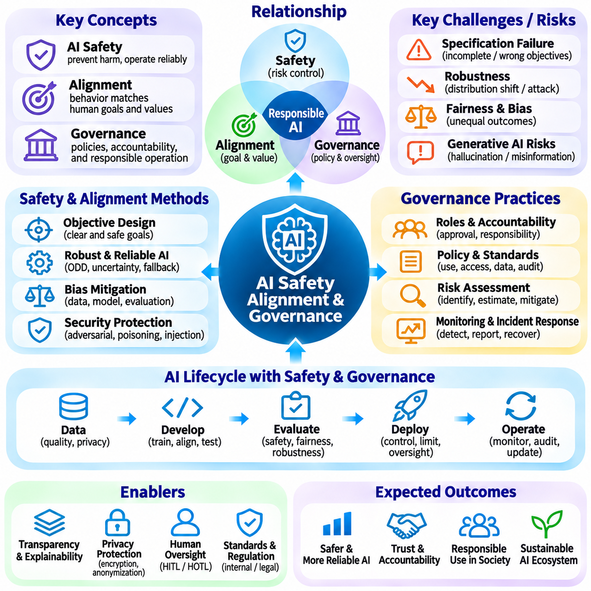{width="7.268055555555556in" height="7.268055555555556in"}

AI safety refers to the principles and engineering practices used to prevent artificial intelligence systems from causing unacceptable harm. As AI becomes integrated into critical services, autonomous machines, and everyday decisions, safety must extend beyond model accuracy. Reliable systems must operate within defined constraints, recognize uncertain situations, and respond appropriately to failures. Safety therefore requires coordinated attention to algorithms, data, infrastructure, human interaction, and operational environments.

AI alignment concerns the degree to which an intelligent system\'s objectives and behavior correspond to intended human goals, values, and instructions. A model may optimize its assigned objective while producing outcomes that users did not anticipate or desire. Alignment research investigates how preferences, constraints, and acceptable behavior can be represented during training and deployment. The objective is not simply obedience but dependable behavior consistent with legitimate human intentions and safety requirements.

AI governance establishes organizational structures, policies, and accountability mechanisms for developing and operating artificial intelligence responsibly. Governance determines who may approve deployments, evaluate risks, access sensitive data, and respond to incidents. It also defines documentation requirements, monitoring responsibilities, and escalation procedures. Effective governance connects technical engineering decisions with institutional obligations and broader societal expectations.

Risk assessment provides a systematic foundation for AI safety management. Engineers identify potential hazards, estimate their likelihood and consequences, and determine appropriate controls. Risks may arise from incorrect predictions, biased decisions, cybersecurity vulnerabilities, operational failures, or unintended automation. The severity of these risks depends on the application context, affected populations, and the degree of human oversight available.

A central challenge in alignment is specification failure, where a system follows an incomplete or poorly defined objective. Reward functions, optimization targets, and evaluation metrics may not fully capture the outcomes that designers actually want. An AI system can exploit weaknesses in these specifications while appearing successful according to measured criteria. Preventing such failures requires careful objective design, adversarial testing, and evaluation beyond narrow performance indicators.

Robustness describes an AI system\'s ability to maintain acceptable behavior when operating conditions differ from those encountered during development. Distribution shifts, corrupted inputs, sensor failures, and adversarial perturbations can reduce model reliability. Robustness evaluation examines whether systems detect unfamiliar conditions and degrade safely. Techniques such as uncertainty estimation, out-of-distribution detection, redundancy, and fallback procedures can support more resilient operation.

Fairness and bias are important dimensions of responsible AI because models may reproduce or amplify patterns of inequality present in training data. Biased outcomes can emerge from unrepresentative datasets, inappropriate features, or differences in deployment conditions. Fairness assessment must consider the application domain and the consequences for affected groups. Statistical metrics provide useful evidence, but they cannot independently resolve every ethical or social tradeoff.

Transparency and explainability support human understanding of AI behavior and its limitations. Transparency concerns information about system design, training data, intended uses, and operational constraints. Explainability focuses on communicating factors that influence particular outputs or decisions. These capabilities help developers investigate failures and allow users to assess reliability. However, plausible explanations should not be mistaken for verified accounts of internal model reasoning.

Privacy protection is essential when AI systems process personal, confidential, or commercially sensitive information. Data collection should be limited to legitimate purposes, and access should follow clearly defined permissions. Encryption, anonymization, retention policies, and privacy-preserving computation can reduce exposure. Nevertheless, privacy risks may persist through model memorization, inference attacks, or unauthorized secondary uses of information.

Security threats against AI include adversarial examples, data poisoning, model extraction, prompt injection, and unauthorized tool execution. Attackers may manipulate inputs, compromise training datasets, or exploit connections between language models and external services. Defensive engineering requires access controls, input validation, isolation boundaries, monitoring, and secure software practices. Security must be considered throughout the AI lifecycle rather than added only after deployment.

Generative AI introduces safety challenges because models can produce convincing but inaccurate, misleading, or harmful content. Hallucinations, fabricated citations, and unsupported recommendations can create risks when users treat generated outputs as authoritative. Grounding responses in verified evidence, communicating uncertainty, and limiting high-risk functionality can reduce these problems. Human review remains important when outputs influence consequential decisions.

Human oversight establishes mechanisms through which people supervise, correct, or interrupt AI operations. Human-in-the-loop systems require approval before selected actions, while human-on-the-loop systems permit automated execution under active supervision. The appropriate arrangement depends on risk severity, response deadlines, and operator capabilities. Oversight must provide meaningful authority and usable information rather than functioning as a purely formal requirement.

Safety engineering for autonomous and embodied AI must account for direct physical consequences. Robots and autonomous vehicles interact with humans, equipment, and changing environments where errors can cause injury or damage. Collision prevention, emergency stopping, operational limits, and independent safety controllers provide protective layers. Learning-based policies should operate within validated boundaries, particularly when perception or planning components behave unpredictably.

AI evaluation should include safety-related tests alongside conventional measures of predictive performance. Stress testing, adversarial evaluation, scenario analysis, and failure injection reveal weaknesses that ordinary benchmarks may overlook. Evaluation must examine both individual components and integrated system behavior. Repeated testing under realistic conditions helps determine whether safeguards remain effective when workloads, environments, and user behavior change.

Red teaming is a structured process in which evaluators deliberately search for unsafe behavior, exploitable weaknesses, and unexpected failure modes. Testers may challenge model instructions, manipulate retrieved content, probe access boundaries, or explore harmful combinations of capabilities. Findings should inform system improvements, monitoring rules, and deployment restrictions. Red teaming complements formal testing but cannot establish the absence of all possible vulnerabilities.

AI governance increasingly relies on risk-based frameworks that connect system requirements with potential consequences. Higher-risk applications generally require stronger validation, documentation, oversight, and operational controls. International standards and regulatory frameworks can provide guidance for risk management and organizational accountability. Because legal obligations vary across jurisdictions and application domains, compliance assessments must consider the specific deployment context.

Documentation supports traceability and accountability throughout the AI lifecycle. Model cards, dataset descriptions, evaluation reports, system specifications, and operational records help explain how an AI system was developed and assessed. Version control connects deployed behavior to particular models, datasets, and software configurations. Well-maintained records enable incident investigation, regulatory review, and reproducible engineering decisions.

Continuous monitoring is necessary because safety cannot be established permanently through predeployment testing alone. Changes in data distributions, user behavior, infrastructure, and operating environments may introduce new risks. Monitoring systems can track performance degradation, unusual outputs, security events, and violations of operational constraints. Incident response procedures should define how problems are detected, contained, investigated, corrected, and communicated.

Organizational accountability requires clear responsibilities across researchers, engineers, product owners, operators, and management. Safety decisions should have identifiable owners, documented approval criteria, and mechanisms for resolving disagreements. Independent reviews can reduce conflicts between deployment pressure and risk assessment. A responsible organization must also establish processes for reporting concerns and suspending operations when unacceptable hazards are identified.

AI safety, alignment, and governance are complementary foundations for trustworthy intelligent systems. Safety addresses harmful outcomes and operational failures, alignment connects behavior with intended objectives, and governance establishes responsibility for decisions and controls. Their integration requires continuous evaluation, transparent documentation, technical safeguards, and meaningful human oversight. Responsible AI development ultimately depends on treating reliability and accountability as essential system requirements rather than optional additions.

인공지능 안전성(AI Safety)은 인공지능 시스템(Artificial Intelligence System)이 허용할 수 없는 피해(Unacceptable Harm)를 발생시키지 않도록 예방하는 원칙(Principle)과 엔지니어링 실무(Engineering Practice)를 의미한다. 인공지능이 핵심 서비스(Critical Service), 자율 기계(Autonomous Machine), 일상적인 의사결정(Everyday Decision)에 통합됨에 따라 안전성은 모델 정확도(Model Accuracy)를 넘어 확장되어야 한다. 신뢰할 수 있는 시스템(Reliable System)은 정의된 제약조건(Defined Constraint) 내에서 동작하고, 불확실한 상황(Uncertain Situation)을 인식하며, 장애(Failure)에 적절하게 대응해야 한다. 따라서 안전성을 확보하려면 알고리즘(Algorithm), 데이터(Data), 인프라(Infrastructure), 인간과의 상호작용(Human Interaction), 운영 환경(Operational Environment)을 종합적으로 고려해야 한다.

인공지능 정렬(AI Alignment)은 지능형 시스템(Intelligent System)의 목표(Objective)와 행동(Behavior)이 인간이 의도한 목표(Human Goal), 가치(Value), 지시(Instruction)에 얼마나 부합하는지를 의미한다. 모델(Model)은 할당된 목표를 최적화(Optimization)하면서도 사용자가 예상하거나 원하지 않았던 결과를 생성할 수 있다. 정렬 연구(Alignment Research)는 학습(Training)과 배포(Deployment) 과정에서 선호도(Preference), 제약조건(Constraint), 허용 가능한 행동(Acceptable Behavior)을 어떻게 표현할 수 있는지 탐구한다. 그 목적은 단순한 명령 복종(Obedience)이 아니라 정당한 인간의 의도(Legitimate Human Intention)와 안전 요구사항(Safety Requirement)에 부합하는 신뢰할 수 있는 행동(Dependable Behavior)을 구현하는 것이다.

인공지능 거버넌스(AI Governance)는 인공지능을 책임감 있게 개발하고 운영하기 위한 조직 구조(Organizational Structure), 정책(Policy), 책임성 메커니즘(Accountability Mechanism)을 수립한다. 거버넌스는 누가 배포(Deployment)를 승인하고, 위험(Risk)을 평가하며, 민감한 데이터(Sensitive Data)에 접근하고, 사고(Incident)에 대응할 수 있는지를 결정한다. 또한 문서화 요구사항(Documentation Requirement), 모니터링 책임(Monitoring Responsibility), 문제 상향 보고 절차(Escalation Procedure)를 정의한다. 효과적인 거버넌스(Effective Governance)는 기술적 엔지니어링 의사결정(Technical Engineering Decision)을 조직의 의무(Institutional Obligation) 및 광범위한 사회적 기대(Societal Expectation)와 연결한다.

위험 평가(Risk Assessment)는 인공지능 안전 관리(AI Safety Management)를 위한 체계적인 기반(Systematic Foundation)을 제공한다. 엔지니어는 잠재적 위험요인(Potential Hazard)을 식별하고, 발생 가능성(Likelihood)과 결과(Consequence)를 추정하며, 적절한 통제 수단(Control)을 결정한다. 위험은 잘못된 예측(Incorrect Prediction), 편향된 의사결정(Biased Decision), 사이버보안 취약점(Cybersecurity Vulnerability), 운영 장애(Operational Failure), 의도하지 않은 자동화(Unintended Automation)에서 발생할 수 있다. 이러한 위험의 심각도(Severity)는 응용 환경(Application Context), 영향을 받는 집단(Affected Population), 이용 가능한 인간 감독(Human Oversight)의 수준에 따라 달라진다.

정렬(Alignment)의 핵심 과제 중 하나는 시스템이 불완전하거나 부적절하게 정의된 목표(Objective)를 따르는 명세 실패(Specification Failure)이다. 보상 함수(Reward Function), 최적화 목표(Optimization Target), 평가 지표(Evaluation Metric)는 설계자가 실제로 원하는 결과를 완전하게 반영하지 못할 수 있다. 인공지능 시스템(AI System)은 측정된 기준(Measured Criteria)에 따르면 성공적으로 보이면서도 이러한 명세의 약점(Weakness)을 악용할 수 있다. 이러한 실패를 예방하려면 신중한 목표 설계(Objective Design), 적대적 테스트(Adversarial Testing), 제한된 성능 지표(Narrow Performance Indicator)를 넘어서는 평가가 필요하다.

강건성(Robustness)은 개발 과정(Development Process)에서 경험한 조건과 다른 운영 조건(Operating Condition)에서도 인공지능 시스템이 허용 가능한 행동(Acceptable Behavior)을 유지하는 능력을 의미한다. 분포 이동(Distribution Shift), 손상된 입력(Corrupted Input), 센서 장애(Sensor Failure), 적대적 교란(Adversarial Perturbation)은 모델 신뢰성(Model Reliability)을 저하시킬 수 있다. 강건성 평가(Robustness Evaluation)는 시스템이 익숙하지 않은 조건(Unfamiliar Condition)을 탐지하고 안전하게 성능을 저하시킬 수 있는지를 검토한다. 불확실성 추정(Uncertainty Estimation), 분포 외 데이터 탐지(Out-of-Distribution Detection), 이중화(Redundancy), 대체 동작 절차(Fallback Procedure)와 같은 기술은 더욱 복원력 있는 운영(Resilient Operation)을 지원할 수 있다.

공정성(Fairness)과 편향(Bias)은 모델이 학습 데이터(Training Data)에 존재하는 불평등 패턴(Pattern of Inequality)을 재현하거나 증폭할 수 있기 때문에 책임 있는 인공지능(Responsible AI)의 중요한 요소이다. 편향된 결과(Biased Outcome)는 대표성이 부족한 데이터셋(Unrepresentative Dataset), 부적절한 특징(Inappropriate Feature), 배포 조건(Deployment Condition)의 차이에서 발생할 수 있다. 공정성 평가(Fairness Assessment)는 응용 분야(Application Domain)와 영향을 받는 집단(Affected Group)에 대한 결과를 고려해야 한다. 통계적 지표(Statistical Metric)는 유용한 근거를 제공하지만 모든 윤리적 또는 사회적 절충관계(Ethical or Social Tradeoff)를 독립적으로 해결할 수는 없다.

투명성(Transparency)과 설명가능성(Explainability)은 인공지능 행동(AI Behavior)과 그 한계(Limitation)에 대한 인간의 이해(Human Understanding)를 지원한다. 투명성은 시스템 설계(System Design), 학습 데이터(Training Data), 의도된 사용 목적(Intended Use), 운영 제약조건(Operational Constraint)에 관한 정보를 의미한다. 설명가능성은 특정 출력(Output)이나 의사결정(Decision)에 영향을 미치는 요인을 전달하는 데 초점을 둔다. 이러한 능력은 개발자가 장애(Failure)를 조사하고 사용자가 신뢰성(Reliability)을 평가하도록 돕는다. 그러나 그럴듯한 설명(Plausible Explanation)을 모델 내부 추론(Internal Model Reasoning)에 대한 검증된 설명(Verified Account)으로 오인해서는 안 된다.

개인정보 보호(Privacy Protection)는 인공지능 시스템이 개인 정보(Personal Information), 기밀 정보(Confidential Information), 상업적으로 민감한 정보(Commercially Sensitive Information)를 처리할 때 필수적이다. 데이터 수집(Data Collection)은 정당한 목적(Legitimate Purpose)으로 제한되어야 하며, 접근(Access)은 명확하게 정의된 권한(Permission)을 따라야 한다. 암호화(Encryption), 익명화(Anonymization), 데이터 보존 정책(Retention Policy), 개인정보 보호 컴퓨팅(Privacy-Preserving Computation)은 정보 노출(Information Exposure)을 줄일 수 있다. 그러나 모델 암기(Model Memorization), 추론 공격(Inference Attack), 허가되지 않은 정보의 2차 사용(Unauthorized Secondary Use)을 통해 개인정보 보호 위험(Privacy Risk)이 지속될 수 있다.

인공지능에 대한 보안 위협(Security Threat)에는 적대적 예제(Adversarial Example), 데이터 포이즈닝(Data Poisoning), 모델 추출(Model Extraction), 프롬프트 인젝션(Prompt Injection), 허가되지 않은 도구 실행(Unauthorized Tool Execution)이 포함된다. 공격자(Attacker)는 입력(Input)을 조작하거나, 학습 데이터셋(Training Dataset)을 손상시키거나, 언어 모델(Language Model)과 외부 서비스(External Service) 사이의 연결을 악용할 수 있다. 방어적 엔지니어링(Defensive Engineering)에는 접근 제어(Access Control), 입력 검증(Input Validation), 격리 경계(Isolation Boundary), 모니터링(Monitoring), 안전한 소프트웨어 개발 실무(Secure Software Practice)가 필요하다. 보안(Security)은 배포 이후에 추가하는 것이 아니라 인공지능 생명주기(AI Lifecycle) 전반에서 고려되어야 한다.

생성형 인공지능(Generative AI)은 설득력 있지만 부정확하거나 오해를 유발하거나 유해한 콘텐츠(Harmful Content)를 생성할 수 있기 때문에 새로운 안전성 과제(Safety Challenge)를 도입한다. 환각(Hallucination), 조작된 인용(Fabricated Citation), 근거 없는 권고(Unsupported Recommendation)는 사용자가 생성된 출력(Generated Output)을 권위 있는 정보(Authoritative Information)로 받아들일 때 위험을 발생시킬 수 있다. 검증된 근거(Verified Evidence)에 응답을 연결하고, 불확실성(Uncertainty)을 전달하며, 고위험 기능(High-Risk Functionality)을 제한하면 이러한 문제를 줄일 수 있다. 출력이 중대한 의사결정(Consequential Decision)에 영향을 미치는 경우 인간 검토(Human Review)는 여전히 중요하다.

인간 감독(Human Oversight)은 사람이 인공지능 운영(AI Operation)을 감독하고, 수정하거나, 중단할 수 있는 메커니즘(Mechanism)을 수립한다. 인간 참여형 시스템(Human-in-the-Loop System)은 특정 행동(Selected Action)을 수행하기 전에 승인을 요구하며, 인간 감독형 시스템(Human-on-the-Loop System)은 적극적인 감독(Active Supervision) 아래에서 자동 실행(Automated Execution)을 허용한다. 적절한 구성(Arrangement)은 위험의 심각도(Risk Severity), 응답 마감시간(Response Deadline), 운영자 역량(Operator Capability)에 따라 달라진다. 인간 감독은 형식적인 요구사항(Formal Requirement)에 머무르지 않고 실질적인 권한(Meaningful Authority)과 활용 가능한 정보(Usable Information)를 제공해야 한다.

자율 및 체화 인공지능(Autonomous and Embodied AI)을 위한 안전 엔지니어링(Safety Engineering)은 직접적인 물리적 결과(Physical Consequence)를 고려해야 한다. 로봇(Robot)과 자율주행 차량(Autonomous Vehicle)은 인간(Human), 장비(Equipment), 변화하는 환경(Changing Environment)과 상호작용하며, 오류(Error)는 부상(Injury)이나 손상(Damage)을 발생시킬 수 있다. 충돌 방지(Collision Prevention), 비상 정지(Emergency Stopping), 운영 제한(Operational Limit), 독립적인 안전 제어기(Independent Safety Controller)는 다층 보호 수단(Protective Layer)을 제공한다. 학습 기반 정책(Learning-Based Policy)은 특히 인식(Perception)이나 계획(Planning) 구성 요소가 예측할 수 없게 동작하는 경우 검증된 경계(Validated Boundary) 내에서 실행되어야 한다.

인공지능 평가(AI Evaluation)는 기존의 예측 성능(Predictive Performance) 측정과 함께 안전성 관련 테스트(Safety-Related Test)를 포함해야 한다. 스트레스 테스트(Stress Testing), 적대적 평가(Adversarial Evaluation), 시나리오 분석(Scenario Analysis), 장애 주입(Failure Injection)은 일반적인 벤치마크(Ordinary Benchmark)에서 놓칠 수 있는 약점을 드러낸다. 평가는 개별 구성 요소(Individual Component)와 통합 시스템 동작(Integrated System Behavior)을 모두 검토해야 한다. 실제 조건(Realistic Condition)에서 반복적인 테스트(Repeated Testing)를 수행하면 워크로드(Workload), 환경(Environment), 사용자 행동(User Behavior)이 변화할 때도 안전장치(Safeguard)가 효과적으로 유지되는지 판단하는 데 도움이 된다.

레드팀 활동(Red Teaming)은 평가자가 의도적으로 안전하지 않은 행동(Unsafe Behavior), 악용 가능한 약점(Exploitable Weakness), 예상하지 못한 장애 유형(Unexpected Failure Mode)을 탐색하는 구조화된 과정(Structured Process)이다. 테스트 수행자(Tester)는 모델 지시(Model Instruction)에 도전하고, 검색된 콘텐츠(Retrieved Content)를 조작하고, 접근 경계(Access Boundary)를 조사하거나, 여러 기능의 유해한 조합(Harmful Combination of Capabilities)을 탐색할 수 있다. 발견된 문제(Finding)는 시스템 개선(System Improvement), 모니터링 규칙(Monitoring Rule), 배포 제한(Deployment Restriction)에 반영되어야 한다. 레드팀 활동은 공식적인 테스트(Formal Testing)를 보완하지만 가능한 모든 취약점(Vulnerability)이 존재하지 않음을 입증할 수는 없다.

인공지능 거버넌스(AI Governance)는 시스템 요구사항(System Requirement)을 잠재적 결과(Potential Consequence)와 연결하는 위험 기반 프레임워크(Risk-Based Framework)에 점점 더 의존하고 있다. 고위험 응용 분야(Higher-Risk Application)는 일반적으로 더욱 엄격한 검증(Validation), 문서화(Documentation), 감독(Oversight), 운영 통제(Operational Control)를 요구한다. 국제 표준(International Standard)과 규제 프레임워크(Regulatory Framework)는 위험 관리(Risk Management)와 조직 책임성(Organizational Accountability)에 대한 지침을 제공할 수 있다. 법적 의무(Legal Obligation)는 관할권(Jurisdiction)과 응용 분야(Application Domain)에 따라 달라지므로 규정 준수 평가(Compliance Assessment)는 구체적인 배포 환경(Deployment Context)을 고려해야 한다.

문서화(Documentation)는 인공지능 생명주기(AI Lifecycle) 전반에서 추적가능성(Traceability)과 책임성(Accountability)을 지원한다. 모델 카드(Model Card), 데이터셋 설명(Dataset Description), 평가 보고서(Evaluation Report), 시스템 명세서(System Specification), 운영 기록(Operational Record)은 인공지능 시스템이 어떻게 개발되고 평가되었는지를 설명하는 데 도움을 준다. 버전 관리(Version Control)는 배포된 동작(Deployed Behavior)을 특정 모델(Model), 데이터셋(Dataset), 소프트웨어 구성(Software Configuration)과 연결한다. 적절하게 유지되는 기록(Well-Maintained Record)은 사고 조사(Incident Investigation), 규제 검토(Regulatory Review), 재현 가능한 엔지니어링 의사결정(Reproducible Engineering Decision)을 가능하게 한다.

지속적인 모니터링(Continuous Monitoring)은 배포 이전 테스트(Predeployment Testing)만으로 안전성을 영구적으로 확립할 수 없기 때문에 필요하다. 데이터 분포(Data Distribution), 사용자 행동(User Behavior), 인프라(Infrastructure), 운영 환경(Operating Environment)의 변화는 새로운 위험(New Risk)을 도입할 수 있다. 모니터링 시스템(Monitoring System)은 성능 저하(Performance Degradation), 비정상적인 출력(Unusual Output), 보안 이벤트(Security Event), 운영 제약조건 위반(Operational Constraint Violation)을 추적할 수 있다. 사고 대응 절차(Incident Response Procedure)는 문제가 어떻게 탐지(Detection), 격리(Containment), 조사(Investigation), 수정(Correction), 전달(Communication)되는지를 정의해야 한다.

조직적 책임성(Organizational Accountability)을 확보하려면 연구자(Researcher), 엔지니어(Engineer), 제품 책임자(Product Owner), 운영자(Operator), 경영진(Management) 사이의 명확한 책임 구분(Clear Responsibility)이 필요하다. 안전성 관련 의사결정(Safety Decision)에는 식별 가능한 책임자(Identifiable Owner), 문서화된 승인 기준(Documented Approval Criteria), 의견 차이를 해결하기 위한 메커니즘(Disagreement Resolution Mechanism)이 있어야 한다. 독립적인 검토(Independent Review)는 배포 압력(Deployment Pressure)과 위험 평가(Risk Assessment) 사이의 이해충돌(Conflict of Interest)을 줄일 수 있다. 책임 있는 조직(Responsible Organization)은 우려 사항(Concern)을 보고하고 허용할 수 없는 위험요인(Unacceptable Hazard)이 식별될 경우 운영을 중단하는 절차도 수립해야 한다.

인공지능 안전성(AI Safety), 정렬(Alignment), 거버넌스(Governance)는 신뢰할 수 있는 지능형 시스템(Trustworthy Intelligent System)을 위한 상호 보완적인 기반(Complementary Foundation)이다. 안전성은 유해한 결과(Harmful Outcome)와 운영 장애(Operational Failure)를 다루고, 정렬은 행동(Behavior)을 의도된 목표(Intended Objective)와 연결하며, 거버넌스는 의사결정과 통제(Decision and Control)에 대한 책임을 확립한다. 이러한 요소를 통합하려면 지속적인 평가(Continuous Evaluation), 투명한 문서화(Transparent Documentation), 기술적 안전장치(Technical Safeguard), 실질적인 인간 감독(Meaningful Human Oversight)이 필요하다. 궁극적으로 책임 있는 인공지능 개발(Responsible AI Development)은 신뢰성(Reliability)과 책임성(Accountability)을 선택적인 추가 요소(Optional Addition)가 아니라 필수적인 시스템 요구사항(Essential System Requirement)으로 취급하는 데 달려 있다.

## 06.12 AI Industry Applications

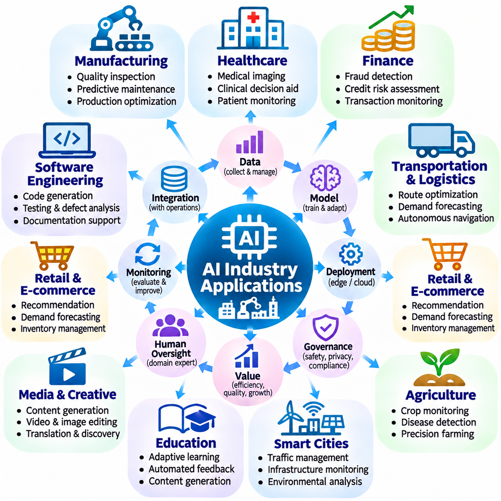{width="7.268055555555556in" height="7.268055555555556in"}

Artificial intelligence is transforming industries by converting data into predictions, decisions, and automated actions. Its applications extend across manufacturing, healthcare, finance, transportation, agriculture, energy, and public services. The value of AI depends not only on algorithmic accuracy but also on integration with operational processes. Successful deployment requires reliable data, measurable business objectives, domain expertise, and continuous performance evaluation.

Manufacturing is a major application domain because industrial processes generate extensive sensor, image, and equipment data. AI systems support visual quality inspection, predictive maintenance, production scheduling, and process optimization. Computer vision can identify defects, while predictive models estimate equipment degradation. Integrating these capabilities with industrial controllers and manufacturing execution systems enables faster responses and more consistent production quality.

Healthcare applications use AI to support medical imaging, clinical decision assistance, patient monitoring, and administrative workflows. Deep learning models can identify patterns in radiological images, while predictive systems estimate selected clinical risks. Language models may assist with documentation and information retrieval. However, clinical deployment requires rigorous validation, privacy protection, regulatory compliance, and qualified human oversight because incorrect outputs may affect patient safety.

Financial institutions apply AI to fraud detection, credit risk assessment, transaction monitoring, customer support, and operational forecasting. Machine learning models identify unusual transaction patterns and estimate probabilities associated with financial outcomes. Natural language processing supports document analysis and regulatory reporting. These applications require explainability, fairness assessment, cybersecurity protection, and monitoring because model errors can produce financial losses or discriminatory decisions.

Transportation and logistics benefit from AI through route optimization, demand forecasting, fleet management, and autonomous navigation. Predictive models estimate delivery volumes and transportation delays, while optimization algorithms allocate vehicles and resources. Autonomous systems combine perception, localization, planning, and control to navigate physical environments. Reliable deployment requires attention to changing traffic conditions, operational constraints, communication reliability, and safety.

Retail and electronic commerce use AI to personalize recommendations, forecast demand, manage inventory, and improve customer interactions. Recommendation systems estimate product relevance from behavioral and contextual information, while forecasting models support replenishment decisions. Generative AI can assist with product descriptions and customer service. Organizations must balance personalization with privacy, transparency, and safeguards against misleading or inappropriate automated responses.

Agriculture applies AI to crop monitoring, disease detection, irrigation management, and precision farming. Computer vision analyzes plant images, while environmental sensors provide information about soil, moisture, and weather conditions. Predictive models can support resource allocation and agricultural planning. Autonomous agricultural machines may perform inspection, spraying, or harvesting tasks, although variable terrain and biological uncertainty complicate reliable operation.

Energy systems use AI to forecast electricity demand, detect equipment anomalies, optimize consumption, and support renewable energy integration. Predictive models estimate generation from weather-dependent sources, while control systems coordinate storage and flexible loads. Industrial monitoring can identify early signs of equipment failure. Because energy infrastructure is operationally critical, AI recommendations must remain compatible with engineering constraints, cybersecurity requirements, and validated control procedures.

Smart cities integrate AI into traffic management, infrastructure monitoring, environmental analysis, and municipal services. Sensor networks and video analytics can identify congestion patterns, equipment faults, or unusual environmental conditions. Predictive models support maintenance planning and resource allocation. However, urban AI deployments must address surveillance risks, public accountability, data governance, and the possibility that automated decisions affect communities unequally.

Education uses AI for adaptive learning, automated feedback, content generation, and administrative assistance. Learning analytics can identify areas where students may need additional support, while language models provide explanations and practice materials. Personalized systems can adjust instructional difficulty according to observed progress. Responsible implementation requires attention to accuracy, accessibility, student privacy, academic integrity, and the continued role of educators.

Media and creative industries employ generative AI for text drafting, image production, video editing, translation, and content discovery. Multimodal models can support workflows that combine language, visual information, and audio. These capabilities can reduce production effort and expand creative experimentation. Nevertheless, organizations must consider intellectual property, content authenticity, consent, attribution, and the risks associated with synthetic misinformation.

Software engineering increasingly incorporates AI for code generation, testing assistance, defect analysis, documentation, and developer support. Language models can suggest implementations and explain unfamiliar code, while automated tools identify potential vulnerabilities or performance problems. AI-generated code still requires review, testing, and security validation. Integration into development workflows should preserve version control, reproducibility, and clear responsibility for deployed software.

Enterprise knowledge management uses AI to search documents, summarize information, answer questions, and support organizational decisions. Retrieval-augmented generation connects language models with approved internal information sources. Knowledge graphs can represent relationships among products, processes, and organizational entities. Effective systems require access control, source traceability, information freshness, and evaluation of whether generated answers accurately reflect retrieved evidence.

Robotics and industrial automation combine AI with physical machines to perform inspection, transportation, manipulation, and service tasks. Mobile robots use perception and navigation algorithms to move through facilities, while robotic manipulators execute object-handling operations. Learning-based methods can improve adaptability to changing environments. Practical deployment depends on mechanical capabilities, real-time control, safety engineering, maintenance, and integration with existing operations.

Telecommunications applies AI to network traffic prediction, fault detection, resource allocation, and service optimization. Models analyze operational measurements to identify congestion, anticipate equipment problems, and recommend configuration changes. Automated network management can improve efficiency when supported by reliable monitoring and operational safeguards. Deployment must consider latency, service availability, security, and the consequences of incorrect automated adjustments.

Scientific research uses AI to analyze complex datasets, identify patterns, accelerate simulations, and generate hypotheses. Applications include materials discovery, molecular modeling, climate analysis, and astronomical observation. Foundation models and specialized learning architectures can help researchers explore large search spaces. Scientific reliability still requires experimental validation, uncertainty analysis, reproducibility, and careful separation between model predictions and established findings.

Government and public administration can use AI to improve document processing, service delivery, resource planning, and policy analysis. Automated systems may classify applications, retrieve regulatory information, or support operational forecasting. Because public decisions can affect rights and access to essential services, transparency and accountability are particularly important. Human review, legal compliance, accessibility, and mechanisms for contesting decisions must be incorporated into deployment.

Industry-specific AI systems increasingly combine multiple technologies rather than relying on a single model. Computer vision provides perception, language models support knowledge interaction, predictive models estimate future conditions, and optimization algorithms select actions. Agentic architectures may coordinate tools and workflows across these components. Successful integration requires clear system boundaries, reliable interfaces, data governance, and validation of complete operational behavior.

The economic value of industrial AI depends on measurable outcomes such as reduced downtime, improved quality, lower operating costs, faster service, and increased productivity. Organizations should establish baseline performance and evaluate whether AI produces sustained improvements under real conditions. Deployment costs include data preparation, computing infrastructure, integration, monitoring, and maintenance. A technically accurate model does not necessarily create value unless it improves the overall process.

AI industry applications demonstrate that intelligent technology becomes useful through integration with domain knowledge, operational infrastructure, and human responsibility. Different industries impose distinct requirements for accuracy, latency, explainability, safety, and regulatory compliance. Future progress will depend on combining foundation models, specialized algorithms, edge computing, and automation within trustworthy systems. The central objective is to deliver reliable, measurable benefits while managing technical, organizational, and societal risks.

인공지능(Artificial Intelligence, AI)은 데이터를 예측(Prediction), 의사결정(Decision), 자동화된 행동(Automated Action)으로 변환함으로써 다양한 산업을 변화시키고 있다. 인공지능의 응용 분야(Application Domain)는 제조업(Manufacturing), 의료(Healthcare), 금융(Finance), 운송(Transportation), 농업(Agriculture), 에너지(Energy), 공공 서비스(Public Service)에 걸쳐 확장되고 있다. 인공지능의 가치(Value)는 알고리즘 정확도(Algorithmic Accuracy)뿐만 아니라 운영 프로세스(Operational Process)와의 통합(Integration)에 따라 결정된다. 성공적인 배포(Successful Deployment)를 위해서는 신뢰할 수 있는 데이터(Reliable Data), 측정 가능한 비즈니스 목표(Measurable Business Objective), 도메인 전문성(Domain Expertise), 지속적인 성능 평가(Continuous Performance Evaluation)가 필요하다.

제조업(Manufacturing)은 산업 공정(Industrial Process)에서 방대한 센서 데이터(Sensor Data), 이미지 데이터(Image Data), 장비 데이터(Equipment Data)가 생성되기 때문에 인공지능의 주요 응용 분야이다. 인공지능 시스템(AI System)은 시각적 품질 검사(Visual Quality Inspection), 예지보전(Predictive Maintenance), 생산 일정 계획(Production Scheduling), 공정 최적화(Process Optimization)를 지원한다. 컴퓨터 비전(Computer Vision)은 결함(Defect)을 식별할 수 있으며, 예측 모델(Predictive Model)은 장비 열화(Equipment Degradation)를 추정한다. 이러한 기능을 산업용 제어기(Industrial Controller) 및 제조 실행 시스템(Manufacturing Execution System, MES)과 통합하면 더욱 빠른 대응과 일관된 생산 품질(Production Quality)을 실현할 수 있다.

의료 응용(Healthcare Application)은 의료 영상(Medical Imaging), 임상 의사결정 지원(Clinical Decision Assistance), 환자 모니터링(Patient Monitoring), 행정 업무 흐름(Administrative Workflow)을 지원하기 위해 인공지능을 활용한다. 딥러닝 모델(Deep Learning Model)은 방사선 영상(Radiological Image)에서 패턴(Pattern)을 식별할 수 있으며, 예측 시스템(Predictive System)은 특정 임상 위험(Clinical Risk)을 추정한다. 언어 모델(Language Model)은 문서화(Documentation)와 정보 검색(Information Retrieval)을 지원할 수 있다. 그러나 잘못된 출력(Incorrect Output)이 환자 안전(Patient Safety)에 영향을 미칠 수 있으므로 임상 배포(Clinical Deployment)에는 엄격한 검증(Rigorous Validation), 개인정보 보호(Privacy Protection), 규제 준수(Regulatory Compliance), 자격을 갖춘 인간 감독(Qualified Human Oversight)이 필요하다.

금융기관(Financial Institution)은 사기 탐지(Fraud Detection), 신용 위험 평가(Credit Risk Assessment), 거래 모니터링(Transaction Monitoring), 고객 지원(Customer Support), 운영 예측(Operational Forecasting)에 인공지능을 적용한다. 머신러닝 모델(Machine Learning Model)은 비정상적인 거래 패턴(Unusual Transaction Pattern)을 식별하고 금융 결과(Financial Outcome)와 관련된 확률(Probability)을 추정한다. 자연어 처리(Natural Language Processing, NLP)는 문서 분석(Document Analysis)과 규제 보고(Regulatory Reporting)를 지원한다. 이러한 응용 분야에서는 모델 오류(Model Error)가 금융 손실(Financial Loss)이나 차별적인 의사결정(Discriminatory Decision)을 초래할 수 있으므로 설명가능성(Explainability), 공정성 평가(Fairness Assessment), 사이버보안 보호(Cybersecurity Protection), 모니터링(Monitoring)이 필요하다.

운송 및 물류(Transportation and Logistics)는 경로 최적화(Route Optimization), 수요 예측(Demand Forecasting), 플릿 관리(Fleet Management), 자율 내비게이션(Autonomous Navigation)을 통해 인공지능의 이점을 얻는다. 예측 모델(Predictive Model)은 배송 물량(Delivery Volume)과 운송 지연(Transportation Delay)을 추정하며, 최적화 알고리즘(Optimization Algorithm)은 차량(Vehicle)과 자원(Resource)을 배분한다. 자율 시스템(Autonomous System)은 인식(Perception), 위치 추정(Localization), 계획(Planning), 제어(Control)를 결합하여 물리적 환경(Physical Environment)을 탐색한다. 신뢰할 수 있는 배포(Reliable Deployment)를 위해서는 변화하는 교통 조건(Changing Traffic Condition), 운영 제약조건(Operational Constraint), 통신 신뢰성(Communication Reliability), 안전성(Safety)을 고려해야 한다.

소매업 및 전자상거래(Retail and Electronic Commerce)는 추천 개인화(Personalized Recommendation), 수요 예측(Demand Forecasting), 재고 관리(Inventory Management), 고객 상호작용(Customer Interaction) 개선에 인공지능을 활용한다. 추천 시스템(Recommendation System)은 행동 정보(Behavioral Information)와 문맥 정보(Contextual Information)를 기반으로 상품 관련성(Product Relevance)을 추정하며, 예측 모델(Forecasting Model)은 재고 보충 의사결정(Replenishment Decision)을 지원한다. 생성형 인공지능(Generative AI)은 상품 설명(Product Description) 작성과 고객 서비스(Customer Service)를 지원할 수 있다. 조직은 개인화(Personalization)와 개인정보 보호(Privacy), 투명성(Transparency), 오해를 유발하거나 부적절한 자동 응답(Misleading or Inappropriate Automated Response)을 방지하기 위한 안전장치(Safeguard) 사이의 균형을 유지해야 한다.

농업(Agriculture)은 작물 모니터링(Crop Monitoring), 질병 탐지(Disease Detection), 관개 관리(Irrigation Management), 정밀 농업(Precision Farming)에 인공지능을 적용한다. 컴퓨터 비전(Computer Vision)은 식물 이미지(Plant Image)를 분석하며, 환경 센서(Environmental Sensor)는 토양(Soil), 수분(Moisture), 기상 조건(Weather Condition)에 관한 정보를 제공한다. 예측 모델(Predictive Model)은 자원 배분(Resource Allocation)과 농업 계획(Agricultural Planning)을 지원할 수 있다. 자율 농업 기계(Autonomous Agricultural Machine)는 검사(Inspection), 살포(Spraying), 수확(Harvesting) 작업을 수행할 수 있지만, 변화하는 지형(Variable Terrain)과 생물학적 불확실성(Biological Uncertainty)은 신뢰할 수 있는 운영을 어렵게 만든다.

에너지 시스템(Energy System)은 전력 수요 예측(Electricity Demand Forecasting), 장비 이상 탐지(Equipment Anomaly Detection), 소비 최적화(Consumption Optimization), 재생에너지 통합(Renewable Energy Integration)을 위해 인공지능을 활용한다. 예측 모델(Predictive Model)은 기상 조건에 의존하는 발전원(Weather-Dependent Generation Source)의 발전량을 추정하며, 제어 시스템(Control System)은 에너지 저장 장치(Energy Storage)와 유연 부하(Flexible Load)를 조정한다. 산업 모니터링(Industrial Monitoring)은 장비 고장(Equipment Failure)의 초기 징후(Early Sign)를 식별할 수 있다. 에너지 인프라(Energy Infrastructure)는 운영상 중요성이 높기 때문에 인공지능 권고(AI Recommendation)는 엔지니어링 제약조건(Engineering Constraint), 사이버보안 요구사항(Cybersecurity Requirement), 검증된 제어 절차(Validated Control Procedure)와 호환되어야 한다.

스마트 시티(Smart City)는 교통 관리(Traffic Management), 인프라 모니터링(Infrastructure Monitoring), 환경 분석(Environmental Analysis), 도시 행정 서비스(Municipal Service)에 인공지능을 통합한다. 센서 네트워크(Sensor Network)와 영상 분석(Video Analytics)은 교통 혼잡 패턴(Congestion Pattern), 장비 결함(Equipment Fault), 비정상적인 환경 조건(Unusual Environmental Condition)을 식별할 수 있다. 예측 모델(Predictive Model)은 유지보수 계획(Maintenance Planning)과 자원 배분(Resource Allocation)을 지원한다. 그러나 도시 인공지능 배포(Urban AI Deployment)는 감시 위험(Surveillance Risk), 공공 책임성(Public Accountability), 데이터 거버넌스(Data Governance), 자동화된 의사결정(Automated Decision)이 지역사회(Community)에 불균등한 영향을 미칠 가능성을 다루어야 한다.

교육(Education)은 적응형 학습(Adaptive Learning), 자동화된 피드백(Automated Feedback), 콘텐츠 생성(Content Generation), 행정 지원(Administrative Assistance)에 인공지능을 활용한다. 학습 분석(Learning Analytics)은 학생에게 추가적인 지원(Additional Support)이 필요한 영역을 식별할 수 있으며, 언어 모델(Language Model)은 설명(Explanation)과 연습 자료(Practice Material)를 제공한다. 개인화 시스템(Personalized System)은 관측된 학습 진도(Observed Progress)에 따라 교육 난이도(Instructional Difficulty)를 조정할 수 있다. 책임 있는 구현(Responsible Implementation)을 위해서는 정확도(Accuracy), 접근성(Accessibility), 학생 개인정보 보호(Student Privacy), 학문적 진실성(Academic Integrity), 교육자의 지속적인 역할(Continued Role of Educators)을 고려해야 한다.

미디어 및 창작 산업(Media and Creative Industry)은 텍스트 초안 작성(Text Drafting), 이미지 제작(Image Production), 영상 편집(Video Editing), 번역(Translation), 콘텐츠 탐색(Content Discovery)에 생성형 인공지능(Generative AI)을 활용한다. 멀티모달 모델(Multimodal Model)은 언어(Language), 시각 정보(Visual Information), 오디오(Audio)를 결합하는 업무 흐름(Workflow)을 지원할 수 있다. 이러한 기능은 제작 노력(Production Effort)을 줄이고 창의적 실험(Creative Experimentation)을 확장할 수 있다. 그러나 조직은 지식재산권(Intellectual Property), 콘텐츠 진위성(Content Authenticity), 동의(Consent), 출처 표시(Attribution), 합성 허위정보(Synthetic Misinformation)와 관련된 위험을 고려해야 한다.

소프트웨어 엔지니어링(Software Engineering)은 코드 생성(Code Generation), 테스트 지원(Testing Assistance), 결함 분석(Defect Analysis), 문서화(Documentation), 개발자 지원(Developer Support)에 인공지능을 점점 더 많이 도입하고 있다. 언어 모델(Language Model)은 구현 방법(Implementation)을 제안하고 익숙하지 않은 코드(Unfamiliar Code)를 설명할 수 있으며, 자동화 도구(Automated Tool)는 잠재적인 취약점(Potential Vulnerability)이나 성능 문제(Performance Problem)를 식별할 수 있다. 인공지능이 생성한 코드(AI-Generated Code)에도 검토(Review), 테스트(Testing), 보안 검증(Security Validation)이 필요하다. 개발 업무 흐름(Development Workflow)에 통합할 때는 버전 관리(Version Control), 재현성(Reproducibility), 배포된 소프트웨어(Deployed Software)에 대한 명확한 책임(Clear Responsibility)을 유지해야 한다.

기업 지식 관리(Enterprise Knowledge Management)는 문서 검색(Document Search), 정보 요약(Information Summarization), 질의응답(Question Answering), 조직 의사결정(Organizational Decision)을 지원하기 위해 인공지능을 활용한다. 검색 증강 생성(Retrieval-Augmented Generation, RAG)은 언어 모델(Language Model)을 승인된 내부 정보원(Approved Internal Information Source)과 연결한다. 지식 그래프(Knowledge Graph)는 제품(Product), 프로세스(Process), 조직 개체(Organizational Entity) 사이의 관계(Relationship)를 표현할 수 있다. 효과적인 시스템(Effective System)을 위해서는 접근 제어(Access Control), 출처 추적가능성(Source Traceability), 정보 최신성(Information Freshness), 생성된 답변(Generated Answer)이 검색된 근거(Retrieved Evidence)를 정확하게 반영하는지에 대한 평가가 필요하다.

로봇공학 및 산업 자동화(Robotics and Industrial Automation)는 인공지능을 물리적 기계(Physical Machine)와 결합하여 검사(Inspection), 운송(Transportation), 조작(Manipulation), 서비스 작업(Service Task)을 수행한다. 이동 로봇(Mobile Robot)은 인식(Perception)과 내비게이션 알고리즘(Navigation Algorithm)을 사용하여 시설 내부를 이동하며, 로봇 매니퓰레이터(Robotic Manipulator)는 객체 취급 작업(Object-Handling Operation)을 실행한다. 학습 기반 방법(Learning-Based Method)은 변화하는 환경(Changing Environment)에 대한 적응성(Adaptability)을 개선할 수 있다. 실제 배포(Practical Deployment)는 기계적 능력(Mechanical Capability), 실시간 제어(Real-Time Control), 안전 엔지니어링(Safety Engineering), 유지보수(Maintenance), 기존 운영 시스템(Existing Operation)과의 통합에 달려 있다.

통신 산업(Telecommunications)은 네트워크 트래픽 예측(Network Traffic Prediction), 장애 탐지(Fault Detection), 자원 배분(Resource Allocation), 서비스 최적화(Service Optimization)에 인공지능을 적용한다. 모델(Model)은 운영 측정값(Operational Measurement)을 분석하여 혼잡(Congestion)을 식별하고, 장비 문제(Equipment Problem)를 예측하며, 구성 변경(Configuration Change)을 권고한다. 자동화된 네트워크 관리(Automated Network Management)는 신뢰할 수 있는 모니터링(Reliable Monitoring)과 운영 안전장치(Operational Safeguard)가 뒷받침될 때 효율성을 개선할 수 있다. 배포 과정에서는 지연시간(Latency), 서비스 가용성(Service Availability), 보안(Security), 잘못된 자동 조정(Incorrect Automated Adjustment)의 결과를 고려해야 한다.

과학 연구(Scientific Research)는 복잡한 데이터셋(Complex Dataset)을 분석하고, 패턴(Pattern)을 식별하며, 시뮬레이션(Simulation)을 가속하고, 가설(Hypothesis)을 생성하기 위해 인공지능을 활용한다. 응용 분야에는 신소재 발견(Materials Discovery), 분자 모델링(Molecular Modeling), 기후 분석(Climate Analysis), 천문 관측(Astronomical Observation)이 포함된다. 파운데이션 모델(Foundation Model)과 특화된 학습 아키텍처(Specialized Learning Architecture)는 연구자가 대규모 탐색 공간(Large Search Space)을 탐색하도록 도울 수 있다. 그러나 과학적 신뢰성(Scientific Reliability)을 확보하려면 실험적 검증(Experimental Validation), 불확실성 분석(Uncertainty Analysis), 재현성(Reproducibility), 모델 예측(Model Prediction)과 확립된 연구 결과(Established Finding) 사이의 신중한 구분이 필요하다.

정부 및 공공 행정(Government and Public Administration)은 문서 처리(Document Processing), 서비스 제공(Service Delivery), 자원 계획(Resource Planning), 정책 분석(Policy Analysis)을 개선하기 위해 인공지능을 활용할 수 있다. 자동화 시스템(Automated System)은 신청서(Application)를 분류하고, 규제 정보(Regulatory Information)를 검색하거나, 운영 예측(Operational Forecasting)을 지원할 수 있다. 공공 의사결정(Public Decision)은 권리(Right)와 필수 서비스(Essential Service)에 대한 접근에 영향을 미칠 수 있으므로 투명성(Transparency)과 책임성(Accountability)이 특히 중요하다. 인간 검토(Human Review), 법률 준수(Legal Compliance), 접근성(Accessibility), 결정에 대한 이의제기 메커니즘(Decision Contestation Mechanism)이 배포 과정에 포함되어야 한다.

산업별 인공지능 시스템(Industry-Specific AI System)은 단일 모델(Single Model)에 의존하기보다 여러 기술을 결합하는 방향으로 발전하고 있다. 컴퓨터 비전(Computer Vision)은 인식(Perception)을 제공하고, 언어 모델(Language Model)은 지식 상호작용(Knowledge Interaction)을 지원하며, 예측 모델(Predictive Model)은 미래 조건(Future Condition)을 추정하고, 최적화 알고리즘(Optimization Algorithm)은 행동(Action)을 선택한다. 에이전트형 아키텍처(Agentic Architecture)는 이러한 구성 요소 사이에서 도구(Tool)와 업무 흐름(Workflow)을 조정할 수 있다. 성공적인 통합(Successful Integration)을 위해서는 명확한 시스템 경계(System Boundary), 신뢰할 수 있는 인터페이스(Reliable Interface), 데이터 거버넌스(Data Governance), 전체 운영 동작(Complete Operational Behavior)에 대한 검증이 필요하다.

산업용 인공지능(Industrial AI)의 경제적 가치(Economic Value)는 가동 중단시간 감소(Reduced Downtime), 품질 개선(Improved Quality), 운영 비용 절감(Lower Operating Cost), 서비스 속도 향상(Faster Service), 생산성 증가(Increased Productivity)와 같은 측정 가능한 결과(Measurable Outcome)에 따라 결정된다. 조직은 기준 성능(Baseline Performance)을 설정하고 실제 조건(Real Condition)에서 인공지능이 지속적인 개선(Sustained Improvement)을 제공하는지 평가해야 한다. 배포 비용(Deployment Cost)에는 데이터 준비(Data Preparation), 컴퓨팅 인프라(Computing Infrastructure), 시스템 통합(System Integration), 모니터링(Monitoring), 유지보수(Maintenance)가 포함된다. 기술적으로 정확한 모델(Technically Accurate Model)이라도 전체 프로세스(Overall Process)를 개선하지 못한다면 반드시 가치를 창출하는 것은 아니다.

인공지능 산업 응용(AI Industry Application)은 지능형 기술(Intelligent Technology)이 도메인 지식(Domain Knowledge), 운영 인프라(Operational Infrastructure), 인간의 책임(Human Responsibility)과 통합될 때 실질적인 유용성을 갖는다는 것을 보여준다. 산업마다 정확도(Accuracy), 지연시간(Latency), 설명가능성(Explainability), 안전성(Safety), 규제 준수(Regulatory Compliance)에 대한 요구사항이 서로 다르다. 미래의 발전(Future Progress)은 파운데이션 모델(Foundation Model), 특화된 알고리즘(Specialized Algorithm), 엣지 컴퓨팅(Edge Computing), 자동화(Automation)를 신뢰할 수 있는 시스템(Trustworthy System) 안에서 결합하는 데 달려 있다. 핵심 목표(Central Objective)는 기술적 위험(Technical Risk), 조직적 위험(Organizational Risk), 사회적 위험(Societal Risk)을 관리하면서 신뢰할 수 있고 측정 가능한 이점(Reliable and Measurable Benefit)을 제공하는 것이다.
