**Volume 04. Artificial Intelligence**

# 06. Modern AI Landscape

## 06.00 Modern AI Field Map

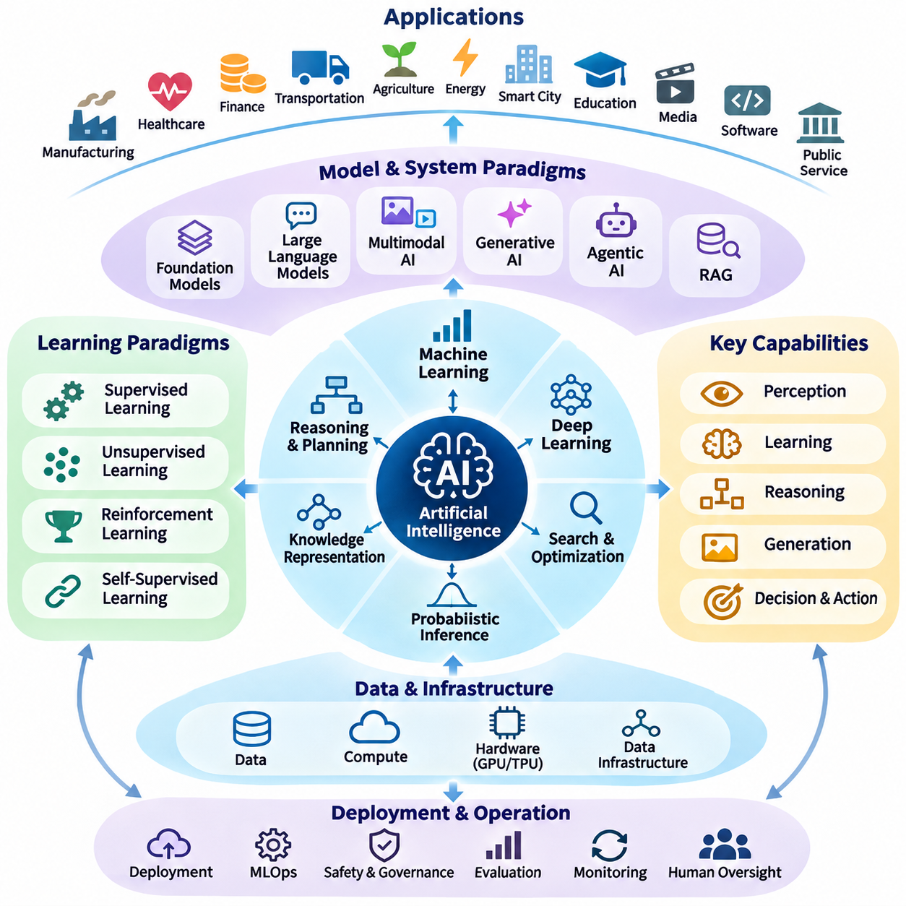{width="7.268055555555556in" height="7.268055555555556in"}

Modern artificial intelligence represents a broad and interconnected field of computational methods designed to perceive information, learn patterns, reason about situations, generate content, and support intelligent actions. Its modern landscape extends beyond individual algorithms to include data infrastructure, learning architectures, knowledge systems, autonomous agents, and deployment environments. Understanding this landscape requires examining how these components interact within complete AI systems.

Artificial intelligence serves as the overarching discipline, while machine learning provides methods for improving performance through experience and data. Deep learning forms a major branch of machine learning by using multilayer neural networks to discover hierarchical representations. However, AI also includes symbolic reasoning, search algorithms, planning, optimization, probabilistic inference, and knowledge representation. These approaches remain important even as neural models dominate many applications.

Machine learning occupies a central position in modern AI because it enables systems to infer useful relationships from examples rather than relying exclusively on manually specified rules. Supervised learning uses labeled observations, unsupervised learning discovers structures without explicit targets, and reinforcement learning develops decision policies through interaction. Self-supervised learning further expands this foundation by extracting training signals from the structure of available data.

Deep learning extends machine learning through representation learning, allowing computational models to transform raw inputs into increasingly abstract features. Convolutional neural networks support spatial analysis, recurrent architectures process sequential information, and transformers model relationships through attention mechanisms. These architectures have enabled substantial advances in computer vision, natural language processing, speech recognition, and scientific modeling.

Foundation models introduce a different organizational principle by training adaptable models on large and diverse datasets before applying them to specialized tasks. Instead of developing a separate architecture for every application, developers can reuse pretrained representations through prompting, fine-tuning, or adaptation. This approach supports broader transfer across tasks, although successful deployment still depends on domain compatibility, evaluation quality, computational resources, and operational constraints.

Large language models represent a prominent category of foundation models specialized in processing and generating linguistic sequences. Through large-scale pretraining, they acquire statistical representations of language, concepts, and relationships that support translation, summarization, question answering, programming, and conversational interaction. Their apparent reasoning capabilities can be useful, but generated responses may contain factual errors, inconsistent logic, or unsupported conclusions.

Multimodal artificial intelligence expands computational understanding beyond a single information format. These systems combine text, images, audio, video, spatial measurements, or structured sensor data to establish relationships across modalities. Vision-language models, for example, connect visual observations with linguistic descriptions, while audio-visual systems integrate sound and imagery. Effective multimodal intelligence requires alignment, synchronization, fusion, and appropriate handling of missing information.

Generative artificial intelligence focuses on producing new content from learned statistical distributions and contextual conditions. Autoregressive models generate sequences incrementally, diffusion models progressively construct samples through denoising, and other generative architectures learn structured latent representations. Applications include document generation, image synthesis, software development, simulation, and design assistance. Output quality must be evaluated separately from factual correctness and practical usefulness.

Agentic AI introduces systems that organize model capabilities around goals, actions, tools, and environmental feedback. Rather than generating a single response, an AI agent may interpret an objective, formulate intermediate steps, retrieve information, invoke software tools, and evaluate results. Agent architectures often combine language models with planning mechanisms, memory systems, execution environments, and control policies. Their autonomy must remain bounded by permissions and verification procedures.

Retrieval-augmented generation connects generative models with external information sources to improve contextual relevance and factual grounding. A retrieval component identifies potentially useful documents or records, while a generation component incorporates selected evidence into its response. Knowledge graphs, vector databases, search indexes, and structured repositories provide complementary retrieval mechanisms. Reliable implementations also require source validation, access control, freshness management, and evidence-based evaluation.

Knowledge representation remains essential because intelligent behavior requires more than recognizing statistical patterns. Logical expressions, ontologies, semantic networks, and knowledge graphs encode entities, relationships, constraints, and domain assumptions. Vector embeddings represent semantic similarities in continuous spaces, while symbolic structures support explicit interpretation and logical operations. Hybrid architectures can combine these complementary representations to support retrieval, inference, planning, and explanation.

Reasoning and planning form another major dimension of the AI landscape. Deductive reasoning derives conclusions from established premises, probabilistic reasoning handles uncertainty, and causal reasoning examines relationships between interventions and outcomes. Search and planning algorithms evaluate possible states and actions to achieve objectives. Modern systems increasingly combine these established mechanisms with learned representations, creating opportunities for more adaptable decision-making under complex conditions.

Embodied AI extends intelligence into physical environments where perception and action continuously influence one another. Robots and autonomous machines must interpret sensor measurements, estimate their states, predict environmental changes, and execute actions under physical constraints. Their intelligence depends on integrating computer vision, localization, planning, control, and learning. Unlike purely digital applications, embodied systems must also account for motion dynamics, uncertainty, latency, energy consumption, and safety.

World models provide a mechanism for representing how environments evolve over time and how actions may affect future states. Such models can support prediction, simulation, planning, and decision-making under uncertainty. In robotics, a world model may integrate visual observations, spatial relationships, object dynamics, and interaction histories. Its usefulness depends on prediction accuracy, temporal consistency, generalization, and the ability to recognize situations outside the model\'s experience.

Edge AI and real-time AI address the practical requirements of deploying intelligence near sensors, machines, and users. Instead of transferring every observation to remote infrastructure, edge devices perform selected computations locally to reduce communication dependence and improve responsiveness. These systems must balance inference accuracy, latency, memory capacity, power consumption, and hardware availability. Real-time applications additionally require predictable execution behavior and carefully managed processing deadlines.

Cloud and distributed AI infrastructures complement edge intelligence by providing scalable computation, centralized data management, large-model training, and coordinated services. Hybrid architectures distribute workloads according to latency requirements, computational complexity, privacy constraints, and communication conditions. A physical robot may perform immediate obstacle avoidance locally while using remote services for historical analysis, fleet coordination, or model updates. Effective system design requires clear responsibility boundaries.

The modern AI ecosystem also depends on data engineering and operational infrastructure. Data collection, labeling, preprocessing, storage, versioning, and quality control determine the reliability of learning pipelines. Model development requires experimentation, optimization, validation, and reproducibility, while production operation introduces deployment, monitoring, drift detection, and lifecycle management. These engineering activities transform experimental algorithms into maintainable systems capable of operating under changing conditions.

AI evaluation must reflect the diversity of modern system capabilities. Classification models may be assessed through accuracy, precision, recall, and calibration, while generative systems require assessments of coherence, factuality, usefulness, and safety. Autonomous agents must also be evaluated through task completion, tool correctness, recovery behavior, and resource consumption. Robotics introduces additional measures involving physical safety, trajectory quality, operational reliability, and real-time performance.

Safety, alignment, and governance operate across every layer of the AI landscape rather than forming isolated application categories. Data practices influence privacy and fairness, model architectures affect interpretability and robustness, and autonomous execution introduces risks associated with unintended actions. Responsible AI engineering therefore requires threat analysis, evaluation procedures, human oversight, security controls, and mechanisms for correcting failures. Governance establishes accountability throughout the system lifecycle.

Industrial applications demonstrate how these fields converge into practical solutions. Manufacturing systems combine visual inspection with anomaly detection and process optimization. Healthcare applications integrate predictive modeling with clinical information, while logistics platforms use forecasting, scheduling, and autonomous navigation. Intelligent transportation systems coordinate perception, planning, and control. Each domain introduces distinct reliability requirements, regulatory conditions, data characteristics, and operational objectives.

Modern AI should consequently be understood as an interconnected ecosystem rather than a simple hierarchy of competing technologies. Machine learning supplies adaptive capabilities, deep learning provides powerful representations, foundation models enable reuse, and reasoning systems support structured decisions. Agents coordinate actions, knowledge systems provide context, and embodied platforms connect intelligence with physical reality. Infrastructure, evaluation, and governance determine whether these capabilities can operate reliably.

The continuing development of artificial intelligence increasingly emphasizes integration across previously separate research areas. Symbolic reasoning can complement neural representations, generative models can support simulation, and reinforcement learning can improve sequential decision policies. Multimodal perception can inform world models, while agent architectures connect predictions with executable operations. These combinations illustrate a transition from isolated predictive models toward increasingly integrated intelligent systems.

A comprehensive field map therefore provides a conceptual foundation for understanding both current capabilities and future research directions. It reveals how algorithms, representations, learning paradigms, system architectures, and application domains contribute different functions to intelligent behavior. More importantly, it encourages evaluating AI technologies according to their roles within complete systems, where adaptability, reasoning, efficiency, reliability, and responsible operation must be considered together.

## 06.01 Machine Learning as AI Core

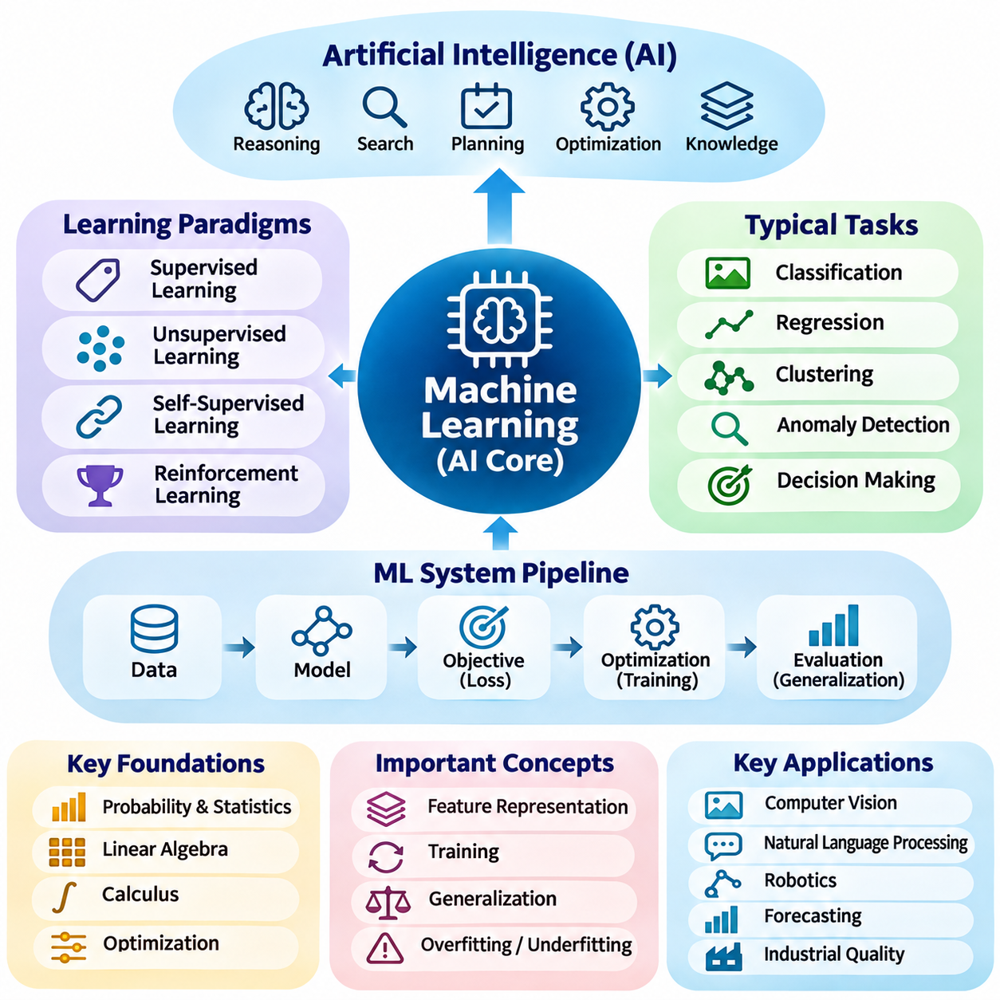{width="7.268055555555556in" height="7.268055555555556in"}

Machine learning has become a central mechanism of modern artificial intelligence because it enables computational systems to improve their performance through data and experience. Instead of requiring developers to specify every decision rule explicitly, machine learning algorithms identify statistical relationships that support prediction, classification, estimation, and decision-making. This capability allows AI systems to adapt to complex environments where manually defining all possible conditions would be impractical.

The importance of machine learning emerges from its ability to transform observations into reusable computational knowledge. Traditional software generally follows predetermined instructions, whereas machine learning systems estimate functions from examples and apply them to previously unseen inputs. This distinction does not eliminate conventional programming, because learning objectives, data pipelines, architectures, and operational constraints must still be designed. Machine learning therefore extends software engineering rather than replacing it.

A machine learning system typically consists of data, a model, an objective function, an optimization procedure, and an evaluation mechanism. Data provides observations from which relationships can be inferred, while the model represents a parameterized mapping between inputs and outputs. The objective function measures the quality of predictions or decisions, and optimization adjusts model parameters to improve performance. Evaluation determines whether the resulting behavior generalizes beyond the training examples.

Supervised learning is one of the most established machine learning paradigms. It uses examples containing input variables and corresponding target values to estimate relationships that can be applied to new observations. Classification predicts discrete categories, while regression estimates continuous quantities. Applications include image recognition, medical risk prediction, demand forecasting, and industrial quality inspection. Successful supervised learning depends on representative datasets, reliable labels, and appropriate evaluation procedures.

Unsupervised learning addresses situations where explicit target labels are unavailable. Its purpose is to identify structures, similarities, distributions, or unusual patterns within observed data. Clustering groups related observations, dimensionality reduction produces compact representations, and density estimation characterizes data distributions. These methods support exploratory analysis, anomaly detection, customer segmentation, and feature discovery, although their outputs require careful interpretation because discovered patterns are not necessarily meaningful.

Self-supervised learning has expanded the practical scope of machine learning by constructing learning objectives from the data itself. A model may predict missing portions of text, reconstruct masked image regions, or distinguish related observations from unrelated examples. Such objectives allow large collections of unlabeled data to contribute to representation learning. The resulting representations can subsequently support classification, retrieval, generation, or specialized downstream tasks through adaptation.

Reinforcement learning introduces a different learning framework in which an agent improves its behavior through interactions with an environment. The agent observes states, selects actions, receives rewards, and updates a policy intended to maximize expected cumulative reward. This approach is particularly relevant to sequential decision-making, robotics, resource allocation, and game-playing. Its practical challenges include exploration, delayed rewards, sample efficiency, safety, and changing environmental conditions.

The mathematical foundation of machine learning involves probability, statistics, linear algebra, calculus, and optimization. Statistical principles describe uncertainty and relationships between observations, while linear algebra supports efficient representation and transformation of data. Calculus and numerical optimization provide mechanisms for adjusting model parameters. These disciplines collectively explain how learning algorithms estimate patterns, minimize errors, quantify uncertainty, and generalize from limited observations.

Feature representation strongly influences the effectiveness of machine learning. A feature is a measurable or computed characteristic used to describe an observation, and its quality affects the information available to a model. Traditional machine learning frequently depends on manually engineered features derived from domain expertise. Modern representation learning increasingly allows models to discover useful features automatically. Nevertheless, feature relevance, data quality, and domain understanding remain fundamental requirements.

Model training is the process of adjusting parameters to improve performance according to a specified learning objective. Optimization algorithms iteratively evaluate errors and update model parameters, often using gradient-based methods when the objective is differentiable. Training behavior depends on initialization, learning rates, regularization, batch composition, and dataset characteristics. A low training error alone does not establish model quality, because the model may have memorized patterns that do not transfer to new data.

Generalization is a defining objective of machine learning because useful systems must perform effectively on observations not encountered during training. Overfitting occurs when a model captures training-specific noise or accidental relationships, while underfitting occurs when it cannot adequately represent important patterns. Model capacity, dataset size, regularization, and training procedures influence this balance. Validation and independent testing provide evidence about performance beyond the training distribution.

Data quality often determines the practical limits of machine learning more strongly than algorithmic complexity alone. Missing observations, incorrect labels, sampling bias, duplicated records, and inconsistent measurements can distort learned relationships. Distribution shifts may also occur when deployment conditions differ from those represented in training data. Reliable machine learning therefore requires systematic data collection, preprocessing, validation, documentation, and continuous monitoring throughout the system lifecycle.

Machine learning models can be understood through several complementary algorithmic families. Linear models provide relatively interpretable relationships, decision trees represent conditional partitions, and ensemble methods combine multiple predictors to improve performance. Kernel methods capture nonlinear relationships through similarity functions, while probabilistic models represent uncertainty explicitly. Neural networks provide flexible function approximation through layered transformations. Each family offers different tradeoffs involving accuracy, complexity, interpretability, and computational cost.

Deep learning represents an important extension of machine learning rather than a separate discipline. By combining multiple trainable layers, deep neural networks can learn hierarchical representations from images, language, audio, and other complex inputs. Their effectiveness has increased with larger datasets, specialized accelerators, improved optimization methods, and scalable architectures. However, conventional machine learning remains valuable for structured data, limited datasets, interpretable models, and computationally constrained applications.

Machine learning also provides the foundation for many modern foundation models and generative AI systems. Large-scale pretraining extracts reusable statistical representations from extensive datasets, while subsequent adaptation enables specialized applications. Language models learn relationships between tokens, vision models learn spatial and semantic patterns, and multimodal models establish associations across information types. These systems demonstrate how learning algorithms can support increasingly general interfaces without guaranteeing universal intelligence.

The relationship between machine learning and symbolic AI is complementary rather than exclusively competitive. Machine learning excels at extracting patterns from uncertain or high-dimensional observations, while symbolic methods support explicit rules, logical constraints, and structured reasoning. Hybrid architectures may use learned models for perception and symbolic mechanisms for planning or verification. Such combinations are valuable when intelligent behavior requires both flexible interpretation and compliance with clearly defined operational requirements.

In practical AI architectures, machine learning often functions as a perception, prediction, or decision-support component within a larger system. An autonomous robot may use learned models to detect objects and estimate environmental conditions while relying on planning algorithms and controllers to execute safe movements. An industrial inspection platform may combine visual classification with rule-based acceptance criteria. These examples demonstrate that learned intelligence becomes operationally useful through integration with surrounding software and hardware.

Evaluation establishes whether a machine learning model satisfies its intended purpose. Classification systems commonly use accuracy, precision, recall, and F1 score, while regression models employ error measures such as mean absolute error and root mean squared error. Probabilistic predictions may require calibration analysis, and deployed systems must also consider latency, memory consumption, robustness, and reliability. Appropriate metrics depend on application objectives and the consequences of different errors.

Responsible machine learning requires attention to fairness, privacy, transparency, security, and human oversight. Models can reproduce biases present in training data, reveal sensitive information, or behave unpredictably under adversarial inputs. Interpretability methods can help examine model behavior, although explanations do not automatically establish correctness. Governance mechanisms should address dataset provenance, access permissions, validation standards, accountability, and procedures for responding to failures.

Machine learning deployment introduces engineering requirements that extend beyond model development. Production systems need reproducible training pipelines, version-controlled datasets, reliable inference services, and mechanisms for detecting performance degradation. Monitoring can identify data drift, unexpected predictions, and operational failures, while controlled updates support continued adaptation. Effective deployment also requires balancing computational resources, maintenance costs, security requirements, and service availability.

The central role of machine learning does not imply that every artificial intelligence problem should be solved through learning alone. Search, planning, logical inference, optimization, and knowledge representation remain essential when tasks involve explicit constraints or verifiable decision procedures. The appropriate approach depends on problem structure, available data, uncertainty, computational limitations, and operational requirements. Modern AI systems frequently achieve stronger results by combining learned components with established algorithmic methods.

Machine learning is therefore best understood as a foundational capability that connects data-driven adaptation with broader artificial intelligence objectives. It enables systems to extract patterns, construct representations, estimate outcomes, and improve decisions through experience. Its effectiveness depends not only on mathematical algorithms but also on data quality, evaluation, system integration, and responsible operation. As AI architectures evolve, machine learning remains a critical component of increasingly capable and interconnected intelligent systems.

## 06.02 Deep Learning as Representation Learning

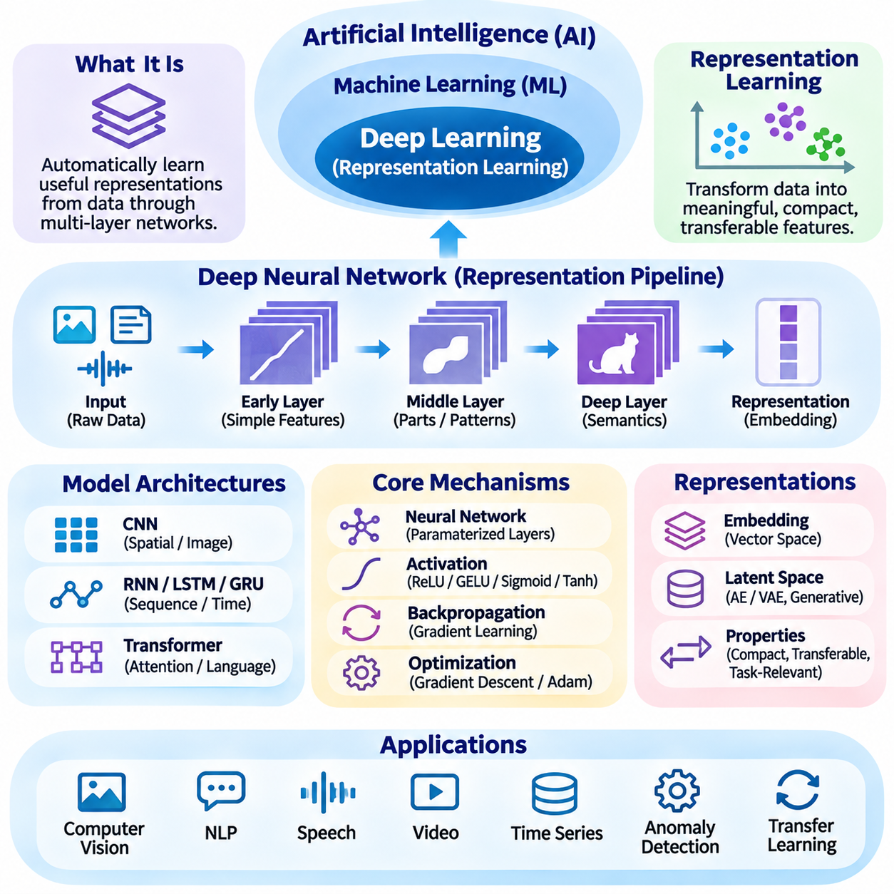{width="7.268055555555556in" height="7.268055555555556in"}

Deep learning is a major branch of machine learning that emphasizes the automatic discovery of useful representations from data. Rather than depending entirely on manually engineered features, deep neural networks transform raw observations through multiple computational layers. Each layer constructs intermediate representations that can capture increasingly complex relationships. This capability has made deep learning particularly effective for images, language, audio, video, and other high-dimensional information.

Representation learning refers to the process of discovering transformations that make information more useful for subsequent computational tasks. A representation may preserve important characteristics while reducing irrelevant variation or emphasizing meaningful relationships. In deep learning, representations are generally optimized through training objectives rather than explicitly programmed. Their usefulness depends on the task, dataset, architecture, and degree to which learned patterns transfer to unfamiliar observations.

The central mechanism of deep representation learning is the composition of multiple parameterized transformations. An input passes through successive layers, where mathematical operations combine learned weights, biases, and nonlinear activation functions. Early layers may identify relatively simple patterns, while deeper layers can construct more abstract combinations. However, the interpretation of individual layers depends on the architecture, and hierarchical abstraction is not guaranteed in every network.

Artificial neural networks provide the computational foundation for deep learning. Neurons receive numerical inputs, apply weighted transformations, and produce outputs through activation functions. Connecting many neurons into layers creates flexible function approximators capable of representing complex nonlinear relationships. Training adjusts network parameters to minimize a specified objective. The resulting internal activations form distributed representations in which information may be encoded across many computational units.

Nonlinear activation functions are essential because repeated linear transformations alone cannot represent general nonlinear mappings. Functions such as ReLU, GELU, sigmoid, and tanh introduce nonlinear behavior that enables networks to learn complex decision boundaries and feature interactions. Their mathematical properties influence gradient propagation, numerical stability, and optimization efficiency. Appropriate activation choices depend on network architecture, training conditions, and the characteristics of the intended application.

Backpropagation enables deep neural networks to learn representations by calculating how model parameters influence the training objective. Using the chain rule of calculus, gradients propagate backward through the computational graph, allowing optimization algorithms to update parameters. Gradient descent and adaptive optimizers iteratively improve model behavior. Although backpropagation is computationally efficient for differentiable models, successful training also depends on initialization, normalization, regularization, and stable numerical computation.

Convolutional neural networks demonstrate how architectural structure influences representation learning. Convolutional filters process local spatial neighborhoods using shared parameters, allowing networks to recognize patterns across different image locations. Early features often respond to edges, textures, or simple shapes, while later representations may encode object parts and semantic characteristics. These properties make convolutional architectures useful for image classification, object detection, segmentation, and visual inspection.

Sequence models extend representation learning to information whose meaning depends on temporal or positional relationships. Recurrent neural networks maintain hidden states that summarize preceding observations, while LSTM and GRU architectures improve the handling of longer dependencies. Such models have been applied to language, speech, sensor measurements, and time-series forecasting. Their representations capture sequential context, although training efficiency and long-range dependencies can remain challenging.

Transformers have substantially expanded representation learning through attention mechanisms that model relationships among elements of an input sequence. Self-attention computes context-dependent interactions between tokens or other representation units, allowing information from different positions to influence each other. Positional information supplies ordering or spatial structure. Transformer architectures now support language understanding, image processing, multimodal integration, and large-scale foundation models.

Embeddings provide a compact numerical form of learned representations. Words, image regions, objects, users, or other entities can be mapped into continuous vector spaces where geometric relationships reflect aspects of learned similarity. These spaces support retrieval, clustering, recommendation, classification, and semantic matching. However, distances between embeddings depend on the training objective and representation geometry, so numerical proximity does not always correspond to meaningful semantic equivalence.

Latent spaces represent information through internal variables that summarize characteristics of observed data. Autoencoders learn compressed representations by reconstructing inputs, while variational autoencoders introduce probabilistic structure into latent variables. Other architectures develop latent representations through predictive, contrastive, or generative objectives. Well-structured latent spaces can support compression, interpolation, anomaly detection, generation, and transfer learning, although their interpretability varies.

Self-supervised learning has become an important strategy for developing general-purpose deep representations without requiring extensive manual labeling. Masked prediction trains models to reconstruct hidden information, while contrastive learning encourages related observations to have compatible representations. Predictive objectives may require models to infer future states or missing contextual elements. These methods extract learning signals from data structure and can support subsequent adaptation to specialized tasks.

Transfer learning demonstrates the practical value of reusable representations. A network pretrained on a large dataset can provide features for a different but related application, reducing the amount of task-specific data and computation required. Developers may freeze pretrained layers, train additional prediction heads, or fine-tune selected parameters. Transfer effectiveness depends on similarities between source and target domains, representation quality, and the extent of distribution shift.

Representation quality cannot be determined solely by the complexity or dimensionality of a neural network. A useful representation should preserve information relevant to the intended task while supporting generalization, robustness, and efficient downstream processing. Excessive sensitivity to noise, irrelevant correlations, or training-specific patterns can reduce reliability. Evaluation therefore requires examining downstream performance, transferability, stability, and behavior under changing data conditions.

Deep learning representations may encode invariance and equivariance, two properties that influence how models respond to transformations. Invariant representations remain relatively stable under changes considered irrelevant to a task, such as certain variations in illumination. Equivariant representations change predictably when inputs undergo structured transformations, such as spatial rotations. Architectural design, data augmentation, and training objectives can encourage these properties when they are appropriate.

Multimodal representation learning seeks to connect information from different sensory or symbolic sources within compatible computational spaces. Text, images, audio, and spatial observations may be encoded separately before being aligned or fused. Shared representations can support cross-modal retrieval, visual question answering, speech understanding, and grounded language processing. Their effectiveness depends on preserving modality-specific information while learning meaningful relationships across modalities.

Deep representation learning also contributes to embodied intelligence and robotics. Visual encoders can extract environmental features, temporal models can summarize motion histories, and learned state representations can support planning or control. World models may use latent variables to predict future observations or environmental transitions. In physical systems, representation quality must be assessed alongside uncertainty, latency, sensor reliability, and safety because prediction errors can influence real-world actions.

Despite its advantages, deep learning introduces substantial engineering challenges. Large models may require extensive training data, specialized accelerators, high memory capacity, and significant energy consumption. Their internal representations can be difficult to interpret, and learned features may fail under unfamiliar conditions. Dataset bias, adversarial sensitivity, catastrophic forgetting, and distribution shift further complicate deployment. Effective systems require careful experimentation, monitoring, and validation.

Deep learning should not be interpreted as a complete replacement for symbolic reasoning or conventional machine learning. Neural representations excel at extracting patterns from complex observations, while symbolic structures can express explicit relationships, constraints, and logical rules. Hybrid systems may combine learned embeddings with knowledge graphs, planning algorithms, or verification mechanisms. Such integration can improve practical functionality when tasks require both perceptual flexibility and structured decision-making.

The relationship between deep learning and foundation models illustrates how representation learning scales across tasks and domains. Large pretrained networks acquire reusable internal structures from extensive datasets, enabling adaptation through prompting, fine-tuning, or additional training. Language models, vision encoders, and multimodal architectures exploit this principle in different ways. Nevertheless, broad transfer capabilities do not guarantee factual accuracy, causal understanding, or reliable reasoning.

Deep learning is therefore best understood as a framework for constructing task-relevant representations through layered computation and data-driven optimization. Its importance lies not simply in network depth but in the ability to transform complex observations into structures that support prediction, generation, retrieval, and decision-making. As AI systems become increasingly integrated, representation learning provides a critical connection between raw information and higher-level intelligent behavior.

## 06.03 Foundation Models

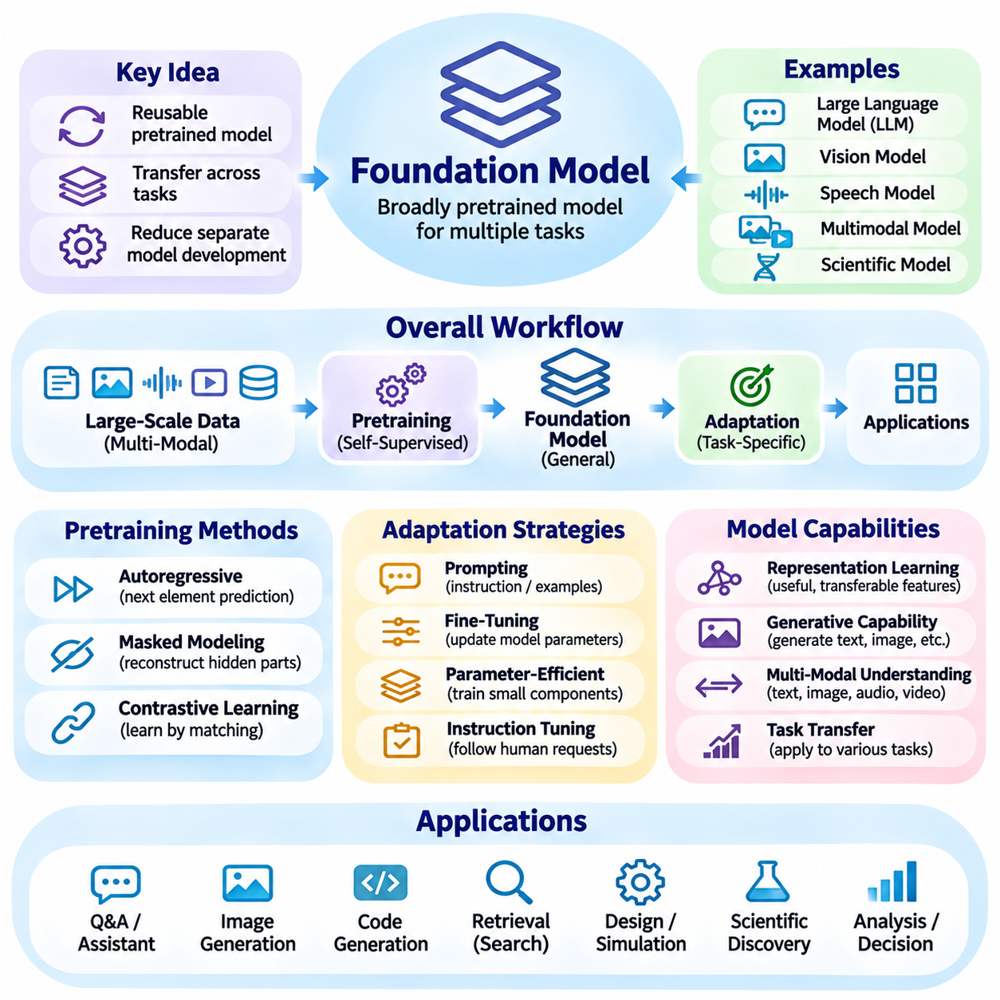{width="7.268055555555556in" height="7.268055555555556in"}

Foundation models represent a major development in artificial intelligence by introducing reusable models trained on large and diverse datasets. Rather than constructing a separate model for every task, developers can adapt a broadly pretrained system to multiple applications. These models acquire statistical representations that support language, vision, audio, and other information types. Their significance lies in transferring learned capabilities across tasks while reducing the need for entirely independent model development.

The foundation model paradigm separates broad pretraining from specialized adaptation. During pretraining, a model learns general patterns from extensive collections of information through objectives such as prediction, reconstruction, or contrastive learning. Subsequent adaptation applies these representations to particular tasks through prompting, fine-tuning, or additional training. This organization creates a shared computational foundation for multiple applications, although its usefulness depends on the quality and relevance of pretrained knowledge.

Large-scale pretraining is central to foundation model development because it enables models to capture statistical relationships across diverse contexts. Text corpora, image collections, audio recordings, video sequences, and structured datasets may provide training information. The resulting capabilities depend on dataset composition, model architecture, training objectives, and computational resources. Increasing scale can improve performance, but it does not automatically guarantee factual accuracy, robustness, or meaningful understanding.

Transformer architectures have played a prominent role in foundation models because attention mechanisms support flexible relationships among input elements. Language-oriented transformers process token sequences, while vision transformers represent images through patches or other visual units. Multimodal architectures extend these mechanisms to information from several modalities. Although transformers are widely used, foundation models are defined by their broad pretraining and adaptability rather than by one mandatory neural architecture.

Self-supervised learning provides an important mechanism for training foundation models without requiring manually labeled examples for every task. Autoregressive objectives predict subsequent tokens or elements, while masked modeling reconstructs hidden information from surrounding context. Contrastive objectives encourage related observations to develop compatible representations. These approaches exploit structure within available data and allow models to learn reusable features that can support multiple downstream applications.

Representation learning explains why foundation models can transfer capabilities between different tasks. During pretraining, internal representations encode statistical regularities, contextual relationships, and useful abstractions. Downstream applications reuse these representations rather than learning every feature from the beginning. However, a representation that works well for one domain may be less effective in another. Transfer quality depends on domain similarity, training diversity, and the requirements of the target application.

Adaptation strategies determine how foundation models are transformed into practical application components. Prompting guides model behavior through instructions or contextual examples without necessarily changing model parameters. Fine-tuning updates selected or all parameters using specialized data, while parameter-efficient methods modify smaller trainable components. Each strategy introduces tradeoffs involving computational cost, customization, maintenance, and the risk of degrading previously learned capabilities.

Instruction tuning further adapts foundation models to interpret and respond to human-oriented requests. Training examples associate instructions with desirable responses, helping models perform tasks that differ from their original pretraining objectives. Preference optimization and feedback-based methods may improve response usefulness, consistency, or adherence to behavioral requirements. Nevertheless, these procedures do not eliminate hallucinations, hidden biases, or failures in unfamiliar situations.

Large language models are among the most visible foundation models, but the category extends beyond text generation. Vision foundation models support image understanding and feature extraction, speech models process acoustic information, and multimodal models connect several information types. Scientific foundation models may represent biological sequences, molecular structures, or other domain-specific observations. Their shared characteristic is reusable pretraining that supports adaptation across related tasks.

Multimodal foundation models attempt to construct meaningful relationships among text, images, audio, video, and spatial information. Separate encoders may transform each modality into compatible representations before alignment or fusion. Other architectures process multiple modalities through shared components. These designs support visual question answering, image description, speech interaction, and cross-modal retrieval. Their reliability depends on synchronization, representation quality, and appropriate handling of incomplete information.

Generative capabilities are prominent in foundation models because pretrained representations can support the production of new content. Autoregressive language models generate sequences incrementally, while diffusion-based models can synthesize images or other structured outputs. Generative foundation models may also support software development, simulation, and design exploration. However, realistic or fluent outputs do not necessarily indicate factual correctness, logical consistency, or suitability for operational use.

Emergent behavior is often discussed when foundation models exhibit capabilities that become more apparent with changes in scale, training, or evaluation. Some abilities may improve gradually, while benchmark thresholds can make improvements appear abrupt. Consequently, claims of emergence require careful experimental interpretation. Model size alone does not establish reasoning competence, and performance should be examined through controlled evaluation rather than assumptions about intelligence.

Scaling foundation models introduces substantial computational and engineering requirements. Training large networks demands accelerators, distributed computation, memory management, high-throughput storage, and reliable communication infrastructure. Optimization techniques address numerical stability, parallel execution, and resource utilization. The overall cost includes data preparation, experimentation, training, evaluation, and deployment. Larger models must therefore be justified by measurable improvements relative to their operational requirements.

Inference efficiency becomes particularly important when foundation models are deployed to real applications. Model compression, quantization, pruning, distillation, caching, and optimized execution can reduce computational demands. Smaller adapted models may provide sufficient performance for specialized tasks while improving latency and resource efficiency. Deployment decisions must balance model quality, memory requirements, energy consumption, service availability, and the sensitivity of application data.

Retrieval-augmented generation connects foundation models with external knowledge sources to supplement information acquired during pretraining. Retrieval systems identify relevant documents, database records, or structured evidence, which the model can use when producing responses. This architecture can improve contextual relevance and support more current information. Nevertheless, retrieval quality, source credibility, access permissions, and evidence verification remain essential because retrieved content can also be incorrect or misleading.

Foundation models increasingly serve as components within agentic AI systems that combine language understanding with planning and tool execution. A model may interpret goals, propose intermediate actions, retrieve information, or generate commands for external software. Supporting components manage permissions, execution state, memory, and verification. Reliable autonomy requires explicit operational boundaries because plausible model outputs do not guarantee that proposed actions are safe, authorized, or correct.

Domain adaptation is necessary when general-purpose foundation models encounter specialized terminology, unfamiliar data distributions, or strict operational requirements. Healthcare, manufacturing, finance, and robotics each introduce distinctive constraints and evaluation criteria. Specialized datasets, retrieval mechanisms, or fine-tuning procedures can improve domain relevance. However, adaptation must be validated against representative scenarios, including rare events, ambiguous inputs, and potentially harmful failures.

Evaluation of foundation models requires more than measuring performance on a single benchmark. Language systems may be assessed for factuality, instruction following, reasoning consistency, and robustness, while vision systems require measures appropriate to perception tasks. Multimodal models must also be tested for cross-modal alignment and grounding. Evaluation should include distribution shifts, adversarial inputs, uncertainty, resource consumption, and realistic application workflows.

Safety and governance are essential because foundation models can influence many applications through a shared pretrained component. Training data may contain biases, copyrighted material, personal information, or inaccurate content. Models can generate misleading statements or behave unexpectedly when integrated with external tools. Responsible development requires data governance, security testing, access control, human oversight, model documentation, and procedures for detecting and correcting failures.

The foundation model ecosystem also introduces questions about openness, reproducibility, and technological dependence. Open-weight models can support local adaptation and independent experimentation, while restricted models may provide managed services with different operational controls. Model licenses, training transparency, infrastructure requirements, and maintenance responsibilities influence adoption. Organizations must evaluate these factors alongside performance when selecting models for long-term systems.

Foundation models should therefore be understood as adaptable computational foundations rather than universally reliable intelligence. Their value emerges from combining reusable representations, broad pretraining, specialized adaptation, and integration with external systems. They complement conventional machine learning, symbolic reasoning, knowledge representation, and planning rather than eliminating these methods. Their effectiveness ultimately depends on evaluation, engineering discipline, and responsible deployment.

As artificial intelligence evolves, foundation models are becoming shared components across language systems, multimodal applications, autonomous agents, and embodied platforms. Their continued development will depend on improving data efficiency, reasoning reliability, adaptation methods, and computational sustainability. The central architectural principle remains the same: broadly learned capabilities become useful when they are carefully adapted, verified, and integrated into systems designed for specific objectives.

## 06.04 Large Language Models

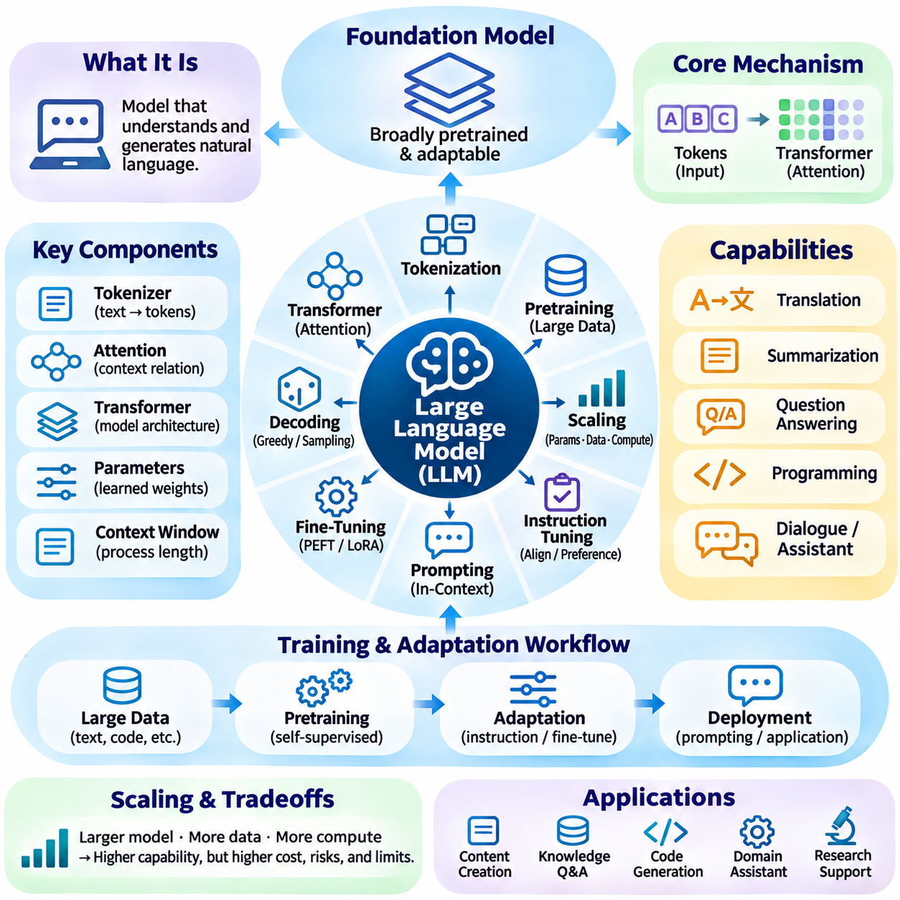{width="7.268055555555556in" height="7.268055555555556in"}

Large language models are a major category of foundation models designed to process, represent, and generate natural language. They learn statistical relationships from extensive text collections and, in some architectures, additional modalities. Their capabilities include translation, summarization, question answering, programming, and dialogue. Rather than following fixed linguistic rules, these models construct context-dependent predictions that support flexible language interaction.

The fundamental operation of most modern large language models involves predicting tokens from preceding or surrounding context. Text is divided into tokens representing words, word fragments, punctuation, or other symbols. A tokenizer converts these elements into numerical identifiers processed by a neural network. During training, the model learns probability distributions over possible tokens, enabling it to generate coherent sequences through repeated prediction.

Transformer architectures provide the primary computational foundation for contemporary large language models. Their attention mechanisms allow representations of individual tokens to incorporate information from other positions in the input. Feedforward layers transform these contextual representations, while residual connections and normalization support stable computation. Decoder-only transformers are widely used for generation, although encoder-decoder and other architectures remain important.

Self-attention enables language models to represent contextual relationships without relying exclusively on sequential recurrence. Queries, keys, and values are derived from token representations to calculate attention weights and aggregate relevant information. Multiple attention heads can capture different interaction patterns. Causal masking prevents autoregressive models from accessing future tokens during prediction, preserving the sequential structure of language generation.

Pretraining establishes the broad linguistic capabilities of large language models through exposure to extensive datasets. Training material may include books, articles, technical documents, software repositories, and other text sources. The model adjusts its parameters to reduce prediction error across many contexts. This process produces reusable representations of syntax, semantics, and recurring relationships, although statistical learning does not guarantee factual correctness or grounded understanding.

Scaling influences language model capabilities through changes in parameter count, training data, and computational resources. Larger models can represent more complex relationships, while broader datasets may improve coverage across topics and linguistic styles. However, performance depends on the balance between model capacity, data quality, and training computation. Increasing scale alone cannot eliminate reasoning failures, dataset bias, or unreliable generation.

Instruction tuning adapts pretrained language models to respond more effectively to user requests. Examples containing instructions and appropriate responses teach models to follow task descriptions, respect formatting requirements, and produce useful explanations. Preference-based optimization can further improve response quality and behavioral consistency. These techniques shape model behavior but do not provide absolute guarantees of truthfulness, safety, or instruction compliance.

Prompting provides a practical interface for controlling language model behavior without necessarily modifying its parameters. A prompt may specify an objective, provide contextual information, establish constraints, or demonstrate examples of expected outputs. In-context learning allows models to adapt their responses using information supplied within the current interaction. Prompt effectiveness depends on clarity, relevant context, model capabilities, and the limits of available context.

Tokenization influences how language models represent information and allocate computational resources. Different tokenization methods divide words, numbers, code, and multilingual text into varying sequences of units. Vocabulary design affects sequence length and processing efficiency. Although tokens are convenient computational symbols, their boundaries do not necessarily correspond to linguistic meaning, and tokenization choices can influence performance across languages and specialized domains.

Context windows determine how much information a language model can process within a single interaction. Longer contexts support document analysis, extended conversations, and complex workflows, but they increase computational and memory requirements. Attention mechanisms must manage relationships across many tokens, and models may not use every part of a long context equally effectively. Context length should therefore be distinguished from reliable information retention and reasoning quality.

Language generation uses decoding strategies to select output tokens from predicted probability distributions. Greedy decoding chooses the most probable token, while sampling introduces controlled variation. Temperature, top-k sampling, and nucleus sampling influence output diversity and determinism. Beam search explores multiple candidate sequences in selected applications. Appropriate decoding settings depend on whether the task prioritizes creativity, consistency, precision, or reproducibility.

Fine-tuning specializes language models by updating parameters using task-specific or domain-specific examples. Full fine-tuning modifies the complete model, while parameter-efficient techniques such as low-rank adaptation update smaller trainable components. These approaches can improve terminology handling, output structure, and domain performance. However, adaptation requires careful validation because narrow training data may reduce general capabilities or reinforce undesirable patterns.

Retrieval-augmented generation extends language models by incorporating external information during response construction. A retrieval system identifies relevant documents or structured records, and the model uses selected evidence to produce contextually grounded outputs. This approach can supplement knowledge acquired during pretraining and improve access to updated information. Reliability still depends on retrieval accuracy, source credibility, access permissions, and verification of generated claims.

Tool use allows language models to interact with software systems beyond text generation. A model may produce structured requests for search engines, databases, calculators, or application programming interfaces. External execution environments perform the requested operations and return results for interpretation. Such integration supports agentic workflows, but reliable operation requires schema validation, permission controls, error handling, and confirmation before consequential actions.

Reasoning capabilities in large language models emerge from learned patterns, contextual computation, and training procedures that encourage structured problem solving. Models can perform mathematical explanations, code analysis, and multistep planning, but their conclusions may contain logical inconsistencies. Additional inference-time computation and verification can improve performance on some tasks. Reliable reasoning requires evaluating intermediate assumptions and final results rather than trusting fluent explanations.

Multimodal language models extend text-based architectures by integrating visual, auditory, or other sensory representations. Images may be converted into visual tokens, while audio encoders produce representations that interact with language processing components. These systems support image interpretation, spoken dialogue, video understanding, and cross-modal question answering. Their effectiveness depends on alignment between modalities and accurate grounding of generated descriptions.

Evaluation of large language models must consider multiple dimensions of performance. Language understanding, factual accuracy, reasoning consistency, instruction following, and coding ability require different assessment methods. Benchmark scores provide useful comparisons but may be affected by dataset contamination or narrow task coverage. Real-world evaluation should additionally examine robustness, latency, cost, uncertainty, and performance under unfamiliar conditions.

Hallucination remains a significant limitation because language models can generate plausible statements unsupported by reliable evidence. Errors may arise from incomplete knowledge, misleading context, ambiguous instructions, or limitations in learned representations. Retrieval, external verification, constrained generation, and calibrated uncertainty can reduce some risks. High-stakes applications require independent validation because linguistic confidence does not establish factual reliability.

Safety and governance are essential when language models are deployed in systems that influence people or operational decisions. Training data may contain personal information, harmful stereotypes, copyrighted material, or inaccurate claims. Models can also be exposed to prompt injection and adversarial manipulation. Responsible deployment requires privacy safeguards, access control, security testing, human oversight, and documented procedures for monitoring and correcting failures.

Efficient deployment requires balancing model capability with memory, latency, throughput, and energy consumption. Quantization reduces numerical precision, distillation transfers capabilities into smaller models, and optimized inference engines improve execution efficiency. Distributed serving can support high request volumes, while local deployment may reduce communication dependence. The appropriate architecture depends on application requirements, hardware resources, and data sensitivity.

Large language models increasingly function as language interfaces within broader artificial intelligence systems. They can connect knowledge retrieval, software tools, planning mechanisms, and domain-specific models through natural language interaction. However, reliable systems must separate generated suggestions from verified actions and enforce explicit operational constraints. Language models are therefore powerful components of intelligent architectures rather than complete substitutes for reasoning, control, or governance.

The continuing development of large language models emphasizes improved reasoning reliability, multimodal integration, computational efficiency, and responsible adaptation. Their long-term value depends on combining flexible language representations with trustworthy information sources, verification mechanisms, and well-designed system boundaries. Understanding these models requires examining both their statistical foundations and their practical limitations within complete AI applications.

## 06.05 Multimodal AI

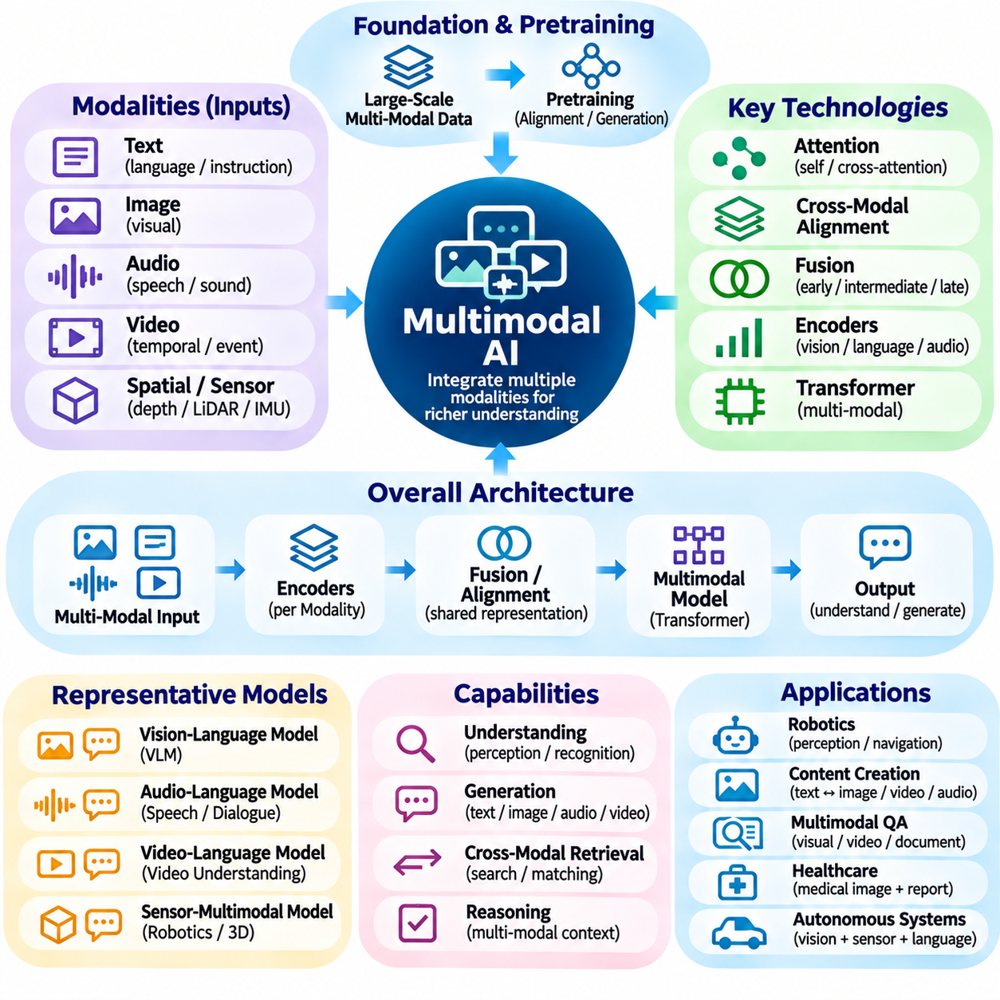{width="7.268055555555556in" height="7.268055555555556in"}

Multimodal artificial intelligence extends machine learning beyond individual information formats by integrating text, images, audio, video, and other sensory data. Its central objective is to establish meaningful relationships among different modalities so that systems can interpret complex situations more comprehensively. Unlike unimodal models, multimodal systems combine complementary evidence, enabling richer perception, contextual understanding, and interaction with digital or physical environments.

A modality represents a particular form of information, such as written language, visual observations, acoustic signals, or spatial measurements. Each modality has distinct statistical properties, temporal characteristics, and representation requirements. Images encode spatial structure, audio captures evolving waveforms, and text expresses symbolic relationships. Multimodal learning must preserve these characteristics while identifying shared information that supports integrated interpretation.

The foundation of multimodal AI lies in representation learning across heterogeneous data sources. Specialized encoders transform raw inputs into numerical features that can be processed by shared computational components. Visual encoders extract spatial patterns, language encoders represent semantic relationships, and audio encoders capture acoustic structure. Effective integration requires representations that retain modality-specific details while supporting meaningful relationships between information types.

Cross-modal alignment establishes correspondences between representations originating from different modalities. A textual description may be associated with an image, while spoken language may be aligned with visual events or written transcripts. Contrastive learning can encourage matching observations to occupy nearby regions in representation space. Alignment quality determines whether a system can reliably connect concepts across modalities rather than merely process multiple inputs independently.

Multimodal fusion combines information from different sources to construct integrated representations or predictions. Early fusion merges features before substantial processing, while late fusion combines outputs from independently trained components. Intermediate fusion integrates information within selected network layers. Each approach offers different tradeoffs involving computational complexity, information preservation, synchronization requirements, and robustness when individual modalities become unavailable.

Attention mechanisms provide flexible tools for modeling relationships across modalities. Cross-attention allows representations from one modality to selectively incorporate information from another, while self-attention captures interactions within a shared sequence. Transformer architectures can process visual patches, text tokens, and audio features through coordinated attention operations. Their effectiveness depends on suitable positional encoding, modality identification, and efficient handling of large input sequences.

Vision-language models represent a prominent category of multimodal AI systems. They associate visual observations with linguistic concepts, enabling image captioning, visual question answering, semantic retrieval, and instruction-based image interpretation. Some architectures use separate visual and language encoders, while others integrate visual tokens into language generation models. Reliable performance requires grounding generated statements in actual image content rather than relying on plausible linguistic associations.

Audio-language systems connect acoustic information with linguistic representations. Speech recognition converts spoken signals into text, while speech synthesis generates acoustic outputs from language. More integrated models can interpret speaker characteristics, environmental sounds, and conversational context. These capabilities support voice assistants, accessibility technologies, and human-machine communication. Practical systems must account for noise, accents, overlapping speakers, and temporal alignment.

Video understanding introduces additional complexity because visual information evolves over time. A video model must capture relationships among frames, object movements, actions, and events while preserving temporal order. Temporal attention, frame sampling, and motion representations help reduce computational requirements. Video-language systems can summarize events, answer questions about recorded activities, and connect descriptions with specific temporal segments, although long-duration reasoning remains challenging.

Spatial and sensor-based modalities extend multimodal learning into physical environments. Depth cameras, LiDAR, radar, inertial sensors, and positioning systems provide complementary measurements of geometry, motion, and location. Combining these signals can improve environmental perception and state estimation. However, sensor fusion requires calibration, coordinate transformations, timestamp synchronization, and explicit treatment of measurement uncertainty.

Multimodal foundation models acquire reusable representations through large-scale pretraining on diverse information sources. Image-text pairs, audio-transcript collections, and synchronized video recordings can provide learning signals for alignment and generation. Pretrained models may subsequently be adapted to specialized tasks through prompting or fine-tuning. Their transfer capabilities depend on dataset diversity, representation quality, modality coverage, and differences between training and deployment environments.

Generative multimodal AI supports content creation and transformation across information formats. A model may generate an image from text, produce spoken responses, describe visual scenes, or synthesize video from structured conditions. Such systems often combine language representations with autoregressive or diffusion-based generation mechanisms. Output realism must be distinguished from semantic accuracy, physical consistency, and faithful adherence to source information.

Missing or degraded modalities create important challenges for multimodal systems. Cameras may fail under poor illumination, microphones may capture excessive noise, and networked sensors may provide incomplete measurements. Robust architectures should detect unreliable inputs and adjust their predictions according to available evidence. Modality dropout, uncertainty estimation, and redundancy-aware fusion can improve resilience, although no combination of sensors guarantees complete reliability.

Temporal synchronization is essential when multimodal observations describe the same evolving event. Audio signals, video frames, and sensor measurements may arrive at different frequencies or experience communication delays. Misaligned timestamps can produce incorrect associations between actions and observations. Real-time systems therefore require synchronization mechanisms, buffering strategies, and latency-aware processing to maintain consistent interpretations of dynamic environments.

Multimodal AI contributes directly to embodied intelligence by connecting perception with action in physical systems. Autonomous robots can combine camera images, depth measurements, language instructions, and motion feedback to interpret tasks and navigate environments. Vision-language-action architectures may map multimodal observations into action representations. Their deployment requires additional safeguards because perception errors or ambiguous instructions can produce unsafe physical behavior.

Multimodal reasoning involves drawing conclusions from complementary information rather than simply recognizing patterns within each modality. A system may interpret a spoken instruction while examining a visual scene, or combine spatial measurements with semantic descriptions to identify relevant objects. Such reasoning requires accurate grounding, consistent representations, and awareness of uncertainty. Apparent fluency does not establish that the model has correctly integrated all available evidence.

Evaluation of multimodal systems must address both individual modality performance and cross-modal integration. Image recognition, speech transcription, temporal localization, and spatial estimation require different metrics. Joint evaluation should examine alignment accuracy, grounding, robustness, and consistency under conflicting inputs. Testing should include missing modalities, distribution shifts, noisy observations, and realistic operational conditions rather than relying exclusively on benchmark averages.

Computational efficiency is a significant concern because multimodal models process several potentially high-dimensional information streams. High-resolution images, long videos, and continuous audio can increase memory requirements and inference latency. Efficient encoders, token reduction, adaptive sampling, and optimized fusion mechanisms help manage these costs. Edge deployment introduces additional constraints involving power consumption, bandwidth, thermal limits, and predictable execution.

Safety and governance become more complex when multimodal AI processes sensitive information from several sources. Images may reveal identities, audio may contain private conversations, and sensor streams may expose behavioral patterns. Systems must enforce appropriate access permissions, data minimization, secure storage, and retention policies. Generated descriptions also require safeguards against misleading interpretations, unsupported inferences, and unintended disclosure of sensitive information.

Multimodal AI should be understood as an integration framework rather than a guarantee of comprehensive intelligence. Combining information sources can improve perception and contextual interpretation, but effectiveness depends on alignment, fusion, data quality, and task-specific validation. Symbolic reasoning, knowledge graphs, planning algorithms, and external tools can complement learned multimodal representations. Complete systems must coordinate these capabilities according to operational objectives.

The continuing development of multimodal AI is moving toward unified models that connect language, perception, temporal understanding, and action. Future progress depends on stronger grounding, efficient representations, reliable sensor integration, and improved reasoning across modalities. Its broader significance lies in enabling artificial intelligence systems to interpret and respond to information in forms closer to those encountered in complex real-world environments.

## 06.06 Generative AI

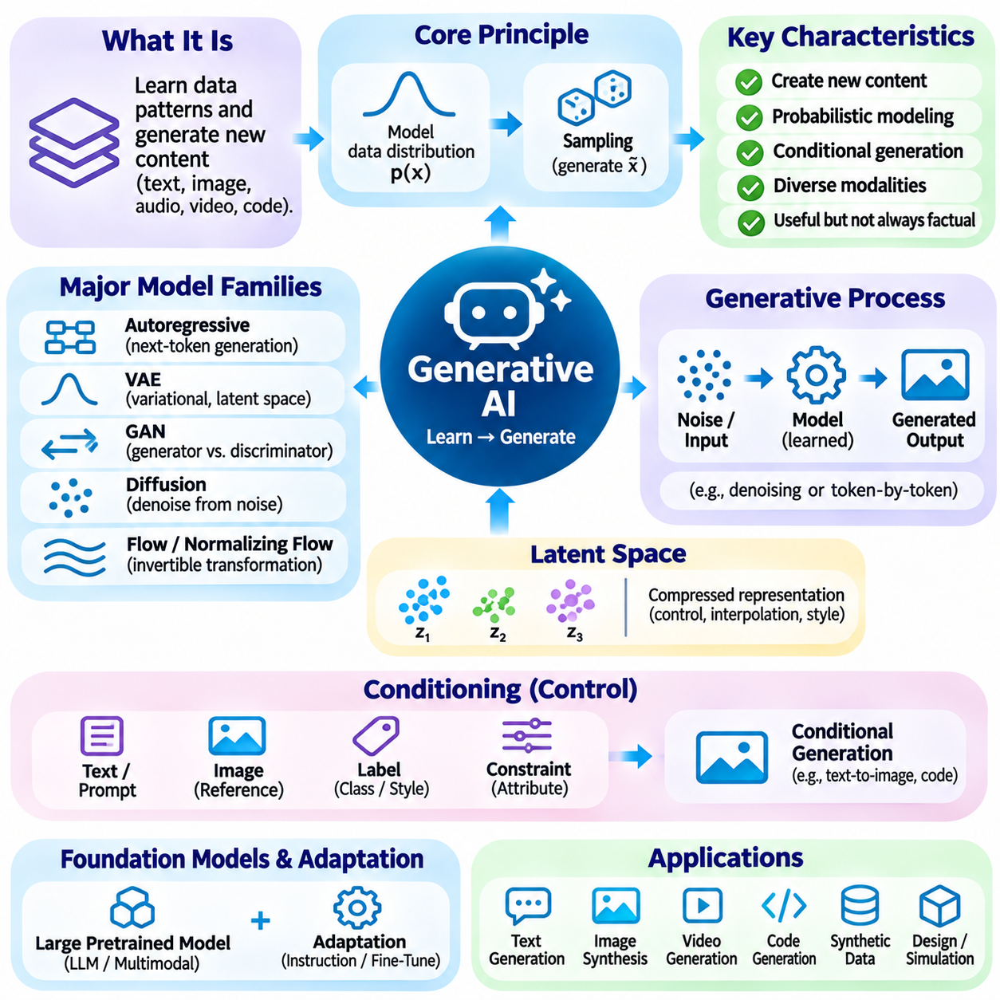{width="7.268055555555556in" height="7.268055555555556in"}

Generative artificial intelligence refers to computational systems that learn patterns from existing data and produce new content resembling the statistical structure of their training distributions. Unlike discriminative models that primarily classify or predict labels, generative models construct text, images, audio, video, code, or structured data. Their purpose is not simply to reproduce examples but to generate plausible outputs conditioned on learned representations and specified requirements.

The theoretical foundation of generative AI lies in probabilistic modeling and representation learning. A generative model approximates a data distribution or learns a process for producing samples from it. Training objectives encourage the model to capture relationships among features, contexts, and latent variables. Different architectures implement this principle through token prediction, latent-space sampling, adversarial learning, or iterative denoising, each with distinct computational properties.

Autoregressive models generate content sequentially by predicting each element from previously available context. In language generation, a model estimates the probability of the next token and repeatedly extends the sequence. Similar approaches can represent images, audio, and other structured outputs as ordered elements. Autoregressive generation provides flexible conditional modeling, although long sequences increase inference latency and may accumulate errors.

Variational autoencoders provide a probabilistic framework for learning compact latent representations of complex data. An encoder maps observations into a distribution over latent variables, while a decoder reconstructs or generates samples from those variables. Training balances reconstruction quality with regularization of the latent distribution. This structure supports controlled sampling, interpolation, and representation analysis, although generated details may sometimes appear less sharp than those from other methods.

Generative adversarial networks introduce competition between a generator and a discriminator. The generator attempts to produce realistic samples, while the discriminator learns to distinguish generated content from training examples. Their adversarial training process can produce detailed synthetic images and other outputs. However, training instability, mode collapse, and sensitivity to optimization settings can limit reliability, motivating alternative generative approaches.

Diffusion models generate data by learning to reverse a progressive noise-corruption process. During training, a model learns to estimate noise or related quantities from perturbed observations. During generation, an iterative sampling procedure transforms random noise into structured content. Diffusion-based methods have achieved strong results in image synthesis and other modalities, although repeated denoising steps can introduce substantial computational costs.

Flow-based generative models learn transformations between simple probability distributions and complex data distributions. Normalizing flows use invertible transformations that permit tractable likelihood evaluation under suitable architectural constraints. Related continuous-time approaches describe generation through learned dynamics. These methods provide useful probabilistic interpretations and alternative sampling strategies, with tradeoffs involving expressiveness, memory consumption, and numerical computation.

Latent spaces play a central role in generative AI by providing compressed representations of meaningful data characteristics. Models can manipulate latent variables to control style, structure, or semantic attributes while preserving broader relationships. Latent diffusion reduces computational requirements by performing generation in compressed feature spaces. However, latent representations may encode unwanted correlations, and changing one attribute can unintentionally affect others.

Conditional generation enables users or external systems to guide generated outputs through prompts, labels, reference data, or structured constraints. Text-to-image systems interpret linguistic descriptions, while code generation models respond to programming specifications. Conditioning mechanisms may include cross-attention, learned embeddings, or specialized control networks. Output quality depends on the clarity of conditions, training coverage, and the model\'s ability to preserve intended relationships.

Foundation models have accelerated generative AI by enabling broad pretraining followed by adaptation to many applications. Large language models generate coherent text and software code, while multimodal foundation models support transformations between language, images, audio, and video. Instruction tuning and preference optimization improve responsiveness to user objectives. Nevertheless, fluent generation does not guarantee factual correctness, logical consistency, or faithful execution of instructions.

Generative AI can support creative and technical workflows by producing drafts, alternative designs, synthetic examples, and candidate solutions. In software engineering, models assist with code completion, documentation, and test generation. In industrial design, they can explore geometric variations or propose configurations. These outputs should be treated as candidates for evaluation rather than verified results, especially when functional correctness or physical constraints are important.

Synthetic data generation provides another application by producing additional training examples when real observations are limited or expensive. Generated images, simulated scenes, and artificial records can improve dataset diversity or support controlled experiments. However, synthetic samples may reproduce biases or introduce unrealistic patterns. Their usefulness depends on distributional fidelity, task relevance, diversity, and validation against independent real-world data.

Evaluation of generative models requires distinguishing perceptual quality, diversity, fidelity, and task-specific usefulness. Image generation may be assessed through distributional metrics and human judgments, while language generation requires factuality, coherence, and instruction adherence. Memorization and unintended reproduction of training examples must also be examined. No single metric fully captures generation quality, making combined quantitative and qualitative evaluation necessary.

Hallucination is a significant concern when generative systems produce convincing outputs without sufficient evidential grounding. Language models may invent references, while image generators may create physically inconsistent objects or misleading visual details. Retrieval, external verification, constrained decoding, and domain-specific validation can reduce selected risks. High-stakes applications require independent checks because apparent realism is not equivalent to truth or operational correctness.

Controllability and consistency remain important technical challenges. Users may require exact object counts, persistent identities, stable temporal sequences, or compliance with detailed specifications. Generative models can struggle to maintain these constraints across complex outputs. Structured conditioning, iterative refinement, planning components, and verification mechanisms can improve reliability, but strict requirements often demand deterministic processing alongside learned generation.

Generative AI introduces substantial computational requirements during training and inference. Large models require accelerator memory, efficient parallel computation, and high-throughput data pipelines. Quantization, distillation, caching, model compression, and optimized sampling can reduce deployment costs. System designers must balance output quality, latency, throughput, energy consumption, and hardware availability, particularly for interactive and edge applications.

Multimodal generation extends synthesis across information formats and enables coordinated production of text, images, speech, music, and video. A system may transform written instructions into visual scenes or generate spoken explanations associated with displayed content. Temporal coherence and cross-modal alignment become essential when outputs evolve over time. These systems require evaluation of synchronization, semantic consistency, and fidelity across modalities.

Generative models also contribute to robotics and embodied AI through simulation, trajectory generation, and predictive environment modeling. World models may generate possible future observations or state transitions to support planning and decision-making. Synthetic environments can expose learning systems to diverse scenarios before physical deployment. However, simulation-to-reality differences and model uncertainty require explicit validation before generated predictions influence real-world actions.

Safety and governance are essential because generative AI can produce misinformation, deceptive media, insecure code, or content containing sensitive information. Training datasets may introduce privacy risks, copyright concerns, and representational biases. Responsible development requires data governance, access controls, content safeguards, provenance mechanisms, and human oversight. Policies must also address misuse, transparency, accountability, and the limitations of automated detection.

The economic and organizational impact of generative AI extends beyond content creation into knowledge work, software development, education, and industrial processes. Effective adoption requires redesigning workflows around human review, measurable quality, and appropriate automation boundaries. Productivity improvements depend on task suitability and verification costs. Organizations should evaluate reliability, integration complexity, security, and long-term maintenance rather than focusing exclusively on generation speed.

Generative AI should ultimately be understood as a family of probabilistic modeling approaches rather than a universal mechanism for intelligence. Its strengths lie in learning reusable data representations and producing diverse outputs under contextual constraints. Its limitations involve uncertainty, controllability, grounding, and verification. Future progress will depend on integrating generative models with reasoning, retrieval, simulation, and reliable system-level safeguards.

## 06.07 Agentic AI and Tool Use

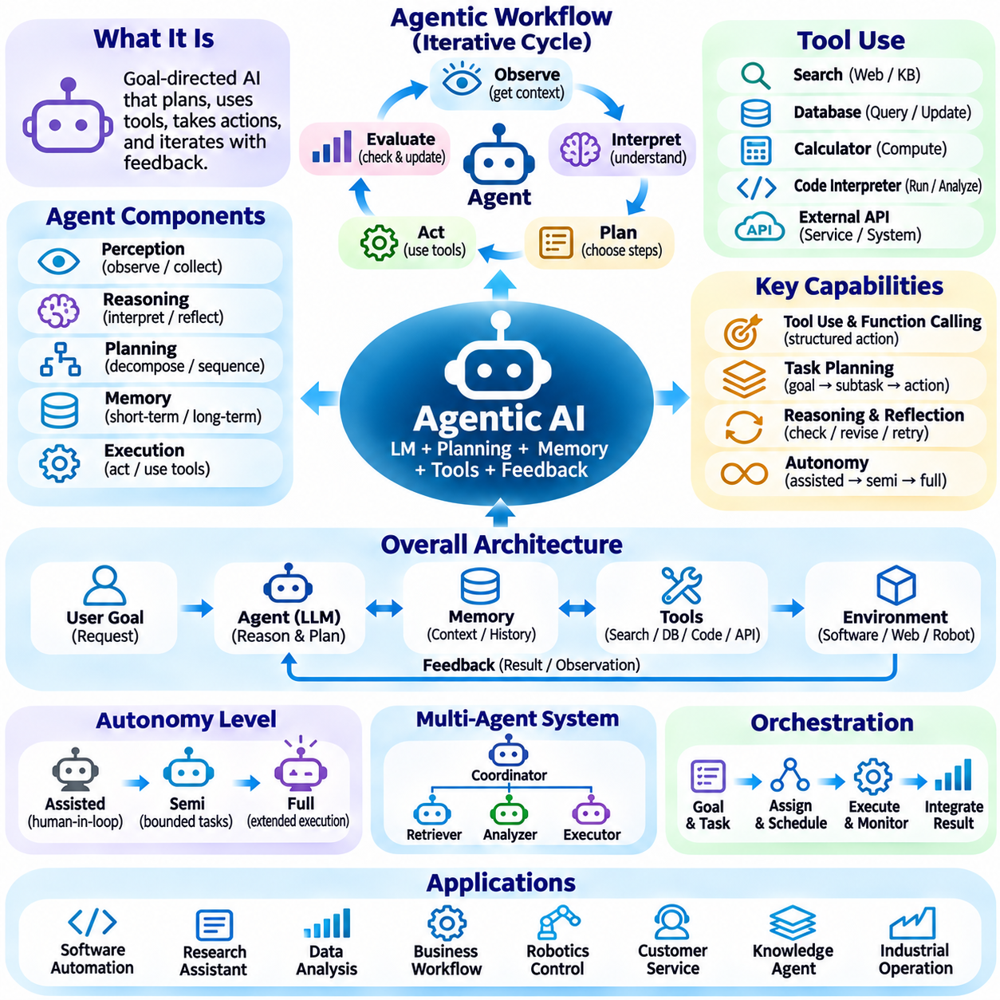{width="7.268055555555556in" height="7.268055555555556in"}

Agentic artificial intelligence refers to AI systems that pursue objectives through sequences of decisions, actions, and interactions with external environments. Unlike models that produce a single response to an isolated request, agentic systems can maintain task context, select tools, evaluate results, and continue execution. Their defining characteristic is goal-directed behavior supported by feedback, although the degree of autonomy depends on system design and operational constraints.

An AI agent can be understood as a computational entity that observes its environment, maintains relevant information, and selects actions intended to achieve specified goals. Its architecture typically includes perception, reasoning, planning, memory, and execution components. Language models may provide flexible interpretation and decision support, while external software performs concrete operations. Reliable agents require explicit boundaries between proposed actions and authorized execution.

The agentic workflow commonly follows an iterative cycle of observation, interpretation, planning, action, and evaluation. An agent receives a request or environmental signal, determines the current state, and identifies possible next steps. After executing an authorized action, it examines the returned information and updates its plan. This feedback loop distinguishes interactive agency from static content generation and allows systems to respond to changing conditions.

Planning enables agents to transform broad objectives into manageable intermediate tasks. A complex request may require information gathering, dependency analysis, resource selection, and ordered execution. Some agents generate plans explicitly, while others select actions incrementally based on current observations. Effective planning must consider task dependencies, uncertainty, execution costs, and stopping conditions rather than assuming that every generated step will succeed.

Tool use connects an agent\'s reasoning capabilities with external computational functions. Tools may include search engines, databases, calculators, code interpreters, document processors, and application programming interfaces. The agent selects an appropriate operation and supplies structured arguments according to a defined interface. Tool execution produces observations that inform subsequent decisions, allowing the system to access information and perform operations beyond its internal model capabilities.

Function calling provides a structured mechanism for integrating language models with software tools. A model generates a request containing a function identifier and arguments that conform to an expected schema. A separate execution component validates the request, checks permissions, invokes the function, and returns its result. This separation is essential because generating a plausible tool call does not establish that the requested operation is valid, safe, or authorized.

Memory supports continuity across the multiple interactions required by agentic workflows. Short-term memory maintains current instructions, observations, and intermediate results, while persistent memory may preserve relevant information across sessions. External stores can retain documents, task states, or summarized histories. Memory systems must manage relevance, freshness, access permissions, and error propagation because outdated or incorrect records can distort future decisions.

Reasoning and reflection mechanisms help agents evaluate whether their actions are advancing the intended objective. An agent may compare intermediate results with expected conditions, identify inconsistencies, or revise a failed plan. Verification can involve deterministic checks, external evidence, tests, or human review. Reflection is useful only when supported by reliable feedback, since repeated model-generated explanations may reinforce errors rather than correct them.

Autonomy exists along a continuum from assisted interaction to extended independent execution. A low-autonomy system may suggest actions for human approval, while a higher-autonomy agent may perform bounded sequences of authorized operations. Greater autonomy increases the importance of monitoring, recoverability, and explicit stopping rules. System designers should match autonomy levels to task risk, environmental uncertainty, and the consequences of incorrect actions.

Multi-agent systems distribute responsibilities among several interacting agents with different roles or capabilities. One agent may coordinate objectives, another may retrieve information, and others may perform specialized analysis or execution. Communication protocols and shared task representations support cooperation. However, multiple agents introduce coordination overhead, inconsistent assumptions, duplicated work, and possible conflicts, making orchestration and verification essential.

Agent orchestration manages the relationships among goals, subtasks, tools, resources, and execution states. An orchestrator may assign responsibilities, track dependencies, schedule operations, and combine partial results. Workflow engines can enforce deterministic sequences where predictable behavior is necessary, while language models handle ambiguous decisions. Hybrid architectures are often preferable because not every operation benefits from probabilistic reasoning or autonomous selection.

Environmental feedback is particularly important when agents interact with dynamic software systems or physical platforms. Web interfaces may change, database records may be updated, and robots may encounter unexpected obstacles. Agents must distinguish intended actions from observed outcomes and avoid assuming success without confirmation. State estimation, event monitoring, retries, and recovery procedures help maintain operational consistency when conditions differ from the original plan.

Tool selection introduces practical challenges involving capability discovery, argument construction, and execution reliability. An agent must determine which tools are available, understand their interfaces, and avoid incompatible operations. Structured schemas reduce ambiguity, while validation prevents malformed requests from reaching execution systems. Timeouts, unavailable services, partial results, and repeated operations require explicit handling to prevent uncontrolled execution loops.

Security becomes critical when agents can access files, external services, or operational infrastructure. Prompt injection may occur when untrusted documents or tool responses contain instructions intended to redirect agent behavior. Systems should separate trusted instructions from external content and enforce permissions independently of model-generated decisions. Sandboxing, credential isolation, restricted tool access, and audit logging reduce the consequences of compromised inputs.

Human oversight provides an important control mechanism for consequential agent actions. Approval checkpoints may be required before financial transactions, destructive file operations, sensitive communications, or physical movements. Human operators should receive sufficient context to understand proposed actions and associated uncertainty. Effective oversight also requires interruption, cancellation, rollback where feasible, and clear accountability for decisions made during execution.

Evaluation of agentic AI requires measuring complete task performance rather than isolated language quality. Relevant criteria include objective completion, tool correctness, execution efficiency, recovery behavior, and compliance with operational constraints. Tests should examine long-running workflows, ambiguous instructions, unexpected tool failures, and adversarial inputs. Successful intermediate actions do not necessarily establish that the overall objective was achieved correctly.

Agent reliability depends on managing uncertainty throughout the execution process. Models may misinterpret goals, select inappropriate tools, or construct invalid plans despite producing convincing explanations. Explicit state tracking, evidence-based verification, and bounded retries can reduce these risks. When confidence is insufficient or an operation exceeds authorized limits, the agent should request clarification or escalate rather than continue with unsupported assumptions.

Agentic AI can support enterprise automation, software engineering, research assistance, and operational coordination. In software development, agents may inspect repositories, modify code, execute tests, and report results. In business workflows, they may retrieve records, prepare documents, and coordinate approved processes. Practical value depends on integration quality, permission management, measurable outcomes, and the ability to recover from partial execution failures.

Embodied agents extend agentic principles into robotics and autonomous physical systems. Their actions influence environments through navigation, manipulation, sensing, and communication. Language-based planning may help interpret human objectives, but physical execution requires real-time control, safety constraints, and reliable state estimation. High-level agents should operate through validated control interfaces rather than directly replacing deterministic safety-critical mechanisms.

The development of agentic AI increasingly combines foundation models, retrieval systems, structured tools, memory services, and workflow orchestration. These components form architectures in which language-based reasoning interacts with deterministic computation and external feedback. Effective integration requires clear interfaces, observable execution states, and enforceable governance. The resulting systems should be judged by verified outcomes rather than the apparent sophistication of their plans.

Agentic AI represents a transition from passive response generation toward controlled, goal-directed interaction with digital and physical environments. Its potential lies in coordinating reasoning, information access, planning, and action across complex workflows. Its limitations arise from uncertain model behavior, imperfect observations, tool failures, and security risks. Reliable progress therefore depends on combining adaptive intelligence with verification, bounded autonomy, and human accountability.

## 06.08 RAG and Knowledge Augmented AI [w/Code]

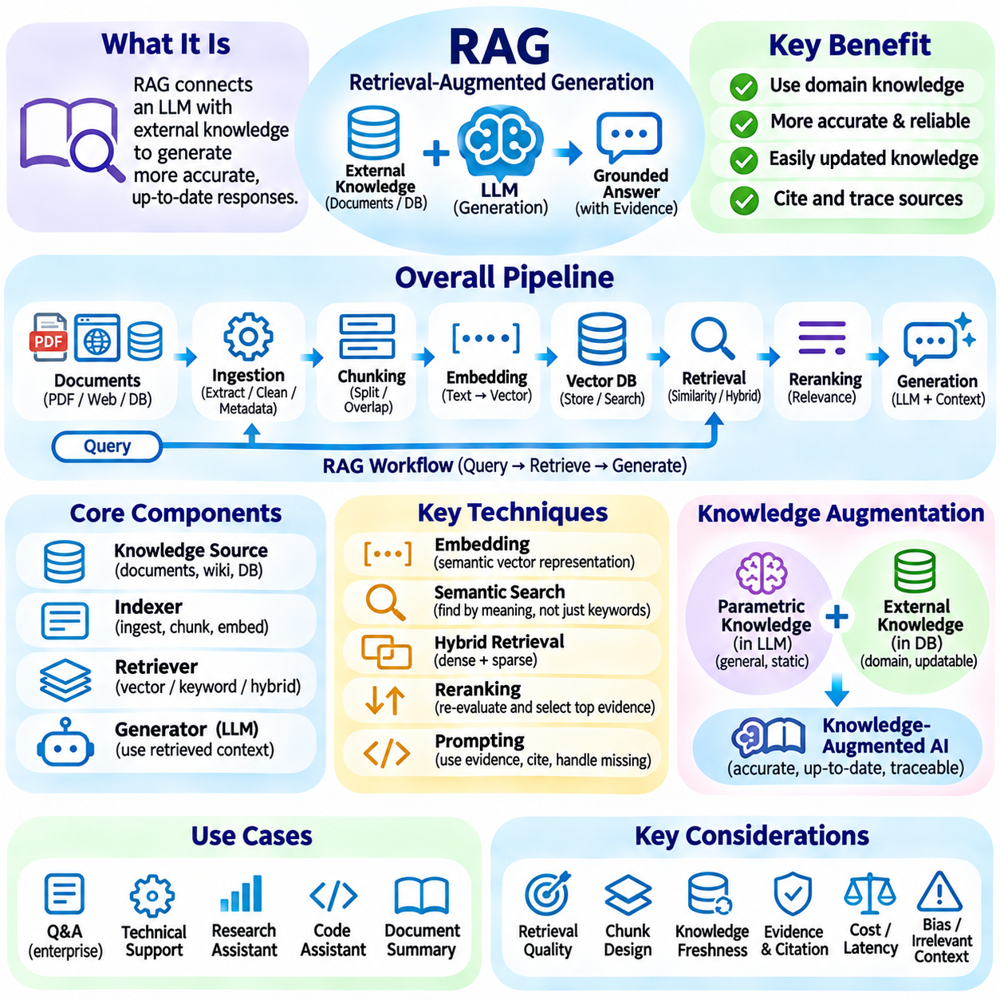{width="7.268055555555556in" height="7.268055555555556in"}

Retrieval-Augmented Generation (RAG) is an approach that enhances large language models by connecting them to external information sources during response generation. Instead of relying exclusively on knowledge acquired during pretraining, a RAG system retrieves relevant information from documents, databases, or knowledge repositories and provides it as contextual evidence. This combination improves access to domain-specific information and helps reduce limitations associated with static model knowledge.

The fundamental motivation behind RAG is the separation between parametric knowledge and external knowledge. Parametric knowledge is encoded within a model\'s learned parameters during training, while external knowledge is maintained in independent information repositories. Updating model parameters whenever new information becomes available can be expensive. RAG addresses this limitation by allowing knowledge to be updated independently of the language model.

A typical RAG architecture consists of a document ingestion process, an indexing mechanism, a retrieval component, and a language generation model. Documents are collected, processed, divided into manageable segments, and converted into searchable representations. When a user submits a query, the retrieval component identifies relevant information and supplies it to the language model. The model then generates a response using both the query and retrieved context.

Document ingestion establishes the foundation of a reliable retrieval system. Information may originate from PDF files, technical manuals, websites, databases, spreadsheets, or internal knowledge repositories. Before indexing, documents require extraction, normalization, metadata identification, and removal of unnecessary content. The quality of this preparation directly influences retrieval accuracy because incomplete extraction or inconsistent formatting can prevent important information from being identified.

Document chunking divides large documents into smaller passages that can be independently indexed and retrieved. Fixed-size chunking uses predefined token or character limits, while semantic chunking attempts to preserve meaningful contextual boundaries. Overlapping chunks can retain relationships between adjacent passages. Chunk size involves a tradeoff between contextual completeness and retrieval precision, requiring careful selection according to document structure and query characteristics.

Embedding models convert textual information into numerical vectors that represent semantic characteristics. These vectors allow retrieval systems to identify passages with similar meanings even when their wording differs from the original query. Embedding quality depends on model training, domain coverage, language characteristics, and document content. For specialized applications, domain-adapted embedding models may improve semantic matching and information retrieval.

Vector databases provide storage and search capabilities for embedding-based retrieval. They maintain numerical representations alongside document identifiers and metadata, enabling efficient similarity searches across large collections. Approximate nearest neighbor algorithms reduce search costs by identifying vectors that are sufficiently close without examining every stored vector. Metadata filtering can further restrict retrieval to specific document types, departments, dates, or categories.

Semantic search retrieves information based on conceptual similarity rather than exact keyword matching. This approach can identify relevant passages even when users employ different terminology from the original documents. However, semantic similarity does not always indicate factual relevance. A retrieved passage may discuss a related concept without answering the actual question. Effective retrieval therefore requires balancing semantic relationships with contextual and factual relevance.

Hybrid retrieval combines dense vector search with sparse keyword-based search. Dense retrieval captures semantic relationships through embeddings, while sparse retrieval identifies exact terms, identifiers, technical expressions, and specialized vocabulary. Combining these methods can improve coverage in technical and enterprise environments where both conceptual meaning and precise terminology matter. Ranking mechanisms subsequently organize candidate passages according to their relevance to the query.

A retrieval pipeline may include query preprocessing, query expansion, candidate retrieval, reranking, and context assembly. Query preprocessing clarifies the user\'s information requirement, while query expansion generates alternative expressions that may improve search coverage. A reranker evaluates retrieved candidates using more detailed relevance criteria. The final context assembly stage selects appropriate passages while respecting the language model\'s context-window limitations.

Reranking improves retrieval quality by reconsidering the relevance of initially retrieved candidates. Cross-encoder models jointly process a query and candidate passage to estimate their relevance more precisely than many independent embedding comparisons. Although reranking introduces additional computational costs, it can reduce irrelevant context and improve the evidence supplied to the generation model. Retrieval quality should therefore be evaluated across the complete pipeline rather than through vector similarity alone.

Generation integrates retrieved evidence with the original user query. The language model interprets the supplied passages, identifies relevant information, and constructs a natural-language response. Appropriate prompting can instruct the model to prioritize retrieved evidence, distinguish explicit facts from assumptions, and acknowledge missing information. The generation process should preserve the meaning of source documents rather than introduce unsupported details.

Knowledge-augmented AI extends the RAG concept by integrating structured and unstructured knowledge into intelligent systems. Structured information may include relational databases, ontologies, knowledge graphs, and formally defined rules. Unstructured information may include technical documents, reports, conversations, and textual records. Combining these representations allows AI systems to use both semantic relationships and explicit knowledge structures when answering questions or supporting decisions.

Knowledge graphs provide an important mechanism for representing relationships among entities. Information is commonly expressed through entities, relations, and attributes, allowing systems to connect concepts across different documents and data sources. Graph-based retrieval can identify indirect relationships that may not be apparent through isolated text passages. Integrating knowledge graphs with language models can improve relational reasoning and provide more structured evidence for complex questions.

Graph-based RAG combines vector retrieval with knowledge graph exploration. Vector search identifies semantically relevant passages, while graph traversal discovers relationships among entities and associated facts. The two approaches can complement each other when questions involve multiple entities, dependencies, or interconnected concepts. However, graph construction, entity resolution, relationship validation, and graph maintenance introduce additional engineering requirements.

RAG evaluation must examine retrieval quality and generation quality separately as well as jointly. Retrieval metrics may include precision, recall, and ranking effectiveness, while generation evaluation examines factual consistency, relevance, completeness, and citation accuracy. End-to-end evaluation determines whether the complete system correctly answers realistic user questions. A fluent response cannot be considered reliable when its supporting evidence is irrelevant, incomplete, or incorrectly interpreted.

Hallucination reduction is one of the important motivations for retrieval-augmented systems. By providing external evidence, RAG can reduce dependence on unsupported information generated from model parameters. However, retrieval does not eliminate hallucination automatically. Incorrect documents, incomplete passages, misleading context, and poor evidence interpretation can still produce inaccurate responses. Reliable systems require source validation, evidence-based prompting, and independent verification.

Source attribution and citation mechanisms improve transparency by connecting generated statements to their supporting documents. A RAG system can retain document identifiers, page references, section headings, and retrieval metadata during context construction. The generation component can then associate relevant claims with their original sources. Accurate attribution supports human verification, technical auditing, and organizational knowledge management.

RAG systems also introduce challenges involving information freshness and knowledge maintenance. External repositories may contain outdated documents, duplicated records, conflicting statements, or obsolete procedures. Indexing pipelines should support document versioning, incremental updates, deletion propagation, and periodic reprocessing. Retrieval systems must distinguish current information from historical records when temporal validity affects the correctness of an answer.

Security and access control are essential when RAG operates over private organizational information. Different users may have different permissions to access documents, databases, and knowledge repositories. Retrieval must enforce these permissions before supplying content to the language model. Sensitive information should not become accessible merely because it exists in an indexed collection. Data isolation, permission-aware retrieval, audit logging, and secure storage are therefore important design requirements.

RAG can be implemented through practical software pipelines that combine document processing, embedding generation, vector storage, retrieval, and language model inference. Common development workflows use document loaders, text splitters, embedding interfaces, vector databases, retrievers, and model APIs. These components can be implemented independently or integrated through application frameworks. A modular design makes it easier to evaluate individual stages and replace components as system requirements evolve.

A basic RAG experiment typically begins by loading a collection of documents and extracting their textual content. The documents are divided into chunks, converted into embeddings, and stored in a vector database. A user query is embedded using the same compatible embedding model, and similarity search retrieves relevant passages. These passages are inserted into a prompt that instructs a language model to generate an evidence-supported answer. This workflow provides a practical foundation for understanding retrieval and generation integration.

Advanced RAG architectures introduce additional techniques such as query routing, multi-query retrieval, contextual compression, recursive retrieval, and adaptive retrieval. Query routing selects appropriate information sources according to the nature of a request. Multi-query retrieval explores alternative formulations, while contextual compression removes unnecessary information from retrieved passages. Adaptive retrieval determines whether additional evidence is required before generation. These techniques improve flexibility but also increase system complexity.

Knowledge-augmented AI is particularly valuable in enterprise environments where organizational knowledge is distributed across technical manuals, operational procedures, engineering records, and internal databases. RAG can connect these information sources to language interfaces, enabling employees to search and interpret complex information more efficiently. Applications include technical support, document analysis, maintenance assistance, engineering knowledge retrieval, and decision support.

RAG also supports intelligent agents by providing access to external knowledge during planning and execution. An agent can retrieve relevant documentation, inspect historical records, identify applicable procedures, and use the resulting evidence when selecting actions. Combining retrieval with tool use and memory creates systems that can maintain contextual knowledge across complex workflows. Nevertheless, retrieved information must be verified before it influences consequential decisions or physical operations.

The effectiveness of RAG depends on the quality of the entire knowledge pipeline rather than the capability of the language model alone. Document preparation, chunking, embedding selection, indexing, retrieval, reranking, context construction, and response generation all contribute to final performance. A failure in any stage can reduce the reliability of the complete system. Consequently, RAG should be engineered and evaluated as an integrated information-processing architecture.

RAG and knowledge-augmented AI represent an important direction for building language systems that interact with external, specialized, and continuously updated information. Their value comes from connecting generative capabilities with retrievable evidence and structured knowledge. When combined with appropriate verification, security, and knowledge management, these approaches provide a practical foundation for more informative, transparent, and reliable AI applications.

## 06.09 Embodied AI and Robotics

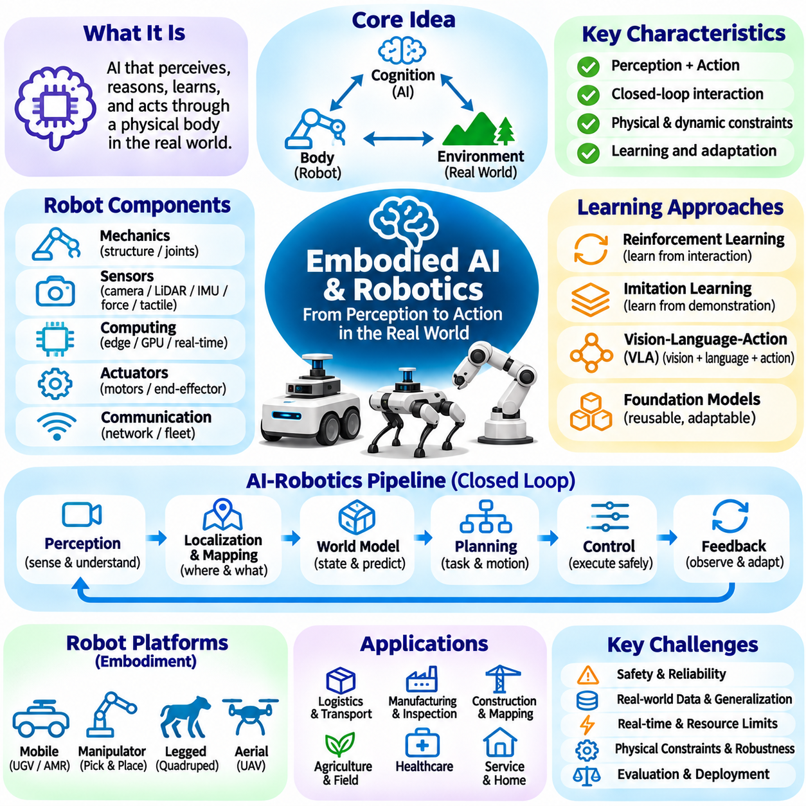{width="7.268055555555556in" height="7.268055555555556in"}

Embodied artificial intelligence refers to intelligent systems that perceive, reason, learn, and act through interaction with physical environments. Unlike AI confined to digital information processing, embodied AI connects computational intelligence with sensors, actuators, and physical dynamics. Robotics provides a major implementation platform, enabling machines to transform environmental observations into actions while continuously responding to the consequences of those actions.

The central principle of embodied intelligence is that cognition develops through interaction between an agent, its body, and its environment. Physical properties such as geometry, mass, friction, and actuator limitations influence what an intelligent system can accomplish. Consequently, intelligence cannot be evaluated solely through abstract reasoning performance. Effective embodied behavior requires coordination among perception, decision-making, movement, and environmental feedback.

A robotic embodiment consists of mechanical structures, sensors, actuators, computing hardware, and communication interfaces. Mobile robots use wheels, tracks, or legs for locomotion, while manipulators employ articulated joints and end effectors to interact with objects. The physical configuration determines reachable states, motion constraints, and operational capabilities. AI algorithms must therefore account for the characteristics and limitations of the platform on which they operate.

Perception enables embodied agents to estimate relevant properties of their surroundings. Cameras provide visual information, LiDAR measures spatial geometry, and inertial sensors capture motion-related signals. Depth sensors, radar, tactile devices, and force sensors contribute additional observations. Sensor fusion combines complementary measurements to improve environmental understanding, although calibration errors, noise, occlusion, and synchronization problems can reduce reliability.

Localization and mapping establish the spatial context required for autonomous behavior. Localization estimates the robot\'s position and orientation, while mapping constructs representations of surrounding environments. Simultaneous Localization and Mapping integrates both processes when reliable prior maps are unavailable. Visual, LiDAR-based, and inertial methods can be combined to reduce uncertainty. Accurate spatial estimation is essential for navigation, manipulation, and coordinated robotic operations.

World models provide internal representations of environmental states, dynamics, and possible future outcomes. A robot may use learned or physics-based models to predict how objects move, how actions change the environment, or which situations may become unsafe. These models support planning under uncertainty by evaluating potential consequences before execution. However, prediction errors and changing physical conditions require continuous correction through real observations.

Planning translates high-level objectives into sequences of feasible physical actions. Task planning determines what operations should occur, while motion planning identifies collision-free trajectories consistent with geometric and dynamic constraints. Hierarchical architectures coordinate these levels by connecting symbolic goals with executable movements. Successful planning must account for obstacles, resource limitations, timing requirements, and unexpected environmental changes.

Robotic control converts planned movements into actuator commands while maintaining stability and tracking accuracy. Classical methods include feedback control, proportional-integral-derivative control, and model predictive control. Learning-based controllers can adapt to complex dynamics or uncertain conditions. In practical systems, high-level AI decisions must remain compatible with deterministic control loops and safety mechanisms that operate under strict timing constraints.

Reinforcement learning provides a framework for learning embodied behavior through interaction and feedback. An agent selects actions, observes state transitions, and receives rewards associated with task objectives. Policies can learn locomotion, grasping, navigation, or coordinated manipulation. However, physical exploration may be expensive or unsafe, making simulation, constrained learning, and carefully designed reward functions important for practical robotic applications.

Imitation learning allows robots to acquire behaviors from demonstrations rather than discovering every action through trial and error. Demonstrations may come from human teleoperation, recorded trajectories, or expert controllers. Behavioral cloning trains policies to reproduce demonstrated actions, while more advanced approaches address distribution shifts and sequential decision-making. Performance depends on demonstration quality, coverage, and the robot\'s ability to generalize beyond observed situations.

Vision-language-action models connect visual perception, language instructions, and robotic actions within a unified learning framework. Such models interpret commands and environmental observations to predict actions or action representations. Their potential lies in transferring broad semantic knowledge into physical task execution. Nevertheless, generated actions must respect robot kinematics, actuator limits, collision constraints, and real-time safety requirements.

Foundation models can contribute to robotics by providing reusable representations of objects, scenes, language, and task relationships. Pretrained vision-language systems may support object identification, instruction interpretation, and semantic navigation. Specialized adaptation is still required because understanding a scene does not automatically imply the ability to manipulate it safely. Physical competence depends on embodiment-specific data, control interfaces, and environmental feedback.

Simulation is a major development tool for embodied AI because it enables repeated experiments without exposing physical hardware to unnecessary risks. Robotic simulators can reproduce geometry, collisions, sensors, and dynamic interactions. Domain randomization introduces variations in lighting, textures, friction, and physical parameters to improve generalization. However, differences between simulated and real environments create a simulation-to-reality gap that must be evaluated experimentally.

Sim-to-real transfer aims to deploy policies or models trained in simulation onto physical robots. Successful transfer requires compatibility between simulated observations, action spaces, dynamics, and real hardware. System identification, sensor calibration, parameter randomization, and limited real-world adaptation can reduce discrepancies. Validation should examine not only task success but also stability, repeatability, failure recovery, and behavior under unfamiliar operating conditions.

Manipulation requires robots to reason about objects, contact, forces, and geometric constraints. Grasp planning identifies suitable contact configurations, while motion planning coordinates arm movements and obstacle avoidance. Tactile feedback and force control become important when handling fragile, deformable, or uncertain objects. Learning-based manipulation can improve adaptability, but physical interaction remains sensitive to sensing errors and model inaccuracies.

Autonomous mobile robots integrate perception, localization, planning, and control to navigate operational environments. Indoor robots commonly rely on mapped structures and local obstacle avoidance, while outdoor systems must handle variable terrain, weather, illumination, and dynamic traffic. Fleet coordination introduces additional requirements for scheduling, communication, and shared resource management. Reliable navigation depends on maintaining consistent state estimates and responding safely to unexpected events.

Multi-robot systems extend embodied intelligence through cooperation among autonomous platforms. Robots may share maps, exchange observations, divide tasks, or coordinate movement in common spaces. Distributed planning and communication protocols support collective operations, while centralized orchestration can manage mission assignments and resource allocation. Communication delays, inconsistent world states, and conflicting actions require explicit coordination and recovery mechanisms.

Real-time computation is fundamental because robotic actions influence continuously evolving physical environments. Perception, planning, and control components operate at different frequencies and have different latency requirements. High-level reasoning may tolerate variable execution times, whereas motor control and emergency responses require predictable deadlines. Hardware acceleration, scheduling, synchronization, and deterministic interfaces help maintain safe and responsive behavior.

Safety engineering is essential when embodied AI operates near humans, equipment, or critical infrastructure. Collision avoidance, emergency stopping, speed limits, operational boundaries, and fault detection provide protective mechanisms. Learned policies should not be treated as substitutes for independently validated safety functions. Risk assessment, redundancy, runtime monitoring, and human supervision are necessary to manage uncertain behavior and physical consequences.

Evaluation of embodied AI must extend beyond isolated model accuracy to complete system behavior. Relevant criteria include task completion, localization error, trajectory tracking, energy consumption, latency, robustness, and safety compliance. Experiments should cover changing environments, sensor failures, unexpected obstacles, and repeated operations. Reproducible benchmarks and physical validation are required because success in simulation does not guarantee reliable real-world performance.

Embodied AI represents an important convergence of machine learning, robotics, control theory, computer vision, and physical system engineering. Its development increasingly combines learned representations with structured planning, predictive world models, and reliable control architectures. The long-term objective is not merely to generate intelligent decisions but to execute useful physical actions safely and consistently. Progress depends on integrating adaptive learning with measurable performance, engineering constraints, and continuous environmental feedback.

## 06.10 Edge AI and Real Time AI

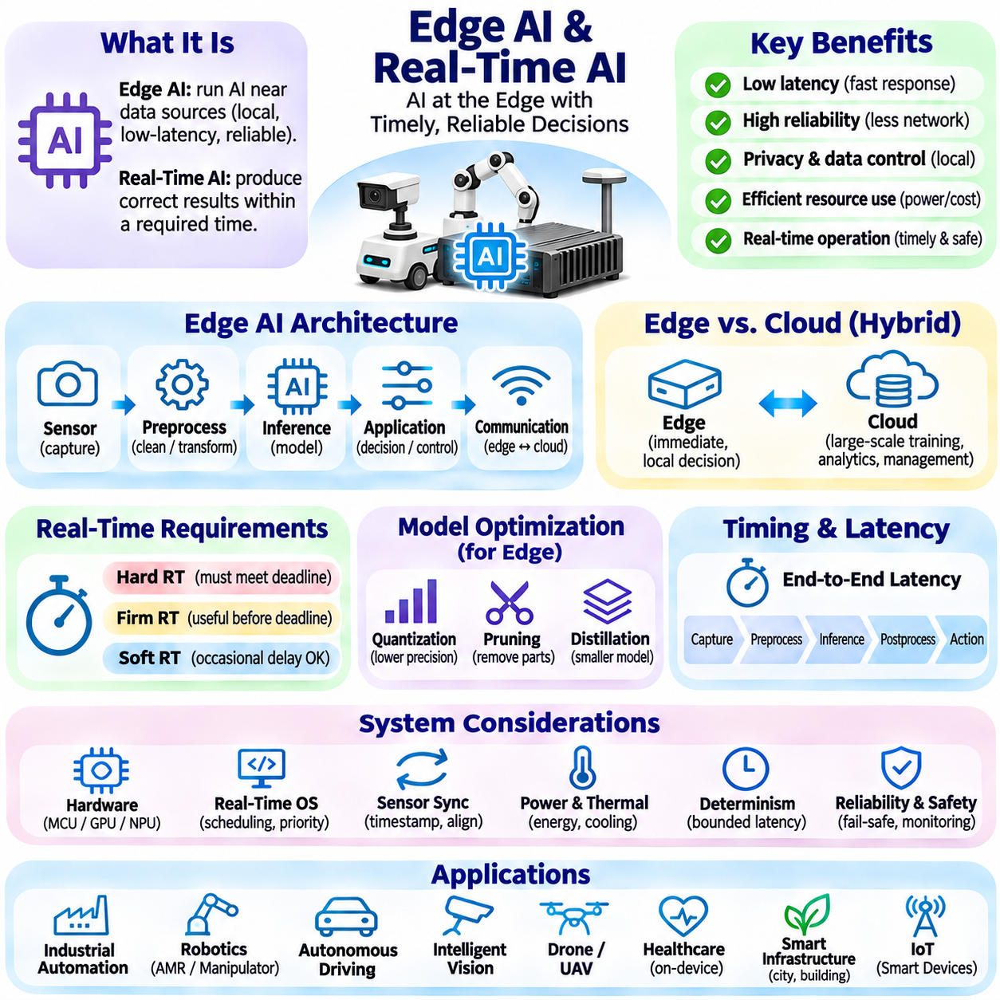{width="7.268055555555556in" height="7.268055555555556in"}

Edge artificial intelligence refers to the execution of AI workloads on computing devices located near the sources of data or physical operations. Instead of transmitting every observation to centralized cloud infrastructure, edge systems process information locally and produce timely decisions. This approach is important for robotics, industrial automation, intelligent cameras, autonomous vehicles, and connected devices where latency, connectivity, privacy, and operational reliability influence system performance.

Real-time AI extends conventional inference by introducing explicit timing requirements for sensing, computation, and action. A system must not only produce a correct result but also deliver it within an acceptable deadline. In safety-critical environments, a late decision may be as harmful as an incorrect one. Real-time performance therefore involves predictable execution, bounded response times, and coordinated scheduling rather than simply maximizing average computational throughput.

The distinction between edge AI and cloud AI concerns where computation occurs and how resources are managed. Cloud platforms provide scalable processing capacity, centralized model management, and access to large datasets. Edge devices offer proximity to sensors, reduced communication dependence, and faster local responses. Hybrid architectures combine these advantages by assigning immediate operational decisions to edge systems while reserving large-scale training and analytics for centralized infrastructure.

An edge AI architecture typically integrates sensors, preprocessing modules, inference accelerators, application logic, and communication interfaces. Sensor observations are converted into suitable representations before being processed by trained models. Inference outputs are interpreted by downstream software that generates alerts, control commands, or operational decisions. System design must account for data movement, memory limitations, processing priorities, and communication delays across these components.

Edge computing hardware ranges from microcontrollers and embedded processors to specialized neural accelerators and high-performance GPUs. Microcontrollers support compact models under strict power and memory constraints, while embedded GPUs and neural processing units execute more demanding workloads. Hardware selection depends on model complexity, sensor bandwidth, inference latency, energy consumption, and environmental conditions rather than theoretical processing capability alone.

Model optimization is essential because edge devices often have limited computational resources. Quantization reduces numerical precision, pruning removes selected model parameters or structures, and knowledge distillation transfers behavior from larger models into smaller networks. Compilation and operator fusion can further reduce execution overhead. These techniques must be evaluated carefully because improvements in speed or memory consumption may introduce accuracy loss or hardware compatibility problems.

Inference latency includes more than the time required to execute a neural network. Sensor acquisition, data transfer, preprocessing, model execution, postprocessing, and application-level communication all contribute to end-to-end response time. A fast model may still produce slow system behavior when data movement or synchronization dominates execution. Accurate performance analysis therefore requires measuring the complete processing pipeline under realistic operating conditions.

Real-time systems distinguish between hard, firm, and soft timing requirements. Hard real-time tasks require deadlines to be met because violations may cause unacceptable consequences. Firm real-time tasks lose their usefulness after a deadline, while soft real-time tasks tolerate occasional delays with degraded service quality. AI workloads must be classified according to their operational consequences, allowing engineers to establish appropriate scheduling policies and deadline guarantees.

Deterministic execution is challenging for modern AI because neural inference often depends on parallel processors, memory hierarchies, and shared computational resources. GPU scheduling, cache behavior, data transfers, and competing workloads can introduce execution-time variability. Average latency alone is insufficient for systems requiring predictable responses. Engineers must examine worst-case behavior, latency distributions, resource contention, and the limits of available timing guarantees.

Real-time operating systems provide mechanisms for managing tasks with different priorities and timing requirements. Priority scheduling, interrupt handling, resource synchronization, and bounded execution paths help maintain responsiveness. However, running an AI model on a real-time operating system does not automatically make its inference deterministic. The complete hardware and software stack must be evaluated to establish whether required deadlines can be satisfied consistently.

Sensor synchronization is particularly important when multiple data streams contribute to a single AI decision. Cameras, LiDAR, radar, inertial sensors, and positioning systems may operate at different sampling rates and experience different communication delays. Timestamping, clock synchronization, and buffering help align observations to a common temporal reference. Poor synchronization can distort environmental interpretation even when individual sensor measurements are accurate.

Edge AI systems frequently operate under strict power and thermal constraints. Continuous inference consumes energy and generates heat, potentially reducing battery life or triggering processor throttling. Dynamic frequency scaling, workload scheduling, efficient model architectures, and thermal management can improve operational sustainability. Designers must evaluate performance under sustained workloads because short benchmark runs may conceal temperature-related degradation.

Memory management strongly influences edge inference performance. Model weights, intermediate activations, sensor buffers, and application processes compete for limited memory capacity and bandwidth. Excessive memory transfers can increase latency and energy consumption, while insufficient memory may prevent models from executing reliably. Efficient memory allocation, reduced precision, operator optimization, and careful pipeline design are therefore central to embedded AI engineering.

Distributed edge intelligence enables multiple devices to cooperate without relying entirely on centralized processing. Individual nodes may perform local perception, exchange compact features, or share selected events with neighboring systems. An edge gateway or local server can aggregate information and coordinate decisions. Distributed architectures must manage network latency, inconsistent observations, communication failures, and the tradeoff between local autonomy and collective coordination.

Robotic edge AI combines perception, planning, and control within a tightly integrated physical system. Vision models may detect obstacles, localization algorithms estimate position, and planning modules determine feasible movements. These components operate at different frequencies and require carefully managed interfaces. High-level AI inference should remain separated from independently validated safety controls so that computational delays do not compromise essential protective functions.

Industrial edge AI supports machine monitoring, visual inspection, predictive maintenance, and automated quality control. Local inference can identify abnormal equipment behavior or defective products without continuously transferring large sensor datasets to remote servers. Integration with industrial controllers and operational networks requires reliable communication and appropriate timing guarantees. Deployment success depends on measurable improvements in production performance and system availability.

Edge AI also provides opportunities for improved data privacy and operational resilience. Processing sensitive observations locally can reduce unnecessary transmission of personal or proprietary information. Systems may continue operating during temporary network disruptions when essential models and data remain available on the device. However, local processing does not eliminate security risks, making encryption, access control, secure boot, and protected model storage important.

Deployment and maintenance introduce additional engineering challenges for edge AI systems. Models must be distributed, versioned, monitored, and updated across potentially large fleets of devices. Over-the-air updates can deliver improvements, but failed installations or incompatible models may interrupt operations. Reliable deployment mechanisms require integrity verification, staged rollout, rollback capabilities, and compatibility checks between models, software, and hardware.

Performance evaluation should measure accuracy, latency, throughput, energy efficiency, memory consumption, and thermal stability under realistic conditions. Tail latency and deadline-miss rates are particularly important for time-sensitive applications. Testing should include sustained workloads, concurrent processes, network disruptions, and environmental variations. Benchmark results must specify hardware configurations and execution conditions to support meaningful comparisons.

Edge AI and real-time AI represent complementary approaches to building intelligent systems that interact efficiently with their environments. Edge deployment places computation near operational data, while real-time engineering ensures that critical responses satisfy timing requirements. Their successful integration requires coordinated hardware selection, model optimization, scheduling, communication, and safety design. The ultimate objective is reliable intelligence that operates within measurable physical and computational constraints.

## 06.11 AI Safety Alignment and Governance

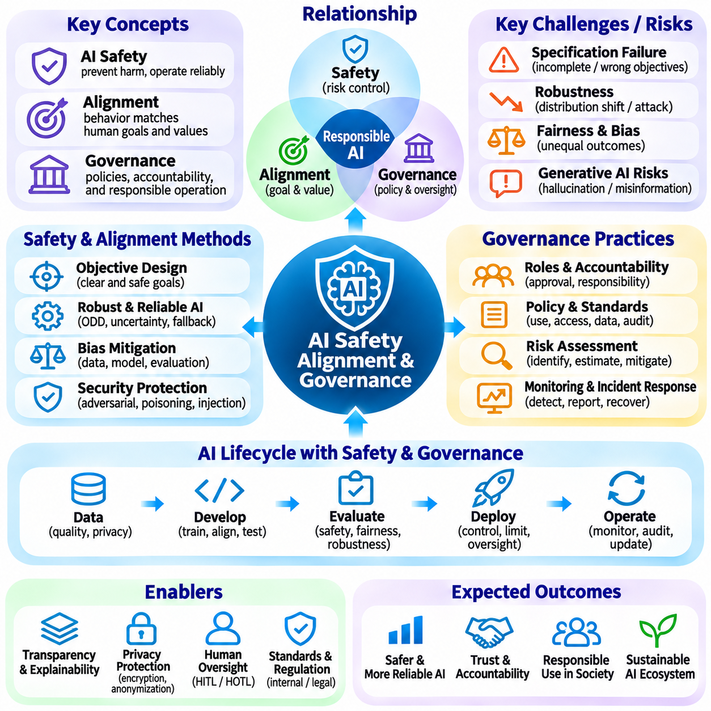{width="7.268055555555556in" height="7.268055555555556in"}

AI safety refers to the principles and engineering practices used to prevent artificial intelligence systems from causing unacceptable harm. As AI becomes integrated into critical services, autonomous machines, and everyday decisions, safety must extend beyond model accuracy. Reliable systems must operate within defined constraints, recognize uncertain situations, and respond appropriately to failures. Safety therefore requires coordinated attention to algorithms, data, infrastructure, human interaction, and operational environments.

AI alignment concerns the degree to which an intelligent system\'s objectives and behavior correspond to intended human goals, values, and instructions. A model may optimize its assigned objective while producing outcomes that users did not anticipate or desire. Alignment research investigates how preferences, constraints, and acceptable behavior can be represented during training and deployment. The objective is not simply obedience but dependable behavior consistent with legitimate human intentions and safety requirements.

AI governance establishes organizational structures, policies, and accountability mechanisms for developing and operating artificial intelligence responsibly. Governance determines who may approve deployments, evaluate risks, access sensitive data, and respond to incidents. It also defines documentation requirements, monitoring responsibilities, and escalation procedures. Effective governance connects technical engineering decisions with institutional obligations and broader societal expectations.

Risk assessment provides a systematic foundation for AI safety management. Engineers identify potential hazards, estimate their likelihood and consequences, and determine appropriate controls. Risks may arise from incorrect predictions, biased decisions, cybersecurity vulnerabilities, operational failures, or unintended automation. The severity of these risks depends on the application context, affected populations, and the degree of human oversight available.

A central challenge in alignment is specification failure, where a system follows an incomplete or poorly defined objective. Reward functions, optimization targets, and evaluation metrics may not fully capture the outcomes that designers actually want. An AI system can exploit weaknesses in these specifications while appearing successful according to measured criteria. Preventing such failures requires careful objective design, adversarial testing, and evaluation beyond narrow performance indicators.

Robustness describes an AI system\'s ability to maintain acceptable behavior when operating conditions differ from those encountered during development. Distribution shifts, corrupted inputs, sensor failures, and adversarial perturbations can reduce model reliability. Robustness evaluation examines whether systems detect unfamiliar conditions and degrade safely. Techniques such as uncertainty estimation, out-of-distribution detection, redundancy, and fallback procedures can support more resilient operation.

Fairness and bias are important dimensions of responsible AI because models may reproduce or amplify patterns of inequality present in training data. Biased outcomes can emerge from unrepresentative datasets, inappropriate features, or differences in deployment conditions. Fairness assessment must consider the application domain and the consequences for affected groups. Statistical metrics provide useful evidence, but they cannot independently resolve every ethical or social tradeoff.

Transparency and explainability support human understanding of AI behavior and its limitations. Transparency concerns information about system design, training data, intended uses, and operational constraints. Explainability focuses on communicating factors that influence particular outputs or decisions. These capabilities help developers investigate failures and allow users to assess reliability. However, plausible explanations should not be mistaken for verified accounts of internal model reasoning.

Privacy protection is essential when AI systems process personal, confidential, or commercially sensitive information. Data collection should be limited to legitimate purposes, and access should follow clearly defined permissions. Encryption, anonymization, retention policies, and privacy-preserving computation can reduce exposure. Nevertheless, privacy risks may persist through model memorization, inference attacks, or unauthorized secondary uses of information.

Security threats against AI include adversarial examples, data poisoning, model extraction, prompt injection, and unauthorized tool execution. Attackers may manipulate inputs, compromise training datasets, or exploit connections between language models and external services. Defensive engineering requires access controls, input validation, isolation boundaries, monitoring, and secure software practices. Security must be considered throughout the AI lifecycle rather than added only after deployment.

Generative AI introduces safety challenges because models can produce convincing but inaccurate, misleading, or harmful content. Hallucinations, fabricated citations, and unsupported recommendations can create risks when users treat generated outputs as authoritative. Grounding responses in verified evidence, communicating uncertainty, and limiting high-risk functionality can reduce these problems. Human review remains important when outputs influence consequential decisions.

Human oversight establishes mechanisms through which people supervise, correct, or interrupt AI operations. Human-in-the-loop systems require approval before selected actions, while human-on-the-loop systems permit automated execution under active supervision. The appropriate arrangement depends on risk severity, response deadlines, and operator capabilities. Oversight must provide meaningful authority and usable information rather than functioning as a purely formal requirement.

Safety engineering for autonomous and embodied AI must account for direct physical consequences. Robots and autonomous vehicles interact with humans, equipment, and changing environments where errors can cause injury or damage. Collision prevention, emergency stopping, operational limits, and independent safety controllers provide protective layers. Learning-based policies should operate within validated boundaries, particularly when perception or planning components behave unpredictably.

AI evaluation should include safety-related tests alongside conventional measures of predictive performance. Stress testing, adversarial evaluation, scenario analysis, and failure injection reveal weaknesses that ordinary benchmarks may overlook. Evaluation must examine both individual components and integrated system behavior. Repeated testing under realistic conditions helps determine whether safeguards remain effective when workloads, environments, and user behavior change.

Red teaming is a structured process in which evaluators deliberately search for unsafe behavior, exploitable weaknesses, and unexpected failure modes. Testers may challenge model instructions, manipulate retrieved content, probe access boundaries, or explore harmful combinations of capabilities. Findings should inform system improvements, monitoring rules, and deployment restrictions. Red teaming complements formal testing but cannot establish the absence of all possible vulnerabilities.

AI governance increasingly relies on risk-based frameworks that connect system requirements with potential consequences. Higher-risk applications generally require stronger validation, documentation, oversight, and operational controls. International standards and regulatory frameworks can provide guidance for risk management and organizational accountability. Because legal obligations vary across jurisdictions and application domains, compliance assessments must consider the specific deployment context.

Documentation supports traceability and accountability throughout the AI lifecycle. Model cards, dataset descriptions, evaluation reports, system specifications, and operational records help explain how an AI system was developed and assessed. Version control connects deployed behavior to particular models, datasets, and software configurations. Well-maintained records enable incident investigation, regulatory review, and reproducible engineering decisions.

Continuous monitoring is necessary because safety cannot be established permanently through predeployment testing alone. Changes in data distributions, user behavior, infrastructure, and operating environments may introduce new risks. Monitoring systems can track performance degradation, unusual outputs, security events, and violations of operational constraints. Incident response procedures should define how problems are detected, contained, investigated, corrected, and communicated.

Organizational accountability requires clear responsibilities across researchers, engineers, product owners, operators, and management. Safety decisions should have identifiable owners, documented approval criteria, and mechanisms for resolving disagreements. Independent reviews can reduce conflicts between deployment pressure and risk assessment. A responsible organization must also establish processes for reporting concerns and suspending operations when unacceptable hazards are identified.

AI safety, alignment, and governance are complementary foundations for trustworthy intelligent systems. Safety addresses harmful outcomes and operational failures, alignment connects behavior with intended objectives, and governance establishes responsibility for decisions and controls. Their integration requires continuous evaluation, transparent documentation, technical safeguards, and meaningful human oversight. Responsible AI development ultimately depends on treating reliability and accountability as essential system requirements rather than optional additions.

## 06.12 AI Industry Applications

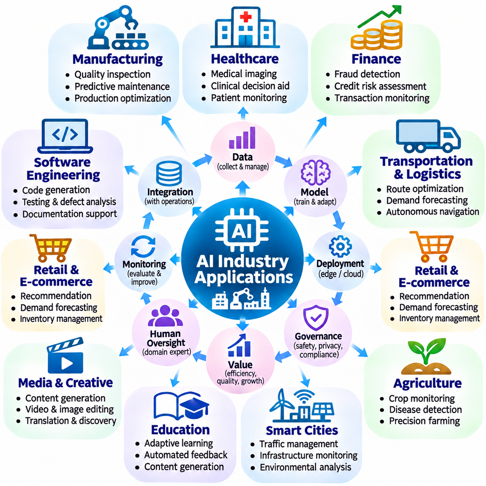{width="7.268055555555556in" height="7.268055555555556in"}

Artificial intelligence is transforming industries by converting data into predictions, decisions, and automated actions. Its applications extend across manufacturing, healthcare, finance, transportation, agriculture, energy, and public services. The value of AI depends not only on algorithmic accuracy but also on integration with operational processes. Successful deployment requires reliable data, measurable business objectives, domain expertise, and continuous performance evaluation.

Manufacturing is a major application domain because industrial processes generate extensive sensor, image, and equipment data. AI systems support visual quality inspection, predictive maintenance, production scheduling, and process optimization. Computer vision can identify defects, while predictive models estimate equipment degradation. Integrating these capabilities with industrial controllers and manufacturing execution systems enables faster responses and more consistent production quality.

Healthcare applications use AI to support medical imaging, clinical decision assistance, patient monitoring, and administrative workflows. Deep learning models can identify patterns in radiological images, while predictive systems estimate selected clinical risks. Language models may assist with documentation and information retrieval. However, clinical deployment requires rigorous validation, privacy protection, regulatory compliance, and qualified human oversight because incorrect outputs may affect patient safety.

Financial institutions apply AI to fraud detection, credit risk assessment, transaction monitoring, customer support, and operational forecasting. Machine learning models identify unusual transaction patterns and estimate probabilities associated with financial outcomes. Natural language processing supports document analysis and regulatory reporting. These applications require explainability, fairness assessment, cybersecurity protection, and monitoring because model errors can produce financial losses or discriminatory decisions.

Transportation and logistics benefit from AI through route optimization, demand forecasting, fleet management, and autonomous navigation. Predictive models estimate delivery volumes and transportation delays, while optimization algorithms allocate vehicles and resources. Autonomous systems combine perception, localization, planning, and control to navigate physical environments. Reliable deployment requires attention to changing traffic conditions, operational constraints, communication reliability, and safety.

Retail and electronic commerce use AI to personalize recommendations, forecast demand, manage inventory, and improve customer interactions. Recommendation systems estimate product relevance from behavioral and contextual information, while forecasting models support replenishment decisions. Generative AI can assist with product descriptions and customer service. Organizations must balance personalization with privacy, transparency, and safeguards against misleading or inappropriate automated responses.

Agriculture applies AI to crop monitoring, disease detection, irrigation management, and precision farming. Computer vision analyzes plant images, while environmental sensors provide information about soil, moisture, and weather conditions. Predictive models can support resource allocation and agricultural planning. Autonomous agricultural machines may perform inspection, spraying, or harvesting tasks, although variable terrain and biological uncertainty complicate reliable operation.

Energy systems use AI to forecast electricity demand, detect equipment anomalies, optimize consumption, and support renewable energy integration. Predictive models estimate generation from weather-dependent sources, while control systems coordinate storage and flexible loads. Industrial monitoring can identify early signs of equipment failure. Because energy infrastructure is operationally critical, AI recommendations must remain compatible with engineering constraints, cybersecurity requirements, and validated control procedures.

Smart cities integrate AI into traffic management, infrastructure monitoring, environmental analysis, and municipal services. Sensor networks and video analytics can identify congestion patterns, equipment faults, or unusual environmental conditions. Predictive models support maintenance planning and resource allocation. However, urban AI deployments must address surveillance risks, public accountability, data governance, and the possibility that automated decisions affect communities unequally.

Education uses AI for adaptive learning, automated feedback, content generation, and administrative assistance. Learning analytics can identify areas where students may need additional support, while language models provide explanations and practice materials. Personalized systems can adjust instructional difficulty according to observed progress. Responsible implementation requires attention to accuracy, accessibility, student privacy, academic integrity, and the continued role of educators.

Media and creative industries employ generative AI for text drafting, image production, video editing, translation, and content discovery. Multimodal models can support workflows that combine language, visual information, and audio. These capabilities can reduce production effort and expand creative experimentation. Nevertheless, organizations must consider intellectual property, content authenticity, consent, attribution, and the risks associated with synthetic misinformation.

Software engineering increasingly incorporates AI for code generation, testing assistance, defect analysis, documentation, and developer support. Language models can suggest implementations and explain unfamiliar code, while automated tools identify potential vulnerabilities or performance problems. AI-generated code still requires review, testing, and security validation. Integration into development workflows should preserve version control, reproducibility, and clear responsibility for deployed software.

Enterprise knowledge management uses AI to search documents, summarize information, answer questions, and support organizational decisions. Retrieval-augmented generation connects language models with approved internal information sources. Knowledge graphs can represent relationships among products, processes, and organizational entities. Effective systems require access control, source traceability, information freshness, and evaluation of whether generated answers accurately reflect retrieved evidence.

Robotics and industrial automation combine AI with physical machines to perform inspection, transportation, manipulation, and service tasks. Mobile robots use perception and navigation algorithms to move through facilities, while robotic manipulators execute object-handling operations. Learning-based methods can improve adaptability to changing environments. Practical deployment depends on mechanical capabilities, real-time control, safety engineering, maintenance, and integration with existing operations.

Telecommunications applies AI to network traffic prediction, fault detection, resource allocation, and service optimization. Models analyze operational measurements to identify congestion, anticipate equipment problems, and recommend configuration changes. Automated network management can improve efficiency when supported by reliable monitoring and operational safeguards. Deployment must consider latency, service availability, security, and the consequences of incorrect automated adjustments.

Scientific research uses AI to analyze complex datasets, identify patterns, accelerate simulations, and generate hypotheses. Applications include materials discovery, molecular modeling, climate analysis, and astronomical observation. Foundation models and specialized learning architectures can help researchers explore large search spaces. Scientific reliability still requires experimental validation, uncertainty analysis, reproducibility, and careful separation between model predictions and established findings.

Government and public administration can use AI to improve document processing, service delivery, resource planning, and policy analysis. Automated systems may classify applications, retrieve regulatory information, or support operational forecasting. Because public decisions can affect rights and access to essential services, transparency and accountability are particularly important. Human review, legal compliance, accessibility, and mechanisms for contesting decisions must be incorporated into deployment.

Industry-specific AI systems increasingly combine multiple technologies rather than relying on a single model. Computer vision provides perception, language models support knowledge interaction, predictive models estimate future conditions, and optimization algorithms select actions. Agentic architectures may coordinate tools and workflows across these components. Successful integration requires clear system boundaries, reliable interfaces, data governance, and validation of complete operational behavior.

The economic value of industrial AI depends on measurable outcomes such as reduced downtime, improved quality, lower operating costs, faster service, and increased productivity. Organizations should establish baseline performance and evaluate whether AI produces sustained improvements under real conditions. Deployment costs include data preparation, computing infrastructure, integration, monitoring, and maintenance. A technically accurate model does not necessarily create value unless it improves the overall process.

AI industry applications demonstrate that intelligent technology becomes useful through integration with domain knowledge, operational infrastructure, and human responsibility. Different industries impose distinct requirements for accuracy, latency, explainability, safety, and regulatory compliance. Future progress will depend on combining foundation models, specialized algorithms, edge computing, and automation within trustworthy systems. The central objective is to deliver reliable, measurable benefits while managing technical, organizational, and societal risks.
