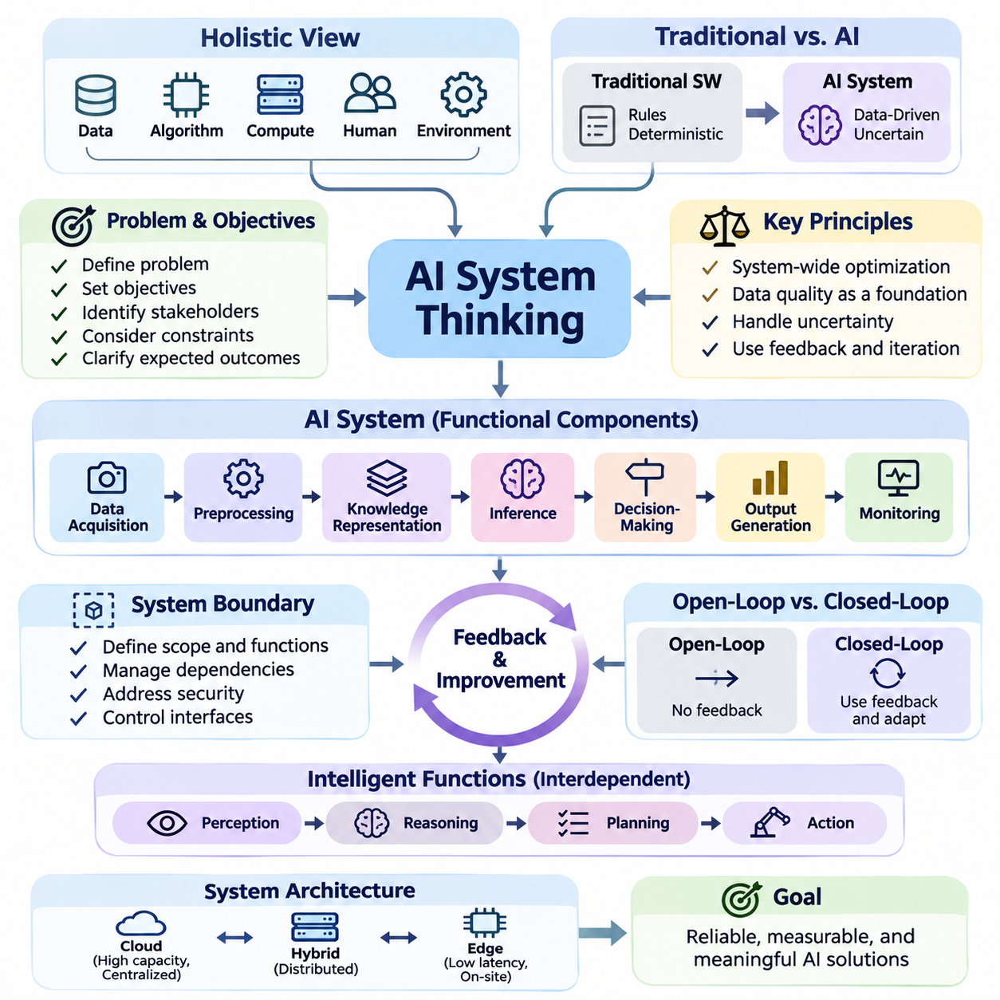
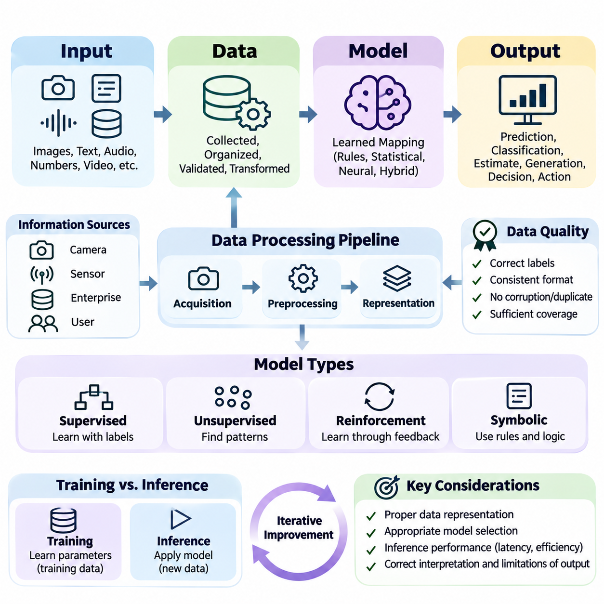
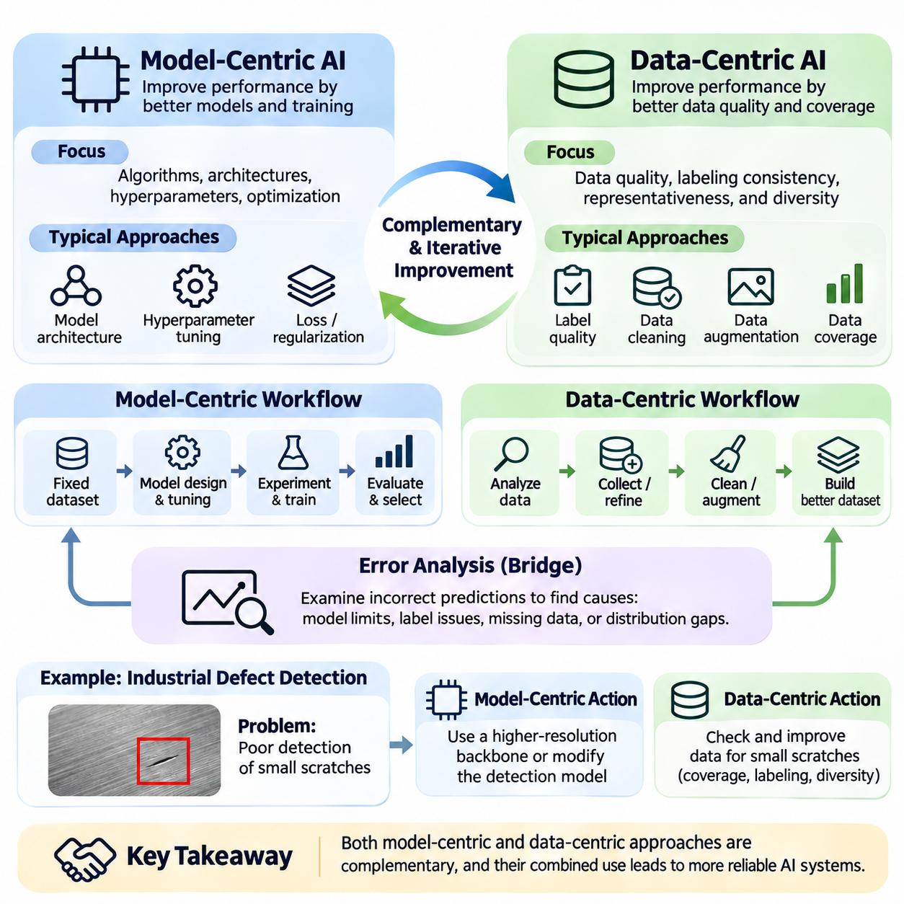
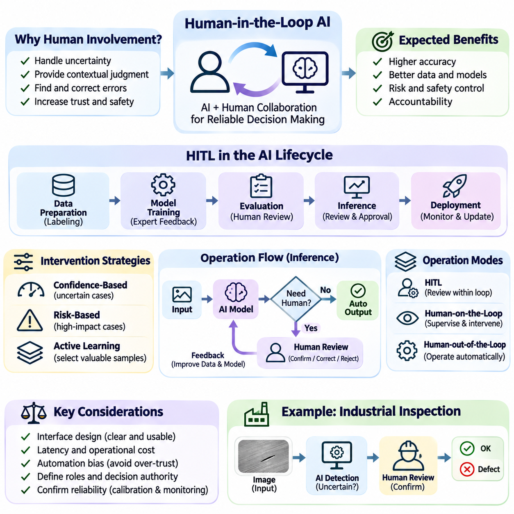
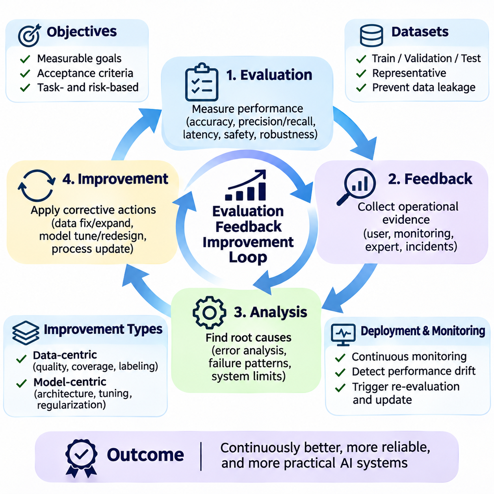
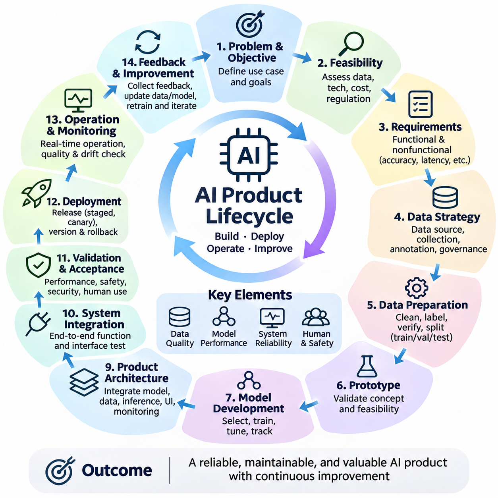
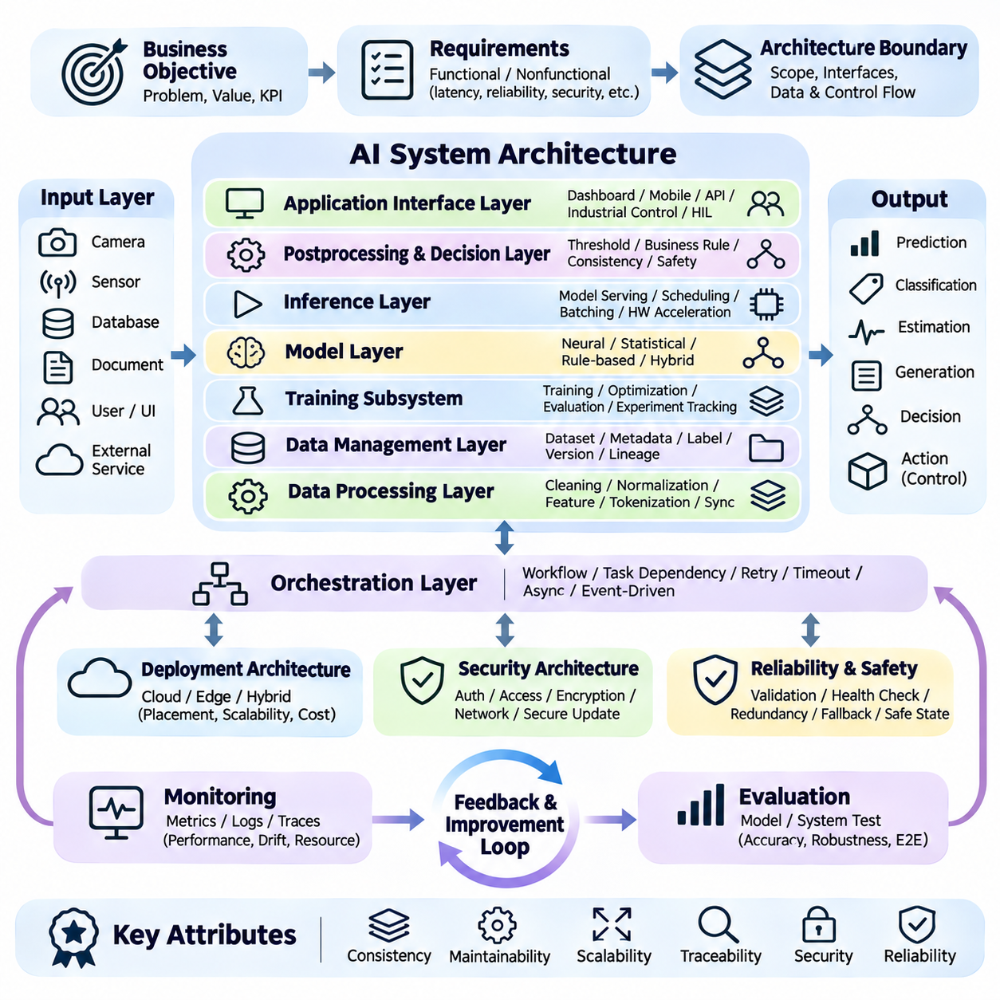
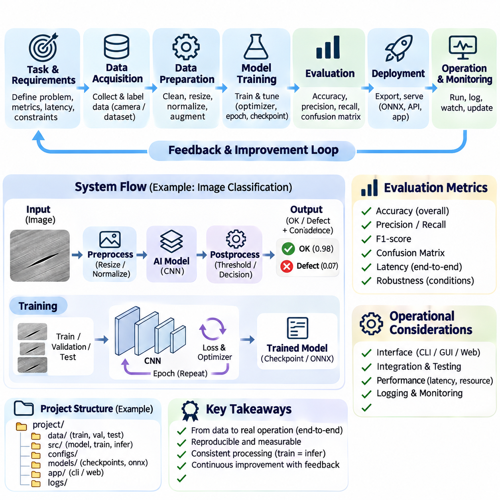

**Volume 04. Artificial Intelligence**

# 07. AI System Design Principles

## 07.00 AI System Thinking

{width="7.268055555555556in" height="7.268055555555556in"}

Artificial Intelligence system thinking is a holistic approach to designing intelligent solutions by considering the relationships among data, algorithms, computational resources, human users, and operational environments. Rather than treating an AI model as an isolated component, this perspective examines how interconnected elements cooperate to achieve reliable, measurable, and meaningful system-level objectives.

Traditional software engineering often relies on explicitly defined rules and deterministic execution paths. AI systems introduce additional complexity because their behavior depends on training data, statistical learning, environmental conditions, and uncertain predictions. System thinking recognizes these dependencies and emphasizes that successful AI development requires coordinated design across software, hardware, data, and organizational processes.

The starting point of AI system thinking is understanding the problem that the system must solve. Designers must identify operational objectives, stakeholders, environmental constraints, and expected outcomes before selecting algorithms or models. A technically sophisticated neural network may provide little practical value if its predictions do not address the actual problem or support an appropriate decision-making process.

An AI system can be understood as a collection of interacting functional components. These typically include data acquisition, preprocessing, knowledge representation, inference, decision-making, output generation, and monitoring. Each component transforms information or influences system behavior. The overall performance depends not only on individual component quality but also on the consistency and reliability of their interactions.

System boundaries establish which functions belong to the AI solution and which remain part of its external environment. A boundary may separate an AI service from enterprise databases, physical sensors, user interfaces, or external applications. Clearly defined boundaries help engineers establish responsibilities, manage dependencies, identify security risks, and determine where information and control signals cross organizational or technical interfaces.

One fundamental principle is that local optimization does not necessarily produce global improvement. Increasing model accuracy may require greater computational resources, introduce additional latency, or reduce operational flexibility. A larger model might perform better in laboratory benchmarks while producing worse results in a real-time application. System thinking therefore evaluates improvements against the performance of the complete solution.

Data quality represents a foundational system dependency because AI behavior is strongly influenced by the information available during training and inference. Incomplete observations, inconsistent labels, measurement errors, and unrepresentative samples can propagate through the entire processing pipeline. Consequently, data acquisition and validation must be treated as architectural responsibilities rather than preliminary tasks performed before model development.

The relationship between data and models is dynamic rather than strictly sequential. Model errors can reveal weaknesses in dataset coverage, while newly collected data may expose limitations in the model architecture. This interaction creates opportunities for iterative refinement. Effective system design supports repeated examination of data distributions, model behavior, operational failures, and the assumptions underlying the learning process.

AI systems also require careful consideration of uncertainty. Predictions may be affected by noisy measurements, incomplete knowledge, ambiguous inputs, or environmental changes. A system should distinguish between confident and uncertain outcomes whenever practical. Confidence estimation, uncertainty calibration, and conservative decision policies can help prevent unreliable predictions from producing inappropriate downstream actions.

Feedback is another defining characteristic of intelligent systems. An AI application receives information, generates predictions or actions, and may observe the consequences of those outputs. These observations can support performance evaluation and subsequent improvement. Feedback mechanisms become particularly important in autonomous systems, where decisions influence future environmental states and therefore affect the information available for subsequent reasoning.

A useful conceptual distinction exists between open-loop and closed-loop AI systems. Open-loop systems generate outputs without directly incorporating the consequences of those outputs into subsequent decisions. Closed-loop systems continuously observe results and adjust their behavior. Autonomous robots, adaptive control systems, and interactive AI agents frequently require closed-loop operation because their environments change during execution.

System thinking encourages the separation of perception, reasoning, planning, and action while recognizing their interdependence. Perception transforms raw observations into meaningful representations. Reasoning interprets relationships and evaluates possible explanations. Planning identifies suitable sequences of decisions, while action mechanisms execute selected operations. Effective coordination among these functions enables intelligent behavior beyond isolated prediction.

Architecture design must account for the location and distribution of computational resources. Cloud infrastructure can provide substantial processing capacity and centralized model management, while edge devices support low-latency inference and operation with limited connectivity. Hybrid architectures distribute responsibilities according to response-time requirements, bandwidth limitations, privacy constraints, energy consumption, and operational reliability.

Resource constraints influence the practical feasibility of AI solutions. Memory capacity, processing throughput, storage bandwidth, power consumption, and communication delays can restrict model selection and deployment strategies. Engineers must evaluate these constraints early because architectural decisions made during development may become expensive to modify after integration with production infrastructure or physical equipment.

Real-time AI systems introduce additional timing requirements. A prediction is useful only when it arrives early enough to support the intended decision or action. Average inference latency alone may be insufficient for evaluating time-sensitive applications. Engineers must also consider worst-case execution behavior, scheduling delays, communication overhead, and the consequences of missing operational deadlines.

Reliability requires attention to both component failures and interactions between components. A model may produce accurate predictions while the complete system fails because of sensor disconnections, corrupted inputs, network interruptions, or unavailable services. Fault detection, graceful degradation, redundancy, and recovery procedures help maintain acceptable behavior when individual elements cannot operate normally.

Human participation remains essential in many AI applications. Users establish objectives, interpret results, correct errors, and provide contextual knowledge that automated systems may lack. System thinking considers human interaction as an architectural component rather than an external afterthought. Interface clarity, appropriate explanations, intervention mechanisms, and responsibility boundaries influence whether AI outputs can be used effectively.

Safety and security must be incorporated throughout the system architecture. AI components may encounter adversarial inputs, unauthorized access attempts, unsafe recommendations, or unexpected environmental conditions. Protective mechanisms can include input validation, access controls, operational limits, independent safety checks, and secure communication. These measures should complement model-level safeguards rather than depend exclusively on learned behavior.

Evaluation must reflect the objectives and constraints of the complete application. Classification accuracy, prediction error, or language generation quality may describe model performance but cannot independently establish operational success. System-level assessment should also consider latency, reliability, resource utilization, robustness, maintainability, user satisfaction, and the consequences of incorrect decisions.

Trade-off analysis provides a structured way to compare alternative architectures. Improving accuracy may increase cost, while reducing latency may require smaller models or additional hardware. Greater autonomy may improve operational efficiency but increase the need for monitoring and safety controls. Engineers should make these relationships explicit and select configurations that satisfy the priorities of the intended application.

Modularity supports manageable development by separating system functions through well-defined interfaces. Individual components can be tested, replaced, or upgraded without redesigning the entire architecture when their interfaces remain compatible. However, modularity does not eliminate system dependencies. Engineers must verify that changes in one component do not introduce unexpected behavior elsewhere in the processing pipeline.

Observability enables engineers to understand how an AI system behaves during operation. Logging, performance metrics, prediction records, resource monitoring, and error reporting provide evidence for diagnosing failures. Effective observability should capture relevant system states while respecting privacy and storage constraints. Without sufficient operational visibility, performance degradation may remain undetected until it produces significant consequences.

AI system thinking also emphasizes lifecycle continuity. Requirements definition, data preparation, model development, integration, deployment, monitoring, and maintenance form an interconnected engineering process. Changes in operational conditions may require updated datasets, revised models, or modified interfaces. Sustainable AI solutions therefore need mechanisms for controlled updates, version management, validation, and rollback.

Consider an autonomous mobile robot operating inside a warehouse. Its intelligence cannot be evaluated solely through object detection accuracy or navigation algorithms. The robot must coordinate sensors, localization, path planning, motion control, battery management, communication, and safety mechanisms. A failure in any critical interaction may prevent successful operation even when individual AI components perform well.

A similar principle applies to enterprise AI assistants. Their effectiveness depends on document accessibility, retrieval quality, language understanding, authorization policies, response generation, and human verification. A powerful language model cannot compensate for missing business information or unreliable retrieval processes. The system must maintain consistency between user requests, available knowledge, generated responses, and permitted actions.

The central objective of AI system thinking is to transform isolated intelligent capabilities into dependable operational solutions. This requires continuous attention to interactions, constraints, uncertainty, feedback, and system-level outcomes. By approaching AI as an integrated engineering discipline, developers can create solutions that remain useful, adaptable, maintainable, and trustworthy beyond controlled experimental environments.

## 07.01 Input Data Model Output

{width="7.268055555555556in" height="7.268055555555556in"}

An artificial intelligence system can be understood through a fundamental processing relationship connecting input, data, model, and output. This structure explains how information enters an intelligent application, undergoes transformation, and produces meaningful results. Although modern AI architectures may contain many interconnected components, this relationship provides a practical foundation for understanding their operational behavior.

Input represents the information initially received by an AI system from users, sensors, databases, software applications, or external environments. Inputs may include images, text, audio signals, numerical measurements, video streams, or structured records. Their characteristics determine the processing requirements and influence which algorithms, representations, and computational resources are appropriate for the application.

The distinction between input and data is important because raw information is not necessarily suitable for direct model processing. Input describes information entering the system, while data represents information that has been collected, organized, validated, or transformed for computational use. An AI pipeline therefore frequently includes intermediate operations that convert heterogeneous inputs into consistent representations.

Data acquisition establishes the connection between information sources and the computational environment. Cameras capture visual observations, microphones record acoustic signals, industrial sensors measure physical conditions, and enterprise systems provide transactional records. Acquisition mechanisms must consider sampling frequency, measurement precision, communication reliability, synchronization, and the operational conditions under which information is collected.

Data preprocessing transforms acquired information into representations compatible with the selected AI model. Typical operations include normalization, resizing, filtering, tokenization, missing-value handling, and feature extraction. These transformations reduce irrelevant variation and establish consistent input formats. However, inappropriate preprocessing can remove useful information or introduce systematic errors that degrade subsequent predictions.

Data representation determines how information is expressed within a computational system. Numerical features may be organized into vectors, images into multidimensional tensors, language into token sequences, and relationships into graphs. The representation influences what patterns a model can recognize and how efficiently those patterns can be processed. Suitable representations preserve information relevant to the intended task.

Training data and inference data serve different purposes within the same architectural framework. Training data supports the estimation of model parameters through learning procedures, while inference data provides observations for generating predictions after training. Although both may undergo similar preprocessing, their distributions can differ. Such differences can reduce reliability when operational conditions depart from the training environment.

Data quality directly affects the information available to the model. Incorrect labels, corrupted measurements, inconsistent formatting, duplicated records, and insufficient coverage can introduce systematic weaknesses. A sophisticated learning algorithm cannot reliably recover information that is absent or fundamentally misleading. Effective AI engineering therefore treats data validation, consistency checking, and representative sampling as essential system functions.

The model represents the computational mechanism that transforms prepared data into predictions, classifications, estimates, generated content, or decisions. Depending on the application, it may consist of logical rules, statistical equations, decision trees, neural networks, or hybrid architectures. The model establishes a mapping between input representations and output variables according to learned parameters or explicitly defined knowledge.

In supervised machine learning, the model learns relationships between input examples and corresponding target values. Training procedures adjust model parameters to reduce a selected loss function, which measures disagreement between predictions and reference targets. Optimization algorithms iteratively improve these parameters. The resulting model approximates patterns present in the training data rather than memorizing every possible operating condition.

Not all AI models follow supervised learning. Unsupervised models discover structures or regularities without requiring explicit target labels, while reinforcement learning agents improve decision policies through interactions and feedback. Symbolic systems may apply predefined rules and logical inference. Despite these differences, each approach transforms available information into representations or outcomes that support an intended intelligent function.

Model inference is the process of applying an established computational model to new observations. During inference, prepared inputs pass through the model to generate outputs based on learned relationships or encoded rules. Inference requirements differ from training requirements because operational systems often prioritize response time, memory efficiency, availability, and predictable behavior rather than parameter optimization.

Output represents the result produced by the AI processing pipeline. Depending on the application, it may be a category label, probability distribution, numerical estimate, generated sentence, recommended action, or control command. Outputs should be interpreted according to their meaning and limitations. A probability score, for example, does not automatically establish that a prediction is correct or sufficiently reliable for action.

Postprocessing converts raw model results into forms suitable for downstream systems or human users. Classification scores may be converted into labels, object detections may undergo filtering, and generated text may be checked against formatting requirements. Postprocessing can also enforce operational constraints. Its design influences the final behavior of the application even when the underlying model remains unchanged.

The relationship between model output and system action requires careful distinction. A model may identify an obstacle, but another component must determine whether a robot should stop, slow down, or change direction. Similarly, a medical prediction may support professional assessment without independently determining treatment. System design must define which outputs are informational and which can influence consequential decisions.

An end-to-end AI pipeline connects information acquisition, preparation, model execution, result interpretation, and delivery into a coherent operational process. Each stage depends on assumptions about the preceding stage. Incorrect data formatting can invalidate model inputs, while inconsistent postprocessing can distort correct predictions. Interface specifications and validation procedures help preserve compatibility across the entire pipeline.

Consider an image classification application designed to identify defective manufactured products. A camera captures an image, preprocessing adjusts its dimensions and numerical representation, and a trained model estimates defect categories. Postprocessing converts model scores into inspection results. The final output may be displayed to an operator or transmitted to a production management system for further action.

A language-based AI application follows the same conceptual structure despite using different representations. A user submits a text request, the system converts the text into tokens, and a language model processes the resulting sequence. Generated tokens are decoded into readable language. Additional mechanisms may retrieve documents, validate outputs, or control tool access, extending the basic pipeline into a more capable system.

Real-time robotics illustrates the importance of temporal relationships among input, data, model, and output. Sensor observations must be acquired and processed within operational deadlines. Perception models estimate environmental conditions, while planning and control components translate relevant results into actions. Delayed or outdated information may produce inappropriate behavior even when individual predictions are statistically accurate.

System performance cannot be determined solely from model accuracy. Data transfer delays, preprocessing overhead, inference latency, postprocessing costs, and communication requirements contribute to total response time. Memory consumption and processing throughput also affect scalability. Engineers must therefore measure the complete pipeline under realistic workloads rather than relying exclusively on isolated model benchmarks.

Uncertainty can propagate through every processing stage. Sensor noise affects acquired inputs, preprocessing introduces approximation, and model predictions contain statistical or structural limitations. Output interpretation may introduce additional ambiguity. Reliable systems should identify significant uncertainty sources and implement appropriate confidence estimation, validation, fallback procedures, or human review when necessary.

Data distribution changes present another important operational challenge. A model trained on daytime images may perform poorly under unfamiliar lighting conditions, while a language system may encounter terminology absent from its training examples. Monitoring input characteristics and output behavior helps identify distribution shifts. Corrective measures may include data updates, model adaptation, recalibration, or revised operating constraints.

Feedback mechanisms connect system outputs with subsequent evaluation and improvement. Observed outcomes can reveal prediction errors, inappropriate thresholds, or previously unidentified data patterns. These observations may support dataset refinement, model retraining, and changes to processing logic. However, operational feedback should be validated before incorporation into training to avoid reinforcing errors or introducing biased information.

The input-data-model-output relationship also provides a framework for assigning engineering responsibilities. Data engineers establish reliable acquisition and preparation processes, model developers design learning mechanisms, and system engineers integrate execution environments and interfaces. Operational teams monitor results and maintain deployment reliability. Clear responsibilities improve coordination while preserving awareness of shared system dependencies.

Ultimately, the input-data-model-output structure provides a foundational abstraction for understanding artificial intelligence systems. Its value lies in revealing how information quality, computational transformations, model behavior, and result interpretation jointly determine operational performance. By designing and evaluating these elements as an integrated pipeline, engineers can develop AI solutions that are reliable, efficient, maintainable, and appropriate for real-world applications.

## 07.02 Model Centric vs Data Centric AI

{width="7.268055555555556in" height="7.268055555555556in"}

Model-centric AI and data-centric AI represent two complementary approaches to improving artificial intelligence systems. Model-centric development primarily focuses on algorithms, architectures, and parameter optimization, while data-centric development emphasizes the quality, consistency, and representativeness of information used for learning. Understanding their differences helps engineers identify the most effective opportunities for improving system performance.

Traditional machine learning research has frequently adopted a model-centric perspective. Developers select datasets, establish evaluation procedures, and compare alternative learning algorithms under relatively fixed data conditions. Improvements may result from deeper neural networks, modified architectures, advanced optimization methods, or carefully tuned hyperparameters. This approach supports controlled experimentation and systematic comparison of computational techniques.

A model-centric workflow typically begins with a defined dataset and a target performance objective. Engineers investigate model capacity, feature extraction mechanisms, loss functions, regularization strategies, and training configurations. By modifying these elements, they attempt to improve predictive performance while preserving the underlying data. The effectiveness of this strategy depends on whether the dataset adequately represents the intended problem.

Model architecture plays an important role in determining which patterns an AI system can learn. Convolutional neural networks exploit spatial relationships in images, transformers model interactions through attention mechanisms, and graph neural networks process relational structures. Selecting an appropriate architecture can substantially improve performance when the model\'s computational assumptions align with the characteristics of the available information.

Hyperparameter optimization is another important model-centric technique. Learning rates, batch sizes, network depth, regularization coefficients, and optimization schedules influence training behavior. Systematic experimentation can identify configurations that improve convergence, generalization, or computational efficiency. However, extensive tuning cannot reliably compensate for fundamentally incorrect labels or missing information within the training dataset.

Data-centric AI shifts attention toward the information used to construct and evaluate intelligent models. Rather than assuming that a dataset is fixed and sufficiently reliable, this approach treats data as an engineering asset requiring continuous improvement. Developers examine collection procedures, labeling consistency, sampling strategies, data distributions, and validation rules to identify weaknesses that limit model performance.

The quality of training labels is particularly important in supervised learning. Incorrect or inconsistent annotations introduce conflicting learning signals that can prevent a model from discovering meaningful relationships. For example, if visually similar manufacturing defects receive different labels without a clear annotation policy, the model may learn unstable decision boundaries. Consistent labeling guidelines and systematic review can reduce these problems.

Data representativeness determines whether training examples adequately reflect the conditions encountered during deployment. A computer vision system trained primarily on clear daytime images may struggle with nighttime scenes, reflections, or adverse weather. Data-centric development identifies these coverage gaps and improves the dataset through targeted collection, balanced sampling, or carefully validated augmentation.

Dataset diversity must be evaluated in relation to the intended application rather than treated as an unlimited objective. Adding unrelated examples may increase dataset size without improving useful coverage. Effective data-centric engineering focuses on meaningful variations in operating conditions, object characteristics, environmental states, and rare events. The objective is to capture the information necessary for reliable generalization.

Data cleaning is a foundational activity in data-centric development. Duplicate records, corrupted samples, inconsistent units, missing values, and incorrectly formatted observations can distort learning and evaluation. Cleaning procedures should preserve valid variation while removing genuine errors. Excessive filtering may eliminate difficult but important examples, creating an artificially simplified dataset that fails to represent real operational conditions.

Data augmentation expands the range of training examples through controlled transformations. Image rotation, cropping, illumination adjustment, and noise injection may improve robustness when they preserve task-relevant information. Text augmentation and synthetic data generation can serve similar purposes in other domains. However, transformations must respect semantic meaning and physical constraints to avoid introducing misleading training examples.

Error analysis provides a practical connection between model-centric and data-centric improvement. Engineers examine incorrect predictions to determine whether failures arise from insufficient model capacity, ambiguous labels, missing training examples, or distribution differences. Grouping errors by environmental condition, object category, or input characteristics can reveal systematic weaknesses that aggregate accuracy metrics conceal.

Consider an industrial defect detection system that performs poorly on small surface scratches. A model-centric response might introduce a higher-resolution backbone or modify detection architecture. A data-centric response would investigate whether small scratches are sufficiently represented and consistently annotated. Both approaches may be necessary, but identifying the actual source of failure prevents unnecessary computational complexity.

Data-centric development also emphasizes dataset versioning and traceability. Changes to labels, sampling policies, preprocessing procedures, or collection sources can alter model behavior. Maintaining documented dataset versions allows engineers to reproduce experiments and distinguish improvements caused by data modifications from those caused by algorithmic changes. This discipline supports reliable comparisons and controlled deployment.

The relationship between dataset size and dataset quality requires careful interpretation. Larger datasets often provide broader statistical coverage, but additional examples do not automatically improve learning. Repeated samples, systematic bias, or inaccurate labels may contribute limited value or introduce additional problems. A smaller, carefully curated dataset can sometimes outperform a larger dataset containing substantial inconsistencies.

Model-centric and data-centric approaches also differ in how engineering resources are allocated. Model-centric work often requires specialized algorithm expertise, computational experimentation, and training infrastructure. Data-centric work may require domain experts, annotation systems, acquisition equipment, and quality assurance processes. The optimal investment depends on the current limitations of the system and the cost of addressing them.

Evaluation design is essential for comparing the effectiveness of both approaches. Improvements should be measured using representative validation and test datasets that remain independent of training modifications. Changing evaluation data without maintaining comparable reference conditions can produce misleading conclusions. Reliable experimentation requires clear separation between training improvements and the measurements used to establish their effectiveness.

Data leakage presents a significant risk in both development strategies. Information from validation or test datasets may unintentionally influence training through duplicated samples, preprocessing decisions, or repeated experimental selection. Such leakage can produce optimistic performance estimates that fail during deployment. Dataset partitioning, provenance tracking, and disciplined evaluation procedures help preserve the validity of reported results.

Data-centric AI becomes particularly valuable when operational environments evolve. New equipment, changing sensor characteristics, seasonal conditions, or emerging user behaviors can alter input distributions. Monitoring deployed systems helps identify these changes and determine whether additional data collection or annotation updates are required. Model adaptation may follow, but effective improvement begins with understanding the changed information environment.

Human expertise contributes significantly to data-centric development. Domain specialists can identify ambiguous cases, define meaningful labels, recognize unusual operating conditions, and evaluate whether synthetic examples remain realistic. Their knowledge helps establish consistent annotation standards and appropriate quality criteria. Human review is especially important when automated labeling tools produce uncertain or potentially misleading results.

The two approaches should not be interpreted as competing philosophies requiring exclusive selection. A strong model cannot compensate for fundamentally inadequate information, while excellent data cannot eliminate every limitation of an unsuitable model architecture. Effective AI engineering combines model selection, data quality management, systematic evaluation, and iterative refinement according to the specific causes of observed performance limitations.

An integrated improvement cycle begins by establishing a baseline model and evaluating its behavior on representative data. Engineers analyze errors, identify whether limitations originate primarily from the model or dataset, and implement targeted changes. Subsequent experiments measure the resulting improvements under controlled conditions. This process transforms development from uncontrolled experimentation into evidence-based engineering.

The central distinction between model-centric and data-centric AI concerns where improvement efforts are concentrated. Model-centric AI asks how computational mechanisms can learn more effectively from available information, while data-centric AI asks how the available information can be made more accurate, consistent, and useful. Their integration provides a balanced foundation for building reliable, adaptable, and maintainable artificial intelligence systems.

## 07.03 Human in the Loop AI

{width="7.268055555555556in" height="7.268055555555556in"}

Human-in-the-loop AI is an approach to artificial intelligence system design that integrates human judgment, supervision, and feedback into automated computational processes. Rather than treating intelligent models as completely independent decision makers, this approach establishes structured interactions between algorithms and human participants. Its primary objective is to combine computational efficiency with contextual understanding, accountability, and reliable decision making.

The importance of human participation arises from the limitations of statistical learning and automated reasoning. AI models may recognize complex patterns but struggle with unfamiliar situations, ambiguous information, or decisions requiring contextual knowledge. Human experts can interpret circumstances beyond the available training data and identify inappropriate predictions. Their involvement helps reduce the consequences of uncertainty and incomplete system understanding.

Human-in-the-loop systems can operate during data preparation, model training, evaluation, inference, and deployment. Human participation may involve labeling examples, correcting predictions, reviewing uncertain outputs, or authorizing consequential actions. The appropriate intervention point depends on the application, operational risk, and available expertise. Effective architectures define when human involvement is required and how decisions are communicated.

During supervised learning, human annotators frequently provide labels that establish the relationships a model is expected to learn. Annotation quality directly influences the reliability of the resulting predictions. Clear labeling instructions, consistent definitions, and review procedures reduce disagreement between annotators. When examples are ambiguous, expert adjudication can establish more dependable reference information for subsequent training.

Active learning provides a systematic method for selecting examples that benefit most from human annotation. Instead of labeling every available sample, the system identifies observations that are uncertain, informative, or poorly represented in the existing dataset. Human experts review these selected examples, and their annotations support subsequent model updates. This approach can reduce labeling costs when sample selection effectively identifies valuable information.

Human feedback can also improve generative AI systems. Evaluators may compare generated responses, identify factual errors, assess instruction compliance, or express preferences regarding usefulness and clarity. These judgments can inform supervised fine-tuning, preference modeling, or reinforcement learning procedures. However, human preferences are not always consistent, and evaluation criteria must be carefully defined to avoid introducing undesirable behavior.

At inference time, human-in-the-loop mechanisms allow people to review model outputs before they influence important decisions. An industrial inspection system may flag uncertain defects for operator confirmation, while a financial application may require analyst approval for exceptional transactions. Such arrangements preserve automation for routine cases while introducing additional oversight when prediction errors could have significant consequences.

Confidence-based intervention is a common design strategy. The system estimates prediction confidence or uncertainty and routes selected cases to human reviewers when predefined criteria are satisfied. However, confidence scores are not automatically reliable indicators of correctness. Calibration, threshold validation, and operational monitoring are necessary to determine whether intervention rules effectively identify situations requiring human judgment.

Risk-based intervention extends beyond confidence estimation by considering the consequences of incorrect decisions. A moderately uncertain recommendation involving minimal consequences may be acceptable, while a highly confident prediction affecting physical safety may still require independent verification. Effective oversight policies therefore combine uncertainty, potential harm, operational context, and regulatory requirements when determining human involvement.

Human-on-the-loop AI differs from direct human-in-the-loop operation by emphasizing supervisory monitoring rather than approval of individual decisions. Automated systems execute tasks while human operators observe performance and intervene when necessary. Human-out-of-the-loop operation allows greater independence within defined boundaries. These arrangements represent different levels of operational authority rather than universally superior or inferior architectures.

Interface design strongly influences the effectiveness of human oversight. Reviewers need access to relevant observations, model recommendations, uncertainty indicators, and the reasons a case requires attention. Poorly organized interfaces can increase cognitive workload and delay intervention. Effective interfaces present essential information clearly while supporting confirmation, correction, rejection, and escalation without unnecessary complexity.

Human participation introduces additional latency and operational costs. Review queues may grow when model uncertainty increases or staffing becomes insufficient. System designers must consider expected case volumes, reviewer availability, response deadlines, and escalation procedures. In time-sensitive applications, waiting indefinitely for human approval may be unacceptable, requiring predefined safe fallback behavior when intervention cannot occur promptly.

Automation bias presents a significant challenge because users may place excessive trust in algorithmic recommendations. Repeated exposure to accurate predictions can encourage reviewers to accept outputs without sufficient examination. Conversely, unreliable systems may cause users to disregard valuable recommendations. Training, interface design, independent evidence, and appropriate responsibility allocation help maintain meaningful human judgment.

Human expertise is not uniform, and reviewers may disagree because of different backgrounds, interpretations, or incomplete information. Reliable human-in-the-loop systems establish qualification requirements, annotation standards, disagreement resolution procedures, and quality monitoring. Periodic audits can identify inconsistent decisions or systematic bias. Human oversight should be evaluated as a component of the complete system rather than assumed to be inherently accurate.

Feedback collection requires careful management because human corrections may become training data for future model versions. Incorrect corrections, inconsistent judgments, or selectively reviewed cases can introduce new biases. Feedback pipelines should preserve provenance, reviewer decisions, contextual information, and validation status. Controlled incorporation of verified feedback supports improvement without automatically reinforcing unreliable observations.

In autonomous robotics, human-in-the-loop mechanisms can support remote assistance, mission approval, and recovery from exceptional conditions. A mobile robot may perform navigation autonomously but request operator guidance when encountering an unfamiliar obstacle or blocked passage. The operator provides contextual interpretation while the robot retains responsibility for executing commands within verified safety constraints.

Industrial AI systems frequently combine automated inspection with human verification. A vision model may classify products as acceptable, defective, or uncertain, while trained inspectors examine ambiguous cases. Confirmed inspection results can improve subsequent training datasets and reveal previously unrecognized defect patterns. The resulting workflow combines high-throughput automated processing with specialized human knowledge.

Human-in-the-loop principles also apply to language-based AI assistants. Users may review generated documents, verify retrieved evidence, approve external actions, or correct inaccurate responses. Systems that interact with databases, communication platforms, or operational tools should distinguish information generation from authorized execution. Human confirmation becomes especially important when actions are difficult to reverse or affect other people.

Accountability requires explicit assignment of decision authority and operational responsibility. Organizations must determine which decisions can be automated, which require approval, and who can override system recommendations. Audit records should document relevant model outputs, human interventions, and final actions. Such traceability supports incident investigation, compliance assessment, and continuous improvement of operational procedures.

Privacy and security considerations remain important when humans access sensitive model inputs or outputs. Review workflows should apply role-based permissions, data minimization, secure communication, and appropriate retention policies. Human involvement does not automatically eliminate security risks. Additional access pathways may create vulnerabilities unless oversight mechanisms are designed within the broader security architecture.

Evaluation of human-in-the-loop AI must consider both algorithmic and human performance. Relevant measures include prediction accuracy, intervention frequency, reviewer agreement, correction quality, decision latency, workload, and final operational outcomes. Comparing automated decisions with reviewed decisions helps determine whether human participation provides measurable benefits. Evaluation should also identify situations where intervention introduces errors or unnecessary delays.

An effective human-in-the-loop architecture is adaptive rather than permanently dependent on fixed intervention rates. As model performance improves, routine cases may require less manual review, while emerging failure patterns may justify increased supervision. Changes in operating conditions, reviewer expertise, or system risk should trigger reassessment of intervention policies. The objective is appropriate human control, not simply maximizing or minimizing human participation.

Ultimately, human-in-the-loop AI establishes a collaborative relationship between machine intelligence and human expertise. Automated models provide scalable pattern recognition and computational consistency, while human participants contribute contextual reasoning, ethical judgment, and responsibility for consequential decisions. Carefully designed feedback, oversight, and evaluation mechanisms allow these capabilities to complement one another, supporting safer and more dependable AI systems.

## 07.04 Evaluation Feedback Improvement Loop

{width="7.268055555555556in" height="7.268055555555556in"}

The evaluation, feedback, and improvement loop is a fundamental mechanism for maintaining and advancing artificial intelligence system performance. It connects performance measurement with operational observations and systematic corrective actions. Rather than treating model development as a one-time activity, this approach establishes a continuous process in which evidence from testing and deployment guides subsequent improvements.

Evaluation determines whether an AI system satisfies its intended objectives under defined operating conditions. These objectives may involve prediction accuracy, response latency, reliability, robustness, safety, or user satisfaction. Effective evaluation begins with measurable requirements and clearly specified acceptance criteria. Without explicit objectives, numerical results may appear impressive while providing limited evidence of practical usefulness.

A reliable evaluation framework distinguishes model-level performance from system-level performance. Model-level assessment examines predictive behavior using metrics such as accuracy, precision, recall, or prediction error. System-level assessment considers the complete processing pipeline, including data acquisition, preprocessing, inference, postprocessing, and output delivery. Both perspectives are necessary to identify the actual causes of operational limitations.

Evaluation datasets must represent the conditions under which the system is expected to operate. Training, validation, and test datasets should serve distinct purposes to prevent misleading conclusions. Training data supports parameter learning, validation data guides development decisions, and independent test data estimates performance on unseen examples. Careful partitioning and leakage prevention are essential for trustworthy comparisons.

Metric selection should reflect the consequences of different types of errors. In industrial inspection, failing to identify a defective product may be more costly than incorrectly flagging an acceptable product. In autonomous navigation, missed obstacles may create significant safety risks. Precision, recall, false-positive rates, and false-negative rates therefore provide complementary information that a single accuracy value cannot fully express.

Baseline evaluation establishes a reference point against which subsequent improvements can be measured. A baseline may use a simple statistical model, an established neural network, or an existing production system. Its purpose is not necessarily to achieve the highest performance but to provide a reproducible comparison. Consistent datasets, metrics, hardware conditions, and evaluation procedures make improvement claims more credible.

Feedback represents information obtained from observed system behavior and its consequences. It may originate from automated monitoring, user corrections, expert reviews, environmental measurements, or operational incident reports. Feedback can identify prediction failures, unexpected input patterns, usability problems, and system integration weaknesses. Its value depends on accuracy, relevance, and the ability to connect observations with specific system conditions.

Feedback collection should preserve sufficient context to support meaningful analysis. A prediction error is more informative when associated with the original input, model version, confidence score, processing configuration, and operating environment. Structured logging and traceability allow engineers to reconstruct events and identify recurring failure patterns. Sensitive information must be protected through appropriate access controls and retention policies.

Error analysis converts evaluation results into actionable engineering knowledge. Rather than examining only aggregate performance scores, engineers categorize failures according to input characteristics, environmental conditions, model behavior, or processing stages. This analysis distinguishes isolated mistakes from systematic weaknesses. Repeated failures under particular conditions often reveal opportunities for targeted data collection or architectural modification.

The improvement stage translates identified weaknesses into controlled corrective actions. Potential interventions include correcting labels, expanding dataset coverage, modifying preprocessing, adjusting decision thresholds, retraining models, or redesigning system components. Each intervention should address a documented problem and include a measurable hypothesis. Uncontrolled simultaneous changes make it difficult to determine which modification produced an observed improvement.

Data-centric improvements focus on the quality and representativeness of information used by the system. Engineers may remove corrupted samples, resolve inconsistent annotations, collect examples from underrepresented environments, or revise data validation rules. These actions can improve model generalization without increasing architectural complexity. However, changes to training data must be evaluated for unintended effects on previously reliable operating conditions.

Model-centric improvements modify the computational mechanisms responsible for learning and inference. Engineers may select different architectures, tune hyperparameters, revise loss functions, or apply regularization techniques. Such changes can improve predictive capability but may also increase computational cost or inference latency. Improvement decisions should therefore consider system constraints rather than optimizing isolated model metrics.

The feedback loop becomes continuous when deployed systems are monitored throughout their operational lifetime. Input distributions, prediction confidence, error frequencies, processing latency, and resource consumption can reveal gradual performance degradation. Monitoring thresholds may trigger investigation or alerts when unusual patterns emerge. Not every deviation requires retraining, so engineers must distinguish temporary fluctuations from persistent changes.

Data drift occurs when the statistical characteristics of operational inputs change over time. Concept drift occurs when the relationship between inputs and desired outputs changes. Both can undermine previously validated models, although their effects and remedies differ. Drift detection requires suitable reference distributions, monitoring windows, and statistical methods. Confirmed changes may justify additional data collection, recalibration, or model updates.

Human feedback provides contextual information that automated metrics may not capture. Domain experts can identify misleading predictions, ambiguous examples, inappropriate recommendations, or emerging operational requirements. User reports may reveal interface problems and unexpected usage patterns. However, human feedback can contain inconsistencies or biases, making verification and systematic aggregation necessary before it influences model training.

An effective improvement loop requires experimentation under controlled conditions. Candidate models or pipeline changes should be compared with established baselines using consistent evaluation criteria. Ablation studies can isolate the contribution of individual modifications, while repeated trials help assess variability. Statistical uncertainty should be considered when interpreting small performance differences, especially with limited evaluation samples.

Deployment introduces additional evaluation requirements because laboratory performance may not accurately predict production behavior. Shadow testing allows a candidate model to process operational inputs without controlling final decisions. Canary deployment exposes a limited portion of traffic or devices to a new version. These strategies provide evidence about real-world performance while limiting the consequences of unexpected failures.

Rollback mechanisms are essential when updated systems perform worse than expected. Versioned models, datasets, configurations, and deployment artifacts allow engineers to restore previously validated behavior. Release criteria should specify acceptable performance, safety constraints, and operational stability. A successful improvement process must support both forward progress and controlled recovery when new changes introduce unacceptable risks.

In autonomous robotics, the loop may begin with evaluating obstacle detection, localization accuracy, navigation success, and intervention frequency. Operational logs can reveal failures under poor lighting, reflective surfaces, or crowded conditions. Engineers then collect representative examples, modify perception or planning components, and repeat validation. Improvements must be verified at both component and mission levels before broader deployment.

Industrial inspection provides another practical example. Evaluation may reveal that small defects are frequently missed despite strong overall classification accuracy. Human inspectors confirm difficult cases, and their validated annotations support targeted dataset improvement. Updated models are tested against representative defect categories and production conditions. The objective is improved inspection reliability rather than merely increasing aggregate benchmark scores.

Governance ensures that evaluation and improvement activities remain accountable and reproducible. Organizations should document performance requirements, dataset changes, experiment results, model approvals, and deployment decisions. Clear responsibilities help prevent unverified modifications from entering production. Audit trails also support incident investigation, regulatory compliance, and communication between data engineers, model developers, and operational teams.

The improvement loop should optimize meaningful system outcomes rather than encourage endless numerical refinement. Additional accuracy may provide limited value if latency, cost, safety, or usability deteriorates. Engineering teams must balance predictive performance with operational constraints and organizational objectives. A successful iteration produces measurable benefits under realistic conditions without introducing unacceptable weaknesses elsewhere.

Ultimately, evaluation, feedback, and improvement form a closed-loop engineering discipline for artificial intelligence systems. Evaluation establishes evidence, feedback reveals operational realities, and improvement converts identified weaknesses into verified changes. Repeating this process enables systems to respond to changing environments, evolving requirements, and newly discovered limitations while maintaining reliability, traceability, and sustained practical value.

## 07.05 AI Product Lifecycle

{width="7.268055555555556in" height="7.268055555555556in"}

The AI product lifecycle describes the complete sequence of activities required to transform an artificial intelligence concept into a reliable, maintainable, and valuable operational product. Unlike conventional software development, AI products depend on data quality, statistical learning, model behavior, and changing operating conditions. Their lifecycle therefore integrates product engineering, data management, model development, deployment, and continuous improvement.

The lifecycle begins with problem identification and business objective definition. Organizations must determine which problem requires intelligent automation and whether AI offers meaningful advantages over conventional software. Expected outcomes should be expressed through measurable indicators such as productivity, accuracy, cost reduction, or service quality. Clear objectives prevent unnecessary model complexity and guide subsequent engineering decisions.

Feasibility assessment evaluates whether the proposed AI product can satisfy technical, economic, and operational requirements. Engineers examine available data, computational resources, integration constraints, expected performance, and development costs. They also consider privacy, safety, and regulatory obligations. A promising algorithm does not automatically justify product development if essential data or operational infrastructure is unavailable.

Requirements engineering translates product objectives into functional and nonfunctional specifications. Functional requirements define the expected intelligent capabilities, while nonfunctional requirements address latency, reliability, scalability, security, and maintainability. AI-specific requirements may include acceptable error rates, confidence thresholds, data coverage, and behavior under unfamiliar conditions. These specifications establish measurable acceptance criteria.

Data strategy determines how information will be acquired, governed, processed, and maintained throughout the product lifecycle. Engineers identify data sources, ownership, collection methods, annotation requirements, and storage policies. Dataset representativeness must reflect anticipated deployment conditions. Early attention to data availability and quality reduces the risk of discovering fundamental limitations after substantial model development.

Data preparation converts collected information into reliable assets for training and evaluation. Activities include cleaning, normalization, labeling, deduplication, quality verification, and dataset partitioning. Training, validation, and test datasets should remain appropriately separated to prevent leakage. Version control and provenance records preserve the ability to reproduce experiments and explain how dataset changes influence model behavior.

Prototype development tests whether the proposed intelligent capability is technically achievable. Engineers may use baseline algorithms, pretrained models, or simplified processing pipelines to establish initial feasibility. Prototypes should emphasize rapid learning rather than complete production functionality. Their results help identify missing data, unsuitable assumptions, computational limitations, and unexpected integration challenges.

Model development transforms validated data into predictive or generative capabilities. Engineers select architectures, define objective functions, configure optimization procedures, and train candidate models. Model-centric improvements address computational structure, while data-centric improvements address information quality and coverage. Experimental tracking supports comparison of alternative configurations and helps prevent unsupported performance claims.

Evaluation verifies whether candidate models satisfy defined requirements. Metrics should reflect the application, including accuracy, precision, recall, calibration, robustness, and computational efficiency. Independent test data provides evidence of generalization, while stress testing examines difficult operating conditions. Evaluation should identify not only average performance but also systematic failure patterns and unacceptable risks.

Product architecture integrates the model with surrounding software and infrastructure. Data ingestion, preprocessing, inference services, postprocessing, user interfaces, monitoring, and external integrations must operate coherently. Engineers determine whether processing occurs in cloud infrastructure, edge devices, or hybrid environments. Architectural decisions influence latency, cost, availability, privacy, and future scalability.

System integration transforms a successful model into a functioning application. Interfaces must handle data formats, communication failures, version compatibility, and operational constraints. Integration testing examines interactions that isolated model benchmarks cannot reveal. A model may perform accurately in laboratory experiments yet fail in production because of delayed inputs, inconsistent preprocessing, or unavailable downstream services.

Validation and acceptance testing establish whether the integrated product is ready for operational use. Testing should cover functional behavior, performance limits, failure recovery, security, and human interaction. High-risk applications may require independent safety assessment and documented approval procedures. Acceptance decisions must consider complete system outcomes rather than relying exclusively on model accuracy.

Deployment introduces the AI product into its intended operating environment. Release strategies may include staged rollout, shadow testing, canary deployment, and controlled activation. These methods allow engineers to observe real-world behavior while limiting exposure to unexpected failures. Deployment artifacts, model versions, configuration parameters, and rollback procedures should be recorded to support controlled recovery.

Machine learning operations, commonly called MLOps, provide practices for managing models and data across development and production. Automated pipelines may support data validation, training, testing, packaging, deployment, and monitoring. Continuous integration and delivery improve consistency, while model registries preserve version history. Automation reduces repetitive work but does not eliminate the need for engineering judgment.

Operational monitoring determines whether the deployed product continues to meet its objectives. Engineers observe prediction quality, input distributions, inference latency, resource utilization, service availability, and user feedback. Monitoring must distinguish temporary fluctuations from persistent degradation. Structured logs and alerts help teams investigate failures before they produce widespread operational consequences.

Model performance can deteriorate when operating conditions change. Data drift alters the statistical characteristics of inputs, while concept drift changes relationships between inputs and expected outputs. New equipment, user behavior, environmental conditions, or business processes may invalidate earlier assumptions. Detecting these changes supports decisions about recalibration, data collection, retraining, or architectural modification.

Feedback management connects production observations with subsequent development activities. Users, operators, domain experts, and automated monitoring systems can identify errors or improvement opportunities. Feedback should be verified, categorized, and associated with relevant model and data versions. Uncontrolled incorporation of operational feedback may reinforce incorrect labels or introduce bias, making governance essential.

Maintenance includes corrective, adaptive, and preventive activities. Corrective maintenance resolves identified defects, adaptive maintenance addresses changing environments, and preventive maintenance reduces future failure risks. AI maintenance may require dataset updates, model retraining, software patches, or hardware adjustments. Each modification should undergo appropriate validation before replacing a previously approved version.

Lifecycle governance establishes responsibility for decisions affecting product quality and safety. Organizations should document data ownership, model approvals, security controls, evaluation evidence, and deployment authorization. Audit trails support accountability and incident investigation. Governance also clarifies when human review is required and how exceptional conditions should be escalated to responsible personnel.

Cost management must consider the entire lifecycle rather than initial model development alone. Data collection, annotation, training computation, inference infrastructure, monitoring, maintenance, and expert review all contribute to total ownership cost. Larger models may improve predictive capability while increasing operational expenditure. Product decisions should balance measurable benefits against sustainable resource requirements.

AI products also require continuous attention to user experience and organizational adoption. Accurate predictions provide limited value if interfaces are confusing or workflows do not support practical decisions. Human-centered design should clarify system capabilities, uncertainty, intervention procedures, and responsibility boundaries. User training and feedback mechanisms help organizations incorporate intelligent functions into established operations.

Product evolution may introduce new features, expanded operating environments, or additional model capabilities. Such changes require reassessment of data coverage, architecture, evaluation criteria, and operational risks. Previously validated performance cannot automatically be assumed to remain valid after substantial modifications. Controlled experimentation and staged deployment help preserve reliability during product expansion.

Eventually, an AI product may require replacement or retirement because of technological obsolescence, changing requirements, excessive maintenance costs, or unacceptable risks. Retirement planning should address data retention, model artifacts, dependent services, user migration, and security obligations. Responsible decommissioning prevents abandoned components from creating operational vulnerabilities or unresolved organizational dependencies.

Ultimately, the AI product lifecycle is an iterative engineering framework rather than a strictly linear development sequence. Requirements, data, models, deployment, and feedback continuously influence one another. Successful lifecycle management combines technical validation, operational monitoring, organizational governance, and controlled improvement. This integrated approach enables AI products to deliver sustained value while remaining reliable, adaptable, and accountable.

## 07.06 AI System Architecture Template

{width="7.268055555555556in" height="7.268055555555556in"}

An AI system architecture template provides a reusable engineering framework for organizing the components, interfaces, and operational processes of an artificial intelligence application. It translates business objectives into a structured technical design that connects data, models, computation, and decision making. A well-defined template improves consistency, maintainability, scalability, and traceability across different AI products.

The architecture begins with a clear definition of system objectives, operating conditions, and performance requirements. Designers identify the intended users, expected inputs, required outputs, and decisions supported by the system. Functional requirements describe intelligent capabilities, while nonfunctional requirements specify latency, availability, security, reliability, and resource constraints. These requirements guide architectural boundaries.

The input layer acquires information from sources such as databases, cameras, sensors, documents, user interfaces, and external services. Each source introduces particular formats, sampling rates, reliability characteristics, and access restrictions. The architecture must define input contracts, acquisition methods, timestamps, and validation rules. Reliable input handling prevents corrupted or inconsistent information from propagating downstream.

The data processing layer transforms raw inputs into representations suitable for machine learning and reasoning. Typical operations include cleaning, normalization, filtering, feature extraction, tokenization, and temporal synchronization. Processing logic must remain consistent between training and inference environments. Versioned transformations and explicit data schemas reduce integration errors and support reproducible behavior.

A data management layer organizes datasets, metadata, labels, and historical observations. Storage systems may include relational databases, object stores, time-series databases, or vector indexes, depending on application requirements. Dataset lineage and version control establish relationships between source records and model training artifacts. Access permissions and retention policies protect sensitive information throughout its lifecycle.

The model layer contains the computational components responsible for prediction, classification, generation, or decision support. Models may include neural networks, statistical estimators, rule-based engines, or combinations of these techniques. Architectural specifications should identify model inputs, outputs, dependencies, versions, and resource requirements. Model interfaces should remain stable enough to support controlled replacement and experimentation.

The training subsystem manages model development using curated datasets and reproducible configurations. It defines training objectives, optimization procedures, evaluation checkpoints, and experiment tracking. Training may occur on local accelerators, distributed clusters, or cloud infrastructure. Separation between training and production inference reduces operational interference while allowing validated model versions to enter deployment pipelines.

The inference layer executes trained models against operational inputs and produces outputs within specified performance limits. Its design includes model loading, request scheduling, batching, hardware acceleration, and resource allocation. Real-time applications may prioritize predictable latency, while offline analytics may emphasize throughput. Inference services should expose documented interfaces and handle invalid requests or unavailable resources safely.

The postprocessing and decision layer converts model outputs into information or actions relevant to the application. It may apply confidence thresholds, business rules, consistency checks, or safety constraints. A classification score may become an inspection alert, while a perception result may inform a robot planning module. Separating prediction from decision logic improves explainability and supports independent validation of operational policies.

The application interface layer connects AI capabilities with users and external systems. Interfaces may include dashboards, mobile applications, APIs, industrial controllers, or robotic middleware. They should communicate predictions, uncertainty, system status, and required interventions clearly. Human-in-the-loop mechanisms can provide approval, correction, and escalation when automated decisions require additional oversight.

An orchestration layer coordinates interactions among data services, models, decision components, and external applications. It manages workflow execution, task dependencies, retries, timeouts, and asynchronous communication. Event-driven architectures are useful when information arrives continuously from distributed sources. Explicit orchestration policies prevent hidden dependencies and improve recovery from partial failures.

Deployment architecture determines where computation and storage are physically located. Cloud systems offer elastic resources and centralized management, while edge systems reduce communication latency and dependence on remote connectivity. Hybrid architectures distribute workloads according to privacy, bandwidth, cost, and timing constraints. Placement decisions should account for network failures and the availability of essential local functions.

Security architecture protects data, models, infrastructure, and communication pathways. Authentication, authorization, encryption, network segmentation, and secure software updates establish important defensive controls. AI-specific risks include data poisoning, adversarial inputs, model extraction, and unauthorized access to generated information. Security requirements should be integrated into component design rather than added after deployment.

Reliability and safety mechanisms define how the system responds to faults, uncertainty, and unexpected conditions. Input validation, health checks, redundancy, watchdogs, and fallback procedures help maintain controlled operation. Safety-critical systems may require independent monitoring and emergency intervention capabilities. Failure handling must specify whether the system continues with reduced functionality, requests assistance, or enters a safe state.

The monitoring layer collects operational evidence about model behavior and system health. Important measurements include prediction quality, input distributions, latency, throughput, memory utilization, device temperature, and service availability. Logs, metrics, and traces support incident diagnosis and performance analysis. Monitoring policies should distinguish normal variability from persistent degradation or emerging failure patterns.

A feedback and improvement layer connects operational observations with model and system development. User corrections, expert reviews, incident reports, and automated evaluations identify opportunities for improvement. Verified feedback can support dataset updates, model retraining, or architectural modifications. Changes should pass controlled validation before deployment to prevent unverified feedback from degrading previously reliable behavior.

The evaluation subsystem verifies whether individual components and the integrated architecture satisfy requirements. Model evaluation examines predictive accuracy and robustness, while integration testing checks communication, data consistency, and workflow behavior. System testing measures end-to-end latency, resource consumption, recovery capability, and operational outcomes. Acceptance criteria should be established before final deployment decisions.

Versioning and configuration management provide traceability across datasets, models, software components, and infrastructure. A deployed prediction should be attributable to the relevant model version, processing configuration, and input context when permitted by privacy requirements. Model registries and deployment manifests support controlled releases and rollback. Reproducibility becomes particularly important when multiple teams maintain interconnected components.

Architectural scalability depends on identifying bottlenecks and defining appropriate expansion strategies. Stateless inference services may scale horizontally, while specialized accelerators can improve computational throughput. Data pipelines may require partitioning, buffering, or distributed processing. Scaling decisions must consider communication overhead, storage performance, synchronization, and operational cost rather than model computation alone.

For an industrial visual inspection application, the template connects cameras, image preprocessing, defect detection models, decision rules, operator interfaces, and production databases. Image quality checks precede inference, while uncertain classifications may require human confirmation. Inspection outcomes are recorded for traceability and future model improvement. This example demonstrates how independent architectural layers cooperate within a unified workflow.

For autonomous robotics, the architecture integrates perception sensors, localization, world representation, planning, control, and supervisory interfaces. Real-time processing may occur on embedded accelerators, while fleet management and historical analysis operate on centralized infrastructure. Safety monitoring must remain effective during communication loss. Clear interfaces separate intelligent decision making from deterministic actuator control and emergency protection.

Architectural documentation should describe component responsibilities, interface contracts, data flows, deployment boundaries, and operational assumptions. It should also record performance budgets, failure scenarios, security controls, and ownership of critical functions. These descriptions enable engineers to evaluate tradeoffs and coordinate implementation. Documentation must evolve alongside the system to remain an accurate representation of deployed behavior.

A reusable architecture template should support adaptation without imposing unnecessary complexity. Small applications may combine several logical layers within a single service, while enterprise or robotic systems may distribute them across multiple computing nodes. The essential principle is separation of responsibilities rather than mandatory physical separation. Architectural decisions should follow measurable requirements and realistic operational constraints.

Ultimately, an AI system architecture template provides a disciplined connection between intelligent algorithms and dependable products. Its value comes from explicit interfaces, controlled data flows, measurable requirements, and integrated operational safeguards. By combining data engineering, model development, inference, orchestration, monitoring, and governance, the template supports AI systems that remain understandable, adaptable, secure, and reliable throughout their lifecycle.

## 07.07 Simple End to End AI System [w/Code]

{width="7.268055555555556in" height="7.268055555555556in"}

A simple end-to-end AI system demonstrates how data, machine learning, inference, and application logic work together to solve a practical problem. Unlike isolated algorithm experiments, an end-to-end system connects every processing stage from raw input to usable output. Its purpose is to establish a complete, reproducible workflow that can be evaluated, deployed, monitored, and improved through systematic engineering practices.

The system begins with a clearly defined task and measurable success criteria. A basic image classification application, for example, may distinguish acceptable products from defective products using camera images. Its inputs are digital images, while its outputs are predicted categories and confidence scores. Requirements should specify expected accuracy, processing latency, supported image formats, and acceptable operational limitations.

Data acquisition establishes the foundation of the system. Images may originate from cameras, public datasets, or previously collected inspection records. Each sample should have an associated label representing the correct category. Reliable collection requires consistent image formats, sufficient variation, and accurate annotations. Dataset documentation should describe acquisition conditions, labeling procedures, and known limitations.

Data preparation converts collected samples into consistent model inputs. Images are resized to a common resolution, converted into numerical tensors, and normalized according to the selected model requirements. Invalid files and duplicate records should be identified before training. Data augmentation may introduce controlled variations in brightness, orientation, or scale to improve generalization without changing the intended class meaning.

The dataset is divided into training, validation, and test subsets. Training samples support parameter optimization, validation samples guide development decisions, and test samples provide an independent performance estimate. Splitting should prevent related images from appearing across different subsets when this would cause information leakage. Fixed random seeds and documented partition rules improve experimental reproducibility.

A baseline model provides an initial implementation of the learning component. For image classification, a compact convolutional neural network can extract visual patterns through successive convolution and pooling operations. A final classification layer converts learned features into category scores. Starting with a simple architecture makes computational requirements manageable and provides a reference for evaluating later improvements.

The training process adjusts model parameters to reduce prediction errors on labeled examples. Each training iteration performs a forward pass, calculates a loss function, computes gradients through backpropagation, and updates parameters using an optimizer. Training proceeds across multiple epochs while validation performance is monitored. Checkpointing preserves selected model states for subsequent evaluation and deployment.

Evaluation determines whether the trained model performs adequately on unseen data. Classification accuracy measures overall correctness, while precision, recall, and confusion matrices reveal different error patterns. Performance should also be examined across lighting conditions, object sizes, and image quality variations. A model that achieves high average accuracy may still fail consistently on rare but operationally important examples.

After evaluation, the selected model is exported as a versioned artifact containing learned parameters and required configuration information. Deployment preparation must preserve the preprocessing operations used during training. Model serialization formats may include framework-specific checkpoints or interoperable representations such as ONNX. Compatibility testing verifies that exported models produce acceptable results in the target runtime.

The inference pipeline accepts a new image and applies the same essential transformations used during training. The processed tensor is passed to the deployed model, which produces classification scores. These scores may be converted into probabilities using an appropriate output transformation. The application then selects a predicted category while retaining confidence information for downstream decisions.

Postprocessing translates numerical predictions into meaningful application outputs. A product inspection system may display an acceptable or defective classification alongside a confidence score. Low-confidence cases can be routed to a human reviewer instead of receiving an automatic decision. Decision thresholds should be established through validation and risk analysis rather than arbitrary assumptions about model confidence.

The application interface connects model inference with practical user workflows. A simple implementation may use a command-line program, desktop interface, or lightweight web service. Users submit images and receive classifications, processing times, and relevant warnings. Input validation should reject unsupported formats or corrupted files, while clear error messages help users distinguish model uncertainty from software failures.

System integration combines data handling, preprocessing, inference, postprocessing, and interface components into one executable workflow. Each component should have a defined responsibility and predictable input-output behavior. Integration testing verifies that the complete pipeline produces consistent results. Differences between training and deployment preprocessing are particularly important because they can silently degrade prediction quality.

Performance engineering evaluates the complete system rather than the model alone. End-to-end latency includes image acquisition, decoding, preprocessing, model execution, postprocessing, and output delivery. Resource measurements include memory consumption, processor utilization, and accelerator usage. Optimizations such as batching, quantization, or hardware acceleration should be assessed against accuracy and deployment constraints.

A simple project structure separates datasets, configuration files, model definitions, training scripts, evaluation utilities, inference functions, and application interfaces. This organization improves maintainability and makes individual components easier to test. Dependency versions and environment settings should be documented. Reproducible execution requires consistent software packages, model artifacts, and data processing configurations.

Logging and monitoring provide visibility into system behavior after deployment. Useful records include prediction categories, confidence values, inference latency, model versions, and operational errors. Monitoring can reveal unusual input patterns or gradual changes in performance. Sensitive images and identifying information should not be retained unnecessarily, and operational records should follow appropriate privacy and security policies.

Feedback mechanisms allow users or domain experts to correct incorrect classifications. Verified corrections can be incorporated into future training datasets after quality review. Error analysis identifies whether failures arise from inadequate data coverage, inconsistent labels, model limitations, or processing defects. This evidence guides targeted improvements instead of relying on repeated training without a clear engineering objective.

A controlled improvement cycle compares updated models against the established baseline. Candidate changes may involve additional training examples, revised preprocessing, adjusted hyperparameters, or alternative architectures. Each candidate should undergo consistent validation and independent testing. Deployment should occur only when measured benefits justify the computational cost and potential operational risks.

The complete workflow can also be adapted to text classification, anomaly detection, forecasting, and sensor-based recognition. Although the input representations and model architectures differ, the underlying engineering stages remain similar. Data enters through a defined interface, undergoes preparation, reaches a trained model, and becomes an application-level result. Evaluation and feedback connect operational experience to future development.

For autonomous robotics, a simplified end-to-end system may process camera images to recognize obstacles or navigation markers. The perception model produces structured observations that support planning or operator assistance. Safety-critical motion commands should remain subject to independently validated constraints and control mechanisms. This separation demonstrates how intelligent predictions can contribute to physical systems without replacing essential safety functions.

A successful educational implementation should prioritize clarity, reproducibility, and measurable behavior over architectural complexity. Students and engineers should be able to trace a prediction from its original input through preprocessing, model execution, and final interpretation. Controlled experiments help demonstrate how data quality, model selection, and system configuration influence outcomes. The project becomes a foundation for more advanced AI engineering.

Ultimately, a simple end-to-end AI system illustrates that artificial intelligence is more than a trained mathematical model. Practical intelligence emerges from the coordinated operation of data pipelines, learning algorithms, inference services, decision rules, interfaces, and monitoring mechanisms. Building and evaluating this complete workflow establishes essential engineering skills for developing reliable, maintainable, and scalable AI applications.
