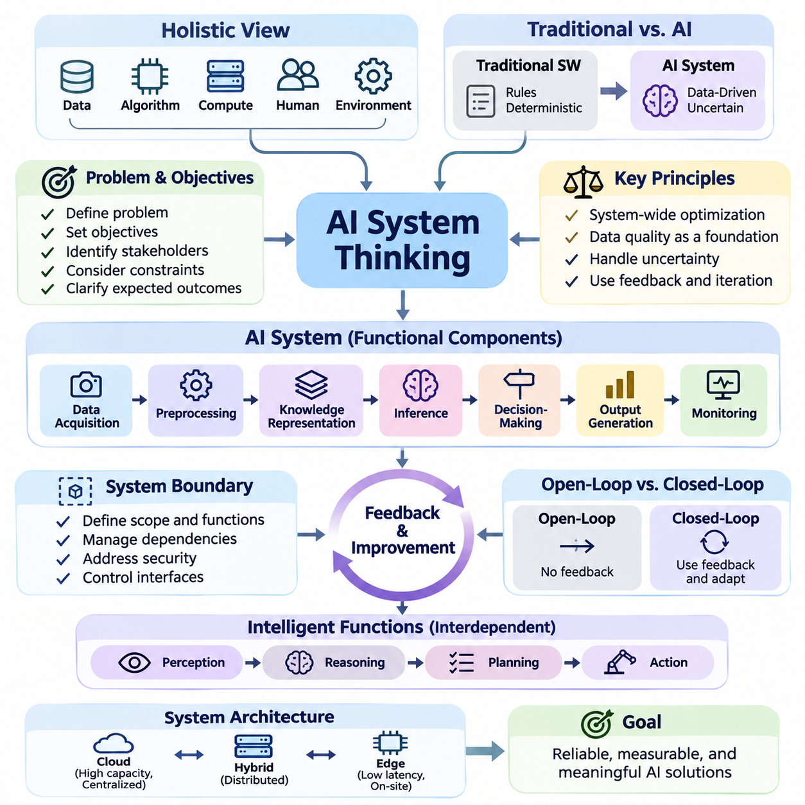
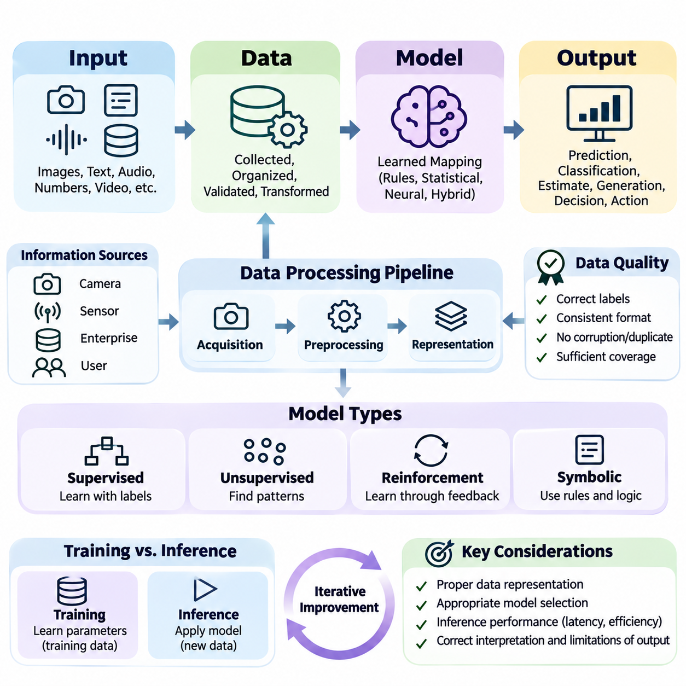
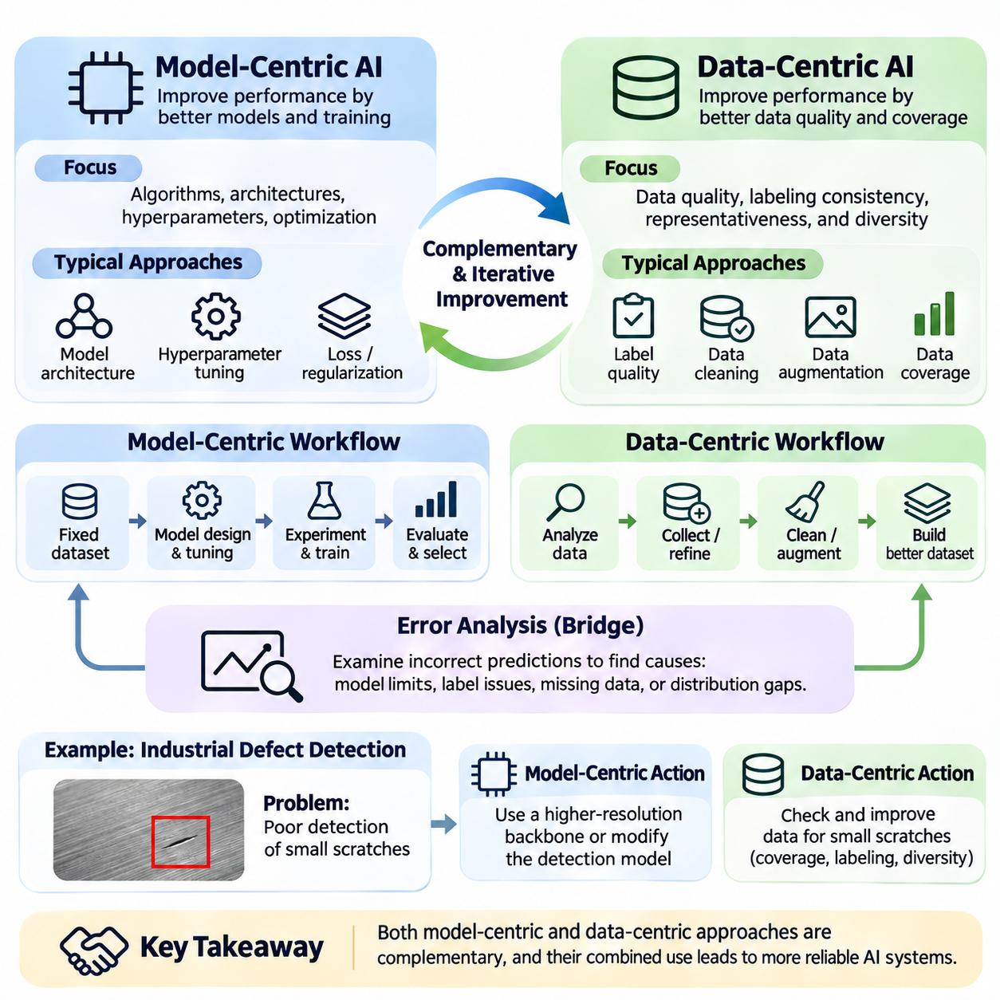
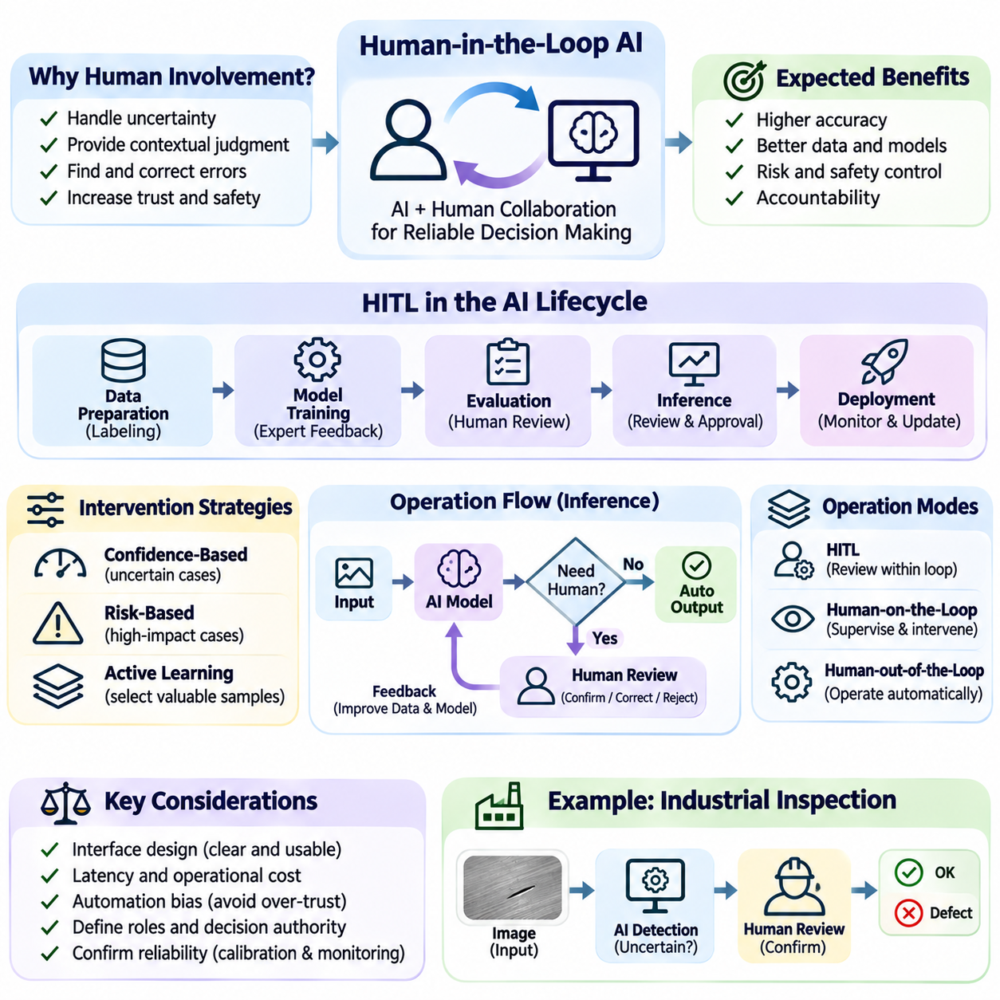
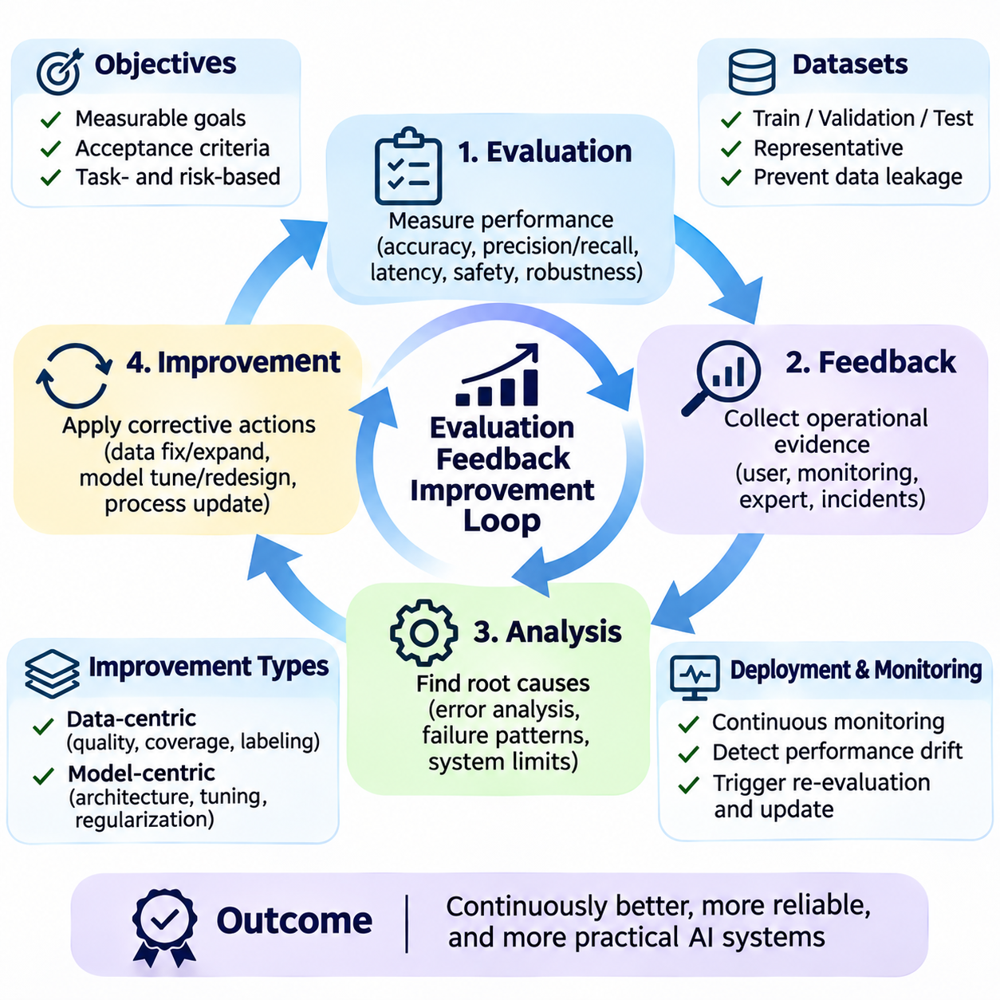
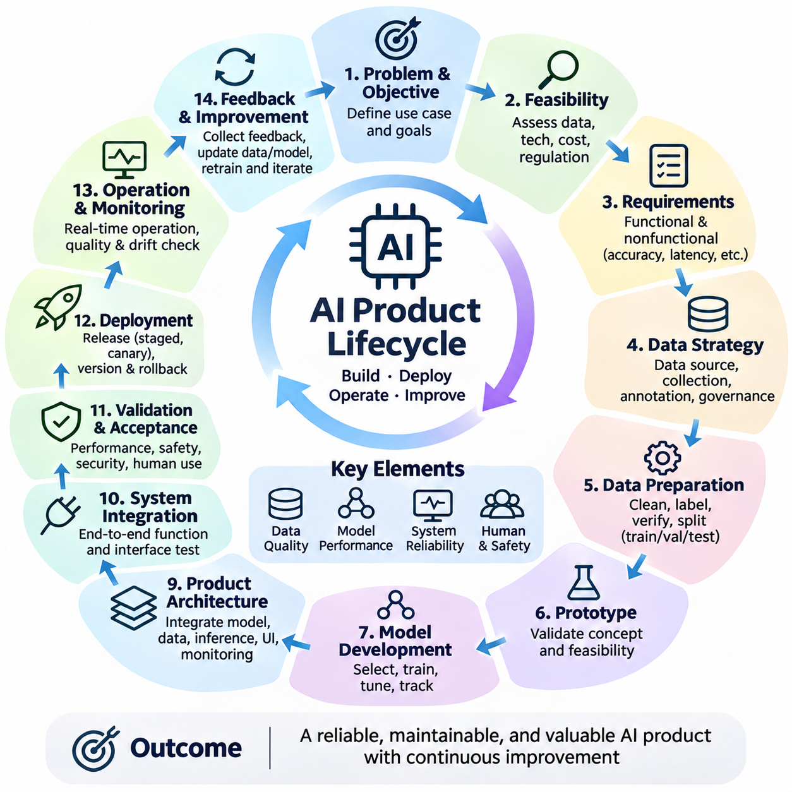
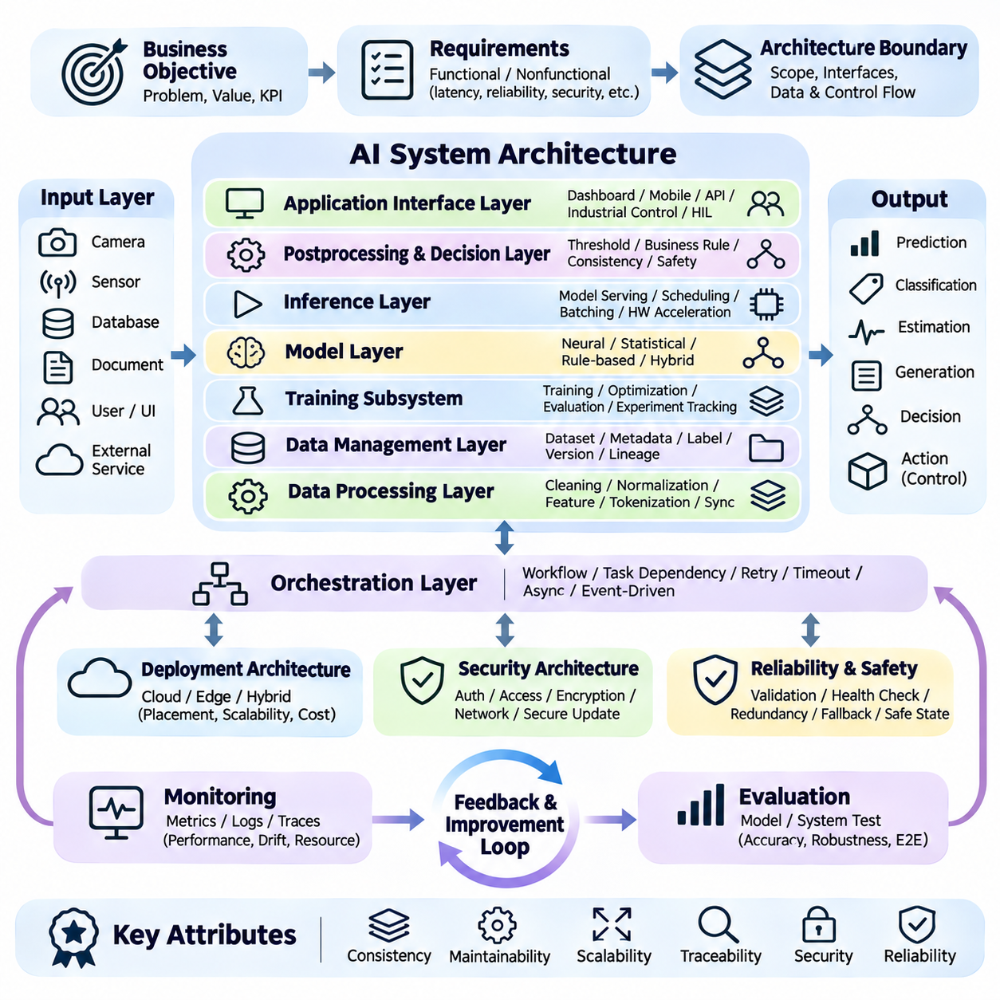
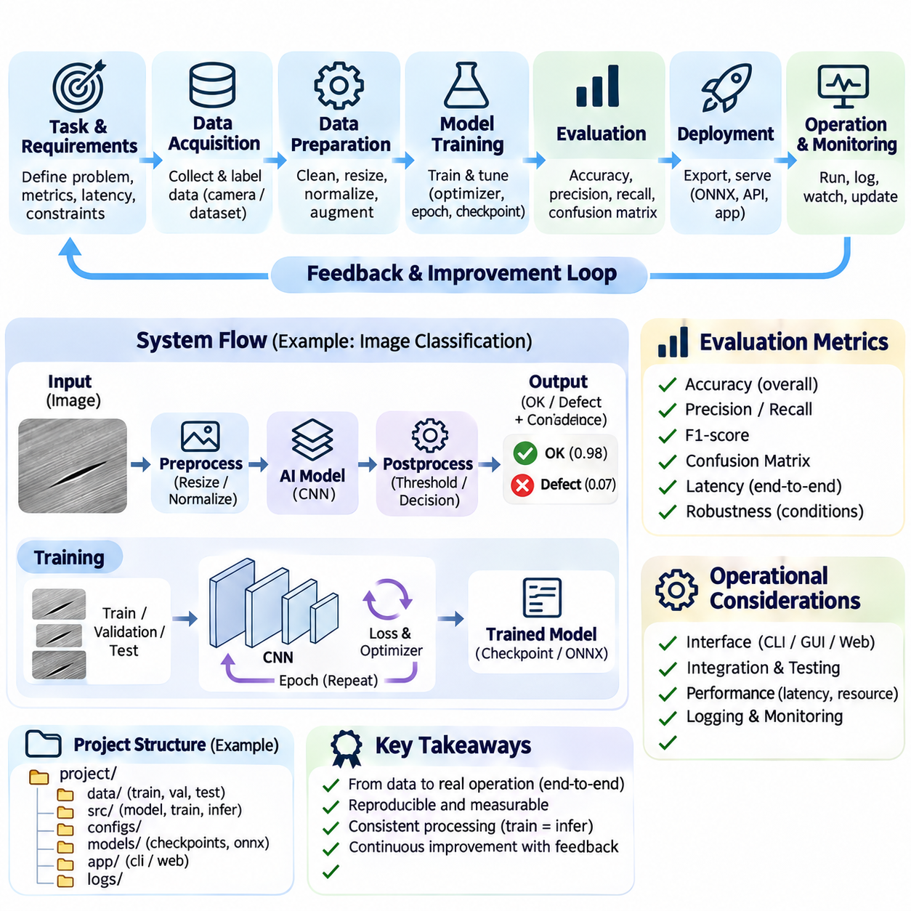

**Volume 04. Artificial Intelligence**

# 07. AI System Design Principles

## 07.00 AI System Thinking

{width="7.268055555555556in" height="7.268055555555556in"}

인공지능 시스템 사고(AI System Thinking)는 데이터(Data), 알고리즘(Algorithm), 컴퓨팅 자원(Computational Resources), 인간 사용자(Human Users), 운영 환경(Operational Environments) 사이의 관계를 종합적으로 고려하여 지능형 솔루션(Intelligent Solutions)을 설계하는 전체론적 접근법(Holistic Approach)이다. 이 관점은 인공지능 모델(AI Model)을 독립적인 구성요소로 취급하기보다, 상호 연결된 요소들이 어떻게 협력하여 신뢰할 수 있고 측정 가능하며 의미 있는 시스템 수준의 목표(System-Level Objectives)를 달성하는지 분석한다.

전통적인 소프트웨어 공학(Traditional Software Engineering)은 명시적으로 정의된 규칙(Explicitly Defined Rules)과 결정론적 실행 경로(Deterministic Execution Paths)에 의존하는 경우가 많다. 반면 인공지능 시스템(AI Systems)은 학습 데이터(Training Data), 통계적 학습(Statistical Learning), 환경 조건(Environmental Conditions), 불확실한 예측(Uncertain Predictions)에 따라 동작이 달라지므로 추가적인 복잡성이 발생한다. 시스템 사고(System Thinking)는 이러한 의존성을 인식하고 소프트웨어, 하드웨어, 데이터, 조직적 프로세스(Organizational Processes) 전반에 걸친 통합 설계의 중요성을 강조한다.

인공지능 시스템 사고(AI System Thinking)의 출발점은 시스템이 해결해야 할 문제를 이해하는 것이다. 설계자는 알고리즘(Algorithm)이나 모델(Model)을 선택하기 전에 운영 목표(Operational Objectives), 이해관계자(Stakeholders), 환경적 제약조건(Environmental Constraints), 기대 결과(Expected Outcomes)를 식별해야 한다. 기술적으로 정교한 신경망(Neural Network)이라도 실제 문제를 해결하지 못하거나 적절한 의사결정 과정(Decision-Making Process)을 지원하지 못한다면 실질적인 가치를 제공하기 어렵다.

인공지능 시스템(AI System)은 상호작용하는 기능적 구성요소(Functional Components)의 집합으로 이해할 수 있다. 일반적으로 데이터 수집(Data Acquisition), 전처리(Preprocessing), 지식 표현(Knowledge Representation), 추론(Inference), 의사결정(Decision-Making), 출력 생성(Output Generation), 모니터링(Monitoring)이 포함된다. 각 구성요소는 정보를 변환하거나 시스템 동작에 영향을 미치며, 전체 성능은 개별 구성요소의 품질뿐 아니라 구성요소 사이의 일관성과 상호작용의 신뢰성에도 좌우된다.

시스템 경계(System Boundaries)는 어떤 기능이 인공지능 솔루션(AI Solution)에 포함되고 어떤 기능이 외부 환경(External Environment)에 속하는지를 결정한다. 이러한 경계는 인공지능 서비스(AI Service)와 기업 데이터베이스(Enterprise Databases), 물리적 센서(Physical Sensors), 사용자 인터페이스(User Interfaces), 외부 애플리케이션(External Applications)을 구분할 수 있다. 명확한 경계 정의는 책임 범위 설정, 의존성 관리, 보안 위험 식별, 정보 및 제어 신호(Control Signals)의 전달 지점 결정에 도움이 된다.

핵심 원칙 중 하나는 국소 최적화(Local Optimization)가 반드시 전역적 개선(Global Improvement)으로 이어지지는 않는다는 것이다. 모델 정확도(Model Accuracy)를 높이면 더 많은 컴퓨팅 자원(Computational Resources)이 필요하거나 지연시간(Latency)이 증가하고 운영 유연성(Operational Flexibility)이 감소할 수 있다. 더 큰 모델이 실험실 벤치마크(Benchmark)에서는 우수하더라도 실시간 애플리케이션(Real-Time Application)에서는 오히려 성능이 저하될 수 있다. 따라서 시스템 사고는 전체 솔루션의 성능을 기준으로 개선 효과를 평가한다.

데이터 품질(Data Quality)은 학습(Training)과 추론(Inference)에 사용되는 정보가 인공지능의 동작에 직접적인 영향을 미치기 때문에 시스템의 근본적인 의존 요소이다. 불완전한 관측(Incomplete Observations), 일관되지 않은 레이블(Inconsistent Labels), 측정 오류(Measurement Errors), 대표성이 부족한 표본(Unrepresentative Samples)은 전체 처리 파이프라인(Processing Pipeline)에 영향을 전파할 수 있다. 따라서 데이터 수집과 검증(Data Validation)은 모델 개발 이전의 준비 작업이 아니라 아키텍처 차원의 핵심 책임으로 다루어야 한다.

데이터(Data)와 모델(Model)의 관계는 엄격한 순차적 관계가 아니라 동적인 관계(Dynamic Relationship)이다. 모델 오류(Model Errors)는 데이터셋 범위(Dataset Coverage)의 약점을 드러낼 수 있으며, 새롭게 수집된 데이터는 모델 아키텍처(Model Architecture)의 한계를 발견하게 할 수 있다. 이러한 상호작용은 반복적 개선(Iterative Refinement)의 기회를 제공한다. 효과적인 시스템 설계는 데이터 분포(Data Distributions), 모델 동작(Model Behavior), 운영 실패(Operational Failures), 학습 과정의 기본 가정을 반복적으로 검토할 수 있도록 지원한다.

인공지능 시스템은 불확실성(Uncertainty)도 신중하게 고려해야 한다. 예측 결과는 잡음이 포함된 측정값(Noisy Measurements), 불완전한 지식(Incomplete Knowledge), 모호한 입력(Ambiguous Inputs), 환경 변화(Environmental Changes)의 영향을 받을 수 있다. 가능한 경우 시스템은 신뢰도가 높은 결과와 불확실한 결과를 구분해야 한다. 신뢰도 추정(Confidence Estimation), 불확실성 보정(Uncertainty Calibration), 보수적 의사결정 정책(Conservative Decision Policies)은 신뢰할 수 없는 예측이 부적절한 후속 행동으로 이어지는 것을 방지하는 데 도움이 된다.

피드백(Feedback)은 지능형 시스템(Intelligent Systems)을 정의하는 또 다른 핵심 특성이다. 인공지능 애플리케이션(AI Application)은 정보를 입력받고 예측이나 행동을 생성하며, 그 결과를 관측할 수 있다. 이러한 관측 결과는 성능 평가(Performance Evaluation)와 후속 개선(Subsequent Improvement)에 활용된다. 특히 자율 시스템(Autonomous Systems)에서는 의사결정이 미래의 환경 상태(Future Environmental States)에 영향을 미치고 이후 추론에 사용되는 정보까지 변화시키므로 피드백 메커니즘(Feedback Mechanisms)이 중요하다.

인공지능 시스템은 개방 루프 시스템(Open-Loop Systems)과 폐쇄 루프 시스템(Closed-Loop Systems)으로 개념적으로 구분할 수 있다. 개방 루프 시스템은 출력 결과의 영향을 후속 의사결정에 직접 반영하지 않고 결과를 생성한다. 반면 폐쇄 루프 시스템은 결과를 지속적으로 관측하고 동작을 조정한다. 자율 로봇(Autonomous Robots), 적응형 제어 시스템(Adaptive Control Systems), 상호작용형 인공지능 에이전트(Interactive AI Agents)는 실행 중 환경이 변화하므로 폐쇄 루프 동작이 필요한 경우가 많다.

시스템 사고(System Thinking)는 인지(Perception), 추론(Reasoning), 계획(Planning), 행동(Action)을 구분하면서도 이들 사이의 상호의존성을 인식하도록 한다. 인지는 원시 관측값(Raw Observations)을 의미 있는 표현(Meaningful Representations)으로 변환한다. 추론은 관계를 해석하고 가능한 설명을 평가하며, 계획은 적절한 의사결정 순서를 결정한다. 행동 메커니즘(Action Mechanisms)은 선택된 작업을 실행한다. 이러한 기능의 효과적인 조정은 단순한 예측을 넘어서는 지능형 행동(Intelligent Behavior)을 가능하게 한다.

아키텍처 설계(Architecture Design)는 컴퓨팅 자원(Computational Resources)의 위치와 분산 구조(Distribution Structure)를 고려해야 한다. 클라우드 인프라(Cloud Infrastructure)는 높은 처리 용량과 중앙집중식 모델 관리(Centralized Model Management)를 제공하는 반면, 엣지 장치(Edge Devices)는 낮은 지연시간(Low Latency)과 제한된 연결 환경에서의 동작을 지원한다. 하이브리드 아키텍처(Hybrid Architecture)는 응답시간 요구사항(Response-Time Requirements), 대역폭 제한(Bandwidth Limitations), 개인정보 보호(Privacy), 에너지 소비(Energy Consumption), 운영 신뢰성(Operational Reliability)에 따라 기능을 분산한다.

자원 제약조건(Resource Constraints)은 인공지능 솔루션의 실질적인 구현 가능성(Practical Feasibility)에 영향을 미친다. 메모리 용량(Memory Capacity), 처리량(Processing Throughput), 저장장치 대역폭(Storage Bandwidth), 전력 소비(Power Consumption), 통신 지연(Communication Delays)은 모델 선택과 배포 전략(Deployment Strategies)을 제한할 수 있다. 개발 과정에서 결정한 아키텍처를 생산 인프라(Production Infrastructure)나 물리적 장비(Physical Equipment)에 통합한 이후에는 변경 비용이 커질 수 있으므로 초기 단계부터 이러한 제약을 평가해야 한다.

실시간 인공지능 시스템(Real-Time AI Systems)은 추가적인 시간적 요구사항(Timing Requirements)을 갖는다. 예측 결과는 의도한 의사결정이나 행동을 지원할 수 있을 만큼 충분히 빠르게 도착해야 유용하다. 평균 추론 지연시간(Average Inference Latency)만으로는 시간 민감형 애플리케이션(Time-Sensitive Applications)을 평가하기 어렵다. 엔지니어는 최악 실행시간 특성(Worst-Case Execution Behavior), 스케줄링 지연(Scheduling Delays), 통신 오버헤드(Communication Overhead), 운영 마감시간(Operational Deadlines)을 지키지 못했을 때의 결과도 고려해야 한다.

신뢰성(Reliability)을 확보하려면 개별 구성요소의 고장(Component Failures)뿐 아니라 구성요소 사이의 상호작용도 검토해야 한다. 모델이 정확한 예측을 생성하더라도 센서 연결 해제(Sensor Disconnections), 손상된 입력(Corrupted Inputs), 네트워크 중단(Network Interruptions), 서비스 가용성 부족(Service Unavailability)으로 전체 시스템이 실패할 수 있다. 고장 감지(Fault Detection), 단계적 성능 저하(Graceful Degradation), 이중화(Redundancy), 복구 절차(Recovery Procedures)는 일부 구성요소가 정상적으로 동작하지 못하는 상황에서도 허용 가능한 동작을 유지하도록 지원한다.

인간의 참여(Human Participation)는 많은 인공지능 애플리케이션에서 여전히 필수적이다. 사용자는 목표를 설정하고 결과를 해석하며 오류를 수정하고 자동화 시스템이 갖추지 못한 맥락적 지식(Contextual Knowledge)을 제공한다. 시스템 사고는 인간과의 상호작용(Human Interaction)을 외부의 부수적인 요소가 아니라 아키텍처의 구성요소로 간주한다. 인터페이스의 명확성(Interface Clarity), 적절한 설명(Appropriate Explanations), 개입 메커니즘(Intervention Mechanisms), 책임 경계(Responsibility Boundaries)는 인공지능 결과의 효과적인 활용에 영향을 미친다.

안전성(Safety)과 보안(Security)은 시스템 아키텍처(System Architecture) 전반에 통합되어야 한다. 인공지능 구성요소는 적대적 입력(Adversarial Inputs), 무단 접근 시도(Unauthorized Access Attempts), 안전하지 않은 권고(Unsafe Recommendations), 예상하지 못한 환경 조건(Unexpected Environmental Conditions)에 직면할 수 있다. 보호 메커니즘(Protective Mechanisms)에는 입력 검증(Input Validation), 접근 제어(Access Controls), 운영 제한(Operational Limits), 독립적인 안전 점검(Independent Safety Checks), 보안 통신(Secure Communication)이 포함될 수 있다.

평가(Evaluation)는 전체 애플리케이션의 목표와 제약조건을 반영해야 한다. 분류 정확도(Classification Accuracy), 예측 오차(Prediction Error), 언어 생성 품질(Language Generation Quality)은 모델 성능(Model Performance)을 설명할 수 있지만 운영상의 성공(Operational Success)을 독립적으로 입증하지는 못한다. 시스템 수준 평가(System-Level Assessment)는 지연시간(Latency), 신뢰성(Reliability), 자원 활용률(Resource Utilization), 강건성(Robustness), 유지보수성(Maintainability), 사용자 만족도(User Satisfaction), 잘못된 의사결정의 결과까지 고려해야 한다.

상충관계 분석(Trade-Off Analysis)은 대안 아키텍처(Alternative Architectures)를 체계적으로 비교하는 방법을 제공한다. 정확도를 개선하면 비용이 증가할 수 있으며, 지연시간을 줄이기 위해 더 작은 모델이나 추가 하드웨어가 필요할 수 있다. 자율성(Autonomy)을 높이면 운영 효율성(Operational Efficiency)은 향상되지만 모니터링과 안전 제어(Safety Controls)의 필요성도 증가할 수 있다. 엔지니어는 이러한 관계를 명확하게 분석하고 애플리케이션의 우선순위를 충족하는 구성을 선택해야 한다.

모듈성(Modularity)은 명확하게 정의된 인터페이스(Well-Defined Interfaces)를 통해 시스템 기능을 분리함으로써 개발과 관리를 용이하게 한다. 인터페이스의 호환성(Interface Compatibility)이 유지된다면 전체 아키텍처를 재설계하지 않고도 개별 구성요소를 시험하거나 교체하고 업그레이드할 수 있다. 그러나 모듈성이 시스템 의존성(System Dependencies)을 제거하는 것은 아니다. 엔지니어는 한 구성요소의 변경이 처리 파이프라인의 다른 부분에서 예상하지 못한 동작을 발생시키지 않는지 검증해야 한다.

관측 가능성(Observability)은 엔지니어가 운영 중인 인공지능 시스템의 동작을 이해하도록 지원한다. 로깅(Logging), 성능 지표(Performance Metrics), 예측 기록(Prediction Records), 자원 모니터링(Resource Monitoring), 오류 보고(Error Reporting)는 고장 진단(Failure Diagnosis)에 필요한 근거를 제공한다. 효과적인 관측 가능성은 개인정보 보호(Privacy)와 저장공간 제약(Storage Constraints)을 고려하면서 관련 시스템 상태를 수집해야 한다. 운영 상태에 대한 충분한 가시성(Operational Visibility)이 없다면 성능 저하가 심각한 결과를 초래할 때까지 발견되지 않을 수 있다.

인공지능 시스템 사고(AI System Thinking)는 수명주기 연속성(Lifecycle Continuity)도 강조한다. 요구사항 정의(Requirements Definition), 데이터 준비(Data Preparation), 모델 개발(Model Development), 통합(Integration), 배포(Deployment), 모니터링(Monitoring), 유지보수(Maintenance)는 상호 연결된 공학적 과정(Engineering Process)을 구성한다. 운영 조건의 변화에 따라 데이터셋 업데이트(Dataset Updates), 모델 수정(Model Revisions), 인터페이스 변경(Interface Modifications)이 필요할 수 있으므로 지속 가능한 시스템에는 통제된 업데이트(Controlled Updates), 버전 관리(Version Management), 검증(Validation), 롤백(Rollback) 메커니즘이 필요하다.

창고 내부에서 작동하는 자율 이동 로봇(Autonomous Mobile Robot)을 예로 들 수 있다. 로봇의 지능은 객체 탐지 정확도(Object Detection Accuracy)나 내비게이션 알고리즘(Navigation Algorithms)만으로 평가할 수 없다. 로봇은 센서(Sensors), 위치 추정(Localization), 경로 계획(Path Planning), 운동 제어(Motion Control), 배터리 관리(Battery Management), 통신(Communication), 안전 메커니즘(Safety Mechanisms)을 조정해야 한다. 개별 인공지능 구성요소가 우수하게 작동하더라도 중요한 상호작용에 문제가 발생하면 전체 임무가 실패할 수 있다.

기업용 인공지능 어시스턴트(Enterprise AI Assistants)에도 동일한 원칙이 적용된다. 시스템의 효과는 문서 접근성(Document Accessibility), 검색 품질(Retrieval Quality), 언어 이해(Language Understanding), 권한 부여 정책(Authorization Policies), 응답 생성(Response Generation), 인간 검증(Human Verification)에 달려 있다. 강력한 대규모 언어 모델(Large Language Model)이라도 누락된 업무 정보나 신뢰할 수 없는 검색 과정의 문제를 완전히 보완할 수는 없다. 시스템은 사용자 요청, 이용 가능한 지식, 생성된 응답, 허용된 행동 사이의 일관성을 유지해야 한다.

인공지능 시스템 사고(AI System Thinking)의 핵심 목표는 개별적인 지능형 기능(Intelligent Capabilities)을 신뢰할 수 있는 운영 솔루션(Dependable Operational Solutions)으로 전환하는 것이다. 이를 위해서는 상호작용(Interactions), 제약조건(Constraints), 불확실성(Uncertainty), 피드백(Feedback), 시스템 수준의 결과(System-Level Outcomes)에 지속적으로 주의를 기울여야 한다. 인공지능을 통합적인 공학 분야(Integrated Engineering Discipline)로 접근함으로써 개발자는 통제된 실험 환경을 넘어 실제 운영 환경에서도 유용하고 적응 가능하며 유지보수가 용이하고 신뢰할 수 있는 솔루션을 구축할 수 있다.

## 07.01 Input Data Model Output

{width="7.268055555555556in" height="7.268055555555556in"}

인공지능 시스템(Artificial Intelligence System)은 입력(Input), 데이터(Data), 모델(Model), 출력(Output)을 연결하는 기본적인 처리 관계를 통해 이해할 수 있다. 이러한 구조는 정보가 지능형 애플리케이션(Intelligent Application)에 유입되고 변환 과정을 거쳐 의미 있는 결과를 생성하는 방식을 설명한다. 현대 인공지능 아키텍처(AI Architecture)는 상호 연결된 다양한 구성요소를 포함할 수 있지만, 이러한 기본 관계는 시스템의 운영 동작(Operational Behavior)을 이해하는 실용적인 기반을 제공한다.

입력(Input)은 사용자, 센서(Sensors), 데이터베이스(Databases), 소프트웨어 애플리케이션(Software Applications), 외부 환경(External Environments)으로부터 인공지능 시스템이 처음 수신하는 정보를 의미한다. 입력에는 이미지(Images), 텍스트(Text), 오디오 신호(Audio Signals), 수치 측정값(Numerical Measurements), 비디오 스트림(Video Streams), 구조화된 기록(Structured Records)이 포함될 수 있다. 입력의 특성은 처리 요구사항(Processing Requirements)을 결정하며, 애플리케이션에 적합한 알고리즘(Algorithms), 표현 방식(Representations), 컴퓨팅 자원(Computational Resources)의 선택에 영향을 미친다.

입력(Input)과 데이터(Data)를 구분하는 것은 중요하다. 원시 정보(Raw Information)가 반드시 모델에서 직접 처리하기에 적합한 것은 아니기 때문이다. 입력은 시스템에 유입되는 정보를 의미하며, 데이터는 계산에 활용할 수 있도록 수집, 구성, 검증 또는 변환된 정보를 의미한다. 따라서 인공지능 파이프라인(AI Pipeline)에는 서로 다른 형태의 입력을 일관된 표현(Consistent Representations)으로 변환하는 중간 처리 과정(Intermediate Operations)이 포함되는 경우가 많다.

데이터 수집(Data Acquisition)은 정보원(Information Sources)과 컴퓨팅 환경(Computational Environment)을 연결하는 과정이다. 카메라(Cameras)는 시각적 관측값(Visual Observations)을 획득하고, 마이크(Microphones)는 음향 신호(Acoustic Signals)를 기록하며, 산업용 센서(Industrial Sensors)는 물리적 상태(Physical Conditions)를 측정한다. 기업 시스템(Enterprise Systems)은 거래 기록(Transactional Records)을 제공한다. 데이터 수집 메커니즘은 샘플링 주파수(Sampling Frequency), 측정 정밀도(Measurement Precision), 통신 신뢰성(Communication Reliability), 동기화(Synchronization), 정보가 수집되는 운영 조건(Operational Conditions)을 고려해야 한다.

데이터 전처리(Data Preprocessing)는 수집된 정보를 선택한 인공지능 모델(AI Model)과 호환되는 표현으로 변환한다. 일반적인 작업에는 정규화(Normalization), 크기 조정(Resizing), 필터링(Filtering), 토큰화(Tokenization), 결측값 처리(Missing-Value Handling), 특징 추출(Feature Extraction)이 포함된다. 이러한 변환은 불필요한 변동을 줄이고 일관된 입력 형식(Consistent Input Formats)을 확립한다. 그러나 부적절한 전처리는 유용한 정보를 제거하거나 체계적인 오류(Systematic Errors)를 발생시켜 후속 예측 성능을 저하시킬 수 있다.

데이터 표현(Data Representation)은 컴퓨팅 시스템(Computational System) 내부에서 정보가 표현되는 방식을 결정한다. 수치 특징(Numerical Features)은 벡터(Vectors), 이미지는 다차원 텐서(Multidimensional Tensors), 언어는 토큰 시퀀스(Token Sequences), 관계 정보는 그래프(Graphs)로 구성될 수 있다. 표현 방식은 모델이 인식할 수 있는 패턴(Patterns)과 해당 패턴을 처리하는 효율성에 영향을 미친다. 적절한 표현은 의도한 작업과 관련된 정보를 보존해야 한다.

학습 데이터(Training Data)와 추론 데이터(Inference Data)는 동일한 아키텍처 구조(Architectural Framework) 안에서 서로 다른 목적을 수행한다. 학습 데이터는 학습 절차(Learning Procedures)를 통해 모델 파라미터(Model Parameters)를 추정하는 데 사용되며, 추론 데이터는 학습이 완료된 이후 새로운 예측을 생성하기 위한 관측값을 제공한다. 두 데이터는 유사한 전처리 과정을 거칠 수 있지만 데이터 분포(Data Distributions)는 다를 수 있다. 이러한 차이는 운영 조건이 학습 환경(Training Environment)에서 벗어날 때 신뢰성을 저하시킬 수 있다.

데이터 품질(Data Quality)은 모델이 활용할 수 있는 정보에 직접적인 영향을 미친다. 잘못된 레이블(Incorrect Labels), 손상된 측정값(Corrupted Measurements), 일관되지 않은 형식(Inconsistent Formatting), 중복 기록(Duplicated Records), 불충분한 데이터 범위(Insufficient Coverage)는 체계적인 약점을 발생시킬 수 있다. 정교한 학습 알고리즘(Learning Algorithm)이라도 누락되거나 근본적으로 잘못된 정보를 안정적으로 복원할 수는 없다. 따라서 효과적인 인공지능 공학(AI Engineering)은 데이터 검증(Data Validation), 일관성 검사(Consistency Checking), 대표성 있는 표본 추출(Representative Sampling)을 필수적인 시스템 기능으로 다룬다.

모델(Model)은 준비된 데이터를 예측(Predictions), 분류(Classifications), 추정값(Estimates), 생성 콘텐츠(Generated Content), 의사결정(Decisions)으로 변환하는 계산 메커니즘(Computational Mechanism)을 의미한다. 애플리케이션에 따라 모델은 논리 규칙(Logical Rules), 통계 방정식(Statistical Equations), 의사결정 트리(Decision Trees), 신경망(Neural Networks), 하이브리드 아키텍처(Hybrid Architectures)로 구성될 수 있다. 모델은 학습된 파라미터(Learned Parameters) 또는 명시적으로 정의된 지식(Explicitly Defined Knowledge)에 따라 입력 표현과 출력 변수(Output Variables) 사이의 매핑(Mapping)을 형성한다.

지도 기계학습(Supervised Machine Learning)에서 모델은 입력 예제(Input Examples)와 해당 목표값(Target Values) 사이의 관계를 학습한다. 학습 절차(Training Procedures)는 예측값과 기준 목표값(Reference Targets) 사이의 차이를 측정하는 손실 함수(Loss Function)를 최소화하도록 모델 파라미터를 조정한다. 최적화 알고리즘(Optimization Algorithms)은 이러한 파라미터를 반복적으로 개선한다. 결과적으로 모델은 가능한 모든 운영 조건을 암기하는 것이 아니라 학습 데이터에 존재하는 패턴을 근사한다.

모든 인공지능 모델(AI Models)이 지도학습(Supervised Learning)을 따르는 것은 아니다. 비지도학습 모델(Unsupervised Models)은 명시적인 목표 레이블(Target Labels) 없이 구조나 규칙성을 발견하며, 강화학습 에이전트(Reinforcement Learning Agents)는 상호작용과 피드백(Feedback)을 통해 의사결정 정책(Decision Policies)을 개선한다. 기호 기반 시스템(Symbolic Systems)은 사전에 정의된 규칙과 논리적 추론(Logical Inference)을 적용할 수 있다. 이러한 차이에도 불구하고 각 접근법은 이용 가능한 정보를 의도한 지능형 기능(Intelligent Function)을 지원하는 표현이나 결과로 변환한다.

모델 추론(Model Inference)은 확립된 계산 모델(Computational Model)을 새로운 관측값에 적용하는 과정이다. 추론 과정에서 준비된 입력은 모델을 통과하며, 학습된 관계(Learned Relationships) 또는 인코딩된 규칙(Encoded Rules)에 따라 출력을 생성한다. 추론 요구사항(Inference Requirements)은 학습 요구사항(Training Requirements)과 다르다. 운영 시스템은 파라미터 최적화(Parameter Optimization)보다 응답시간(Response Time), 메모리 효율성(Memory Efficiency), 가용성(Availability), 예측 가능한 동작(Predictable Behavior)을 우선하는 경우가 많다.

출력(Output)은 인공지능 처리 파이프라인(AI Processing Pipeline)이 생성한 결과를 의미한다. 애플리케이션에 따라 출력은 범주 레이블(Category Label), 확률 분포(Probability Distribution), 수치 추정값(Numerical Estimate), 생성된 문장(Generated Sentence), 권장 행동(Recommended Action), 제어 명령(Control Command)이 될 수 있다. 출력은 그 의미와 한계에 따라 해석해야 한다. 예를 들어 확률 점수(Probability Score)가 높다고 해서 예측이 반드시 정확하거나 실제 행동에 사용하기에 충분히 신뢰할 수 있다는 의미는 아니다.

후처리(Postprocessing)는 모델의 원시 결과(Raw Model Results)를 후속 시스템(Downstream Systems)이나 인간 사용자가 활용하기 적합한 형태로 변환한다. 분류 점수(Classification Scores)는 레이블로 변환될 수 있으며, 객체 탐지 결과(Object Detections)는 필터링을 거칠 수 있고, 생성된 텍스트(Generated Text)는 형식 요구사항(Formatting Requirements)에 따라 검사될 수 있다. 후처리는 운영 제약조건(Operational Constraints)을 적용할 수도 있다. 이러한 설계는 기본 모델이 변경되지 않더라도 애플리케이션의 최종 동작에 영향을 미친다.

모델 출력(Model Output)과 시스템 행동(System Action)의 관계는 명확하게 구분해야 한다. 모델이 장애물(Obstacle)을 식별할 수 있지만, 로봇이 정지하거나 감속하거나 방향을 변경할지는 다른 구성요소가 결정해야 한다. 마찬가지로 의료 예측(Medical Prediction)은 전문가의 판단(Professional Assessment)을 지원할 수 있지만 독립적으로 치료를 결정하는 것은 아니다. 시스템 설계에서는 어떤 출력이 정보 제공용(Informational)이고 어떤 출력이 중요한 의사결정(Consequential Decisions)에 영향을 줄 수 있는지 정의해야 한다.

종단 간 인공지능 파이프라인(End-to-End AI Pipeline)은 정보 수집(Information Acquisition), 준비(Preparation), 모델 실행(Model Execution), 결과 해석(Result Interpretation), 전달(Delivery)을 일관된 운영 과정(Operational Process)으로 연결한다. 각 단계는 이전 단계에 대한 가정(Assumptions)에 의존한다. 잘못된 데이터 형식(Data Formatting)은 모델 입력을 무효화할 수 있으며, 일관되지 않은 후처리는 정확한 예측 결과를 왜곡할 수 있다. 인터페이스 명세(Interface Specifications)와 검증 절차(Validation Procedures)는 전체 파이프라인의 호환성을 유지하는 데 도움이 된다.

제조 제품의 결함을 식별하도록 설계된 이미지 분류 애플리케이션(Image Classification Application)을 예로 들 수 있다. 카메라가 이미지를 획득하면 전처리(Preprocessing)는 이미지의 크기와 수치 표현(Numerical Representation)을 조정하고, 학습된 모델(Trained Model)은 결함 범주(Defect Categories)를 추정한다. 후처리는 모델 점수(Model Scores)를 검사 결과(Inspection Results)로 변환한다. 최종 출력은 작업자(Operator)에게 표시되거나 추가 조치를 위해 생산 관리 시스템(Production Management System)으로 전달될 수 있다.

언어 기반 인공지능 애플리케이션(Language-Based AI Application)도 서로 다른 표현 방식을 사용하지만 동일한 개념적 구조를 따른다. 사용자가 텍스트 요청(Text Request)을 제출하면 시스템은 텍스트를 토큰(Tokens)으로 변환하고 언어 모델(Language Model)이 해당 시퀀스를 처리한다. 생성된 토큰은 읽을 수 있는 언어로 디코딩(Decoding)된다. 추가적인 메커니즘은 문서 검색(Document Retrieval), 출력 검증(Output Validation), 도구 접근 제어(Tool Access Control)를 수행하며 기본 파이프라인을 더욱 강력한 시스템으로 확장할 수 있다.

실시간 로보틱스(Real-Time Robotics)는 입력(Input), 데이터(Data), 모델(Model), 출력(Output) 사이의 시간적 관계(Temporal Relationships)가 얼마나 중요한지 보여준다. 센서 관측값(Sensor Observations)은 운영 마감시간(Operational Deadlines) 내에 수집되고 처리되어야 한다. 인지 모델(Perception Models)은 환경 상태(Environmental Conditions)를 추정하며, 계획 및 제어 구성요소(Planning and Control Components)는 관련 결과를 행동으로 변환한다. 개별 예측이 통계적으로 정확하더라도 지연되거나 오래된 정보(Outdated Information)는 부적절한 동작을 유발할 수 있다.

시스템 성능(System Performance)은 모델 정확도(Model Accuracy)만으로 결정할 수 없다. 데이터 전송 지연(Data Transfer Delays), 전처리 오버헤드(Preprocessing Overhead), 추론 지연시간(Inference Latency), 후처리 비용(Postprocessing Costs), 통신 요구사항(Communication Requirements)은 전체 응답시간(Total Response Time)에 영향을 미친다. 메모리 소비(Memory Consumption)와 처리량(Processing Throughput)도 확장성(Scalability)에 영향을 준다. 따라서 엔지니어는 개별 모델 벤치마크(Model Benchmarks)에만 의존하지 않고 실제 작업 부하(Realistic Workloads)에서 전체 파이프라인을 측정해야 한다.

불확실성(Uncertainty)은 모든 처리 단계에 걸쳐 전파될 수 있다. 센서 잡음(Sensor Noise)은 수집된 입력에 영향을 미치고, 전처리는 근사(Approximation)를 도입하며, 모델 예측에는 통계적 또는 구조적 한계(Statistical or Structural Limitations)가 존재한다. 출력 해석(Output Interpretation)은 추가적인 모호성(Ambiguity)을 발생시킬 수도 있다. 신뢰할 수 있는 시스템은 주요 불확실성 원인을 식별하고 필요에 따라 신뢰도 추정(Confidence Estimation), 검증(Validation), 대체 절차(Fallback Procedures), 인간 검토(Human Review)를 구현해야 한다.

데이터 분포 변화(Data Distribution Changes)는 또 다른 중요한 운영상의 과제이다. 주간 이미지(Daytime Images)로 학습한 모델은 익숙하지 않은 조명 조건(Lighting Conditions)에서 성능이 저하될 수 있으며, 언어 시스템(Language System)은 학습 예제(Training Examples)에 존재하지 않았던 전문 용어를 접할 수 있다. 입력 특성(Input Characteristics)과 출력 동작(Output Behavior)을 모니터링하면 분포 변화(Distribution Shifts)를 식별하는 데 도움이 된다. 대응 방법에는 데이터 업데이트(Data Updates), 모델 적응(Model Adaptation), 재보정(Recalibration), 운영 제약조건 수정(Revised Operating Constraints)이 포함될 수 있다.

피드백 메커니즘(Feedback Mechanisms)은 시스템 출력을 후속 평가(Subsequent Evaluation)와 개선(Improvement)에 연결한다. 관측된 결과(Observed Outcomes)는 예측 오류(Prediction Errors), 부적절한 임계값(Inappropriate Thresholds), 이전에 식별하지 못한 데이터 패턴(Data Patterns)을 드러낼 수 있다. 이러한 관측값은 데이터셋 개선(Dataset Refinement), 모델 재학습(Model Retraining), 처리 로직 변경(Processing Logic Changes)에 활용될 수 있다. 그러나 오류를 강화하거나 편향된 정보(Biased Information)를 도입하지 않도록 운영 피드백(Operational Feedback)은 학습에 반영하기 전에 검증되어야 한다.

입력-데이터-모델-출력 관계(Input-Data-Model-Output Relationship)는 공학적 책임(Engineering Responsibilities)을 할당하기 위한 프레임워크(Framework)도 제공한다. 데이터 엔지니어(Data Engineers)는 신뢰할 수 있는 수집 및 준비 과정을 구축하고, 모델 개발자(Model Developers)는 학습 메커니즘(Learning Mechanisms)을 설계하며, 시스템 엔지니어(System Engineers)는 실행 환경(Execution Environments)과 인터페이스(Interfaces)를 통합한다. 운영팀(Operational Teams)은 결과를 모니터링하고 배포 신뢰성(Deployment Reliability)을 유지한다. 명확한 책임 분담은 공동의 시스템 의존성을 인식하면서 협업 효율성을 높인다.

궁극적으로 입력-데이터-모델-출력 구조(Input-Data-Model-Output Structure)는 인공지능 시스템을 이해하기 위한 기본적인 추상화(Foundational Abstraction)를 제공한다. 이 구조의 가치는 정보 품질(Information Quality), 계산적 변환(Computational Transformations), 모델 동작(Model Behavior), 결과 해석(Result Interpretation)이 어떻게 함께 운영 성능(Operational Performance)을 결정하는지 보여준다는 데 있다. 이러한 요소를 통합된 파이프라인(Integrated Pipeline)으로 설계하고 평가함으로써 엔지니어는 실제 환경에 적합하고 신뢰할 수 있으며 효율적이고 유지보수가 용이한 인공지능 솔루션(AI Solutions)을 개발할 수 있다.

## 07.02 Model Centric vs Data Centric AI

{width="7.268055555555556in" height="7.268055555555556in"}

모델 중심 인공지능(Model-Centric AI)과 데이터 중심 인공지능(Data-Centric AI)은 인공지능 시스템(Artificial Intelligence Systems)을 개선하기 위한 상호 보완적인 두 가지 접근법이다. 모델 중심 개발(Model-Centric Development)은 주로 알고리즘(Algorithms), 아키텍처(Architectures), 파라미터 최적화(Parameter Optimization)에 집중하는 반면, 데이터 중심 개발(Data-Centric Development)은 학습에 사용되는 정보의 품질(Quality), 일관성(Consistency), 대표성(Representativeness)을 강조한다. 두 접근법의 차이를 이해하면 엔지니어가 시스템 성능을 개선할 수 있는 가장 효과적인 기회를 식별하는 데 도움이 된다.

전통적인 기계학습 연구(Traditional Machine Learning Research)는 모델 중심 관점(Model-Centric Perspective)을 채택하는 경우가 많았다. 개발자는 데이터셋(Datasets)을 선택하고 평가 절차(Evaluation Procedures)를 수립한 다음, 비교적 고정된 데이터 조건에서 여러 학습 알고리즘(Learning Algorithms)을 비교한다. 성능 개선은 더 깊은 신경망(Deeper Neural Networks), 수정된 아키텍처(Modified Architectures), 고급 최적화 기법(Advanced Optimization Methods), 정교하게 조정된 하이퍼파라미터(Hyperparameters)를 통해 이루어질 수 있다. 이러한 접근법은 통제된 실험(Controlled Experimentation)과 계산 기법(Computational Techniques)의 체계적인 비교를 지원한다.

모델 중심 워크플로(Model-Centric Workflow)는 일반적으로 정의된 데이터셋(Dataset)과 목표 성능(Target Performance Objective)에서 시작한다. 엔지니어는 모델 용량(Model Capacity), 특징 추출 메커니즘(Feature Extraction Mechanisms), 손실 함수(Loss Functions), 정규화 전략(Regularization Strategies), 학습 설정(Training Configurations)을 검토한다. 이러한 요소를 수정하면서 기본 데이터를 유지한 상태로 예측 성능(Predictive Performance)을 개선하려고 한다. 이 전략의 효과는 데이터셋이 의도한 문제를 충분히 대표하는지에 따라 달라진다.

모델 아키텍처(Model Architecture)는 인공지능 시스템이 학습할 수 있는 패턴(Patterns)을 결정하는 데 중요한 역할을 한다. 합성곱 신경망(Convolutional Neural Networks)은 이미지의 공간적 관계(Spatial Relationships)를 활용하고, 트랜스포머(Transformers)는 어텐션 메커니즘(Attention Mechanisms)을 통해 상호작용을 모델링하며, 그래프 신경망(Graph Neural Networks)은 관계형 구조(Relational Structures)를 처리한다. 모델의 계산적 가정(Computational Assumptions)이 이용 가능한 정보의 특성과 일치할 때 적절한 아키텍처 선택은 성능을 크게 향상시킬 수 있다.

하이퍼파라미터 최적화(Hyperparameter Optimization)는 또 다른 중요한 모델 중심 기법(Model-Centric Technique)이다. 학습률(Learning Rates), 배치 크기(Batch Sizes), 네트워크 깊이(Network Depth), 정규화 계수(Regularization Coefficients), 최적화 스케줄(Optimization Schedules)은 학습 동작(Training Behavior)에 영향을 미친다. 체계적인 실험(Systematic Experimentation)은 수렴성(Convergence), 일반화 성능(Generalization), 계산 효율성(Computational Efficiency)을 개선하는 설정을 식별할 수 있다. 그러나 광범위한 파라미터 조정만으로는 근본적으로 잘못된 레이블(Incorrect Labels)이나 학습 데이터셋에 누락된 정보를 안정적으로 보완할 수 없다.

데이터 중심 인공지능(Data-Centric AI)은 지능형 모델(Intelligent Models)을 구축하고 평가하는 데 사용되는 정보 자체에 주목한다. 이 접근법은 데이터셋이 고정되어 있고 충분히 신뢰할 수 있다고 가정하기보다, 데이터를 지속적인 개선이 필요한 공학적 자산(Engineering Asset)으로 취급한다. 개발자는 데이터 수집 절차(Collection Procedures), 레이블 일관성(Labeling Consistency), 샘플링 전략(Sampling Strategies), 데이터 분포(Data Distributions), 검증 규칙(Validation Rules)을 분석하여 모델 성능을 제한하는 약점을 식별한다.

학습 레이블(Training Labels)의 품질은 지도학습(Supervised Learning)에서 특히 중요하다. 잘못되거나 일관되지 않은 주석(Incorrect or Inconsistent Annotations)은 상충되는 학습 신호(Conflicting Learning Signals)를 발생시켜 모델이 의미 있는 관계를 발견하지 못하게 할 수 있다. 예를 들어 시각적으로 유사한 제조 결함(Manufacturing Defects)에 명확한 주석 정책(Annotation Policy) 없이 서로 다른 레이블이 부여되면 모델은 불안정한 결정 경계(Unstable Decision Boundaries)를 학습할 수 있다. 일관된 레이블링 지침(Labeling Guidelines)과 체계적인 검토(Systematic Review)는 이러한 문제를 줄이는 데 도움이 된다.

데이터 대표성(Data Representativeness)은 학습 예제(Training Examples)가 배포 환경(Deployment Environment)에서 발생하는 조건을 충분히 반영하는지를 결정한다. 주로 선명한 주간 이미지(Daytime Images)로 학습한 컴퓨터 비전 시스템(Computer Vision System)은 야간 장면(Nighttime Scenes), 반사(Reflections), 악천후(Adverse Weather)에서 어려움을 겪을 수 있다. 데이터 중심 개발은 이러한 데이터 범위의 공백(Coverage Gaps)을 식별하고 목표 지향적 데이터 수집(Targeted Collection), 균형 잡힌 샘플링(Balanced Sampling), 신중하게 검증된 데이터 증강(Validated Augmentation)을 통해 데이터셋을 개선한다.

데이터셋 다양성(Dataset Diversity)은 무제한으로 확대해야 하는 목표가 아니라 의도한 애플리케이션과의 관련성을 기준으로 평가해야 한다. 관련성이 낮은 예제를 추가하면 데이터셋 크기(Dataset Size)는 증가하지만 유용한 범위(Useful Coverage)는 개선되지 않을 수 있다. 효과적인 데이터 중심 공학(Data-Centric Engineering)은 운영 조건(Operating Conditions), 객체 특성(Object Characteristics), 환경 상태(Environmental States), 희귀 사건(Rare Events)의 의미 있는 변동에 집중한다. 목표는 신뢰할 수 있는 일반화(Reliable Generalization)에 필요한 정보를 확보하는 것이다.

데이터 정제(Data Cleaning)는 데이터 중심 개발(Data-Centric Development)의 기본적인 활동이다. 중복 기록(Duplicate Records), 손상된 샘플(Corrupted Samples), 일관되지 않은 단위(Inconsistent Units), 결측값(Missing Values), 잘못된 형식의 관측값(Incorrectly Formatted Observations)은 학습과 평가를 왜곡할 수 있다. 정제 절차(Cleaning Procedures)는 실제 오류를 제거하면서 유효한 변동(Valid Variation)을 보존해야 한다. 과도한 필터링(Excessive Filtering)은 어렵지만 중요한 예제를 제거하여 실제 운영 조건을 제대로 반영하지 못하는 지나치게 단순화된 데이터셋을 만들 수 있다.

데이터 증강(Data Augmentation)은 통제된 변환(Controlled Transformations)을 통해 학습 예제의 범위를 확장한다. 이미지 회전(Image Rotation), 자르기(Cropping), 조명 조정(Illumination Adjustment), 잡음 주입(Noise Injection)은 작업과 관련된 정보(Task-Relevant Information)를 보존하는 경우 강건성(Robustness)을 개선할 수 있다. 텍스트 증강(Text Augmentation)과 합성 데이터 생성(Synthetic Data Generation)도 다른 분야에서 유사한 목적을 수행한다. 그러나 변환 과정은 잘못된 학습 예제를 만들지 않도록 의미적 정보(Semantic Meaning)와 물리적 제약조건(Physical Constraints)을 준수해야 한다.

오류 분석(Error Analysis)은 모델 중심 개선(Model-Centric Improvement)과 데이터 중심 개선(Data-Centric Improvement)을 연결하는 실용적인 방법이다. 엔지니어는 잘못된 예측(Incorrect Predictions)을 검토하여 실패 원인이 모델 용량 부족(Insufficient Model Capacity), 모호한 레이블(Ambiguous Labels), 누락된 학습 예제(Missing Training Examples), 데이터 분포 차이(Distribution Differences) 중 어디에 있는지 판단한다. 환경 조건, 객체 범주(Object Categories), 입력 특성(Input Characteristics)에 따라 오류를 분류하면 전체 정확도 지표(Aggregate Accuracy Metrics)에 가려진 체계적인 약점을 발견할 수 있다.

작은 표면 흠집(Small Surface Scratches)을 제대로 탐지하지 못하는 산업용 결함 탐지 시스템(Industrial Defect Detection System)을 생각해 볼 수 있다. 모델 중심 접근법(Model-Centric Approach)은 더 높은 해상도의 백본(High-Resolution Backbone)을 도입하거나 탐지 아키텍처(Detection Architecture)를 수정할 수 있다. 데이터 중심 접근법(Data-Centric Approach)은 작은 흠집이 충분히 포함되어 있고 일관되게 주석 처리되었는지 조사한다. 두 접근법이 모두 필요할 수 있지만 실제 실패 원인을 식별하면 불필요한 계산 복잡성(Computational Complexity)의 증가를 방지할 수 있다.

데이터 중심 개발(Data-Centric Development)은 데이터셋 버전 관리(Dataset Versioning)와 추적 가능성(Traceability)도 강조한다. 레이블(Labels), 샘플링 정책(Sampling Policies), 전처리 절차(Preprocessing Procedures), 데이터 수집원(Collection Sources)의 변경은 모델 동작(Model Behavior)을 변화시킬 수 있다. 문서화된 데이터셋 버전(Documented Dataset Versions)을 유지하면 엔지니어는 실험을 재현하고 데이터 수정으로 인한 개선과 알고리즘 변경으로 인한 개선을 구분할 수 있다. 이러한 관리 체계는 신뢰할 수 있는 비교(Reliable Comparisons)와 통제된 배포(Controlled Deployment)를 지원한다.

데이터셋 크기(Dataset Size)와 데이터셋 품질(Dataset Quality)의 관계는 신중하게 해석해야 한다. 더 큰 데이터셋은 일반적으로 더 넓은 통계적 범위(Statistical Coverage)를 제공하지만 예제를 추가한다고 해서 학습 성능이 자동으로 개선되는 것은 아니다. 반복된 샘플(Repeated Samples), 체계적 편향(Systematic Bias), 부정확한 레이블(Inaccurate Labels)은 제한적인 가치만 제공하거나 추가적인 문제를 발생시킬 수 있다. 신중하게 선별된 작은 데이터셋(Curated Dataset)이 상당한 불일치를 포함한 더 큰 데이터셋보다 우수한 성능을 보이는 경우도 있다.

모델 중심 접근법(Model-Centric Approach)과 데이터 중심 접근법(Data-Centric Approach)은 공학적 자원(Engineering Resources)을 배분하는 방식에서도 차이가 있다. 모델 중심 작업은 전문적인 알고리즘 지식(Algorithm Expertise), 계산 실험(Computational Experimentation), 학습 인프라(Training Infrastructure)를 요구하는 경우가 많다. 데이터 중심 작업은 도메인 전문가(Domain Experts), 주석 시스템(Annotation Systems), 데이터 수집 장비(Acquisition Equipment), 품질 보증 절차(Quality Assurance Processes)를 필요로 할 수 있다. 최적의 투자 방향은 현재 시스템의 한계와 이를 해결하는 비용에 따라 결정된다.

평가 설계(Evaluation Design)는 두 접근법의 효과를 비교하는 데 필수적이다. 개선 효과는 학습 수정(Training Modifications)과 독립적으로 유지되는 대표성 있는 검증 데이터셋(Validation Datasets)과 테스트 데이터셋(Test Datasets)을 사용하여 측정해야 한다. 비교 가능한 기준 조건(Comparable Reference Conditions)을 유지하지 않고 평가 데이터를 변경하면 잘못된 결론에 도달할 수 있다. 신뢰할 수 있는 실험(Reliable Experimentation)은 학습 과정의 개선과 그 효과를 확인하는 측정 과정을 명확하게 분리해야 한다.

데이터 누출(Data Leakage)은 두 개발 전략 모두에서 중요한 위험 요소이다. 검증 데이터셋(Validation Dataset)이나 테스트 데이터셋(Test Dataset)의 정보가 중복 샘플(Duplicated Samples), 전처리 결정(Preprocessing Decisions), 반복적인 실험 선택(Repeated Experimental Selection)을 통해 의도하지 않게 학습에 영향을 미칠 수 있다. 이러한 누출은 배포 환경에서 재현되지 않는 낙관적인 성능 추정(Optimistic Performance Estimates)을 초래할 수 있다. 데이터셋 분할(Dataset Partitioning), 데이터 출처 추적(Provenance Tracking), 엄격한 평가 절차(Disciplined Evaluation Procedures)는 보고된 결과의 타당성을 유지하는 데 도움이 된다.

데이터 중심 인공지능(Data-Centric AI)은 운영 환경(Operational Environments)이 변화할 때 특히 중요한 가치를 갖는다. 새로운 장비(New Equipment), 센서 특성의 변화(Changing Sensor Characteristics), 계절적 조건(Seasonal Conditions), 새롭게 나타나는 사용자 행동(Emerging User Behaviors)은 입력 분포(Input Distributions)를 변화시킬 수 있다. 배포된 시스템(Deployed Systems)을 모니터링하면 이러한 변화를 식별하고 추가 데이터 수집(Data Collection)이나 주석 업데이트(Annotation Updates)의 필요성을 판단할 수 있다. 이후 모델 적응(Model Adaptation)이 이루어질 수 있지만 효과적인 개선은 변화된 정보 환경(Information Environment)을 이해하는 것에서 시작한다.

인간의 전문성(Human Expertise)은 데이터 중심 개발(Data-Centric Development)에 크게 기여한다. 도메인 전문가(Domain Specialists)는 모호한 사례(Ambiguous Cases)를 식별하고 의미 있는 레이블(Meaningful Labels)을 정의하며 비정상적인 운영 조건(Unusual Operating Conditions)을 인식하고 합성 예제(Synthetic Examples)의 현실성을 평가할 수 있다. 이러한 지식은 일관된 주석 표준(Annotation Standards)과 적절한 품질 기준(Quality Criteria)을 확립하는 데 도움이 된다. 특히 자동 레이블링 도구(Automated Labeling Tools)가 불확실하거나 잘못된 결과를 생성할 가능성이 있을 때 인간 검토(Human Review)는 중요하다.

두 접근법을 반드시 하나만 선택해야 하는 경쟁적 철학(Competing Philosophies)으로 해석해서는 안 된다. 강력한 모델(Strong Model)이라도 근본적으로 부적절한 정보를 보완할 수 없으며, 우수한 데이터(Excellent Data)라도 부적합한 모델 아키텍처(Unsuitable Model Architecture)의 모든 한계를 제거할 수는 없다. 효과적인 인공지능 공학(Effective AI Engineering)은 관측된 성능 한계(Observed Performance Limitations)의 구체적인 원인에 따라 모델 선택(Model Selection), 데이터 품질 관리(Data Quality Management), 체계적인 평가(Systematic Evaluation), 반복적 개선(Iterative Refinement)을 결합한다.

통합 개선 주기(Integrated Improvement Cycle)는 기준 모델(Baseline Model)을 수립하고 대표성 있는 데이터(Representative Data)에서 동작을 평가하는 것으로 시작한다. 엔지니어는 오류를 분석하고 한계가 주로 모델에서 발생하는지 데이터셋에서 발생하는지 식별한 다음 목표 지향적 변경(Targeted Changes)을 수행한다. 이후 실험(Subsequent Experiments)은 통제된 조건(Controlled Conditions)에서 개선 효과를 측정한다. 이러한 과정은 개발을 통제되지 않은 실험(Uncontrolled Experimentation)에서 근거 기반 공학(Evidence-Based Engineering)으로 전환한다.

모델 중심 인공지능(Model-Centric AI)과 데이터 중심 인공지능(Data-Centric AI)의 핵심적인 차이는 개선 노력이 어디에 집중되는가에 있다. 모델 중심 인공지능은 이용 가능한 정보로부터 계산 메커니즘(Computational Mechanisms)이 어떻게 더 효과적으로 학습할 수 있는지를 질문한다. 반면 데이터 중심 인공지능은 이용 가능한 정보를 어떻게 더 정확하고 일관되며 유용하게 만들 수 있는지를 질문한다. 두 접근법의 통합은 신뢰할 수 있고 적응 가능하며 유지보수가 용이한 인공지능 시스템(Artificial Intelligence Systems)을 구축하기 위한 균형 잡힌 기반을 제공한다.

## 07.03 Human in the Loop AI

{width="7.268055555555556in" height="7.268055555555556in"}

인간 참여형 인공지능(Human-in-the-Loop AI)은 자동화된 계산 과정(Automated Computational Processes)에 인간의 판단(Human Judgment), 감독(Supervision), 피드백(Feedback)을 통합하는 인공지능 시스템 설계(AI System Design) 접근법이다. 이 접근법은 지능형 모델(Intelligent Models)을 완전히 독립적인 의사결정 주체(Independent Decision Makers)로 취급하기보다 알고리즘(Algorithms)과 인간 참여자(Human Participants) 사이에 구조화된 상호작용(Structured Interactions)을 구축한다. 주요 목표는 계산 효율성(Computational Efficiency)을 맥락적 이해(Contextual Understanding), 책임성(Accountability), 신뢰할 수 있는 의사결정(Reliable Decision Making)과 결합하는 것이다.

인간 참여(Human Participation)의 중요성은 통계적 학습(Statistical Learning)과 자동화된 추론(Automated Reasoning)의 한계에서 비롯된다. 인공지능 모델(AI Models)은 복잡한 패턴(Complex Patterns)을 인식할 수 있지만 익숙하지 않은 상황(Unfamiliar Situations), 모호한 정보(Ambiguous Information), 맥락적 지식(Contextual Knowledge)이 필요한 의사결정에서는 어려움을 겪을 수 있다. 인간 전문가(Human Experts)는 학습 데이터(Training Data)의 범위를 넘어서는 상황을 해석하고 부적절한 예측(Inappropriate Predictions)을 식별할 수 있다. 이러한 참여는 불확실성(Uncertainty)과 불완전한 시스템 이해(Incomplete System Understanding)로 인한 영향을 줄이는 데 도움이 된다.

인간 참여형 시스템(Human-in-the-Loop Systems)은 데이터 준비(Data Preparation), 모델 학습(Model Training), 평가(Evaluation), 추론(Inference), 배포(Deployment) 과정에서 운영될 수 있다. 인간 참여에는 예제 레이블링(Example Labeling), 예측 수정(Prediction Correction), 불확실한 출력 검토(Uncertain Output Review), 중요한 행동 승인(Consequential Action Authorization)이 포함될 수 있다. 적절한 개입 지점(Intervention Point)은 애플리케이션(Application), 운영 위험(Operational Risk), 이용 가능한 전문성(Available Expertise)에 따라 달라진다. 효과적인 아키텍처(Effective Architectures)는 인간의 개입이 필요한 시점과 의사결정이 전달되는 방식을 정의한다.

지도학습(Supervised Learning)에서는 인간 주석 작업자(Human Annotators)가 모델이 학습해야 할 관계를 설정하는 레이블(Labels)을 제공하는 경우가 많다. 주석 품질(Annotation Quality)은 결과적으로 생성되는 예측의 신뢰성(Reliability)에 직접적인 영향을 미친다. 명확한 레이블링 지침(Labeling Instructions), 일관된 정의(Consistent Definitions), 검토 절차(Review Procedures)는 주석 작업자 사이의 불일치를 줄인다. 예제가 모호한 경우 전문가 판정(Expert Adjudication)을 통해 후속 학습에 사용할 수 있는 더욱 신뢰할 수 있는 기준 정보(Reference Information)를 확립할 수 있다.

능동학습(Active Learning)은 인간 주석(Human Annotation)으로부터 가장 큰 이점을 얻을 수 있는 예제를 체계적으로 선택하는 방법을 제공한다. 시스템은 이용 가능한 모든 샘플에 레이블을 부여하는 대신 불확실하거나 정보 가치가 높거나 기존 데이터셋(Existing Dataset)에서 충분히 대표되지 않은 관측값을 식별한다. 인간 전문가(Human Experts)는 선택된 예제를 검토하고, 해당 주석(Annotations)은 후속 모델 업데이트(Model Updates)를 지원한다. 이러한 접근법은 샘플 선택(Sample Selection)이 가치 있는 정보를 효과적으로 식별할 경우 레이블링 비용(Labeling Costs)을 줄일 수 있다.

인간 피드백(Human Feedback)은 생성형 인공지능 시스템(Generative AI Systems)의 개선에도 활용될 수 있다. 평가자(Evaluators)는 생성된 응답(Generated Responses)을 비교하고, 사실적 오류(Factual Errors)를 식별하며, 지시사항 준수(Instruction Compliance)를 평가하거나 유용성(Usefulness)과 명확성(Clarity)에 대한 선호도를 표현할 수 있다. 이러한 판단은 지도 미세조정(Supervised Fine-Tuning), 선호도 모델링(Preference Modeling), 강화학습 절차(Reinforcement Learning Procedures)에 활용될 수 있다. 그러나 인간의 선호도(Human Preferences)가 항상 일관된 것은 아니므로 바람직하지 않은 동작(Undesirable Behavior)을 유발하지 않도록 평가 기준(Evaluation Criteria)을 신중하게 정의해야 한다.

추론 시점(Inference Time)의 인간 참여형 메커니즘(Human-in-the-Loop Mechanisms)은 모델 출력(Model Outputs)이 중요한 의사결정에 영향을 미치기 전에 사람이 이를 검토할 수 있도록 한다. 산업용 검사 시스템(Industrial Inspection System)은 불확실한 결함(Uncertain Defects)을 작업자 확인(Operator Confirmation) 대상으로 지정할 수 있으며, 금융 애플리케이션(Financial Application)은 예외적인 거래(Exceptional Transactions)에 대해 분석가 승인(Analyst Approval)을 요구할 수 있다. 이러한 구조는 일상적인 사례(Routine Cases)에 대한 자동화를 유지하면서 예측 오류가 중대한 결과를 초래할 수 있는 상황에 추가적인 감독(Oversight)을 도입한다.

신뢰도 기반 개입(Confidence-Based Intervention)은 일반적인 설계 전략(Design Strategy)이다. 시스템은 예측 신뢰도(Prediction Confidence) 또는 불확실성(Uncertainty)을 추정하고, 사전에 정의된 기준(Predefined Criteria)이 충족되면 선택된 사례를 인간 검토자(Human Reviewers)에게 전달한다. 그러나 신뢰도 점수(Confidence Scores)가 자동으로 정확성(Correctness)을 나타내는 신뢰할 수 있는 지표가 되는 것은 아니다. 개입 규칙(Intervention Rules)이 인간 판단이 필요한 상황을 효과적으로 식별하는지 확인하려면 보정(Calibration), 임계값 검증(Threshold Validation), 운영 모니터링(Operational Monitoring)이 필요하다.

위험 기반 개입(Risk-Based Intervention)은 잘못된 의사결정의 결과를 고려함으로써 신뢰도 추정(Confidence Estimation)을 넘어선다. 결과의 영향이 작은 권고는 불확실성이 어느 정도 존재하더라도 허용될 수 있지만, 물리적 안전(Physical Safety)에 영향을 미치는 높은 신뢰도의 예측은 여전히 독립적인 검증(Independent Verification)이 필요할 수 있다. 따라서 효과적인 감독 정책(Oversight Policies)은 인간 참여 여부를 결정할 때 불확실성(Uncertainty), 잠재적 피해(Potential Harm), 운영 맥락(Operational Context), 규제 요구사항(Regulatory Requirements)을 함께 고려한다.

인간 감독형 인공지능(Human-on-the-Loop AI)은 개별 의사결정에 대한 직접적인 승인보다 감독 모니터링(Supervisory Monitoring)을 강조한다는 점에서 직접적인 인간 참여형 운영(Human-in-the-Loop Operation)과 다르다. 자동화 시스템(Automated Systems)이 작업을 실행하는 동안 인간 운영자(Human Operators)는 성능을 관찰하고 필요할 때 개입한다. 인간 비참여형 운영(Human-out-of-the-Loop Operation)은 정의된 경계(Defined Boundaries) 안에서 더 높은 독립성을 허용한다. 이러한 구조는 보편적으로 우수하거나 열등한 아키텍처를 의미하는 것이 아니라 서로 다른 수준의 운영 권한(Operational Authority)을 나타낸다.

인터페이스 설계(Interface Design)는 인간 감독(Human Oversight)의 효과에 큰 영향을 미친다. 검토자는 관련 관측값(Relevant Observations), 모델 권고(Model Recommendations), 불확실성 지표(Uncertainty Indicators), 특정 사례에 주의가 필요한 이유에 접근할 수 있어야 한다. 잘못 구성된 인터페이스(Poorly Organized Interfaces)는 인지적 작업 부하(Cognitive Workload)를 증가시키고 개입을 지연시킬 수 있다. 효과적인 인터페이스는 필수 정보를 명확하게 제시하면서 불필요한 복잡성 없이 확인(Confirmation), 수정(Correction), 거부(Rejection), 상위 단계 전달(Escalation)을 지원한다.

인간 참여(Human Participation)는 추가적인 지연시간(Latency)과 운영 비용(Operational Costs)을 발생시킨다. 모델 불확실성(Model Uncertainty)이 증가하거나 인력이 부족해지면 검토 대기열(Review Queues)이 길어질 수 있다. 시스템 설계자(System Designers)는 예상 사례 수(Expected Case Volumes), 검토자 가용성(Reviewer Availability), 응답 마감시간(Response Deadlines), 상위 단계 전달 절차(Escalation Procedures)를 고려해야 한다. 시간 민감형 애플리케이션(Time-Sensitive Applications)에서는 인간 승인을 무기한 기다리는 것이 허용되지 않을 수 있으므로 개입이 신속하게 이루어지지 않을 경우를 대비한 사전 정의된 안전 대체 동작(Safe Fallback Behavior)이 필요하다.

자동화 편향(Automation Bias)은 사용자가 알고리즘 권고(Algorithmic Recommendations)를 과도하게 신뢰할 수 있기 때문에 중요한 과제가 된다. 정확한 예측에 반복적으로 노출되면 검토자가 충분한 확인 없이 출력을 수용하게 될 수 있다. 반대로 신뢰성이 낮은 시스템은 사용자가 유용한 권고까지 무시하도록 만들 수 있다. 교육(Training), 인터페이스 설계(Interface Design), 독립적인 근거(Independent Evidence), 적절한 책임 배분(Responsibility Allocation)은 의미 있는 인간 판단(Human Judgment)을 유지하는 데 도움이 된다.

인간의 전문성(Human Expertise)은 균일하지 않으며, 검토자는 서로 다른 배경(Backgrounds), 해석(Interpretations), 불완전한 정보(Incomplete Information)로 인해 의견이 일치하지 않을 수 있다. 신뢰할 수 있는 인간 참여형 시스템(Human-in-the-Loop Systems)은 자격 요건(Qualification Requirements), 주석 표준(Annotation Standards), 의견 불일치 해결 절차(Disagreement Resolution Procedures), 품질 모니터링(Quality Monitoring)을 확립한다. 정기적인 감사(Periodic Audits)는 일관되지 않은 의사결정이나 체계적 편향(Systematic Bias)을 식별할 수 있다. 인간 감독은 본질적으로 정확하다고 가정하기보다 전체 시스템의 구성요소로 평가해야 한다.

피드백 수집(Feedback Collection)은 인간의 수정 사항(Human Corrections)이 향후 모델 버전(Model Versions)의 학습 데이터(Training Data)가 될 수 있으므로 신중한 관리가 필요하다. 잘못된 수정(Incorrect Corrections), 일관되지 않은 판단(Inconsistent Judgments), 선택적으로 검토된 사례(Selectively Reviewed Cases)는 새로운 편향(Biases)을 도입할 수 있다. 피드백 파이프라인(Feedback Pipelines)은 데이터 출처(Provenance), 검토자 결정(Reviewer Decisions), 맥락 정보(Contextual Information), 검증 상태(Validation Status)를 보존해야 한다. 검증된 피드백(Verified Feedback)을 통제된 방식으로 반영하면 신뢰할 수 없는 관측값을 자동으로 강화하지 않으면서 시스템을 개선할 수 있다.

자율 로보틱스(Autonomous Robotics)에서 인간 참여형 메커니즘(Human-in-the-Loop Mechanisms)은 원격 지원(Remote Assistance), 임무 승인(Mission Approval), 예외 상황 복구(Recovery from Exceptional Conditions)를 지원할 수 있다. 자율 이동 로봇(Autonomous Mobile Robot)은 자율적으로 내비게이션(Navigation)을 수행하면서 익숙하지 않은 장애물(Unfamiliar Obstacle)이나 막힌 통로(Blocked Passage)를 발견하면 운영자의 안내(Operator Guidance)를 요청할 수 있다. 운영자는 맥락적 해석(Contextual Interpretation)을 제공하고, 로봇은 검증된 안전 제약조건(Verified Safety Constraints) 안에서 명령을 실행할 책임을 유지한다.

산업용 인공지능 시스템(Industrial AI Systems)은 자동화된 검사(Automated Inspection)와 인간 검증(Human Verification)을 결합하는 경우가 많다. 비전 모델(Vision Model)은 제품을 정상(Acceptable), 불량(Defective), 불확실(Uncertain)로 분류할 수 있으며, 숙련된 검사자(Trained Inspectors)는 모호한 사례(Ambiguous Cases)를 검토한다. 확인된 검사 결과(Confirmed Inspection Results)는 후속 학습 데이터셋(Training Datasets)을 개선하고 이전에 인식하지 못한 결함 패턴(Defect Patterns)을 발견하는 데 활용될 수 있다. 이러한 워크플로(Workflow)는 높은 처리량의 자동화 처리(High-Throughput Automated Processing)와 전문적인 인간 지식(Specialized Human Knowledge)을 결합한다.

인간 참여형 원칙(Human-in-the-Loop Principles)은 언어 기반 인공지능 어시스턴트(Language-Based AI Assistants)에도 적용된다. 사용자는 생성된 문서(Generated Documents)를 검토하고, 검색된 근거(Retrieved Evidence)를 확인하며, 외부 행동(External Actions)을 승인하거나 부정확한 응답(Inaccurate Responses)을 수정할 수 있다. 데이터베이스(Databases), 통신 플랫폼(Communication Platforms), 운영 도구(Operational Tools)와 상호작용하는 시스템은 정보 생성(Information Generation)과 승인된 실행(Authorized Execution)을 구분해야 한다. 행동을 되돌리기 어렵거나 다른 사람에게 영향을 미치는 경우 인간 확인(Human Confirmation)은 특히 중요하다.

책임성(Accountability)을 확보하려면 의사결정 권한(Decision Authority)과 운영 책임(Operational Responsibility)을 명시적으로 할당해야 한다. 조직은 어떤 의사결정을 자동화할 수 있는지, 어떤 의사결정에 승인이 필요한지, 누가 시스템 권고(System Recommendations)를 무효화하거나 변경할 수 있는지 결정해야 한다. 감사 기록(Audit Records)에는 관련 모델 출력(Model Outputs), 인간 개입(Human Interventions), 최종 행동(Final Actions)이 문서화되어야 한다. 이러한 추적 가능성(Traceability)은 사고 조사(Incident Investigation), 규정 준수 평가(Compliance Assessment), 운영 절차(Operational Procedures)의 지속적인 개선을 지원한다.

인간이 민감한 모델 입력(Sensitive Model Inputs)이나 출력(Outputs)에 접근하는 경우 개인정보 보호(Privacy)와 보안(Security)에 대한 고려는 여전히 중요하다. 검토 워크플로(Review Workflows)는 역할 기반 권한(Role-Based Permissions), 데이터 최소화(Data Minimization), 보안 통신(Secure Communication), 적절한 보존 정책(Retention Policies)을 적용해야 한다. 인간 참여가 보안 위험(Security Risks)을 자동으로 제거하는 것은 아니다. 감독 메커니즘(Oversight Mechanisms)이 전체 보안 아키텍처(Security Architecture) 안에서 설계되지 않으면 추가적인 접근 경로(Access Pathways)가 취약점(Vulnerabilities)을 만들 수 있다.

인간 참여형 인공지능(Human-in-the-Loop AI)의 평가는 알고리즘 성능(Algorithmic Performance)과 인간 성능(Human Performance)을 모두 고려해야 한다. 관련 지표에는 예측 정확도(Prediction Accuracy), 개입 빈도(Intervention Frequency), 검토자 간 일치도(Reviewer Agreement), 수정 품질(Correction Quality), 의사결정 지연시간(Decision Latency), 작업 부하(Workload), 최종 운영 결과(Final Operational Outcomes)가 포함된다. 자동화된 의사결정(Automated Decisions)과 검토를 거친 의사결정(Reviewed Decisions)을 비교하면 인간 참여가 측정 가능한 이점(Measurable Benefits)을 제공하는지 판단할 수 있다. 또한 평가 과정에서는 인간 개입이 오류나 불필요한 지연을 발생시키는 상황도 식별해야 한다.

효과적인 인간 참여형 아키텍처(Human-in-the-Loop Architecture)는 고정된 개입 비율(Fixed Intervention Rates)에 영구적으로 의존하기보다 적응형(Adaptive)으로 설계되어야 한다. 모델 성능(Model Performance)이 개선되면 일상적인 사례(Routine Cases)에 필요한 수동 검토(Manual Review)를 줄일 수 있으며, 새로운 실패 패턴(Emerging Failure Patterns)이 나타나면 감독(Supervision)을 강화할 수 있다. 운영 조건(Operating Conditions), 검토자의 전문성(Reviewer Expertise), 시스템 위험(System Risk)의 변화는 개입 정책(Intervention Policies)의 재평가로 이어져야 한다. 목표는 인간 참여를 단순히 최대화하거나 최소화하는 것이 아니라 적절한 인간 통제(Human Control)를 확보하는 것이다.

궁극적으로 인간 참여형 인공지능(Human-in-the-Loop AI)은 기계 지능(Machine Intelligence)과 인간 전문성(Human Expertise) 사이의 협력적 관계(Collaborative Relationship)를 구축한다. 자동화된 모델(Automated Models)은 확장 가능한 패턴 인식(Scalable Pattern Recognition)과 계산적 일관성(Computational Consistency)을 제공하며, 인간 참여자는 맥락적 추론(Contextual Reasoning), 윤리적 판단(Ethical Judgment), 중요한 의사결정에 대한 책임(Responsibility for Consequential Decisions)을 제공한다. 신중하게 설계된 피드백(Feedback), 감독(Oversight), 평가(Evaluation) 메커니즘은 이러한 역량이 상호 보완적으로 작동하도록 하여 더욱 안전하고 신뢰할 수 있는 인공지능 시스템(AI Systems)을 지원한다.

## 07.04 Evaluation Feedback Improvement Loop

{width="7.268055555555556in" height="7.268055555555556in"}

평가, 피드백 및 개선 루프(Evaluation, Feedback, and Improvement Loop)는 인공지능 시스템(Artificial Intelligence System)의 성능을 유지하고 발전시키기 위한 핵심 메커니즘(Fundamental Mechanism)이다. 이 구조는 성능 측정(Performance Measurement)을 운영 관측(Operational Observations) 및 체계적인 시정 조치(Systematic Corrective Actions)와 연결한다. 모델 개발(Model Development)을 일회성 활동으로 취급하는 대신, 테스트(Testing)와 배포(Deployment)에서 확보한 근거(Evidence)가 후속 개선을 이끄는 지속적인 프로세스(Continuous Process)를 구축한다.

평가(Evaluation)는 인공지능 시스템(AI System)이 정의된 운영 조건(Operating Conditions)에서 의도한 목표(Intended Objectives)를 충족하는지 판단한다. 이러한 목표에는 예측 정확도(Prediction Accuracy), 응답 지연시간(Response Latency), 신뢰성(Reliability), 강건성(Robustness), 안전성(Safety), 사용자 만족도(User Satisfaction)가 포함될 수 있다. 효과적인 평가는 측정 가능한 요구사항(Measurable Requirements)과 명확하게 정의된 수용 기준(Acceptance Criteria)에서 시작한다. 명시적인 목표가 없다면 수치 결과가 인상적으로 보이더라도 실질적인 유용성(Practical Usefulness)을 입증하는 근거로는 부족할 수 있다.

신뢰할 수 있는 평가 프레임워크(Evaluation Framework)는 모델 수준 성능(Model-Level Performance)과 시스템 수준 성능(System-Level Performance)을 구분한다. 모델 수준 평가(Model-Level Assessment)는 정확도(Accuracy), 정밀도(Precision), 재현율(Recall), 예측 오차(Prediction Error)와 같은 지표를 사용하여 예측 동작(Predictive Behavior)을 분석한다. 시스템 수준 평가(System-Level Assessment)는 데이터 수집(Data Acquisition), 전처리(Preprocessing), 추론(Inference), 후처리(Postprocessing), 출력 전달(Output Delivery)을 포함한 전체 처리 파이프라인(Processing Pipeline)을 고려한다. 운영상의 한계(Operational Limitations)가 발생하는 실제 원인을 식별하려면 두 관점이 모두 필요하다.

평가 데이터셋(Evaluation Datasets)은 시스템이 실제로 작동할 것으로 예상되는 조건을 대표해야 한다. 학습 데이터셋(Training Dataset), 검증 데이터셋(Validation Dataset), 테스트 데이터셋(Test Dataset)은 잘못된 결론을 방지하기 위해 서로 다른 목적을 수행해야 한다. 학습 데이터는 파라미터 학습(Parameter Learning)을 지원하고, 검증 데이터는 개발 의사결정(Development Decisions)을 안내하며, 독립적인 테스트 데이터는 이전에 관측하지 않은 예제(Unseen Examples)에 대한 성능을 추정한다. 신뢰할 수 있는 비교를 위해서는 신중한 데이터 분할(Data Partitioning)과 데이터 누출 방지(Leakage Prevention)가 필수적이다.

평가 지표 선택(Metric Selection)은 서로 다른 유형의 오류가 초래하는 결과를 반영해야 한다. 산업용 검사(Industrial Inspection)에서는 불량 제품(Defective Product)을 식별하지 못하는 것이 정상 제품(Acceptable Product)을 잘못 불량으로 판정하는 것보다 더 큰 비용을 발생시킬 수 있다. 자율 내비게이션(Autonomous Navigation)에서는 장애물 탐지 실패(Missed Obstacles)가 심각한 안전 위험(Safety Risks)을 초래할 수 있다. 따라서 정밀도(Precision), 재현율(Recall), 거짓 양성률(False-Positive Rate), 거짓 음성률(False-Negative Rate)은 단일 정확도 값(Accuracy Value)만으로는 충분히 표현할 수 없는 상호 보완적인 정보를 제공한다.

기준 성능 평가(Baseline Evaluation)는 후속 개선 효과를 측정할 수 있는 참조점(Reference Point)을 설정한다. 기준 모델(Baseline Model)은 단순한 통계 모델(Statistical Model), 기존 신경망(Established Neural Network), 현재 운영 중인 시스템(Existing Production System)을 사용할 수 있다. 그 목적은 반드시 최고 성능을 달성하는 것이 아니라 재현 가능한 비교(Reproducible Comparison)를 제공하는 것이다. 일관된 데이터셋(Datasets), 평가 지표(Metrics), 하드웨어 조건(Hardware Conditions), 평가 절차(Evaluation Procedures)는 성능 개선 주장에 대한 신뢰성을 높인다.

피드백(Feedback)은 관측된 시스템 동작(System Behavior)과 그 결과로부터 얻은 정보를 의미한다. 피드백은 자동화된 모니터링(Automated Monitoring), 사용자 수정(User Corrections), 전문가 검토(Expert Reviews), 환경 측정(Environmental Measurements), 운영 사고 보고서(Operational Incident Reports)에서 발생할 수 있다. 피드백은 예측 실패(Prediction Failures), 예상하지 못한 입력 패턴(Unexpected Input Patterns), 사용성 문제(Usability Problems), 시스템 통합의 약점(System Integration Weaknesses)을 식별할 수 있다. 그 가치는 정확성(Accuracy), 관련성(Relevance), 관측 결과를 특정 시스템 조건과 연결할 수 있는 능력에 따라 달라진다.

피드백 수집(Feedback Collection)은 의미 있는 분석을 지원할 수 있도록 충분한 맥락 정보(Contextual Information)를 보존해야 한다. 예측 오류(Prediction Error)는 원본 입력(Original Input), 모델 버전(Model Version), 신뢰도 점수(Confidence Score), 처리 설정(Processing Configuration), 운영 환경(Operating Environment)과 연결될 때 더 유용한 정보를 제공한다. 구조화된 로깅(Structured Logging)과 추적 가능성(Traceability)은 엔지니어가 사건을 재구성하고 반복적으로 발생하는 실패 패턴(Recurring Failure Patterns)을 식별하도록 지원한다. 민감한 정보(Sensitive Information)는 적절한 접근 제어(Access Controls)와 보존 정책(Retention Policies)을 통해 보호해야 한다.

오류 분석(Error Analysis)은 평가 결과(Evaluation Results)를 실행 가능한 공학적 지식(Actionable Engineering Knowledge)으로 전환한다. 엔지니어는 전체 성능 점수(Aggregate Performance Scores)만 검토하는 대신 입력 특성(Input Characteristics), 환경 조건(Environmental Conditions), 모델 동작(Model Behavior), 처리 단계(Processing Stages)에 따라 실패를 분류한다. 이러한 분석은 개별적인 실수(Isolated Mistakes)와 체계적인 약점(Systematic Weaknesses)을 구분한다. 특정 조건에서 반복되는 실패는 목표 지향적 데이터 수집(Targeted Data Collection)이나 아키텍처 수정(Architectural Modification)의 기회를 나타내는 경우가 많다.

개선 단계(Improvement Stage)는 식별된 약점을 통제된 시정 조치(Controlled Corrective Actions)로 전환한다. 가능한 개입 방법에는 레이블 수정(Label Correction), 데이터셋 범위 확대(Dataset Coverage Expansion), 전처리 변경(Preprocessing Modification), 의사결정 임계값 조정(Decision Threshold Adjustment), 모델 재학습(Model Retraining), 시스템 구성요소 재설계(System Component Redesign)가 포함된다. 각 개입은 문서화된 문제(Documented Problem)를 해결해야 하며 측정 가능한 가설(Measurable Hypothesis)을 포함해야 한다. 여러 변경을 통제 없이 동시에 수행하면 어떤 수정이 관측된 개선을 만들어냈는지 판단하기 어렵다.

데이터 중심 개선(Data-Centric Improvements)은 시스템에서 사용하는 정보의 품질(Quality)과 대표성(Representativeness)에 집중한다. 엔지니어는 손상된 샘플(Corrupted Samples)을 제거하고, 일관되지 않은 주석(Inconsistent Annotations)을 해결하며, 충분히 대표되지 않은 환경(Underrepresented Environments)에서 예제를 수집하거나 데이터 검증 규칙(Data Validation Rules)을 수정할 수 있다. 이러한 조치는 아키텍처 복잡성(Architectural Complexity)을 증가시키지 않으면서 모델 일반화 성능(Model Generalization)을 개선할 수 있다. 그러나 학습 데이터 변경(Training Data Changes)은 이전에 신뢰할 수 있었던 운영 조건에 미치는 의도하지 않은 영향(Unintended Effects)까지 평가해야 한다.

모델 중심 개선(Model-Centric Improvements)은 학습(Learning)과 추론(Inference)을 담당하는 계산 메커니즘(Computational Mechanisms)을 수정한다. 엔지니어는 다른 아키텍처(Architectures)를 선택하고, 하이퍼파라미터(Hyperparameters)를 조정하며, 손실 함수(Loss Functions)를 수정하거나 정규화 기법(Regularization Techniques)을 적용할 수 있다. 이러한 변경은 예측 능력(Predictive Capability)을 개선할 수 있지만 계산 비용(Computational Cost)이나 추론 지연시간(Inference Latency)을 증가시킬 수도 있다. 따라서 개선 의사결정은 개별 모델 지표만 최적화하기보다 시스템 제약조건(System Constraints)을 고려해야 한다.

배포된 시스템(Deployed Systems)을 운영 수명주기(Operational Lifetime) 전반에 걸쳐 모니터링하면 피드백 루프(Feedback Loop)는 지속적인 과정이 된다. 입력 분포(Input Distributions), 예측 신뢰도(Prediction Confidence), 오류 발생 빈도(Error Frequencies), 처리 지연시간(Processing Latency), 자원 소비(Resource Consumption)는 점진적인 성능 저하(Performance Degradation)를 드러낼 수 있다. 모니터링 임계값(Monitoring Thresholds)은 비정상적인 패턴(Unusual Patterns)이 발생할 때 조사나 경고(Alerts)를 유발할 수 있다. 모든 편차(Deviation)가 재학습(Retraining)을 요구하는 것은 아니므로 엔지니어는 일시적인 변동(Temporary Fluctuations)과 지속적인 변화(Persistent Changes)를 구분해야 한다.

데이터 드리프트(Data Drift)는 운영 입력(Operational Inputs)의 통계적 특성(Statistical Characteristics)이 시간에 따라 변화할 때 발생한다. 개념 드리프트(Concept Drift)는 입력과 원하는 출력 사이의 관계(Relationship Between Inputs and Desired Outputs)가 변화할 때 발생한다. 두 현상 모두 이전에 검증된 모델(Previously Validated Models)의 성능을 저하시킬 수 있지만 영향과 해결 방법은 서로 다르다. 드리프트 탐지(Drift Detection)에는 적절한 기준 분포(Reference Distributions), 모니터링 구간(Monitoring Windows), 통계적 방법(Statistical Methods)이 필요하다. 변화가 확인되면 추가 데이터 수집(Data Collection), 재보정(Recalibration), 모델 업데이트(Model Updates)가 필요할 수 있다.

인간 피드백(Human Feedback)은 자동화된 평가 지표(Automated Metrics)가 포착하지 못하는 맥락적 정보(Contextual Information)를 제공한다. 도메인 전문가(Domain Experts)는 잘못된 예측(Misleading Predictions), 모호한 예제(Ambiguous Examples), 부적절한 권고(Inappropriate Recommendations), 새롭게 등장하는 운영 요구사항(Emerging Operational Requirements)을 식별할 수 있다. 사용자 보고(User Reports)는 인터페이스 문제(Interface Problems)와 예상하지 못한 사용 패턴(Unexpected Usage Patterns)을 드러낼 수 있다. 그러나 인간 피드백에는 불일치(Inconsistencies)나 편향(Biases)이 포함될 수 있으므로 모델 학습에 반영하기 전에 검증(Verification)과 체계적인 집계(Systematic Aggregation)가 필요하다.

효과적인 개선 루프(Improvement Loop)를 위해서는 통제된 조건(Controlled Conditions)에서의 실험이 필요하다. 후보 모델(Candidate Models)이나 파이프라인 변경(Pipeline Changes)은 일관된 평가 기준(Evaluation Criteria)을 사용하여 기존 기준 모델(Established Baselines)과 비교해야 한다. 제거 실험(Ablation Studies)은 개별 수정의 기여도를 분리할 수 있으며, 반복 실험(Repeated Trials)은 변동성(Variability)을 평가하는 데 도움이 된다. 특히 평가 샘플(Evaluation Samples)이 제한적인 경우 작은 성능 차이를 해석할 때 통계적 불확실성(Statistical Uncertainty)을 고려해야 한다.

배포(Deployment)는 실험실 성능(Laboratory Performance)이 실제 운영 환경(Production Environment)의 동작을 정확하게 예측하지 못할 수 있기 때문에 추가적인 평가 요구사항(Evaluation Requirements)을 발생시킨다. 섀도 테스트(Shadow Testing)는 후보 모델이 최종 의사결정을 제어하지 않으면서 운영 입력(Operational Inputs)을 처리하도록 한다. 카나리 배포(Canary Deployment)는 제한된 비율의 트래픽(Traffic)이나 장치(Devices)에 새로운 버전을 적용한다. 이러한 전략은 예상하지 못한 실패(Unexpected Failures)의 영향을 제한하면서 실제 환경 성능(Real-World Performance)에 대한 근거를 제공한다.

업데이트된 시스템(Updated Systems)이 예상보다 낮은 성능을 보일 때 롤백 메커니즘(Rollback Mechanisms)은 필수적이다. 버전이 관리되는 모델(Versioned Models), 데이터셋(Datasets), 설정(Configurations), 배포 산출물(Deployment Artifacts)은 엔지니어가 이전에 검증된 동작(Previously Validated Behavior)을 복원할 수 있도록 한다. 릴리스 기준(Release Criteria)은 허용 가능한 성능(Acceptable Performance), 안전 제약조건(Safety Constraints), 운영 안정성(Operational Stability)을 명시해야 한다. 성공적인 개선 프로세스(Improvement Process)는 지속적인 발전뿐 아니라 새로운 변경이 허용할 수 없는 위험(Unacceptable Risks)을 발생시켰을 때 통제된 복구(Controlled Recovery)도 지원해야 한다.

자율 로보틱스(Autonomous Robotics)에서는 장애물 탐지(Obstacle Detection), 위치 추정 정확도(Localization Accuracy), 내비게이션 성공률(Navigation Success), 개입 빈도(Intervention Frequency)를 평가하면서 개선 루프를 시작할 수 있다. 운영 로그(Operational Logs)는 낮은 조도(Poor Lighting), 반사 표면(Reflective Surfaces), 혼잡한 환경(Crowded Conditions)에서 발생하는 실패를 드러낼 수 있다. 이후 엔지니어는 대표성 있는 예제(Representative Examples)를 수집하고 인지 또는 계획 구성요소(Perception or Planning Components)를 수정한 다음 검증을 반복한다. 개선 효과는 더 넓은 범위로 배포하기 전에 구성요소 수준(Component Level)과 임무 수준(Mission Level) 모두에서 검증해야 한다.

산업용 검사(Industrial Inspection)는 또 다른 실용적인 사례를 제공한다. 평가 결과 전체 분류 정확도(Overall Classification Accuracy)는 높지만 작은 결함(Small Defects)이 자주 누락된다는 사실이 드러날 수 있다. 인간 검사자(Human Inspectors)는 어려운 사례를 확인하고, 검증된 주석(Validated Annotations)은 목표 지향적인 데이터셋 개선(Targeted Dataset Improvement)을 지원한다. 업데이트된 모델(Updated Models)은 대표성 있는 결함 범주(Representative Defect Categories)와 생산 조건(Production Conditions)에 대해 테스트된다. 목표는 단순히 전체 벤치마크 점수(Aggregate Benchmark Scores)를 높이는 것이 아니라 검사 신뢰성(Inspection Reliability)을 개선하는 것이다.

거버넌스(Governance)는 평가 및 개선 활동(Evaluation and Improvement Activities)의 책임성(Accountability)과 재현성(Reproducibility)을 보장한다. 조직은 성능 요구사항(Performance Requirements), 데이터셋 변경(Dataset Changes), 실험 결과(Experiment Results), 모델 승인(Model Approvals), 배포 결정(Deployment Decisions)을 문서화해야 한다. 명확한 책임(Responsibilities)은 검증되지 않은 수정(Unverified Modifications)이 운영 환경에 반영되는 것을 방지하는 데 도움이 된다. 감사 추적 기록(Audit Trails)은 사고 조사(Incident Investigation), 규정 준수(Regulatory Compliance), 데이터 엔지니어(Data Engineers), 모델 개발자(Model Developers), 운영팀(Operational Teams) 사이의 의사소통도 지원한다.

개선 루프(Improvement Loop)는 끝없는 수치적 개선(Numerical Refinement)을 추구하기보다 의미 있는 시스템 결과(Meaningful System Outcomes)를 최적화해야 한다. 지연시간(Latency), 비용(Cost), 안전성(Safety), 사용성(Usability)이 악화된다면 추가적인 정확도 향상(Accuracy Improvement)의 가치는 제한적일 수 있다. 엔지니어링 팀(Engineering Teams)은 예측 성능(Predictive Performance)과 운영 제약조건(Operational Constraints), 조직 목표(Organizational Objectives) 사이의 균형을 유지해야 한다. 성공적인 반복 개선(Successful Iteration)은 다른 영역에 허용할 수 없는 약점(Unacceptable Weaknesses)을 도입하지 않으면서 현실적인 조건에서 측정 가능한 이점(Measurable Benefits)을 제공한다.

궁극적으로 평가, 피드백 및 개선(Evaluation, Feedback, and Improvement)은 인공지능 시스템을 위한 폐쇄 루프 공학 체계(Closed-Loop Engineering Discipline)를 형성한다. 평가(Evaluation)는 근거(Evidence)를 확립하고, 피드백(Feedback)은 운영 현실(Operational Realities)을 드러내며, 개선(Improvement)은 식별된 약점을 검증된 변경(Verified Changes)으로 전환한다. 이러한 과정을 반복하면 시스템은 변화하는 환경(Changing Environments), 발전하는 요구사항(Evolving Requirements), 새롭게 발견된 한계(Newly Discovered Limitations)에 대응하면서 신뢰성(Reliability), 추적 가능성(Traceability), 지속적인 실용적 가치(Sustained Practical Value)를 유지할 수 있다.

## 07.05 AI Product Lifecycle

{width="7.268055555555556in" height="7.268055555555556in"}

인공지능 제품 수명주기(AI Product Lifecycle)는 인공지능 개념(Artificial Intelligence Concept)을 신뢰할 수 있고 유지보수가 가능하며 실질적인 가치를 제공하는 운영 제품(Operational Product)으로 전환하는 데 필요한 전체 활동 과정을 설명한다. 기존 소프트웨어 개발(Conventional Software Development)과 달리 인공지능 제품(AI Products)은 데이터 품질(Data Quality), 통계적 학습(Statistical Learning), 모델 동작(Model Behavior), 변화하는 운영 조건(Changing Operating Conditions)에 의존한다. 따라서 제품 수명주기는 제품 공학(Product Engineering), 데이터 관리(Data Management), 모델 개발(Model Development), 배포(Deployment), 지속적인 개선(Continuous Improvement)을 통합한다.

제품 수명주기(Lifecycle)는 문제 식별(Problem Identification)과 비즈니스 목표 정의(Business Objective Definition)에서 시작한다. 조직은 어떤 문제에 지능형 자동화(Intelligent Automation)가 필요한지, 그리고 인공지능이 기존 소프트웨어(Conventional Software)보다 의미 있는 이점을 제공하는지 판단해야 한다. 기대 결과(Expected Outcomes)는 생산성(Productivity), 정확도(Accuracy), 비용 절감(Cost Reduction), 서비스 품질(Service Quality)과 같은 측정 가능한 지표(Measurable Indicators)로 표현해야 한다. 명확한 목표는 불필요한 모델 복잡성(Model Complexity)을 방지하고 후속 공학적 의사결정(Engineering Decisions)을 안내한다.

타당성 평가(Feasibility Assessment)는 제안된 인공지능 제품(AI Product)이 기술적(Technical), 경제적(Economic), 운영적 요구사항(Operational Requirements)을 충족할 수 있는지 검토한다. 엔지니어는 이용 가능한 데이터(Available Data), 컴퓨팅 자원(Computational Resources), 통합 제약조건(Integration Constraints), 예상 성능(Expected Performance), 개발 비용(Development Costs)을 분석한다. 또한 개인정보 보호(Privacy), 안전성(Safety), 규제 의무(Regulatory Obligations)를 고려한다. 필수 데이터나 운영 인프라(Operational Infrastructure)가 확보되지 않았다면 유망한 알고리즘(Promising Algorithm)만으로 제품 개발을 정당화할 수는 없다.

요구사항 공학(Requirements Engineering)은 제품 목표(Product Objectives)를 기능적 명세(Functional Specifications)와 비기능적 명세(Nonfunctional Specifications)로 변환한다. 기능적 요구사항(Functional Requirements)은 기대되는 지능형 기능(Intelligent Capabilities)을 정의하고, 비기능적 요구사항(Nonfunctional Requirements)은 지연시간(Latency), 신뢰성(Reliability), 확장성(Scalability), 보안(Security), 유지보수성(Maintainability)을 다룬다. 인공지능 특화 요구사항(AI-Specific Requirements)에는 허용 가능한 오류율(Acceptable Error Rates), 신뢰도 임계값(Confidence Thresholds), 데이터 범위(Data Coverage), 익숙하지 않은 조건에서의 동작(Behavior Under Unfamiliar Conditions)이 포함될 수 있다. 이러한 명세는 측정 가능한 수용 기준(Acceptance Criteria)을 확립한다.

데이터 전략(Data Strategy)은 제품 수명주기 전반에 걸쳐 정보를 어떻게 수집, 관리, 처리, 유지할 것인지 결정한다. 엔지니어는 데이터 소스(Data Sources), 소유권(Ownership), 수집 방법(Collection Methods), 주석 요구사항(Annotation Requirements), 저장 정책(Storage Policies)을 식별한다. 데이터셋 대표성(Dataset Representativeness)은 예상되는 배포 조건(Anticipated Deployment Conditions)을 반영해야 한다. 초기 단계에서 데이터 가용성(Data Availability)과 품질(Quality)을 충분히 검토하면 상당한 모델 개발이 진행된 이후 근본적인 한계를 발견할 위험을 줄일 수 있다.

데이터 준비(Data Preparation)는 수집된 정보를 학습(Training)과 평가(Evaluation)에 사용할 수 있는 신뢰할 수 있는 자산으로 변환한다. 주요 활동에는 데이터 정제(Cleaning), 정규화(Normalization), 레이블링(Labeling), 중복 제거(Deduplication), 품질 검증(Quality Verification), 데이터셋 분할(Dataset Partitioning)이 포함된다. 학습 데이터셋(Training Dataset), 검증 데이터셋(Validation Dataset), 테스트 데이터셋(Test Dataset)은 데이터 누출(Data Leakage)을 방지하기 위해 적절하게 분리해야 한다. 버전 관리(Version Control)와 데이터 출처 기록(Provenance Records)은 실험을 재현하고 데이터셋 변경이 모델 동작에 미치는 영향을 설명할 수 있도록 한다.

프로토타입 개발(Prototype Development)은 제안된 지능형 기능(Intelligent Capability)이 기술적으로 구현 가능한지 검증한다. 엔지니어는 기준 알고리즘(Baseline Algorithms), 사전학습 모델(Pretrained Models), 단순화된 처리 파이프라인(Simplified Processing Pipelines)을 사용하여 초기 타당성(Initial Feasibility)을 확인할 수 있다. 프로토타입(Prototypes)은 완전한 운영 기능(Production Functionality)보다 빠른 학습(Rapid Learning)에 중점을 두어야 한다. 그 결과는 누락된 데이터(Missing Data), 부적절한 가정(Unsuitable Assumptions), 계산상의 한계(Computational Limitations), 예상하지 못한 통합 문제(Unexpected Integration Challenges)를 식별하는 데 도움이 된다.

모델 개발(Model Development)은 검증된 데이터(Validated Data)를 예측 또는 생성 기능(Predictive or Generative Capabilities)으로 전환한다. 엔지니어는 아키텍처(Architectures)를 선택하고, 목적 함수(Objective Functions)를 정의하며, 최적화 절차(Optimization Procedures)를 설정하고, 후보 모델(Candidate Models)을 학습한다. 모델 중심 개선(Model-Centric Improvements)은 계산 구조(Computational Structure)를 다루고, 데이터 중심 개선(Data-Centric Improvements)은 정보 품질(Information Quality)과 데이터 범위(Data Coverage)를 개선한다. 실험 추적(Experimental Tracking)은 대안 설정(Alternative Configurations)을 비교하고 근거 없는 성능 주장(Unsupported Performance Claims)을 방지하는 데 도움이 된다.

평가(Evaluation)는 후보 모델(Candidate Models)이 정의된 요구사항(Defined Requirements)을 충족하는지 검증한다. 평가 지표(Metrics)는 정확도(Accuracy), 정밀도(Precision), 재현율(Recall), 보정(Calibration), 강건성(Robustness), 계산 효율성(Computational Efficiency) 등 애플리케이션의 특성을 반영해야 한다. 독립적인 테스트 데이터(Independent Test Data)는 일반화 성능(Generalization)에 대한 근거를 제공하며, 스트레스 테스트(Stress Testing)는 어려운 운영 조건(Difficult Operating Conditions)을 검토한다. 평가는 평균 성능(Average Performance)뿐 아니라 체계적인 실패 패턴(Systematic Failure Patterns)과 허용할 수 없는 위험(Unacceptable Risks)도 식별해야 한다.

제품 아키텍처(Product Architecture)는 모델을 주변 소프트웨어(Surrounding Software) 및 인프라(Infrastructure)와 통합한다. 데이터 수집(Data Ingestion), 전처리(Preprocessing), 추론 서비스(Inference Services), 후처리(Postprocessing), 사용자 인터페이스(User Interfaces), 모니터링(Monitoring), 외부 시스템 통합(External Integrations)은 일관되게 작동해야 한다. 엔지니어는 처리가 클라우드 인프라(Cloud Infrastructure), 엣지 장치(Edge Devices), 하이브리드 환경(Hybrid Environments) 중 어디에서 수행될지 결정한다. 아키텍처 결정은 지연시간(Latency), 비용(Cost), 가용성(Availability), 개인정보 보호(Privacy), 향후 확장성(Future Scalability)에 영향을 미친다.

시스템 통합(System Integration)은 성공적으로 개발된 모델을 실제로 작동하는 애플리케이션(Functional Application)으로 전환한다. 인터페이스(Interfaces)는 데이터 형식(Data Formats), 통신 장애(Communication Failures), 버전 호환성(Version Compatibility), 운영 제약조건(Operational Constraints)을 처리할 수 있어야 한다. 통합 테스트(Integration Testing)는 개별 모델 벤치마크(Isolated Model Benchmarks)로는 발견할 수 없는 상호작용을 검토한다. 모델이 실험실 환경(Laboratory Experiments)에서는 정확하게 동작하더라도 입력 지연(Delayed Inputs), 일관되지 않은 전처리(Inconsistent Preprocessing), 후속 서비스의 가용성 부족(Unavailable Downstream Services)으로 인해 운영 환경에서 실패할 수 있다.

검증 및 인수 테스트(Validation and Acceptance Testing)는 통합된 제품(Integrated Product)이 실제 운영에 투입될 준비가 되었는지 판단한다. 테스트는 기능적 동작(Functional Behavior), 성능 한계(Performance Limits), 장애 복구(Failure Recovery), 보안(Security), 인간과의 상호작용(Human Interaction)을 포함해야 한다. 고위험 애플리케이션(High-Risk Applications)은 독립적인 안전성 평가(Independent Safety Assessment)와 문서화된 승인 절차(Documented Approval Procedures)가 필요할 수 있다. 인수 결정(Acceptance Decisions)은 모델 정확도(Model Accuracy)에만 의존하지 않고 전체 시스템 결과(Complete System Outcomes)를 고려해야 한다.

배포(Deployment)는 인공지능 제품(AI Product)을 의도한 운영 환경(Operating Environment)에 도입하는 과정이다. 릴리스 전략(Release Strategies)에는 단계적 출시(Staged Rollout), 섀도 테스트(Shadow Testing), 카나리 배포(Canary Deployment), 통제된 활성화(Controlled Activation)가 포함될 수 있다. 이러한 방법은 예상하지 못한 실패(Unexpected Failures)에 대한 노출을 제한하면서 실제 환경 동작(Real-World Behavior)을 관측할 수 있도록 한다. 통제된 복구(Controlled Recovery)를 지원하기 위해 배포 산출물(Deployment Artifacts), 모델 버전(Model Versions), 설정 파라미터(Configuration Parameters), 롤백 절차(Rollback Procedures)를 기록해야 한다.

기계학습 운영(Machine Learning Operations), 일반적으로 엠엘옵스(MLOps)라고 부르는 체계는 개발 환경(Development Environment)과 운영 환경(Production Environment) 전반에서 모델과 데이터를 관리하기 위한 실무 방법을 제공한다. 자동화된 파이프라인(Automated Pipelines)은 데이터 검증(Data Validation), 학습(Training), 테스트(Testing), 패키징(Packaging), 배포(Deployment), 모니터링(Monitoring)을 지원할 수 있다. 지속적 통합 및 배포(Continuous Integration and Delivery)는 일관성을 향상시키며, 모델 레지스트리(Model Registries)는 버전 이력(Version History)을 보존한다. 자동화(Automation)는 반복적인 작업을 줄이지만 공학적 판단(Engineering Judgment)의 필요성을 제거하지는 않는다.

운영 모니터링(Operational Monitoring)은 배포된 제품이 지속적으로 목표를 충족하는지 판단한다. 엔지니어는 예측 품질(Prediction Quality), 입력 분포(Input Distributions), 추론 지연시간(Inference Latency), 자원 활용률(Resource Utilization), 서비스 가용성(Service Availability), 사용자 피드백(User Feedback)을 관측한다. 모니터링은 일시적인 변동(Temporary Fluctuations)과 지속적인 성능 저하(Persistent Degradation)를 구분해야 한다. 구조화된 로그(Structured Logs)와 경고(Alerts)는 장애가 광범위한 운영상의 결과(Operational Consequences)를 발생시키기 전에 문제를 조사하도록 지원한다.

운영 조건(Operating Conditions)이 변화하면 모델 성능(Model Performance)이 저하될 수 있다. 데이터 드리프트(Data Drift)는 입력의 통계적 특성(Statistical Characteristics)을 변화시키며, 개념 드리프트(Concept Drift)는 입력과 기대 출력(Expected Outputs) 사이의 관계를 변화시킨다. 새로운 장비(New Equipment), 사용자 행동(User Behavior), 환경 조건(Environmental Conditions), 비즈니스 프로세스(Business Processes)는 기존 가정(Earlier Assumptions)을 무효화할 수 있다. 이러한 변화를 탐지하면 재보정(Recalibration), 데이터 수집(Data Collection), 재학습(Retraining), 아키텍처 수정(Architectural Modification)에 관한 의사결정을 지원할 수 있다.

피드백 관리(Feedback Management)는 운영 환경에서 관측된 결과(Production Observations)를 후속 개발 활동(Subsequent Development Activities)과 연결한다. 사용자(Users), 운영자(Operators), 도메인 전문가(Domain Experts), 자동화된 모니터링 시스템(Automated Monitoring Systems)은 오류나 개선 기회(Improvement Opportunities)를 식별할 수 있다. 피드백은 검증(Verification), 분류(Categorization) 과정을 거쳐 관련 모델 및 데이터 버전(Model and Data Versions)과 연결되어야 한다. 운영 피드백(Operational Feedback)을 통제 없이 반영하면 잘못된 레이블(Incorrect Labels)을 강화하거나 편향(Bias)을 도입할 수 있으므로 거버넌스(Governance)가 필수적이다.

유지보수(Maintenance)에는 수정적 활동(Corrective Activities), 적응적 활동(Adaptive Activities), 예방적 활동(Preventive Activities)이 포함된다. 수정 유지보수(Corrective Maintenance)는 식별된 결함(Identified Defects)을 해결하고, 적응 유지보수(Adaptive Maintenance)는 변화하는 환경(Changing Environments)에 대응하며, 예방 유지보수(Preventive Maintenance)는 미래의 장애 위험(Future Failure Risks)을 줄인다. 인공지능 유지보수(AI Maintenance)에는 데이터셋 업데이트(Dataset Updates), 모델 재학습(Model Retraining), 소프트웨어 패치(Software Patches), 하드웨어 조정(Hardware Adjustments)이 필요할 수 있다. 각 수정 사항은 이전에 승인된 버전(Previously Approved Version)을 대체하기 전에 적절한 검증을 거쳐야 한다.

수명주기 거버넌스(Lifecycle Governance)는 제품 품질(Product Quality)과 안전성(Safety)에 영향을 미치는 의사결정의 책임(Responsibility)을 확립한다. 조직은 데이터 소유권(Data Ownership), 모델 승인(Model Approvals), 보안 통제(Security Controls), 평가 근거(Evaluation Evidence), 배포 권한(Deployment Authorization)을 문서화해야 한다. 감사 추적 기록(Audit Trails)은 책임성(Accountability)과 사고 조사(Incident Investigation)를 지원한다. 거버넌스는 또한 인간 검토(Human Review)가 필요한 시점과 예외 상황(Exceptional Conditions)을 담당자에게 상위 단계로 전달(Escalation)하는 방법을 명확히 한다.

비용 관리(Cost Management)는 초기 모델 개발(Initial Model Development)뿐 아니라 전체 수명주기(Entire Lifecycle)를 고려해야 한다. 데이터 수집(Data Collection), 주석 작업(Annotation), 학습 연산(Training Computation), 추론 인프라(Inference Infrastructure), 모니터링(Monitoring), 유지보수(Maintenance), 전문가 검토(Expert Review)는 모두 총소유비용(Total Cost of Ownership)에 영향을 미친다. 더 큰 모델(Larger Models)은 예측 능력(Predictive Capability)을 개선할 수 있지만 운영 비용(Operational Expenditure)을 증가시킬 수도 있다. 제품 관련 의사결정은 측정 가능한 이점(Measurable Benefits)과 지속 가능한 자원 요구사항(Sustainable Resource Requirements) 사이의 균형을 고려해야 한다.

인공지능 제품(AI Products)은 사용자 경험(User Experience)과 조직적 도입(Organizational Adoption)에도 지속적인 관심이 필요하다. 인터페이스(Interfaces)가 혼란스럽거나 워크플로(Workflows)가 실질적인 의사결정을 지원하지 못한다면 정확한 예측(Accurate Predictions)의 가치도 제한적이다. 인간 중심 설계(Human-Centered Design)는 시스템 기능(System Capabilities), 불확실성(Uncertainty), 개입 절차(Intervention Procedures), 책임 경계(Responsibility Boundaries)를 명확하게 해야 한다. 사용자 교육(User Training)과 피드백 메커니즘(Feedback Mechanisms)은 조직이 지능형 기능(Intelligent Functions)을 기존 운영 체계(Established Operations)에 통합하도록 지원한다.

제품 진화(Product Evolution)는 새로운 기능(New Features), 확장된 운영 환경(Expanded Operating Environments), 추가적인 모델 역량(Additional Model Capabilities)을 도입할 수 있다. 이러한 변경은 데이터 범위(Data Coverage), 아키텍처(Architecture), 평가 기준(Evaluation Criteria), 운영 위험(Operational Risks)에 대한 재평가를 요구한다. 상당한 수정(Substantial Modifications)이 이루어진 이후에도 이전에 검증된 성능(Previously Validated Performance)이 자동으로 유지된다고 가정해서는 안 된다. 통제된 실험(Controlled Experimentation)과 단계적 배포(Staged Deployment)는 제품 확장(Product Expansion) 과정에서 신뢰성을 유지하는 데 도움이 된다.

결국 인공지능 제품(AI Product)은 기술적 노후화(Technological Obsolescence), 요구사항 변화(Changing Requirements), 과도한 유지보수 비용(Excessive Maintenance Costs), 허용할 수 없는 위험(Unacceptable Risks)으로 인해 교체(Replacement)되거나 운영 종료(Retirement)가 필요할 수 있다. 운영 종료 계획(Retirement Planning)은 데이터 보존(Data Retention), 모델 산출물(Model Artifacts), 의존 서비스(Dependent Services), 사용자 마이그레이션(User Migration), 보안 의무(Security Obligations)를 다루어야 한다. 책임 있는 시스템 폐기(Responsible Decommissioning)는 방치된 구성요소(Abandoned Components)가 운영 취약점(Operational Vulnerabilities)이나 해결되지 않은 조직적 의존성(Unresolved Organizational Dependencies)을 발생시키지 않도록 한다.

궁극적으로 인공지능 제품 수명주기(AI Product Lifecycle)는 엄격한 선형 개발 절차(Strictly Linear Development Sequence)가 아니라 반복적인 공학 프레임워크(Iterative Engineering Framework)이다. 요구사항(Requirements), 데이터(Data), 모델(Models), 배포(Deployment), 피드백(Feedback)은 지속적으로 서로 영향을 미친다. 성공적인 수명주기 관리(Lifecycle Management)는 기술적 검증(Technical Validation), 운영 모니터링(Operational Monitoring), 조직 거버넌스(Organizational Governance), 통제된 개선(Controlled Improvement)을 결합한다. 이러한 통합적 접근법(Integrated Approach)은 인공지능 제품이 신뢰성(Reliability), 적응성(Adaptability), 책임성(Accountability)을 유지하면서 지속적인 가치(Sustained Value)를 제공하도록 한다.

## 07.06 AI System Architecture Template

{width="7.268055555555556in" height="7.268055555555556in"}

인공지능 시스템 아키텍처 템플릿(AI System Architecture Template)은 인공지능 애플리케이션(Artificial Intelligence Application)의 구성요소(Components), 인터페이스(Interfaces), 운영 프로세스(Operational Processes)를 체계적으로 구성하기 위한 재사용 가능한 공학 프레임워크(Reusable Engineering Framework)를 제공한다. 이 템플릿은 비즈니스 목표(Business Objectives)를 데이터(Data), 모델(Models), 컴퓨팅(Computation), 의사결정(Decision Making)을 연결하는 구조화된 기술 설계(Structured Technical Design)로 변환한다. 잘 정의된 템플릿은 서로 다른 인공지능 제품(AI Products) 전반에서 일관성(Consistency), 유지보수성(Maintainability), 확장성(Scalability), 추적 가능성(Traceability)을 향상시킨다.

아키텍처(Architecture)는 시스템 목표(System Objectives), 운영 조건(Operating Conditions), 성능 요구사항(Performance Requirements)을 명확하게 정의하는 것에서 시작한다. 설계자는 대상 사용자(Intended Users), 예상 입력(Expected Inputs), 요구 출력(Required Outputs), 시스템이 지원하는 의사결정(Decisions)을 식별한다. 기능적 요구사항(Functional Requirements)은 지능형 기능(Intelligent Capabilities)을 설명하고, 비기능적 요구사항(Nonfunctional Requirements)은 지연시간(Latency), 가용성(Availability), 보안(Security), 신뢰성(Reliability), 자원 제약조건(Resource Constraints)을 명시한다. 이러한 요구사항은 아키텍처 경계(Architectural Boundaries)를 결정하는 기준이 된다.

입력 계층(Input Layer)은 데이터베이스(Databases), 카메라(Cameras), 센서(Sensors), 문서(Documents), 사용자 인터페이스(User Interfaces), 외부 서비스(External Services)와 같은 소스에서 정보를 수집한다. 각 데이터 소스(Data Source)는 고유한 데이터 형식(Data Formats), 샘플링 속도(Sampling Rates), 신뢰성 특성(Reliability Characteristics), 접근 제한(Access Restrictions)을 가진다. 아키텍처는 입력 계약(Input Contracts), 수집 방법(Acquisition Methods), 타임스탬프(Timestamps), 검증 규칙(Validation Rules)을 정의해야 한다. 신뢰할 수 있는 입력 처리(Reliable Input Handling)는 손상되거나 일관되지 않은 정보가 후속 처리 단계(Downstream Processing Stages)로 전달되는 것을 방지한다.

데이터 처리 계층(Data Processing Layer)은 원시 입력(Raw Inputs)을 기계학습(Machine Learning)과 추론(Reasoning)에 적합한 표현(Representations)으로 변환한다. 일반적인 작업에는 데이터 정제(Cleaning), 정규화(Normalization), 필터링(Filtering), 특징 추출(Feature Extraction), 토큰화(Tokenization), 시간 동기화(Temporal Synchronization)가 포함된다. 처리 로직(Processing Logic)은 학습 환경(Training Environment)과 추론 환경(Inference Environment) 사이에서 일관성을 유지해야 한다. 버전이 관리되는 변환(Versioned Transformations)과 명시적인 데이터 스키마(Explicit Data Schemas)는 통합 오류(Integration Errors)를 줄이고 재현 가능한 동작(Reproducible Behavior)을 지원한다.

데이터 관리 계층(Data Management Layer)은 데이터셋(Datasets), 메타데이터(Metadata), 레이블(Labels), 과거 관측값(Historical Observations)을 체계적으로 관리한다. 저장 시스템(Storage Systems)은 애플리케이션 요구사항(Application Requirements)에 따라 관계형 데이터베이스(Relational Databases), 객체 저장소(Object Stores), 시계열 데이터베이스(Time-Series Databases), 벡터 인덱스(Vector Indexes)를 포함할 수 있다. 데이터셋 계보(Dataset Lineage)와 버전 관리(Version Control)는 원본 기록(Source Records)과 모델 학습 산출물(Model Training Artifacts) 사이의 관계를 확립한다. 접근 권한(Access Permissions)과 보존 정책(Retention Policies)은 데이터 수명주기(Data Lifecycle) 전반에 걸쳐 민감한 정보를 보호한다.

모델 계층(Model Layer)은 예측(Prediction), 분류(Classification), 생성(Generation), 의사결정 지원(Decision Support)을 담당하는 계산 구성요소(Computational Components)를 포함한다. 모델은 신경망(Neural Networks), 통계적 추정기(Statistical Estimators), 규칙 기반 엔진(Rule-Based Engines), 또는 이러한 기술의 조합으로 구성될 수 있다. 아키텍처 명세(Architectural Specifications)는 모델 입력(Model Inputs), 출력(Outputs), 의존성(Dependencies), 버전(Versions), 자원 요구사항(Resource Requirements)을 식별해야 한다. 모델 인터페이스(Model Interfaces)는 통제된 교체(Controlled Replacement)와 실험(Experimentation)을 지원할 수 있도록 충분한 안정성을 유지해야 한다.

학습 하위 시스템(Training Subsystem)은 정제된 데이터셋(Curated Datasets)과 재현 가능한 설정(Reproducible Configurations)을 사용하여 모델 개발(Model Development)을 관리한다. 이 시스템은 학습 목표(Training Objectives), 최적화 절차(Optimization Procedures), 평가 체크포인트(Evaluation Checkpoints), 실험 추적(Experiment Tracking)을 정의한다. 학습은 로컬 가속기(Local Accelerators), 분산 클러스터(Distributed Clusters), 클라우드 인프라(Cloud Infrastructure)에서 수행될 수 있다. 학습(Training)과 운영 추론(Production Inference)을 분리하면 운영 간섭(Operational Interference)을 줄이면서 검증된 모델 버전(Validated Model Versions)을 배포 파이프라인(Deployment Pipelines)에 반영할 수 있다.

추론 계층(Inference Layer)은 학습된 모델(Trained Models)을 운영 입력(Operational Inputs)에 적용하여 지정된 성능 한계(Performance Limits) 안에서 출력을 생성한다. 추론 계층의 설계에는 모델 로딩(Model Loading), 요청 스케줄링(Request Scheduling), 배치 처리(Batching), 하드웨어 가속(Hardware Acceleration), 자원 할당(Resource Allocation)이 포함된다. 실시간 애플리케이션(Real-Time Applications)은 예측 가능한 지연시간(Predictable Latency)을 우선할 수 있으며, 오프라인 분석(Offline Analytics)은 처리량(Throughput)을 중시할 수 있다. 추론 서비스(Inference Services)는 문서화된 인터페이스(Documented Interfaces)를 제공하고 잘못된 요청(Invalid Requests)이나 자원 부족(Unavailable Resources)을 안전하게 처리해야 한다.

후처리 및 의사결정 계층(Postprocessing and Decision Layer)은 모델 출력(Model Outputs)을 애플리케이션에 필요한 정보나 행동으로 변환한다. 이 계층은 신뢰도 임계값(Confidence Thresholds), 비즈니스 규칙(Business Rules), 일관성 검사(Consistency Checks), 안전 제약조건(Safety Constraints)을 적용할 수 있다. 분류 점수(Classification Score)는 검사 경고(Inspection Alert)로 변환될 수 있으며, 인지 결과(Perception Result)는 로봇 계획 모듈(Robot Planning Module)에 정보를 제공할 수 있다. 예측(Prediction)과 의사결정 로직(Decision Logic)을 분리하면 설명 가능성(Explainability)이 향상되고 운영 정책(Operational Policies)을 독립적으로 검증할 수 있다.

애플리케이션 인터페이스 계층(Application Interface Layer)은 인공지능 기능(AI Capabilities)을 사용자 및 외부 시스템(External Systems)과 연결한다. 인터페이스에는 대시보드(Dashboards), 모바일 애플리케이션(Mobile Applications), 응용 프로그램 인터페이스(APIs), 산업용 제어기(Industrial Controllers), 로봇 미들웨어(Robotic Middleware)가 포함될 수 있다. 인터페이스는 예측(Predictions), 불확실성(Uncertainty), 시스템 상태(System Status), 필요한 개입(Required Interventions)을 명확하게 전달해야 한다. 인간 참여형 메커니즘(Human-in-the-Loop Mechanisms)은 자동화된 의사결정에 추가적인 감독이 필요한 경우 승인(Approval), 수정(Correction), 상위 단계 전달(Escalation)을 제공할 수 있다.

오케스트레이션 계층(Orchestration Layer)은 데이터 서비스(Data Services), 모델(Models), 의사결정 구성요소(Decision Components), 외부 애플리케이션(External Applications) 사이의 상호작용을 조정한다. 이 계층은 워크플로 실행(Workflow Execution), 작업 의존성(Task Dependencies), 재시도(Retries), 시간 초과(Timeouts), 비동기 통신(Asynchronous Communication)을 관리한다. 이벤트 기반 아키텍처(Event-Driven Architectures)는 분산된 소스(Distributed Sources)에서 정보가 지속적으로 유입되는 경우 유용하다. 명시적인 오케스트레이션 정책(Explicit Orchestration Policies)은 숨겨진 의존성(Hidden Dependencies)을 방지하고 부분 장애(Partial Failures)로부터의 복구 능력을 향상시킨다.

배포 아키텍처(Deployment Architecture)는 컴퓨팅(Computation)과 저장소(Storage)가 물리적으로 어디에 배치되는지 결정한다. 클라우드 시스템(Cloud Systems)은 탄력적인 자원(Elastic Resources)과 중앙 집중식 관리(Centralized Management)를 제공하며, 엣지 시스템(Edge Systems)은 통신 지연시간(Communication Latency)과 원격 연결(Remote Connectivity)에 대한 의존성을 줄인다. 하이브리드 아키텍처(Hybrid Architectures)는 개인정보 보호(Privacy), 대역폭(Bandwidth), 비용(Cost), 시간 제약조건(Timing Constraints)에 따라 워크로드(Workloads)를 분산한다. 배치 결정(Placement Decisions)은 네트워크 장애(Network Failures)와 필수 로컬 기능(Essential Local Functions)의 가용성을 고려해야 한다.

보안 아키텍처(Security Architecture)는 데이터(Data), 모델(Models), 인프라(Infrastructure), 통신 경로(Communication Pathways)를 보호한다. 인증(Authentication), 인가(Authorization), 암호화(Encryption), 네트워크 분할(Network Segmentation), 안전한 소프트웨어 업데이트(Secure Software Updates)는 중요한 방어 통제(Defensive Controls)를 형성한다. 인공지능 특화 위험(AI-Specific Risks)에는 데이터 오염 공격(Data Poisoning), 적대적 입력(Adversarial Inputs), 모델 추출(Model Extraction), 생성된 정보에 대한 무단 접근(Unauthorized Access)이 포함된다. 보안 요구사항(Security Requirements)은 배포 이후 추가하는 것이 아니라 구성요소 설계(Component Design)에 통합해야 한다.

신뢰성 및 안전 메커니즘(Reliability and Safety Mechanisms)은 장애(Faults), 불확실성(Uncertainty), 예상하지 못한 조건(Unexpected Conditions)에 시스템이 어떻게 대응할지 정의한다. 입력 검증(Input Validation), 상태 점검(Health Checks), 이중화(Redundancy), 감시 타이머(Watchdogs), 대체 동작 절차(Fallback Procedures)는 통제된 운영(Controlled Operation)을 유지하는 데 도움이 된다. 안전 필수 시스템(Safety-Critical Systems)은 독립적인 모니터링(Independent Monitoring)과 비상 개입 기능(Emergency Intervention Capabilities)이 필요할 수 있다. 장애 처리(Failure Handling)는 시스템이 축소된 기능(Reduced Functionality)으로 계속 작동할지, 지원을 요청할지, 안전 상태(Safe State)로 전환할지를 명시해야 한다.

모니터링 계층(Monitoring Layer)은 모델 동작(Model Behavior)과 시스템 상태(System Health)에 대한 운영 근거(Operational Evidence)를 수집한다. 중요한 측정 항목에는 예측 품질(Prediction Quality), 입력 분포(Input Distributions), 지연시간(Latency), 처리량(Throughput), 메모리 사용률(Memory Utilization), 장치 온도(Device Temperature), 서비스 가용성(Service Availability)이 포함된다. 로그(Logs), 지표(Metrics), 추적 정보(Traces)는 사고 진단(Incident Diagnosis)과 성능 분석(Performance Analysis)을 지원한다. 모니터링 정책(Monitoring Policies)은 정상적인 변동(Normal Variability)과 지속적인 성능 저하(Persistent Degradation) 또는 새롭게 나타나는 실패 패턴(Emerging Failure Patterns)을 구분해야 한다.

피드백 및 개선 계층(Feedback and Improvement Layer)은 운영 관측(Operational Observations)을 모델 및 시스템 개발(Model and System Development)과 연결한다. 사용자 수정(User Corrections), 전문가 검토(Expert Reviews), 사고 보고서(Incident Reports), 자동화된 평가(Automated Evaluations)는 개선 기회(Improvement Opportunities)를 식별한다. 검증된 피드백(Verified Feedback)은 데이터셋 업데이트(Dataset Updates), 모델 재학습(Model Retraining), 아키텍처 수정(Architectural Modifications)을 지원할 수 있다. 이전에 신뢰할 수 있었던 동작(Previously Reliable Behavior)이 검증되지 않은 피드백으로 인해 저하되지 않도록 변경 사항은 배포 전에 통제된 검증(Controlled Validation)을 통과해야 한다.

평가 하위 시스템(Evaluation Subsystem)은 개별 구성요소(Individual Components)와 통합 아키텍처(Integrated Architecture)가 요구사항을 충족하는지 검증한다. 모델 평가(Model Evaluation)는 예측 정확도(Predictive Accuracy)와 강건성(Robustness)을 분석하며, 통합 테스트(Integration Testing)는 통신(Communication), 데이터 일관성(Data Consistency), 워크플로 동작(Workflow Behavior)을 확인한다. 시스템 테스트(System Testing)는 종단 간 지연시간(End-to-End Latency), 자원 소비(Resource Consumption), 복구 능력(Recovery Capability), 운영 결과(Operational Outcomes)를 측정한다. 최종 배포 결정(Final Deployment Decisions)에 앞서 수용 기준(Acceptance Criteria)을 확립해야 한다.

버전 관리 및 설정 관리(Versioning and Configuration Management)는 데이터셋(Datasets), 모델(Models), 소프트웨어 구성요소(Software Components), 인프라(Infrastructure) 전반에 걸쳐 추적 가능성(Traceability)을 제공한다. 배포된 예측(Deployed Prediction)은 개인정보 보호 요구사항(Privacy Requirements)이 허용하는 범위에서 관련 모델 버전(Model Version), 처리 설정(Processing Configuration), 입력 맥락(Input Context)과 연결될 수 있어야 한다. 모델 레지스트리(Model Registries)와 배포 매니페스트(Deployment Manifests)는 통제된 릴리스(Controlled Releases)와 롤백(Rollback)을 지원한다. 여러 팀이 상호 연결된 구성요소(Interconnected Components)를 유지보수하는 경우 재현성(Reproducibility)은 특히 중요하다.

아키텍처 확장성(Architectural Scalability)은 병목 지점(Bottlenecks)을 식별하고 적절한 확장 전략(Expansion Strategies)을 정의하는 데 달려 있다. 무상태 추론 서비스(Stateless Inference Services)는 수평 확장(Horizontal Scaling)이 가능하며, 특수 가속기(Specialized Accelerators)는 계산 처리량(Computational Throughput)을 향상시킬 수 있다. 데이터 파이프라인(Data Pipelines)에는 분할(Partitioning), 버퍼링(Buffering), 분산 처리(Distributed Processing)가 필요할 수 있다. 확장 결정(Scaling Decisions)은 모델 계산(Model Computation)뿐 아니라 통신 오버헤드(Communication Overhead), 저장소 성능(Storage Performance), 동기화(Synchronization), 운영 비용(Operational Cost)을 함께 고려해야 한다.

산업용 비전 검사 애플리케이션(Industrial Visual Inspection Application)에서 이 템플릿은 카메라(Cameras), 이미지 전처리(Image Preprocessing), 결함 탐지 모델(Defect Detection Models), 의사결정 규칙(Decision Rules), 작업자 인터페이스(Operator Interfaces), 생산 데이터베이스(Production Databases)를 연결한다. 이미지 품질 검사(Image Quality Checks)는 추론(Inference)보다 먼저 수행되며, 불확실한 분류(Uncertain Classifications)는 인간 확인(Human Confirmation)이 필요할 수 있다. 검사 결과(Inspection Outcomes)는 추적 가능성(Traceability)과 향후 모델 개선(Future Model Improvement)을 위해 기록된다. 이 사례는 독립적인 아키텍처 계층(Architectural Layers)이 통합된 워크플로(Unified Workflow) 안에서 어떻게 협력하는지 보여준다.

자율 로보틱스(Autonomous Robotics)에서 아키텍처는 인지 센서(Perception Sensors), 위치 추정(Localization), 세계 표현(World Representation), 계획(Planning), 제어(Control), 감독 인터페이스(Supervisory Interfaces)를 통합한다. 실시간 처리(Real-Time Processing)는 임베디드 가속기(Embedded Accelerators)에서 수행될 수 있으며, 군집 관리(Fleet Management)와 이력 분석(Historical Analysis)은 중앙 집중식 인프라(Centralized Infrastructure)에서 수행될 수 있다. 안전 모니터링(Safety Monitoring)은 통신이 끊어진 상황(Communication Loss)에서도 효과적으로 유지되어야 한다. 명확한 인터페이스(Clear Interfaces)는 지능형 의사결정(Intelligent Decision Making)을 결정론적 액추에이터 제어(Deterministic Actuator Control) 및 비상 보호(Emergency Protection)와 분리한다.

아키텍처 문서화(Architectural Documentation)는 구성요소 책임(Component Responsibilities), 인터페이스 계약(Interface Contracts), 데이터 흐름(Data Flows), 배포 경계(Deployment Boundaries), 운영 가정(Operational Assumptions)을 설명해야 한다. 또한 성능 예산(Performance Budgets), 장애 시나리오(Failure Scenarios), 보안 통제(Security Controls), 핵심 기능의 책임 주체(Ownership of Critical Functions)를 기록해야 한다. 이러한 설명은 엔지니어가 절충 관계(Tradeoffs)를 평가하고 구현(Implementation)을 조정할 수 있도록 한다. 문서는 실제 배포된 동작(Deployed Behavior)을 정확하게 반영하도록 시스템과 함께 지속적으로 발전해야 한다.

재사용 가능한 아키텍처 템플릿(Reusable Architecture Template)은 불필요한 복잡성(Unnecessary Complexity)을 강요하지 않으면서 다양한 환경에 적응할 수 있어야 한다. 소규모 애플리케이션(Small Applications)은 여러 논리 계층(Logical Layers)을 하나의 서비스(Single Service) 안에 결합할 수 있으며, 기업용 또는 로봇 시스템(Enterprise or Robotic Systems)은 여러 컴퓨팅 노드(Computing Nodes)에 계층을 분산할 수 있다. 핵심 원칙은 반드시 물리적으로 분리하는 것이 아니라 책임의 분리(Separation of Responsibilities)이다. 아키텍처 결정은 측정 가능한 요구사항(Measurable Requirements)과 현실적인 운영 제약조건(Realistic Operational Constraints)을 따라야 한다.

궁극적으로 인공지능 시스템 아키텍처 템플릿(AI System Architecture Template)은 지능형 알고리즘(Intelligent Algorithms)과 신뢰할 수 있는 제품(Dependable Products) 사이에 체계적인 연결을 제공한다. 그 가치는 명시적인 인터페이스(Explicit Interfaces), 통제된 데이터 흐름(Controlled Data Flows), 측정 가능한 요구사항(Measurable Requirements), 통합된 운영 안전장치(Integrated Operational Safeguards)에서 비롯된다. 데이터 공학(Data Engineering), 모델 개발(Model Development), 추론(Inference), 오케스트레이션(Orchestration), 모니터링(Monitoring), 거버넌스(Governance)를 결합함으로써 이 템플릿은 전체 수명주기(Lifecycle)에 걸쳐 이해 가능성(Understandability), 적응성(Adaptability), 보안성(Security), 신뢰성(Reliability)을 유지하는 인공지능 시스템을 지원한다.

## 07.07 Simple End to End AI System [w/Code]

{width="7.268055555555556in" height="7.268055555555556in"}

간단한 종단 간 인공지능 시스템(Simple End-to-End AI System)은 데이터(Data), 기계학습(Machine Learning), 추론(Inference), 애플리케이션 로직(Application Logic)이 실제 문제를 해결하기 위해 어떻게 함께 작동하는지 보여준다. 개별적인 알고리즘 실험(Isolated Algorithm Experiments)과 달리 종단 간 시스템(End-to-End System)은 원시 입력(Raw Input)부터 사용 가능한 출력(Usable Output)까지 모든 처리 단계를 연결한다. 그 목적은 체계적인 공학적 실무(Systematic Engineering Practices)를 통해 평가(Evaluation), 배포(Deployment), 모니터링(Monitoring), 개선(Improvement)이 가능한 완전하고 재현 가능한 워크플로(Complete and Reproducible Workflow)를 구축하는 것이다.

시스템은 명확하게 정의된 작업(Task)과 측정 가능한 성공 기준(Measurable Success Criteria)에서 시작한다. 예를 들어 기본적인 이미지 분류 애플리케이션(Image Classification Application)은 카메라 이미지(Camera Images)를 사용하여 정상 제품(Acceptable Products)과 불량 제품(Defective Products)을 구분할 수 있다. 입력(Inputs)은 디지털 이미지(Digital Images)이며, 출력(Outputs)은 예측 범주(Predicted Categories)와 신뢰도 점수(Confidence Scores)이다. 요구사항(Requirements)은 예상 정확도(Expected Accuracy), 처리 지연시간(Processing Latency), 지원 이미지 형식(Supported Image Formats), 허용 가능한 운영상의 한계(Acceptable Operational Limitations)를 명시해야 한다.

데이터 수집(Data Acquisition)은 시스템의 기반(Foundation)을 구축한다. 이미지는 카메라(Cameras), 공개 데이터셋(Public Datasets), 이전에 수집된 검사 기록(Previously Collected Inspection Records)에서 확보할 수 있다. 각 샘플(Sample)에는 올바른 범주(Correct Category)를 나타내는 레이블(Label)이 연결되어야 한다. 신뢰할 수 있는 데이터 수집(Reliable Collection)을 위해서는 일관된 이미지 형식(Consistent Image Formats), 충분한 다양성(Sufficient Variation), 정확한 주석(Accurate Annotations)이 필요하다. 데이터셋 문서(Dataset Documentation)는 수집 조건(Acquisition Conditions), 레이블링 절차(Labeling Procedures), 알려진 한계(Known Limitations)를 설명해야 한다.

데이터 준비(Data Preparation)는 수집된 샘플(Collected Samples)을 일관된 모델 입력(Model Inputs)으로 변환한다. 이미지는 공통 해상도(Common Resolution)로 크기가 조정되고, 수치 텐서(Numerical Tensors)로 변환되며, 선택한 모델 요구사항(Model Requirements)에 따라 정규화(Normalization)된다. 학습(Training) 전에 유효하지 않은 파일(Invalid Files)과 중복 기록(Duplicate Records)을 식별해야 한다. 데이터 증강(Data Augmentation)은 의도한 클래스 의미(Intended Class Meaning)를 변경하지 않으면서 일반화 성능(Generalization)을 개선하기 위해 밝기(Brightness), 방향(Orientation), 크기(Scale)에 통제된 변화를 도입할 수 있다.

데이터셋(Dataset)은 학습(Training), 검증(Validation), 테스트(Test) 하위 집합으로 분할된다. 학습 샘플(Training Samples)은 파라미터 최적화(Parameter Optimization)를 지원하고, 검증 샘플(Validation Samples)은 개발 의사결정(Development Decisions)을 안내하며, 테스트 샘플(Test Samples)은 독립적인 성능 추정(Independent Performance Estimate)을 제공한다. 관련된 이미지(Related Images)가 서로 다른 하위 집합에 포함되어 정보 누출(Information Leakage)이 발생하지 않도록 분할해야 한다. 고정된 난수 시드(Fixed Random Seeds)와 문서화된 분할 규칙(Documented Partition Rules)은 실험 재현성(Experimental Reproducibility)을 향상시킨다.

기준 모델(Baseline Model)은 학습 구성요소(Learning Component)의 초기 구현(Initial Implementation)을 제공한다. 이미지 분류(Image Classification)의 경우 소형 합성곱 신경망(Compact Convolutional Neural Network)은 연속적인 합성곱 연산(Convolution Operations)과 풀링 연산(Pooling Operations)을 통해 시각적 패턴(Visual Patterns)을 추출할 수 있다. 최종 분류 계층(Final Classification Layer)은 학습된 특징(Learned Features)을 범주 점수(Category Scores)로 변환한다. 단순한 아키텍처(Simple Architecture)에서 시작하면 계산 요구사항(Computational Requirements)을 관리하기 쉬우며 이후 개선을 평가할 기준(Reference)을 제공할 수 있다.

학습 과정(Training Process)은 레이블이 지정된 예제(Labeled Examples)에 대한 예측 오류(Prediction Errors)를 줄이도록 모델 파라미터(Model Parameters)를 조정한다. 각 학습 반복(Training Iteration)은 순전파(Forward Pass)를 수행하고, 손실 함수(Loss Function)를 계산하며, 역전파(Backpropagation)를 통해 기울기(Gradients)를 구한 다음 최적화 알고리즘(Optimizer)을 사용하여 파라미터를 업데이트한다. 학습은 여러 에포크(Epochs)에 걸쳐 진행되며 검증 성능(Validation Performance)을 모니터링한다. 체크포인트 저장(Checkpointing)은 후속 평가(Evaluation)와 배포(Deployment)를 위해 선택된 모델 상태(Model States)를 보존한다.

평가(Evaluation)는 학습된 모델(Trained Model)이 이전에 관측하지 않은 데이터(Unseen Data)에서 적절하게 동작하는지 판단한다. 분류 정확도(Classification Accuracy)는 전체적인 정답 비율(Overall Correctness)을 측정하며, 정밀도(Precision), 재현율(Recall), 혼동 행렬(Confusion Matrices)은 서로 다른 오류 패턴(Error Patterns)을 보여준다. 성능은 조명 조건(Lighting Conditions), 객체 크기(Object Sizes), 이미지 품질 변화(Image Quality Variations)에 대해서도 검토해야 한다. 평균 정확도(Average Accuracy)가 높은 모델이라도 드물지만 운영상 중요한 예제(Rare but Operationally Important Examples)에서 지속적으로 실패할 수 있다.

평가 이후 선택된 모델(Selected Model)은 학습된 파라미터(Learned Parameters)와 필요한 설정 정보(Configuration Information)를 포함하는 버전 관리 산출물(Versioned Artifact)로 내보낸다. 배포 준비(Deployment Preparation) 과정에서는 학습에 사용한 전처리 작업(Preprocessing Operations)을 그대로 유지해야 한다. 모델 직렬화 형식(Model Serialization Formats)에는 프레임워크 전용 체크포인트(Framework-Specific Checkpoints)나 오닉스(ONNX)와 같은 상호운용 가능한 표현(Interoperable Representations)이 포함될 수 있다. 호환성 테스트(Compatibility Testing)는 내보낸 모델이 대상 실행 환경(Target Runtime)에서 허용 가능한 결과를 생성하는지 검증한다.

추론 파이프라인(Inference Pipeline)은 새로운 이미지(New Image)를 입력받아 학습 중 사용한 것과 동일한 핵심 변환(Essential Transformations)을 적용한다. 처리된 텐서(Processed Tensor)는 배포된 모델(Deployed Model)에 전달되며, 모델은 분류 점수(Classification Scores)를 생성한다. 이러한 점수는 적절한 출력 변환(Output Transformation)을 사용하여 확률(Probabilities)로 변환될 수 있다. 이후 애플리케이션(Application)은 예측 범주(Predicted Category)를 선택하면서 후속 의사결정(Downstream Decisions)에 사용할 신뢰도 정보(Confidence Information)를 유지한다.

후처리(Postprocessing)는 수치 예측(Numerical Predictions)을 의미 있는 애플리케이션 출력(Application Outputs)으로 변환한다. 제품 검사 시스템(Product Inspection System)은 신뢰도 점수(Confidence Score)와 함께 정상 또는 불량 분류(Acceptable or Defective Classification)를 표시할 수 있다. 신뢰도가 낮은 사례(Low-Confidence Cases)는 자동 의사결정(Automatic Decision) 대신 인간 검토자(Human Reviewer)에게 전달할 수 있다. 의사결정 임계값(Decision Thresholds)은 모델 신뢰도(Model Confidence)에 대한 임의적인 가정(Arbitrary Assumptions)이 아니라 검증(Validation)과 위험 분석(Risk Analysis)을 통해 설정해야 한다.

애플리케이션 인터페이스(Application Interface)는 모델 추론(Model Inference)을 실제 사용자 워크플로(Practical User Workflows)와 연결한다. 간단한 구현(Simple Implementation)은 명령줄 프로그램(Command-Line Program), 데스크톱 인터페이스(Desktop Interface), 경량 웹 서비스(Lightweight Web Service)를 사용할 수 있다. 사용자는 이미지를 제출하고 분류 결과(Classifications), 처리 시간(Processing Times), 관련 경고(Relevant Warnings)를 받는다. 입력 검증(Input Validation)은 지원하지 않는 형식(Unsupported Formats)이나 손상된 파일(Corrupted Files)을 거부해야 하며, 명확한 오류 메시지(Clear Error Messages)는 사용자가 모델 불확실성(Model Uncertainty)과 소프트웨어 장애(Software Failures)를 구분하도록 도와야 한다.

시스템 통합(System Integration)은 데이터 처리(Data Handling), 전처리(Preprocessing), 추론(Inference), 후처리(Postprocessing), 인터페이스 구성요소(Interface Components)를 하나의 실행 가능한 워크플로(Executable Workflow)로 결합한다. 각 구성요소(Component)는 정의된 책임(Defined Responsibility)과 예측 가능한 입출력 동작(Predictable Input-Output Behavior)을 가져야 한다. 통합 테스트(Integration Testing)는 전체 파이프라인(Complete Pipeline)이 일관된 결과(Consistent Results)를 생성하는지 검증한다. 특히 학습과 배포 사이의 전처리 차이(Preprocessing Differences)는 예측 품질(Prediction Quality)을 눈에 띄지 않게 저하시킬 수 있으므로 중요하다.

성능 공학(Performance Engineering)은 모델만이 아니라 전체 시스템(Complete System)을 평가한다. 종단 간 지연시간(End-to-End Latency)에는 이미지 수집(Image Acquisition), 디코딩(Decoding), 전처리(Preprocessing), 모델 실행(Model Execution), 후처리(Postprocessing), 출력 전달(Output Delivery)이 포함된다. 자원 측정(Resource Measurements)에는 메모리 소비(Memory Consumption), 프로세서 사용률(Processor Utilization), 가속기 사용량(Accelerator Usage)이 포함된다. 배치 처리(Batching), 양자화(Quantization), 하드웨어 가속(Hardware Acceleration)과 같은 최적화(Optimizations)는 정확도(Accuracy)와 배포 제약조건(Deployment Constraints)을 함께 고려하여 평가해야 한다.

간단한 프로젝트 구조(Project Structure)는 데이터셋(Datasets), 설정 파일(Configuration Files), 모델 정의(Model Definitions), 학습 스크립트(Training Scripts), 평가 유틸리티(Evaluation Utilities), 추론 함수(Inference Functions), 애플리케이션 인터페이스(Application Interfaces)를 분리한다. 이러한 구성은 유지보수성(Maintainability)을 향상시키고 개별 구성요소를 쉽게 테스트할 수 있도록 한다. 의존성 버전(Dependency Versions)과 환경 설정(Environment Settings)은 문서화해야 한다. 재현 가능한 실행(Reproducible Execution)을 위해서는 일관된 소프트웨어 패키지(Software Packages), 모델 산출물(Model Artifacts), 데이터 처리 설정(Data Processing Configurations)이 필요하다.

로깅 및 모니터링(Logging and Monitoring)은 배포 이후 시스템 동작(System Behavior)을 관찰할 수 있도록 한다. 유용한 기록에는 예측 범주(Prediction Categories), 신뢰도 값(Confidence Values), 추론 지연시간(Inference Latency), 모델 버전(Model Versions), 운영 오류(Operational Errors)가 포함된다. 모니터링(Monitoring)은 비정상적인 입력 패턴(Unusual Input Patterns)이나 점진적인 성능 변화(Gradual Performance Changes)를 발견할 수 있다. 민감한 이미지(Sensitive Images)와 개인 식별 정보(Identifying Information)는 불필요하게 보존하지 않아야 하며, 운영 기록(Operational Records)은 적절한 개인정보 보호 및 보안 정책(Privacy and Security Policies)을 따라야 한다.

피드백 메커니즘(Feedback Mechanisms)은 사용자(Users)나 도메인 전문가(Domain Experts)가 잘못된 분류(Incorrect Classifications)를 수정할 수 있도록 한다. 검증된 수정 사항(Verified Corrections)은 품질 검토(Quality Review)를 거친 후 향후 학습 데이터셋(Future Training Datasets)에 반영할 수 있다. 오류 분석(Error Analysis)은 실패가 불충분한 데이터 범위(Inadequate Data Coverage), 일관되지 않은 레이블(Inconsistent Labels), 모델 한계(Model Limitations), 처리 결함(Processing Defects) 중 어디에서 발생하는지 식별한다. 이러한 근거(Evidence)는 명확한 공학적 목표(Engineering Objective) 없이 반복적으로 학습하는 대신 목표 지향적인 개선(Targeted Improvements)을 안내한다.

통제된 개선 주기(Controlled Improvement Cycle)는 업데이트된 모델(Updated Models)을 기존 기준 모델(Established Baseline)과 비교한다. 후보 변경(Candidate Changes)에는 추가 학습 예제(Additional Training Examples), 수정된 전처리(Revised Preprocessing), 조정된 하이퍼파라미터(Adjusted Hyperparameters), 대안 아키텍처(Alternative Architectures)가 포함될 수 있다. 각 후보(Candidate)는 일관된 검증(Consistent Validation)과 독립적인 테스트(Independent Testing)를 거쳐야 한다. 측정된 이점(Measured Benefits)이 계산 비용(Computational Cost)과 잠재적인 운영 위험(Potential Operational Risks)을 정당화할 때에만 배포해야 한다.

전체 워크플로(Complete Workflow)는 텍스트 분류(Text Classification), 이상 탐지(Anomaly Detection), 예측(Forecasting), 센서 기반 인식(Sensor-Based Recognition)에도 적용할 수 있다. 입력 표현(Input Representations)과 모델 아키텍처(Model Architectures)는 다르지만 기본적인 공학 단계(Underlying Engineering Stages)는 유사하다. 데이터는 정의된 인터페이스(Defined Interface)를 통해 입력되고, 준비 과정(Preparation)을 거쳐 학습된 모델(Trained Model)에 전달된 후 애플리케이션 수준 결과(Application-Level Result)로 변환된다. 평가(Evaluation)와 피드백(Feedback)은 운영 경험(Operational Experience)을 향후 개발(Future Development)과 연결한다.

자율 로보틱스(Autonomous Robotics)에서 단순화된 종단 간 시스템(Simplified End-to-End System)은 카메라 이미지(Camera Images)를 처리하여 장애물(Obstacles)이나 내비게이션 마커(Navigation Markers)를 인식할 수 있다. 인지 모델(Perception Model)은 계획(Planning)이나 운영자 지원(Operator Assistance)에 활용할 구조화된 관측값(Structured Observations)을 생성한다. 안전 필수 동작 명령(Safety-Critical Motion Commands)은 독립적으로 검증된 제약조건(Independently Validated Constraints)과 제어 메커니즘(Control Mechanisms)의 적용을 받아야 한다. 이러한 분리(Separation)는 지능형 예측(Intelligent Predictions)이 필수 안전 기능(Essential Safety Functions)을 대체하지 않으면서 물리적 시스템(Physical Systems)에 기여할 수 있음을 보여준다.

성공적인 교육용 구현(Educational Implementation)은 아키텍처 복잡성(Architectural Complexity)보다 명확성(Clarity), 재현성(Reproducibility), 측정 가능한 동작(Measurable Behavior)을 우선해야 한다. 학생과 엔지니어는 원본 입력(Original Input)에서 전처리(Preprocessing), 모델 실행(Model Execution), 최종 해석(Final Interpretation)에 이르기까지 예측 과정을 추적할 수 있어야 한다. 통제된 실험(Controlled Experiments)은 데이터 품질(Data Quality), 모델 선택(Model Selection), 시스템 설정(System Configuration)이 결과에 미치는 영향을 보여준다. 이러한 프로젝트는 더욱 발전된 인공지능 공학(Advanced AI Engineering)을 위한 기반(Foundation)이 된다.

궁극적으로 간단한 종단 간 인공지능 시스템(Simple End-to-End AI System)은 인공지능(Artificial Intelligence)이 단순히 학습된 수학적 모델(Trained Mathematical Model) 이상이라는 사실을 보여준다. 실용적인 지능(Practical Intelligence)은 데이터 파이프라인(Data Pipelines), 학습 알고리즘(Learning Algorithms), 추론 서비스(Inference Services), 의사결정 규칙(Decision Rules), 인터페이스(Interfaces), 모니터링 메커니즘(Monitoring Mechanisms)의 조정된 운영(Coordinated Operation)에서 구현된다. 이러한 전체 워크플로를 구축하고 평가하는 과정은 신뢰할 수 있고(Reliable), 유지보수가 가능하며(Maintainable), 확장 가능한(Scalable) 인공지능 애플리케이션(AI Applications)을 개발하는 데 필요한 핵심 공학 역량(Essential Engineering Skills)을 확립한다.
