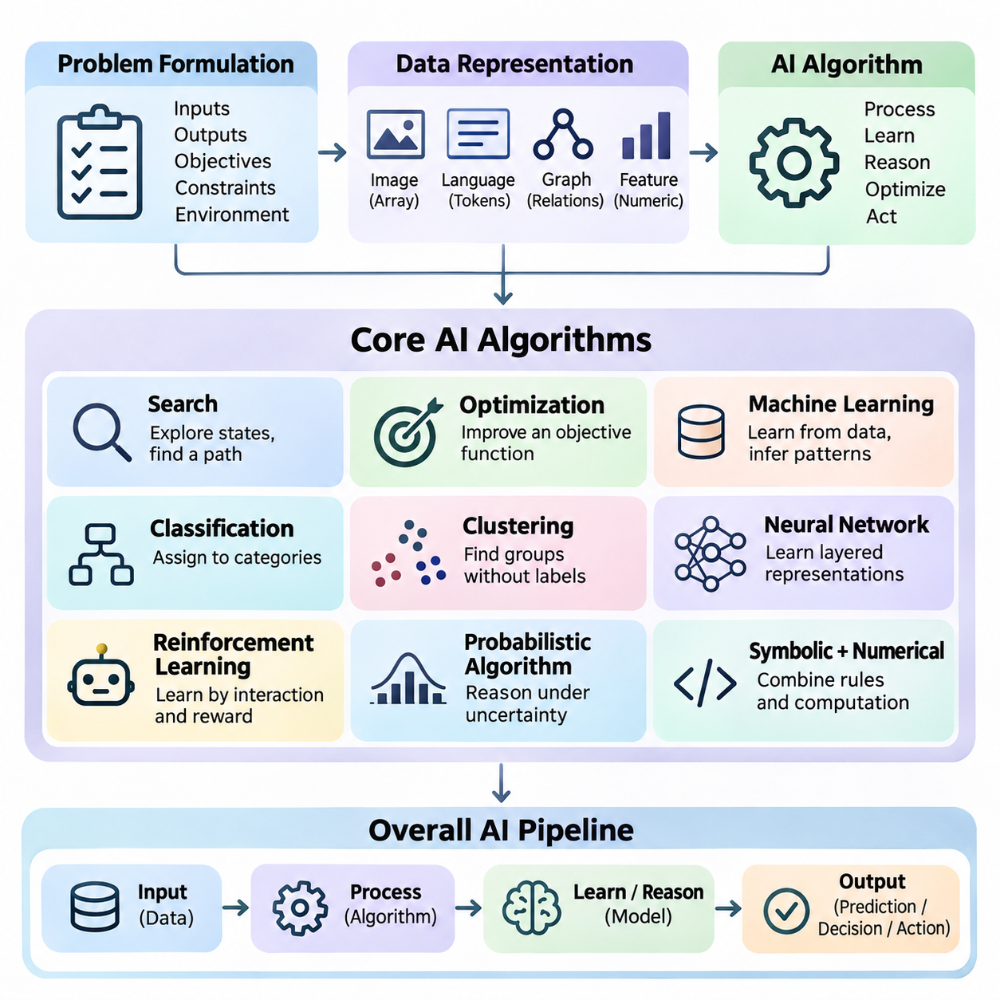
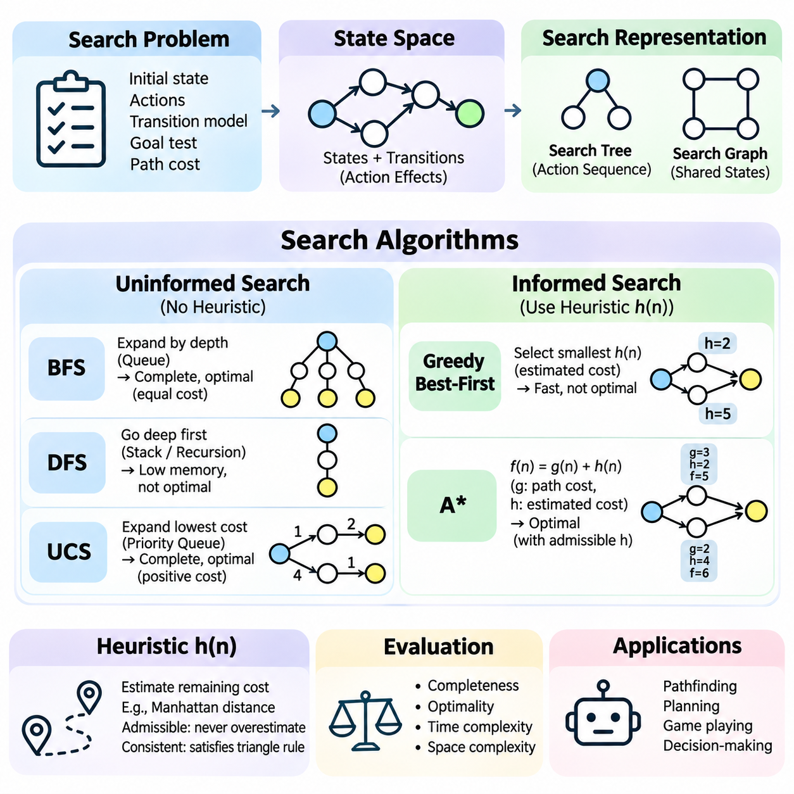
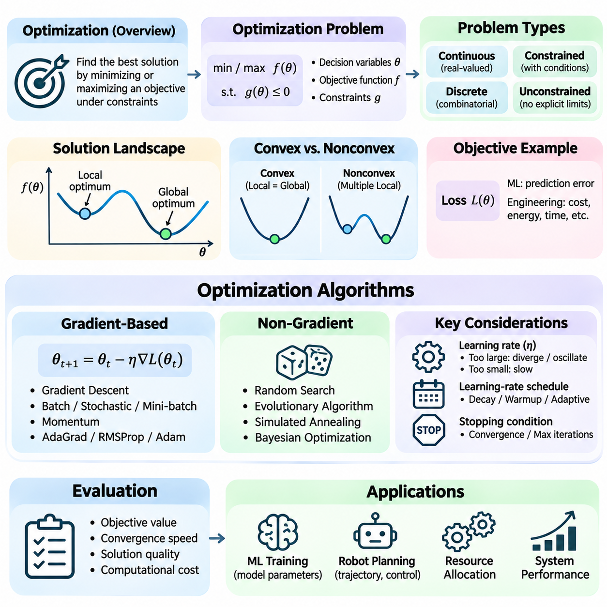
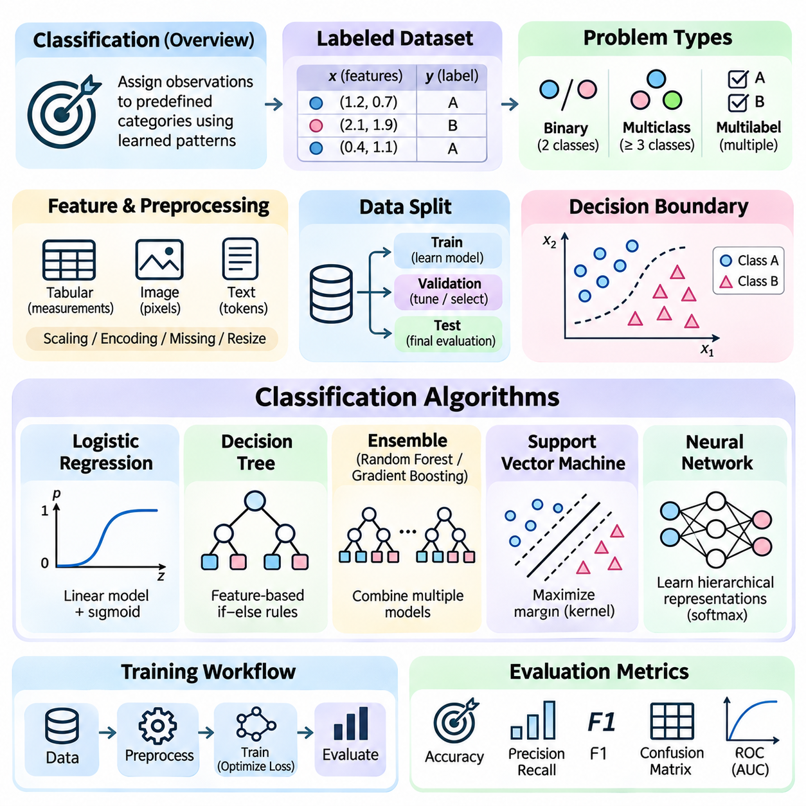
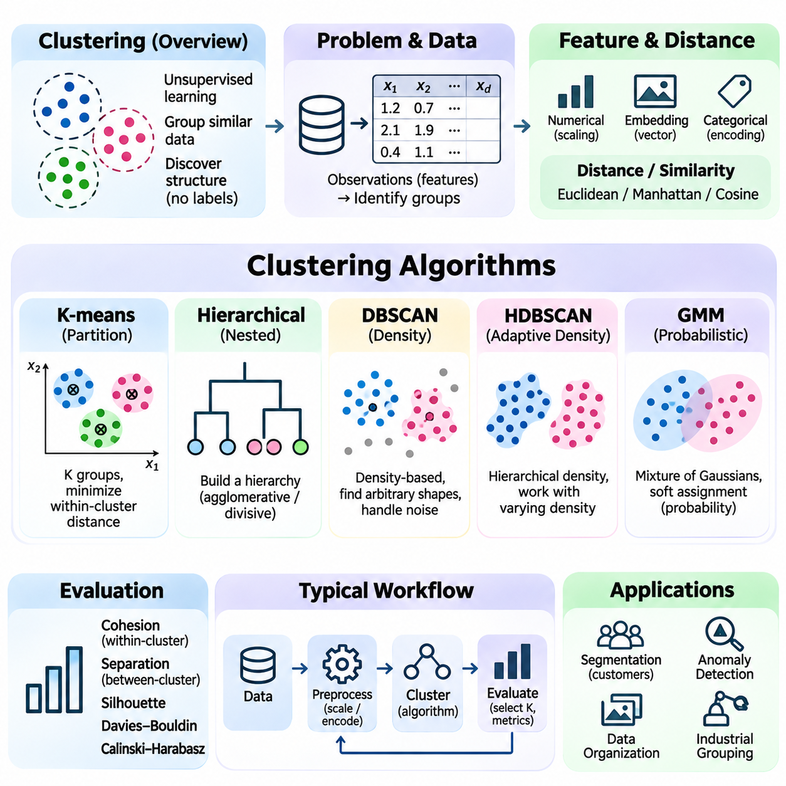
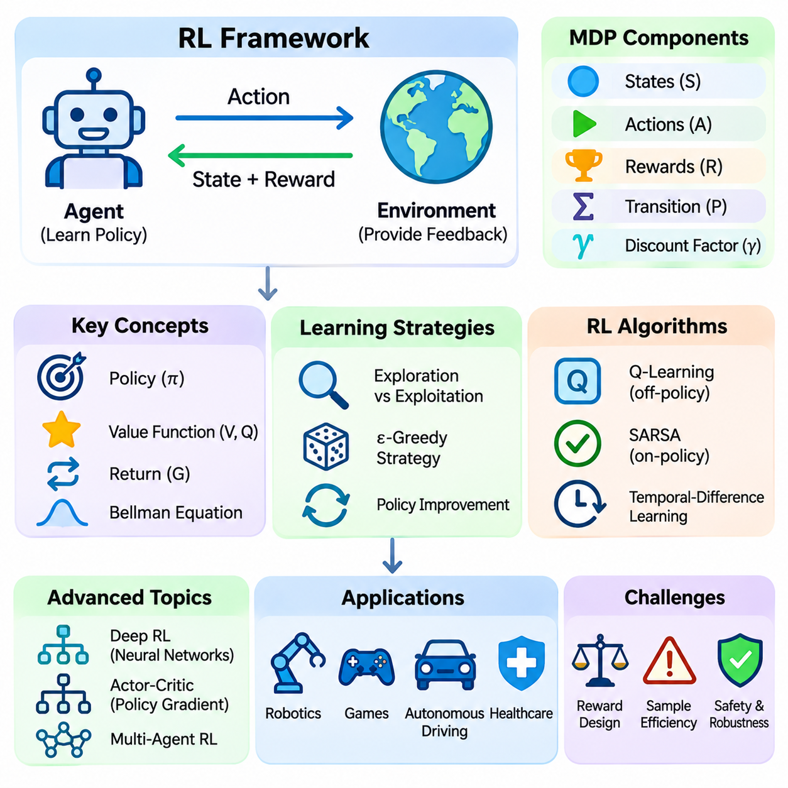
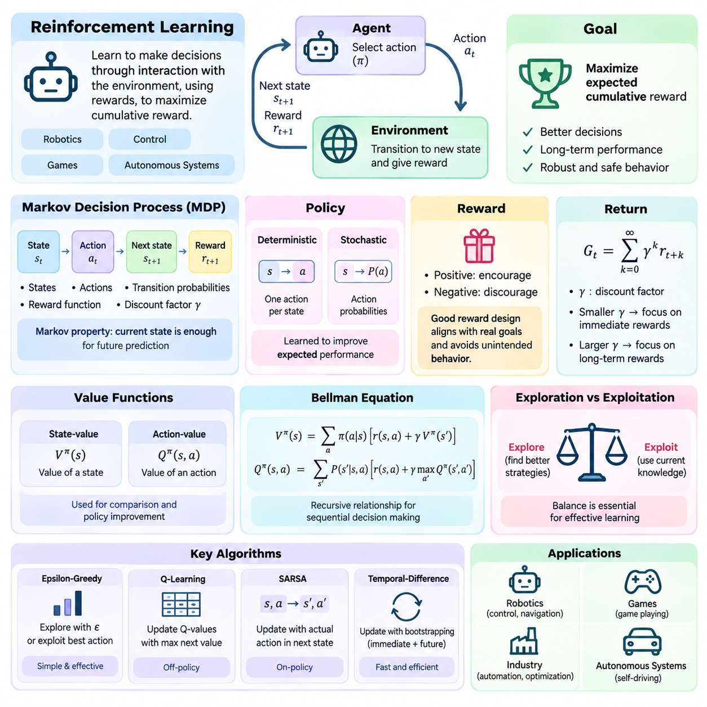
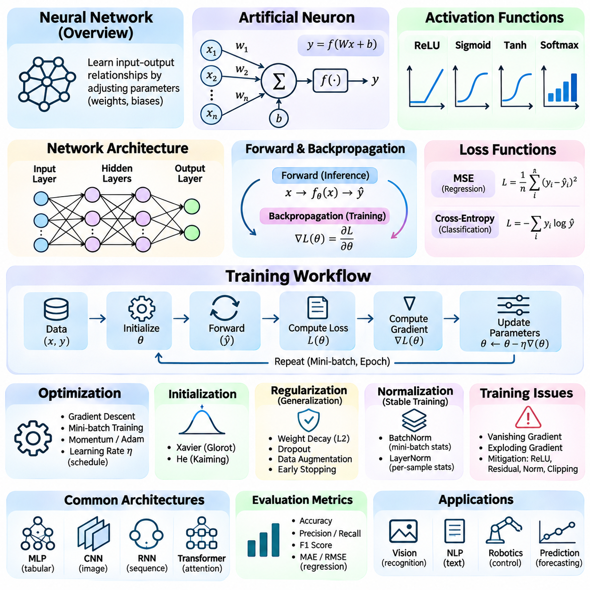
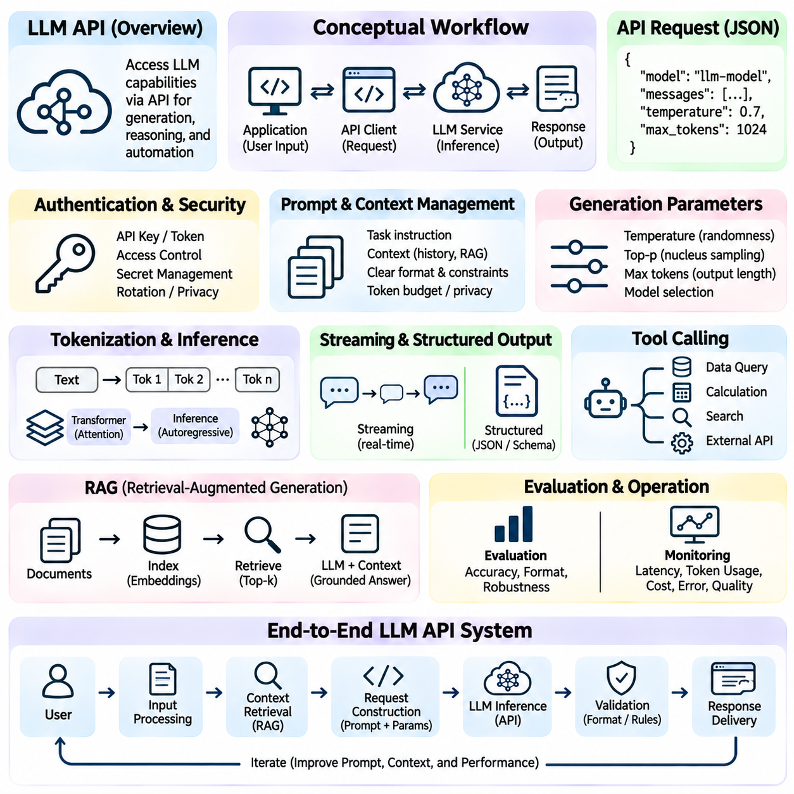

**Volume 04. Artificial Intelligence**


# 08. Core AI Algorithms Primer

## 08.00 Algorithmic View of AI

{width="7.268055555555556in" height="7.268055555555556in"}

Artificial intelligence can be understood from an algorithmic perspective as the systematic transformation of information into predictions, decisions, and actions. An AI algorithm defines a computational procedure that processes inputs, applies mathematical or logical operations, and produces outputs aligned with a specified objective. This perspective provides a common foundation for understanding classical reasoning systems, machine learning, neural networks, and autonomous agents.

An algorithm represents a sequence of computational operations designed to solve a defined problem. In conventional software, these operations are often explicitly programmed using rules and conditions. Artificial intelligence extends this approach by introducing mechanisms for searching alternatives, learning patterns, representing uncertainty, and adapting behavior. The resulting systems may combine deterministic procedures with statistical inference and optimization.

The algorithmic view begins with problem formulation. A problem must be described through its inputs, outputs, objectives, constraints, and operating environment. For example, an autonomous robot receives sensor measurements, estimates its surroundings, identifies possible actions, and selects movements toward a destination. Each operation can be expressed as an algorithmic component, allowing complex intelligent behavior to emerge from coordinated computational processes.

Data representation is fundamental because algorithms operate on structured information rather than abstract concepts directly. Images may be represented as multidimensional arrays, language as token sequences, and relationships as graphs. Numerical features, symbolic expressions, and probability distributions provide alternative representations. The selected representation determines which operations are possible and strongly influences computational efficiency and predictive performance.

Search algorithms provide one of the earliest foundations of artificial intelligence. They explore possible states or candidate solutions to identify a path toward a goal. Breadth-first search, depth-first search, uniform-cost search, and A\\\* illustrate different strategies for navigating a search space. Their effectiveness depends on the structure of the problem, available computational resources, and the quality of heuristic information guiding exploration.

Optimization algorithms approach intelligent computation by identifying parameters or decisions that minimize or maximize an objective function. Gradient descent adjusts model parameters using information about the direction of improvement, while other methods explore discrete or continuous solution spaces. Optimization connects classical mathematical programming with modern machine learning because both require systematic improvement under constraints and computational limitations.

Machine learning introduces algorithms that infer useful relationships from observed data instead of relying exclusively on manually specified rules. A learning procedure adjusts internal parameters according to examples, feedback, or statistical structure. Training establishes these parameters, while inference applies the resulting model to new inputs. The distinction between learning and inference is essential for understanding computational requirements and system behavior.

Classification algorithms assign observations to predefined categories using learned decision boundaries or statistical relationships. A classification system might distinguish defective products from acceptable products based on visual measurements. Logistic regression, decision trees, support vector machines, and neural classifiers provide different mechanisms for this task. Their performance depends on feature quality, representative training data, and appropriate evaluation procedures.

Clustering algorithms identify groups within data without requiring predefined category labels. They examine similarities, distances, or density relationships to discover underlying structure. K-means clustering partitions observations around representative centers, while density-based approaches identify regions containing closely connected samples. These methods support exploratory analysis, anomaly detection, customer segmentation, and the organization of large information collections.

Neural networks introduce interconnected computational units that transform information through weighted operations and nonlinear activation functions. During training, network parameters are adjusted to reduce prediction errors. Backpropagation efficiently calculates gradients needed for this adjustment. By combining multiple processing layers, neural networks can learn increasingly abstract representations suitable for images, language, sensor signals, and other complex data.

Reinforcement learning addresses problems in which an agent learns through interaction with an environment. The agent observes a state, selects an action, receives feedback, and updates its decision strategy. Rewards express desirable outcomes, while policies determine action selection. Unlike ordinary supervised learning, reinforcement learning must consider delayed consequences, exploration, and the relationship between present decisions and future outcomes.

Probabilistic algorithms provide mechanisms for reasoning when observations are incomplete, noisy, or uncertain. Bayesian inference updates beliefs using new evidence, while probabilistic graphical models represent dependencies among variables. Such approaches are important in robotics, medical decision support, and predictive systems. Rather than assuming that every observation is correct, probabilistic reasoning explicitly represents uncertainty and supports decisions based on available evidence.

Algorithmic reasoning can combine symbolic and numerical computation. Symbolic methods manipulate logical expressions, rules, and structured knowledge, while numerical methods operate on vectors, matrices, and continuous parameters. Hybrid systems can use learned models to interpret observations and symbolic procedures to enforce constraints or construct plans. This integration is particularly valuable when intelligent behavior requires both flexibility and explicit logical structure.

Modern large language models demonstrate how relatively general computational mechanisms can support diverse intelligent capabilities. Tokenization converts text into numerical identifiers, embeddings represent contextual information, and transformer operations process relationships across sequences. During inference, a model estimates likely output tokens conditioned on available context. Additional algorithms may manage retrieval, tool execution, validation, and interaction with external systems.

An AI system frequently contains several algorithms operating as an integrated pipeline. A perception algorithm extracts information from sensor measurements, a classification model identifies relevant objects, and a planning algorithm selects suitable actions. A controller then converts decisions into executable commands. The overall intelligence of the system depends not only on individual algorithms but also on the accuracy, timing, and coordination of information exchanged between components.

Computational complexity determines whether an algorithm can operate within practical resource limits. Time complexity describes how processing requirements grow with problem size, while space complexity characterizes memory consumption. An algorithm that produces accurate results may still be unsuitable for real-time applications if its computational demands exceed available resources. Efficient AI design therefore balances solution quality, execution time, memory usage, and energy consumption.

Algorithm selection also depends on the nature of the available information. Problems with explicit rules and well-defined states may benefit from symbolic search, whereas tasks involving large amounts of labeled data often favor supervised learning. Unlabeled datasets can support clustering, and sequential interaction problems may require reinforcement learning. Recognizing these distinctions prevents unnecessary complexity and encourages the selection of methods appropriate to the actual problem.

Generalization is a central requirement for learning-based algorithms. A model should perform effectively on previously unseen observations rather than merely reproduce its training examples. Overfitting occurs when learned patterns depend excessively on training-specific details, while underfitting indicates insufficient representation of relevant relationships. Validation procedures, regularization, and representative datasets help establish whether an algorithm can operate reliably beyond its development environment.

Evaluation provides evidence that an algorithm satisfies its intended objectives. Classification systems may be assessed through accuracy, precision, recall, and F1 score, while search algorithms can be compared through path quality and computational cost. Reinforcement learning systems require measures of cumulative reward, stability, and safety. Evaluation criteria must reflect the intended application because a single numerical metric rarely captures every important aspect of intelligent behavior.

Robustness concerns an algorithm\'s ability to maintain acceptable performance when inputs, operating conditions, or environmental assumptions change. Sensor noise, missing observations, unexpected obstacles, and distribution shifts can undermine otherwise effective models. Robust systems incorporate uncertainty handling, input validation, fallback procedures, and operational constraints. These mechanisms are especially important when algorithmic outputs influence physical actions or consequential decisions.

The algorithmic perspective also clarifies the distinction between intelligence and computational implementation. An intelligent capability may be realized through several alternative algorithms, each with different assumptions and tradeoffs. Conversely, a sophisticated algorithm does not automatically produce an intelligent system. Useful intelligence emerges when computational methods are connected to meaningful objectives, appropriate representations, reliable feedback, and effective interaction with the environment.

Understanding artificial intelligence through algorithms establishes a foundation for examining search, optimization, classification, clustering, reinforcement learning, neural computation, and language-model workflows. These methods represent complementary approaches rather than isolated technologies. Their combination enables systems to perceive information, discover patterns, reason about alternatives, and select actions, providing the computational foundation for increasingly capable and adaptive artificial intelligence.

인공지능(Artificial Intelligence, AI)은 알고리즘 관점(Algorithmic Perspective)에서 정보를 예측(Prediction), 의사결정(Decision-Making), 행동(Action)으로 체계적으로 변환하는 기술로 이해할 수 있다. 인공지능 알고리즘(AI Algorithm)은 입력(Input)을 처리하고 수학적 또는 논리적 연산(Mathematical or Logical Operations)을 수행하여 지정된 목표(Objective)에 부합하는 출력(Output)을 생성하는 계산 절차(Computational Procedure)를 정의한다. 이러한 관점은 고전적 추론 시스템(Classical Reasoning Systems), 기계학습(Machine Learning), 신경망(Neural Networks), 자율 에이전트(Autonomous Agents)를 이해하기 위한 공통 기반을 제공한다.

알고리즘(Algorithm)은 정의된 문제를 해결하기 위해 설계된 일련의 계산 연산(Computational Operations)을 의미한다. 전통적인 소프트웨어(Conventional Software)에서는 이러한 연산이 명시적인 규칙(Rules)과 조건(Conditions)에 따라 프로그래밍된다. 인공지능은 여기에 대안 탐색(Search), 패턴 학습(Pattern Learning), 불확실성 표현(Uncertainty Representation), 행동 적응(Behavior Adaptation) 기능을 추가한다. 그 결과 결정론적 절차(Deterministic Procedures)와 통계적 추론(Statistical Inference), 최적화(Optimization)를 결합한 시스템을 구현할 수 있다.

알고리즘적 관점(Algorithmic View)은 문제 정의(Problem Formulation)에서 시작된다. 문제는 입력(Input), 출력(Output), 목표(Objectives), 제약조건(Constraints), 운영 환경(Operating Environment)을 통해 명확하게 기술되어야 한다. 예를 들어 자율 로봇(Autonomous Robot)은 센서 측정값(Sensor Measurements)을 수신하고 주변 환경을 추정하며 가능한 행동을 식별한 후 목적지까지 이동하기 위한 동작을 선택한다. 각각의 과정은 알고리즘 구성요소(Algorithmic Component)로 표현할 수 있으며, 이러한 계산 과정의 협력을 통해 복잡한 지능적 행동(Intelligent Behavior)이 구현된다.

데이터 표현(Data Representation)은 알고리즘이 추상적 개념 자체가 아니라 구조화된 정보(Structured Information)를 대상으로 연산하기 때문에 매우 중요하다. 이미지는 다차원 배열(Multidimensional Arrays), 언어는 토큰 시퀀스(Token Sequences), 관계는 그래프(Graphs)로 표현할 수 있다. 수치 특징(Numerical Features), 기호 표현(Symbolic Expressions), 확률분포(Probability Distributions) 역시 서로 다른 표현 방식이다. 선택된 표현 방식은 수행 가능한 연산을 결정하며 계산 효율성(Computational Efficiency)과 예측 성능(Predictive Performance)에 큰 영향을 미친다.

탐색 알고리즘(Search Algorithms)은 인공지능의 가장 초기 기반 기술 중 하나이다. 탐색 알고리즘은 목표에 도달하는 경로를 찾기 위해 가능한 상태(States) 또는 후보 해(Candidate Solutions)를 탐색한다. 너비 우선 탐색(Breadth-First Search), 깊이 우선 탐색(Depth-First Search), 균일 비용 탐색(Uniform-Cost Search), A\\\* 탐색(A\\\* Search)은 탐색 공간(Search Space)을 탐색하는 서로 다른 전략을 보여준다. 이러한 알고리즘의 효율성은 문제 구조(Problem Structure), 사용 가능한 계산 자원(Computational Resources), 탐색을 안내하는 휴리스틱 정보(Heuristic Information)의 품질에 따라 달라진다.

최적화 알고리즘(Optimization Algorithms)은 목적함수(Objective Function)를 최소화하거나 최대화하는 매개변수(Parameters) 또는 의사결정(Decisions)을 찾는 방식으로 지능적 계산(Intelligent Computation)을 수행한다. 경사하강법(Gradient Descent)은 개선 방향에 관한 정보를 이용하여 모델 매개변수를 조정하며, 다른 최적화 방법들은 이산 또는 연속 해 공간(Discrete or Continuous Solution Spaces)을 탐색한다. 최적화는 고전적인 수학적 계획법(Mathematical Programming)과 현대 기계학습을 연결하는 핵심 개념으로, 두 분야 모두 제약조건과 계산 자원의 한계 내에서 체계적인 성능 개선을 추구한다.

기계학습(Machine Learning)은 사람이 모든 규칙을 직접 정의하는 대신 관측 데이터(Observed Data)로부터 유용한 관계를 추론하는 알고리즘을 도입한다. 학습 절차(Learning Procedure)는 예제(Examples), 피드백(Feedback), 통계적 구조(Statistical Structure)를 바탕으로 내부 매개변수(Internal Parameters)를 조정한다. 학습(Training)은 이러한 매개변수를 확립하는 과정이며, 추론(Inference)은 학습된 모델을 새로운 입력에 적용하는 과정이다. 학습과 추론의 차이를 이해하는 것은 계산 요구사항(Computational Requirements)과 시스템 동작(System Behavior)을 파악하는 데 필수적이다.

분류 알고리즘(Classification Algorithms)은 학습된 결정 경계(Decision Boundaries) 또는 통계적 관계(Statistical Relationships)를 이용하여 관측 데이터를 사전에 정의된 범주(Categories)에 할당한다. 예를 들어 분류 시스템은 시각적 측정값을 바탕으로 불량 제품과 정상 제품을 구분할 수 있다. 로지스틱 회귀(Logistic Regression), 의사결정 트리(Decision Trees), 서포트 벡터 머신(Support Vector Machines), 신경망 분류기(Neural Classifiers)는 이러한 작업을 수행하는 서로 다른 방법을 제공한다. 성능은 특징 품질(Feature Quality), 대표성 있는 학습 데이터(Representative Training Data), 적절한 평가 절차(Evaluation Procedures)에 따라 달라진다.

군집화 알고리즘(Clustering Algorithms)은 사전에 정의된 범주 레이블(Category Labels) 없이 데이터 내부의 집단을 식별한다. 데이터 간 유사도(Similarity), 거리(Distance), 밀도 관계(Density Relationships)를 분석하여 잠재적인 구조(Underlying Structure)를 발견한다. K-평균 군집화(K-Means Clustering)는 대표 중심점(Representative Centers)을 기준으로 데이터를 분할하며, 밀도 기반 방법(Density-Based Methods)은 밀접하게 연결된 표본이 분포하는 영역을 식별한다. 이러한 방법은 탐색적 분석(Exploratory Analysis), 이상 탐지(Anomaly Detection), 고객 세분화(Customer Segmentation), 대규모 정보 집합의 구조화에 활용된다.

신경망(Neural Networks)은 가중 연산(Weighted Operations)과 비선형 활성화 함수(Nonlinear Activation Functions)를 통해 정보를 변환하는 상호 연결된 계산 단위(Computational Units)를 도입한다. 학습 과정에서는 예측 오차(Prediction Errors)를 줄이도록 네트워크 매개변수(Network Parameters)를 조정한다. 역전파(Backpropagation)는 이러한 조정에 필요한 기울기(Gradients)를 효율적으로 계산한다. 여러 처리 계층(Processing Layers)을 결합하면 이미지, 언어, 센서 신호 등 복잡한 데이터에 적합한 고차원 추상 표현(Abstract Representations)을 학습할 수 있다.

강화학습(Reinforcement Learning)은 에이전트(Agent)가 환경(Environment)과 상호작용하면서 학습하는 문제를 다룬다. 에이전트는 상태(State)를 관측하고 행동(Action)을 선택하며 피드백(Feedback)을 받은 후 의사결정 전략(Decision Strategy)을 갱신한다. 보상(Reward)은 바람직한 결과를 표현하고, 정책(Policy)은 행동 선택 방식을 결정한다. 일반적인 지도학습(Supervised Learning)과 달리 강화학습은 지연된 결과(Delayed Consequences), 탐색(Exploration), 현재 의사결정과 미래 결과 사이의 관계를 고려해야 한다.

확률적 알고리즘(Probabilistic Algorithms)은 관측 정보가 불완전하거나 잡음(Noise)을 포함하거나 불확실한 상황에서 추론할 수 있는 메커니즘을 제공한다. 베이지안 추론(Bayesian Inference)은 새로운 증거(Evidence)를 이용하여 믿음 또는 확률적 신념(Beliefs)을 갱신하며, 확률 그래프 모델(Probabilistic Graphical Models)은 변수 사이의 의존 관계(Dependencies)를 표현한다. 이러한 접근법은 로봇공학(Robotics), 의료 의사결정 지원(Medical Decision Support), 예측 시스템(Predictive Systems)에서 중요하다. 모든 관측이 정확하다고 가정하지 않고 불확실성을 명시적으로 표현하여 이용 가능한 증거에 기반한 의사결정을 지원한다.

알고리즘적 추론(Algorithmic Reasoning)은 기호적 계산(Symbolic Computation)과 수치적 계산(Numerical Computation)을 결합할 수 있다. 기호적 방법(Symbolic Methods)은 논리 표현(Logical Expressions), 규칙(Rules), 구조화된 지식(Structured Knowledge)을 조작하며, 수치적 방법(Numerical Methods)은 벡터(Vectors), 행렬(Matrices), 연속 매개변수(Continuous Parameters)를 처리한다. 하이브리드 시스템(Hybrid Systems)은 학습된 모델로 관측 정보를 해석하고 기호적 절차로 제약조건을 적용하거나 계획을 수립할 수 있다. 이러한 통합은 유연성과 명시적 논리 구조가 동시에 필요한 지능적 행동에서 특히 유용하다.

현대의 대규모 언어 모델(Large Language Models, LLMs)은 비교적 범용적인 계산 메커니즘(General Computational Mechanisms)이 다양한 지능적 기능을 지원할 수 있음을 보여준다. 토큰화(Tokenization)는 텍스트를 수치 식별자(Numerical Identifiers)로 변환하고, 임베딩(Embeddings)은 문맥 정보(Contextual Information)를 표현하며, 트랜스포머 연산(Transformer Operations)은 시퀀스 내부의 관계를 처리한다. 추론 과정에서 모델은 주어진 문맥을 조건으로 출력 토큰의 가능성을 추정한다. 추가 알고리즘은 검색(Retrieval), 도구 실행(Tool Execution), 검증(Validation), 외부 시스템과의 상호작용을 관리할 수 있다.

인공지능 시스템(AI System)은 여러 알고리즘이 통합 파이프라인(Integrated Pipeline)으로 작동하는 구조를 갖는 경우가 많다. 인지 알고리즘(Perception Algorithm)은 센서 측정값에서 정보를 추출하고, 분류 모델(Classification Model)은 관련 객체를 식별하며, 계획 알고리즘(Planning Algorithm)은 적절한 행동을 선택한다. 이후 제어기(Controller)는 의사결정을 실행 가능한 명령(Executable Commands)으로 변환한다. 시스템 전체의 지능은 개별 알고리즘의 성능뿐 아니라 구성요소 사이에서 교환되는 정보의 정확성(Accuracy), 시간적 적합성(Timing), 조정 능력(Coordination)에 의해 결정된다.

계산 복잡도(Computational Complexity)는 알고리즘이 실제 자원 제약(Resource Constraints) 내에서 실행될 수 있는지를 결정한다. 시간 복잡도(Time Complexity)는 문제 크기가 증가함에 따라 처리 요구량이 어떻게 증가하는지를 나타내며, 공간 복잡도(Space Complexity)는 메모리 사용량(Memory Consumption)을 설명한다. 정확한 결과를 생성하는 알고리즘이라도 계산 요구량이 가용 자원을 초과하면 실시간 응용(Real-Time Applications)에 적합하지 않을 수 있다. 따라서 효율적인 인공지능 설계는 해의 품질(Solution Quality), 실행 시간(Execution Time), 메모리 사용량, 에너지 소비(Energy Consumption) 사이의 균형을 고려해야 한다.

알고리즘 선택(Algorithm Selection)은 이용 가능한 정보의 특성에 따라서도 달라진다. 명시적 규칙과 잘 정의된 상태를 갖는 문제에는 기호적 탐색(Symbolic Search)이 적합할 수 있으며, 대량의 레이블 데이터(Labeled Data)를 사용하는 작업에는 지도학습(Supervised Learning)이 유리한 경우가 많다. 레이블이 없는 데이터(Unlabeled Data)에는 군집화(Clustering)를 적용할 수 있고, 순차적 상호작용(Sequential Interaction)이 필요한 문제에는 강화학습이 요구될 수 있다. 이러한 차이를 이해하면 불필요한 복잡성을 줄이고 실제 문제에 적합한 방법을 선택할 수 있다.

일반화(Generalization)는 학습 기반 알고리즘(Learning-Based Algorithms)의 핵심 요구사항이다. 모델은 학습 예제를 단순히 재현하는 것이 아니라 이전에 관측하지 못한 데이터(Unseen Data)에서도 효과적으로 작동해야 한다. 과적합(Overfitting)은 학습된 패턴이 학습 데이터에 특화된 세부사항에 지나치게 의존할 때 발생하며, 과소적합(Underfitting)은 중요한 관계를 충분히 표현하지 못하는 상태를 의미한다. 검증 절차(Validation Procedures), 정규화(Regularization), 대표성 있는 데이터셋(Representative Datasets)은 개발 환경을 벗어난 상황에서도 알고리즘이 안정적으로 작동하는지 판단하는 데 도움을 준다.

평가(Evaluation)는 알고리즘이 의도한 목표를 충족하는지 판단할 수 있는 근거를 제공한다. 분류 시스템은 정확도(Accuracy), 정밀도(Precision), 재현율(Recall), F1 점수(F1 Score)를 통해 평가할 수 있으며, 탐색 알고리즘은 경로 품질(Path Quality)과 계산 비용(Computational Cost)을 기준으로 비교할 수 있다. 강화학습 시스템은 누적 보상(Cumulative Reward), 안정성(Stability), 안전성(Safety)을 평가해야 한다. 단일 수치 지표(Numerical Metric)만으로 지능적 행동의 모든 중요한 특성을 설명하기 어렵기 때문에 평가 기준은 실제 응용 목적을 반영해야 한다.

강건성(Robustness)은 입력, 운영 조건 또는 환경적 가정(Environmental Assumptions)이 변화하더라도 알고리즘이 허용 가능한 성능을 유지하는 능력을 의미한다. 센서 잡음(Sensor Noise), 누락된 관측(Missing Observations), 예상하지 못한 장애물(Unexpected Obstacles), 분포 변화(Distribution Shifts)는 정상적으로 작동하던 모델의 성능을 저하시킬 수 있다. 강건한 시스템(Robust Systems)은 불확실성 처리(Uncertainty Handling), 입력 검증(Input Validation), 대체 절차(Fallback Procedures), 운영 제약조건(Operational Constraints)을 포함한다. 이러한 메커니즘은 알고리즘의 출력이 물리적 행동이나 중요한 의사결정에 영향을 미치는 경우 특히 중요하다.

알고리즘적 관점(Algorithmic Perspective)은 지능(Intelligence)과 계산적 구현(Computational Implementation)의 차이를 명확하게 설명한다. 하나의 지능적 기능(Intelligent Capability)은 서로 다른 가정과 절충관계(Tradeoffs)를 가진 여러 알고리즘으로 구현될 수 있다. 반대로 정교한 알고리즘(Sophisticated Algorithm)을 사용한다고 해서 자동으로 지능적인 시스템이 만들어지는 것은 아니다. 유용한 지능은 계산 방법이 의미 있는 목표(Meaningful Objectives), 적절한 표현(Appropriate Representations), 신뢰할 수 있는 피드백(Reliable Feedback), 환경과의 효과적인 상호작용(Effective Interaction)으로 연결될 때 구현된다.

알고리즘을 통한 인공지능의 이해는 탐색(Search), 최적화(Optimization), 분류(Classification), 군집화(Clustering), 강화학습(Reinforcement Learning), 신경망 계산(Neural Computation), 언어 모델 작업 흐름(Language Model Workflows)을 학습하기 위한 기초를 제공한다. 이러한 방법들은 서로 독립된 기술이 아니라 상호 보완적인 접근법(Complementary Approaches)을 나타낸다. 이들의 결합을 통해 시스템은 정보를 인지하고 패턴을 발견하며 대안을 추론하고 행동을 선택할 수 있으며, 점점 더 높은 능력과 적응성을 갖춘 인공지능(Adaptive Artificial Intelligence)을 구현하기 위한 계산적 기반(Computational Foundation)을 형성한다.

## 08.01 Search Algorithms Review [w/Code]

{width="7.268055555555556in" height="7.268055555555556in"}

Search algorithms are fundamental computational methods in artificial intelligence that systematically explore possible states to identify solutions satisfying defined objectives. They provide the foundation for pathfinding, automated planning, game playing, and decision-making. A search problem is typically described through an initial state, available actions, a transition model, a goal test, and a path-cost function that evaluates candidate solutions.

A state space represents all configurations that can potentially arise during problem solving. Each state describes a particular situation, while transitions represent changes produced by applying valid actions. Search algorithms navigate these relationships to discover sequences connecting an initial state to a desired goal. The structure of the state space strongly influences computational complexity, memory requirements, and the feasibility of finding solutions.

Search trees and search graphs provide two related representations of exploration. A search tree records alternative action sequences, potentially representing the same underlying state multiple times. A search graph identifies shared states and their connections, allowing algorithms to recognize previously explored configurations. Graph-based search can reduce redundant computation, although maintaining visited-state information introduces additional memory requirements.

Uninformed search algorithms explore state spaces without using estimates of proximity to a goal. Their decisions depend on structural information such as node depth, accumulated path cost, or exploration order. Breadth-first search, depth-first search, and uniform-cost search are representative approaches. Each algorithm follows a different expansion strategy, producing distinct tradeoffs among completeness, optimality, computational effort, and memory consumption.

Breadth-first search explores states in increasing order of depth, expanding all nodes at one level before proceeding to the next. It typically uses a first-in, first-out queue to manage pending states. When every action has equal cost, breadth-first search finds a solution requiring the minimum number of actions, provided a solution exists within a finite branching structure. Its principal limitation is substantial memory consumption as the search frontier grows.

Depth-first search follows one branch of the search tree as deeply as possible before returning to explore alternatives. A stack or recursive procedure naturally supports this behavior. Depth-first search generally requires less memory than breadth-first search because it primarily maintains the current exploration path. However, it may encounter extremely deep or infinite branches, and the first discovered solution is not necessarily optimal.

Uniform-cost search expands the frontier node with the lowest accumulated path cost rather than the shallowest node. A priority queue maintains candidates according to their current costs. This strategy is particularly useful when actions have different costs, such as routes with varying distances or energy requirements. With appropriate positive cost assumptions, uniform-cost search is complete and returns a minimum-cost solution.

Informed search algorithms improve exploration by incorporating heuristic information about the remaining distance or cost to a goal. A heuristic function estimates the effort required to complete a solution from a particular state. Effective heuristics guide the algorithm toward promising regions of the search space, potentially reducing unnecessary exploration. Their usefulness depends on computational efficiency, estimation accuracy, and consistency with the underlying problem.

Greedy best-first search selects the state with the smallest estimated remaining cost. It prioritizes apparent proximity to the goal without directly considering the cost already accumulated along the current path. This approach can locate solutions quickly when heuristic estimates are informative. However, misleading heuristics may cause inefficient exploration, and greedy best-first search does not generally guarantee an optimal solution.

A\\\* search combines accumulated path cost with estimated remaining cost through the evaluation function f(n) = g(n) + h(n). Here, g(n) represents the known cost from the initial state to node n, while h(n) estimates the remaining cost to the goal. This combination balances progress already achieved with anticipated future effort, making A\\\* a widely used algorithm for optimal pathfinding.

The optimality of A\\\* depends on properties of its heuristic function and search implementation. An admissible heuristic never overestimates the true minimum remaining cost. A consistent heuristic additionally satisfies a triangle-inequality relationship across transitions. With appropriate graph-search procedures and cost assumptions, these properties support optimal solutions while reducing unnecessary node expansions compared with uninformed approaches.

Heuristic design is therefore an important part of practical search engineering. Common techniques include simplifying the original problem, calculating geometric distances, and constructing pattern databases from previously solved subproblems. For grid navigation, Manhattan distance can estimate movement cost when movement is restricted to horizontal and vertical directions. A useful heuristic must balance estimation quality against the computational expense of evaluating it.

Search algorithms are commonly evaluated using completeness, optimality, time complexity, and space complexity. Completeness indicates whether an algorithm eventually finds a solution when one exists under specified assumptions. Optimality describes whether the returned solution minimizes the relevant cost. Time and space complexity characterize computational requirements, often in relation to branching factor, solution depth, and the maximum depth explored.

The branching factor represents the number of successor states typically generated from each state. Even moderate branching factors can produce enormous search spaces as exploration depth increases. This combinatorial growth is known as state-space explosion. Practical systems address it through pruning, heuristic guidance, state abstraction, duplicate detection, and carefully designed constraints that eliminate unnecessary alternatives.

Implementation details significantly influence search performance. A frontier data structure stores states awaiting expansion, while an explored-state collection records previously processed configurations. Queues support breadth-first search, stacks support depth-first search, and priority queues support cost-based exploration. Efficient state hashing, successor generation, and cost updating can substantially reduce execution time in large problems.

A practical Python implementation often separates problem representation from the search procedure. The problem interface defines the initial state, goal condition, available actions, transition behavior, and action costs. The algorithm then manages the frontier and determines which state to expand next. This separation enables the same search implementation to operate across different environments without changing its fundamental exploration logic.

Consider a robot navigating a warehouse containing shelves, corridors, and restricted areas. Each navigable location can represent a state, while permitted movements define transitions. Breadth-first search may find the shortest route in terms of movement steps, whereas uniform-cost search can account for unequal traversal costs. A\\\* can incorporate distance estimates to accelerate route planning while preserving optimality under suitable conditions.

Search also supports automated planning, where states describe world conditions and actions modify those conditions through defined preconditions and effects. A planning algorithm explores possible action sequences until the desired goal conditions are satisfied. Unlike simple geometric pathfinding, planning may involve logical dependencies, resource constraints, and multiple interacting objectives. Search thus provides a computational foundation for goal-directed reasoning.

Adversarial search extends the basic search framework to environments containing competing decision-makers. In game-playing systems, possible moves generate a game tree representing alternative future states. Minimax evaluates decisions by assuming that opposing players act strategically, while alpha-beta pruning eliminates branches that cannot affect the final decision. These methods demonstrate how search can support strategic reasoning rather than merely finding physical paths.

Search becomes more challenging when environments are dynamic, partially observable, or uncertain. A previously valid route may become blocked, and available information may not fully describe the current state. Replanning algorithms, belief-state search, and probabilistic approaches address different aspects of these difficulties. Real-world autonomous systems often combine search with perception, localization, prediction, and continuous feedback.

The distinction between search and learning is important but not absolute. Traditional search algorithms explore explicitly defined alternatives using known transition rules, while learning algorithms infer useful patterns or policies from data. Modern systems frequently combine both approaches. Learned heuristics can guide search, neural networks can evaluate candidate states, and planning algorithms can improve decisions generated by learned models.

Search algorithms remain essential because they provide transparent mechanisms for exploring alternatives, enforcing constraints, and constructing goal-directed solutions. Their effectiveness depends on problem formulation, representation quality, heuristic design, and resource management. Understanding these principles establishes a foundation for optimization, automated planning, reinforcement learning, and intelligent systems that must make reliable decisions in complex environments.

탐색 알고리즘(Search Algorithms)은 정의된 목표(Objectives)를 충족하는 해(Solutions)를 찾기 위해 가능한 상태(States)를 체계적으로 탐색하는 인공지능(Artificial Intelligence)의 핵심 계산 방법(Computational Methods)이다. 이러한 알고리즘은 경로 탐색(Pathfinding), 자동 계획(Automated Planning), 게임 수행(Game Playing), 의사결정(Decision-Making)의 기반을 제공한다. 탐색 문제(Search Problem)는 일반적으로 초기 상태(Initial State), 사용 가능한 행동(Available Actions), 상태 전이 모델(Transition Model), 목표 검사(Goal Test), 후보 해를 평가하는 경로 비용 함수(Path-Cost Function)로 정의된다.

상태 공간(State Space)은 문제 해결 과정에서 발생할 수 있는 모든 구성 상태(Configurations)를 나타낸다. 각각의 상태(State)는 특정 상황을 설명하며, 상태 전이(Transitions)는 유효한 행동(Valid Actions)을 적용하여 발생하는 변화를 의미한다. 탐색 알고리즘은 이러한 관계를 탐색하여 초기 상태와 목표 상태(Goal State)를 연결하는 행동 시퀀스(Action Sequences)를 발견한다. 상태 공간의 구조는 계산 복잡도(Computational Complexity), 메모리 요구사항(Memory Requirements), 해를 찾을 수 있는 실현 가능성(Feasibility)에 큰 영향을 미친다.

탐색 트리(Search Trees)와 탐색 그래프(Search Graphs)는 탐색 과정을 표현하는 서로 연관된 두 가지 방법이다. 탐색 트리는 서로 다른 행동 시퀀스를 기록하므로 동일한 실제 상태가 여러 번 표현될 수 있다. 반면 탐색 그래프는 공통 상태와 상태 사이의 연결 관계를 식별하여 알고리즘이 이전에 탐색한 구성을 인식할 수 있도록 한다. 그래프 기반 탐색(Graph-Based Search)은 중복 계산(Redundant Computation)을 줄일 수 있지만, 방문한 상태(Visited States)를 관리하기 위한 추가적인 메모리가 필요하다.

비정보 탐색 알고리즘(Uninformed Search Algorithms)은 목표까지의 근접성을 추정하는 정보 없이 상태 공간을 탐색한다. 탐색 결정은 노드 깊이(Node Depth), 누적 경로 비용(Accumulated Path Cost), 탐색 순서(Exploration Order)와 같은 구조적 정보에 의존한다. 너비 우선 탐색(Breadth-First Search), 깊이 우선 탐색(Depth-First Search), 균일 비용 탐색(Uniform-Cost Search)이 대표적인 방법이다. 각 알고리즘은 서로 다른 노드 확장 전략(Node Expansion Strategy)을 사용하며, 완전성(Completeness), 최적성(Optimality), 계산량(Computational Effort), 메모리 사용량(Memory Consumption) 사이에서 서로 다른 절충관계(Tradeoffs)를 보인다.

너비 우선 탐색(Breadth-First Search, BFS)은 깊이가 증가하는 순서로 상태를 탐색하며, 다음 깊이로 이동하기 전에 현재 깊이의 모든 노드를 확장한다. 일반적으로 선입선출 큐(First-In, First-Out Queue)를 사용하여 탐색 대기 상태를 관리한다. 모든 행동의 비용이 동일하고 유한한 분기 구조(Finite Branching Structure) 내에 해가 존재한다면, 너비 우선 탐색은 최소 행동 횟수(Minimum Number of Actions)로 구성된 해를 찾는다. 주요 한계는 탐색 경계(Frontier)가 확장되면서 메모리 소비가 크게 증가한다는 점이다.

깊이 우선 탐색(Depth-First Search, DFS)은 하나의 탐색 트리 분기(Branch)를 가능한 한 깊이 따라간 후 이전 위치로 되돌아가 다른 대안을 탐색한다. 스택(Stack)이나 재귀 절차(Recursive Procedure)를 사용하면 이러한 동작을 자연스럽게 구현할 수 있다. 깊이 우선 탐색은 주로 현재 탐색 경로(Current Exploration Path)를 유지하므로 일반적으로 너비 우선 탐색보다 적은 메모리를 사용한다. 그러나 매우 깊거나 무한한 분기(Infinite Branches)에 진입할 수 있으며, 처음 발견한 해가 반드시 최적해(Optimal Solution)는 아니다.

균일 비용 탐색(Uniform-Cost Search, UCS)은 가장 얕은 노드가 아니라 누적 경로 비용(Accumulated Path Cost)이 가장 작은 탐색 경계 노드(Frontier Node)를 확장한다. 우선순위 큐(Priority Queue)는 현재 비용을 기준으로 후보 노드를 관리한다. 이러한 전략은 이동 거리나 에너지 요구량이 서로 다른 경로처럼 행동 비용(Action Costs)이 일정하지 않은 문제에서 특히 유용하다. 적절한 양의 비용 조건(Positive Cost Assumptions)이 충족되면 균일 비용 탐색은 완전성을 보장하며 최소 비용 해(Minimum-Cost Solution)를 반환한다.

정보 탐색 알고리즘(Informed Search Algorithms)은 목표까지 남은 거리나 비용에 관한 휴리스틱 정보(Heuristic Information)를 활용하여 탐색 효율성을 개선한다. 휴리스틱 함수(Heuristic Function)는 특정 상태에서 해를 완성하는 데 필요한 노력을 추정한다. 효과적인 휴리스틱은 알고리즘을 가능성이 높은 탐색 공간 영역(Promising Regions)으로 유도하여 불필요한 탐색을 줄일 수 있다. 휴리스틱의 유용성은 계산 효율성(Computational Efficiency), 추정 정확도(Estimation Accuracy), 실제 문제와의 일관성(Consistency)에 따라 달라진다.

탐욕적 최선 우선 탐색(Greedy Best-First Search)은 목표까지 남은 추정 비용(Estimated Remaining Cost)이 가장 작은 상태를 선택한다. 현재 경로에서 이미 누적된 비용을 직접 고려하지 않고 목표에 가까워 보이는 정도를 우선한다. 휴리스틱 추정값(Heuristic Estimates)이 유용한 정보를 제공하면 빠르게 해를 발견할 수 있다. 그러나 부정확한 휴리스틱은 비효율적인 탐색을 유발할 수 있으며, 탐욕적 최선 우선 탐색은 일반적으로 최적해를 보장하지 않는다.

A\\\* 탐색(A\\\* Search)은 평가 함수(Evaluation Function) f(n) = g(n) + h(n)을 통해 누적 경로 비용과 남은 추정 비용을 결합한다. 여기서 g(n)은 초기 상태에서 노드 n까지의 알려진 비용(Known Cost)을 의미하며, h(n)은 목표까지 남은 비용을 추정한다. 이러한 결합은 이미 달성한 진행 정도와 앞으로 필요한 노력을 균형 있게 고려한다. 따라서 A\\\*는 최적 경로 탐색(Optimal Pathfinding)에 널리 사용되는 알고리즘이다.

A\\\*의 최적성(Optimality)은 휴리스틱 함수의 특성과 탐색 구현(Search Implementation)에 따라 달라진다. 허용적 휴리스틱(Admissible Heuristic)은 실제 최소 잔여 비용(True Minimum Remaining Cost)을 절대로 과대평가하지 않는다. 일관적 휴리스틱(Consistent Heuristic)은 상태 전이 사이에서 삼각 부등식 관계(Triangle-Inequality Relationship)를 추가로 만족한다. 적절한 그래프 탐색 절차(Graph-Search Procedures)와 비용 조건(Cost Assumptions)이 충족되면 이러한 특성은 비정보 탐색보다 불필요한 노드 확장을 줄이면서 최적해를 찾는 데 기여한다.

휴리스틱 설계(Heuristic Design)는 실용적인 탐색 시스템 공학(Search Engineering)의 중요한 요소이다. 일반적인 방법에는 원래 문제의 단순화(Problem Relaxation), 기하학적 거리(Geometric Distances) 계산, 이전에 해결한 하위 문제(Subproblems)를 이용한 패턴 데이터베이스(Pattern Databases) 구축이 포함된다. 격자 기반 경로 탐색(Grid Navigation)에서는 이동이 수평과 수직 방향으로 제한될 때 맨해튼 거리(Manhattan Distance)를 이동 비용 추정에 활용할 수 있다. 유용한 휴리스틱은 추정 품질(Estimation Quality)과 계산 비용(Computational Expense) 사이의 균형을 유지해야 한다.

탐색 알고리즘은 일반적으로 완전성(Completeness), 최적성(Optimality), 시간 복잡도(Time Complexity), 공간 복잡도(Space Complexity)를 기준으로 평가한다. 완전성은 지정된 가정 아래에서 해가 존재할 때 알고리즘이 결국 해를 찾는지를 나타낸다. 최적성은 반환된 해가 관련 비용을 최소화하는지를 설명한다. 시간 복잡도와 공간 복잡도는 계산 요구사항을 나타내며, 일반적으로 분기 계수(Branching Factor), 해의 깊이(Solution Depth), 최대 탐색 깊이(Maximum Explored Depth)와 관련된다.

분기 계수(Branching Factor)는 각 상태에서 일반적으로 생성되는 후속 상태(Successor States)의 수를 의미한다. 분기 계수가 비교적 작더라도 탐색 깊이가 증가하면 탐색 공간(Search Space)은 매우 커질 수 있다. 이러한 조합적 증가(Combinatorial Growth)를 상태 공간 폭발(State-Space Explosion)이라고 한다. 실제 시스템에서는 가지치기(Pruning), 휴리스틱 안내(Heuristic Guidance), 상태 추상화(State Abstraction), 중복 상태 탐지(Duplicate Detection), 불필요한 대안을 제거하는 제약조건(Constraints)을 통해 이러한 문제를 완화한다.

구현 세부사항(Implementation Details)은 탐색 성능(Search Performance)에 상당한 영향을 미친다. 탐색 경계 자료구조(Frontier Data Structure)는 확장을 기다리는 상태를 저장하며, 탐색 완료 상태 집합(Explored-State Collection)은 이전에 처리한 구성을 기록한다. 큐(Queue)는 너비 우선 탐색을, 스택(Stack)은 깊이 우선 탐색을, 우선순위 큐(Priority Queue)는 비용 기반 탐색(Cost-Based Search)을 지원한다. 효율적인 상태 해싱(State Hashing), 후속 상태 생성(Successor Generation), 비용 갱신(Cost Updating)은 대규모 문제에서 실행 시간을 크게 줄일 수 있다.

실용적인 파이썬 구현(Python Implementation)에서는 문제 표현(Problem Representation)과 탐색 절차(Search Procedure)를 분리하는 경우가 많다. 문제 인터페이스(Problem Interface)는 초기 상태, 목표 조건(Goal Condition), 사용 가능한 행동, 상태 전이 동작(Transition Behavior), 행동 비용을 정의한다. 이후 알고리즘은 탐색 경계를 관리하고 다음에 확장할 상태를 결정한다. 이러한 분리는 기본 탐색 로직(Fundamental Exploration Logic)을 변경하지 않고도 동일한 탐색 구현을 다양한 환경에 적용할 수 있도록 한다.

선반(Shelves), 통로(Corridors), 제한 구역(Restricted Areas)이 존재하는 창고를 이동하는 로봇을 생각해 볼 수 있다. 이동 가능한 각 위치(Navigable Location)는 하나의 상태로 표현되며, 허용된 이동(Permitted Movements)은 상태 전이를 정의한다. 너비 우선 탐색은 이동 단계 수(Movement Steps)를 기준으로 최단 경로를 찾을 수 있으며, 균일 비용 탐색은 서로 다른 이동 비용(Traversal Costs)을 고려할 수 있다. A\\\*는 거리 추정값(Distance Estimates)을 활용하여 적절한 조건에서 최적성을 유지하면서 경로 계획(Route Planning)을 가속할 수 있다.

탐색은 자동 계획(Automated Planning)에도 활용되며, 이때 상태는 세계의 조건(World Conditions)을 설명하고 행동은 정의된 사전조건(Preconditions)과 효과(Effects)를 통해 이러한 조건을 변경한다. 계획 알고리즘(Planning Algorithm)은 원하는 목표 조건(Goal Conditions)이 충족될 때까지 가능한 행동 시퀀스를 탐색한다. 단순한 기하학적 경로 탐색(Geometric Pathfinding)과 달리 계획 문제에는 논리적 의존성(Logical Dependencies), 자원 제약(Resource Constraints), 상호작용하는 여러 목표(Multiple Interacting Objectives)가 포함될 수 있다. 따라서 탐색은 목표 지향적 추론(Goal-Directed Reasoning)의 계산적 기반을 제공한다.

적대적 탐색(Adversarial Search)은 경쟁하는 의사결정 주체(Competing Decision-Makers)가 존재하는 환경으로 기본 탐색 구조를 확장한다. 게임 수행 시스템(Game-Playing Systems)에서는 가능한 수(Moves)가 대안적인 미래 상태를 나타내는 게임 트리(Game Tree)를 생성한다. 미니맥스(Minimax)는 상대 플레이어가 전략적으로 행동한다고 가정하여 의사결정을 평가하며, 알파-베타 가지치기(Alpha-Beta Pruning)는 최종 결정에 영향을 주지 않는 분기를 제거한다. 이러한 방법은 탐색이 단순한 물리적 경로 발견을 넘어 전략적 추론(Strategic Reasoning)을 지원할 수 있음을 보여준다.

환경이 동적(Dynamic)이거나 부분 관측 가능(Partially Observable)하거나 불확실(Uncertain)할 경우 탐색은 더욱 어려워진다. 이전에 유효했던 경로가 차단될 수 있으며, 이용 가능한 정보가 현재 상태를 완전히 설명하지 못할 수도 있다. 재계획 알고리즘(Replanning Algorithms), 믿음 상태 탐색(Belief-State Search), 확률적 접근법(Probabilistic Approaches)은 이러한 어려움의 서로 다른 측면을 해결한다. 실제 자율 시스템(Autonomous Systems)은 탐색을 인지(Perception), 위치 추정(Localization), 예측(Prediction), 지속적 피드백(Continuous Feedback)과 결합하는 경우가 많다.

탐색(Search)과 학습(Learning)의 차이는 중요하지만 두 개념이 완전히 분리되는 것은 아니다. 전통적인 탐색 알고리즘은 알려진 상태 전이 규칙(Transition Rules)을 이용하여 명시적으로 정의된 대안을 탐색하는 반면, 학습 알고리즘(Learning Algorithms)은 데이터에서 유용한 패턴(Patterns)이나 정책(Policies)을 추론한다. 현대 시스템은 두 접근법을 자주 결합한다. 학습된 휴리스틱(Learned Heuristics)은 탐색을 안내할 수 있고, 신경망(Neural Networks)은 후보 상태를 평가할 수 있으며, 계획 알고리즘은 학습된 모델이 생성한 의사결정을 개선할 수 있다.

탐색 알고리즘은 대안을 탐색하고 제약조건을 적용하며 목표 지향적 해(Goal-Directed Solutions)를 구성하는 투명한 메커니즘(Transparent Mechanisms)을 제공하기 때문에 여전히 필수적이다. 그 효과는 문제 정의(Problem Formulation), 표현 품질(Representation Quality), 휴리스틱 설계(Heuristic Design), 자원 관리(Resource Management)에 따라 달라진다. 이러한 원리를 이해하면 최적화(Optimization), 자동 계획(Automated Planning), 강화학습(Reinforcement Learning), 복잡한 환경에서 신뢰할 수 있는 의사결정을 수행해야 하는 지능형 시스템(Intelligent Systems)을 학습하기 위한 기반을 확립할 수 있다.

## 08.02 Optimization Basics [w/Code]

{width="7.268055555555556in" height="7.268055555555556in"}

Optimization is a fundamental computational process in artificial intelligence that seeks the best possible solution according to a defined objective. It provides the mathematical foundation for training machine learning models, selecting actions, allocating resources, and improving system performance. An optimization problem typically consists of decision variables, an objective function, and constraints that determine which solutions are feasible within a particular application.

The objective function expresses what an algorithm attempts to minimize or maximize. In machine learning, this function often measures prediction error through a loss function, while engineering applications may optimize energy consumption, execution time, or operational cost. The choice of objective determines how candidate solutions are evaluated. A poorly specified objective can produce mathematically successful results that fail to satisfy practical requirements.

Decision variables represent quantities that an optimization algorithm can adjust to improve the objective. In neural networks, these variables include weights and biases, while robotic planning may involve trajectories, velocities, or control parameters. The complete set of possible variable configurations defines the search space. Optimization algorithms navigate this space to identify solutions that satisfy constraints while improving the selected performance criterion.

Optimization problems can be classified according to the mathematical properties of their variables and objectives. Continuous optimization involves real-valued parameters, whereas discrete optimization concerns choices such as routes, assignments, or configurations. Constrained optimization restricts feasible solutions through explicit conditions. Unconstrained optimization allows variables to vary freely within their mathematical domains, although practical implementations may still impose numerical limits.

The distinction between local and global optima is essential for understanding optimization behavior. A local optimum represents a solution that cannot be improved through sufficiently small changes within its neighborhood. A global optimum achieves the best objective value across the entire feasible domain. Complex optimization landscapes may contain multiple local optima, flat regions, and saddle points, making it difficult to identify globally optimal solutions efficiently.

Convex optimization provides an important theoretical foundation because convex objective functions over convex feasible regions possess favorable mathematical properties. For a differentiable convex function, any local minimum is also a global minimum. Many classical optimization methods exploit this structure to establish convergence guarantees. However, neural network training generally involves nonconvex objectives, requiring practical strategies that can operate without global optimality guarantees.

Gradient-based optimization uses derivatives to determine how changes in decision variables affect an objective function. The gradient points toward the direction of steepest local increase under the Euclidean metric, so moving in the opposite direction can reduce the objective for a sufficiently small step. This principle forms the basis of gradient descent, one of the most widely used algorithms in machine learning and numerical optimization.

Gradient descent updates parameters iteratively according to the expression θ_next = θ_current − η∇L(θ_current). Here, θ represents the model parameters, L denotes the loss function, and η is the learning rate controlling the update magnitude. Each iteration evaluates the gradient and adjusts parameters toward a lower-loss region. The process continues until a stopping condition is satisfied or the available computational budget is exhausted.

The learning rate strongly influences optimization stability and convergence speed. A learning rate that is too large may cause oscillation, overshooting, or divergence, while an excessively small value can produce slow progress. Learning-rate schedules modify the step size during training to improve convergence behavior. Common strategies include gradual decay, warmup periods, and adaptive adjustments based on optimization progress.

Batch gradient descent calculates parameter updates using the complete training dataset, producing relatively stable gradient estimates but potentially requiring substantial computation. Stochastic gradient descent uses individual training examples, introducing randomness into the update process. Mini-batch gradient descent computes gradients from smaller groups of examples, balancing computational efficiency, gradient variability, and compatibility with parallel hardware acceleration.

Momentum-based optimization improves ordinary gradient descent by incorporating information from previous updates. Instead of responding exclusively to the current gradient, the algorithm maintains a moving accumulation of past gradient directions. This mechanism can accelerate movement through consistently descending regions and reduce oscillations in poorly conditioned landscapes. Momentum is particularly useful when optimization surfaces exhibit different curvature across parameter dimensions.

Adaptive optimization algorithms adjust update magnitudes according to historical gradient information. AdaGrad accumulates squared gradients to scale parameter-specific learning rates, while RMSProp uses moving averages to avoid indefinitely shrinking effective steps. Adam combines momentum-like first-moment estimates with second-moment estimates of gradient magnitude. These methods are widely used in neural network training, although their performance and generalization properties depend on the task.

Optimization also includes methods that do not require gradient information. Random search evaluates randomly selected candidates, while evolutionary algorithms iteratively modify populations of potential solutions through selection and variation. Simulated annealing occasionally accepts worse solutions to encourage exploration. Such approaches are useful when objective functions are discontinuous, nondifferentiable, expensive to evaluate, or defined over discrete configurations.

Constraints introduce additional complexity because candidate solutions must satisfy operational or mathematical requirements. Equality constraints specify relationships that must hold exactly, while inequality constraints define allowable ranges or boundaries. Penalty methods incorporate constraint violations into the objective function. Other approaches, including projected gradient methods and Lagrangian formulations, address feasibility through mathematical transformations or explicit constrained updates.

Regularization connects optimization with model generalization by modifying the training objective to discourage undesirable model behavior. L1 regularization penalizes absolute parameter magnitudes and can encourage sparsity, while L2 regularization penalizes squared magnitudes. These techniques influence the solutions selected during training and can reduce overfitting. Regularization strength must be chosen carefully because excessive penalties may limit the model\'s ability to represent useful patterns.

Optimization performance depends on the geometry of the objective landscape. Poor conditioning occurs when the objective changes much more rapidly in some directions than others, potentially slowing gradient-based methods. Saddle points contain directions of increasing and decreasing objective values, complicating convergence analysis. Parameter scaling, normalization, suitable initialization, and adaptive optimization strategies can improve numerical behavior in challenging problems.

Convergence describes the progression of an optimization algorithm toward a stable solution or a mathematically defined optimality condition. Practical stopping criteria may include small improvements in objective value, sufficiently small gradient norms, maximum iteration counts, or validation-based early stopping. A decreasing training loss does not necessarily imply improved generalization. Monitoring both optimization progress and independent evaluation performance is therefore essential.

A simple classification example illustrates the optimization process. A model receives feature vectors and predicts class probabilities, which are compared with known labels using a loss function such as cross-entropy. The optimization algorithm calculates parameter gradients and updates the model to reduce prediction errors. Repeated iterations gradually improve the fit to training data, while validation measurements help determine whether the resulting model generalizes.

Optimization in robotics extends beyond model training to trajectory planning, control, and resource management. A mobile robot may minimize travel time, energy consumption, or deviation from a desired path while respecting obstacle and actuator constraints. Multiple objectives may conflict, requiring weighted combinations or multi-objective optimization techniques. The resulting solution must balance mathematical performance with physical feasibility, safety, and real-time computational requirements.

Computational efficiency is a major consideration because optimization often requires repeated evaluations of objective functions and gradients. Large neural networks may contain millions or billions of adjustable parameters, making each update computationally expensive. Vectorized operations, automatic differentiation, GPU acceleration, and efficient data pipelines reduce training overhead. Memory consumption, numerical precision, and communication costs also influence the practical choice of optimization methods.

Numerical stability becomes particularly important when optimization involves very large or very small values. Floating-point limitations can produce overflow, underflow, or inaccurate gradient calculations. Techniques such as gradient clipping, stable mathematical formulations, and appropriate numerical precision help prevent training failures. Mixed-precision computation can improve throughput and memory efficiency when supported by suitable scaling and numerical safeguards.

Optimization algorithms must be evaluated through more than their final objective values. Convergence speed, computational cost, sensitivity to initialization, robustness to hyperparameters, and generalization performance are also important. Repeated experiments with controlled random seeds help characterize variability, while consistent evaluation conditions support meaningful comparisons. An optimizer that converges quickly on one problem may perform poorly on another.

Optimization provides a unifying foundation connecting classical artificial intelligence, machine learning, deep learning, reinforcement learning, and autonomous systems. Search algorithms explore candidate solutions, learning algorithms adjust model parameters, and control algorithms select actions under constraints. Understanding objectives, gradients, convergence, and computational tradeoffs establishes the essential background for designing AI systems that improve performance through systematic mathematical adjustment.

최적화(Optimization)는 정의된 목표(Objective)에 따라 가능한 최상의 해(Solution)를 찾는 인공지능(Artificial Intelligence)의 핵심 계산 과정(Computational Process)이다. 최적화는 기계학습 모델(Machine Learning Models)의 학습, 행동 선택(Action Selection), 자원 할당(Resource Allocation), 시스템 성능 개선(System Performance Improvement)을 위한 수학적 기반(Mathematical Foundation)을 제공한다. 최적화 문제(Optimization Problem)는 일반적으로 결정 변수(Decision Variables), 목적함수(Objective Function), 특정 응용 분야에서 실행 가능한 해를 결정하는 제약조건(Constraints)으로 구성된다.

목적함수(Objective Function)는 알고리즘이 최소화하거나 최대화하려는 대상을 표현한다. 기계학습(Machine Learning)에서는 손실함수(Loss Function)를 통해 예측 오차(Prediction Error)를 측정하는 경우가 많으며, 공학적 응용(Engineering Applications)에서는 에너지 소비(Energy Consumption), 실행 시간(Execution Time), 운영 비용(Operational Cost)을 최적화할 수 있다. 목적함수의 선택은 후보 해(Candidate Solutions)를 평가하는 방식을 결정한다. 목적함수가 부적절하게 정의되면 수학적으로는 성공적인 결과를 얻더라도 실제 요구사항(Practical Requirements)을 충족하지 못할 수 있다.

결정 변수(Decision Variables)는 최적화 알고리즘(Optimization Algorithm)이 목표를 개선하기 위해 조정할 수 있는 수량을 의미한다. 신경망(Neural Networks)에서는 가중치(Weights)와 편향(Biases)이 결정 변수에 해당하며, 로봇 경로 계획(Robotic Planning)에서는 궤적(Trajectories), 속도(Velocities), 제어 매개변수(Control Parameters)가 포함될 수 있다. 가능한 모든 변수 구성(Variable Configurations)의 집합은 탐색 공간(Search Space)을 정의한다. 최적화 알고리즘은 이 공간을 탐색하여 제약조건을 만족하면서 선택된 성능 기준(Performance Criterion)을 개선하는 해를 찾는다.

최적화 문제는 변수와 목적함수의 수학적 특성(Mathematical Properties)에 따라 분류할 수 있다. 연속 최적화(Continuous Optimization)는 실수값 매개변수(Real-Valued Parameters)를 다루며, 이산 최적화(Discrete Optimization)는 경로(Routes), 할당(Assignments), 구성(Configurations)과 같은 선택 문제를 다룬다. 제약 최적화(Constrained Optimization)는 명시적인 조건을 통해 실행 가능한 해(Feasible Solutions)를 제한한다. 비제약 최적화(Unconstrained Optimization)는 수학적 정의역(Mathematical Domains) 내에서 변수의 자유로운 변화를 허용하지만, 실제 구현에서는 수치적 한계(Numerical Limits)가 적용될 수 있다.

국소 최적해(Local Optimum)와 전역 최적해(Global Optimum)의 차이는 최적화 동작(Optimization Behavior)을 이해하는 데 필수적이다. 국소 최적해는 주변 영역(Neighborhood)에서 충분히 작은 변화를 적용해도 개선할 수 없는 해를 의미한다. 전역 최적해는 전체 실행 가능 영역(Feasible Domain)에서 가장 우수한 목적함수 값을 달성한다. 복잡한 최적화 지형(Optimization Landscapes)에는 여러 국소 최적해, 평탄 영역(Flat Regions), 안장점(Saddle Points)이 존재할 수 있어 전역 최적해를 효율적으로 찾기 어렵다.

볼록 최적화(Convex Optimization)는 볼록 목적함수(Convex Objective Functions)와 볼록 실행 가능 영역(Convex Feasible Regions)이 유리한 수학적 특성을 가지므로 중요한 이론적 기반을 제공한다. 미분 가능한 볼록 함수(Differentiable Convex Function)에서는 모든 국소 최솟값(Local Minimum)이 전역 최솟값(Global Minimum)이 된다. 많은 고전적 최적화 방법(Classical Optimization Methods)은 이러한 구조를 활용하여 수렴 보장(Convergence Guarantees)을 확립한다. 그러나 신경망 학습(Neural Network Training)은 일반적으로 비볼록 목적함수(Nonconvex Objectives)를 포함하므로 전역 최적성을 보장하지 않는 실용적인 전략이 필요하다.

기울기 기반 최적화(Gradient-Based Optimization)는 미분(Derivatives)을 이용하여 결정 변수의 변화가 목적함수에 어떤 영향을 미치는지 판단한다. 기울기(Gradient)는 유클리드 거리 기준(Euclidean Metric)에서 국소적으로 가장 가파르게 증가하는 방향을 가리키므로, 충분히 작은 크기로 반대 방향으로 이동하면 목적함수 값을 감소시킬 수 있다. 이러한 원리는 기계학습과 수치 최적화(Numerical Optimization)에서 가장 널리 사용되는 알고리즘 중 하나인 경사하강법(Gradient Descent)의 기초를 형성한다.

경사하강법(Gradient Descent)은 θ_next = θ_current − η∇L(θ_current)라는 수식을 사용하여 매개변수를 반복적으로 갱신한다. 여기서 θ는 모델 매개변수(Model Parameters), L은 손실함수(Loss Function), η는 갱신 크기를 제어하는 학습률(Learning Rate)을 나타낸다. 각 반복(Iteration)에서는 기울기를 계산하고 매개변수를 손실이 더 낮은 영역으로 조정한다. 이러한 과정은 종료 조건(Stopping Condition)을 만족하거나 사용 가능한 계산 예산(Computational Budget)이 소진될 때까지 계속된다.

학습률(Learning Rate)은 최적화 안정성(Optimization Stability)과 수렴 속도(Convergence Speed)에 큰 영향을 미친다. 학습률이 지나치게 크면 진동(Oscillation), 목표 지점 초과(Overshooting), 발산(Divergence)이 발생할 수 있으며, 너무 작으면 학습 진행이 느려질 수 있다. 학습률 스케줄(Learning-Rate Schedules)은 학습 과정에서 단계 크기(Step Size)를 조정하여 수렴 특성을 개선한다. 대표적인 전략에는 점진적 감소(Gradual Decay), 워밍업 구간(Warmup Periods), 최적화 진행 상황에 따른 적응적 조정(Adaptive Adjustments)이 포함된다.

전체 배치 경사하강법(Batch Gradient Descent)은 전체 학습 데이터셋(Training Dataset)을 사용하여 매개변수 갱신을 계산하므로 비교적 안정적인 기울기 추정값(Gradient Estimates)을 생성하지만 상당한 계산량이 필요할 수 있다. 확률적 경사하강법(Stochastic Gradient Descent, SGD)은 개별 학습 예제(Training Examples)를 사용하여 갱신 과정에 무작위성(Randomness)을 도입한다. 미니배치 경사하강법(Mini-Batch Gradient Descent)은 작은 예제 집합에서 기울기를 계산하여 계산 효율성, 기울기 변동성(Gradient Variability), 병렬 하드웨어 가속(Parallel Hardware Acceleration)과의 호환성 사이에서 균형을 유지한다.

모멘텀 기반 최적화(Momentum-Based Optimization)는 이전 갱신 정보(Previous Updates)를 반영하여 일반적인 경사하강법을 개선한다. 알고리즘은 현재 기울기에만 반응하는 대신 과거 기울기 방향(Past Gradient Directions)의 이동 누적값(Moving Accumulation)을 유지한다. 이러한 메커니즘은 일관되게 감소하는 영역에서 이동을 가속하고 조건이 좋지 않은 최적화 지형(Poorly Conditioned Landscapes)에서 진동을 줄일 수 있다. 모멘텀(Momentum)은 매개변수 차원(Parameter Dimensions)에 따라 곡률(Curvature)이 크게 달라지는 최적화 표면에서 특히 유용하다.

적응형 최적화 알고리즘(Adaptive Optimization Algorithms)은 과거 기울기 정보(Historical Gradient Information)를 이용하여 갱신 크기를 조정한다. AdaGrad는 기울기 제곱값(Squared Gradients)을 누적하여 매개변수별 학습률(Parameter-Specific Learning Rates)을 조정하며, RMSProp은 이동평균(Moving Averages)을 사용하여 유효 단계 크기(Effective Steps)가 지속적으로 감소하는 문제를 완화한다. Adam은 모멘텀과 유사한 1차 모멘트 추정(First-Moment Estimates)과 기울기 크기에 대한 2차 모멘트 추정(Second-Moment Estimates)을 결합한다. 이러한 방법들은 신경망 학습에 널리 사용되지만 성능과 일반화 특성(Generalization Properties)은 작업에 따라 달라진다.

최적화에는 기울기 정보(Gradient Information)가 필요하지 않은 방법도 포함된다. 무작위 탐색(Random Search)은 무작위로 선택한 후보를 평가하며, 진화 알고리즘(Evolutionary Algorithms)은 선택(Selection)과 변이(Variation)를 통해 잠재적 해의 집단(Populations)을 반복적으로 수정한다. 모의 담금질(Simulated Annealing)은 탐색을 촉진하기 위해 때때로 더 나쁜 해를 수용한다. 이러한 접근법은 목적함수가 불연속(Discontinuous)이거나 미분 불가능(Nondifferentiable)하거나 평가 비용이 높거나 이산적 구성(Discrete Configurations)으로 정의되는 경우에 유용하다.

제약조건(Constraints)은 후보 해가 운영상 또는 수학적 요구사항(Operational or Mathematical Requirements)을 만족해야 하므로 최적화 문제를 더욱 복잡하게 만든다. 등식 제약조건(Equality Constraints)은 정확하게 성립해야 하는 관계를 지정하며, 부등식 제약조건(Inequality Constraints)은 허용 범위나 경계(Boundaries)를 정의한다. 벌점 방법(Penalty Methods)은 제약조건 위반(Constraint Violations)을 목적함수에 반영한다. 투영 경사 방법(Projected Gradient Methods)과 라그랑주 공식화(Lagrangian Formulations)를 포함한 다른 접근법은 수학적 변환이나 명시적인 제약 갱신(Constrained Updates)을 통해 실행 가능성(Feasibility)을 다룬다.

정규화(Regularization)는 바람직하지 않은 모델 동작(Model Behavior)을 억제하도록 학습 목적함수(Training Objective)를 수정함으로써 최적화와 모델 일반화(Model Generalization)를 연결한다. L1 정규화(L1 Regularization)는 매개변수 절댓값(Absolute Parameter Magnitudes)에 벌점을 부여하여 희소성(Sparsity)을 유도할 수 있으며, L2 정규화(L2 Regularization)는 매개변수 제곱 크기(Squared Magnitudes)에 벌점을 부여한다. 이러한 기법은 학습 과정에서 선택되는 해에 영향을 미치고 과적합(Overfitting)을 줄일 수 있다. 그러나 지나치게 강한 정규화는 유용한 패턴을 표현하는 모델의 능력을 제한할 수 있으므로 정규화 강도(Regularization Strength)를 신중하게 선택해야 한다.

최적화 성능(Optimization Performance)은 목적함수 지형(Objective Landscape)의 기하학적 특성(Geometry)에 따라 달라진다. 불량 조건(Poor Conditioning)은 목적함수가 일부 방향에서는 다른 방향보다 훨씬 빠르게 변화하는 현상으로, 기울기 기반 방법의 진행 속도를 늦출 수 있다. 안장점(Saddle Points)은 목적함수 값이 증가하는 방향과 감소하는 방향을 동시에 포함하여 수렴 분석(Convergence Analysis)을 복잡하게 만든다. 매개변수 스케일링(Parameter Scaling), 정규화(Normalization), 적절한 초기화(Initialization), 적응형 최적화 전략(Adaptive Optimization Strategies)은 어려운 문제에서 수치적 동작(Numerical Behavior)을 개선할 수 있다.

수렴(Convergence)은 최적화 알고리즘이 안정적인 해(Stable Solution) 또는 수학적으로 정의된 최적성 조건(Optimality Condition)을 향해 진행하는 과정을 의미한다. 실제 종료 기준(Stopping Criteria)에는 목적함수 값의 작은 개선량, 충분히 작은 기울기 노름(Gradient Norms), 최대 반복 횟수(Maximum Iteration Counts), 검증 기반 조기 종료(Validation-Based Early Stopping)가 포함될 수 있다. 학습 손실(Training Loss)이 감소한다고 해서 반드시 일반화 성능(Generalization Performance)이 개선되는 것은 아니다. 따라서 최적화 진행 상황과 독립적인 평가 성능(Independent Evaluation Performance)을 함께 관찰하는 것이 중요하다.

간단한 분류 예제(Classification Example)를 통해 최적화 과정을 설명할 수 있다. 모델은 특징 벡터(Feature Vectors)를 입력받아 클래스 확률(Class Probabilities)을 예측하고, 이를 교차 엔트로피(Cross-Entropy)와 같은 손실함수를 사용하여 알려진 레이블(Known Labels)과 비교한다. 최적화 알고리즘은 매개변수 기울기(Parameter Gradients)를 계산하고 예측 오차를 줄이도록 모델을 갱신한다. 반복적인 갱신을 통해 학습 데이터에 대한 적합도(Fit)가 점진적으로 개선되며, 검증 측정값(Validation Measurements)은 결과 모델이 일반화되는지를 판단하는 데 도움을 준다.

로봇공학(Robotics)에서 최적화는 모델 학습을 넘어 궤적 계획(Trajectory Planning), 제어(Control), 자원 관리(Resource Management)로 확장된다. 이동 로봇(Mobile Robot)은 장애물 제약조건(Obstacle Constraints)과 구동기 제약조건(Actuator Constraints)을 준수하면서 이동 시간(Travel Time), 에너지 소비(Energy Consumption), 목표 경로로부터의 편차(Path Deviation)를 최소화할 수 있다. 여러 목표가 충돌할 수 있으므로 가중 결합(Weighted Combinations)이나 다목적 최적화(Multi-Objective Optimization) 기법이 필요할 수 있다. 결과 해는 수학적 성능과 물리적 실현 가능성(Physical Feasibility), 안전성(Safety), 실시간 계산 요구사항(Real-Time Computational Requirements) 사이의 균형을 유지해야 한다.

계산 효율성(Computational Efficiency)은 최적화 과정에서 목적함수와 기울기를 반복적으로 평가해야 하므로 중요한 고려사항이다. 대규모 신경망(Large Neural Networks)은 수백만 개에서 수십억 개의 조정 가능한 매개변수(Adjustable Parameters)를 포함할 수 있어 각 갱신에 상당한 계산 비용이 발생한다. 벡터화 연산(Vectorized Operations), 자동 미분(Automatic Differentiation), GPU 가속(GPU Acceleration), 효율적인 데이터 파이프라인(Efficient Data Pipelines)은 학습 오버헤드(Training Overhead)를 줄인다. 메모리 소비(Memory Consumption), 수치 정밀도(Numerical Precision), 통신 비용(Communication Costs) 역시 최적화 방법의 실질적인 선택에 영향을 미친다.

수치 안정성(Numerical Stability)은 최적화 과정에서 매우 크거나 작은 값을 처리할 때 특히 중요하다. 부동소수점(Floating-Point)의 한계는 오버플로(Overflow), 언더플로(Underflow), 부정확한 기울기 계산(Inaccurate Gradient Calculations)을 유발할 수 있다. 기울기 클리핑(Gradient Clipping), 안정적인 수학적 공식화(Stable Mathematical Formulations), 적절한 수치 정밀도(Appropriate Numerical Precision)와 같은 기법은 학습 실패(Training Failures)를 방지하는 데 도움을 준다. 혼합 정밀도 연산(Mixed-Precision Computation)은 적절한 스케일링(Scaling)과 수치적 보호장치(Numerical Safeguards)가 지원될 때 처리량(Throughput)과 메모리 효율성을 개선할 수 있다.

최적화 알고리즘은 최종 목적함수 값(Final Objective Values)만으로 평가해서는 안 된다. 수렴 속도(Convergence Speed), 계산 비용(Computational Cost), 초기화 민감도(Sensitivity to Initialization), 하이퍼파라미터에 대한 강건성(Robustness to Hyperparameters), 일반화 성능(Generalization Performance)도 중요한 평가 요소이다. 통제된 난수 시드(Random Seeds)를 사용한 반복 실험(Repeated Experiments)은 결과 변동성(Variability)을 파악하는 데 도움을 주며, 일관된 평가 조건(Consistent Evaluation Conditions)은 의미 있는 비교를 가능하게 한다. 특정 문제에서 빠르게 수렴하는 최적화 알고리즘이 다른 문제에서는 낮은 성능을 보일 수 있다.

최적화는 고전 인공지능(Classical Artificial Intelligence), 기계학습(Machine Learning), 딥러닝(Deep Learning), 강화학습(Reinforcement Learning), 자율 시스템(Autonomous Systems)을 연결하는 통합적인 기반(Unifying Foundation)을 제공한다. 탐색 알고리즘(Search Algorithms)은 후보 해를 탐색하고, 학습 알고리즘(Learning Algorithms)은 모델 매개변수를 조정하며, 제어 알고리즘(Control Algorithms)은 제약조건 아래에서 행동을 선택한다. 목적함수(Objectives), 기울기(Gradients), 수렴(Convergence), 계산적 절충관계(Computational Tradeoffs)를 이해하는 것은 체계적인 수학적 조정(Systematic Mathematical Adjustment)을 통해 성능을 개선하는 인공지능 시스템을 설계하기 위한 필수적인 기초가 된다.

## 08.03 Classification Basics [w/Code]

{width="7.268055555555556in" height="7.268055555555556in"}

Classification is a fundamental supervised learning task in artificial intelligence that assigns observations to predefined categories based on learned patterns. It supports applications such as image recognition, document filtering, medical decision support, and industrial defect detection. A classification algorithm learns relationships between input features and target labels, allowing the resulting model to predict categories for previously unseen observations.

A classification problem begins with a labeled dataset containing examples of inputs and their corresponding categories. Each observation is represented through features that describe relevant characteristics, while the label identifies the expected class. During training, an algorithm examines these examples to construct a decision function. The objective is to learn relationships that generalize beyond the training data rather than simply memorize individual observations.

Binary classification distinguishes between two categories, such as defective and acceptable products. Multiclass classification assigns each observation to one of several mutually exclusive categories, while multilabel classification allows multiple categories to apply simultaneously. These distinctions influence model architecture, output representation, loss-function selection, and evaluation procedures. A clear problem definition is essential before choosing a classification algorithm.

Feature representation strongly influences classification performance because algorithms operate on numerical or structured descriptions of observations. Tabular datasets may contain measurements and categorical attributes, while images are represented through pixel arrays or learned embeddings. Text can be transformed into token-based representations or numerical vectors. Effective features preserve information relevant to class distinctions while minimizing irrelevant variation and noise.

Data preprocessing prepares observations for consistent learning and evaluation. Numerical features may require scaling or normalization, categorical variables may need encoding, and missing values must be handled appropriately. Image classification pipelines often include resizing and intensity normalization. Preprocessing transformations should be fitted using training data when applicable, then applied consistently to validation and test data to prevent information leakage.

Classification datasets are commonly divided into training, validation, and test subsets. Training data determines model parameters, validation data supports hyperparameter selection and model development, and test data provides an independent estimate of final performance. Stratified splitting can preserve class proportions across subsets. When observations are related through time, subjects, or acquisition sessions, splitting strategies must prevent correlated examples from producing misleading results.

A classifier learns a decision boundary separating regions associated with different classes. In simple problems, this boundary may be linear, while complex datasets require nonlinear relationships. The decision boundary is influenced by model structure, feature representation, training examples, and optimization procedures. Understanding its behavior helps explain why a classifier succeeds on some observations but produces errors near ambiguous or overlapping class regions.

Logistic regression provides a foundational approach to classification by transforming a linear combination of input features into a probability estimate. In binary classification, the sigmoid function maps the model output into a value between zero and one. A threshold converts this probability into a predicted category. Despite its simplicity, logistic regression offers an interpretable baseline and performs effectively when class relationships are approximately linear.

Decision trees classify observations through sequences of feature-based conditions. Each internal node evaluates a selected attribute, while terminal nodes produce class predictions. Tree construction typically seeks splits that improve class separation according to measures such as information gain or Gini impurity. Decision trees are relatively interpretable but may overfit training data, especially when their depth and complexity are insufficiently controlled.

Ensemble methods combine multiple classifiers to improve predictive stability and accuracy. Random forests construct collections of decision trees using randomized training samples and feature selections. Gradient boosting builds successive models that correct errors or optimize an objective through incremental improvements. These approaches often perform strongly on structured datasets, although computational cost, interpretability, and hyperparameter sensitivity vary across implementations.

Support vector machines identify decision boundaries that maximize separation between classes through a margin-based objective. The observations closest to the boundary, known as support vectors, strongly influence the resulting classifier. Kernel methods allow nonlinear relationships to be represented through implicit feature transformations. Support vector machines can be effective with carefully selected features, but their computational requirements may increase substantially on large datasets.

Neural network classifiers learn hierarchical representations through interconnected layers of weighted transformations and nonlinear activation functions. An output layer produces class scores, often converted into probabilities using a softmax function for mutually exclusive categories. During training, backpropagation calculates gradients of the loss function, and an optimizer updates network parameters. Deep architectures are particularly useful for complex image, language, and sensor data.

Classification training requires a loss function that measures disagreement between predictions and target labels. Cross-entropy loss is widely used because it penalizes low predicted probabilities assigned to correct classes. Binary cross-entropy supports binary and multilabel formulations, while categorical cross-entropy is commonly applied to multiclass classification. The selected loss must match the output representation and the assumptions of the classification task.

Class imbalance occurs when some categories contain substantially more examples than others. A classifier may achieve high overall accuracy by favoring majority classes while performing poorly on rare but important events. Techniques such as class weighting, resampling, targeted data augmentation, and threshold adjustment can address this problem. Their effectiveness should be assessed using metrics that reflect the application's priorities rather than accuracy alone.

A confusion matrix summarizes classification outcomes by comparing predicted categories with actual labels. In binary classification, true positives and true negatives represent correct predictions, while false positives and false negatives represent different error types. These distinctions matter because their consequences may differ substantially. For example, missing a safety-critical defect may be more costly than incorrectly flagging an acceptable product for inspection.

Accuracy measures the proportion of correct predictions, but it may conceal poor performance on minority classes. Precision measures the proportion of predicted positives that are correct, while recall measures the proportion of actual positives successfully detected. The F1 score combines precision and recall through their harmonic mean. Metric selection should reflect whether false alarms, missed detections, or balanced performance matter most.

Classification thresholds determine how probability estimates are converted into categorical decisions. Adjusting a threshold changes the balance between precision and recall. Receiver operating characteristic curves illustrate true-positive and false-positive rates across thresholds, while precision-recall curves are particularly informative for rare positive classes. Threshold selection should consider operational costs, class prevalence, and the intended deployment environment.

Probability calibration evaluates whether predicted confidence values correspond to observed outcome frequencies. A classifier that assigns approximately eighty percent confidence to many predictions should be correct on roughly eighty percent of those predictions if it is well calibrated. Calibration differs from classification accuracy because a model can rank observations correctly while producing unreliable probabilities. Reliable confidence estimates support risk-aware decision-making.

Overfitting occurs when a classifier learns training-specific patterns that fail to generalize to new observations. Underfitting occurs when the model lacks sufficient capacity or training to capture meaningful relationships. Regularization, representative datasets, appropriate model complexity, and early stopping help control these problems. Data augmentation can improve robustness by exposing models to realistic variations while preserving valid class labels.

Practical classification systems must also address distribution shifts, noisy labels, uncertain observations, and deployment constraints. A model trained under controlled lighting may perform differently when camera exposure, object appearance, or environmental conditions change. Monitoring prediction quality and input distributions helps identify degradation. Retraining, recalibration, and fallback procedures may be necessary when operational conditions differ from development assumptions.

A basic Python classification workflow typically loads a labeled dataset, prepares features, divides observations into appropriate subsets, and trains a selected estimator. The implementation then generates predictions, calculates evaluation metrics, and examines errors. Libraries such as scikit-learn provide conventional classifiers and preprocessing tools, while PyTorch and TensorFlow support neural network implementations. Reproducible experiments require controlled data handling and documented settings.

Classification provides a foundational mechanism for converting observations into meaningful categorical decisions. Its effectiveness depends on problem formulation, data quality, feature representation, model selection, optimization, and evaluation. Understanding these relationships prepares the foundation for advanced computer vision, natural language processing, anomaly detection, and autonomous perception systems where reliable interpretation of incoming information is essential.

분류(Classification)는 학습된 패턴(Learned Patterns)을 기반으로 관측 데이터(Observations)를 사전에 정의된 범주(Categories)에 할당하는 인공지능(Artificial Intelligence)의 핵심 지도학습(Supervised Learning) 작업이다. 분류는 이미지 인식(Image Recognition), 문서 필터링(Document Filtering), 의료 의사결정 지원(Medical Decision Support), 산업 결함 탐지(Industrial Defect Detection)와 같은 응용 분야를 지원한다. 분류 알고리즘(Classification Algorithm)은 입력 특징(Input Features)과 목표 레이블(Target Labels) 사이의 관계를 학습하여 이전에 관측하지 못한 데이터의 범주를 예측할 수 있도록 한다.

분류 문제(Classification Problem)는 입력 예제와 해당 범주를 포함하는 레이블 데이터셋(Labeled Dataset)에서 시작된다. 각 관측 데이터는 관련 특성을 설명하는 특징(Features)으로 표현되며, 레이블(Label)은 예상되는 클래스(Class)를 식별한다. 학습 과정(Training Process)에서 알고리즘은 이러한 예제를 분석하여 결정 함수(Decision Function)를 구성한다. 목표는 개별 관측 데이터를 단순히 암기하는 것이 아니라 학습 데이터(Training Data)를 넘어 일반화(Generalization)할 수 있는 관계를 학습하는 것이다.

이진 분류(Binary Classification)는 불량 제품과 정상 제품처럼 두 가지 범주를 구분한다. 다중 클래스 분류(Multiclass Classification)는 각 관측 데이터를 상호 배타적인 여러 범주 중 하나에 할당하며, 다중 레이블 분류(Multilabel Classification)는 여러 범주가 동시에 적용되는 것을 허용한다. 이러한 차이는 모델 아키텍처(Model Architecture), 출력 표현(Output Representation), 손실함수 선택(Loss-Function Selection), 평가 절차(Evaluation Procedures)에 영향을 미친다. 따라서 분류 알고리즘을 선택하기 전에 문제를 명확하게 정의하는 것이 필수적이다.

특징 표현(Feature Representation)은 알고리즘이 관측 데이터의 수치적 또는 구조화된 설명(Numerical or Structured Descriptions)을 처리하기 때문에 분류 성능(Classification Performance)에 큰 영향을 미친다. 표 형식 데이터셋(Tabular Datasets)은 측정값과 범주형 속성(Categorical Attributes)을 포함할 수 있으며, 이미지는 픽셀 배열(Pixel Arrays)이나 학습된 임베딩(Learned Embeddings)으로 표현된다. 텍스트는 토큰 기반 표현(Token-Based Representations)이나 수치 벡터(Numerical Vectors)로 변환할 수 있다. 효과적인 특징은 클래스 구분에 필요한 정보를 보존하면서 관련 없는 변동과 잡음(Noise)을 최소화한다.

데이터 전처리(Data Preprocessing)는 일관된 학습과 평가를 위해 관측 데이터를 준비하는 과정이다. 수치 특징(Numerical Features)은 스케일링(Scaling)이나 정규화(Normalization)가 필요할 수 있으며, 범주형 변수(Categorical Variables)는 인코딩(Encoding)이 필요하고 결측값(Missing Values)은 적절하게 처리해야 한다. 이미지 분류 파이프라인(Image Classification Pipelines)에는 크기 조정(Resizing)과 강도 정규화(Intensity Normalization)가 포함되는 경우가 많다. 정보 누출(Information Leakage)을 방지하기 위해 전처리 변환은 필요한 경우 학습 데이터에서만 적합(Fitting)한 후 검증 데이터와 테스트 데이터에 일관되게 적용해야 한다.

분류 데이터셋(Classification Datasets)은 일반적으로 학습 집합(Training Set), 검증 집합(Validation Set), 테스트 집합(Test Set)으로 분할된다. 학습 데이터는 모델 매개변수(Model Parameters)를 결정하고, 검증 데이터는 하이퍼파라미터 선택(Hyperparameter Selection)과 모델 개발(Model Development)을 지원하며, 테스트 데이터는 최종 성능에 대한 독립적인 추정값(Independent Performance Estimate)을 제공한다. 계층화 분할(Stratified Splitting)은 부분집합 사이의 클래스 비율(Class Proportions)을 유지할 수 있다. 관측 데이터가 시간, 대상 개체 또는 수집 세션(Acquisition Sessions)을 통해 연관되어 있다면 상관된 예제가 잘못된 평가 결과를 만들지 않도록 분할 전략을 설계해야 한다.

분류기(Classifier)는 서로 다른 클래스와 관련된 영역을 구분하는 결정 경계(Decision Boundary)를 학습한다. 단순한 문제에서는 결정 경계가 선형(Linear)일 수 있지만, 복잡한 데이터셋에서는 비선형 관계(Nonlinear Relationships)가 필요하다. 결정 경계는 모델 구조(Model Structure), 특징 표현(Feature Representation), 학습 예제(Training Examples), 최적화 절차(Optimization Procedures)의 영향을 받는다. 결정 경계의 동작을 이해하면 분류기가 특정 관측에서는 성공하지만 모호하거나 클래스가 중첩된 영역(Overlapping Class Regions)에서는 오류를 발생시키는 이유를 설명할 수 있다.

로지스틱 회귀(Logistic Regression)는 입력 특징의 선형 결합(Linear Combination)을 확률 추정값(Probability Estimate)으로 변환하는 기본적인 분류 방법이다. 이진 분류(Binary Classification)에서는 시그모이드 함수(Sigmoid Function)가 모델 출력을 0과 1 사이의 값으로 변환한다. 임계값(Threshold)은 이러한 확률을 예측 범주(Predicted Category)로 변환한다. 로지스틱 회귀는 구조가 단순하지만 해석 가능한 기준 모델(Interpretable Baseline)을 제공하며, 클래스 관계가 대체로 선형일 때 효과적으로 작동한다.

의사결정 트리(Decision Trees)는 특징 기반 조건(Feature-Based Conditions)의 연속적인 평가를 통해 관측 데이터를 분류한다. 각 내부 노드(Internal Node)는 선택된 속성을 평가하고, 말단 노드(Terminal Node)는 클래스 예측(Class Predictions)을 생성한다. 트리 구성(Tree Construction)은 일반적으로 정보 이득(Information Gain)이나 지니 불순도(Gini Impurity)와 같은 척도를 이용하여 클래스 분리(Class Separation)를 개선하는 분할을 찾는다. 의사결정 트리는 비교적 해석하기 쉽지만 깊이(Depth)와 복잡도(Complexity)를 충분히 제어하지 않으면 학습 데이터에 과적합(Overfitting)될 수 있다.

앙상블 방법(Ensemble Methods)은 여러 분류기를 결합하여 예측 안정성(Predictive Stability)과 정확도(Accuracy)를 개선한다. 랜덤 포레스트(Random Forests)는 무작위로 선택한 학습 표본(Training Samples)과 특징(Features)을 사용하여 여러 의사결정 트리를 구성한다. 그래디언트 부스팅(Gradient Boosting)은 오류를 수정하거나 점진적인 개선을 통해 목적함수(Objective Function)를 최적화하는 모델을 순차적으로 구축한다. 이러한 접근법은 구조화된 데이터셋(Structured Datasets)에서 우수한 성능을 보이는 경우가 많지만 계산 비용(Computational Cost), 해석 가능성(Interpretability), 하이퍼파라미터 민감도(Hyperparameter Sensitivity)는 구현 방식에 따라 달라진다.

서포트 벡터 머신(Support Vector Machines, SVM)은 마진 기반 목적함수(Margin-Based Objective)를 통해 클래스 사이의 분리 간격을 최대화하는 결정 경계(Decision Boundary)를 찾는다. 경계에 가장 가까운 관측 데이터인 서포트 벡터(Support Vectors)는 최종 분류기에 큰 영향을 미친다. 커널 방법(Kernel Methods)은 암묵적인 특징 변환(Implicit Feature Transformations)을 통해 비선형 관계를 표현할 수 있도록 한다. 서포트 벡터 머신은 적절하게 선택된 특징을 사용할 때 효과적이지만 대규모 데이터셋에서는 계산 요구사항(Computational Requirements)이 크게 증가할 수 있다.

신경망 분류기(Neural Network Classifiers)는 가중 변환(Weighted Transformations)과 비선형 활성화 함수(Nonlinear Activation Functions)로 연결된 여러 계층을 통해 계층적 표현(Hierarchical Representations)을 학습한다. 출력 계층(Output Layer)은 클래스 점수(Class Scores)를 생성하며, 상호 배타적인 범주에서는 소프트맥스 함수(Softmax Function)를 이용하여 확률로 변환하는 경우가 많다. 학습 과정에서 역전파(Backpropagation)는 손실함수의 기울기(Gradients)를 계산하고 최적화 알고리즘(Optimizer)은 네트워크 매개변수를 갱신한다. 심층 아키텍처(Deep Architectures)는 복잡한 이미지, 언어, 센서 데이터에 특히 유용하다.

분류 학습(Classification Training)에는 예측값과 목표 레이블 사이의 불일치를 측정하는 손실함수(Loss Function)가 필요하다. 교차 엔트로피 손실(Cross-Entropy Loss)은 정답 클래스에 낮은 예측 확률을 할당하는 경우 큰 벌점을 부여하기 때문에 널리 사용된다. 이진 교차 엔트로피(Binary Cross-Entropy)는 이진 분류와 다중 레이블 분류를 지원하며, 범주형 교차 엔트로피(Categorical Cross-Entropy)는 다중 클래스 분류에 일반적으로 적용된다. 선택된 손실함수는 출력 표현(Output Representation)과 분류 작업의 가정(Assumptions)에 부합해야 한다.

클래스 불균형(Class Imbalance)은 일부 범주가 다른 범주보다 훨씬 많은 예제를 포함할 때 발생한다. 분류기는 다수 클래스(Majority Classes)를 우선적으로 예측하여 전체 정확도(Overall Accuracy)는 높게 달성하면서도 드물지만 중요한 사건에 대해서는 낮은 성능을 보일 수 있다. 클래스 가중치(Class Weighting), 재표본추출(Resampling), 목표 지향적 데이터 증강(Targeted Data Augmentation), 임계값 조정(Threshold Adjustment)과 같은 기법으로 이 문제를 완화할 수 있다. 이러한 방법의 효과는 정확도만이 아니라 실제 응용 분야의 우선순위를 반영하는 평가 지표(Evaluation Metrics)를 통해 판단해야 한다.

혼동 행렬(Confusion Matrix)은 예측 범주(Predicted Categories)와 실제 레이블(Actual Labels)을 비교하여 분류 결과를 요약한다. 이진 분류에서는 참양성(True Positives)과 참음성(True Negatives)이 올바른 예측을 나타내며, 거짓양성(False Positives)과 거짓음성(False Negatives)은 서로 다른 유형의 오류를 나타낸다. 이러한 구분은 오류의 결과가 크게 다를 수 있기 때문에 중요하다. 예를 들어 안전에 중요한 결함(Safety-Critical Defect)을 놓치는 것은 정상 제품을 잘못 표시하여 추가 검사를 수행하는 것보다 더 큰 비용을 발생시킬 수 있다.

정확도(Accuracy)는 전체 예측 중 올바른 예측의 비율을 측정하지만 소수 클래스(Minority Classes)에 대한 낮은 성능을 감출 수 있다. 정밀도(Precision)는 양성으로 예측한 사례 중 실제 양성의 비율을 나타내며, 재현율(Recall)은 실제 양성 중 성공적으로 탐지한 비율을 나타낸다. F1 점수(F1 Score)는 정밀도와 재현율의 조화평균(Harmonic Mean)을 통해 두 지표를 결합한다. 평가 지표 선택(Metric Selection)은 오경보(False Alarms), 탐지 누락(Missed Detections), 균형 잡힌 성능(Balanced Performance) 중 무엇이 가장 중요한지를 반영해야 한다.

분류 임계값(Classification Thresholds)은 확률 추정값(Probability Estimates)을 범주형 의사결정(Categorical Decisions)으로 변환하는 방식을 결정한다. 임계값을 조정하면 정밀도(Precision)와 재현율(Recall) 사이의 균형이 달라진다. 수신자 조작 특성 곡선(Receiver Operating Characteristic Curves, ROC Curves)은 여러 임계값에서 참양성률(True-Positive Rate)과 거짓양성률(False-Positive Rate)을 보여주며, 정밀도-재현율 곡선(Precision-Recall Curves)은 드문 양성 클래스(Rare Positive Classes)를 평가할 때 특히 유용하다. 임계값 선택은 운영 비용(Operational Costs), 클래스 유병률 또는 발생 비율(Class Prevalence), 실제 배포 환경(Deployment Environment)을 고려해야 한다.

확률 보정(Probability Calibration)은 예측 신뢰도(Predicted Confidence)가 실제 관측 결과의 빈도(Observed Outcome Frequencies)와 일치하는지를 평가한다. 예를 들어 분류기가 여러 예측에 약 80%의 신뢰도를 부여한다면, 보정이 잘된 모델(Well-Calibrated Model)은 해당 예측의 약 80%에서 정답을 맞혀야 한다. 보정(Calibration)은 분류 정확도(Classification Accuracy)와 다르며, 모델이 관측 데이터의 순위를 올바르게 판단하더라도 신뢰할 수 없는 확률을 출력할 수 있다. 신뢰할 수 있는 신뢰도 추정(Reliable Confidence Estimates)은 위험 인식 기반 의사결정(Risk-Aware Decision-Making)을 지원한다.

과적합(Overfitting)은 분류기가 새로운 관측 데이터로 일반화되지 않는 학습 데이터 특유의 패턴(Training-Specific Patterns)을 학습할 때 발생한다. 과소적합(Underfitting)은 모델의 표현 능력(Model Capacity)이나 학습이 충분하지 않아 의미 있는 관계를 포착하지 못하는 상태를 의미한다. 정규화(Regularization), 대표성 있는 데이터셋(Representative Datasets), 적절한 모델 복잡도(Model Complexity), 조기 종료(Early Stopping)는 이러한 문제를 제어하는 데 도움을 준다. 데이터 증강(Data Augmentation)은 유효한 클래스 레이블을 유지하면서 현실적인 변형(Realistic Variations)을 학습에 포함하여 강건성(Robustness)을 개선할 수 있다.

실제 분류 시스템(Practical Classification Systems)은 분포 변화(Distribution Shifts), 잡음이 포함된 레이블(Noisy Labels), 불확실한 관측(Uncertain Observations), 배포 제약조건(Deployment Constraints)도 처리해야 한다. 통제된 조명(Controlled Lighting)에서 학습한 모델은 카메라 노출(Camera Exposure), 객체 외형(Object Appearance), 환경 조건(Environmental Conditions)이 변하면 다른 성능을 보일 수 있다. 예측 품질(Prediction Quality)과 입력 분포(Input Distributions)를 모니터링하면 성능 저하를 식별하는 데 도움이 된다. 운영 조건이 개발 단계의 가정과 달라지면 재학습(Retraining), 재보정(Recalibration), 대체 절차(Fallback Procedures)가 필요할 수 있다.

기본적인 파이썬 분류 작업 흐름(Python Classification Workflow)은 일반적으로 레이블 데이터셋(Labeled Dataset)을 불러오고 특징을 준비한 다음 관측 데이터를 적절한 부분집합으로 분할하여 선택한 추정기(Estimator)를 학습하는 과정으로 구성된다. 이후 구현된 시스템은 예측값(Predictions)을 생성하고 평가 지표(Evaluation Metrics)를 계산하며 오류를 분석한다. 사이킷런(scikit-learn)은 전통적인 분류기(Conventional Classifiers)와 전처리 도구(Preprocessing Tools)를 제공하며, 파이토치(PyTorch)와 텐서플로(TensorFlow)는 신경망 구현(Neural Network Implementations)을 지원한다. 재현 가능한 실험(Reproducible Experiments)을 위해서는 통제된 데이터 처리(Controlled Data Handling)와 설정 기록(Documented Settings)이 필요하다.

분류(Classification)는 관측 데이터를 의미 있는 범주형 의사결정(Categorical Decisions)으로 변환하는 기본 메커니즘(Foundational Mechanism)을 제공한다. 분류의 효과는 문제 정의(Problem Formulation), 데이터 품질(Data Quality), 특징 표현(Feature Representation), 모델 선택(Model Selection), 최적화(Optimization), 평가(Evaluation)에 따라 달라진다. 이러한 관계를 이해하면 입력 정보를 신뢰성 있게 해석해야 하는 고급 컴퓨터 비전(Advanced Computer Vision), 자연어 처리(Natural Language Processing), 이상 탐지(Anomaly Detection), 자율 인지 시스템(Autonomous Perception Systems)을 학습하기 위한 기반을 마련할 수 있다.

## 08.04 Clustering Basics [w/Code]

{width="7.268055555555556in" height="7.268055555555556in"}

Clustering is a fundamental unsupervised learning technique that organizes observations into groups according to similarities in their characteristics. Unlike classification, clustering does not require predefined category labels during training. Its purpose is to discover underlying structures within data, supporting exploratory analysis, anomaly detection, segmentation, and pattern discovery across scientific, industrial, and commercial applications.

A clustering problem begins with a collection of observations represented by numerical features or structured descriptions. The algorithm examines relationships among these observations and assigns them to groups according to a similarity criterion. Ideally, observations within the same cluster are more similar to one another than to observations in different clusters. However, the meaning of similarity depends on the selected representation and distance measure.

Feature representation strongly influences clustering outcomes because different descriptions of the same data may produce different group structures. Numerical measurements, learned embeddings, categorical attributes, and temporal characteristics can all support clustering. Features with large numerical ranges may dominate distance calculations unless appropriate scaling is applied. Effective preprocessing therefore includes normalization, missing-value handling, and removal of irrelevant features.

Distance metrics provide mathematical mechanisms for measuring relationships between observations. Euclidean distance measures straight-line separation in numerical feature spaces, while Manhattan distance sums absolute differences across dimensions. Cosine similarity evaluates directional alignment and is often useful for high-dimensional embeddings. Selecting a suitable metric is essential because the same dataset may produce substantially different clusters under different similarity definitions.

Partition-based clustering divides observations into a specified number of groups by optimizing an assignment criterion. K-means is a widely used example that represents each cluster through a centroid. The algorithm alternates between assigning observations to their nearest centroid and updating centroids using assigned members. This iterative process reduces within-cluster squared distances until assignments stabilize or a stopping condition is reached.

K-means clustering requires the number of clusters, represented by K, to be selected before execution. An inappropriate K can merge distinct groups or divide meaningful groups unnecessarily. Initialization also matters because different starting centroids may produce different local solutions. K-means++ improves centroid initialization by encouraging initial centers to be distributed across the dataset, although it does not guarantee globally optimal clustering.

K-means works particularly well when clusters are relatively compact, approximately spherical, and comparable in scale. Its assumptions become restrictive when groups have irregular shapes, substantially different densities, or significant outliers. Because centroids are calculated using arithmetic means, extreme observations can distort cluster locations. These limitations motivate alternative methods that use different definitions of cluster structure.

Hierarchical clustering constructs nested relationships among observations rather than immediately producing a single partition. Agglomerative clustering begins with individual observations and repeatedly merges groups, while divisive clustering starts with larger groups and separates them. A dendrogram represents the resulting hierarchy. Different linkage criteria, including single, complete, and average linkage, determine how distances between groups are calculated.

Density-based clustering identifies groups as regions containing sufficiently concentrated observations separated by sparse areas. DBSCAN uses neighborhood radius and minimum sample requirements to distinguish core observations, border observations, and noise. It can discover irregularly shaped clusters without requiring a predefined cluster count. However, selecting suitable density parameters becomes difficult when clusters exhibit substantially different densities.

HDBSCAN extends density-based reasoning by examining clustering structure across varying density levels. It builds a hierarchy of density-connected groups and selects clusters according to stability criteria. This approach can handle datasets with varying local density more flexibly than conventional DBSCAN. Nevertheless, results remain sensitive to feature representation, distance metrics, and the availability of meaningful density relationships.

Gaussian mixture models provide a probabilistic approach to clustering by representing observations as samples generated from a mixture of probability distributions. Each component is commonly modeled using a Gaussian distribution with its own mean and covariance. Instead of assigning every observation exclusively to one group, the model estimates membership probabilities. This soft clustering approach is useful when group boundaries overlap or uncertainty must be represented.

The expectation-maximization algorithm is commonly used to estimate Gaussian mixture parameters. During the expectation step, the algorithm calculates the probability that each observation belongs to each component. During the maximization step, it updates component parameters using these probabilities. Repeated iterations improve the likelihood of the observed data until convergence criteria are satisfied, although the procedure may reach local optima.

Cluster evaluation is challenging because unsupervised learning usually lacks authoritative ground-truth labels. Internal evaluation measures examine properties such as cohesion and separation without requiring external categories. The silhouette coefficient compares average within-cluster distance with distance to neighboring clusters. Higher values generally indicate better separation, but the metric may favor particular cluster geometries and should not be treated as universally decisive.

Other internal evaluation methods include the Davies-Bouldin index and the Calinski-Harabasz index. These measures summarize relationships between cluster compactness and separation using different mathematical formulations. When reference labels are available, external measures such as adjusted Rand index and normalized mutual information can compare clustering assignments with known groupings. However, discovered clusters may represent meaningful structures that differ from existing labels.

Dimensionality reduction can improve clustering efficiency and help reveal structure in high-dimensional datasets. Principal component analysis transforms observations into lower-dimensional representations that preserve major directions of variance. Nonlinear methods such as UMAP may expose local neighborhood relationships. However, dimensionality reduction can distort distances or remove important information, so clustering results should be validated against the original application requirements.

Choosing an appropriate clustering algorithm depends on dataset size, feature characteristics, expected group geometry, noise levels, and computational resources. K-means offers simplicity and scalability, hierarchical methods reveal nested relationships, and density-based methods support irregular structures. Probabilistic mixture models represent overlapping groups through membership probabilities. No single algorithm performs best across every dataset or application.

A practical Python clustering workflow begins by loading observations, selecting informative features, and applying suitable preprocessing. The algorithm then constructs clusters using selected hyperparameters. Libraries such as scikit-learn provide implementations of K-means, DBSCAN, hierarchical clustering, and Gaussian mixture models. Evaluation combines quantitative metrics with examination of representative observations and sensitivity to parameter choices.

Clustering can support industrial inspection by grouping sensor measurements or visual embeddings according to recurring operating patterns. Observations that do not belong to established groups may indicate unusual behavior requiring investigation. However, cluster membership alone does not prove that a sample is defective or abnormal. Reliable interpretation requires domain knowledge, operational context, and additional validation against known system behavior.

In robotics, clustering helps organize point clouds, group spatial observations, and identify candidate objects or environmental structures. LiDAR measurements may be segmented into spatially connected groups that support obstacle perception. Temporal clustering can reveal recurring motion patterns or operating conditions. These applications require careful consideration of sensor noise, spatial resolution, processing latency, and changes in environmental geometry.

Clustering is also useful for organizing large collections of learned representations. Image embeddings may reveal visually related categories, while language embeddings can group documents with similar semantic content. Such applications demonstrate how clustering complements neural representation learning. The quality of discovered groups depends on whether the embedding space preserves relationships relevant to the intended task.

A major limitation of clustering is that algorithms can produce groups even when the data lacks meaningful natural categories. Apparent clusters may result from feature scaling, sampling bias, initialization, or arbitrary parameter choices. Stability analysis compares results across different samples and configurations to assess whether structures persist. Domain interpretation remains essential because mathematical separation does not automatically establish practical significance.

Clustering provides an important foundation for discovering patterns without explicit supervision. Its effectiveness depends on data representation, similarity measures, algorithm selection, parameter tuning, and evaluation. By revealing latent relationships and organizing complex observations, clustering supports exploratory intelligence and complements classification, anomaly detection, representation learning, and autonomous perception within broader artificial intelligence systems.

군집화(Clustering)는 관측 데이터(Observations)의 특성 사이에 존재하는 유사성(Similarity)을 기준으로 데이터를 여러 집단으로 구성하는 기본적인 비지도학습(Unsupervised Learning) 기법이다. 분류(Classification)와 달리 군집화는 학습 과정에서 사전에 정의된 범주 레이블(Category Labels)을 필요로 하지 않는다. 군집화의 목적은 데이터 내부에 존재하는 잠재적 구조(Underlying Structures)를 발견하는 것이며, 과학, 산업, 상업 분야에서 탐색적 분석(Exploratory Analysis), 이상 탐지(Anomaly Detection), 세분화(Segmentation), 패턴 발견(Pattern Discovery)을 지원한다.

군집화 문제(Clustering Problem)는 수치적 특징(Numerical Features)이나 구조화된 설명(Structured Descriptions)으로 표현된 관측 데이터의 집합에서 시작된다. 알고리즘은 관측 데이터 사이의 관계를 분석하고 유사성 기준(Similarity Criterion)에 따라 데이터를 집단으로 할당한다. 이상적으로는 동일한 군집(Cluster)에 속한 관측 데이터들이 서로 다른 군집에 속한 데이터보다 높은 유사성을 가진다. 그러나 유사성의 의미는 선택한 데이터 표현(Representation)과 거리 척도(Distance Measure)에 따라 달라진다.

특징 표현(Feature Representation)은 동일한 데이터를 서로 다른 방식으로 설명하면 서로 다른 군집 구조(Cluster Structures)가 생성될 수 있기 때문에 군집화 결과에 큰 영향을 미친다. 수치 측정값(Numerical Measurements), 학습된 임베딩(Learned Embeddings), 범주형 속성(Categorical Attributes), 시간적 특성(Temporal Characteristics)은 모두 군집화에 활용될 수 있다. 적절한 스케일링(Scaling)을 적용하지 않으면 수치 범위가 큰 특징이 거리 계산(Distance Calculations)을 지배할 수 있다. 따라서 효과적인 전처리(Preprocessing)에는 정규화(Normalization), 결측값 처리(Missing-Value Handling), 관련성이 낮은 특징의 제거(Removal of Irrelevant Features)가 포함된다.

거리 척도(Distance Metrics)는 관측 데이터 사이의 관계를 측정하기 위한 수학적 메커니즘(Mathematical Mechanisms)을 제공한다. 유클리드 거리(Euclidean Distance)는 수치적 특징 공간(Numerical Feature Space)에서 직선거리를 측정하며, 맨해튼 거리(Manhattan Distance)는 각 차원에서 발생하는 절댓값 차이(Absolute Differences)를 합산한다. 코사인 유사도(Cosine Similarity)는 방향의 일치 정도(Directional Alignment)를 평가하며 고차원 임베딩(High-Dimensional Embeddings)에 유용한 경우가 많다. 동일한 데이터셋이라도 유사성 정의에 따라 상당히 다른 군집이 생성될 수 있으므로 적절한 척도를 선택하는 것이 중요하다.

분할 기반 군집화(Partition-Based Clustering)는 할당 기준(Assignment Criterion)을 최적화하여 관측 데이터를 지정된 수의 집단으로 나눈다. K-평균 군집화(K-Means Clustering)는 각 군집을 중심점(Centroid)으로 표현하는 대표적인 방법이다. 알고리즘은 관측 데이터를 가장 가까운 중심점에 할당하고, 할당된 구성원을 이용하여 중심점을 갱신하는 과정을 반복한다. 이러한 반복 과정(Iterative Process)은 군집 내부 제곱거리(Within-Cluster Squared Distances)를 줄이며, 할당이 안정화되거나 종료 조건(Stopping Condition)을 만족할 때까지 계속된다.

K-평균 군집화(K-Means Clustering)는 실행 전에 K로 표현되는 군집 수(Number of Clusters)를 지정해야 한다. 부적절한 K 값은 서로 다른 집단을 하나로 병합하거나 의미 있는 집단을 불필요하게 분할할 수 있다. 초기화(Initialization)도 중요한데, 시작 중심점(Starting Centroids)이 다르면 서로 다른 국소해(Local Solutions)가 생성될 수 있기 때문이다. K-평균++(K-Means++)는 초기 중심점이 데이터셋 전반에 분산되도록 유도하여 중심점 초기화를 개선하지만 전역 최적 군집화(Globally Optimal Clustering)를 보장하지는 않는다.

K-평균(K-Means)은 군집이 비교적 조밀하고 대체로 구형(Spherical)이며 규모가 비슷할 때 특히 효과적이다. 그러나 집단의 형태가 불규칙하거나 밀도(Density)가 크게 다르거나 상당한 이상치(Outliers)가 존재하면 이러한 가정은 제약으로 작용한다. 중심점은 산술평균(Arithmetic Mean)을 사용하여 계산되므로 극단적인 관측 데이터(Extreme Observations)가 군집 위치를 왜곡할 수 있다. 이러한 한계는 군집 구조를 서로 다른 방식으로 정의하는 대안적인 방법의 필요성을 보여준다.

계층적 군집화(Hierarchical Clustering)는 처음부터 하나의 분할 결과를 생성하는 대신 관측 데이터 사이의 중첩된 관계(Nested Relationships)를 구성한다. 병합형 군집화(Agglomerative Clustering)는 개별 관측 데이터에서 시작하여 집단을 반복적으로 병합하며, 분할형 군집화(Divisive Clustering)는 큰 집단에서 시작하여 이를 분리한다. 덴드로그램(Dendrogram)은 결과적으로 형성된 계층 구조(Hierarchy)를 표현한다. 단일 연결(Single Linkage), 완전 연결(Complete Linkage), 평균 연결(Average Linkage)과 같은 연결 기준(Linkage Criteria)은 집단 사이의 거리를 계산하는 방식을 결정한다.

밀도 기반 군집화(Density-Based Clustering)는 관측 데이터가 충분히 밀집된 영역을 군집으로 식별하고, 이러한 영역을 분리하는 희소한 공간(Sparse Areas)을 고려한다. DBSCAN은 이웃 반경(Neighborhood Radius)과 최소 표본 수(Minimum Sample Requirements)를 사용하여 핵심 관측 데이터(Core Observations), 경계 관측 데이터(Border Observations), 잡음(Noise)을 구분한다. 사전에 군집 수를 지정하지 않고도 불규칙한 형태의 군집을 발견할 수 있다. 그러나 군집마다 밀도가 크게 다른 경우 적절한 밀도 매개변수(Density Parameters)를 선택하기 어렵다.

HDBSCAN은 서로 다른 밀도 수준(Density Levels)에 걸쳐 군집 구조를 분석함으로써 밀도 기반 추론(Density-Based Reasoning)을 확장한다. 밀도 연결 집단(Density-Connected Groups)의 계층 구조를 구성하고 안정성 기준(Stability Criteria)에 따라 군집을 선택한다. 이러한 접근법은 기존 DBSCAN보다 국소 밀도(Local Density)가 서로 다른 데이터셋을 유연하게 처리할 수 있다. 그러나 결과는 여전히 특징 표현(Feature Representation), 거리 척도(Distance Metrics), 의미 있는 밀도 관계(Density Relationships)의 존재 여부에 영향을 받는다.

가우시안 혼합 모델(Gaussian Mixture Models, GMM)은 관측 데이터를 여러 확률분포(Probability Distributions)의 혼합에서 생성된 표본으로 표현하는 확률적 군집화(Probabilistic Clustering) 방법이다. 각 구성요소(Component)는 일반적으로 고유한 평균(Mean)과 공분산(Covariance)을 갖는 가우시안 분포(Gaussian Distribution)로 모델링된다. 모든 관측 데이터를 하나의 집단에 배타적으로 할당하는 대신 소속 확률(Membership Probabilities)을 추정한다. 이러한 소프트 군집화(Soft Clustering)는 집단 경계가 중첩되거나 불확실성(Uncertainty)을 표현해야 하는 경우에 유용하다.

기댓값 최대화 알고리즘(Expectation-Maximization Algorithm, EM)은 가우시안 혼합 모델의 매개변수를 추정하는 데 일반적으로 사용된다. 기댓값 단계(Expectation Step)에서는 각 관측 데이터가 각 구성요소에 속할 확률을 계산한다. 최대화 단계(Maximization Step)에서는 이러한 확률을 이용하여 구성요소 매개변수(Component Parameters)를 갱신한다. 반복 과정은 수렴 기준(Convergence Criteria)을 만족할 때까지 관측 데이터의 우도(Likelihood)를 개선하지만, 국소 최적해(Local Optima)에 도달할 수도 있다.

군집 평가(Cluster Evaluation)는 비지도학습(Unsupervised Learning)에 일반적으로 권위 있는 정답 레이블(Ground-Truth Labels)이 존재하지 않기 때문에 어렵다. 내부 평가 척도(Internal Evaluation Measures)는 외부 범주 없이 응집도(Cohesion)와 분리도(Separation) 같은 특성을 분석한다. 실루엣 계수(Silhouette Coefficient)는 군집 내부 평균 거리(Average Within-Cluster Distance)와 인접 군집까지의 거리를 비교한다. 일반적으로 값이 높을수록 분리도가 우수하지만, 특정 군집 기하학적 형태(Cluster Geometries)에 유리할 수 있으므로 보편적으로 결정적인 지표로 취급해서는 안 된다.

다른 내부 평가 방법(Internal Evaluation Methods)에는 데이비스-볼딘 지수(Davies-Bouldin Index)와 칼린스키-하라바즈 지수(Calinski-Harabasz Index)가 포함된다. 이러한 척도는 서로 다른 수학적 공식(Mathematical Formulations)을 사용하여 군집의 조밀도(Cluster Compactness)와 분리도 사이의 관계를 요약한다. 참조 레이블(Reference Labels)이 존재하는 경우 조정 랜드 지수(Adjusted Rand Index)와 정규화 상호정보량(Normalized Mutual Information) 같은 외부 평가 척도(External Measures)를 사용하여 군집 할당 결과를 알려진 집단과 비교할 수 있다. 그러나 발견된 군집은 기존 레이블과 다른 의미 있는 구조를 나타낼 수도 있다.

차원 축소(Dimensionality Reduction)는 고차원 데이터셋(High-Dimensional Datasets)에서 군집화 효율성을 개선하고 구조를 발견하는 데 도움을 줄 수 있다. 주성분 분석(Principal Component Analysis, PCA)은 분산(Variance)의 주요 방향을 보존하는 저차원 표현(Lower-Dimensional Representations)으로 관측 데이터를 변환한다. UMAP과 같은 비선형 방법(Nonlinear Methods)은 국소 이웃 관계(Local Neighborhood Relationships)를 드러낼 수 있다. 그러나 차원 축소는 거리를 왜곡하거나 중요한 정보를 제거할 수 있으므로 군집화 결과를 원래 응용 분야의 요구사항에 따라 검증해야 한다.

적절한 군집화 알고리즘(Clustering Algorithm)의 선택은 데이터셋 크기(Dataset Size), 특징 특성(Feature Characteristics), 예상되는 집단의 기하학적 형태(Group Geometry), 잡음 수준(Noise Levels), 계산 자원(Computational Resources)에 따라 달라진다. K-평균은 단순성과 확장성(Scalability)을 제공하고, 계층적 방법(Hierarchical Methods)은 중첩된 관계를 드러내며, 밀도 기반 방법(Density-Based Methods)은 불규칙한 구조를 처리한다. 확률적 혼합 모델(Probabilistic Mixture Models)은 소속 확률을 통해 중첩된 집단을 표현한다. 모든 데이터셋이나 응용 분야에서 가장 우수한 단일 알고리즘은 존재하지 않는다.

실용적인 파이썬 군집화 작업 흐름(Python Clustering Workflow)은 관측 데이터를 불러오고 유용한 특징(Informative Features)을 선택한 다음 적절한 전처리를 적용하는 과정에서 시작된다. 이후 선택한 하이퍼파라미터(Hyperparameters)를 사용하여 군집을 구성한다. 사이킷런(scikit-learn)과 같은 라이브러리는 K-평균(K-Means), DBSCAN, 계층적 군집화(Hierarchical Clustering), 가우시안 혼합 모델(Gaussian Mixture Models)의 구현을 제공한다. 평가는 정량적 지표(Quantitative Metrics)와 대표 관측 데이터(Representative Observations)의 검토, 매개변수 선택에 대한 민감도(Sensitivity)를 함께 고려한다.

군집화는 반복적으로 나타나는 운영 패턴(Operating Patterns)을 기준으로 센서 측정값(Sensor Measurements)이나 시각적 임베딩(Visual Embeddings)을 그룹화하여 산업 검사(Industrial Inspection)를 지원할 수 있다. 기존 집단에 속하지 않는 관측 데이터는 추가 조사가 필요한 비정상적 동작(Unusual Behavior)을 나타낼 수 있다. 그러나 군집 소속 여부(Cluster Membership)만으로 표본이 불량이거나 비정상이라고 증명할 수는 없다. 신뢰할 수 있는 해석(Reliable Interpretation)을 위해서는 도메인 지식(Domain Knowledge), 운영 맥락(Operational Context), 알려진 시스템 동작에 대한 추가 검증(Additional Validation)이 필요하다.

로봇공학(Robotics)에서 군집화는 포인트 클라우드(Point Clouds)를 구성하고 공간 관측 데이터(Spatial Observations)를 그룹화하며 후보 객체(Candidate Objects)나 환경 구조(Environmental Structures)를 식별하는 데 도움을 준다. 라이다(LiDAR) 측정값은 장애물 인지(Obstacle Perception)를 지원하는 공간적으로 연결된 집단(Spatially Connected Groups)으로 분할할 수 있다. 시간적 군집화(Temporal Clustering)는 반복되는 움직임 패턴(Motion Patterns)이나 운영 조건(Operating Conditions)을 발견할 수 있다. 이러한 응용에서는 센서 잡음(Sensor Noise), 공간 해상도(Spatial Resolution), 처리 지연시간(Processing Latency), 환경 기하학적 구조(Environmental Geometry)의 변화를 신중하게 고려해야 한다.

군집화는 학습된 표현(Learned Representations)의 대규모 집합을 구성하는 데에도 유용하다. 이미지 임베딩(Image Embeddings)은 시각적으로 관련된 범주를 드러낼 수 있으며, 언어 임베딩(Language Embeddings)은 의미적 내용(Semantic Content)이 유사한 문서를 그룹화할 수 있다. 이러한 응용은 군집화가 신경망 표현학습(Neural Representation Learning)을 어떻게 보완하는지 보여준다. 발견된 집단의 품질은 임베딩 공간(Embedding Space)이 의도한 작업과 관련된 관계를 얼마나 잘 보존하는지에 따라 달라진다.

군집화의 주요 한계는 데이터에 의미 있는 자연적 범주(Natural Categories)가 존재하지 않더라도 알고리즘이 집단을 생성할 수 있다는 점이다. 겉으로 드러나는 군집은 특징 스케일링(Feature Scaling), 표본추출 편향(Sampling Bias), 초기화(Initialization), 임의의 매개변수 선택(Arbitrary Parameter Choices)으로 인해 발생할 수 있다. 안정성 분석(Stability Analysis)은 서로 다른 표본과 설정에서 얻은 결과를 비교하여 구조가 지속적으로 유지되는지 평가한다. 수학적 분리(Mathematical Separation)가 자동으로 실용적 의미(Practical Significance)를 확립하는 것은 아니므로 도메인 해석(Domain Interpretation)은 여전히 필수적이다.

군집화(Clustering)는 명시적인 지도 정보(Explicit Supervision) 없이 패턴을 발견하기 위한 중요한 기반을 제공한다. 그 효과는 데이터 표현(Data Representation), 유사성 척도(Similarity Measures), 알고리즘 선택(Algorithm Selection), 매개변수 조정(Parameter Tuning), 평가(Evaluation)에 따라 달라진다. 군집화는 잠재적 관계(Latent Relationships)를 드러내고 복잡한 관측 데이터를 구조화함으로써 탐색적 지능(Exploratory Intelligence)을 지원하며, 보다 광범위한 인공지능 시스템(Artificial Intelligence Systems)에서 분류(Classification), 이상 탐지(Anomaly Detection), 표현학습(Representation Learning), 자율 인지(Autonomous Perception)를 보완한다.

## 08.05 Reinforcement Learning Basics [w/Code]

{width="7.268055555555556in" height="7.268055555555556in"}

{width="7.268055555555556in" height="7.268055555555556in"}

Reinforcement learning is a machine learning paradigm in which an agent learns to make decisions through repeated interaction with an environment. Instead of relying exclusively on labeled examples, the agent receives rewards that evaluate the consequences of its actions. The objective is to develop a decision-making strategy that maximizes expected cumulative reward, making reinforcement learning suitable for robotics, control, games, and autonomous systems.

The reinforcement learning framework consists of an agent, an environment, states, actions, and rewards. At each interaction step, the agent observes information about the environment and selects an action. The environment responds by transitioning to a new state and providing a reward signal. This repeated interaction generates experience that the agent uses to improve its behavior and learn relationships between decisions and their consequences.

A Markov decision process provides the mathematical foundation for many reinforcement learning problems. It defines a set of states, available actions, transition probabilities, reward functions, and a discount factor. The Markov property assumes that the current state contains sufficient information to predict future transitions given an action. This representation allows sequential decision-making problems to be analyzed through well-defined mathematical relationships.

A policy defines how an agent selects actions based on available state information. Deterministic policies choose a specific action for each state, while stochastic policies assign probabilities to possible actions. During learning, the policy is adjusted to improve expected performance. The final objective is not necessarily to maximize immediate reward but to select actions that produce favorable outcomes over an extended sequence of interactions.

The reward function expresses the desired behavior of an agent through numerical feedback. Positive rewards encourage beneficial outcomes, while negative rewards discourage undesirable behavior. Reward design is critical because an agent optimizes the specified signal rather than the designer\'s unstated intentions. Poorly designed rewards may encourage shortcuts, unsafe actions, or unintended strategies that achieve high numerical scores without satisfying operational goals.

The return represents the accumulated reward associated with a sequence of decisions. In discounted reinforcement learning, future rewards are multiplied by powers of a discount factor, typically between zero and one. A smaller discount factor emphasizes immediate outcomes, while a larger value places greater importance on long-term consequences. The appropriate choice depends on task duration, uncertainty, and the desired planning horizon.

Value functions estimate the expected return associated with states or state-action combinations under a policy. A state-value function evaluates the desirability of occupying a particular state, while an action-value function evaluates selecting a particular action from that state. These estimates help agents compare alternatives and improve decisions. Value-based reinforcement learning algorithms use such estimates as the foundation for policy improvement.

The Bellman equation expresses a recursive relationship between the value of a state and the values of possible successor states. It connects immediate rewards with expected future returns, enabling sequential problems to be decomposed into smaller calculations. Bellman optimality equations characterize the best achievable values under an optimal policy. These relationships support dynamic programming and many modern reinforcement learning algorithms.

Exploration and exploitation represent a central challenge in reinforcement learning. Exploration involves selecting actions to discover potentially better strategies, while exploitation uses currently available knowledge to obtain rewards. Excessive exploration wastes resources and may introduce risk, whereas insufficient exploration can prevent the discovery of superior policies. Effective learning requires balancing information gathering with reliable performance.

An epsilon-greedy strategy provides a simple mechanism for balancing exploration and exploitation. With probability epsilon, the agent selects an exploratory action, while otherwise choosing an action with the highest estimated value. Epsilon may decrease during training as the agent gains experience. Although straightforward, this approach can explore inefficiently because randomly selected actions do not necessarily provide useful information.

Q-learning is a model-free reinforcement learning algorithm that estimates the optimal action-value function through interaction. It updates Q-values using observed rewards and estimates of the best future action value. Because its update target uses the maximum estimated value of the next state, Q-learning is considered an off-policy method. Under suitable assumptions, tabular Q-learning can converge toward optimal action values.

SARSA is another temporal-difference learning algorithm that updates action values using the action actually selected in the next state. Unlike Q-learning, its standard formulation learns values associated with the behavior policy being followed. This on-policy characteristic can produce different behavior when exploration introduces risk. Comparing SARSA and Q-learning illustrates how learning targets influence the relationship between exploration and policy improvement.

Temporal-difference learning combines ideas from experience-based estimation and dynamic programming. Instead of waiting until an episode finishes, it updates value estimates using immediate rewards and predictions of subsequent values. This process is called bootstrapping because existing estimates help construct new targets. Temporal-difference methods are computationally practical and form the foundation of numerous value-based reinforcement learning algorithms.

Monte Carlo reinforcement learning estimates values from complete sampled returns rather than bootstrapped one-step targets. It is conceptually straightforward and can learn directly from completed episodes without requiring transition probabilities. However, estimates may exhibit substantial variance, and updates typically depend on episode completion. Temporal-difference methods often learn more incrementally, creating different tradeoffs between bias, variance, and computational requirements.

Deep reinforcement learning combines reinforcement learning with neural networks to handle large or continuous state representations. A deep Q-network approximates action values using a neural model rather than maintaining a table for every state-action combination. Experience replay stores previous interactions for reuse during training, while target networks help stabilize learning. These mechanisms address some difficulties introduced by nonlinear function approximation.

Policy gradient methods optimize parameterized policies directly by estimating how policy parameters influence expected return. Rather than selecting actions exclusively through estimated action values, they adjust action probabilities to favor beneficial behavior. Policy gradients can naturally represent stochastic policies and continuous action distributions. However, their gradient estimates may have high variance, requiring techniques that improve training stability.

Actor-critic algorithms combine policy optimization with value estimation. The actor represents the policy responsible for selecting actions, while the critic evaluates states or actions to guide policy updates. Advantage estimates can indicate whether an action performs better than an expected baseline. This architecture supports algorithms such as advantage actor-critic and proximal policy optimization, which are widely studied for complex sequential decision-making.

Model-based reinforcement learning uses an explicit or learned representation of environment dynamics to support planning. The agent may predict future states and rewards before selecting actions, reducing dependence on purely reactive decisions. Model-free methods instead learn policies or values without requiring an explicit transition model. Model-based approaches can improve sample efficiency, although inaccurate models may introduce planning errors.

Training efficiency is a major challenge because reinforcement learning often requires extensive interaction data. In robotics, collecting experience through physical hardware can be expensive, slow, and potentially unsafe. Simulation environments provide a practical alternative for initial training and experimentation. However, differences between simulated and real-world dynamics create a simulation-to-reality gap that must be addressed through validation and adaptation.

Safe reinforcement learning incorporates operational constraints and risk considerations into learning and decision-making. An autonomous robot must avoid collisions, respect actuator limits, and maintain stability even while exploring possible actions. Safety mechanisms may include constrained optimization, action shielding, supervisory controllers, and emergency fallback behavior. Reward maximization alone is insufficient when failures can produce physical damage or safety hazards.

Reinforcement learning evaluation considers cumulative reward, learning efficiency, policy stability, and performance under changing conditions. Results should be measured across multiple random seeds because training outcomes may vary significantly. Evaluation environments must distinguish training experience from independent testing. In safety-critical applications, constraint violations, failure frequency, and robustness are as important as average reward.

A basic Python reinforcement learning workflow defines an environment interface, initializes an agent, and repeatedly executes observation, action selection, transition, and learning steps. Simple environments can use tabular Q-learning, while complex tasks may require neural policies implemented with PyTorch or TensorFlow. Libraries such as Gymnasium provide standardized environment interfaces. Careful logging and reproducible configurations support meaningful experimental comparisons.

Reinforcement learning provides a computational foundation for agents that improve behavior through interaction and feedback. Its central concepts include states, actions, rewards, policies, value functions, exploration, and long-term optimization. By combining learning with sequential decision-making, reinforcement learning supports intelligent control and autonomous behavior, while highlighting the importance of reward design, computational efficiency, and operational safety.

강화학습(Reinforcement Learning)은 에이전트(Agent)가 환경(Environment)과 반복적으로 상호작용하면서 의사결정(Decision-Making)을 학습하는 기계학습(Machine Learning)의 한 가지 패러다임(Paradigm)이다. 에이전트는 레이블이 지정된 예제(Labeled Examples)에만 의존하는 대신 자신의 행동 결과를 평가하는 보상(Rewards)을 받는다. 목표는 기대 누적 보상(Expected Cumulative Reward)을 최대화하는 의사결정 전략(Decision-Making Strategy)을 개발하는 것이며, 이러한 특성으로 인해 강화학습은 로봇공학(Robotics), 제어(Control), 게임(Games), 자율 시스템(Autonomous Systems)에 적합하다.

강화학습 프레임워크(Reinforcement Learning Framework)는 에이전트(Agent), 환경(Environment), 상태(States), 행동(Actions), 보상(Rewards)으로 구성된다. 각 상호작용 단계(Interaction Step)에서 에이전트는 환경에 관한 정보를 관측하고 행동을 선택한다. 환경은 새로운 상태로 전이(State Transition)하면서 보상 신호(Reward Signal)를 제공한다. 이러한 반복적인 상호작용은 경험(Experience)을 생성하며, 에이전트는 이를 활용하여 자신의 행동을 개선하고 의사결정과 그 결과 사이의 관계를 학습한다.

마르코프 의사결정 과정(Markov Decision Process, MDP)은 많은 강화학습 문제의 수학적 기반(Mathematical Foundation)을 제공한다. 이는 상태 집합(State Set), 사용 가능한 행동(Available Actions), 상태 전이 확률(Transition Probabilities), 보상함수(Reward Functions), 할인율(Discount Factor)을 정의한다. 마르코프 속성(Markov Property)은 현재 상태가 주어진 행동에 따른 미래 상태 전이를 예측하기에 충분한 정보를 포함한다고 가정한다. 이러한 표현을 통해 순차적 의사결정 문제(Sequential Decision-Making Problems)를 명확한 수학적 관계로 분석할 수 있다.

정책(Policy)은 이용 가능한 상태 정보(State Information)를 기반으로 에이전트가 행동을 선택하는 방식을 정의한다. 결정론적 정책(Deterministic Policies)은 각 상태에서 특정 행동을 선택하며, 확률적 정책(Stochastic Policies)은 가능한 행동에 확률을 할당한다. 학습 과정에서 정책은 기대 성능(Expected Performance)을 개선하도록 조정된다. 최종 목표는 반드시 즉각적인 보상(Immediate Reward)을 최대화하는 것이 아니라 장기간의 상호작용 과정에서 유리한 결과를 생성하는 행동을 선택하는 것이다.

보상함수(Reward Function)는 수치적 피드백(Numerical Feedback)을 통해 에이전트가 수행해야 할 바람직한 행동(Desired Behavior)을 표현한다. 양의 보상(Positive Rewards)은 유익한 결과를 장려하고, 음의 보상(Negative Rewards)은 바람직하지 않은 행동을 억제한다. 보상 설계(Reward Design)는 에이전트가 설계자의 명시되지 않은 의도(Unstated Intentions)가 아니라 지정된 보상 신호를 최적화하기 때문에 매우 중요하다. 부적절한 보상은 높은 수치 점수를 달성하면서도 실제 운영 목표(Operational Goals)를 충족하지 못하는 편법, 위험한 행동 또는 의도하지 않은 전략을 유도할 수 있다.

수익(Return)은 일련의 의사결정과 관련하여 누적된 보상(Accumulated Reward)을 나타낸다. 할인 강화학습(Discounted Reinforcement Learning)에서는 미래 보상(Future Rewards)에 일반적으로 0과 1 사이의 할인율(Discount Factor)의 거듭제곱을 곱한다. 할인율이 작으면 즉각적인 결과(Immediate Outcomes)를 강조하고, 값이 클수록 장기적인 결과(Long-Term Consequences)에 더 큰 중요성을 부여한다. 적절한 할인율은 작업 지속시간(Task Duration), 불확실성(Uncertainty), 원하는 계획 범위(Planning Horizon)에 따라 결정된다.

가치함수(Value Functions)는 특정 정책 아래에서 상태 또는 상태-행동 조합(State-Action Combinations)에 대한 기대 수익(Expected Return)을 추정한다. 상태가치함수(State-Value Function)는 특정 상태에 존재하는 것이 얼마나 바람직한지를 평가하며, 행동가치함수(Action-Value Function)는 해당 상태에서 특정 행동을 선택하는 가치를 평가한다. 이러한 추정값은 에이전트가 대안을 비교하고 의사결정을 개선하도록 돕는다. 가치 기반 강화학습(Value-Based Reinforcement Learning)은 이러한 추정값을 정책 개선(Policy Improvement)의 기반으로 활용한다.

벨만 방정식(Bellman Equation)은 상태의 가치와 가능한 후속 상태(Successor States)의 가치 사이에 존재하는 재귀적 관계(Recursive Relationship)를 표현한다. 즉각적인 보상(Immediate Rewards)과 기대 미래 수익(Expected Future Returns)을 연결하여 순차적 문제를 더 작은 계산으로 분해할 수 있도록 한다. 벨만 최적 방정식(Bellman Optimality Equations)은 최적 정책(Optimal Policy) 아래에서 달성할 수 있는 최상의 가치를 규정한다. 이러한 관계는 동적 계획법(Dynamic Programming)과 많은 현대 강화학습 알고리즘의 기반을 형성한다.

탐색(Exploration)과 활용(Exploitation)은 강화학습의 핵심 과제이다. 탐색은 잠재적으로 더 우수한 전략을 발견하기 위해 행동을 선택하는 과정이며, 활용은 현재 확보한 지식(Current Knowledge)을 사용하여 보상을 획득하는 과정이다. 지나친 탐색은 자원을 낭비하고 위험을 증가시킬 수 있지만, 탐색이 부족하면 더 우수한 정책을 발견하지 못할 수 있다. 효과적인 학습을 위해서는 정보 수집(Information Gathering)과 신뢰할 수 있는 성능(Reliable Performance) 사이의 균형이 필요하다.

엡실론 탐욕 전략(Epsilon-Greedy Strategy)은 탐색과 활용의 균형을 조절하는 간단한 메커니즘을 제공한다. 에이전트는 엡실론(Epsilon) 확률로 탐색 행동(Exploratory Action)을 선택하고, 나머지 경우에는 추정 가치(Estimated Value)가 가장 높은 행동을 선택한다. 에이전트가 경험을 축적함에 따라 학습 과정에서 엡실론을 감소시킬 수 있다. 이러한 접근법은 단순하지만 무작위로 선택한 행동이 반드시 유용한 정보를 제공하는 것은 아니므로 비효율적인 탐색이 발생할 수 있다.

Q-학습(Q-Learning)은 환경과의 상호작용을 통해 최적 행동가치함수(Optimal Action-Value Function)를 추정하는 모델 프리 강화학습(Model-Free Reinforcement Learning) 알고리즘이다. 관측된 보상과 최상의 미래 행동 가치(Best Future Action Value)에 대한 추정값을 이용하여 Q값(Q-Values)을 갱신한다. 갱신 목표(Update Target)가 다음 상태에서 추정된 최대 가치를 사용하기 때문에 Q-학습은 오프 정책 방법(Off-Policy Method)으로 분류된다. 적절한 가정이 충족되면 표 형식 Q-학습(Tabular Q-Learning)은 최적 행동 가치(Optimal Action Values)를 향해 수렴할 수 있다.

SARSA는 다음 상태에서 실제로 선택한 행동을 사용하여 행동 가치(Action Values)를 갱신하는 또 다른 시간차 학습(Temporal-Difference Learning) 알고리즘이다. Q-학습과 달리 표준 SARSA는 현재 따르고 있는 행동 정책(Behavior Policy)에 해당하는 가치를 학습한다. 이러한 온 정책 특성(On-Policy Characteristic)은 탐색이 위험을 수반하는 상황에서 서로 다른 행동을 유도할 수 있다. SARSA와 Q-학습의 비교는 학습 목표(Learning Targets)가 탐색과 정책 개선 사이의 관계에 어떤 영향을 미치는지 보여준다.

시간차 학습(Temporal-Difference Learning)은 경험 기반 추정(Experience-Based Estimation)과 동적 계획법(Dynamic Programming)의 개념을 결합한다. 에피소드(Episode)가 종료될 때까지 기다리는 대신 즉각적인 보상과 후속 가치(Subsequent Values)의 예측값을 이용하여 가치 추정값(Value Estimates)을 갱신한다. 기존 추정값을 사용하여 새로운 학습 목표를 구성하기 때문에 이러한 과정을 부트스트래핑(Bootstrapping)이라고 한다. 시간차 학습 방법은 계산 측면에서 실용적이며 다양한 가치 기반 강화학습 알고리즘의 기반을 형성한다.

몬테카를로 강화학습(Monte Carlo Reinforcement Learning)은 부트스트래핑된 단일 단계 목표(One-Step Targets) 대신 완료된 표본 수익(Complete Sampled Returns)을 사용하여 가치를 추정한다. 개념적으로 이해하기 쉽고 상태 전이 확률(Transition Probabilities)을 알지 못하더라도 완료된 에피소드에서 직접 학습할 수 있다. 그러나 추정값의 분산(Variance)이 상당히 클 수 있으며, 갱신은 일반적으로 에피소드 완료에 의존한다. 시간차 학습은 보다 점진적으로 학습하는 경우가 많으므로 편향(Bias), 분산(Variance), 계산 요구사항(Computational Requirements) 사이에서 서로 다른 절충관계(Tradeoffs)가 형성된다.

심층 강화학습(Deep Reinforcement Learning)은 강화학습과 신경망(Neural Networks)을 결합하여 대규모 또는 연속적인 상태 표현(Continuous State Representations)을 처리한다. 심층 Q-네트워크(Deep Q-Network, DQN)는 모든 상태-행동 조합에 대한 테이블을 유지하는 대신 신경망 모델(Neural Model)을 사용하여 행동 가치를 근사한다. 경험 재생(Experience Replay)은 이전 상호작용을 저장하여 학습 과정에서 재사용하고, 목표 네트워크(Target Networks)는 학습 안정성을 높이는 데 도움을 준다. 이러한 메커니즘은 비선형 함수 근사(Nonlinear Function Approximation)로 인해 발생하는 일부 어려움을 완화한다.

정책 경사 방법(Policy Gradient Methods)은 정책 매개변수(Policy Parameters)가 기대 수익(Expected Return)에 미치는 영향을 추정하여 매개변수화된 정책(Parameterized Policies)을 직접 최적화한다. 추정된 행동 가치만으로 행동을 선택하는 대신 유익한 행동을 선호하도록 행동 확률(Action Probabilities)을 조정한다. 정책 경사는 확률적 정책(Stochastic Policies)과 연속 행동 분포(Continuous Action Distributions)를 자연스럽게 표현할 수 있다. 그러나 기울기 추정값(Gradient Estimates)의 분산이 클 수 있어 학습 안정성을 개선하는 기법이 필요하다.

액터-크리틱 알고리즘(Actor-Critic Algorithms)은 정책 최적화(Policy Optimization)와 가치 추정(Value Estimation)을 결합한다. 액터(Actor)는 행동 선택을 담당하는 정책을 나타내며, 크리틱(Critic)은 정책 갱신을 안내하기 위해 상태나 행동을 평가한다. 어드밴티지 추정값(Advantage Estimates)은 특정 행동이 기대 기준값(Expected Baseline)보다 얼마나 우수한지를 나타낼 수 있다. 이러한 아키텍처는 복잡한 순차적 의사결정에 널리 연구되는 어드밴티지 액터-크리틱(Advantage Actor-Critic)과 근접 정책 최적화(Proximal Policy Optimization, PPO) 같은 알고리즘을 지원한다.

모델 기반 강화학습(Model-Based Reinforcement Learning)은 계획(Planning)을 지원하기 위해 환경 동역학(Environment Dynamics)에 대한 명시적 또는 학습된 표현을 사용한다. 에이전트는 행동을 선택하기 전에 미래 상태(Future States)와 보상(Rewards)을 예측할 수 있으며, 이를 통해 순수하게 반응적인 의사결정(Reactive Decisions)에 대한 의존도를 줄일 수 있다. 반면 모델 프리 방법(Model-Free Methods)은 명시적인 상태 전이 모델(Transition Model) 없이 정책이나 가치를 학습한다. 모델 기반 접근법은 표본 효율성(Sample Efficiency)을 개선할 수 있지만 부정확한 모델은 계획 오류(Planning Errors)를 유발할 수 있다.

학습 효율성(Training Efficiency)은 강화학습이 일반적으로 방대한 상호작용 데이터(Interaction Data)를 필요로 하기 때문에 중요한 과제이다. 로봇공학(Robotics)에서는 실제 하드웨어(Physical Hardware)를 통해 경험을 수집하는 과정이 비용이 높고 느리며 잠재적으로 위험할 수 있다. 시뮬레이션 환경(Simulation Environments)은 초기 학습과 실험을 위한 실용적인 대안을 제공한다. 그러나 시뮬레이션과 실제 환경의 동역학 차이는 시뮬레이션-현실 격차(Simulation-to-Reality Gap)를 발생시키므로 검증(Validation)과 적응(Adaptation)을 통해 해결해야 한다.

안전 강화학습(Safe Reinforcement Learning)은 학습과 의사결정 과정에 운영 제약조건(Operational Constraints)과 위험 고려사항(Risk Considerations)을 통합한다. 자율 로봇(Autonomous Robot)은 가능한 행동을 탐색하는 동안에도 충돌을 방지하고 구동기 한계(Actuator Limits)를 준수하며 안정성(Stability)을 유지해야 한다. 안전 메커니즘(Safety Mechanisms)에는 제약 최적화(Constrained Optimization), 행동 차폐(Action Shielding), 감독 제어기(Supervisory Controllers), 비상 대체 동작(Emergency Fallback Behavior)이 포함될 수 있다. 실패가 물리적 손상이나 안전 위험(Safety Hazards)을 유발할 수 있는 경우 보상 최대화(Reward Maximization)만으로는 충분하지 않다.

강화학습 평가(Reinforcement Learning Evaluation)는 누적 보상(Cumulative Reward), 학습 효율성(Learning Efficiency), 정책 안정성(Policy Stability), 변화하는 조건에서의 성능을 고려한다. 학습 결과가 크게 달라질 수 있으므로 여러 난수 시드(Random Seeds)에 걸쳐 결과를 측정해야 한다. 평가 환경(Evaluation Environments)은 학습 경험(Training Experience)과 독립적인 테스트(Independent Testing)를 구분해야 한다. 안전이 중요한 응용 분야(Safety-Critical Applications)에서는 제약조건 위반(Constraint Violations), 실패 빈도(Failure Frequency), 강건성(Robustness)이 평균 보상(Average Reward)만큼 중요하다.

기본적인 파이썬 강화학습 작업 흐름(Python Reinforcement Learning Workflow)은 환경 인터페이스(Environment Interface)를 정의하고 에이전트를 초기화한 다음 관측(Observation), 행동 선택(Action Selection), 상태 전이(Transition), 학습(Learning) 단계를 반복적으로 실행한다. 단순한 환경에서는 표 형식 Q-학습(Tabular Q-Learning)을 사용할 수 있지만 복잡한 작업에는 파이토치(PyTorch)나 텐서플로(TensorFlow)로 구현한 신경망 정책(Neural Policies)이 필요할 수 있다. 짐네이지엄(Gymnasium)과 같은 라이브러리는 표준화된 환경 인터페이스(Standardized Environment Interfaces)를 제공한다. 체계적인 로깅(Logging)과 재현 가능한 설정(Reproducible Configurations)은 의미 있는 실험 비교를 지원한다.

강화학습(Reinforcement Learning)은 상호작용(Interaction)과 피드백(Feedback)을 통해 행동을 개선하는 에이전트를 위한 계산적 기반(Computational Foundation)을 제공한다. 핵심 개념에는 상태(States), 행동(Actions), 보상(Rewards), 정책(Policies), 가치함수(Value Functions), 탐색(Exploration), 장기 최적화(Long-Term Optimization)가 포함된다. 강화학습은 학습과 순차적 의사결정(Sequential Decision-Making)을 결합하여 지능형 제어(Intelligent Control)와 자율 행동(Autonomous Behavior)을 지원하며, 동시에 보상 설계(Reward Design), 계산 효율성(Computational Efficiency), 운영 안전성(Operational Safety)의 중요성을 강조한다.

## 08.06 Neural Network Basics [w/Code]

{width="7.268055555555556in" height="7.268055555555556in"}

Neural networks are computational models inspired by interconnected biological neurons, designed to learn relationships between inputs and outputs through adjustable parameters. They form the foundation of modern deep learning and support classification, regression, perception, and decision-making. By combining mathematical transformations with nonlinear functions, neural networks can approximate complex patterns that are difficult to represent through manually constructed rules.

An artificial neuron receives numerical inputs, multiplies them by corresponding weights, adds a bias, and applies an activation function. This operation can be expressed as y = f(Wx + b), where W represents weights, x denotes inputs, b is the bias, and f is the activation function. Weights determine the influence of individual inputs, while biases shift the response. Learning adjusts these parameters to produce useful predictions.

Neural networks organize artificial neurons into interconnected layers. An input layer receives feature representations, hidden layers perform intermediate transformations, and an output layer generates predictions. A feedforward neural network transfers information from earlier layers toward later layers without recurrent connections. Increasing network depth allows multiple transformations to be composed, enabling the learning of increasingly abstract representations.

Activation functions introduce nonlinearity into neural network computations. Without nonlinear activations, a sequence of linear layers remains equivalent to a single linear transformation. The rectified linear unit, or ReLU, outputs the positive part of its input and is widely used in hidden layers. Sigmoid and hyperbolic tangent functions provide alternative nonlinear mappings, while softmax converts output scores into normalized class probabilities.

The forward propagation process transforms input data through successive network layers to produce an output. Each layer calculates weighted combinations, applies activation functions, and passes the resulting representation forward. In classification, the output may represent class scores or probabilities, while regression networks predict continuous values. The architecture determines how information flows and which relationships the network can represent.

Training a neural network requires a loss function that measures disagreement between predicted outputs and target values. Mean squared error is commonly used for regression, while cross-entropy is widely applied to classification. The training objective is to minimize expected prediction error across representative observations. An appropriate loss function must reflect the task, output representation, and relative importance of different prediction errors.

Backpropagation provides an efficient method for calculating gradients of the loss function with respect to network parameters. It applies the chain rule of calculus backward through the computational graph, reusing intermediate derivatives. These gradients indicate how parameter changes affect prediction error. Automatic differentiation frameworks implement this process, allowing complex neural networks to be trained without manually deriving every gradient.

Gradient descent updates neural network parameters in directions intended to reduce the loss. The learning rate controls the magnitude of each update and influences training stability. Mini-batch training estimates gradients using subsets of the dataset, balancing computational efficiency and statistical variability. Optimizers such as stochastic gradient descent with momentum and Adam introduce additional mechanisms for improving convergence behavior.

A training epoch represents one complete pass through the training dataset, although individual parameter updates typically occur after processing mini-batches. Multiple epochs allow the network to refine its learned representations. Batch size influences memory requirements, gradient variability, and hardware utilization. Effective training requires coordinating epoch count, batch size, learning rate, and optimizer settings rather than treating these parameters independently.

Network initialization affects early optimization behavior because poorly chosen weights can produce unstable activations or gradients. Xavier initialization is commonly associated with certain symmetric activation functions, while He initialization is suitable for many ReLU-based networks. Appropriate initialization helps preserve signal magnitudes across layers. However, initialization alone cannot eliminate every training difficulty, particularly in very deep architectures.

Deep networks may experience vanishing or exploding gradients during backpropagation. Vanishing gradients make early layers learn slowly, while exploding gradients can destabilize parameter updates. Activation selection, residual connections, normalization layers, and gradient clipping help mitigate these problems. These techniques improve the numerical behavior of training and support the development of deeper, more expressive neural architectures.

Overfitting occurs when a neural network learns patterns specific to its training examples rather than relationships that generalize to unseen data. Regularization methods discourage excessive model complexity or dependence on individual features. Weight decay penalizes parameter magnitude, while dropout randomly disables selected activations during training. Data augmentation and early stopping provide additional mechanisms for improving generalization.

Normalization techniques help stabilize the distribution of intermediate representations during training. Batch normalization uses statistics calculated across mini-batches, while layer normalization operates across selected feature dimensions within individual examples. These methods can improve optimization behavior and reduce sensitivity to certain parameter settings. Their suitability depends on architecture, batch characteristics, and the intended application.

A multilayer perceptron is a basic neural network architecture composed primarily of fully connected layers. Each neuron receives information from the preceding layer, enabling flexible mappings between fixed-size feature vectors and outputs. Multilayer perceptrons are useful for tabular data, simple classification, and function approximation. However, they do not inherently exploit spatial or sequential relationships present in images and temporal signals.

Convolutional neural networks introduce localized filters that share parameters across spatial positions. Convolution operations detect patterns such as edges, textures, and increasingly complex visual structures. Pooling or strided operations can reduce spatial resolution while retaining useful information. These architectural properties make convolutional networks effective for image classification, object detection, segmentation, and other visual perception tasks.

Recurrent neural networks process sequential information by maintaining hidden states that carry information across time steps. Long short-term memory and gated recurrent unit architectures introduce mechanisms for managing information over longer sequences. These networks have been applied to language, speech, and time-series analysis. However, sequential computation can limit parallelism, motivating alternative architectures for large-scale sequence modeling.

Transformers use attention mechanisms to model relationships among elements of an input sequence. Self-attention allows representations to incorporate information from other positions according to learned relevance scores. Positional information helps distinguish sequence order, while feedforward layers transform contextual representations. Transformers support modern language models, vision systems, and multimodal architectures, although attention computation can become expensive for long sequences.

Representation learning is a central advantage of neural networks because useful features can emerge through optimization rather than manual engineering. Early layers may capture relatively simple patterns, while deeper layers combine them into more abstract representations. Embeddings provide compact numerical descriptions of objects, words, or other entities. These learned representations can support classification, similarity search, clustering, and transfer learning.

Transfer learning reuses knowledge acquired from one training task to improve performance on another. A pretrained neural network can serve as a feature extractor or provide initial parameters for fine-tuning. Fine-tuning adjusts some or all parameters using data from the target application. This approach can reduce training requirements when labeled data is limited, although differences between source and target distributions may affect effectiveness.

Neural network evaluation requires separating training performance from generalization performance. Validation datasets support model selection and hyperparameter tuning, while independent test datasets estimate final predictive capability. Accuracy, precision, recall, and F1 score are useful for classification, whereas regression tasks may use mean absolute error or root mean squared error. Evaluation must also consider robustness, calibration, and application-specific failure costs.

Practical neural network development involves managing computational resources and numerical precision. GPU acceleration supports efficient matrix operations, while automatic differentiation simplifies gradient computation. Mixed-precision training can improve throughput and memory efficiency when numerical stability is maintained. Model size, inference latency, energy consumption, and deployment hardware constraints influence architecture selection, particularly for embedded and robotic systems.

A basic Python neural network workflow defines a model, selects a loss function and optimizer, and prepares training data through batches. Each training iteration performs forward propagation, calculates loss, computes gradients through backpropagation, and updates parameters. Frameworks such as PyTorch and TensorFlow provide reusable components for these operations. Reproducible experiments require controlled random seeds, consistent preprocessing, and systematic performance monitoring.

Neural networks provide a flexible computational foundation for learning complex mappings and representations from data. Their effectiveness depends on architecture design, optimization, training data quality, regularization, and evaluation. Understanding neurons, layers, activations, forward propagation, and backpropagation establishes the essential background for deep learning, modern perception systems, language models, and intelligent autonomous applications.

신경망(Neural Networks)은 상호 연결된 생물학적 뉴런(Biological Neurons)에서 영감을 받은 계산 모델(Computational Models)로, 조정 가능한 매개변수(Adjustable Parameters)를 통해 입력과 출력 사이의 관계를 학습하도록 설계되었다. 신경망은 현대 딥러닝(Deep Learning)의 기반을 형성하며 분류(Classification), 회귀(Regression), 인지(Perception), 의사결정(Decision-Making)을 지원한다. 신경망은 수학적 변환(Mathematical Transformations)과 비선형 함수(Nonlinear Functions)를 결합하여 수작업으로 구성한 규칙으로 표현하기 어려운 복잡한 패턴을 근사할 수 있다.

인공 뉴런(Artificial Neuron)은 수치 입력(Numerical Inputs)을 받아 각각의 가중치(Weights)를 곱하고 편향(Bias)을 더한 다음 활성화 함수(Activation Function)를 적용한다. 이 연산은 y = f(Wx + b)로 표현할 수 있으며, 여기서 W는 가중치, x는 입력, b는 편향, f는 활성화 함수를 의미한다. 가중치는 개별 입력의 영향력을 결정하고 편향은 응답을 이동시킨다. 학습(Learning)은 유용한 예측을 생성하도록 이러한 매개변수를 조정하는 과정이다.

신경망은 인공 뉴런(Artificial Neurons)을 상호 연결된 계층(Layers)으로 구성한다. 입력 계층(Input Layer)은 특징 표현(Feature Representations)을 수신하고, 은닉 계층(Hidden Layers)은 중간 변환(Intermediate Transformations)을 수행하며, 출력 계층(Output Layer)은 예측값을 생성한다. 순방향 신경망(Feedforward Neural Network)은 순환 연결(Recurrent Connections) 없이 앞선 계층에서 뒤쪽 계층으로 정보를 전달한다. 네트워크 깊이(Network Depth)가 증가하면 여러 변환을 결합할 수 있어 점차 추상적인 표현(Abstract Representations)을 학습할 수 있다.

활성화 함수(Activation Functions)는 신경망 계산에 비선형성(Nonlinearity)을 도입한다. 비선형 활성화가 없다면 여러 선형 계층(Linear Layers)의 연속은 하나의 선형 변환(Linear Transformation)과 동일해진다. 정류 선형 유닛(Rectified Linear Unit, ReLU)은 입력의 양수 부분을 출력하며 은닉 계층에서 널리 사용된다. 시그모이드 함수(Sigmoid Function)와 쌍곡탄젠트 함수(Hyperbolic Tangent Function)는 다른 비선형 매핑(Nonlinear Mappings)을 제공하며, 소프트맥스(Softmax)는 출력 점수를 정규화된 클래스 확률(Normalized Class Probabilities)로 변환한다.

순전파(Forward Propagation)는 입력 데이터를 연속적인 네트워크 계층을 통해 변환하여 출력을 생성하는 과정이다. 각 계층은 가중 결합(Weighted Combinations)을 계산하고 활성화 함수를 적용한 다음 결과 표현(Resulting Representation)을 다음 계층으로 전달한다. 분류(Classification)에서는 출력이 클래스 점수(Class Scores)나 확률(Probabilities)을 나타낼 수 있으며, 회귀 신경망(Regression Networks)은 연속적인 값(Continuous Values)을 예측한다. 아키텍처(Architecture)는 정보가 흐르는 방식과 네트워크가 표현할 수 있는 관계를 결정한다.

신경망 학습(Neural Network Training)에는 예측 출력(Predicted Outputs)과 목표값(Target Values) 사이의 불일치를 측정하는 손실함수(Loss Function)가 필요하다. 평균제곱오차(Mean Squared Error, MSE)는 회귀에 일반적으로 사용되며, 교차 엔트로피(Cross-Entropy)는 분류에 널리 적용된다. 학습 목표(Training Objective)는 대표성 있는 관측 데이터(Representative Observations)에 대한 기대 예측 오차(Expected Prediction Error)를 최소화하는 것이다. 적절한 손실함수는 작업(Task), 출력 표현(Output Representation), 서로 다른 예측 오류의 상대적 중요성을 반영해야 한다.

역전파(Backpropagation)는 네트워크 매개변수에 대한 손실함수의 기울기(Gradients)를 효율적으로 계산하는 방법이다. 계산 그래프(Computational Graph)를 역방향으로 따라가면서 미적분학의 연쇄법칙(Chain Rule)을 적용하고 중간 도함수(Intermediate Derivatives)를 재사용한다. 이러한 기울기는 매개변수 변화가 예측 오차에 어떤 영향을 미치는지 나타낸다. 자동 미분 프레임워크(Automatic Differentiation Frameworks)는 이 과정을 구현하여 모든 기울기를 수동으로 유도하지 않고도 복잡한 신경망을 학습할 수 있도록 한다.

경사하강법(Gradient Descent)은 손실을 감소시키는 방향으로 신경망 매개변수를 갱신한다. 학습률(Learning Rate)은 각 갱신의 크기를 제어하며 학습 안정성(Training Stability)에 영향을 미친다. 미니배치 학습(Mini-Batch Training)은 데이터셋의 부분집합을 이용하여 기울기를 추정함으로써 계산 효율성(Computational Efficiency)과 통계적 변동성(Statistical Variability)의 균형을 맞춘다. 모멘텀 기반 확률적 경사하강법(Stochastic Gradient Descent with Momentum)과 아담(Adam) 같은 최적화 알고리즘(Optimizers)은 수렴 동작(Convergence Behavior)을 개선하기 위한 추가적인 메커니즘을 제공한다.

학습 에포크(Training Epoch)는 전체 학습 데이터셋(Training Dataset)을 한 번 완전히 처리하는 과정을 의미하지만, 개별 매개변수 갱신(Parameter Updates)은 일반적으로 미니배치를 처리한 후 수행된다. 여러 에포크를 반복하면 신경망은 학습된 표현(Learned Representations)을 점진적으로 개선할 수 있다. 배치 크기(Batch Size)는 메모리 요구사항(Memory Requirements), 기울기 변동성(Gradient Variability), 하드웨어 활용률(Hardware Utilization)에 영향을 미친다. 효과적인 학습을 위해서는 에포크 수, 배치 크기, 학습률, 최적화 알고리즘 설정을 독립적으로 취급하기보다 상호 연관하여 조정해야 한다.

네트워크 초기화(Network Initialization)는 부적절하게 선택된 가중치가 불안정한 활성화값(Activations)이나 기울기(Gradients)를 생성할 수 있기 때문에 초기 최적화 동작(Early Optimization Behavior)에 영향을 미친다. 자비에 초기화(Xavier Initialization)는 특정 대칭 활성화 함수(Symmetric Activation Functions)와 관련하여 일반적으로 사용되며, 허 초기화(He Initialization)는 많은 ReLU 기반 신경망에 적합하다. 적절한 초기화는 계층 사이에서 신호 크기(Signal Magnitudes)를 유지하는 데 도움을 준다. 그러나 초기화만으로는 특히 매우 깊은 아키텍처에서 발생하는 모든 학습 문제를 제거할 수 없다.

심층 신경망(Deep Networks)은 역전파 과정에서 기울기 소실(Vanishing Gradients)이나 기울기 폭발(Exploding Gradients)을 경험할 수 있다. 기울기 소실은 초기 계층의 학습을 느리게 만들며, 기울기 폭발은 매개변수 갱신을 불안정하게 만들 수 있다. 활성화 함수 선택(Activation Selection), 잔차 연결(Residual Connections), 정규화 계층(Normalization Layers), 기울기 클리핑(Gradient Clipping)은 이러한 문제를 완화하는 데 도움을 준다. 이러한 기법은 학습의 수치적 동작(Numerical Behavior)을 개선하고 더욱 깊고 표현력이 높은 신경망 아키텍처의 개발을 지원한다.

과적합(Overfitting)은 신경망이 관측하지 않은 데이터로 일반화되는 관계 대신 학습 예제에 특화된 패턴을 학습할 때 발생한다. 정규화 기법(Regularization Methods)은 과도한 모델 복잡도(Model Complexity)나 개별 특징에 대한 의존성을 억제한다. 가중치 감쇠(Weight Decay)는 매개변수 크기(Parameter Magnitude)에 벌점을 부여하며, 드롭아웃(Dropout)은 학습 과정에서 선택된 활성화값을 무작위로 비활성화한다. 데이터 증강(Data Augmentation)과 조기 종료(Early Stopping)는 일반화 성능(Generalization Performance)을 개선하기 위한 추가적인 메커니즘을 제공한다.

정규화 기법(Normalization Techniques)은 학습 과정에서 중간 표현(Intermediate Representations)의 분포를 안정화하는 데 도움을 준다. 배치 정규화(Batch Normalization)는 미니배치 전체에서 계산된 통계량(Statistics)을 사용하며, 계층 정규화(Layer Normalization)는 개별 예제 내부의 선택된 특징 차원(Feature Dimensions)에 걸쳐 작동한다. 이러한 방법은 최적화 동작(Optimization Behavior)을 개선하고 특정 매개변수 설정에 대한 민감도를 줄일 수 있다. 적합성은 아키텍처, 배치 특성(Batch Characteristics), 의도한 응용 분야에 따라 달라진다.

다층 퍼셉트론(Multilayer Perceptron, MLP)은 주로 완전 연결 계층(Fully Connected Layers)으로 구성되는 기본적인 신경망 아키텍처이다. 각 뉴런은 이전 계층에서 정보를 수신하여 고정 크기 특징 벡터(Fixed-Size Feature Vectors)와 출력 사이의 유연한 매핑(Mapping)을 가능하게 한다. 다층 퍼셉트론은 표 형식 데이터(Tabular Data), 단순 분류(Simple Classification), 함수 근사(Function Approximation)에 유용하다. 그러나 이미지와 시간적 신호(Temporal Signals)에 존재하는 공간적 관계(Spatial Relationships)나 순차적 관계(Sequential Relationships)를 구조적으로 활용하지는 못한다.

합성곱 신경망(Convolutional Neural Networks, CNN)은 공간적 위치 전반에 걸쳐 매개변수를 공유하는 국소 필터(Localized Filters)를 도입한다. 합성곱 연산(Convolution Operations)은 모서리(Edges), 질감(Textures), 점차 복잡해지는 시각적 구조(Visual Structures)와 같은 패턴을 탐지한다. 풀링(Pooling)이나 스트라이드 연산(Strided Operations)은 유용한 정보를 유지하면서 공간 해상도(Spatial Resolution)를 줄일 수 있다. 이러한 아키텍처 특성은 합성곱 신경망을 이미지 분류(Image Classification), 객체 탐지(Object Detection), 분할(Segmentation), 기타 시각적 인지(Visual Perception) 작업에 효과적으로 만든다.

순환 신경망(Recurrent Neural Networks, RNN)은 시간 단계(Time Steps)에 걸쳐 정보를 전달하는 은닉 상태(Hidden States)를 유지하여 순차적 정보(Sequential Information)를 처리한다. 장단기 메모리(Long Short-Term Memory, LSTM)와 게이트 순환 유닛(Gated Recurrent Unit, GRU) 아키텍처는 긴 시퀀스에서 정보를 관리하기 위한 메커니즘을 도입한다. 이러한 신경망은 언어(Language), 음성(Speech), 시계열 분석(Time-Series Analysis)에 적용되어 왔다. 그러나 순차적 계산(Sequential Computation)은 병렬 처리(Parallelism)를 제한할 수 있으며, 이는 대규모 시퀀스 모델링(Sequence Modeling)을 위한 대안적인 아키텍처의 개발을 촉진하였다.

트랜스포머(Transformers)는 어텐션 메커니즘(Attention Mechanisms)을 사용하여 입력 시퀀스(Input Sequence)의 요소 사이에 존재하는 관계를 모델링한다. 자기 어텐션(Self-Attention)은 학습된 관련성 점수(Learned Relevance Scores)에 따라 다른 위치의 정보를 표현에 반영할 수 있도록 한다. 위치 정보(Positional Information)는 시퀀스 순서를 구분하는 데 도움을 주며, 순방향 전달 계층(Feedforward Layers)은 문맥적 표현(Contextual Representations)을 변환한다. 트랜스포머는 현대 언어 모델(Language Models), 비전 시스템(Vision Systems), 멀티모달 아키텍처(Multimodal Architectures)를 지원하지만 긴 시퀀스에서는 어텐션 계산 비용이 커질 수 있다.

표현학습(Representation Learning)은 유용한 특징을 수작업으로 설계하는 대신 최적화(Optimization)를 통해 학습할 수 있다는 점에서 신경망의 핵심적인 장점이다. 초기 계층은 비교적 단순한 패턴을 포착하고, 깊은 계층은 이를 결합하여 더욱 추상적인 표현(Abstract Representations)을 구성할 수 있다. 임베딩(Embeddings)은 객체(Objects), 단어(Words), 기타 개체(Entities)에 대한 압축된 수치적 설명(Compact Numerical Descriptions)을 제공한다. 이러한 학습된 표현은 분류(Classification), 유사성 검색(Similarity Search), 군집화(Clustering), 전이학습(Transfer Learning)을 지원할 수 있다.

전이학습(Transfer Learning)은 하나의 학습 작업에서 획득한 지식을 재사용하여 다른 작업의 성능을 개선한다. 사전학습된 신경망(Pretrained Neural Network)은 특징 추출기(Feature Extractor)로 활용되거나 미세조정(Fine-Tuning)을 위한 초기 매개변수를 제공할 수 있다. 미세조정은 목표 응용 분야(Target Application)의 데이터를 사용하여 일부 또는 전체 매개변수를 조정한다. 이러한 접근법은 레이블 데이터(Labeled Data)가 제한적일 때 학습 요구사항을 줄일 수 있지만, 원본 분포(Source Distribution)와 목표 분포(Target Distribution) 사이의 차이는 효과에 영향을 미칠 수 있다.

신경망 평가(Neural Network Evaluation)는 학습 성능(Training Performance)과 일반화 성능(Generalization Performance)을 구분해야 한다. 검증 데이터셋(Validation Datasets)은 모델 선택(Model Selection)과 하이퍼파라미터 조정(Hyperparameter Tuning)을 지원하며, 독립적인 테스트 데이터셋(Independent Test Datasets)은 최종 예측 능력(Predictive Capability)을 추정한다. 정확도(Accuracy), 정밀도(Precision), 재현율(Recall), F1 점수(F1 Score)는 분류에 유용하며, 회귀 작업에서는 평균절대오차(Mean Absolute Error)나 평균제곱근오차(Root Mean Squared Error)를 사용할 수 있다. 평가에서는 강건성(Robustness), 확률 보정(Calibration), 응용 분야별 실패 비용(Application-Specific Failure Costs)도 고려해야 한다.

실용적인 신경망 개발(Practical Neural Network Development)에는 계산 자원(Computational Resources)과 수치 정밀도(Numerical Precision)의 관리가 포함된다. GPU 가속(GPU Acceleration)은 효율적인 행렬 연산(Matrix Operations)을 지원하며, 자동 미분(Automatic Differentiation)은 기울기 계산을 단순화한다. 혼합 정밀도 학습(Mixed-Precision Training)은 수치 안정성(Numerical Stability)이 유지되는 경우 처리량(Throughput)과 메모리 효율성(Memory Efficiency)을 개선할 수 있다. 모델 크기(Model Size), 추론 지연시간(Inference Latency), 에너지 소비(Energy Consumption), 배포 하드웨어 제약조건(Deployment Hardware Constraints)은 특히 임베디드 시스템(Embedded Systems)과 로봇 시스템(Robotic Systems)에서 아키텍처 선택에 영향을 미친다.

기본적인 파이썬 신경망 작업 흐름(Python Neural Network Workflow)은 모델(Model)을 정의하고 손실함수(Loss Function)와 최적화 알고리즘(Optimizer)을 선택한 다음 배치(Batches)를 통해 학습 데이터를 준비한다. 각 학습 반복(Training Iteration)은 순전파(Forward Propagation)를 수행하고 손실을 계산하며, 역전파(Backpropagation)를 통해 기울기를 구한 다음 매개변수를 갱신한다. 파이토치(PyTorch)와 텐서플로(TensorFlow) 같은 프레임워크는 이러한 연산을 위한 재사용 가능한 구성요소(Reusable Components)를 제공한다. 재현 가능한 실험(Reproducible Experiments)을 위해서는 통제된 난수 시드(Random Seeds), 일관된 전처리(Consistent Preprocessing), 체계적인 성능 모니터링(Systematic Performance Monitoring)이 필요하다.

신경망(Neural Networks)은 데이터로부터 복잡한 매핑(Complex Mappings)과 표현(Representations)을 학습하기 위한 유연한 계산적 기반(Computational Foundation)을 제공한다. 신경망의 효과는 아키텍처 설계(Architecture Design), 최적화(Optimization), 학습 데이터 품질(Training Data Quality), 정규화(Regularization), 평가(Evaluation)에 따라 달라진다. 뉴런(Neurons), 계층(Layers), 활성화 함수(Activations), 순전파(Forward Propagation), 역전파(Backpropagation)를 이해하면 딥러닝(Deep Learning), 현대 인지 시스템(Modern Perception Systems), 언어 모델(Language Models), 지능형 자율 응용(Intelligent Autonomous Applications)을 학습하기 위한 필수적인 기반을 확립할 수 있다.

## 08.07 LLM API Conceptual Workflow [w/Code]

{width="7.268055555555556in" height="7.268055555555556in"}

A large language model API provides a programmable interface for accessing language generation and reasoning capabilities through software applications. Instead of running a large model locally, developers send structured requests to a hosted inference service and receive generated responses. This approach supports conversational assistants, document analysis, information extraction, and workflow automation while separating application logic from model infrastructure.

The conceptual workflow begins with an application that collects user input and prepares a request for a language model service. The request typically identifies a model, supplies instructions and contextual information, and specifies generation parameters. An API client transmits the request through a network connection. The service processes the input, performs model inference, and returns a response that the application interprets and presents.

Authentication establishes whether an application is authorized to access the API service. Providers commonly use API keys or other credentials to identify authorized clients and enforce usage limits. Credentials should remain on trusted server infrastructure rather than being embedded in publicly accessible application code. Secure development practices include environment variables, secret management systems, restricted permissions, and credential rotation.

An API request is commonly represented using structured data such as JSON. Its fields may specify the model identifier, input messages, generation settings, and optional capabilities. A conversational request can contain instructions, previous dialogue, and the latest user message. The exact request schema differs among providers and API versions, so implementations must follow the relevant service documentation rather than assuming universal compatibility.

Prompt construction determines how the model receives instructions and task context. A prompt may describe the desired objective, required output format, relevant background, and operational constraints. Clear instructions reduce ambiguity and improve consistency, although they cannot guarantee correctness. Effective prompt design separates trusted application instructions from untrusted user content and retrieved documents to reduce unintended instruction conflicts.

Conversation management provides continuity across multiple interactions. An application may preserve earlier messages, summarize previous exchanges, or retrieve relevant context from persistent storage. Because model requests have finite context limits, retaining every message indefinitely is usually impractical. Context selection should prioritize information relevant to the current task while respecting privacy requirements, token budgets, and the possibility of outdated information.

Tokenization converts text into smaller units that language models process numerically. Input tokens represent instructions and contextual information, while output tokens correspond to generated content. Token counts influence context capacity, response length, latency, and service cost. Applications should estimate token usage and configure output limits appropriately, especially when processing lengthy documents or supporting high-volume interactions.

Generation parameters influence how model outputs are produced. Temperature commonly adjusts the randomness of token selection, while nucleus sampling restricts selection according to cumulative probability. Output length limits constrain the amount of generated text. Parameter availability and behavior vary across model families, and some services manage sampling internally. Reliable applications should validate supported settings instead of assuming identical controls across providers.

During inference, the language model processes the supplied context and generates output according to its learned parameters and decoding procedure. Transformer-based models use attention mechanisms to incorporate relationships among input tokens. Many text generation systems produce tokens autoregressively, conditioning each new token on preceding context. The API abstracts much of this computation, allowing developers to focus on application behavior.

A response typically contains generated content together with service metadata. Depending on the API, metadata may describe token usage, response status, termination reasons, or processing details. Applications must distinguish successful completion from incomplete generation, rejected requests, and unexpected response structures. Response validation is necessary because syntactically valid service communication does not guarantee that generated content satisfies application requirements.

Streaming allows an application to receive portions of generated output before the complete response is available. This can improve perceived responsiveness in conversational interfaces and interactive tools. However, streamed fragments may contain incomplete sentences or partial structured data. Applications should assemble fragments carefully, handle interrupted connections, and delay strict validation until sufficient output has been received.

Structured output mechanisms help applications obtain information in predictable formats such as JSON objects. A schema may define required fields, permitted data types, and constraints on generated values. Where supported, schema-constrained generation can improve format reliability. Nevertheless, syntactic compliance does not establish factual accuracy, so applications must separately validate extracted values, business rules, and references to external information.

Tool calling extends language model workflows by allowing a model to request operations performed by external software. Tools may retrieve database records, execute calculations, search approved resources, or interact with authorized services. The application remains responsible for executing these operations and returning results to the model when appropriate. Tool permissions, argument validation, and execution boundaries are essential for secure orchestration.

Retrieval-augmented generation combines language model inference with information obtained from external knowledge sources. Documents may be divided into passages, transformed into embeddings, and indexed for similarity search. Relevant passages are retrieved and supplied as context for a model request. This approach can improve grounding in domain-specific information, but retrieval quality, source freshness, and citation verification remain important.

A complete application may organize its workflow into input processing, context retrieval, request construction, model inference, output validation, and response delivery. Each stage has distinct responsibilities and potential failure modes. Separating these components improves maintainability, testing, and observability. It also allows developers to replace models, retrieval systems, or validation procedures without redesigning the entire application.

Error handling is essential because API requests may fail due to authentication problems, rate limits, network interruptions, invalid parameters, or temporary service unavailability. Applications should classify errors and apply appropriate recovery procedures. Exponential backoff can help with retryable failures, while permanent validation errors require correction rather than repetition. Retries must also account for duplicate operations and non-idempotent actions.

Latency and cost management influence practical API system design. Response time depends on network conditions, input size, output length, model characteristics, and service load. Developers may reduce unnecessary context, cache reusable results, or route tasks to models with appropriate capabilities. Cost monitoring should consider input and output usage, tool operations, and repeated requests rather than evaluating model inference in isolation.

Security and privacy requirements extend beyond credential protection. User inputs may contain personal information, confidential documents, or sensitive operational data. Applications should apply data minimization, access controls, retention policies, and appropriate encryption. Retrieved content and tool responses must be treated as potentially untrusted. Prompt injection defenses and authorization checks help prevent external text from redirecting privileged application behavior.

Language model outputs may contain factual errors, unsupported claims, inconsistent reasoning, or inappropriate assumptions. Evaluation should therefore measure task accuracy, instruction adherence, format validity, and robustness across representative inputs. High-impact applications may require deterministic checks, source verification, or human review before actions are taken. Model confidence expressed in natural language should not be treated as a calibrated probability without supporting evidence.

A basic Python implementation commonly initializes an API client, loads credentials securely, constructs an input request, and invokes a model inference endpoint. The program then extracts the response, checks its structure, and handles exceptions. Provider SDKs simplify authentication and request serialization, while direct HTTP clients offer additional control. Production implementations also require timeouts, logging, retry policies, and dependency management.

Testing an LLM API workflow involves examining both individual components and end-to-end behavior. Unit tests can verify request construction, schema validation, and error handling without invoking a live model. Integration tests evaluate actual service communication and response processing. Regression evaluations compare model behavior against representative tasks over time, helping identify changes caused by model updates, prompt revisions, or retrieval modifications.

Operational monitoring tracks service availability, latency, token consumption, failure rates, and output quality. Logging should provide sufficient diagnostic information without unnecessarily storing sensitive content. Versioning prompts, model identifiers, and application configurations supports reproducibility and controlled deployment. Continuous evaluation helps detect quality degradation, unexpected costs, and emerging failure patterns after a system enters production.

The LLM API conceptual workflow illustrates how language models become components of larger software systems rather than isolated text generators. Effective integration requires structured communication, secure authentication, context management, reliable validation, and operational governance. Understanding these principles establishes a foundation for developing conversational applications, retrieval systems, intelligent agents, and AI-enabled automation workflows.

대규모 언어 모델 API(Large Language Model API)는 소프트웨어 애플리케이션(Software Applications)을 통해 언어 생성(Language Generation)과 추론(Reasoning) 기능에 접근할 수 있도록 하는 프로그래밍 인터페이스(Programmable Interface)를 제공한다. 개발자는 대규모 모델을 로컬 환경에서 직접 실행하는 대신 호스팅된 추론 서비스(Hosted Inference Service)에 구조화된 요청(Structured Requests)을 전송하고 생성된 응답을 수신한다. 이러한 접근법은 애플리케이션 로직(Application Logic)과 모델 인프라(Model Infrastructure)를 분리하면서 대화형 비서(Conversational Assistants), 문서 분석(Document Analysis), 정보 추출(Information Extraction), 작업 흐름 자동화(Workflow Automation)를 지원한다.

개념적 작업 흐름(Conceptual Workflow)은 사용자 입력(User Input)을 수집하고 언어 모델 서비스(Language Model Service)에 전달할 요청을 준비하는 애플리케이션에서 시작된다. 요청에는 일반적으로 모델 식별자(Model Identifier), 지침(Instructions), 문맥 정보(Contextual Information), 생성 매개변수(Generation Parameters)가 포함된다. API 클라이언트(API Client)는 네트워크 연결(Network Connection)을 통해 요청을 전송한다. 서비스는 입력을 처리하고 모델 추론(Model Inference)을 수행한 다음 애플리케이션이 해석하고 사용자에게 제공할 응답을 반환한다.

인증(Authentication)은 애플리케이션이 API 서비스에 접근할 권한이 있는지를 확인하는 과정이다. 서비스 제공업체(Providers)는 일반적으로 API 키(API Keys)나 기타 자격증명(Credentials)을 사용하여 승인된 클라이언트를 식별하고 사용량 제한(Usage Limits)을 적용한다. 자격증명은 공개적으로 접근할 수 있는 애플리케이션 코드에 포함하지 않고 신뢰할 수 있는 서버 인프라(Trusted Server Infrastructure)에 보관해야 한다. 안전한 개발 관행(Secure Development Practices)에는 환경변수(Environment Variables), 비밀정보 관리 시스템(Secret Management Systems), 제한된 권한(Restricted Permissions), 자격증명 교체(Credential Rotation)가 포함된다.

API 요청(API Request)은 일반적으로 JSON과 같은 구조화된 데이터(Structured Data)로 표현된다. 요청 필드(Request Fields)에는 모델 식별자(Model Identifier), 입력 메시지(Input Messages), 생성 설정(Generation Settings), 선택적 기능(Optional Capabilities)이 지정될 수 있다. 대화형 요청(Conversational Request)에는 지침, 이전 대화(Previous Dialogue), 최신 사용자 메시지(Latest User Message)가 포함될 수 있다. 정확한 요청 스키마(Request Schema)는 서비스 제공업체와 API 버전(API Versions)에 따라 다르므로 구현 과정에서는 모든 서비스가 동일하게 호환된다고 가정하지 않고 관련 서비스 문서(Service Documentation)를 따라야 한다.

프롬프트 구성(Prompt Construction)은 모델이 지침과 작업 문맥(Task Context)을 전달받는 방식을 결정한다. 프롬프트(Prompt)는 원하는 목표(Objective), 필수 출력 형식(Required Output Format), 관련 배경정보(Relevant Background), 운영 제약조건(Operational Constraints)을 설명할 수 있다. 명확한 지침은 모호성을 줄이고 일관성을 개선하지만 정확성을 보장하지는 않는다. 효과적인 프롬프트 설계(Prompt Design)는 신뢰할 수 있는 애플리케이션 지침(Trusted Application Instructions)과 신뢰할 수 없는 사용자 콘텐츠(Untrusted User Content) 및 검색된 문서(Retrieved Documents)를 분리하여 의도하지 않은 지침 충돌(Instruction Conflicts)을 줄인다.

대화 관리(Conversation Management)는 여러 상호작용에 걸쳐 연속성(Continuity)을 제공한다. 애플리케이션은 이전 메시지를 보존하거나 과거 대화를 요약하거나 영구 저장소(Persistent Storage)에서 관련 문맥을 검색할 수 있다. 모델 요청에는 유한한 문맥 길이 제한(Context Limits)이 존재하므로 모든 메시지를 무기한 유지하는 것은 일반적으로 비현실적이다. 문맥 선택(Context Selection)은 개인정보 보호 요구사항(Privacy Requirements), 토큰 예산(Token Budgets), 오래된 정보(Outdated Information)의 가능성을 고려하면서 현재 작업과 관련성이 높은 정보를 우선해야 한다.

토큰화(Tokenization)는 텍스트를 언어 모델이 수치적으로 처리하는 작은 단위로 변환한다. 입력 토큰(Input Tokens)은 지침과 문맥 정보를 나타내며, 출력 토큰(Output Tokens)은 생성된 콘텐츠에 해당한다. 토큰 수(Token Counts)는 문맥 수용량(Context Capacity), 응답 길이(Response Length), 지연시간(Latency), 서비스 비용(Service Cost)에 영향을 미친다. 애플리케이션은 특히 긴 문서를 처리하거나 대량의 상호작용을 지원할 때 토큰 사용량(Token Usage)을 추정하고 출력 제한(Output Limits)을 적절하게 설정해야 한다.

생성 매개변수(Generation Parameters)는 모델 출력이 생성되는 방식에 영향을 미친다. 온도(Temperature)는 일반적으로 토큰 선택(Token Selection)의 무작위성을 조정하며, 핵 샘플링(Nucleus Sampling)은 누적 확률(Cumulative Probability)을 기준으로 선택 범위를 제한한다. 출력 길이 제한(Output Length Limits)은 생성되는 텍스트의 양을 제어한다. 매개변수의 지원 여부와 동작은 모델 계열(Model Families)에 따라 다르며, 일부 서비스는 샘플링(Sampling)을 내부적으로 관리한다. 신뢰할 수 있는 애플리케이션은 서비스 제공업체마다 동일한 제어 기능이 있다고 가정하지 않고 지원되는 설정을 검증해야 한다.

추론(Inference) 과정에서 언어 모델(Language Model)은 제공된 문맥을 처리하고 학습된 매개변수(Learned Parameters)와 디코딩 절차(Decoding Procedure)에 따라 출력을 생성한다. 트랜스포머 기반 모델(Transformer-Based Models)은 어텐션 메커니즘(Attention Mechanisms)을 사용하여 입력 토큰 사이의 관계를 반영한다. 많은 텍스트 생성 시스템(Text Generation Systems)은 앞선 문맥을 조건으로 새로운 토큰을 순차적으로 생성하는 자기회귀 방식(Autoregressive Generation)을 사용한다. API는 이러한 계산의 상당 부분을 추상화하여 개발자가 애플리케이션 동작(Application Behavior)에 집중할 수 있도록 한다.

응답(Response)에는 일반적으로 생성된 콘텐츠(Generated Content)와 서비스 메타데이터(Service Metadata)가 포함된다. API에 따라 메타데이터는 토큰 사용량(Token Usage), 응답 상태(Response Status), 종료 사유(Termination Reasons), 처리 세부정보(Processing Details)를 설명할 수 있다. 애플리케이션은 정상 완료(Successful Completion), 불완전한 생성(Incomplete Generation), 거부된 요청(Rejected Requests), 예상하지 못한 응답 구조(Unexpected Response Structures)를 구분해야 한다. 서비스 통신이 구문적으로 유효하더라도 생성된 콘텐츠가 애플리케이션 요구사항을 충족한다는 보장은 없으므로 응답 검증(Response Validation)이 필요하다.

스트리밍(Streaming)은 전체 응답이 완성되기 전에 생성된 출력의 일부를 애플리케이션이 수신할 수 있도록 한다. 이는 대화형 인터페이스(Conversational Interfaces)와 대화형 도구(Interactive Tools)에서 사용자가 체감하는 응답성(Perceived Responsiveness)을 개선할 수 있다. 그러나 스트리밍된 조각(Streamed Fragments)에는 완성되지 않은 문장이나 부분적인 구조화 데이터(Partial Structured Data)가 포함될 수 있다. 애플리케이션은 조각들을 신중하게 결합하고 연결 중단(Interrupted Connections)을 처리하며, 충분한 출력이 수신될 때까지 엄격한 검증(Strict Validation)을 지연해야 한다.

구조화된 출력 메커니즘(Structured Output Mechanisms)은 애플리케이션이 JSON 객체(JSON Objects)와 같은 예측 가능한 형식으로 정보를 획득하도록 지원한다. 스키마(Schema)는 필수 필드(Required Fields), 허용되는 데이터 유형(Permitted Data Types), 생성값에 대한 제약조건(Constraints)을 정의할 수 있다. 지원되는 경우 스키마 제약 생성(Schema-Constrained Generation)은 형식의 신뢰성(Format Reliability)을 개선할 수 있다. 그러나 구문적 준수(Syntactic Compliance)가 사실적 정확성(Factual Accuracy)을 보장하지는 않으므로 추출된 값(Extracted Values), 비즈니스 규칙(Business Rules), 외부 정보에 대한 참조(References)를 별도로 검증해야 한다.

도구 호출(Tool Calling)은 언어 모델이 외부 소프트웨어에서 수행할 작업을 요청할 수 있도록 하여 작업 흐름을 확장한다. 도구(Tools)는 데이터베이스 기록(Database Records)을 검색하거나 계산(Calculations)을 실행하거나 승인된 자원(Approved Resources)을 검색하거나 권한이 부여된 서비스(Authorized Services)와 상호작용할 수 있다. 애플리케이션은 이러한 작업을 실제로 실행하고 필요한 경우 결과를 모델에 반환할 책임을 가진다. 안전한 오케스트레이션(Secure Orchestration)을 위해서는 도구 권한(Tool Permissions), 인수 검증(Argument Validation), 실행 경계(Execution Boundaries)가 필수적이다.

검색 증강 생성(Retrieval-Augmented Generation, RAG)은 언어 모델 추론과 외부 지식원(External Knowledge Sources)에서 획득한 정보를 결합한다. 문서는 여러 구절(Passages)로 분할되고 임베딩(Embeddings)으로 변환된 다음 유사성 검색(Similarity Search)을 위한 인덱스(Index)에 저장될 수 있다. 관련 구절을 검색하여 모델 요청의 문맥으로 제공한다. 이러한 접근법은 도메인 특화 정보(Domain-Specific Information)에 대한 근거 기반 생성(Grounded Generation)을 개선할 수 있지만 검색 품질(Retrieval Quality), 정보의 최신성(Source Freshness), 인용 검증(Citation Verification)은 여전히 중요하다.

완전한 애플리케이션(Complete Application)은 작업 흐름을 입력 처리(Input Processing), 문맥 검색(Context Retrieval), 요청 구성(Request Construction), 모델 추론(Model Inference), 출력 검증(Output Validation), 응답 전달(Response Delivery) 단계로 구성할 수 있다. 각 단계는 서로 다른 책임과 잠재적인 실패 유형(Failure Modes)을 가진다. 이러한 구성요소를 분리하면 유지보수성(Maintainability), 테스트 용이성(Testability), 관측 가능성(Observability)이 개선된다. 또한 전체 애플리케이션을 재설계하지 않고도 모델, 검색 시스템, 검증 절차를 교체할 수 있다.

오류 처리(Error Handling)는 API 요청이 인증 문제(Authentication Problems), 요청 속도 제한(Rate Limits), 네트워크 중단(Network Interruptions), 잘못된 매개변수(Invalid Parameters), 일시적인 서비스 장애(Temporary Service Unavailability)로 실패할 수 있기 때문에 필수적이다. 애플리케이션은 오류를 분류하고 적절한 복구 절차(Recovery Procedures)를 적용해야 한다. 지수 백오프(Exponential Backoff)는 재시도 가능한 오류(Retryable Failures)에 도움이 될 수 있지만, 영구적인 검증 오류(Permanent Validation Errors)는 반복 요청이 아니라 수정이 필요하다. 재시도(Retries)에서는 중복 작업(Duplicate Operations)과 비멱등 작업(Non-Idempotent Actions)도 고려해야 한다.

지연시간(Latency)과 비용 관리(Cost Management)는 실제 API 시스템 설계(API System Design)에 영향을 미친다. 응답시간(Response Time)은 네트워크 상태(Network Conditions), 입력 크기(Input Size), 출력 길이(Output Length), 모델 특성(Model Characteristics), 서비스 부하(Service Load)에 따라 달라진다. 개발자는 불필요한 문맥을 줄이거나 재사용 가능한 결과를 캐싱(Caching)하거나 작업을 적절한 기능을 가진 모델로 라우팅(Routing)할 수 있다. 비용 모니터링(Cost Monitoring)은 모델 추론만 독립적으로 평가하는 대신 입력 및 출력 사용량(Input and Output Usage), 도구 작업(Tool Operations), 반복 요청(Repeated Requests)을 함께 고려해야 한다.

보안(Security)과 개인정보 보호(Privacy) 요구사항은 자격증명 보호(Credential Protection)를 넘어선다. 사용자 입력에는 개인정보(Personal Information), 기밀 문서(Confidential Documents), 민감한 운영 데이터(Sensitive Operational Data)가 포함될 수 있다. 애플리케이션은 데이터 최소화(Data Minimization), 접근 제어(Access Controls), 보존 정책(Retention Policies), 적절한 암호화(Encryption)를 적용해야 한다. 검색된 콘텐츠(Retrieved Content)와 도구 응답(Tool Responses)은 잠재적으로 신뢰할 수 없는 정보로 취급해야 한다. 프롬프트 인젝션 방어(Prompt Injection Defenses)와 권한 검증(Authorization Checks)은 외부 텍스트가 특권적인 애플리케이션 동작(Privileged Application Behavior)을 변경하지 못하도록 돕는다.

언어 모델 출력(Language Model Outputs)에는 사실적 오류(Factual Errors), 근거 없는 주장(Unsupported Claims), 일관되지 않은 추론(Inconsistent Reasoning), 부적절한 가정(Inappropriate Assumptions)이 포함될 수 있다. 따라서 평가는 작업 정확도(Task Accuracy), 지침 준수(Instruction Adherence), 형식 유효성(Format Validity), 대표 입력에 대한 강건성(Robustness)을 측정해야 한다. 영향력이 큰 응용 분야(High-Impact Applications)에서는 작업을 실행하기 전에 결정론적 검사(Deterministic Checks), 출처 검증(Source Verification), 인간 검토(Human Review)가 필요할 수 있다. 자연어로 표현된 모델 신뢰도(Model Confidence)는 이를 뒷받침하는 근거가 없다면 보정된 확률(Calibrated Probability)로 취급해서는 안 된다.

기본적인 파이썬 구현(Python Implementation)은 일반적으로 API 클라이언트(API Client)를 초기화하고 자격증명(Credentials)을 안전하게 불러온 다음 입력 요청(Input Request)을 구성하여 모델 추론 엔드포인트(Model Inference Endpoint)를 호출한다. 이후 프로그램은 응답을 추출하고 구조를 확인하며 예외(Exception)를 처리한다. 서비스 제공업체의 SDK(Software Development Kit)는 인증과 요청 직렬화(Request Serialization)를 단순화하며, 직접적인 HTTP 클라이언트(HTTP Clients)는 추가적인 제어 기능을 제공한다. 운영 환경 구현(Production Implementations)에는 시간 초과 설정(Timeouts), 로깅(Logging), 재시도 정책(Retry Policies), 의존성 관리(Dependency Management)도 필요하다.

LLM API 작업 흐름(LLM API Workflow)의 테스트는 개별 구성요소와 종단 간 동작(End-to-End Behavior)을 모두 검토하는 과정이다. 단위 테스트(Unit Tests)는 실제 모델을 호출하지 않고 요청 구성(Request Construction), 스키마 검증(Schema Validation), 오류 처리(Error Handling)를 확인할 수 있다. 통합 테스트(Integration Tests)는 실제 서비스 통신(Service Communication)과 응답 처리(Response Processing)를 평가한다. 회귀 평가(Regression Evaluations)는 시간에 따라 대표적인 작업에서 모델 동작을 비교하여 모델 업데이트(Model Updates), 프롬프트 수정(Prompt Revisions), 검색 시스템 변경(Retrieval Modifications)으로 인한 변화를 식별하는 데 도움을 준다.

운영 모니터링(Operational Monitoring)은 서비스 가용성(Service Availability), 지연시간(Latency), 토큰 소비량(Token Consumption), 실패율(Failure Rates), 출력 품질(Output Quality)을 추적한다. 로깅(Logging)은 민감한 콘텐츠를 불필요하게 저장하지 않으면서 문제 진단에 충분한 정보(Diagnostic Information)를 제공해야 한다. 프롬프트(Prompts), 모델 식별자(Model Identifiers), 애플리케이션 설정(Application Configurations)의 버전 관리(Versioning)는 재현성(Reproducibility)과 통제된 배포(Controlled Deployment)를 지원한다. 지속적인 평가(Continuous Evaluation)는 시스템이 운영 환경에 도입된 이후 품질 저하(Quality Degradation), 예상하지 못한 비용(Unexpected Costs), 새롭게 나타나는 실패 패턴(Emerging Failure Patterns)을 탐지하는 데 도움을 준다.

LLM API의 개념적 작업 흐름(LLM API Conceptual Workflow)은 언어 모델(Language Models)이 독립적인 텍스트 생성기(Isolated Text Generators)가 아니라 더 큰 소프트웨어 시스템(Larger Software Systems)의 구성요소가 되는 방식을 보여준다. 효과적인 통합(Effective Integration)을 위해서는 구조화된 통신(Structured Communication), 안전한 인증(Secure Authentication), 문맥 관리(Context Management), 신뢰할 수 있는 검증(Reliable Validation), 운영 거버넌스(Operational Governance)가 필요하다. 이러한 원칙을 이해하면 대화형 애플리케이션(Conversational Applications), 검색 시스템(Retrieval Systems), 지능형 에이전트(Intelligent Agents), 인공지능 기반 자동화 작업 흐름(AI-Enabled Automation Workflows)을 개발하기 위한 기반을 확립할 수 있다.
