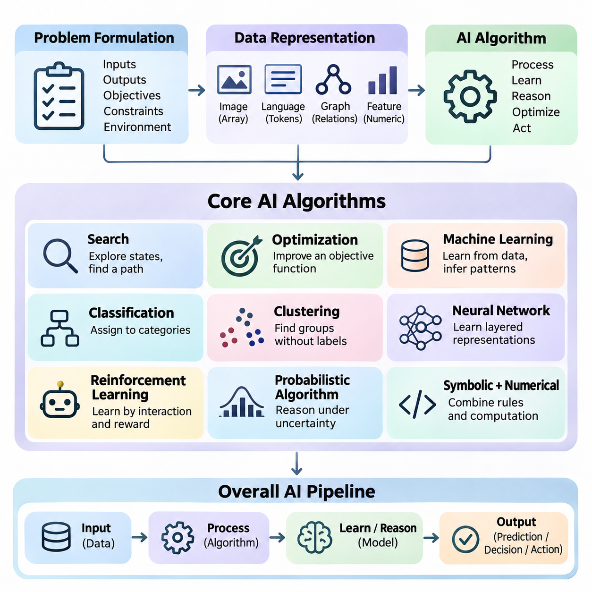
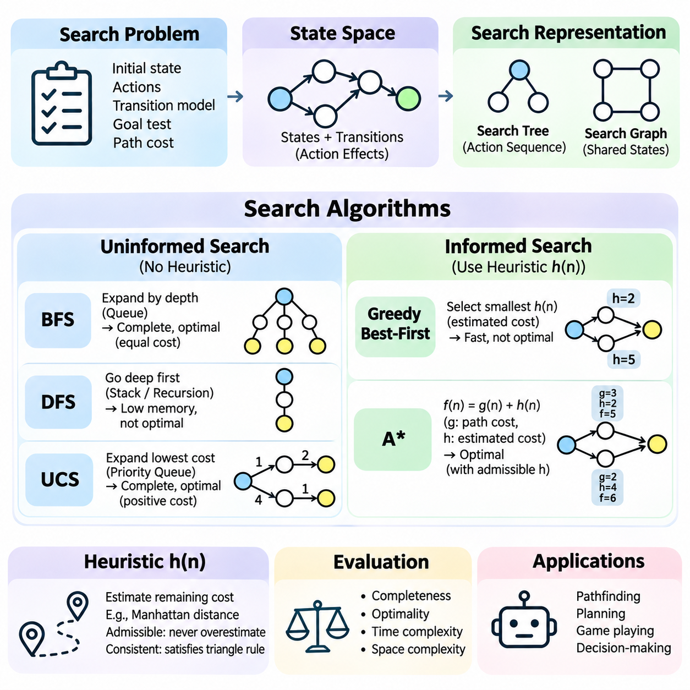
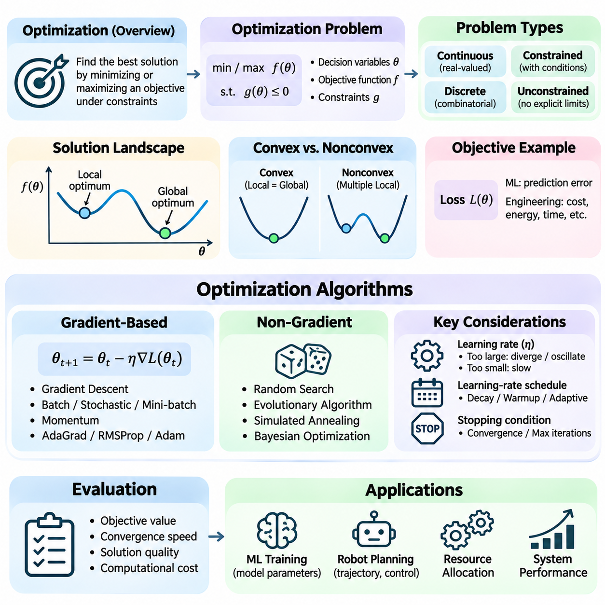
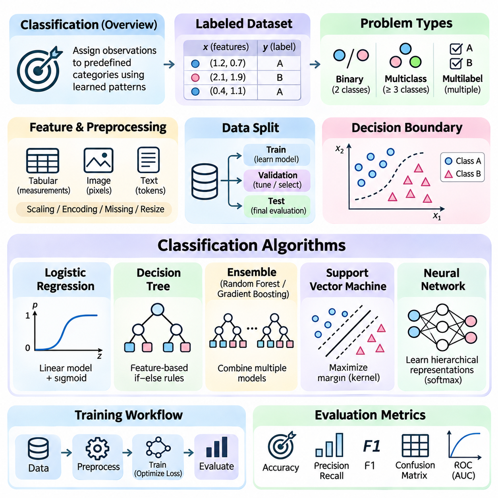
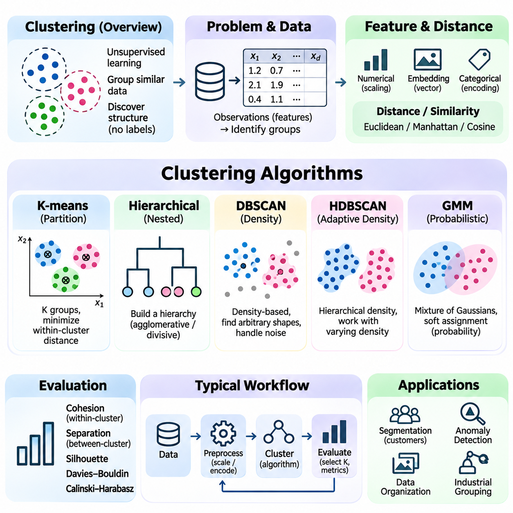
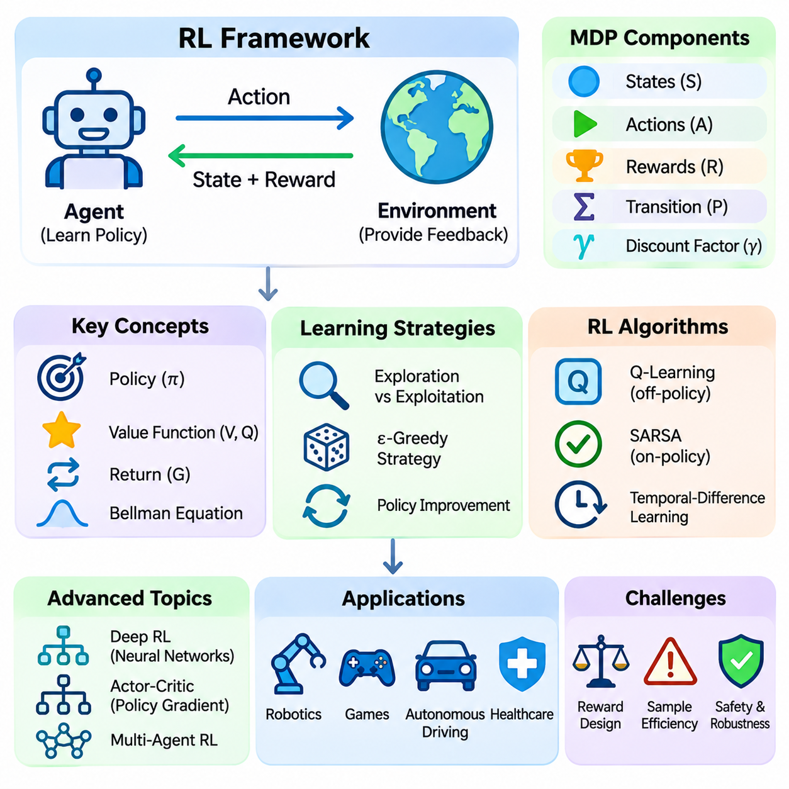
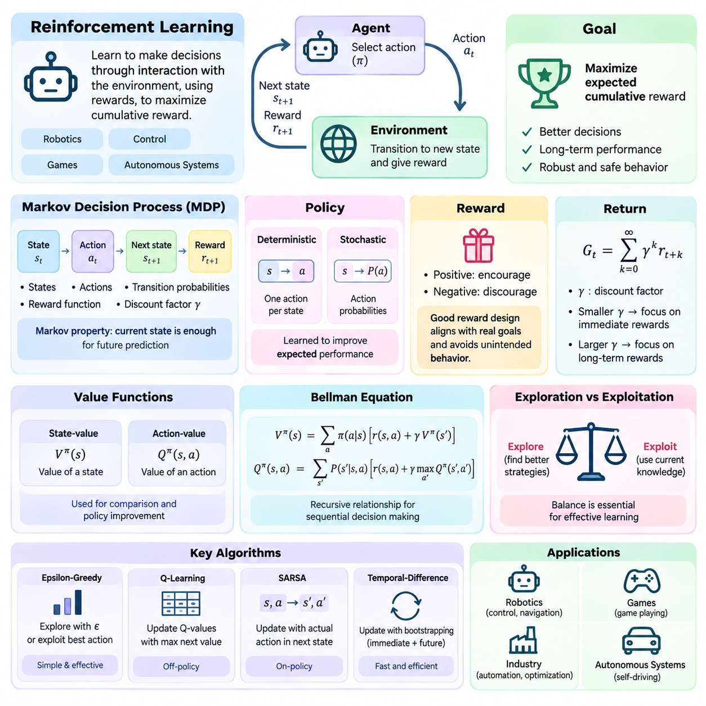
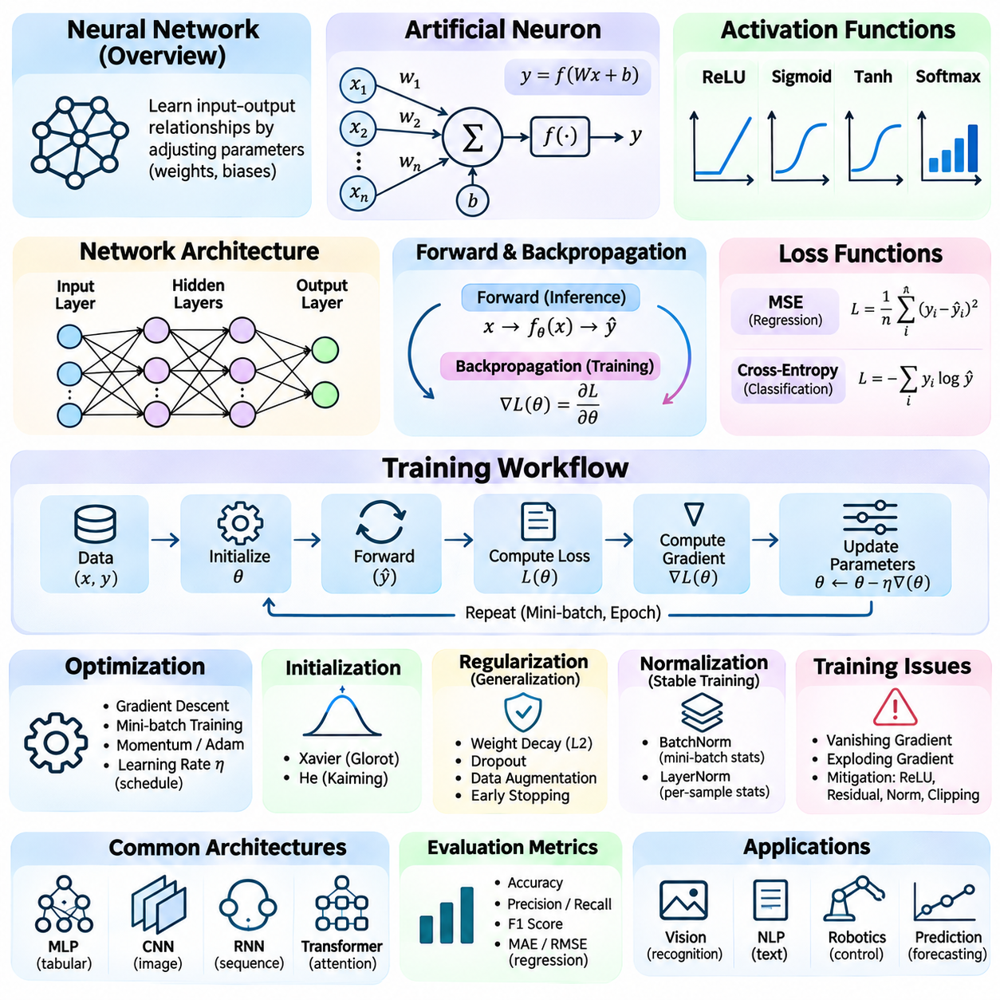
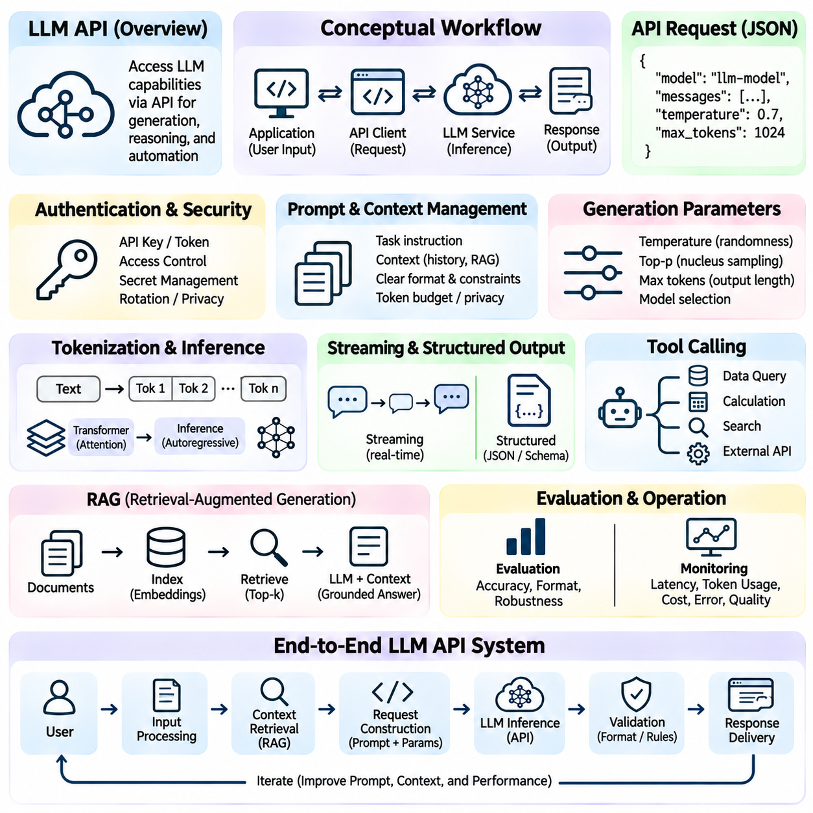

**Volume 04. Artificial Intelligence**

# 08. Core AI Algorithms Primer

## 08.00 Algorithmic View of AI

{width="7.268055555555556in" height="7.268055555555556in"}

Artificial intelligence can be understood from an algorithmic perspective as the systematic transformation of information into predictions, decisions, and actions. An AI algorithm defines a computational procedure that processes inputs, applies mathematical or logical operations, and produces outputs aligned with a specified objective. This perspective provides a common foundation for understanding classical reasoning systems, machine learning, neural networks, and autonomous agents.

An algorithm represents a sequence of computational operations designed to solve a defined problem. In conventional software, these operations are often explicitly programmed using rules and conditions. Artificial intelligence extends this approach by introducing mechanisms for searching alternatives, learning patterns, representing uncertainty, and adapting behavior. The resulting systems may combine deterministic procedures with statistical inference and optimization.

The algorithmic view begins with problem formulation. A problem must be described through its inputs, outputs, objectives, constraints, and operating environment. For example, an autonomous robot receives sensor measurements, estimates its surroundings, identifies possible actions, and selects movements toward a destination. Each operation can be expressed as an algorithmic component, allowing complex intelligent behavior to emerge from coordinated computational processes.

Data representation is fundamental because algorithms operate on structured information rather than abstract concepts directly. Images may be represented as multidimensional arrays, language as token sequences, and relationships as graphs. Numerical features, symbolic expressions, and probability distributions provide alternative representations. The selected representation determines which operations are possible and strongly influences computational efficiency and predictive performance.

Search algorithms provide one of the earliest foundations of artificial intelligence. They explore possible states or candidate solutions to identify a path toward a goal. Breadth-first search, depth-first search, uniform-cost search, and A\\\* illustrate different strategies for navigating a search space. Their effectiveness depends on the structure of the problem, available computational resources, and the quality of heuristic information guiding exploration.

Optimization algorithms approach intelligent computation by identifying parameters or decisions that minimize or maximize an objective function. Gradient descent adjusts model parameters using information about the direction of improvement, while other methods explore discrete or continuous solution spaces. Optimization connects classical mathematical programming with modern machine learning because both require systematic improvement under constraints and computational limitations.

Machine learning introduces algorithms that infer useful relationships from observed data instead of relying exclusively on manually specified rules. A learning procedure adjusts internal parameters according to examples, feedback, or statistical structure. Training establishes these parameters, while inference applies the resulting model to new inputs. The distinction between learning and inference is essential for understanding computational requirements and system behavior.

Classification algorithms assign observations to predefined categories using learned decision boundaries or statistical relationships. A classification system might distinguish defective products from acceptable products based on visual measurements. Logistic regression, decision trees, support vector machines, and neural classifiers provide different mechanisms for this task. Their performance depends on feature quality, representative training data, and appropriate evaluation procedures.

Clustering algorithms identify groups within data without requiring predefined category labels. They examine similarities, distances, or density relationships to discover underlying structure. K-means clustering partitions observations around representative centers, while density-based approaches identify regions containing closely connected samples. These methods support exploratory analysis, anomaly detection, customer segmentation, and the organization of large information collections.

Neural networks introduce interconnected computational units that transform information through weighted operations and nonlinear activation functions. During training, network parameters are adjusted to reduce prediction errors. Backpropagation efficiently calculates gradients needed for this adjustment. By combining multiple processing layers, neural networks can learn increasingly abstract representations suitable for images, language, sensor signals, and other complex data.

Reinforcement learning addresses problems in which an agent learns through interaction with an environment. The agent observes a state, selects an action, receives feedback, and updates its decision strategy. Rewards express desirable outcomes, while policies determine action selection. Unlike ordinary supervised learning, reinforcement learning must consider delayed consequences, exploration, and the relationship between present decisions and future outcomes.

Probabilistic algorithms provide mechanisms for reasoning when observations are incomplete, noisy, or uncertain. Bayesian inference updates beliefs using new evidence, while probabilistic graphical models represent dependencies among variables. Such approaches are important in robotics, medical decision support, and predictive systems. Rather than assuming that every observation is correct, probabilistic reasoning explicitly represents uncertainty and supports decisions based on available evidence.

Algorithmic reasoning can combine symbolic and numerical computation. Symbolic methods manipulate logical expressions, rules, and structured knowledge, while numerical methods operate on vectors, matrices, and continuous parameters. Hybrid systems can use learned models to interpret observations and symbolic procedures to enforce constraints or construct plans. This integration is particularly valuable when intelligent behavior requires both flexibility and explicit logical structure.

Modern large language models demonstrate how relatively general computational mechanisms can support diverse intelligent capabilities. Tokenization converts text into numerical identifiers, embeddings represent contextual information, and transformer operations process relationships across sequences. During inference, a model estimates likely output tokens conditioned on available context. Additional algorithms may manage retrieval, tool execution, validation, and interaction with external systems.

An AI system frequently contains several algorithms operating as an integrated pipeline. A perception algorithm extracts information from sensor measurements, a classification model identifies relevant objects, and a planning algorithm selects suitable actions. A controller then converts decisions into executable commands. The overall intelligence of the system depends not only on individual algorithms but also on the accuracy, timing, and coordination of information exchanged between components.

Computational complexity determines whether an algorithm can operate within practical resource limits. Time complexity describes how processing requirements grow with problem size, while space complexity characterizes memory consumption. An algorithm that produces accurate results may still be unsuitable for real-time applications if its computational demands exceed available resources. Efficient AI design therefore balances solution quality, execution time, memory usage, and energy consumption.

Algorithm selection also depends on the nature of the available information. Problems with explicit rules and well-defined states may benefit from symbolic search, whereas tasks involving large amounts of labeled data often favor supervised learning. Unlabeled datasets can support clustering, and sequential interaction problems may require reinforcement learning. Recognizing these distinctions prevents unnecessary complexity and encourages the selection of methods appropriate to the actual problem.

Generalization is a central requirement for learning-based algorithms. A model should perform effectively on previously unseen observations rather than merely reproduce its training examples. Overfitting occurs when learned patterns depend excessively on training-specific details, while underfitting indicates insufficient representation of relevant relationships. Validation procedures, regularization, and representative datasets help establish whether an algorithm can operate reliably beyond its development environment.

Evaluation provides evidence that an algorithm satisfies its intended objectives. Classification systems may be assessed through accuracy, precision, recall, and F1 score, while search algorithms can be compared through path quality and computational cost. Reinforcement learning systems require measures of cumulative reward, stability, and safety. Evaluation criteria must reflect the intended application because a single numerical metric rarely captures every important aspect of intelligent behavior.

Robustness concerns an algorithm\'s ability to maintain acceptable performance when inputs, operating conditions, or environmental assumptions change. Sensor noise, missing observations, unexpected obstacles, and distribution shifts can undermine otherwise effective models. Robust systems incorporate uncertainty handling, input validation, fallback procedures, and operational constraints. These mechanisms are especially important when algorithmic outputs influence physical actions or consequential decisions.

The algorithmic perspective also clarifies the distinction between intelligence and computational implementation. An intelligent capability may be realized through several alternative algorithms, each with different assumptions and tradeoffs. Conversely, a sophisticated algorithm does not automatically produce an intelligent system. Useful intelligence emerges when computational methods are connected to meaningful objectives, appropriate representations, reliable feedback, and effective interaction with the environment.

Understanding artificial intelligence through algorithms establishes a foundation for examining search, optimization, classification, clustering, reinforcement learning, neural computation, and language-model workflows. These methods represent complementary approaches rather than isolated technologies. Their combination enables systems to perceive information, discover patterns, reason about alternatives, and select actions, providing the computational foundation for increasingly capable and adaptive artificial intelligence.

## 08.01 Search Algorithms Review [w/Code]

{width="7.268055555555556in" height="7.268055555555556in"}

Search algorithms are fundamental computational methods in artificial intelligence that systematically explore possible states to identify solutions satisfying defined objectives. They provide the foundation for pathfinding, automated planning, game playing, and decision-making. A search problem is typically described through an initial state, available actions, a transition model, a goal test, and a path-cost function that evaluates candidate solutions.

A state space represents all configurations that can potentially arise during problem solving. Each state describes a particular situation, while transitions represent changes produced by applying valid actions. Search algorithms navigate these relationships to discover sequences connecting an initial state to a desired goal. The structure of the state space strongly influences computational complexity, memory requirements, and the feasibility of finding solutions.

Search trees and search graphs provide two related representations of exploration. A search tree records alternative action sequences, potentially representing the same underlying state multiple times. A search graph identifies shared states and their connections, allowing algorithms to recognize previously explored configurations. Graph-based search can reduce redundant computation, although maintaining visited-state information introduces additional memory requirements.

Uninformed search algorithms explore state spaces without using estimates of proximity to a goal. Their decisions depend on structural information such as node depth, accumulated path cost, or exploration order. Breadth-first search, depth-first search, and uniform-cost search are representative approaches. Each algorithm follows a different expansion strategy, producing distinct tradeoffs among completeness, optimality, computational effort, and memory consumption.

Breadth-first search explores states in increasing order of depth, expanding all nodes at one level before proceeding to the next. It typically uses a first-in, first-out queue to manage pending states. When every action has equal cost, breadth-first search finds a solution requiring the minimum number of actions, provided a solution exists within a finite branching structure. Its principal limitation is substantial memory consumption as the search frontier grows.

Depth-first search follows one branch of the search tree as deeply as possible before returning to explore alternatives. A stack or recursive procedure naturally supports this behavior. Depth-first search generally requires less memory than breadth-first search because it primarily maintains the current exploration path. However, it may encounter extremely deep or infinite branches, and the first discovered solution is not necessarily optimal.

Uniform-cost search expands the frontier node with the lowest accumulated path cost rather than the shallowest node. A priority queue maintains candidates according to their current costs. This strategy is particularly useful when actions have different costs, such as routes with varying distances or energy requirements. With appropriate positive cost assumptions, uniform-cost search is complete and returns a minimum-cost solution.

Informed search algorithms improve exploration by incorporating heuristic information about the remaining distance or cost to a goal. A heuristic function estimates the effort required to complete a solution from a particular state. Effective heuristics guide the algorithm toward promising regions of the search space, potentially reducing unnecessary exploration. Their usefulness depends on computational efficiency, estimation accuracy, and consistency with the underlying problem.

Greedy best-first search selects the state with the smallest estimated remaining cost. It prioritizes apparent proximity to the goal without directly considering the cost already accumulated along the current path. This approach can locate solutions quickly when heuristic estimates are informative. However, misleading heuristics may cause inefficient exploration, and greedy best-first search does not generally guarantee an optimal solution.

A\\\* search combines accumulated path cost with estimated remaining cost through the evaluation function f(n) = g(n) + h(n). Here, g(n) represents the known cost from the initial state to node n, while h(n) estimates the remaining cost to the goal. This combination balances progress already achieved with anticipated future effort, making A\\\* a widely used algorithm for optimal pathfinding.

The optimality of A\\\* depends on properties of its heuristic function and search implementation. An admissible heuristic never overestimates the true minimum remaining cost. A consistent heuristic additionally satisfies a triangle-inequality relationship across transitions. With appropriate graph-search procedures and cost assumptions, these properties support optimal solutions while reducing unnecessary node expansions compared with uninformed approaches.

Heuristic design is therefore an important part of practical search engineering. Common techniques include simplifying the original problem, calculating geometric distances, and constructing pattern databases from previously solved subproblems. For grid navigation, Manhattan distance can estimate movement cost when movement is restricted to horizontal and vertical directions. A useful heuristic must balance estimation quality against the computational expense of evaluating it.

Search algorithms are commonly evaluated using completeness, optimality, time complexity, and space complexity. Completeness indicates whether an algorithm eventually finds a solution when one exists under specified assumptions. Optimality describes whether the returned solution minimizes the relevant cost. Time and space complexity characterize computational requirements, often in relation to branching factor, solution depth, and the maximum depth explored.

The branching factor represents the number of successor states typically generated from each state. Even moderate branching factors can produce enormous search spaces as exploration depth increases. This combinatorial growth is known as state-space explosion. Practical systems address it through pruning, heuristic guidance, state abstraction, duplicate detection, and carefully designed constraints that eliminate unnecessary alternatives.

Implementation details significantly influence search performance. A frontier data structure stores states awaiting expansion, while an explored-state collection records previously processed configurations. Queues support breadth-first search, stacks support depth-first search, and priority queues support cost-based exploration. Efficient state hashing, successor generation, and cost updating can substantially reduce execution time in large problems.

A practical Python implementation often separates problem representation from the search procedure. The problem interface defines the initial state, goal condition, available actions, transition behavior, and action costs. The algorithm then manages the frontier and determines which state to expand next. This separation enables the same search implementation to operate across different environments without changing its fundamental exploration logic.

Consider a robot navigating a warehouse containing shelves, corridors, and restricted areas. Each navigable location can represent a state, while permitted movements define transitions. Breadth-first search may find the shortest route in terms of movement steps, whereas uniform-cost search can account for unequal traversal costs. A\\\* can incorporate distance estimates to accelerate route planning while preserving optimality under suitable conditions.

Search also supports automated planning, where states describe world conditions and actions modify those conditions through defined preconditions and effects. A planning algorithm explores possible action sequences until the desired goal conditions are satisfied. Unlike simple geometric pathfinding, planning may involve logical dependencies, resource constraints, and multiple interacting objectives. Search thus provides a computational foundation for goal-directed reasoning.

Adversarial search extends the basic search framework to environments containing competing decision-makers. In game-playing systems, possible moves generate a game tree representing alternative future states. Minimax evaluates decisions by assuming that opposing players act strategically, while alpha-beta pruning eliminates branches that cannot affect the final decision. These methods demonstrate how search can support strategic reasoning rather than merely finding physical paths.

Search becomes more challenging when environments are dynamic, partially observable, or uncertain. A previously valid route may become blocked, and available information may not fully describe the current state. Replanning algorithms, belief-state search, and probabilistic approaches address different aspects of these difficulties. Real-world autonomous systems often combine search with perception, localization, prediction, and continuous feedback.

The distinction between search and learning is important but not absolute. Traditional search algorithms explore explicitly defined alternatives using known transition rules, while learning algorithms infer useful patterns or policies from data. Modern systems frequently combine both approaches. Learned heuristics can guide search, neural networks can evaluate candidate states, and planning algorithms can improve decisions generated by learned models.

Search algorithms remain essential because they provide transparent mechanisms for exploring alternatives, enforcing constraints, and constructing goal-directed solutions. Their effectiveness depends on problem formulation, representation quality, heuristic design, and resource management. Understanding these principles establishes a foundation for optimization, automated planning, reinforcement learning, and intelligent systems that must make reliable decisions in complex environments.

## 08.02 Optimization Basics [w/Code]

{width="7.268055555555556in" height="7.268055555555556in"}

Optimization is a fundamental computational process in artificial intelligence that seeks the best possible solution according to a defined objective. It provides the mathematical foundation for training machine learning models, selecting actions, allocating resources, and improving system performance. An optimization problem typically consists of decision variables, an objective function, and constraints that determine which solutions are feasible within a particular application.

The objective function expresses what an algorithm attempts to minimize or maximize. In machine learning, this function often measures prediction error through a loss function, while engineering applications may optimize energy consumption, execution time, or operational cost. The choice of objective determines how candidate solutions are evaluated. A poorly specified objective can produce mathematically successful results that fail to satisfy practical requirements.

Decision variables represent quantities that an optimization algorithm can adjust to improve the objective. In neural networks, these variables include weights and biases, while robotic planning may involve trajectories, velocities, or control parameters. The complete set of possible variable configurations defines the search space. Optimization algorithms navigate this space to identify solutions that satisfy constraints while improving the selected performance criterion.

Optimization problems can be classified according to the mathematical properties of their variables and objectives. Continuous optimization involves real-valued parameters, whereas discrete optimization concerns choices such as routes, assignments, or configurations. Constrained optimization restricts feasible solutions through explicit conditions. Unconstrained optimization allows variables to vary freely within their mathematical domains, although practical implementations may still impose numerical limits.

The distinction between local and global optima is essential for understanding optimization behavior. A local optimum represents a solution that cannot be improved through sufficiently small changes within its neighborhood. A global optimum achieves the best objective value across the entire feasible domain. Complex optimization landscapes may contain multiple local optima, flat regions, and saddle points, making it difficult to identify globally optimal solutions efficiently.

Convex optimization provides an important theoretical foundation because convex objective functions over convex feasible regions possess favorable mathematical properties. For a differentiable convex function, any local minimum is also a global minimum. Many classical optimization methods exploit this structure to establish convergence guarantees. However, neural network training generally involves nonconvex objectives, requiring practical strategies that can operate without global optimality guarantees.

Gradient-based optimization uses derivatives to determine how changes in decision variables affect an objective function. The gradient points toward the direction of steepest local increase under the Euclidean metric, so moving in the opposite direction can reduce the objective for a sufficiently small step. This principle forms the basis of gradient descent, one of the most widely used algorithms in machine learning and numerical optimization.

Gradient descent updates parameters iteratively according to the expression θ_next = θ_current − η∇L(θ_current). Here, θ represents the model parameters, L denotes the loss function, and η is the learning rate controlling the update magnitude. Each iteration evaluates the gradient and adjusts parameters toward a lower-loss region. The process continues until a stopping condition is satisfied or the available computational budget is exhausted.

The learning rate strongly influences optimization stability and convergence speed. A learning rate that is too large may cause oscillation, overshooting, or divergence, while an excessively small value can produce slow progress. Learning-rate schedules modify the step size during training to improve convergence behavior. Common strategies include gradual decay, warmup periods, and adaptive adjustments based on optimization progress.

Batch gradient descent calculates parameter updates using the complete training dataset, producing relatively stable gradient estimates but potentially requiring substantial computation. Stochastic gradient descent uses individual training examples, introducing randomness into the update process. Mini-batch gradient descent computes gradients from smaller groups of examples, balancing computational efficiency, gradient variability, and compatibility with parallel hardware acceleration.

Momentum-based optimization improves ordinary gradient descent by incorporating information from previous updates. Instead of responding exclusively to the current gradient, the algorithm maintains a moving accumulation of past gradient directions. This mechanism can accelerate movement through consistently descending regions and reduce oscillations in poorly conditioned landscapes. Momentum is particularly useful when optimization surfaces exhibit different curvature across parameter dimensions.

Adaptive optimization algorithms adjust update magnitudes according to historical gradient information. AdaGrad accumulates squared gradients to scale parameter-specific learning rates, while RMSProp uses moving averages to avoid indefinitely shrinking effective steps. Adam combines momentum-like first-moment estimates with second-moment estimates of gradient magnitude. These methods are widely used in neural network training, although their performance and generalization properties depend on the task.

Optimization also includes methods that do not require gradient information. Random search evaluates randomly selected candidates, while evolutionary algorithms iteratively modify populations of potential solutions through selection and variation. Simulated annealing occasionally accepts worse solutions to encourage exploration. Such approaches are useful when objective functions are discontinuous, nondifferentiable, expensive to evaluate, or defined over discrete configurations.

Constraints introduce additional complexity because candidate solutions must satisfy operational or mathematical requirements. Equality constraints specify relationships that must hold exactly, while inequality constraints define allowable ranges or boundaries. Penalty methods incorporate constraint violations into the objective function. Other approaches, including projected gradient methods and Lagrangian formulations, address feasibility through mathematical transformations or explicit constrained updates.

Regularization connects optimization with model generalization by modifying the training objective to discourage undesirable model behavior. L1 regularization penalizes absolute parameter magnitudes and can encourage sparsity, while L2 regularization penalizes squared magnitudes. These techniques influence the solutions selected during training and can reduce overfitting. Regularization strength must be chosen carefully because excessive penalties may limit the model\'s ability to represent useful patterns.

Optimization performance depends on the geometry of the objective landscape. Poor conditioning occurs when the objective changes much more rapidly in some directions than others, potentially slowing gradient-based methods. Saddle points contain directions of increasing and decreasing objective values, complicating convergence analysis. Parameter scaling, normalization, suitable initialization, and adaptive optimization strategies can improve numerical behavior in challenging problems.

Convergence describes the progression of an optimization algorithm toward a stable solution or a mathematically defined optimality condition. Practical stopping criteria may include small improvements in objective value, sufficiently small gradient norms, maximum iteration counts, or validation-based early stopping. A decreasing training loss does not necessarily imply improved generalization. Monitoring both optimization progress and independent evaluation performance is therefore essential.

A simple classification example illustrates the optimization process. A model receives feature vectors and predicts class probabilities, which are compared with known labels using a loss function such as cross-entropy. The optimization algorithm calculates parameter gradients and updates the model to reduce prediction errors. Repeated iterations gradually improve the fit to training data, while validation measurements help determine whether the resulting model generalizes.

Optimization in robotics extends beyond model training to trajectory planning, control, and resource management. A mobile robot may minimize travel time, energy consumption, or deviation from a desired path while respecting obstacle and actuator constraints. Multiple objectives may conflict, requiring weighted combinations or multi-objective optimization techniques. The resulting solution must balance mathematical performance with physical feasibility, safety, and real-time computational requirements.

Computational efficiency is a major consideration because optimization often requires repeated evaluations of objective functions and gradients. Large neural networks may contain millions or billions of adjustable parameters, making each update computationally expensive. Vectorized operations, automatic differentiation, GPU acceleration, and efficient data pipelines reduce training overhead. Memory consumption, numerical precision, and communication costs also influence the practical choice of optimization methods.

Numerical stability becomes particularly important when optimization involves very large or very small values. Floating-point limitations can produce overflow, underflow, or inaccurate gradient calculations. Techniques such as gradient clipping, stable mathematical formulations, and appropriate numerical precision help prevent training failures. Mixed-precision computation can improve throughput and memory efficiency when supported by suitable scaling and numerical safeguards.

Optimization algorithms must be evaluated through more than their final objective values. Convergence speed, computational cost, sensitivity to initialization, robustness to hyperparameters, and generalization performance are also important. Repeated experiments with controlled random seeds help characterize variability, while consistent evaluation conditions support meaningful comparisons. An optimizer that converges quickly on one problem may perform poorly on another.

Optimization provides a unifying foundation connecting classical artificial intelligence, machine learning, deep learning, reinforcement learning, and autonomous systems. Search algorithms explore candidate solutions, learning algorithms adjust model parameters, and control algorithms select actions under constraints. Understanding objectives, gradients, convergence, and computational tradeoffs establishes the essential background for designing AI systems that improve performance through systematic mathematical adjustment.

## 08.03 Classification Basics [w/Code]

{width="7.268055555555556in" height="7.268055555555556in"}

Classification is a fundamental supervised learning task in artificial intelligence that assigns observations to predefined categories based on learned patterns. It supports applications such as image recognition, document filtering, medical decision support, and industrial defect detection. A classification algorithm learns relationships between input features and target labels, allowing the resulting model to predict categories for previously unseen observations.

A classification problem begins with a labeled dataset containing examples of inputs and their corresponding categories. Each observation is represented through features that describe relevant characteristics, while the label identifies the expected class. During training, an algorithm examines these examples to construct a decision function. The objective is to learn relationships that generalize beyond the training data rather than simply memorize individual observations.

Binary classification distinguishes between two categories, such as defective and acceptable products. Multiclass classification assigns each observation to one of several mutually exclusive categories, while multilabel classification allows multiple categories to apply simultaneously. These distinctions influence model architecture, output representation, loss-function selection, and evaluation procedures. A clear problem definition is essential before choosing a classification algorithm.

Feature representation strongly influences classification performance because algorithms operate on numerical or structured descriptions of observations. Tabular datasets may contain measurements and categorical attributes, while images are represented through pixel arrays or learned embeddings. Text can be transformed into token-based representations or numerical vectors. Effective features preserve information relevant to class distinctions while minimizing irrelevant variation and noise.

Data preprocessing prepares observations for consistent learning and evaluation. Numerical features may require scaling or normalization, categorical variables may need encoding, and missing values must be handled appropriately. Image classification pipelines often include resizing and intensity normalization. Preprocessing transformations should be fitted using training data when applicable, then applied consistently to validation and test data to prevent information leakage.

Classification datasets are commonly divided into training, validation, and test subsets. Training data determines model parameters, validation data supports hyperparameter selection and model development, and test data provides an independent estimate of final performance. Stratified splitting can preserve class proportions across subsets. When observations are related through time, subjects, or acquisition sessions, splitting strategies must prevent correlated examples from producing misleading results.

A classifier learns a decision boundary separating regions associated with different classes. In simple problems, this boundary may be linear, while complex datasets require nonlinear relationships. The decision boundary is influenced by model structure, feature representation, training examples, and optimization procedures. Understanding its behavior helps explain why a classifier succeeds on some observations but produces errors near ambiguous or overlapping class regions.

Logistic regression provides a foundational approach to classification by transforming a linear combination of input features into a probability estimate. In binary classification, the sigmoid function maps the model output into a value between zero and one. A threshold converts this probability into a predicted category. Despite its simplicity, logistic regression offers an interpretable baseline and performs effectively when class relationships are approximately linear.

Decision trees classify observations through sequences of feature-based conditions. Each internal node evaluates a selected attribute, while terminal nodes produce class predictions. Tree construction typically seeks splits that improve class separation according to measures such as information gain or Gini impurity. Decision trees are relatively interpretable but may overfit training data, especially when their depth and complexity are insufficiently controlled.

Ensemble methods combine multiple classifiers to improve predictive stability and accuracy. Random forests construct collections of decision trees using randomized training samples and feature selections. Gradient boosting builds successive models that correct errors or optimize an objective through incremental improvements. These approaches often perform strongly on structured datasets, although computational cost, interpretability, and hyperparameter sensitivity vary across implementations.

Support vector machines identify decision boundaries that maximize separation between classes through a margin-based objective. The observations closest to the boundary, known as support vectors, strongly influence the resulting classifier. Kernel methods allow nonlinear relationships to be represented through implicit feature transformations. Support vector machines can be effective with carefully selected features, but their computational requirements may increase substantially on large datasets.

Neural network classifiers learn hierarchical representations through interconnected layers of weighted transformations and nonlinear activation functions. An output layer produces class scores, often converted into probabilities using a softmax function for mutually exclusive categories. During training, backpropagation calculates gradients of the loss function, and an optimizer updates network parameters. Deep architectures are particularly useful for complex image, language, and sensor data.

Classification training requires a loss function that measures disagreement between predictions and target labels. Cross-entropy loss is widely used because it penalizes low predicted probabilities assigned to correct classes. Binary cross-entropy supports binary and multilabel formulations, while categorical cross-entropy is commonly applied to multiclass classification. The selected loss must match the output representation and the assumptions of the classification task.

Class imbalance occurs when some categories contain substantially more examples than others. A classifier may achieve high overall accuracy by favoring majority classes while performing poorly on rare but important events. Techniques such as class weighting, resampling, targeted data augmentation, and threshold adjustment can address this problem. Their effectiveness should be assessed using metrics that reflect the application's priorities rather than accuracy alone.

A confusion matrix summarizes classification outcomes by comparing predicted categories with actual labels. In binary classification, true positives and true negatives represent correct predictions, while false positives and false negatives represent different error types. These distinctions matter because their consequences may differ substantially. For example, missing a safety-critical defect may be more costly than incorrectly flagging an acceptable product for inspection.

Accuracy measures the proportion of correct predictions, but it may conceal poor performance on minority classes. Precision measures the proportion of predicted positives that are correct, while recall measures the proportion of actual positives successfully detected. The F1 score combines precision and recall through their harmonic mean. Metric selection should reflect whether false alarms, missed detections, or balanced performance matter most.

Classification thresholds determine how probability estimates are converted into categorical decisions. Adjusting a threshold changes the balance between precision and recall. Receiver operating characteristic curves illustrate true-positive and false-positive rates across thresholds, while precision-recall curves are particularly informative for rare positive classes. Threshold selection should consider operational costs, class prevalence, and the intended deployment environment.

Probability calibration evaluates whether predicted confidence values correspond to observed outcome frequencies. A classifier that assigns approximately eighty percent confidence to many predictions should be correct on roughly eighty percent of those predictions if it is well calibrated. Calibration differs from classification accuracy because a model can rank observations correctly while producing unreliable probabilities. Reliable confidence estimates support risk-aware decision-making.

Overfitting occurs when a classifier learns training-specific patterns that fail to generalize to new observations. Underfitting occurs when the model lacks sufficient capacity or training to capture meaningful relationships. Regularization, representative datasets, appropriate model complexity, and early stopping help control these problems. Data augmentation can improve robustness by exposing models to realistic variations while preserving valid class labels.

Practical classification systems must also address distribution shifts, noisy labels, uncertain observations, and deployment constraints. A model trained under controlled lighting may perform differently when camera exposure, object appearance, or environmental conditions change. Monitoring prediction quality and input distributions helps identify degradation. Retraining, recalibration, and fallback procedures may be necessary when operational conditions differ from development assumptions.

A basic Python classification workflow typically loads a labeled dataset, prepares features, divides observations into appropriate subsets, and trains a selected estimator. The implementation then generates predictions, calculates evaluation metrics, and examines errors. Libraries such as scikit-learn provide conventional classifiers and preprocessing tools, while PyTorch and TensorFlow support neural network implementations. Reproducible experiments require controlled data handling and documented settings.

Classification provides a foundational mechanism for converting observations into meaningful categorical decisions. Its effectiveness depends on problem formulation, data quality, feature representation, model selection, optimization, and evaluation. Understanding these relationships prepares the foundation for advanced computer vision, natural language processing, anomaly detection, and autonomous perception systems where reliable interpretation of incoming information is essential.

## 08.04 Clustering Basics [w/Code]

{width="7.268055555555556in" height="7.268055555555556in"}

Clustering is a fundamental unsupervised learning technique that organizes observations into groups according to similarities in their characteristics. Unlike classification, clustering does not require predefined category labels during training. Its purpose is to discover underlying structures within data, supporting exploratory analysis, anomaly detection, segmentation, and pattern discovery across scientific, industrial, and commercial applications.

A clustering problem begins with a collection of observations represented by numerical features or structured descriptions. The algorithm examines relationships among these observations and assigns them to groups according to a similarity criterion. Ideally, observations within the same cluster are more similar to one another than to observations in different clusters. However, the meaning of similarity depends on the selected representation and distance measure.

Feature representation strongly influences clustering outcomes because different descriptions of the same data may produce different group structures. Numerical measurements, learned embeddings, categorical attributes, and temporal characteristics can all support clustering. Features with large numerical ranges may dominate distance calculations unless appropriate scaling is applied. Effective preprocessing therefore includes normalization, missing-value handling, and removal of irrelevant features.

Distance metrics provide mathematical mechanisms for measuring relationships between observations. Euclidean distance measures straight-line separation in numerical feature spaces, while Manhattan distance sums absolute differences across dimensions. Cosine similarity evaluates directional alignment and is often useful for high-dimensional embeddings. Selecting a suitable metric is essential because the same dataset may produce substantially different clusters under different similarity definitions.

Partition-based clustering divides observations into a specified number of groups by optimizing an assignment criterion. K-means is a widely used example that represents each cluster through a centroid. The algorithm alternates between assigning observations to their nearest centroid and updating centroids using assigned members. This iterative process reduces within-cluster squared distances until assignments stabilize or a stopping condition is reached.

K-means clustering requires the number of clusters, represented by K, to be selected before execution. An inappropriate K can merge distinct groups or divide meaningful groups unnecessarily. Initialization also matters because different starting centroids may produce different local solutions. K-means++ improves centroid initialization by encouraging initial centers to be distributed across the dataset, although it does not guarantee globally optimal clustering.

K-means works particularly well when clusters are relatively compact, approximately spherical, and comparable in scale. Its assumptions become restrictive when groups have irregular shapes, substantially different densities, or significant outliers. Because centroids are calculated using arithmetic means, extreme observations can distort cluster locations. These limitations motivate alternative methods that use different definitions of cluster structure.

Hierarchical clustering constructs nested relationships among observations rather than immediately producing a single partition. Agglomerative clustering begins with individual observations and repeatedly merges groups, while divisive clustering starts with larger groups and separates them. A dendrogram represents the resulting hierarchy. Different linkage criteria, including single, complete, and average linkage, determine how distances between groups are calculated.

Density-based clustering identifies groups as regions containing sufficiently concentrated observations separated by sparse areas. DBSCAN uses neighborhood radius and minimum sample requirements to distinguish core observations, border observations, and noise. It can discover irregularly shaped clusters without requiring a predefined cluster count. However, selecting suitable density parameters becomes difficult when clusters exhibit substantially different densities.

HDBSCAN extends density-based reasoning by examining clustering structure across varying density levels. It builds a hierarchy of density-connected groups and selects clusters according to stability criteria. This approach can handle datasets with varying local density more flexibly than conventional DBSCAN. Nevertheless, results remain sensitive to feature representation, distance metrics, and the availability of meaningful density relationships.

Gaussian mixture models provide a probabilistic approach to clustering by representing observations as samples generated from a mixture of probability distributions. Each component is commonly modeled using a Gaussian distribution with its own mean and covariance. Instead of assigning every observation exclusively to one group, the model estimates membership probabilities. This soft clustering approach is useful when group boundaries overlap or uncertainty must be represented.

The expectation-maximization algorithm is commonly used to estimate Gaussian mixture parameters. During the expectation step, the algorithm calculates the probability that each observation belongs to each component. During the maximization step, it updates component parameters using these probabilities. Repeated iterations improve the likelihood of the observed data until convergence criteria are satisfied, although the procedure may reach local optima.

Cluster evaluation is challenging because unsupervised learning usually lacks authoritative ground-truth labels. Internal evaluation measures examine properties such as cohesion and separation without requiring external categories. The silhouette coefficient compares average within-cluster distance with distance to neighboring clusters. Higher values generally indicate better separation, but the metric may favor particular cluster geometries and should not be treated as universally decisive.

Other internal evaluation methods include the Davies-Bouldin index and the Calinski-Harabasz index. These measures summarize relationships between cluster compactness and separation using different mathematical formulations. When reference labels are available, external measures such as adjusted Rand index and normalized mutual information can compare clustering assignments with known groupings. However, discovered clusters may represent meaningful structures that differ from existing labels.

Dimensionality reduction can improve clustering efficiency and help reveal structure in high-dimensional datasets. Principal component analysis transforms observations into lower-dimensional representations that preserve major directions of variance. Nonlinear methods such as UMAP may expose local neighborhood relationships. However, dimensionality reduction can distort distances or remove important information, so clustering results should be validated against the original application requirements.

Choosing an appropriate clustering algorithm depends on dataset size, feature characteristics, expected group geometry, noise levels, and computational resources. K-means offers simplicity and scalability, hierarchical methods reveal nested relationships, and density-based methods support irregular structures. Probabilistic mixture models represent overlapping groups through membership probabilities. No single algorithm performs best across every dataset or application.

A practical Python clustering workflow begins by loading observations, selecting informative features, and applying suitable preprocessing. The algorithm then constructs clusters using selected hyperparameters. Libraries such as scikit-learn provide implementations of K-means, DBSCAN, hierarchical clustering, and Gaussian mixture models. Evaluation combines quantitative metrics with examination of representative observations and sensitivity to parameter choices.

Clustering can support industrial inspection by grouping sensor measurements or visual embeddings according to recurring operating patterns. Observations that do not belong to established groups may indicate unusual behavior requiring investigation. However, cluster membership alone does not prove that a sample is defective or abnormal. Reliable interpretation requires domain knowledge, operational context, and additional validation against known system behavior.

In robotics, clustering helps organize point clouds, group spatial observations, and identify candidate objects or environmental structures. LiDAR measurements may be segmented into spatially connected groups that support obstacle perception. Temporal clustering can reveal recurring motion patterns or operating conditions. These applications require careful consideration of sensor noise, spatial resolution, processing latency, and changes in environmental geometry.

Clustering is also useful for organizing large collections of learned representations. Image embeddings may reveal visually related categories, while language embeddings can group documents with similar semantic content. Such applications demonstrate how clustering complements neural representation learning. The quality of discovered groups depends on whether the embedding space preserves relationships relevant to the intended task.

A major limitation of clustering is that algorithms can produce groups even when the data lacks meaningful natural categories. Apparent clusters may result from feature scaling, sampling bias, initialization, or arbitrary parameter choices. Stability analysis compares results across different samples and configurations to assess whether structures persist. Domain interpretation remains essential because mathematical separation does not automatically establish practical significance.

Clustering provides an important foundation for discovering patterns without explicit supervision. Its effectiveness depends on data representation, similarity measures, algorithm selection, parameter tuning, and evaluation. By revealing latent relationships and organizing complex observations, clustering supports exploratory intelligence and complements classification, anomaly detection, representation learning, and autonomous perception within broader artificial intelligence systems.

## 08.05 Reinforcement Learning Basics [w/Code]

{width="7.268055555555556in" height="7.268055555555556in"}

{width="7.268055555555556in" height="7.268055555555556in"}

Reinforcement learning is a machine learning paradigm in which an agent learns to make decisions through repeated interaction with an environment. Instead of relying exclusively on labeled examples, the agent receives rewards that evaluate the consequences of its actions. The objective is to develop a decision-making strategy that maximizes expected cumulative reward, making reinforcement learning suitable for robotics, control, games, and autonomous systems.

The reinforcement learning framework consists of an agent, an environment, states, actions, and rewards. At each interaction step, the agent observes information about the environment and selects an action. The environment responds by transitioning to a new state and providing a reward signal. This repeated interaction generates experience that the agent uses to improve its behavior and learn relationships between decisions and their consequences.

A Markov decision process provides the mathematical foundation for many reinforcement learning problems. It defines a set of states, available actions, transition probabilities, reward functions, and a discount factor. The Markov property assumes that the current state contains sufficient information to predict future transitions given an action. This representation allows sequential decision-making problems to be analyzed through well-defined mathematical relationships.

A policy defines how an agent selects actions based on available state information. Deterministic policies choose a specific action for each state, while stochastic policies assign probabilities to possible actions. During learning, the policy is adjusted to improve expected performance. The final objective is not necessarily to maximize immediate reward but to select actions that produce favorable outcomes over an extended sequence of interactions.

The reward function expresses the desired behavior of an agent through numerical feedback. Positive rewards encourage beneficial outcomes, while negative rewards discourage undesirable behavior. Reward design is critical because an agent optimizes the specified signal rather than the designer\'s unstated intentions. Poorly designed rewards may encourage shortcuts, unsafe actions, or unintended strategies that achieve high numerical scores without satisfying operational goals.

The return represents the accumulated reward associated with a sequence of decisions. In discounted reinforcement learning, future rewards are multiplied by powers of a discount factor, typically between zero and one. A smaller discount factor emphasizes immediate outcomes, while a larger value places greater importance on long-term consequences. The appropriate choice depends on task duration, uncertainty, and the desired planning horizon.

Value functions estimate the expected return associated with states or state-action combinations under a policy. A state-value function evaluates the desirability of occupying a particular state, while an action-value function evaluates selecting a particular action from that state. These estimates help agents compare alternatives and improve decisions. Value-based reinforcement learning algorithms use such estimates as the foundation for policy improvement.

The Bellman equation expresses a recursive relationship between the value of a state and the values of possible successor states. It connects immediate rewards with expected future returns, enabling sequential problems to be decomposed into smaller calculations. Bellman optimality equations characterize the best achievable values under an optimal policy. These relationships support dynamic programming and many modern reinforcement learning algorithms.

Exploration and exploitation represent a central challenge in reinforcement learning. Exploration involves selecting actions to discover potentially better strategies, while exploitation uses currently available knowledge to obtain rewards. Excessive exploration wastes resources and may introduce risk, whereas insufficient exploration can prevent the discovery of superior policies. Effective learning requires balancing information gathering with reliable performance.

An epsilon-greedy strategy provides a simple mechanism for balancing exploration and exploitation. With probability epsilon, the agent selects an exploratory action, while otherwise choosing an action with the highest estimated value. Epsilon may decrease during training as the agent gains experience. Although straightforward, this approach can explore inefficiently because randomly selected actions do not necessarily provide useful information.

Q-learning is a model-free reinforcement learning algorithm that estimates the optimal action-value function through interaction. It updates Q-values using observed rewards and estimates of the best future action value. Because its update target uses the maximum estimated value of the next state, Q-learning is considered an off-policy method. Under suitable assumptions, tabular Q-learning can converge toward optimal action values.

SARSA is another temporal-difference learning algorithm that updates action values using the action actually selected in the next state. Unlike Q-learning, its standard formulation learns values associated with the behavior policy being followed. This on-policy characteristic can produce different behavior when exploration introduces risk. Comparing SARSA and Q-learning illustrates how learning targets influence the relationship between exploration and policy improvement.

Temporal-difference learning combines ideas from experience-based estimation and dynamic programming. Instead of waiting until an episode finishes, it updates value estimates using immediate rewards and predictions of subsequent values. This process is called bootstrapping because existing estimates help construct new targets. Temporal-difference methods are computationally practical and form the foundation of numerous value-based reinforcement learning algorithms.

Monte Carlo reinforcement learning estimates values from complete sampled returns rather than bootstrapped one-step targets. It is conceptually straightforward and can learn directly from completed episodes without requiring transition probabilities. However, estimates may exhibit substantial variance, and updates typically depend on episode completion. Temporal-difference methods often learn more incrementally, creating different tradeoffs between bias, variance, and computational requirements.

Deep reinforcement learning combines reinforcement learning with neural networks to handle large or continuous state representations. A deep Q-network approximates action values using a neural model rather than maintaining a table for every state-action combination. Experience replay stores previous interactions for reuse during training, while target networks help stabilize learning. These mechanisms address some difficulties introduced by nonlinear function approximation.

Policy gradient methods optimize parameterized policies directly by estimating how policy parameters influence expected return. Rather than selecting actions exclusively through estimated action values, they adjust action probabilities to favor beneficial behavior. Policy gradients can naturally represent stochastic policies and continuous action distributions. However, their gradient estimates may have high variance, requiring techniques that improve training stability.

Actor-critic algorithms combine policy optimization with value estimation. The actor represents the policy responsible for selecting actions, while the critic evaluates states or actions to guide policy updates. Advantage estimates can indicate whether an action performs better than an expected baseline. This architecture supports algorithms such as advantage actor-critic and proximal policy optimization, which are widely studied for complex sequential decision-making.

Model-based reinforcement learning uses an explicit or learned representation of environment dynamics to support planning. The agent may predict future states and rewards before selecting actions, reducing dependence on purely reactive decisions. Model-free methods instead learn policies or values without requiring an explicit transition model. Model-based approaches can improve sample efficiency, although inaccurate models may introduce planning errors.

Training efficiency is a major challenge because reinforcement learning often requires extensive interaction data. In robotics, collecting experience through physical hardware can be expensive, slow, and potentially unsafe. Simulation environments provide a practical alternative for initial training and experimentation. However, differences between simulated and real-world dynamics create a simulation-to-reality gap that must be addressed through validation and adaptation.

Safe reinforcement learning incorporates operational constraints and risk considerations into learning and decision-making. An autonomous robot must avoid collisions, respect actuator limits, and maintain stability even while exploring possible actions. Safety mechanisms may include constrained optimization, action shielding, supervisory controllers, and emergency fallback behavior. Reward maximization alone is insufficient when failures can produce physical damage or safety hazards.

Reinforcement learning evaluation considers cumulative reward, learning efficiency, policy stability, and performance under changing conditions. Results should be measured across multiple random seeds because training outcomes may vary significantly. Evaluation environments must distinguish training experience from independent testing. In safety-critical applications, constraint violations, failure frequency, and robustness are as important as average reward.

A basic Python reinforcement learning workflow defines an environment interface, initializes an agent, and repeatedly executes observation, action selection, transition, and learning steps. Simple environments can use tabular Q-learning, while complex tasks may require neural policies implemented with PyTorch or TensorFlow. Libraries such as Gymnasium provide standardized environment interfaces. Careful logging and reproducible configurations support meaningful experimental comparisons.

Reinforcement learning provides a computational foundation for agents that improve behavior through interaction and feedback. Its central concepts include states, actions, rewards, policies, value functions, exploration, and long-term optimization. By combining learning with sequential decision-making, reinforcement learning supports intelligent control and autonomous behavior, while highlighting the importance of reward design, computational efficiency, and operational safety.

## 08.06 Neural Network Basics [w/Code]

{width="7.268055555555556in" height="7.268055555555556in"}

Neural networks are computational models inspired by interconnected biological neurons, designed to learn relationships between inputs and outputs through adjustable parameters. They form the foundation of modern deep learning and support classification, regression, perception, and decision-making. By combining mathematical transformations with nonlinear functions, neural networks can approximate complex patterns that are difficult to represent through manually constructed rules.

An artificial neuron receives numerical inputs, multiplies them by corresponding weights, adds a bias, and applies an activation function. This operation can be expressed as y = f(Wx + b), where W represents weights, x denotes inputs, b is the bias, and f is the activation function. Weights determine the influence of individual inputs, while biases shift the response. Learning adjusts these parameters to produce useful predictions.

Neural networks organize artificial neurons into interconnected layers. An input layer receives feature representations, hidden layers perform intermediate transformations, and an output layer generates predictions. A feedforward neural network transfers information from earlier layers toward later layers without recurrent connections. Increasing network depth allows multiple transformations to be composed, enabling the learning of increasingly abstract representations.

Activation functions introduce nonlinearity into neural network computations. Without nonlinear activations, a sequence of linear layers remains equivalent to a single linear transformation. The rectified linear unit, or ReLU, outputs the positive part of its input and is widely used in hidden layers. Sigmoid and hyperbolic tangent functions provide alternative nonlinear mappings, while softmax converts output scores into normalized class probabilities.

The forward propagation process transforms input data through successive network layers to produce an output. Each layer calculates weighted combinations, applies activation functions, and passes the resulting representation forward. In classification, the output may represent class scores or probabilities, while regression networks predict continuous values. The architecture determines how information flows and which relationships the network can represent.

Training a neural network requires a loss function that measures disagreement between predicted outputs and target values. Mean squared error is commonly used for regression, while cross-entropy is widely applied to classification. The training objective is to minimize expected prediction error across representative observations. An appropriate loss function must reflect the task, output representation, and relative importance of different prediction errors.

Backpropagation provides an efficient method for calculating gradients of the loss function with respect to network parameters. It applies the chain rule of calculus backward through the computational graph, reusing intermediate derivatives. These gradients indicate how parameter changes affect prediction error. Automatic differentiation frameworks implement this process, allowing complex neural networks to be trained without manually deriving every gradient.

Gradient descent updates neural network parameters in directions intended to reduce the loss. The learning rate controls the magnitude of each update and influences training stability. Mini-batch training estimates gradients using subsets of the dataset, balancing computational efficiency and statistical variability. Optimizers such as stochastic gradient descent with momentum and Adam introduce additional mechanisms for improving convergence behavior.

A training epoch represents one complete pass through the training dataset, although individual parameter updates typically occur after processing mini-batches. Multiple epochs allow the network to refine its learned representations. Batch size influences memory requirements, gradient variability, and hardware utilization. Effective training requires coordinating epoch count, batch size, learning rate, and optimizer settings rather than treating these parameters independently.

Network initialization affects early optimization behavior because poorly chosen weights can produce unstable activations or gradients. Xavier initialization is commonly associated with certain symmetric activation functions, while He initialization is suitable for many ReLU-based networks. Appropriate initialization helps preserve signal magnitudes across layers. However, initialization alone cannot eliminate every training difficulty, particularly in very deep architectures.

Deep networks may experience vanishing or exploding gradients during backpropagation. Vanishing gradients make early layers learn slowly, while exploding gradients can destabilize parameter updates. Activation selection, residual connections, normalization layers, and gradient clipping help mitigate these problems. These techniques improve the numerical behavior of training and support the development of deeper, more expressive neural architectures.

Overfitting occurs when a neural network learns patterns specific to its training examples rather than relationships that generalize to unseen data. Regularization methods discourage excessive model complexity or dependence on individual features. Weight decay penalizes parameter magnitude, while dropout randomly disables selected activations during training. Data augmentation and early stopping provide additional mechanisms for improving generalization.

Normalization techniques help stabilize the distribution of intermediate representations during training. Batch normalization uses statistics calculated across mini-batches, while layer normalization operates across selected feature dimensions within individual examples. These methods can improve optimization behavior and reduce sensitivity to certain parameter settings. Their suitability depends on architecture, batch characteristics, and the intended application.

A multilayer perceptron is a basic neural network architecture composed primarily of fully connected layers. Each neuron receives information from the preceding layer, enabling flexible mappings between fixed-size feature vectors and outputs. Multilayer perceptrons are useful for tabular data, simple classification, and function approximation. However, they do not inherently exploit spatial or sequential relationships present in images and temporal signals.

Convolutional neural networks introduce localized filters that share parameters across spatial positions. Convolution operations detect patterns such as edges, textures, and increasingly complex visual structures. Pooling or strided operations can reduce spatial resolution while retaining useful information. These architectural properties make convolutional networks effective for image classification, object detection, segmentation, and other visual perception tasks.

Recurrent neural networks process sequential information by maintaining hidden states that carry information across time steps. Long short-term memory and gated recurrent unit architectures introduce mechanisms for managing information over longer sequences. These networks have been applied to language, speech, and time-series analysis. However, sequential computation can limit parallelism, motivating alternative architectures for large-scale sequence modeling.

Transformers use attention mechanisms to model relationships among elements of an input sequence. Self-attention allows representations to incorporate information from other positions according to learned relevance scores. Positional information helps distinguish sequence order, while feedforward layers transform contextual representations. Transformers support modern language models, vision systems, and multimodal architectures, although attention computation can become expensive for long sequences.

Representation learning is a central advantage of neural networks because useful features can emerge through optimization rather than manual engineering. Early layers may capture relatively simple patterns, while deeper layers combine them into more abstract representations. Embeddings provide compact numerical descriptions of objects, words, or other entities. These learned representations can support classification, similarity search, clustering, and transfer learning.

Transfer learning reuses knowledge acquired from one training task to improve performance on another. A pretrained neural network can serve as a feature extractor or provide initial parameters for fine-tuning. Fine-tuning adjusts some or all parameters using data from the target application. This approach can reduce training requirements when labeled data is limited, although differences between source and target distributions may affect effectiveness.

Neural network evaluation requires separating training performance from generalization performance. Validation datasets support model selection and hyperparameter tuning, while independent test datasets estimate final predictive capability. Accuracy, precision, recall, and F1 score are useful for classification, whereas regression tasks may use mean absolute error or root mean squared error. Evaluation must also consider robustness, calibration, and application-specific failure costs.

Practical neural network development involves managing computational resources and numerical precision. GPU acceleration supports efficient matrix operations, while automatic differentiation simplifies gradient computation. Mixed-precision training can improve throughput and memory efficiency when numerical stability is maintained. Model size, inference latency, energy consumption, and deployment hardware constraints influence architecture selection, particularly for embedded and robotic systems.

A basic Python neural network workflow defines a model, selects a loss function and optimizer, and prepares training data through batches. Each training iteration performs forward propagation, calculates loss, computes gradients through backpropagation, and updates parameters. Frameworks such as PyTorch and TensorFlow provide reusable components for these operations. Reproducible experiments require controlled random seeds, consistent preprocessing, and systematic performance monitoring.

Neural networks provide a flexible computational foundation for learning complex mappings and representations from data. Their effectiveness depends on architecture design, optimization, training data quality, regularization, and evaluation. Understanding neurons, layers, activations, forward propagation, and backpropagation establishes the essential background for deep learning, modern perception systems, language models, and intelligent autonomous applications.

## 08.07 LLM API Conceptual Workflow [w/Code]

{width="7.268055555555556in" height="7.268055555555556in"}

A large language model API provides a programmable interface for accessing language generation and reasoning capabilities through software applications. Instead of running a large model locally, developers send structured requests to a hosted inference service and receive generated responses. This approach supports conversational assistants, document analysis, information extraction, and workflow automation while separating application logic from model infrastructure.

The conceptual workflow begins with an application that collects user input and prepares a request for a language model service. The request typically identifies a model, supplies instructions and contextual information, and specifies generation parameters. An API client transmits the request through a network connection. The service processes the input, performs model inference, and returns a response that the application interprets and presents.

Authentication establishes whether an application is authorized to access the API service. Providers commonly use API keys or other credentials to identify authorized clients and enforce usage limits. Credentials should remain on trusted server infrastructure rather than being embedded in publicly accessible application code. Secure development practices include environment variables, secret management systems, restricted permissions, and credential rotation.

An API request is commonly represented using structured data such as JSON. Its fields may specify the model identifier, input messages, generation settings, and optional capabilities. A conversational request can contain instructions, previous dialogue, and the latest user message. The exact request schema differs among providers and API versions, so implementations must follow the relevant service documentation rather than assuming universal compatibility.

Prompt construction determines how the model receives instructions and task context. A prompt may describe the desired objective, required output format, relevant background, and operational constraints. Clear instructions reduce ambiguity and improve consistency, although they cannot guarantee correctness. Effective prompt design separates trusted application instructions from untrusted user content and retrieved documents to reduce unintended instruction conflicts.

Conversation management provides continuity across multiple interactions. An application may preserve earlier messages, summarize previous exchanges, or retrieve relevant context from persistent storage. Because model requests have finite context limits, retaining every message indefinitely is usually impractical. Context selection should prioritize information relevant to the current task while respecting privacy requirements, token budgets, and the possibility of outdated information.

Tokenization converts text into smaller units that language models process numerically. Input tokens represent instructions and contextual information, while output tokens correspond to generated content. Token counts influence context capacity, response length, latency, and service cost. Applications should estimate token usage and configure output limits appropriately, especially when processing lengthy documents or supporting high-volume interactions.

Generation parameters influence how model outputs are produced. Temperature commonly adjusts the randomness of token selection, while nucleus sampling restricts selection according to cumulative probability. Output length limits constrain the amount of generated text. Parameter availability and behavior vary across model families, and some services manage sampling internally. Reliable applications should validate supported settings instead of assuming identical controls across providers.

During inference, the language model processes the supplied context and generates output according to its learned parameters and decoding procedure. Transformer-based models use attention mechanisms to incorporate relationships among input tokens. Many text generation systems produce tokens autoregressively, conditioning each new token on preceding context. The API abstracts much of this computation, allowing developers to focus on application behavior.

A response typically contains generated content together with service metadata. Depending on the API, metadata may describe token usage, response status, termination reasons, or processing details. Applications must distinguish successful completion from incomplete generation, rejected requests, and unexpected response structures. Response validation is necessary because syntactically valid service communication does not guarantee that generated content satisfies application requirements.

Streaming allows an application to receive portions of generated output before the complete response is available. This can improve perceived responsiveness in conversational interfaces and interactive tools. However, streamed fragments may contain incomplete sentences or partial structured data. Applications should assemble fragments carefully, handle interrupted connections, and delay strict validation until sufficient output has been received.

Structured output mechanisms help applications obtain information in predictable formats such as JSON objects. A schema may define required fields, permitted data types, and constraints on generated values. Where supported, schema-constrained generation can improve format reliability. Nevertheless, syntactic compliance does not establish factual accuracy, so applications must separately validate extracted values, business rules, and references to external information.

Tool calling extends language model workflows by allowing a model to request operations performed by external software. Tools may retrieve database records, execute calculations, search approved resources, or interact with authorized services. The application remains responsible for executing these operations and returning results to the model when appropriate. Tool permissions, argument validation, and execution boundaries are essential for secure orchestration.

Retrieval-augmented generation combines language model inference with information obtained from external knowledge sources. Documents may be divided into passages, transformed into embeddings, and indexed for similarity search. Relevant passages are retrieved and supplied as context for a model request. This approach can improve grounding in domain-specific information, but retrieval quality, source freshness, and citation verification remain important.

A complete application may organize its workflow into input processing, context retrieval, request construction, model inference, output validation, and response delivery. Each stage has distinct responsibilities and potential failure modes. Separating these components improves maintainability, testing, and observability. It also allows developers to replace models, retrieval systems, or validation procedures without redesigning the entire application.

Error handling is essential because API requests may fail due to authentication problems, rate limits, network interruptions, invalid parameters, or temporary service unavailability. Applications should classify errors and apply appropriate recovery procedures. Exponential backoff can help with retryable failures, while permanent validation errors require correction rather than repetition. Retries must also account for duplicate operations and non-idempotent actions.

Latency and cost management influence practical API system design. Response time depends on network conditions, input size, output length, model characteristics, and service load. Developers may reduce unnecessary context, cache reusable results, or route tasks to models with appropriate capabilities. Cost monitoring should consider input and output usage, tool operations, and repeated requests rather than evaluating model inference in isolation.

Security and privacy requirements extend beyond credential protection. User inputs may contain personal information, confidential documents, or sensitive operational data. Applications should apply data minimization, access controls, retention policies, and appropriate encryption. Retrieved content and tool responses must be treated as potentially untrusted. Prompt injection defenses and authorization checks help prevent external text from redirecting privileged application behavior.

Language model outputs may contain factual errors, unsupported claims, inconsistent reasoning, or inappropriate assumptions. Evaluation should therefore measure task accuracy, instruction adherence, format validity, and robustness across representative inputs. High-impact applications may require deterministic checks, source verification, or human review before actions are taken. Model confidence expressed in natural language should not be treated as a calibrated probability without supporting evidence.

A basic Python implementation commonly initializes an API client, loads credentials securely, constructs an input request, and invokes a model inference endpoint. The program then extracts the response, checks its structure, and handles exceptions. Provider SDKs simplify authentication and request serialization, while direct HTTP clients offer additional control. Production implementations also require timeouts, logging, retry policies, and dependency management.

Testing an LLM API workflow involves examining both individual components and end-to-end behavior. Unit tests can verify request construction, schema validation, and error handling without invoking a live model. Integration tests evaluate actual service communication and response processing. Regression evaluations compare model behavior against representative tasks over time, helping identify changes caused by model updates, prompt revisions, or retrieval modifications.

Operational monitoring tracks service availability, latency, token consumption, failure rates, and output quality. Logging should provide sufficient diagnostic information without unnecessarily storing sensitive content. Versioning prompts, model identifiers, and application configurations supports reproducibility and controlled deployment. Continuous evaluation helps detect quality degradation, unexpected costs, and emerging failure patterns after a system enters production.

The LLM API conceptual workflow illustrates how language models become components of larger software systems rather than isolated text generators. Effective integration requires structured communication, secure authentication, context management, reliable validation, and operational governance. Understanding these principles establishes a foundation for developing conversational applications, retrieval systems, intelligent agents, and AI-enabled automation workflows.
