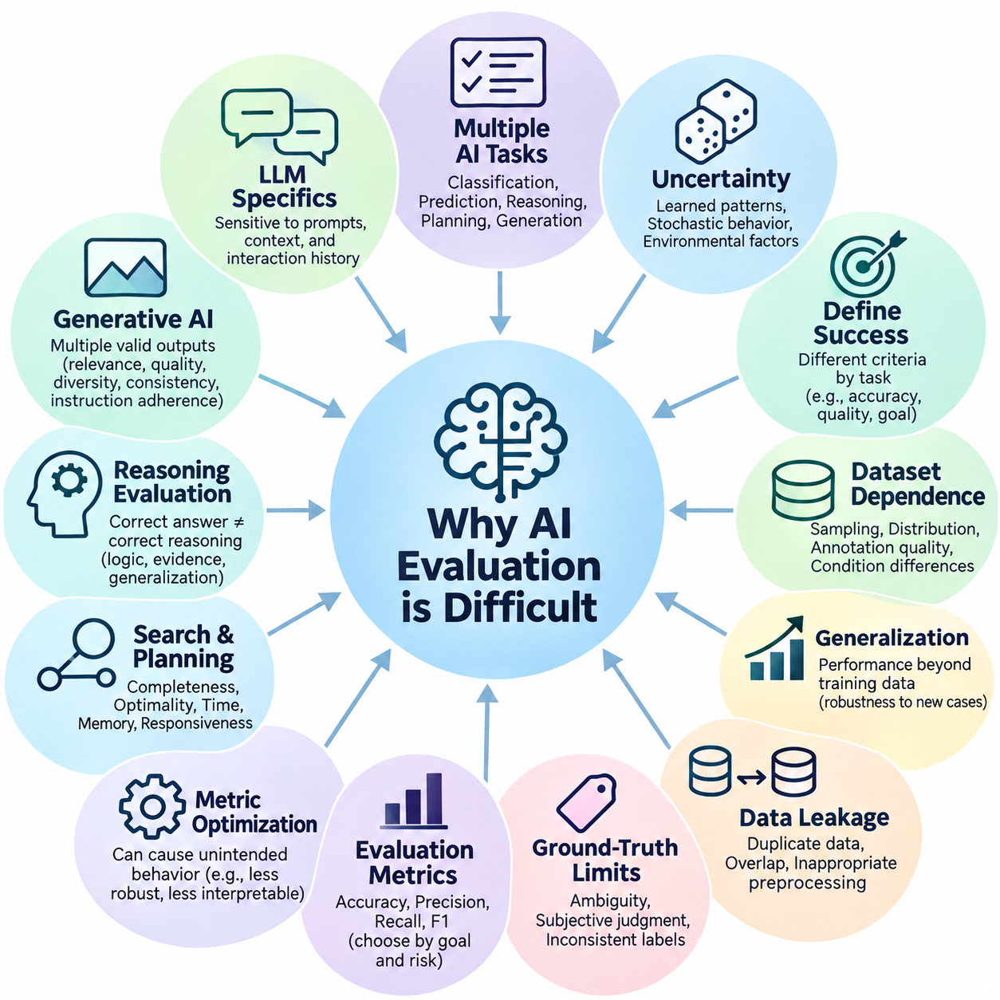
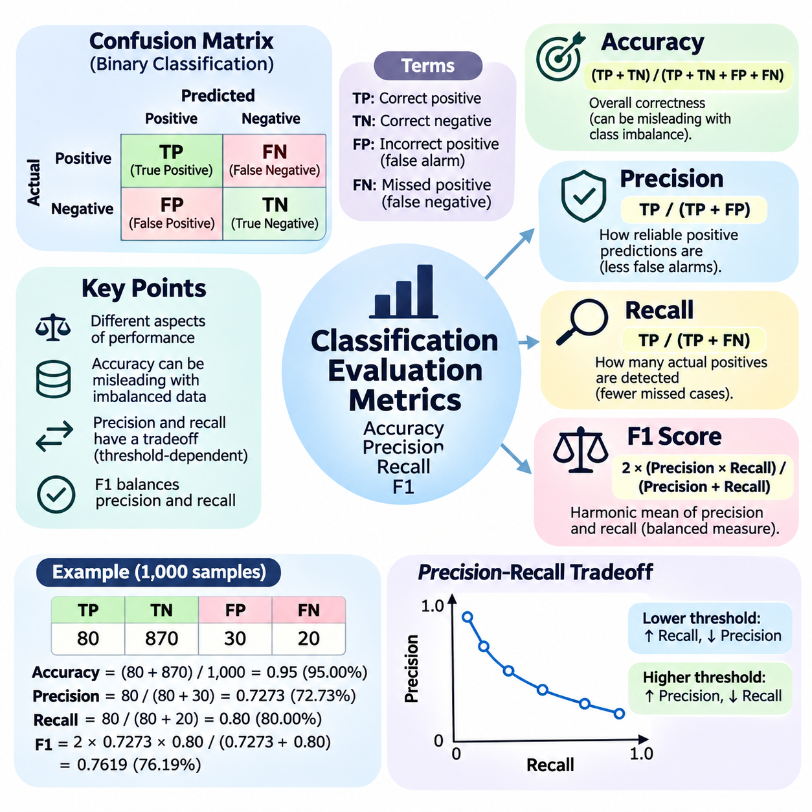
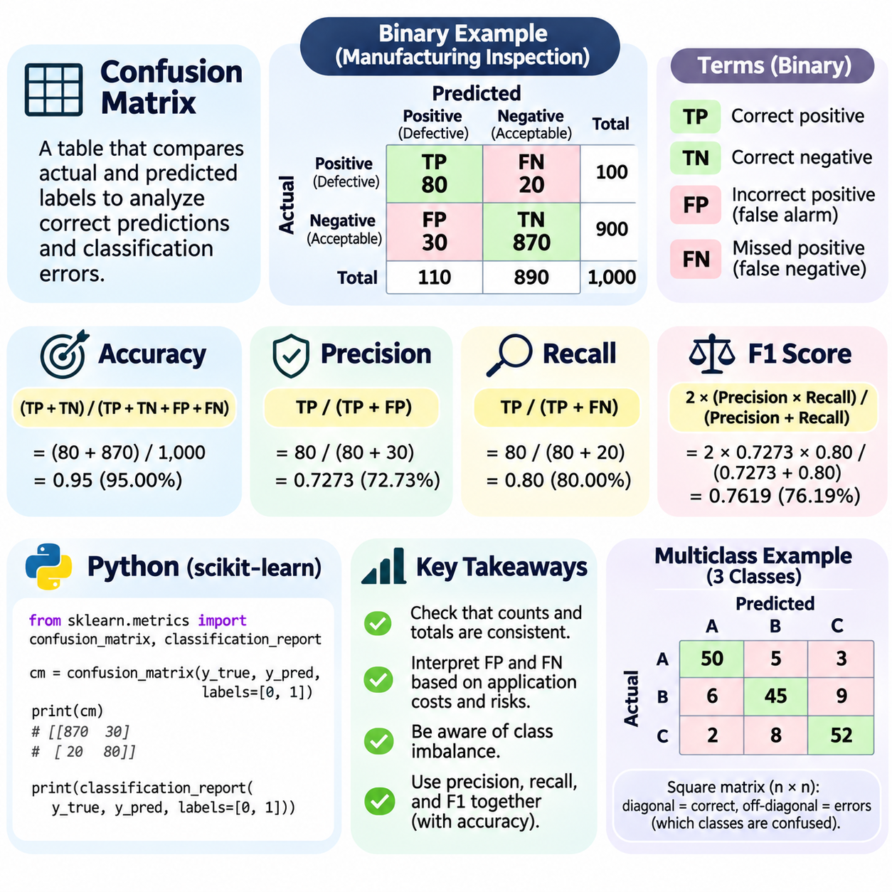
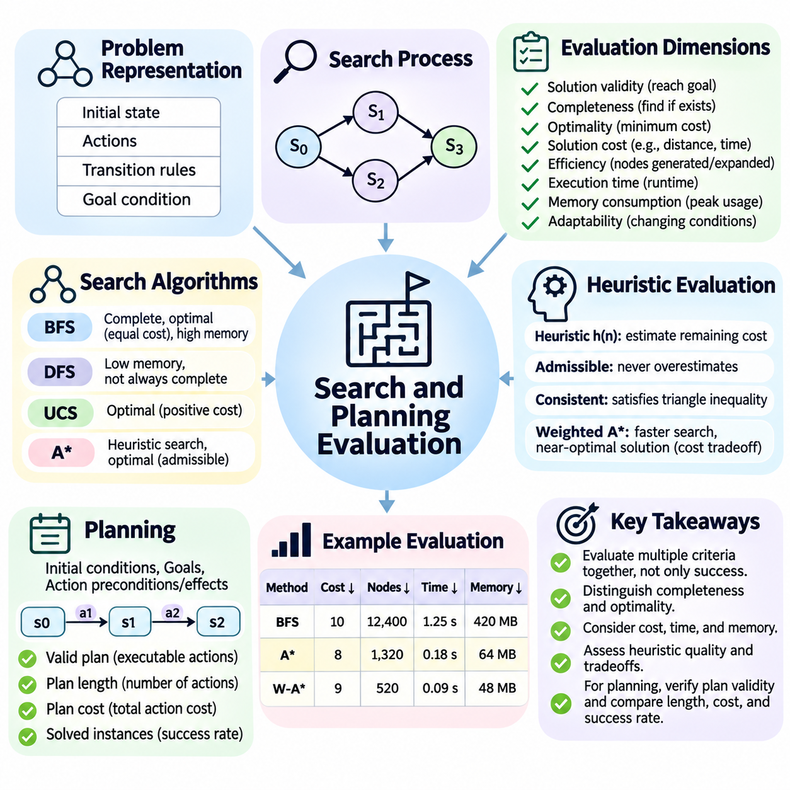
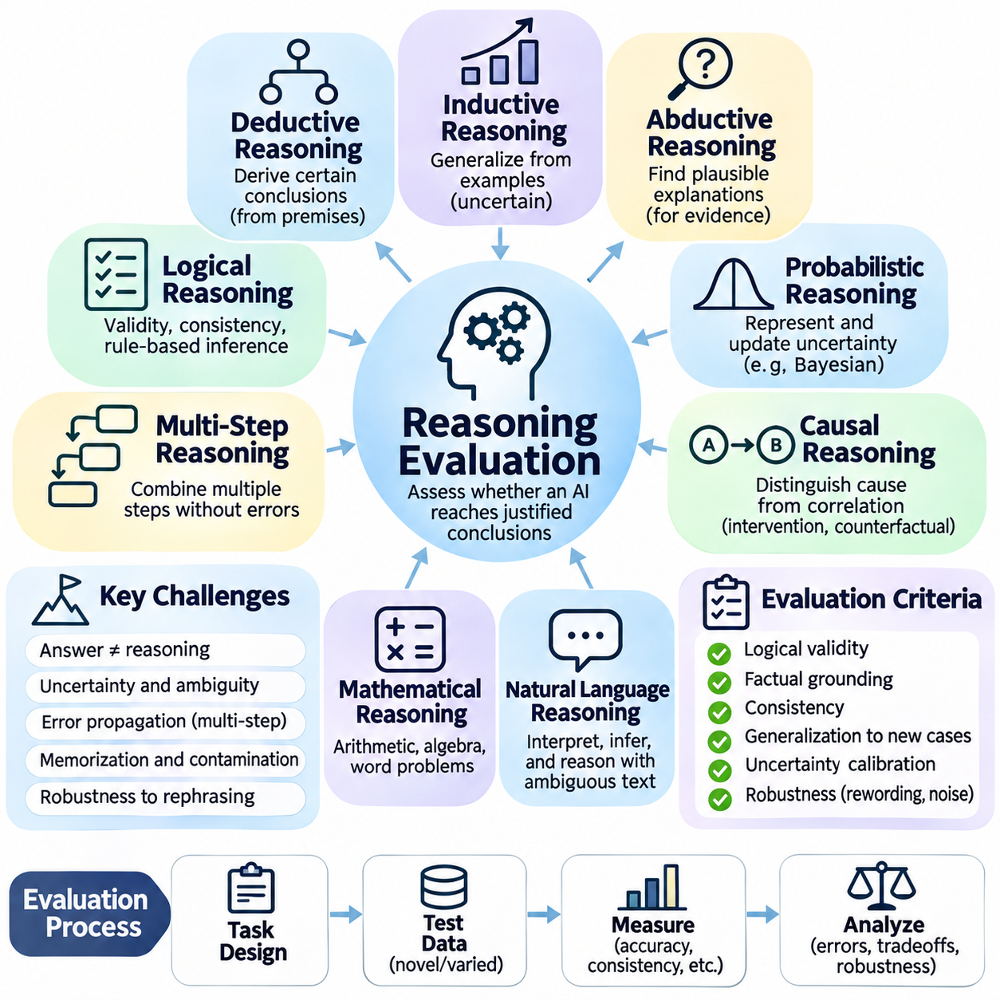
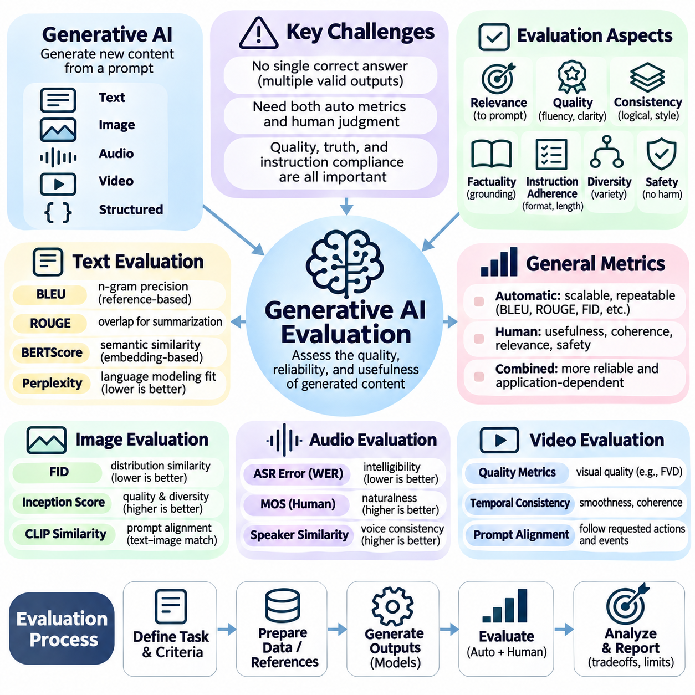
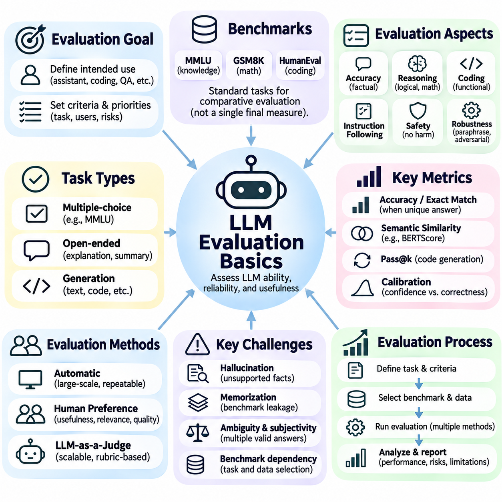
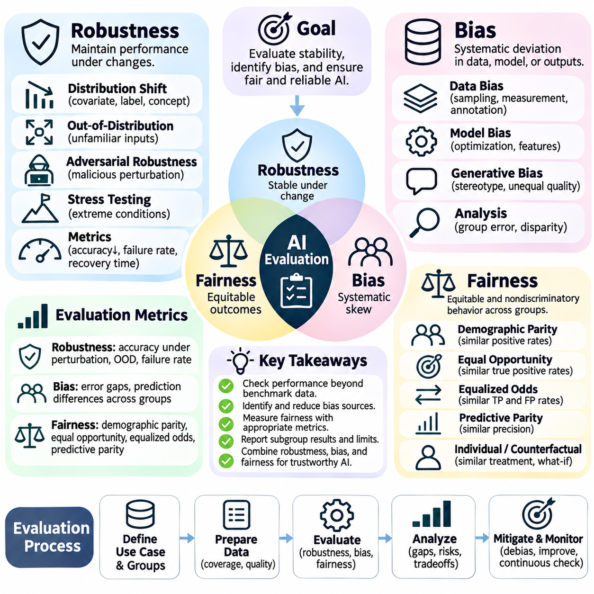
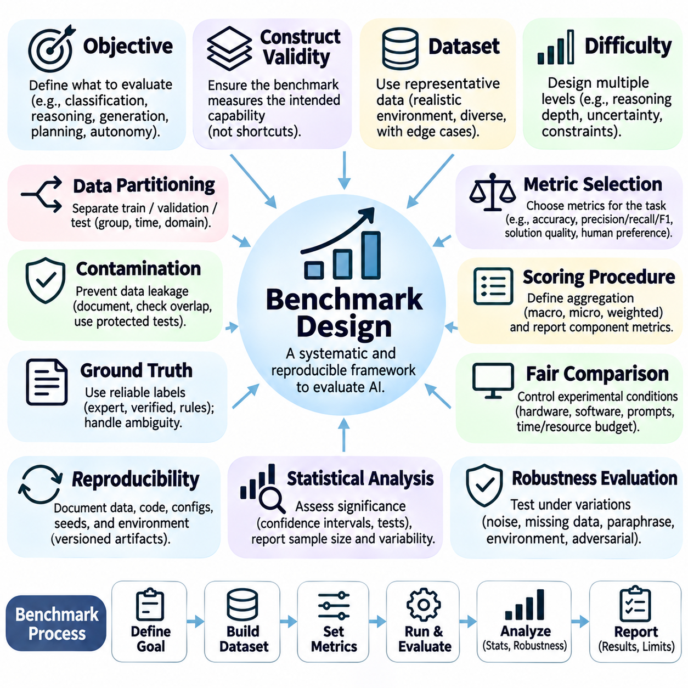

**Volume 04. Artificial Intelligence**


# 09. AI Evaluation and Benchmarking

## 09.00 Why AI Evaluation is Difficult

{width="7.268055555555556in" height="7.268055555555556in"}

Evaluating artificial intelligence is fundamentally difficult because intelligence cannot be represented by a single measurable property. AI systems perform diverse activities, including classification, prediction, reasoning, planning, generation, and decision-making. Each activity requires different evaluation criteria, making it challenging to establish a universal standard that accurately reflects the overall capability of an intelligent system.

Traditional software evaluation generally focuses on whether a program produces expected outputs for predefined inputs. Artificial intelligence introduces uncertainty because its behavior depends on learned patterns, statistical relationships, and environmental conditions. An AI model may produce different responses to similar inputs while remaining functionally acceptable, complicating the distinction between correct and incorrect behavior.

One major challenge is defining what successful intelligence actually means. A classification system may be evaluated through prediction accuracy, while a planning system must consider solution quality, computational efficiency, and goal achievement. A conversational AI system requires additional consideration of factual correctness, relevance, coherence, and contextual understanding. These dimensions cannot always be reduced to one numerical score.

Evaluation also depends heavily on the characteristics of the dataset used for testing. A model may achieve excellent results on a carefully prepared benchmark while performing poorly on unfamiliar real-world information. Differences in sampling methods, class distributions, annotation quality, and environmental conditions can significantly influence measured performance. Consequently, benchmark results describe behavior under particular conditions rather than universal competence.

The distinction between training performance and generalization represents another fundamental difficulty. AI systems can learn patterns that are highly effective within their training distributions without acquiring transferable understanding. When confronted with new situations, unfamiliar objects, or changed operating conditions, their performance may deteriorate. Reliable evaluation must therefore examine whether learned capabilities remain effective beyond previously observed examples.

Data leakage further complicates evaluation by allowing information from testing procedures to influence model development. Leakage may occur through duplicated samples, overlapping datasets, inappropriate preprocessing, or repeated benchmark-driven optimization. In such circumstances, reported performance may overestimate genuine generalization. Preventing leakage requires careful separation of training, validation, and testing information throughout development.

Another challenge arises from the limitations of ground-truth labels. Many evaluation procedures assume that each test example has a clearly defined correct answer. However, natural language interpretation, image annotation, ethical judgment, and complex decision-making frequently involve ambiguity. Different human experts may provide reasonable but inconsistent answers, making evaluation dependent on annotation policies and subjective assumptions.

The selection of evaluation metrics introduces additional complexity. Accuracy provides an intuitive measure of classification performance but may be misleading when classes are imbalanced. Precision and recall emphasize different types of prediction errors, while the F1 score combines them through a harmonic mean. Selecting an appropriate metric requires understanding the application, the distribution of errors, and the consequences associated with incorrect decisions.

Metric optimization can also create unintended behavior when the selected measurement does not fully represent the intended objective. A system optimized exclusively for benchmark accuracy may sacrifice robustness, interpretability, or computational efficiency. Similarly, a language model optimized for superficial response similarity may generate plausible statements without reliable factual grounding. Evaluation must distinguish measurable performance from meaningful task success.

Search and planning systems illustrate the importance of multidimensional assessment. Finding a valid solution does not necessarily mean finding the best solution, and achieving optimality may require excessive computation. Evaluators must consider completeness, optimality, execution time, memory consumption, and responsiveness to changing conditions. The relative importance of these properties depends on the operational requirements of the application.

Reasoning evaluation presents an especially difficult problem because correct conclusions do not necessarily demonstrate correct reasoning processes. A model may arrive at the expected answer through memorization, shortcuts, or accidental correlations. Conversely, a logically appropriate reasoning process may fail because of incomplete information. Evaluating reasoning therefore requires attention to logical consistency, evidence use, generalization, and intermediate decision quality.

Generative AI introduces challenges that differ substantially from conventional predictive modeling. A generative system may produce numerous acceptable outputs for the same prompt, making exact matching against a reference answer inadequate. Text, images, audio, and other generated content must be assessed through multiple dimensions, including semantic relevance, quality, diversity, consistency, and adherence to instructions. Human judgment often remains necessary.

Large language models further complicate evaluation because their capabilities vary with prompting strategies, contextual information, and interaction history. A model may answer a question correctly under one prompt formulation and incorrectly under another. Performance may also change when examples, retrieved documents, or external tools are introduced. Reliable evaluation must account for these conditions rather than treating model behavior as entirely fixed.

Factual correctness and linguistic fluency represent separate dimensions of language model quality. A response can be grammatically sophisticated, coherent, and persuasive while containing inaccurate information. Such errors are particularly problematic when users interpret fluent explanations as evidence of reliability. Evaluation must therefore distinguish presentation quality from factual grounding and examine whether generated claims are supported by appropriate evidence.

Robustness evaluation examines whether an AI system maintains acceptable behavior under disturbances and unexpected conditions. Small changes in image brightness, sensor noise, language phrasing, or input formatting may produce disproportionate changes in model outputs. Adversarial inputs can expose additional weaknesses. A robust evaluation framework must investigate sensitivity to perturbations and determine whether performance remains within acceptable operational limits.

Bias and fairness introduce evaluation requirements that extend beyond aggregate predictive performance. An AI system may achieve high overall accuracy while producing substantially different error rates across demographic groups or operating environments. These differences can remain hidden when results are summarized using a single average. Fairness assessment requires careful selection of relevant groups, performance measures, and application-specific criteria.

Real-world AI systems must also be evaluated according to their operational constraints. Computational latency, memory requirements, energy consumption, hardware compatibility, and system availability may determine whether a technically accurate model is practically useful. For embedded AI and autonomous robotics, delayed predictions can be as consequential as incorrect predictions. Evaluation must therefore consider the complete system rather than only the underlying algorithm.

Autonomous systems introduce additional difficulties because their decisions influence the environments in which they operate. A robot\'s actions change subsequent observations, creating feedback relationships between perception, reasoning, planning, and control. Evaluating individual components independently may overlook failures arising from their interactions. System-level assessment must examine complete behavioral sequences and the consequences of accumulated errors.

Safety-critical applications require particular attention to rare but consequential failures. A model may perform successfully across thousands of ordinary examples while failing under an unusual condition that creates substantial risk. Average performance metrics can obscure these low-frequency events. Evaluation should therefore include targeted scenarios, boundary conditions, failure analysis, and explicit consideration of the severity of potential consequences.

Reproducibility represents another essential challenge in AI benchmarking. Results may vary because of random initialization, dataset partitioning, software versions, hardware configurations, and nondeterministic computation. Comparisons between algorithms become unreliable when experimental conditions are inconsistent. Meaningful evaluation requires documented configurations, controlled procedures, repeated experiments, and appropriate reporting of performance variability.

Statistical uncertainty must also be considered when interpreting benchmark results. A small difference between two model scores does not automatically establish that one model is superior. Limited test samples and experimental randomness can produce apparent improvements that disappear under repeated measurement. Confidence intervals, statistical testing, and analysis across multiple datasets help distinguish meaningful performance differences from random variation.

Benchmark saturation creates a further limitation when increasingly capable models approach the maximum attainable score on established tests. Once many systems achieve similar results, the benchmark loses its ability to distinguish important differences in capability. Repeated exposure to popular evaluation datasets may also encourage benchmark-specific adaptation. New assessments must introduce meaningful challenges without sacrificing consistency and comparability.

The relationship between offline benchmarking and production performance is equally important. Controlled experiments generally operate on relatively stable datasets, while deployed systems encounter changing user behavior, evolving environments, and shifting input distributions. Performance measured before deployment may not remain representative afterward. Continuous monitoring, feedback collection, and periodic reevaluation are therefore necessary components of responsible AI operation.

Human evaluation provides valuable insight but introduces its own methodological difficulties. Human reviewers may disagree because of differences in expertise, interpretation, expectations, and cultural context. Evaluation outcomes can also be affected by presentation order, incomplete instructions, and reviewer fatigue. Structured assessment criteria, reviewer calibration, and agreement analysis help improve consistency without eliminating the inherent subjectivity of complex judgments.

Evaluation becomes more challenging when AI systems combine multiple capabilities into integrated workflows. An intelligent agent may retrieve information, interpret instructions, select tools, execute actions, and revise its plan based on feedback. Success depends not only on individual component performance but also on coordination across the entire workflow. A reliable assessment must identify where errors originate and how they propagate through subsequent decisions.

Ultimately, AI evaluation is not simply the calculation of a benchmark score. It is a systematic process of determining whether an intelligent system demonstrates the capabilities, reliability, efficiency, and safety required for its intended purpose. Effective evaluation combines quantitative metrics, qualitative assessment, controlled experimentation, and real-world observation. Its central objective is to establish credible evidence that an AI system can perform appropriately under the conditions in which it will actually be used.

인공지능(Artificial Intelligence, AI)을 평가하는 것은 지능(Intelligence)을 단일한 측정 가능한 속성으로 표현할 수 없기 때문에 근본적으로 어렵다. 인공지능 시스템(AI System)은 분류(Classification), 예측(Prediction), 추론(Reasoning), 계획(Planning), 생성(Generation), 의사결정(Decision-Making) 등 다양한 활동을 수행한다. 각각의 활동에는 서로 다른 평가 기준(Evaluation Criteria)이 필요하므로, 지능형 시스템(Intelligent System)의 전반적인 능력을 정확하게 반영하는 보편적인 평가 기준을 확립하기는 어렵다.

전통적인 소프트웨어 평가(Software Evaluation)는 일반적으로 프로그램이 사전에 정의된 입력(Input)에 대해 예상된 출력(Output)을 생성하는지 확인하는 데 중점을 둔다. 그러나 인공지능은 학습된 패턴(Learned Patterns), 통계적 관계(Statistical Relationships), 환경 조건(Environmental Conditions)에 따라 동작하기 때문에 불확실성(Uncertainty)이 발생한다. 인공지능 모델(AI Model)은 유사한 입력에 대해 서로 다른 응답을 생성하면서도 기능적으로 허용 가능한 결과를 제공할 수 있으며, 이로 인해 올바른 동작과 잘못된 동작을 구분하기가 복잡해진다.

주요 과제 중 하나는 성공적인 지능(Successful Intelligence)이 무엇을 의미하는지 정의하는 것이다. 분류 시스템(Classification System)은 예측 정확도(Prediction Accuracy)를 통해 평가할 수 있지만, 계획 시스템(Planning System)은 해의 품질(Solution Quality), 계산 효율성(Computational Efficiency), 목표 달성(Goal Achievement)을 함께 고려해야 한다. 대화형 인공지능(Conversational AI)은 사실적 정확성(Factual Correctness), 관련성(Relevance), 일관성(Coherence), 문맥 이해(Contextual Understanding)까지 평가해야 한다. 이러한 평가 차원(Evaluation Dimensions)을 항상 하나의 수치 점수로 환산할 수 있는 것은 아니다.

평가는 시험에 사용되는 데이터셋(Dataset)의 특성에도 크게 의존한다. 모델은 정교하게 준비된 벤치마크(Benchmark)에서 우수한 결과를 달성하더라도 익숙하지 않은 실제 환경의 정보에서는 낮은 성능을 보일 수 있다. 표본 추출 방법(Sampling Methods), 클래스 분포(Class Distribution), 주석 품질(Annotation Quality), 환경 조건(Environmental Conditions)의 차이는 측정된 성능에 상당한 영향을 미친다. 따라서 벤치마크 결과는 보편적인 능력보다는 특정 조건에서 나타난 동작을 설명한다.

학습 성능(Training Performance)과 일반화(Generalization)의 차이는 또 다른 근본적인 어려움이다. 인공지능 시스템은 학습 데이터 분포(Training Distribution) 내에서 매우 효과적인 패턴을 학습하더라도 다른 상황에 적용할 수 있는 이해 능력을 확보하지 못할 수 있다. 새로운 상황, 익숙하지 않은 객체, 변화된 운영 조건에 직면하면 성능이 저하될 수 있다. 따라서 신뢰할 수 있는 평가는 학습된 능력이 기존에 관찰한 사례를 넘어 효과적으로 유지되는지 확인해야 한다.

데이터 누출(Data Leakage)은 시험 절차의 정보가 모델 개발에 영향을 미치도록 만들어 평가를 더욱 복잡하게 한다. 데이터 누출은 중복 표본(Duplicated Samples), 데이터셋 간 중첩(Overlapping Datasets), 부적절한 전처리(Inappropriate Preprocessing), 반복적인 벤치마크 기반 최적화(Benchmark-Driven Optimization)를 통해 발생할 수 있다. 이러한 상황에서는 보고된 성능이 실제 일반화 능력을 과대평가할 수 있다. 데이터 누출을 방지하려면 개발 전 과정에서 학습(Training), 검증(Validation), 시험(Test) 정보를 신중하게 분리해야 한다.

정답 레이블(Ground-Truth Labels)의 한계 역시 평가를 어렵게 만든다. 많은 평가 절차는 각 시험 사례(Test Example)에 명확하게 정의된 정답(Correct Answer)이 존재한다고 가정한다. 그러나 자연어 해석(Natural Language Interpretation), 이미지 주석(Image Annotation), 윤리적 판단(Ethical Judgment), 복잡한 의사결정(Complex Decision-Making)에는 모호성(Ambiguity)이 자주 존재한다. 서로 다른 전문가가 합리적이지만 일치하지 않는 답변을 제공할 수 있으며, 평가 결과는 주석 정책(Annotation Policies)과 주관적 가정(Subjective Assumptions)에 영향을 받는다.

평가 지표(Evaluation Metrics)의 선택은 추가적인 복잡성을 초래한다. 정확도(Accuracy)는 분류 성능(Classification Performance)을 직관적으로 측정하지만 클래스 불균형(Class Imbalance)이 존재하면 오해를 유발할 수 있다. 정밀도(Precision)와 재현율(Recall)은 서로 다른 유형의 예측 오류(Prediction Errors)를 강조하며, F1 점수(F1 Score)는 조화평균(Harmonic Mean)을 통해 두 지표를 결합한다. 적절한 지표를 선택하려면 응용 분야(Application), 오류 분포(Error Distribution), 잘못된 의사결정의 결과를 이해해야 한다.

지표 최적화(Metric Optimization)는 선택한 측정값이 실제 목표를 완전히 반영하지 못할 때 의도하지 않은 동작을 유발할 수 있다. 벤치마크 정확도(Benchmark Accuracy)만을 최적화한 시스템은 강건성(Robustness), 해석 가능성(Interpretability), 계산 효율성(Computational Efficiency)을 희생할 수 있다. 마찬가지로 표면적인 응답 유사성(Response Similarity)에 최적화된 언어 모델(Language Model)은 신뢰할 수 있는 사실적 근거 없이 그럴듯한 문장을 생성할 수 있다. 따라서 평가는 측정 가능한 성능과 실질적인 작업 성공(Task Success)을 구분해야 한다.

탐색 및 계획 시스템(Search and Planning Systems)은 다차원 평가(Multidimensional Assessment)의 중요성을 보여준다. 유효한 해(Valid Solution)를 찾았다고 해서 반드시 최적해(Optimal Solution)를 찾은 것은 아니며, 최적성을 달성하는 데 과도한 계산 자원이 필요할 수도 있다. 평가자는 완전성(Completeness), 최적성(Optimality), 실행 시간(Execution Time), 메모리 사용량(Memory Consumption), 변화하는 조건에 대한 대응성(Responsiveness)을 고려해야 한다. 이러한 특성의 상대적 중요도는 응용 시스템의 운영 요구사항(Operational Requirements)에 따라 달라진다.

추론 평가(Reasoning Evaluation)는 올바른 결론이 반드시 올바른 추론 과정(Reasoning Process)을 입증하지는 않기 때문에 특히 어렵다. 모델은 암기(Memorization), 지름길(Shortcuts), 우연한 상관관계(Accidental Correlations)를 통해 예상된 답에 도달할 수 있다. 반대로 논리적으로 적절한 추론 과정도 불완전한 정보(Incomplete Information) 때문에 실패할 수 있다. 따라서 추론 평가에서는 논리적 일관성(Logical Consistency), 증거 활용(Evidence Use), 일반화(Generalization), 중간 의사결정 품질(Intermediate Decision Quality)에 주의를 기울여야 한다.

생성형 인공지능(Generative AI)은 기존 예측 모델링(Predictive Modeling)과 상당히 다른 평가 과제를 제시한다. 생성 시스템(Generative System)은 동일한 프롬프트(Prompt)에 대해 여러 개의 허용 가능한 출력을 생성할 수 있으므로 참조 정답(Reference Answer)과의 정확한 일치만으로는 충분하지 않다. 생성된 텍스트(Text), 이미지(Image), 오디오(Audio) 및 기타 콘텐츠(Content)는 의미적 관련성(Semantic Relevance), 품질(Quality), 다양성(Diversity), 일관성(Consistency), 지시사항 준수(Instruction Adherence) 등 여러 차원에서 평가해야 한다. 이 과정에서는 인간의 판단(Human Judgment)이 여전히 필요한 경우가 많다.

대규모 언어 모델(Large Language Model, LLM)은 프롬프트 전략(Prompting Strategies), 문맥 정보(Contextual Information), 상호작용 이력(Interaction History)에 따라 능력이 달라지므로 평가를 더욱 복잡하게 만든다. 모델은 하나의 프롬프트 표현(Prompt Formulation)에서는 질문에 올바르게 답하지만 다른 표현에서는 잘못된 답을 제공할 수 있다. 예시(Examples), 검색된 문서(Retrieved Documents), 외부 도구(External Tools)가 도입되면 성능이 달라질 수도 있다. 따라서 신뢰할 수 있는 평가는 모델 동작을 완전히 고정된 것으로 취급하지 않고 이러한 조건을 고려해야 한다.

사실적 정확성(Factual Correctness)과 언어적 유창성(Linguistic Fluency)은 언어 모델 품질(Language Model Quality)의 서로 다른 평가 차원이다. 응답은 문법적으로 정교하고 일관되며 설득력이 있으면서도 부정확한 정보를 포함할 수 있다. 이러한 오류는 사용자가 유창한 설명을 신뢰성(Reliability)의 증거로 받아들일 때 특히 문제가 된다. 따라서 평가는 표현 품질(Presentation Quality)과 사실적 근거(Factual Grounding)를 구분하고, 생성된 주장(Generated Claims)이 적절한 증거에 의해 뒷받침되는지 검토해야 한다.

강건성 평가(Robustness Evaluation)는 교란(Disturbances)과 예상하지 못한 조건에서도 인공지능 시스템이 허용 가능한 동작을 유지하는지 확인한다. 이미지 밝기(Image Brightness), 센서 잡음(Sensor Noise), 언어 표현(Language Phrasing), 입력 형식(Input Formatting)의 작은 변화가 모델 출력에 불균형적으로 큰 변화를 일으킬 수 있다. 적대적 입력(Adversarial Inputs)은 추가적인 취약점을 드러낼 수 있다. 따라서 강건한 평가 프레임워크(Evaluation Framework)는 교란에 대한 민감도(Sensitivity)를 조사하고 성능이 허용 가능한 운영 한계 내에서 유지되는지 판단해야 한다.

편향(Bias)과 공정성(Fairness)은 전체 예측 성능(Aggregate Predictive Performance)을 넘어서는 평가 요구사항을 제시한다. 인공지능 시스템은 높은 전체 정확도(Overall Accuracy)를 달성하면서도 인구통계학적 집단(Demographic Groups)이나 운영 환경(Operating Environments)에 따라 상당히 다른 오류율(Error Rates)을 나타낼 수 있다. 이러한 차이는 결과를 하나의 평균값으로 요약하면 드러나지 않을 수 있다. 공정성 평가(Fairness Assessment)에서는 관련 집단, 성능 측정값, 응용 분야별 기준을 신중하게 선택해야 한다.

실제 인공지능 시스템(Real-World AI Systems)은 운영 제약조건(Operational Constraints)에 따라서도 평가해야 한다. 계산 지연시간(Computational Latency), 메모리 요구량(Memory Requirements), 에너지 소비(Energy Consumption), 하드웨어 호환성(Hardware Compatibility), 시스템 가용성(System Availability)은 기술적으로 정확한 모델이 실제로 유용한지를 결정할 수 있다. 임베디드 인공지능(Embedded AI)과 자율 로봇(Autonomous Robotics)에서는 지연된 예측이 잘못된 예측만큼 중대한 결과를 초래할 수 있다. 따라서 평가는 기본 알고리즘뿐 아니라 전체 시스템을 고려해야 한다.

자율 시스템(Autonomous Systems)은 자신의 의사결정이 작동 환경에 영향을 미치기 때문에 추가적인 어려움을 발생시킨다. 로봇의 행동(Action)은 이후의 관측(Observation)을 변화시키며, 인식(Perception), 추론(Reasoning), 계획(Planning), 제어(Control) 사이에 피드백 관계(Feedback Relationships)를 형성한다. 개별 구성요소(Component)를 독립적으로 평가하면 상호작용에서 발생하는 실패를 놓칠 수 있다. 시스템 수준 평가(System-Level Assessment)는 완전한 행동 시퀀스(Behavioral Sequences)와 누적 오류(Accumulated Errors)의 결과를 검토해야 한다.

안전 필수 응용 분야(Safety-Critical Applications)에서는 드물지만 중대한 결과를 초래하는 실패에 특별한 주의를 기울여야 한다. 모델은 수천 개의 일반적인 사례에서 성공적으로 동작하면서도 상당한 위험을 발생시키는 특수한 조건에서는 실패할 수 있다. 평균 성능 지표(Average Performance Metrics)는 이러한 저빈도 사건(Low-Frequency Events)을 가릴 수 있다. 따라서 평가에는 목표 지향적 시나리오(Targeted Scenarios), 경계 조건(Boundary Conditions), 실패 분석(Failure Analysis), 잠재적 결과의 심각성(Severity)에 대한 명시적 고려가 포함되어야 한다.

재현성(Reproducibility)은 인공지능 벤치마킹(AI Benchmarking)의 또 다른 필수 과제이다. 결과는 무작위 초기화(Random Initialization), 데이터셋 분할(Dataset Partitioning), 소프트웨어 버전(Software Versions), 하드웨어 구성(Hardware Configurations), 비결정적 계산(Nondeterministic Computation)에 따라 달라질 수 있다. 실험 조건이 일관되지 않으면 알고리즘 간 비교는 신뢰하기 어렵다. 의미 있는 평가를 위해서는 문서화된 구성, 통제된 절차, 반복 실험(Repeated Experiments), 성능 변동성(Performance Variability)에 대한 적절한 보고가 필요하다.

벤치마크 결과를 해석할 때는 통계적 불확실성(Statistical Uncertainty)도 고려해야 한다. 두 모델의 점수 차이가 작다고 해서 한 모델이 다른 모델보다 우수하다는 사실이 자동으로 입증되는 것은 아니다. 제한된 시험 표본(Test Samples)과 실험의 무작위성(Experimental Randomness)은 반복 측정에서 사라지는 겉보기 성능 향상(Apparent Improvements)을 만들어낼 수 있다. 신뢰구간(Confidence Intervals), 통계적 검정(Statistical Testing), 여러 데이터셋에 대한 분석은 의미 있는 성능 차이와 무작위 변동(Random Variation)을 구분하는 데 도움이 된다.

벤치마크 포화(Benchmark Saturation)는 점점 더 강력해지는 모델들이 기존 시험에서 달성 가능한 최대 점수에 근접할 때 발생하는 추가적인 한계이다. 많은 시스템이 비슷한 결과를 달성하면 벤치마크는 중요한 능력 차이를 구분하는 기능을 잃게 된다. 널리 사용되는 평가 데이터셋(Evaluation Datasets)에 반복적으로 노출되는 현상도 벤치마크 특화 적응(Benchmark-Specific Adaptation)을 촉진할 수 있다. 새로운 평가는 일관성(Consistency)과 비교 가능성(Comparability)을 유지하면서 의미 있는 도전 과제를 도입해야 한다.

오프라인 벤치마킹(Offline Benchmarking)과 운영 환경 성능(Production Performance)의 관계도 중요하다. 통제된 실험(Controlled Experiments)은 일반적으로 비교적 안정적인 데이터셋을 사용하지만, 배포된 시스템(Deployed Systems)은 변화하는 사용자 행동(User Behavior), 진화하는 환경(Evolving Environments), 이동하는 입력 분포(Shifting Input Distributions)에 직면한다. 배포 전에 측정한 성능이 이후에도 대표성을 유지한다고 보장할 수 없다. 따라서 지속적 모니터링(Continuous Monitoring), 피드백 수집(Feedback Collection), 주기적 재평가(Periodic Reevaluation)는 책임 있는 인공지능 운영의 필수 요소이다.

인간 평가(Human Evaluation)는 유용한 통찰을 제공하지만 자체적인 방법론적 어려움(Methodological Difficulties)을 수반한다. 인간 평가자(Human Reviewers)는 전문성(Expertise), 해석(Interpretation), 기대(Expectations), 문화적 맥락(Cultural Context)의 차이로 인해 서로 다른 판단을 내릴 수 있다. 평가 결과는 제시 순서(Presentation Order), 불완전한 지침(Incomplete Instructions), 평가자 피로(Reviewer Fatigue)의 영향도 받을 수 있다. 구조화된 평가 기준(Structured Assessment Criteria), 평가자 보정(Reviewer Calibration), 일치도 분석(Agreement Analysis)은 복잡한 판단에 내재된 주관성을 완전히 제거하지는 못하더라도 일관성을 높이는 데 도움이 된다.

인공지능 시스템이 여러 능력을 통합된 작업 흐름(Integrated Workflows)으로 결합하면 평가는 더욱 어려워진다. 지능형 에이전트(Intelligent Agent)는 정보를 검색하고, 지시사항을 해석하며, 도구를 선택하고, 행동을 실행한 다음 피드백에 따라 계획을 수정할 수 있다. 성공 여부는 개별 구성요소의 성능뿐 아니라 전체 작업 흐름의 조정 능력(Coordination)에 달려 있다. 신뢰할 수 있는 평가는 오류가 어디에서 발생하고 이후 의사결정에 어떻게 전파되는지 식별해야 한다.

궁극적으로 인공지능 평가(AI Evaluation)는 단순히 벤치마크 점수(Benchmark Score)를 계산하는 작업이 아니다. 이는 지능형 시스템이 의도된 목적에 필요한 능력(Capabilities), 신뢰성(Reliability), 효율성(Efficiency), 안전성(Safety)을 갖추었는지 판단하는 체계적인 과정(Systematic Process)이다. 효과적인 평가는 정량적 지표(Quantitative Metrics), 정성적 평가(Qualitative Assessment), 통제된 실험(Controlled Experimentation), 실제 환경 관측(Real-World Observation)을 결합한다. 궁극적인 목표는 인공지능 시스템이 실제 사용 조건에서 적절하게 수행할 수 있다는 신뢰할 만한 증거(Credible Evidence)를 확보하는 것이다.

## 09.01 Accuracy Precision Recall F1 [w/Code]

{width="7.268055555555556in" height="7.268055555555556in"}

Accuracy, precision, recall, and F1 score are fundamental evaluation metrics used to measure the performance of classification systems in artificial intelligence. Although these metrics are derived from the same prediction outcomes, they describe different aspects of model behavior. Understanding their mathematical definitions, practical interpretations, and limitations is essential for selecting appropriate evaluation criteria.

Classification evaluation begins by comparing predicted labels with actual labels in a labeled test dataset. For binary classification, outcomes are divided into true positives, true negatives, false positives, and false negatives. These four categories form the foundation of the confusion matrix and provide the numerical information required to calculate accuracy, precision, recall, and F1 score.

A true positive (TP) occurs when a model correctly predicts the positive class, while a true negative (TN) occurs when it correctly predicts the negative class. A false positive (FP) represents an incorrect positive prediction, and a false negative (FN) represents a missed positive instance. The practical consequences of these errors depend on the application and may differ substantially.

Accuracy measures the proportion of all predictions that are correct. It is calculated as Accuracy = (TP + TN) / (TP + TN + FP + FN). For example, if a classifier correctly predicts 900 out of 1,000 samples, its accuracy is 90 percent. This metric provides an intuitive summary of overall correctness when the test dataset adequately represents the intended operating conditions.

However, accuracy can become misleading when the dataset contains a substantial class imbalance. Consider a medical screening dataset containing 990 negative cases and only 10 positive cases. A classifier that predicts every sample as negative achieves 99 percent accuracy while failing to identify any positive cases. This example demonstrates why overall correctness alone cannot establish practical classification quality.

Precision measures the proportion of predicted positive instances that are actually positive. Its mathematical definition is Precision = TP / (TP + FP). A precision value of 0.90 means that 90 percent of the model\'s positive predictions are correct. Precision therefore describes the reliability of positive predictions and is especially important when false positive errors are expensive or disruptive.

For example, an automated industrial inspection system may classify manufactured components as defective or acceptable. If precision is low, many acceptable components may be incorrectly rejected as defective. This creates unnecessary inspection costs, material waste, and production delays. Improving precision reduces these false alarms, although it may also affect the system\'s ability to identify actual defects.

Recall measures the proportion of actual positive instances that the classifier successfully identifies. It is calculated as Recall = TP / (TP + FN). A recall value of 0.95 indicates that the model detects 95 percent of all positive instances in the evaluated dataset. Recall is particularly important when failing to identify a positive case creates significant safety, financial, or operational consequences.

In medical diagnosis, a false negative may allow a serious condition to remain undetected. Similarly, a robotic safety monitoring system may fail to recognize a person entering a restricted operating area. In these applications, high recall is often prioritized because missed detections can have severe consequences. Nevertheless, maximizing recall without controlling false positives can create excessive alarms.

Precision and recall frequently exhibit a tradeoff because classification decisions depend on a prediction threshold. Lowering the threshold for assigning the positive class generally increases the number of detected positive instances, improving recall while potentially reducing precision. Raising the threshold often improves precision by eliminating uncertain positive predictions but may increase false negatives.

The precision-recall tradeoff becomes especially important when classifiers produce probability estimates or confidence scores. Instead of relying exclusively on a default threshold of 0.5, engineers can examine how performance changes across different thresholds. The selected operating point should reflect the relative costs of false positives and false negatives rather than an arbitrary numerical convention.

The F1 score combines precision and recall into a single metric using their harmonic mean. Its mathematical definition is F1 = 2 × (Precision × Recall) / (Precision + Recall). When expressed through confusion matrix values, the equivalent formula is F1 = 2TP / (2TP + FP + FN). The harmonic mean penalizes large differences between precision and recall.

For example, consider a classifier with precision of 0.90 and recall of 0.60. Its F1 score is approximately 0.72, reflecting the imbalance between the two metrics. If both precision and recall increase to 0.80, the F1 score becomes 0.80. This behavior makes F1 useful when both false positives and false negatives deserve meaningful consideration.

A practical numerical example illustrates the relationship among these metrics. Suppose a binary classifier produces TP = 80, TN = 870, FP = 30, and FN = 20 across 1,000 samples. Its accuracy is 95 percent, precision is approximately 72.73 percent, recall is 80 percent, and F1 score is approximately 76.19 percent. The different values reveal information hidden by accuracy alone.

Although F1 provides a balanced summary of precision and recall, it does not incorporate true negatives directly. Consequently, two classifiers with identical TP, FP, and FN values but different numbers of true negatives have the same F1 score. This property is useful for some imbalanced classification problems but means that F1 should not automatically replace every other performance metric.

When precision and recall have unequal importance, the generalized F-beta score provides additional flexibility. Its formula is Fβ = (1 + β²) × Precision × Recall / (β² × Precision + Recall). Values of β greater than one emphasize recall, while values below one emphasize precision. The standard F1 score corresponds to β = 1 and assigns equal mathematical emphasis to both measures.

Multiclass classification introduces additional considerations because each class can be evaluated separately. A common approach treats one class as positive and all remaining classes as negative, producing class-specific precision, recall, and F1 scores. These values reveal whether the classifier performs consistently across categories or achieves strong overall results by favoring frequently occurring classes.

Macro averaging calculates the arithmetic mean of class-specific metrics, giving every class equal weight regardless of its frequency. Weighted averaging combines class-specific results according to the number of actual samples belonging to each class. Micro averaging aggregates confusion counts across classes before calculating the metrics. Each method represents a different perspective on classification performance.

For single-label multiclass classification, micro-averaged precision, recall, and F1 are equal to overall accuracy when every sample receives exactly one predicted class. However, macro-averaged and weighted scores may differ substantially. These distinctions are especially important for imbalanced datasets because a high aggregate score can conceal poor performance on rare but operationally significant categories.

Multilabel classification presents another evaluation scenario in which each sample may belong to several classes simultaneously. Precision, recall, and F1 can be calculated for individual labels, aggregated across all label decisions, or averaged across samples. The interpretation depends on the averaging strategy, making it necessary to document how predictions, thresholds, and metric calculations are defined.

Reliable implementation requires careful treatment of undefined mathematical expressions. Precision is undefined when a classifier produces no positive predictions, while recall is undefined when the evaluated dataset contains no actual positive instances. Software libraries may assign a configurable replacement value or generate warnings. Such cases should be reported explicitly rather than silently interpreted as ordinary performance measurements.

Evaluation metrics must also be interpreted in relation to statistical uncertainty and dataset quality. Small test sets can produce unstable precision and recall estimates, especially when positive examples are rare. Confidence intervals, repeated evaluation, and representative sampling help determine whether observed differences are meaningful. Metric values should therefore be accompanied by sufficient experimental context.

In practical AI engineering, metric selection should begin with the consequences of classification errors. Accuracy is useful for summarizing overall correctness, precision emphasizes the trustworthiness of positive predictions, recall measures the detection of actual positives, and F1 captures their combined behavior. A reliable evaluation process uses these complementary perspectives to determine whether a classifier satisfies its intended operational requirements.

정확도(Accuracy), 정밀도(Precision), 재현율(Recall), F1 점수(F1 Score)는 인공지능(Artificial Intelligence)의 분류 시스템(Classification System) 성능을 측정하는 데 사용되는 기본적인 평가 지표(Evaluation Metrics)이다. 이러한 지표들은 동일한 예측 결과(Prediction Outcomes)에서 도출되지만 모델 동작(Model Behavior)의 서로 다른 측면을 설명한다. 수학적 정의(Mathematical Definitions), 실제적 해석(Practical Interpretations), 한계(Limitations)를 이해하는 것은 적절한 평가 기준(Evaluation Criteria)을 선택하는 데 필수적이다.

분류 평가(Classification Evaluation)는 레이블이 지정된 시험 데이터셋(Labeled Test Dataset)에서 예측 레이블(Predicted Labels)과 실제 레이블(Actual Labels)을 비교하는 것으로 시작한다. 이진 분류(Binary Classification)에서는 결과를 참양성(True Positive), 참음성(True Negative), 거짓양성(False Positive), 거짓음성(False Negative)으로 구분한다. 이러한 네 가지 범주는 혼동 행렬(Confusion Matrix)의 기초를 형성하며 정확도, 정밀도, 재현율, F1 점수를 계산하는 데 필요한 수치 정보를 제공한다.

참양성(True Positive, TP)은 모델이 양성 클래스(Positive Class)를 올바르게 예측한 경우이며, 참음성(True Negative, TN)은 음성 클래스(Negative Class)를 올바르게 예측한 경우이다. 거짓양성(False Positive, FP)은 실제로 음성인 대상을 양성으로 잘못 예측한 경우이고, 거짓음성(False Negative, FN)은 실제 양성인 대상을 탐지하지 못한 경우이다. 이러한 오류의 실제적 결과(Practical Consequences)는 응용 분야(Application)에 따라 달라지며 상당한 차이가 발생할 수 있다.

정확도(Accuracy)는 전체 예측 중 올바른 예측이 차지하는 비율을 측정한다. 계산식은 Accuracy = (TP + TN) / (TP + TN + FP + FN)이다. 예를 들어 분류기(Classifier)가 1,000개의 표본(Samples) 중 900개를 올바르게 예측했다면 정확도는 90%이다. 이 지표는 시험 데이터셋(Test Dataset)이 실제 운영 조건(Operating Conditions)을 적절하게 대표할 때 전체적인 예측 정확성(Overall Correctness)을 직관적으로 요약한다.

그러나 데이터셋에 상당한 클래스 불균형(Class Imbalance)이 존재하면 정확도는 오해를 유발할 수 있다. 예를 들어 의료 선별검사 데이터셋(Medical Screening Dataset)에 음성 사례(Negative Cases) 990개와 양성 사례(Positive Cases) 10개가 있다고 가정하자. 모든 표본을 음성으로 예측하는 분류기는 양성 사례를 하나도 식별하지 못하면서도 99%의 정확도를 달성한다. 이는 전체적인 예측 정확성만으로 실제 분류 품질(Classification Quality)을 판단할 수 없음을 보여준다.

정밀도(Precision)는 양성으로 예측한 사례 중 실제로 양성인 사례의 비율을 측정한다. 수학적 정의는 Precision = TP / (TP + FP)이다. 정밀도가 0.90이라는 것은 모델이 양성으로 예측한 결과의 90%가 올바르다는 의미이다. 따라서 정밀도는 양성 예측(Positive Predictions)의 신뢰성을 설명하며, 특히 거짓양성 오류(False Positive Errors)가 높은 비용이나 운영상의 혼란을 초래하는 상황에서 중요하다.

예를 들어 자동화된 산업 검사 시스템(Automated Industrial Inspection System)은 제조된 부품(Manufactured Components)을 불량(Defective) 또는 정상(Acceptable)으로 분류할 수 있다. 정밀도가 낮으면 많은 정상 부품이 불량으로 잘못 판정될 수 있다. 이는 불필요한 검사 비용(Inspection Costs), 재료 낭비(Material Waste), 생산 지연(Production Delays)을 발생시킨다. 정밀도를 향상시키면 이러한 오경보(False Alarms)를 줄일 수 있지만 실제 불량을 식별하는 능력에도 영향을 미칠 수 있다.

재현율(Recall)은 실제 양성 사례 중 분류기가 성공적으로 식별한 사례의 비율을 측정한다. 계산식은 Recall = TP / (TP + FN)이다. 재현율이 0.95라는 것은 평가 데이터셋(Evaluation Dataset)에 존재하는 모든 양성 사례의 95%를 모델이 탐지했다는 의미이다. 재현율은 양성 사례를 식별하지 못하는 것이 안전(Safety), 재무(Financial), 운영(Operational) 측면에서 중대한 결과를 초래하는 상황에서 특히 중요하다.

의료 진단(Medical Diagnosis)에서 거짓음성(False Negative)은 심각한 질환이 발견되지 않은 상태로 남게 할 수 있다. 마찬가지로 로봇 안전 모니터링 시스템(Robotic Safety Monitoring System)은 제한된 작업 구역(Restricted Operating Area)에 진입하는 사람을 인식하지 못할 수 있다. 이러한 응용 분야에서는 미탐지(Missed Detection)가 심각한 결과를 초래할 수 있으므로 높은 재현율을 우선시하는 경우가 많다. 그러나 거짓양성을 통제하지 않고 재현율만 극대화하면 과도한 경보가 발생할 수 있다.

정밀도와 재현율은 분류 결정(Classification Decisions)이 예측 임곗값(Prediction Threshold)에 의존하기 때문에 상충관계(Tradeoff)를 나타내는 경우가 많다. 양성 클래스를 할당하는 임곗값을 낮추면 일반적으로 탐지되는 양성 사례의 수가 증가하여 재현율이 향상되지만 정밀도는 감소할 수 있다. 반대로 임곗값을 높이면 불확실한 양성 예측(Uncertain Positive Predictions)이 제거되어 정밀도가 향상될 수 있지만 거짓음성이 증가할 수 있다.

정밀도와 재현율의 상충관계(Precision-Recall Tradeoff)는 분류기가 확률 추정값(Probability Estimates)이나 신뢰도 점수(Confidence Scores)를 생성할 때 특히 중요하다. 기본 임곗값(Default Threshold)인 0.5에만 의존하는 대신 엔지니어는 다양한 임곗값에서 성능이 어떻게 변화하는지 분석할 수 있다. 선택된 동작점(Operating Point)은 임의의 수치적 관례가 아니라 거짓양성과 거짓음성의 상대적 비용(Relative Costs)을 반영해야 한다.

F1 점수(F1 Score)는 정밀도와 재현율의 조화평균(Harmonic Mean)을 사용하여 두 지표를 하나로 결합한다. 수학적 정의는 F1 = 2 × (Precision × Recall) / (Precision + Recall)이다. 혼동 행렬(Confusion Matrix)의 값으로 표현하면 동일한 공식은 F1 = 2TP / (2TP + FP + FN)이 된다. 조화평균은 정밀도와 재현율 사이에 큰 차이가 존재할 때 점수를 낮추는 특성이 있다.

예를 들어 정밀도가 0.90이고 재현율이 0.60인 분류기를 생각해 보자. 이 분류기의 F1 점수는 약 0.72이며 두 지표 사이의 불균형을 반영한다. 정밀도와 재현율이 모두 0.80으로 증가하면 F1 점수도 0.80이 된다. 이러한 특성으로 인해 F1 점수는 거짓양성과 거짓음성을 모두 중요하게 고려해야 하는 상황에서 유용하다.

실제 수치 예제(Numerical Example)를 통해 이러한 지표들의 관계를 이해할 수 있다. 이진 분류기가 1,000개의 표본에서 TP = 80, TN = 870, FP = 30, FN = 20의 결과를 생성했다고 가정하자. 정확도는 95%, 정밀도는 약 72.73%, 재현율은 80%, F1 점수는 약 76.19%이다. 서로 다른 지표값은 정확도만으로는 드러나지 않는 분류 성능의 특성을 보여준다.

F1 점수는 정밀도와 재현율을 균형 있게 요약하지만 참음성(True Negatives)을 직접적으로 포함하지 않는다. 따라서 TP, FP, FN 값이 동일하지만 참음성의 수가 다른 두 분류기는 동일한 F1 점수를 갖는다. 이러한 특성은 일부 불균형 분류 문제(Imbalanced Classification Problems)에서 유용하지만 F1 점수가 다른 모든 성능 지표를 자동으로 대체해야 한다는 의미는 아니다.

정밀도와 재현율의 중요도가 서로 다를 때는 일반화된 F-베타 점수(F-beta Score)를 통해 추가적인 유연성을 확보할 수 있다. 계산식은 Fβ = (1 + β²) × Precision × Recall / (β² × Precision + Recall)이다. β가 1보다 크면 재현율을 더 강조하고, 1보다 작으면 정밀도를 더 강조한다. 표준 F1 점수(Standard F1 Score)는 β = 1에 해당하며 두 지표에 동일한 수학적 가중치를 부여한다.

다중 클래스 분류(Multiclass Classification)는 각 클래스를 개별적으로 평가할 수 있으므로 추가적인 고려사항이 발생한다. 일반적인 접근법은 하나의 클래스를 양성으로 취급하고 나머지 모든 클래스를 음성으로 취급하여 클래스별 정밀도(Class-Specific Precision), 재현율(Recall), F1 점수(F1 Score)를 계산하는 것이다. 이러한 값은 분류기가 여러 범주에서 일관된 성능을 보이는지 또는 빈도가 높은 클래스를 우선하여 높은 전체 성능을 달성하는지 보여준다.

매크로 평균(Macro Averaging)은 클래스별 지표의 산술평균(Arithmetic Mean)을 계산하며 각 클래스의 빈도와 관계없이 동일한 가중치를 부여한다. 가중 평균(Weighted Averaging)은 각 클래스에 속하는 실제 표본 수에 따라 클래스별 결과를 결합한다. 마이크로 평균(Micro Averaging)은 지표를 계산하기 전에 클래스 전체의 혼동 행렬 관련 집계값(Confusion Counts)을 통합한다. 각 방법은 분류 성능을 서로 다른 관점에서 나타낸다.

단일 레이블 다중 클래스 분류(Single-Label Multiclass Classification)에서는 모든 표본에 정확히 하나의 예측 클래스가 할당될 때 마이크로 평균 정밀도(Micro-Averaged Precision), 재현율(Micro-Averaged Recall), F1 점수(Micro-Averaged F1)가 전체 정확도(Overall Accuracy)와 동일하다. 그러나 매크로 평균 점수(Macro-Averaged Scores)와 가중 평균 점수(Weighted Scores)는 상당히 다를 수 있다. 이러한 차이는 높은 집계 점수(Aggregate Score)가 드물지만 운영상 중요한 범주의 낮은 성능을 숨길 수 있으므로 불균형 데이터셋에서 특히 중요하다.

다중 레이블 분류(Multilabel Classification)는 각 표본이 동시에 여러 클래스에 속할 수 있는 또 다른 평가 상황이다. 정밀도, 재현율, F1 점수는 개별 레이블(Individual Labels)에 대해 계산하거나 모든 레이블 결정(Label Decisions)을 통합하거나 표본별 평균(Sample Averaging)을 통해 계산할 수 있다. 결과의 해석은 평균화 전략(Averaging Strategy)에 따라 달라지므로 예측(Predictions), 임곗값(Thresholds), 지표 계산(Metric Calculations)이 어떻게 정의되었는지 문서화해야 한다.

신뢰할 수 있는 구현(Reliable Implementation)을 위해서는 정의되지 않은 수학적 표현(Undefined Mathematical Expressions)을 신중하게 처리해야 한다. 분류기가 양성 예측을 전혀 생성하지 않으면 정밀도는 정의되지 않으며, 평가 데이터셋에 실제 양성 사례가 없으면 재현율도 정의되지 않는다. 소프트웨어 라이브러리(Software Libraries)는 설정 가능한 대체값(Replacement Value)을 할당하거나 경고(Warning)를 생성할 수 있다. 이러한 경우는 일반적인 성능 측정값으로 조용히 해석하기보다 명시적으로 보고해야 한다.

평가 지표는 통계적 불확실성(Statistical Uncertainty)과 데이터셋 품질(Dataset Quality)의 관점에서도 해석해야 한다. 시험 데이터셋이 작으면 정밀도와 재현율 추정값(Estimates)이 불안정해질 수 있으며, 특히 양성 사례가 드문 경우 이러한 문제가 두드러진다. 신뢰구간(Confidence Intervals), 반복 평가(Repeated Evaluation), 대표성 있는 표본 추출(Representative Sampling)은 관찰된 차이가 의미 있는지 판단하는 데 도움이 된다. 따라서 지표값은 충분한 실험적 맥락(Experimental Context)과 함께 제시되어야 한다.

실제 인공지능 엔지니어링(AI Engineering)에서 평가 지표의 선택은 분류 오류(Classification Errors)가 초래하는 결과를 이해하는 것에서 시작해야 한다. 정확도(Accuracy)는 전체적인 예측 정확성을 요약하는 데 유용하고, 정밀도(Precision)는 양성 예측의 신뢰성을 강조하며, 재현율(Recall)은 실제 양성 사례의 탐지 능력을 측정하고, F1 점수(F1 Score)는 두 지표의 결합된 특성을 나타낸다. 신뢰할 수 있는 평가 과정(Reliable Evaluation Process)은 이러한 상호 보완적인 관점을 활용하여 분류기가 의도된 운영 요구사항(Operational Requirements)을 충족하는지 판단한다.

## 09.02 Confusion Matrix Practice [w/Code]

{width="7.268055555555556in" height="7.268055555555556in"}

A confusion matrix is a fundamental evaluation tool used to examine how a classification model assigns predicted labels to actual categories. Unlike a single accuracy score, it reveals the distribution of correct predictions and classification errors. By organizing prediction outcomes into a structured representation, the confusion matrix helps engineers identify systematic weaknesses, understand class-specific behavior, and improve model reliability.

The basic construction of a confusion matrix begins with two sequences of labels: ground-truth labels and model-predicted labels. Each sample contributes one count to the cell corresponding to its actual class and predicted class. A common convention places actual classes along rows and predicted classes along columns. Because software implementations may use different conventions, axis definitions must always be verified.

For binary classification, the confusion matrix contains four fundamental outcomes: true positives, true negatives, false positives, and false negatives. True positives represent correctly identified positive samples, while true negatives represent correctly identified negative samples. False positives indicate negative samples incorrectly classified as positive, whereas false negatives represent positive samples incorrectly classified as negative.

Consider a binary classification system designed to identify defective manufactured components. Suppose the evaluation dataset contains 1,000 components, including 100 defective and 900 acceptable items. The classifier correctly detects 80 defective components and correctly accepts 870 normal components. It also incorrectly rejects 30 acceptable components and fails to detect 20 defective components.

These outcomes produce TP = 80, TN = 870, FP = 30, and FN = 20. The confusion matrix provides a complete accounting of all 1,000 evaluation samples. Its actual-positive row contains 80 true positives and 20 false negatives, while its actual-negative row contains 30 false positives and 870 true negatives. Row totals correspond to the actual class distribution.

The first practical step in confusion matrix analysis is validating the consistency of its counts. The sum of all cells must equal the total number of evaluated samples. For each actual class, the corresponding row total should match its ground-truth frequency. These simple checks can reveal missing predictions, inconsistent label mappings, duplicated samples, or errors in evaluation preprocessing.

Once the matrix has been validated, several performance metrics can be calculated directly. Accuracy equals (TP + TN) divided by the total number of samples. Precision equals TP divided by TP + FP, while recall equals TP divided by TP + FN. The F1 score combines precision and recall through their harmonic mean, providing an additional summary of positive-class performance.

For the industrial inspection example, accuracy is 95 percent, precision is approximately 72.73 percent, recall is 80 percent, and F1 score is approximately 76.19 percent. Although the overall accuracy appears strong, the matrix reveals that 20 defective components were missed and 30 acceptable components were rejected. These errors have different operational consequences and require separate consideration.

False positives and false negatives should be interpreted according to the objectives of the application. In industrial inspection, false positives can increase manual reinspection, material handling, and production costs. False negatives may allow defective components to proceed into assembly or delivery. The confusion matrix therefore supports risk-oriented evaluation rather than treating every classification error as equally important.

A confusion matrix also helps explain why class imbalance can distort aggregate performance measurements. When one class dominates a dataset, correctly predicting that class may produce high accuracy even if minority-class detection is poor. Examining individual cells exposes these weaknesses. Engineers should therefore inspect class frequencies and error counts alongside aggregate metrics, especially when rare events have significant consequences.

In practical machine learning workflows, confusion matrices are commonly generated using Python libraries such as scikit-learn. The confusion_matrix function accepts arrays of actual and predicted labels and returns a numerical matrix. Specifying the class order explicitly helps prevent interpretation errors. For binary labels ordered as negative followed by positive, the resulting matrix follows the arrangement TN, FP, FN, and TP.

A typical implementation begins by importing confusion_matrix and classification_report from sklearn.metrics. After obtaining predictions from a trained classifier, the evaluator calls confusion_matrix(y_true, y_pred, labels=[0, 1]). The returned array contains the four outcome counts. Additional calculations or classification_report can summarize precision, recall, F1 score, and support for each class.

The support of a class refers to the number of actual samples belonging to that class in the evaluation dataset. Support is important because performance estimates derived from very few samples may be unstable. A confusion matrix with only several positive examples cannot provide the same statistical confidence as one containing thousands of representative positive examples, even when their calculated metrics appear similar.

For multiclass classification, the confusion matrix expands into a square matrix whose dimensions equal the number of classes. Each diagonal element represents correctly classified samples, while off-diagonal elements represent misclassifications. The matrix therefore reveals not only how frequently errors occur but also which categories are confused with one another.

Consider an image classification system that recognizes pedestrians, bicycles, and vehicles. If bicycles are frequently predicted as motorcycles in a broader category set, the corresponding off-diagonal cells will contain elevated counts. This pattern may indicate insufficient training examples, visual similarity between categories, inadequate image resolution, or inconsistent annotation practices. The matrix identifies the error pattern but does not establish its cause.

Raw confusion matrices display absolute counts, which are useful for understanding the number of affected samples. However, comparisons become difficult when class frequencies differ substantially. Normalization converts counts into proportions, allowing performance patterns to be examined independently of some differences in dataset size or class prevalence. The chosen normalization method must be documented.

Row normalization divides each cell by the total number of actual samples in its row. Under the convention that rows represent actual classes, diagonal values then correspond to class-specific recall. Column normalization divides each cell by the total number of predictions assigned to its column, making diagonal values correspond to class-specific precision when denominators are nonzero.

Normalization across the entire matrix divides each cell by the total number of evaluated samples. This representation describes the proportion of all predictions belonging to each actual-predicted class combination. Although normalized matrices simplify comparisons, absolute counts remain necessary for understanding sample support, operational error volumes, and the statistical reliability of estimated performance.

Confusion matrices can also be examined across different classification thresholds. For models that output probabilities or confidence scores, changing the decision threshold alters the balance between positive and negative predictions. Lower thresholds generally increase positive detections while also increasing false positives. Higher thresholds generally reduce false positives but may increase false negatives.

Threshold analysis is especially useful when operational requirements impose explicit limits on certain error types. An industrial safety classifier may require very high recall to minimize missed hazards, while an automated rejection system may prioritize precision to avoid excessive waste. Comparing confusion matrices across candidate thresholds helps engineers select an operating point consistent with application requirements.

Error analysis should continue beyond numerical inspection by examining representative samples from important matrix cells. False-positive examples can reveal confusing backgrounds, misleading visual features, or incorrect labels. False-negative examples may expose small objects, occlusion, unusual lighting, or insufficient training coverage. These investigations connect quantitative evaluation with targeted dataset and model improvements.

A reliable evaluation workflow must also distinguish between validation and final testing. Validation data may be used repeatedly to select thresholds, tune hyperparameters, and compare model configurations. The final test dataset should remain separate from these decisions to provide a less biased estimate of generalization performance. Repeatedly optimizing against the test set can compromise the credibility of reported results.

When comparing two classifiers, confusion matrices should be generated using the same evaluation samples, class definitions, and label conventions. Differences in dataset composition or preprocessing can otherwise produce misleading conclusions. Engineers should compare not only overall error counts but also whether improvements in one class are accompanied by deteriorating performance in another.

For large-scale AI systems, confusion matrix analysis can be extended across operating conditions such as lighting, weather, camera position, geographic region, or equipment configuration. Separate matrices for relevant subsets can reveal performance degradation hidden within aggregate results. Such analysis is valuable for autonomous robotics, industrial inspection, medical screening, and other applications requiring dependable behavior.

The confusion matrix is ultimately more than a table of classification outcomes. It provides a structured foundation for understanding model errors, calculating evaluation metrics, identifying class-specific weaknesses, and selecting practical improvements. Effective confusion matrix practice combines correct construction, careful interpretation, normalization, threshold analysis, and representative error inspection to support reliable classification system development.

혼동 행렬(Confusion Matrix)은 분류 모델(Classification Model)이 실제 범주(Actual Categories)에 예측 레이블(Predicted Labels)을 어떻게 할당하는지 분석하는 데 사용되는 기본적인 평가 도구(Evaluation Tool)이다. 단일 정확도 점수(Accuracy Score)와 달리 올바른 예측(Correct Predictions)과 분류 오류(Classification Errors)의 분포를 보여준다. 혼동 행렬은 예측 결과(Prediction Outcomes)를 구조화하여 체계적인 약점(Systematic Weaknesses)을 식별하고, 클래스별 동작(Class-Specific Behavior)을 이해하며, 모델 신뢰성(Model Reliability)을 개선하는 데 도움을 준다.

혼동 행렬의 기본적인 구성은 정답 레이블(Ground-Truth Labels)과 모델 예측 레이블(Model-Predicted Labels)이라는 두 개의 레이블 시퀀스(Label Sequences)에서 시작한다. 각 표본(Sample)은 실제 클래스(Actual Class)와 예측 클래스(Predicted Class)에 해당하는 셀(Cell)에 하나의 빈도값을 추가한다. 일반적인 규칙에서는 실제 클래스를 행(Rows)에 배치하고 예측 클래스를 열(Columns)에 배치한다. 소프트웨어 구현(Software Implementations)에 따라 서로 다른 규칙을 사용할 수 있으므로 축 정의(Axis Definitions)를 항상 확인해야 한다.

이진 분류(Binary Classification)에서 혼동 행렬은 참양성(True Positive), 참음성(True Negative), 거짓양성(False Positive), 거짓음성(False Negative)이라는 네 가지 기본 결과를 포함한다. 참양성은 올바르게 식별된 양성 표본(Positive Samples)을 나타내고, 참음성은 올바르게 식별된 음성 표본(Negative Samples)을 나타낸다. 거짓양성은 음성 표본을 양성으로 잘못 분류한 경우이며, 거짓음성은 양성 표본을 음성으로 잘못 분류한 경우이다.

불량 제조 부품(Defective Manufactured Components)을 식별하도록 설계된 이진 분류 시스템(Binary Classification System)을 생각해 보자. 평가 데이터셋(Evaluation Dataset)에 불량 부품 100개와 정상 부품 900개를 포함하여 총 1,000개의 부품이 있다고 가정한다. 분류기(Classifier)는 불량 부품 80개를 올바르게 탐지하고 정상 부품 870개를 올바르게 판정한다. 또한 정상 부품 30개를 잘못 불량으로 판정하고 불량 부품 20개를 탐지하지 못한다.

이러한 결과는 TP = 80, TN = 870, FP = 30, FN = 20으로 표현된다. 혼동 행렬은 평가 표본(Evaluation Samples) 1,000개 전체에 대한 완전한 집계(Complete Accounting)를 제공한다. 실제 양성 행(Actual-Positive Row)에는 참양성 80개와 거짓음성 20개가 포함되며, 실제 음성 행(Actual-Negative Row)에는 거짓양성 30개와 참음성 870개가 포함된다. 각 행의 합계(Row Totals)는 실제 클래스 분포(Actual Class Distribution)에 해당한다.

혼동 행렬 분석(Confusion Matrix Analysis)의 첫 번째 실무 단계는 집계값의 일관성(Consistency)을 검증하는 것이다. 모든 셀의 합계는 평가된 전체 표본 수와 같아야 한다. 각 실제 클래스에 해당하는 행의 합계는 정답 레이블 빈도(Ground-Truth Frequency)와 일치해야 한다. 이러한 기본적인 검사는 누락된 예측(Missing Predictions), 일관되지 않은 레이블 매핑(Inconsistent Label Mappings), 중복 표본(Duplicated Samples), 평가 전처리(Evaluation Preprocessing)의 오류를 발견하는 데 도움이 된다.

혼동 행렬이 검증되면 여러 성능 지표(Performance Metrics)를 직접 계산할 수 있다. 정확도(Accuracy)는 TP + TN을 전체 표본 수로 나눈 값이다. 정밀도(Precision)는 TP를 TP + FP로 나눈 값이며, 재현율(Recall)은 TP를 TP + FN으로 나눈 값이다. F1 점수(F1 Score)는 정밀도와 재현율을 조화평균(Harmonic Mean)으로 결합하여 양성 클래스 성능(Positive-Class Performance)에 대한 추가적인 요약 정보를 제공한다.

산업 검사(Industrial Inspection) 예제에서 정확도는 95%, 정밀도는 약 72.73%, 재현율은 80%, F1 점수는 약 76.19%이다. 전체 정확도는 우수해 보이지만 혼동 행렬은 불량 부품 20개를 탐지하지 못했고 정상 부품 30개를 잘못 불량으로 판정했다는 사실을 보여준다. 이러한 오류는 서로 다른 운영상 결과(Operational Consequences)를 초래하므로 각각 별도로 고려해야 한다.

거짓양성(False Positives)과 거짓음성(False Negatives)은 응용 분야의 목표(Application Objectives)에 따라 해석해야 한다. 산업 검사에서 거짓양성은 수동 재검사(Manual Reinspection), 자재 취급(Material Handling), 생산 비용(Production Costs)을 증가시킬 수 있다. 거짓음성은 불량 부품이 조립(Assembly) 또는 출하(Delivery) 단계로 진행되도록 만들 수 있다. 따라서 혼동 행렬은 모든 분류 오류를 동일하게 취급하는 대신 위험 중심 평가(Risk-Oriented Evaluation)를 지원한다.

혼동 행렬은 클래스 불균형(Class Imbalance)이 집계 성능 측정값(Aggregate Performance Measurements)을 왜곡할 수 있는 이유를 설명하는 데도 도움이 된다. 하나의 클래스가 데이터셋의 대부분을 차지하면 소수 클래스(Minority Class)의 탐지 성능이 낮더라도 다수 클래스를 올바르게 예측하는 것만으로 높은 정확도를 달성할 수 있다. 개별 셀을 확인하면 이러한 약점을 드러낼 수 있다. 따라서 드문 사건(Rare Events)이 중대한 결과를 초래하는 경우에는 집계 지표와 함께 클래스 빈도(Class Frequencies)와 오류 수(Error Counts)를 분석해야 한다.

실제 기계학습 작업 흐름(Machine Learning Workflows)에서는 사이킷런(scikit-learn)과 같은 파이썬(Python) 라이브러리를 사용하여 혼동 행렬을 생성하는 경우가 많다. confusion_matrix 함수(Function)는 실제 레이블과 예측 레이블의 배열(Arrays)을 입력받아 수치 행렬(Numerical Matrix)을 반환한다. 클래스 순서(Class Order)를 명시적으로 지정하면 해석 오류를 방지하는 데 도움이 된다. 음성 레이블 다음에 양성 레이블을 배치하는 이진 분류에서는 결과 행렬이 TN, FP, FN, TP의 배열 구조를 따른다.

일반적인 구현(Implementation)은 sklearn.metrics에서 confusion_matrix와 classification_report를 가져오는 것으로 시작한다. 학습된 분류기(Trained Classifier)에서 예측 결과를 얻은 후 평가자는 confusion_matrix(y_true, y_pred, labels=[0, 1])을 호출한다. 반환된 배열에는 네 가지 결과의 집계값이 포함된다. 추가 계산이나 classification_report를 사용하면 각 클래스의 정밀도, 재현율, F1 점수, 표본 수(Support)를 요약할 수 있다.

클래스의 표본 수(Support)는 평가 데이터셋에서 해당 클래스에 실제로 속하는 표본의 개수를 의미한다. 표본 수가 매우 적으면 성능 추정값(Performance Estimates)이 불안정해질 수 있으므로 중요한 정보이다. 양성 사례가 몇 개에 불과한 혼동 행렬은 계산된 지표가 비슷하더라도 수천 개의 대표성 있는 양성 사례를 포함한 혼동 행렬과 동일한 수준의 통계적 신뢰도(Statistical Confidence)를 제공할 수 없다.

다중 클래스 분류(Multiclass Classification)에서는 혼동 행렬이 클래스 수와 동일한 차원을 갖는 정방행렬(Square Matrix)로 확장된다. 각 대각 원소(Diagonal Element)는 올바르게 분류된 표본을 나타내며, 비대각 원소(Off-Diagonal Elements)는 오분류(Misclassifications)를 나타낸다. 따라서 혼동 행렬은 오류가 얼마나 자주 발생하는지뿐 아니라 어떤 범주들이 서로 혼동되는지도 보여준다.

보행자(Pedestrians), 자전거(Bicycles), 차량(Vehicles)을 인식하는 이미지 분류 시스템(Image Classification System)을 생각해 보자. 더 넓은 범주 집합(Category Set)에서 자전거가 오토바이(Motorcycles)로 자주 예측된다면 해당 비대각 셀에 높은 빈도값이 나타난다. 이러한 패턴은 학습 예제(Training Examples)의 부족, 범주 간 시각적 유사성(Visual Similarity), 불충분한 이미지 해상도(Image Resolution), 일관되지 않은 주석 관행(Annotation Practices)을 시사할 수 있다. 혼동 행렬은 오류 패턴을 식별하지만 그 원인을 확정하지는 않는다.

원시 혼동 행렬(Raw Confusion Matrix)은 절대 빈도(Absolute Counts)를 표시하므로 영향을 받은 표본 수를 이해하는 데 유용하다. 그러나 클래스 빈도가 크게 다르면 비교가 어려워진다. 정규화(Normalization)는 빈도값을 비율(Proportions)로 변환하여 데이터셋 크기나 클래스 출현 비율(Class Prevalence)의 일부 차이와 독립적으로 성능 패턴을 분석할 수 있도록 한다. 사용한 정규화 방법(Normalization Method)은 반드시 문서화해야 한다.

행 정규화(Row Normalization)는 각 셀의 값을 해당 행에 속하는 실제 표본의 총수로 나눈다. 행이 실제 클래스를 나타내는 규칙에서는 대각 원소의 값이 클래스별 재현율(Class-Specific Recall)에 해당한다. 열 정규화(Column Normalization)는 각 셀을 해당 열에 할당된 전체 예측 수로 나누며, 분모가 0이 아닌 경우 대각 원소의 값이 클래스별 정밀도(Class-Specific Precision)에 해당한다.

전체 행렬 정규화(Global Normalization)는 각 셀을 평가된 전체 표본 수로 나눈다. 이러한 표현은 실제 클래스와 예측 클래스의 각 조합이 전체 예측에서 차지하는 비율을 설명한다. 정규화된 행렬(Normalized Matrices)은 비교를 단순화하지만 표본 수(Sample Support), 운영상 오류 발생량(Operational Error Volumes), 추정 성능의 통계적 신뢰성(Statistical Reliability)을 이해하려면 절대 빈도값도 여전히 필요하다.

혼동 행렬은 서로 다른 분류 임곗값(Classification Thresholds)에 대해서도 분석할 수 있다. 확률(Probabilities)이나 신뢰도 점수(Confidence Scores)를 출력하는 모델에서는 의사결정 임곗값(Decision Threshold)을 변경하면 양성 예측과 음성 예측의 균형이 달라진다. 낮은 임곗값은 일반적으로 양성 탐지를 증가시키지만 거짓양성도 증가시킨다. 높은 임곗값은 일반적으로 거짓양성을 줄이지만 거짓음성을 증가시킬 수 있다.

임곗값 분석(Threshold Analysis)은 운영 요구사항(Operational Requirements)이 특정 오류 유형에 명시적인 제한을 부과할 때 특히 유용하다. 산업 안전 분류기(Industrial Safety Classifier)는 위험 미탐지(Missed Hazards)를 최소화하기 위해 매우 높은 재현율을 요구할 수 있으며, 자동 불량 판정 시스템(Automated Rejection System)은 과도한 폐기(Waste)를 방지하기 위해 정밀도를 우선할 수 있다. 후보 임곗값별 혼동 행렬을 비교하면 응용 요구사항에 적합한 동작점(Operating Point)을 선택하는 데 도움이 된다.

오류 분석(Error Analysis)은 수치적 검토를 넘어 중요한 혼동 행렬 셀에 해당하는 대표 표본(Representative Samples)을 조사하는 단계까지 확장되어야 한다. 거짓양성 사례는 혼동을 유발하는 배경(Confusing Backgrounds), 오해를 일으키는 시각적 특징(Misleading Visual Features), 잘못된 레이블(Incorrect Labels)을 드러낼 수 있다. 거짓음성 사례는 작은 객체(Small Objects), 가림 현상(Occlusion), 비정상적인 조명(Unusual Lighting), 불충분한 학습 데이터 범위(Training Coverage)를 보여줄 수 있다. 이러한 조사는 정량적 평가(Quantitative Evaluation)를 목표 지향적인 데이터셋 및 모델 개선과 연결한다.

신뢰할 수 있는 평가 작업 흐름(Reliable Evaluation Workflow)은 검증(Validation)과 최종 시험(Final Testing)을 구분해야 한다. 검증 데이터(Validation Data)는 임곗값 선택, 하이퍼파라미터 조정(Hyperparameter Tuning), 모델 구성(Model Configurations) 비교에 반복적으로 사용될 수 있다. 최종 시험 데이터셋(Final Test Dataset)은 이러한 의사결정 과정과 분리하여 일반화 성능(Generalization Performance)에 대한 편향이 적은 추정값을 제공해야 한다. 시험 데이터셋을 대상으로 반복적으로 최적화하면 보고된 결과의 신뢰성(Credibility)이 훼손될 수 있다.

두 분류기(Classifiers)를 비교할 때는 동일한 평가 표본(Evaluation Samples), 클래스 정의(Class Definitions), 레이블 규칙(Label Conventions)을 사용하여 혼동 행렬을 생성해야 한다. 데이터셋 구성(Dataset Composition)이나 전처리(Preprocessing)가 다르면 잘못된 결론이 도출될 수 있다. 엔지니어는 전체 오류 수뿐 아니라 한 클래스의 성능 향상이 다른 클래스의 성능 저하를 동반하는지도 비교해야 한다.

대규모 인공지능 시스템(Large-Scale AI Systems)에서는 조명(Lighting), 날씨(Weather), 카메라 위치(Camera Position), 지리적 지역(Geographic Region), 장비 구성(Equipment Configuration)과 같은 운영 조건별로 혼동 행렬 분석을 확장할 수 있다. 관련 하위 집합(Subsets)에 대해 별도의 혼동 행렬을 생성하면 전체 결과에 숨겨진 성능 저하(Performance Degradation)를 발견할 수 있다. 이러한 분석은 자율 로봇(Autonomous Robotics), 산업 검사(Industrial Inspection), 의료 선별검사(Medical Screening) 등 신뢰할 수 있는 동작이 요구되는 응용 분야에서 유용하다.

궁극적으로 혼동 행렬(Confusion Matrix)은 단순한 분류 결과표(Classification Outcome Table) 이상의 의미를 갖는다. 혼동 행렬은 모델 오류(Model Errors)를 이해하고, 평가 지표(Evaluation Metrics)를 계산하며, 클래스별 약점(Class-Specific Weaknesses)을 식별하고, 실질적인 개선 방향(Practical Improvements)을 선택하기 위한 구조화된 기반을 제공한다. 효과적인 혼동 행렬 활용(Confusion Matrix Practice)은 올바른 구성(Correct Construction), 신중한 해석(Careful Interpretation), 정규화(Normalization), 임곗값 분석(Threshold Analysis), 대표 오류 사례 검토(Representative Error Inspection)를 결합하여 신뢰할 수 있는 분류 시스템 개발을 지원한다.

## 09.03 Search and Planning Evaluation

{width="7.268055555555556in" height="7.268055555555556in"}

Evaluating search and planning algorithms requires more than determining whether a system successfully reaches a goal. These algorithms explore possible states, select actions, and construct solutions under computational and environmental constraints. Their quality depends on solution validity, completeness, optimality, execution time, memory consumption, and adaptability. A reliable evaluation framework must examine these dimensions together.

Search evaluation begins with a clearly defined problem representation containing an initial state, available actions, transition rules, and a goal condition. The state space determines which configurations are reachable, while the search strategy determines how they are explored. Evaluation must verify that returned solutions respect the transition rules and actually satisfy the specified goal rather than merely producing plausible action sequences.

Completeness measures whether an algorithm is guaranteed to find a solution whenever one exists under its stated assumptions. Breadth-first search is complete when the branching factor is finite and a solution exists at finite depth. Depth-first search may fail to terminate in infinite-depth spaces. Evaluating completeness therefore requires examining the structure of the search space and the algorithm\'s assumptions.

Optimality concerns whether a search algorithm returns a solution with minimum cost according to a defined objective function. Breadth-first search produces shortest-depth solutions when actions have equal cost, while uniform-cost search can find minimum-cost solutions under suitable positive cost assumptions. Evaluation must distinguish solution existence from solution quality because a valid path is not necessarily optimal.

Solution cost provides a quantitative basis for comparing search algorithms. In route planning, cost may represent distance, travel time, energy consumption, or a weighted combination of objectives. In robotic manipulation, cost may include movement duration, actuator effort, and collision risk. Evaluators must define the cost function consistently because different objectives can produce different preferred solutions.

Search efficiency is commonly assessed through the number of generated and expanded nodes. Generated nodes represent discovered successor states, while expanded nodes represent states whose successors are examined. These measurements reveal the amount of exploration performed by an algorithm. However, node counts alone do not capture differences in successor-generation costs, data structures, or hardware execution efficiency.

Execution time measures the computational duration required to obtain a solution. Algorithms that expand fewer nodes are not always faster because heuristic calculations, memory management, and priority queue operations introduce additional overhead. Meaningful comparisons should use consistent hardware, software environments, implementation quality, and timing procedures to separate algorithmic improvements from experimental artifacts.

Memory consumption is another essential evaluation dimension because search algorithms often maintain large collections of unexplored or previously visited states. Breadth-first search can require substantial memory as the search frontier grows, while depth-first search typically uses less memory for path storage. Evaluation should measure peak memory usage and determine whether resource requirements remain practical.

Heuristic search introduces additional criteria because performance depends on the quality of estimated remaining costs. A heuristic function guides exploration toward promising states, potentially reducing computational effort. Its effectiveness can be assessed through solution cost, node expansions, and runtime. Evaluators must also consider the computational expense of the heuristic itself rather than assuming stronger guidance is always preferable.

Admissibility and consistency are important properties when evaluating heuristics for A\\\* search. An admissible heuristic never overestimates the true remaining optimal cost, while a consistent heuristic satisfies the appropriate triangle inequality across transitions. Under standard assumptions, these properties support optimality guarantees. Practical evaluation should distinguish theoretical guarantees from measured performance.

Weighted A\\\* illustrates the tradeoff between computational efficiency and solution optimality. By increasing the influence of heuristic estimates, the algorithm may reach a satisfactory solution more quickly while sacrificing strict optimality. Evaluation can compare the returned solution cost with an optimal reference cost. The resulting cost ratio helps quantify the quality loss associated with faster search.

Planning evaluation extends search assessment by considering structured action sequences and their effects on the environment. A planning problem specifies initial conditions, goals, action preconditions, and action effects. A valid plan must contain executable actions whose combined effects achieve the desired goal. Plan validation should independently verify these conditions rather than relying exclusively on planner-reported success.

In classical planning, benchmarks frequently use representations such as STRIPS and the Planning Domain Definition Language. These representations describe planning domains and problem instances through formal action models. Evaluation can compare planners using standardized tasks while measuring solved instances, plan lengths, action costs, and computational resources. Consistent domain definitions are essential for meaningful comparisons.

Plan length is a useful metric when each action has approximately equal significance, but shorter plans are not always better. One action may consume substantially more time, energy, or resources than several simpler actions. Cost-sensitive planning therefore evaluates cumulative action cost rather than relying only on the number of steps. The selected metric must reflect the actual operational objective.

Planning systems may also need to satisfy temporal and resource constraints. Actions can have durations, dependencies, deadlines, and requirements for shared equipment. Evaluation should consider makespan, resource utilization, constraint satisfaction, and scheduling feasibility. A plan that reaches its goal but violates timing or resource limitations cannot be considered operationally successful.

Robotic planning introduces additional complexity because physical actions must respect geometry, dynamics, and safety constraints. A planned trajectory may be collision-free in a simplified model but infeasible for the actual robot. Evaluation should examine collision avoidance, kinematic feasibility, dynamic limits, path smoothness, and execution accuracy. Simulation results should be interpreted alongside physical deployment evidence.

Dynamic environments require planning algorithms to respond when conditions change after a plan has been generated. Moving obstacles, unexpected failures, and updated task requirements may invalidate previously selected actions. Evaluation should measure replanning latency, recovery success, and the cost of adapting an existing plan. Responsiveness becomes especially important when decisions must be made under real-time constraints.

Robustness assessment examines whether search and planning systems remain effective across variations in problem difficulty and environmental conditions. Tests may vary state-space size, branching factor, obstacle density, action costs, and uncertainty. A robust algorithm should not depend exclusively on a narrow collection of favorable instances. Performance distributions provide more information than isolated benchmark results.

Scalability describes how computational requirements change as problem size increases. Search spaces can grow exponentially with depth or the number of decision variables, making small benchmark success an unreliable indicator of large-scale feasibility. Evaluation should examine runtime growth, memory growth, and solution quality across systematically increasing problem sizes. Resource limits must be reported explicitly.

Benchmark design must account for differences in problem structure and difficulty. Randomly generated instances may not represent realistic planning requirements, while familiar benchmarks can encourage algorithm-specific optimization. A balanced evaluation suite should include simple verification cases, difficult structured problems, and representative application scenarios. Clear instance definitions support reproducibility and fair comparison.

Success rate measures the proportion of problem instances solved within specified computational limits. This metric is particularly useful when some algorithms fail, exhaust memory, or exceed time budgets. However, success rate should be interpreted together with solution quality and resource consumption. An algorithm that solves more instances may still produce substantially more expensive solutions.

Statistical analysis is necessary because runtime and search behavior can vary across instances and experimental conditions. Average performance may conceal severe failures on difficult cases. Reporting medians, variability, failure frequencies, and performance across individual problem categories provides a more complete assessment. Repeated trials are especially valuable for randomized or nondeterministic algorithms.

Search and planning evaluation must also distinguish offline algorithmic performance from end-to-end system behavior. A planner may generate high-quality solutions but fail to meet operational requirements because perception, state estimation, or action execution introduces errors. Integrated evaluation should measure whether plans remain executable and whether completed actions achieve intended outcomes under realistic conditions.

Ultimately, evaluating search and planning systems requires balancing correctness, solution quality, computational efficiency, scalability, and operational reliability. No single metric captures every relevant capability. Effective evaluation combines formal guarantees, controlled benchmarks, statistical analysis, and realistic execution tests to establish whether an algorithm can solve its intended problems within acceptable resource and safety constraints.

탐색 및 계획 알고리즘(Search and Planning Algorithms)을 평가하려면 시스템이 목표(Goal)에 성공적으로 도달했는지를 확인하는 것 이상의 분석이 필요하다. 이러한 알고리즘은 계산 및 환경적 제약조건(Computational and Environmental Constraints) 아래에서 가능한 상태(States)를 탐색하고, 행동(Actions)을 선택하며, 해(Solutions)를 구성한다. 알고리즘의 품질은 해의 유효성(Solution Validity), 완전성(Completeness), 최적성(Optimality), 실행 시간(Execution Time), 메모리 사용량(Memory Consumption), 적응성(Adaptability)에 따라 결정된다. 신뢰할 수 있는 평가 프레임워크(Evaluation Framework)는 이러한 요소들을 종합적으로 검토해야 한다.

탐색 평가(Search Evaluation)는 초기 상태(Initial State), 사용 가능한 행동(Available Actions), 상태 전이 규칙(Transition Rules), 목표 조건(Goal Condition)을 포함하는 명확한 문제 표현(Problem Representation)에서 시작한다. 상태 공간(State Space)은 도달 가능한 구성(Reachable Configurations)을 결정하며, 탐색 전략(Search Strategy)은 이러한 상태들을 어떤 방식으로 탐색할지 결정한다. 평가는 반환된 해가 상태 전이 규칙을 준수하고 지정된 목표를 실제로 만족하는지 검증해야 하며, 단순히 그럴듯한 행동 시퀀스(Action Sequences)를 생성하는 것만으로는 충분하지 않다.

완전성(Completeness)은 명시된 가정(Assumptions) 아래에서 해가 존재할 경우 알고리즘이 반드시 해를 찾을 수 있는지를 나타낸다. 너비 우선 탐색(Breadth-First Search, BFS)은 분기 계수(Branching Factor)가 유한하고 유한한 깊이에 해가 존재할 때 완전성을 보장한다. 반면 깊이 우선 탐색(Depth-First Search, DFS)은 무한 깊이 공간(Infinite-Depth Spaces)에서 종료되지 않을 수 있다. 따라서 완전성을 평가하려면 탐색 공간의 구조(Search Space Structure)와 알고리즘의 전제조건을 함께 검토해야 한다.

최적성(Optimality)은 탐색 알고리즘이 정의된 목적함수(Objective Function)에 따라 최소 비용(Minimum Cost)을 갖는 해를 반환하는지를 의미한다. 너비 우선 탐색은 모든 행동의 비용이 동일할 때 최소 깊이 해(Shortest-Depth Solution)를 생성하며, 균일 비용 탐색(Uniform-Cost Search)은 적절한 양의 비용 조건(Positive Cost Assumptions)에서 최소 비용 해를 찾을 수 있다. 유효한 경로(Valid Path)가 반드시 최적 경로(Optimal Path)는 아니므로 평가에서는 해의 존재 여부와 해의 품질(Solution Quality)을 구분해야 한다.

해의 비용(Solution Cost)은 탐색 알고리즘을 비교하기 위한 정량적 기준(Quantitative Basis)을 제공한다. 경로 계획(Route Planning)에서 비용은 거리(Distance), 이동 시간(Travel Time), 에너지 소비(Energy Consumption) 또는 여러 목적의 가중 결합(Weighted Combination)을 의미할 수 있다. 로봇 조작(Robotic Manipulation)에서는 이동 소요 시간(Movement Duration), 구동기 작동량(Actuator Effort), 충돌 위험(Collision Risk)이 비용에 포함될 수 있다. 서로 다른 목적은 서로 다른 선호 해(Preferred Solutions)를 생성하므로 평가자는 비용함수(Cost Function)를 일관되게 정의해야 한다.

탐색 효율성(Search Efficiency)은 일반적으로 생성된 노드(Generated Nodes)와 확장된 노드(Expanded Nodes)의 수를 통해 평가한다. 생성된 노드는 발견된 후속 상태(Successor States)를 의미하며, 확장된 노드는 후속 상태를 조사한 상태를 의미한다. 이러한 측정값은 알고리즘이 수행한 탐색량(Exploration Effort)을 보여준다. 그러나 노드 수만으로는 후속 상태 생성 비용(Successor-Generation Costs), 자료구조(Data Structures), 하드웨어 실행 효율성(Hardware Execution Efficiency)의 차이를 완전히 설명할 수 없다.

실행 시간(Execution Time)은 해를 얻는 데 필요한 계산 소요 시간(Computational Duration)을 측정한다. 적은 수의 노드를 확장하는 알고리즘이 반드시 더 빠른 것은 아니다. 휴리스틱 계산(Heuristic Calculations), 메모리 관리(Memory Management), 우선순위 큐 연산(Priority Queue Operations)이 추가적인 오버헤드(Overhead)를 발생시키기 때문이다. 의미 있는 비교를 위해서는 하드웨어(Hardware), 소프트웨어 환경(Software Environment), 구현 품질(Implementation Quality), 시간 측정 절차(Timing Procedures)를 일관되게 유지하여 알고리즘 자체의 개선과 실험적 요인(Experimental Artifacts)을 구분해야 한다.

메모리 사용량(Memory Consumption)은 탐색 알고리즘이 탐색되지 않은 상태(Unexplored States)나 이미 방문한 상태(Visited States)의 대규모 집합을 유지하는 경우가 많으므로 또 다른 필수 평가 요소이다. 너비 우선 탐색은 탐색 경계(Frontier)가 증가하면서 상당한 메모리를 요구할 수 있지만, 깊이 우선 탐색은 일반적으로 경로 저장(Path Storage)에 더 적은 메모리를 사용한다. 평가에서는 최대 메모리 사용량(Peak Memory Usage)을 측정하고 자원 요구사항(Resource Requirements)이 실제 운영에 적합한지 판단해야 한다.

휴리스틱 탐색(Heuristic Search)은 추정된 잔여 비용(Estimated Remaining Costs)의 품질에 따라 성능이 달라지므로 추가적인 평가 기준이 필요하다. 휴리스틱 함수(Heuristic Function)는 유망한 상태(Promising States)를 향해 탐색을 유도하여 계산량을 줄일 수 있다. 휴리스틱의 효과는 해의 비용, 노드 확장 수(Node Expansions), 실행 시간을 통해 평가할 수 있다. 그러나 더 강한 탐색 유도(Guidance)가 항상 유리하다고 가정해서는 안 되며, 휴리스틱 자체의 계산 비용(Computational Expense)도 고려해야 한다.

허용성(Admissibility)과 일관성(Consistency)은 A\\\* 탐색(A\\\* Search)의 휴리스틱을 평가할 때 중요한 특성이다. 허용 가능한 휴리스틱(Admissible Heuristic)은 실제 최적 잔여 비용(True Remaining Optimal Cost)을 과대평가하지 않으며, 일관된 휴리스틱(Consistent Heuristic)은 상태 전이(Transitions)에 대해 적절한 삼각 부등식(Triangle Inequality)을 만족한다. 표준적인 가정 아래에서 이러한 특성은 최적성 보장(Optimality Guarantees)을 뒷받침한다. 실제 평가에서는 이론적 보장(Theoretical Guarantees)과 측정된 성능(Measured Performance)을 구분해야 한다.

가중 A\\\* 탐색(Weighted A\\\* Search)은 계산 효율성(Computational Efficiency)과 해의 최적성(Solution Optimality) 사이의 상충관계(Tradeoff)를 보여준다. 휴리스틱 추정값(Heuristic Estimates)의 영향력을 높이면 엄격한 최적성을 희생하는 대신 만족스러운 해를 더 빠르게 찾을 수 있다. 평가는 반환된 해의 비용(Returned Solution Cost)을 최적 기준 비용(Optimal Reference Cost)과 비교할 수 있다. 이때 계산된 비용 비율(Cost Ratio)은 빠른 탐색으로 인해 발생하는 해의 품질 저하(Quality Loss)를 정량화하는 데 도움이 된다.

계획 평가(Planning Evaluation)는 구조화된 행동 시퀀스(Structured Action Sequences)와 환경에 미치는 영향을 고려함으로써 탐색 평가를 확장한다. 계획 문제(Planning Problem)는 초기 조건(Initial Conditions), 목표(Goals), 행동 전제조건(Action Preconditions), 행동 효과(Action Effects)를 정의한다. 유효한 계획(Valid Plan)은 실행 가능한 행동들을 포함해야 하며, 이러한 행동들의 결합된 효과가 원하는 목표를 달성해야 한다. 계획 검증(Plan Validation)은 계획기가 보고한 성공 여부에만 의존하지 않고 이러한 조건을 독립적으로 확인해야 한다.

고전적 계획(Classical Planning)의 벤치마크(Benchmarks)에서는 STRIPS와 계획 도메인 정의 언어(Planning Domain Definition Language, PDDL) 같은 표현 방식을 자주 사용한다. 이러한 표현은 형식적 행동 모델(Formal Action Models)을 통해 계획 도메인(Planning Domains)과 문제 인스턴스(Problem Instances)를 기술한다. 평가는 표준화된 작업(Standardized Tasks)을 사용하여 해결된 문제 수(Solved Instances), 계획 길이(Plan Lengths), 행동 비용(Action Costs), 계산 자원(Computational Resources)을 측정하고 계획기(Planners)를 비교할 수 있다. 의미 있는 비교를 위해서는 일관된 도메인 정의(Domain Definitions)가 필수적이다.

계획 길이(Plan Length)는 각 행동이 거의 동일한 중요도를 가질 때 유용한 지표이지만 짧은 계획이 항상 더 좋은 것은 아니다. 하나의 행동이 여러 개의 단순한 행동보다 훨씬 많은 시간, 에너지 또는 자원을 소비할 수 있다. 따라서 비용 민감형 계획(Cost-Sensitive Planning)은 단순히 단계 수(Number of Steps)에 의존하지 않고 누적 행동 비용(Cumulative Action Cost)을 평가한다. 선택한 지표는 실제 운영 목적(Operational Objective)을 반영해야 한다.

계획 시스템(Planning Systems)은 시간 및 자원 제약조건(Temporal and Resource Constraints)을 충족해야 할 수도 있다. 행동에는 지속시간(Durations), 의존관계(Dependencies), 마감시간(Deadlines), 공유 장비(Shared Equipment)에 대한 요구사항이 존재할 수 있다. 평가에서는 전체 완료 시간(Makespan), 자원 활용률(Resource Utilization), 제약조건 충족(Constraint Satisfaction), 일정 실행 가능성(Scheduling Feasibility)을 고려해야 한다. 목표에 도달하더라도 시간이나 자원 제한을 위반하는 계획은 운영상 성공한 것으로 간주할 수 없다.

로봇 계획(Robotic Planning)은 물리적 행동이 기하학적 제약조건(Geometric Constraints), 동역학(Dynamics), 안전 제약조건(Safety Constraints)을 준수해야 하므로 추가적인 복잡성을 갖는다. 단순화된 모델(Simplified Model)에서는 충돌이 없는 궤적(Collision-Free Trajectory)이 실제 로봇에서는 실행 불가능할 수 있다. 평가에서는 충돌 회피(Collision Avoidance), 운동학적 실행 가능성(Kinematic Feasibility), 동역학적 한계(Dynamic Limits), 경로 평활성(Path Smoothness), 실행 정확도(Execution Accuracy)를 검토해야 한다. 시뮬레이션 결과(Simulation Results)는 실제 물리적 배포 증거(Physical Deployment Evidence)와 함께 해석해야 한다.

동적 환경(Dynamic Environments)에서는 계획이 생성된 이후 조건이 변화할 때 계획 알고리즘이 대응할 수 있어야 한다. 이동 장애물(Moving Obstacles), 예상하지 못한 고장(Unexpected Failures), 변경된 작업 요구사항(Updated Task Requirements)은 이전에 선택한 행동을 무효화할 수 있다. 평가는 재계획 지연시간(Replanning Latency), 복구 성공률(Recovery Success), 기존 계획의 수정 비용(Adaptation Cost)을 측정해야 한다. 특히 실시간 제약조건(Real-Time Constraints) 아래에서 의사결정을 수행해야 할 때 대응성(Responsiveness)이 중요해진다.

강건성 평가(Robustness Assessment)는 문제 난이도(Problem Difficulty)와 환경 조건(Environmental Conditions)이 변화하더라도 탐색 및 계획 시스템이 효과적으로 동작하는지 확인한다. 시험에서는 상태 공간 크기(State-Space Size), 분기 계수(Branching Factor), 장애물 밀도(Obstacle Density), 행동 비용(Action Costs), 불확실성(Uncertainty)을 변화시킬 수 있다. 강건한 알고리즘(Robust Algorithm)은 일부 유리한 문제 사례에만 의존해서는 안 된다. 성능 분포(Performance Distributions)는 개별 벤치마크 결과보다 더 많은 정보를 제공한다.

확장성(Scalability)은 문제 크기(Problem Size)가 증가할 때 계산 요구사항(Computational Requirements)이 어떻게 변화하는지를 설명한다. 탐색 공간(Search Spaces)은 깊이(Depth)나 의사결정 변수(Decision Variables)의 수에 따라 지수적으로 증가할 수 있으므로 작은 벤치마크에서의 성공만으로 대규모 문제의 실행 가능성을 판단하기 어렵다. 평가는 체계적으로 증가하는 문제 크기에 대해 실행 시간 증가(Runtime Growth), 메모리 사용량 증가(Memory Growth), 해의 품질(Solution Quality)을 분석해야 한다. 자원 제한(Resource Limits)은 명시적으로 보고해야 한다.

벤치마크 설계(Benchmark Design)는 문제 구조(Problem Structure)와 난이도(Difficulty)의 차이를 고려해야 한다. 무작위로 생성된 문제 인스턴스(Randomly Generated Instances)는 실제 계획 요구사항을 대표하지 못할 수 있으며, 널리 알려진 벤치마크는 알고리즘별 특화 최적화(Algorithm-Specific Optimization)를 유도할 수 있다. 균형 잡힌 평가 모음(Evaluation Suite)은 단순 검증 사례(Simple Verification Cases), 어려운 구조적 문제(Difficult Structured Problems), 대표적인 응용 시나리오(Representative Application Scenarios)를 포함해야 한다. 명확한 문제 정의(Instance Definitions)는 재현성(Reproducibility)과 공정한 비교(Fair Comparison)를 지원한다.

성공률(Success Rate)은 지정된 계산 제한(Computational Limits) 내에서 해결한 문제 인스턴스의 비율을 측정한다. 이 지표는 일부 알고리즘이 실패하거나 메모리를 모두 사용하거나 제한 시간(Time Budgets)을 초과하는 경우에 특히 유용하다. 그러나 성공률은 해의 품질(Solution Quality)과 자원 소비(Resource Consumption)를 함께 고려하여 해석해야 한다. 더 많은 문제를 해결하는 알고리즘이라도 상당히 높은 비용의 해를 생성할 수 있기 때문이다.

실행 시간과 탐색 동작(Search Behavior)은 문제 인스턴스와 실험 조건에 따라 달라질 수 있으므로 통계 분석(Statistical Analysis)이 필요하다. 평균 성능(Average Performance)은 어려운 사례에서 발생하는 심각한 실패를 숨길 수 있다. 중앙값(Medians), 변동성(Variability), 실패 빈도(Failure Frequencies), 개별 문제 범주(Problem Categories)별 성능을 보고하면 더욱 완전한 평가가 가능하다. 반복 실험(Repeated Trials)은 특히 무작위 알고리즘(Randomized Algorithms)이나 비결정적 알고리즘(Nondeterministic Algorithms)에서 중요하다.

탐색 및 계획 평가(Search and Planning Evaluation)는 오프라인 알고리즘 성능(Offline Algorithmic Performance)과 종단 간 시스템 동작(End-to-End System Behavior)도 구분해야 한다. 계획기는 높은 품질의 해를 생성하더라도 인식(Perception), 상태 추정(State Estimation), 행동 실행(Action Execution) 과정에서 오류가 발생하면 운영 요구사항(Operational Requirements)을 충족하지 못할 수 있다. 통합 평가(Integrated Evaluation)는 현실적인 조건에서 계획이 실행 가능한 상태를 유지하는지, 완료된 행동이 의도한 결과를 달성하는지를 측정해야 한다.

궁극적으로 탐색 및 계획 시스템(Search and Planning Systems)의 평가는 정확성(Correctness), 해의 품질(Solution Quality), 계산 효율성(Computational Efficiency), 확장성(Scalability), 운영 신뢰성(Operational Reliability) 사이의 균형을 요구한다. 단일 지표로 모든 관련 능력을 표현할 수는 없다. 효과적인 평가는 형식적 보장(Formal Guarantees), 통제된 벤치마크(Controlled Benchmarks), 통계 분석(Statistical Analysis), 현실적인 실행 시험(Realistic Execution Tests)을 결합하여 알고리즘이 허용 가능한 자원 및 안전 제약조건(Resource and Safety Constraints) 내에서 의도된 문제를 해결할 수 있는지 확인한다.

## 09.04 Reasoning Evaluation

{width="7.268055555555556in" height="7.268055555555556in"}

Reasoning evaluation examines whether an artificial intelligence system can derive justified conclusions from available information rather than merely reproduce familiar answers. Unlike ordinary classification, reasoning involves relationships among premises, rules, evidence, and conclusions. A reliable assessment must consider logical validity, factual grounding, consistency, generalization, and the ability to recognize insufficient information.

The first challenge is distinguishing answer correctness from reasoning correctness. A model may produce the expected answer through memorization, statistical shortcuts, or accidental correlations without applying the intended reasoning principles. Conversely, a logically sound procedure may reach an uncertain conclusion when the available evidence is incomplete. Evaluation must therefore examine both outcomes and the justification supporting them.

Deductive reasoning evaluation focuses on whether conclusions necessarily follow from stated premises under valid logical rules. If all premises are true and the inference is valid, the conclusion must be true. Test problems may involve syllogisms, propositional logic, predicate logic, or rule-based inference. Evaluators should verify whether models preserve logical relationships rather than rely on familiar linguistic patterns.

Inductive reasoning evaluation examines how systems generalize from observed examples to broader conclusions. Unlike deduction, inductive conclusions remain uncertain because additional evidence may contradict existing patterns. Evaluation should measure predictive accuracy, generalization to unseen cases, and sensitivity to sample quality. Strong inductive reasoning requires recognizing uncertainty rather than presenting every inferred pattern as universal.

Abductive reasoning involves identifying plausible explanations for observed evidence. A diagnostic system may infer several possible causes from the same symptoms or equipment measurements. Evaluation must consider explanatory consistency, compatibility with evidence, and the relative plausibility of competing hypotheses. A reasonable explanation is not necessarily the only explanation or the objectively established cause.

Probabilistic reasoning evaluation examines whether a system correctly represents and updates uncertainty. Bayesian inference provides a framework for combining prior probabilities with new evidence. Assessment may compare predicted probabilities with reference calculations and examine whether confidence changes appropriately when evidence is introduced. Calibration is important because confident but incorrect conclusions can create substantial operational risk.

Causal reasoning requires distinguishing genuine cause-and-effect relationships from statistical associations. A model may recognize that two events frequently occur together without understanding whether one causes the other. Evaluation can introduce interventions, counterfactual questions, and changes in background conditions. Strong causal performance requires conclusions that remain consistent with the specified causal assumptions.

Logical consistency is a central evaluation dimension because reasoning systems should avoid deriving incompatible conclusions from equivalent information. Evaluators can present logically equivalent statements using different wording or rearranged premises. If a system produces contradictory answers, its reasoning may depend excessively on surface expressions. Consistency tests reveal weaknesses that ordinary answer accuracy can overlook.

Multi-step reasoning introduces additional difficulty because errors can accumulate across intermediate deductions. A system may correctly perform individual operations but fail when several dependent steps must be combined. Evaluation should measure final-answer correctness while examining whether intermediate conclusions follow from preceding information. Increasing reasoning depth helps reveal limitations in maintaining coherent logical dependencies.

Mathematical reasoning benchmarks commonly test arithmetic, algebra, symbolic manipulation, and word-problem interpretation. Correct evaluation requires distinguishing calculation errors from failures to construct an appropriate mathematical representation. A model may understand the problem but make an arithmetic mistake, or obtain a correct number through an invalid method. These failure types require different corrective strategies.

Symbolic reasoning systems can often be evaluated through formal verification because their rules and representations are explicitly defined. Automated theorem provers, constraint solvers, and logical inference engines provide opportunities to check whether conclusions satisfy formal requirements. However, formal correctness depends on the accuracy of the encoded premises and rules. Verification cannot compensate for an incorrect problem formulation.

Natural language reasoning is harder to evaluate because statements may contain ambiguity, implicit assumptions, and contextual dependencies. Questions involving everyday knowledge often permit several interpretations. Evaluators must distinguish genuine reasoning failures from disagreements caused by underspecified tasks. Clear instructions, carefully constructed reference answers, and explicit assumptions improve evaluation reliability.

Large language models introduce the additional challenge of separating demonstrated reasoning ability from memorized benchmark content. A model may have encountered similar questions during training and reproduce established solution patterns. Testing with novel problem instances, altered entities, and unfamiliar combinations of known rules helps investigate generalization. Such tests reduce, but cannot completely eliminate, contamination concerns.

Reasoning robustness can be examined through controlled modifications that preserve the underlying logical structure. Changing names, object labels, sentence order, or irrelevant background details should not alter a logically determined answer. Performance degradation under these transformations suggests sensitivity to superficial patterns. Evaluators should also distinguish harmless changes from modifications that genuinely alter the premises.

Compositional generalization measures whether a system can combine familiar reasoning operations in unfamiliar arrangements. A model may solve isolated comparisons, arithmetic steps, or logical implications but struggle when these operations are integrated. Evaluation should vary the number, order, and dependency structure of reasoning steps. This approach tests transferable reasoning capabilities rather than recognition of memorized templates.

Reasoning explanations can provide useful diagnostic evidence, but their presence does not guarantee that a model actually followed the described process. Generated explanations may be incomplete, misleading, or constructed after an answer has been selected. Evaluators should independently check verifiable intermediate claims and avoid treating fluent explanations as direct evidence of internal computation.

Process-oriented evaluation examines observable intermediate decisions, tool operations, or formally checkable reasoning steps when these are available. For example, a mathematical solution can be assessed by verifying equations and transformations, while a planning argument can be checked against stated constraints. Such evaluation can identify local errors, although it cannot always establish the model\'s underlying internal reasoning mechanism.

Outcome-based evaluation focuses on whether the final answer satisfies the task requirements. This approach is efficient when answers can be verified automatically, as in arithmetic problems or executable code tests. However, outcome correctness alone may conceal unreliable reasoning strategies. Combining outcome checks with independent evidence validation provides a more informative assessment when intermediate correctness matters.

Human evaluation remains important for reasoning tasks involving interpretation, explanation quality, or incomplete evidence. Expert reviewers can assess whether arguments are coherent, relevant, and appropriately qualified. Nevertheless, reviewers may disagree about acceptable assumptions or explanatory detail. Structured rubrics, reviewer calibration, and agreement analysis improve consistency across subjective assessments.

Reasoning evaluation should also measure uncertainty awareness and appropriate abstention. A system should recognize when premises are contradictory, evidence is insufficient, or multiple conclusions remain possible. Forcing a definite answer in every situation can reward unsupported certainty. Evaluation datasets should therefore include unanswerable questions, inconsistent premises, and cases requiring qualified conclusions.

Efficiency matters when reasoning systems operate under practical computational constraints. Complex inference may require substantial execution time, memory, or external tool usage. Evaluation should consider whether improvements in reasoning accuracy justify their computational cost. For real-time robotics and autonomous decision-making, delayed conclusions may be operationally ineffective even when logically correct.

Benchmark design should cover multiple reasoning types, difficulty levels, and domains rather than relying on a narrow collection of familiar puzzles. Tasks should include straightforward verification cases, multi-step dependencies, uncertainty, and adversarially constructed examples. Difficulty must be characterized carefully because longer questions are not necessarily logically harder. Transparent evaluation procedures support meaningful comparisons.

Statistical reliability is essential when comparing reasoning systems. Small score differences may result from sampling variation, prompt wording, or stochastic generation. Repeated trials, confidence intervals, and performance analysis across task categories help distinguish genuine improvements from experimental noise. Evaluation reports should document prompting conditions, scoring rules, and the treatment of ambiguous responses.

In integrated AI applications, reasoning quality must be evaluated through its consequences for subsequent actions. An autonomous agent may infer a correct relationship but select an inappropriate tool or execute an unsafe plan. System-level assessment should examine how reasoning interacts with perception, knowledge retrieval, planning, and control. This perspective connects abstract logical performance with dependable operational behavior.

Ultimately, reasoning evaluation seeks credible evidence that an AI system can apply appropriate inference principles across unfamiliar situations. Reliable assessment combines answer verification, logical consistency checks, uncertainty analysis, generalization tests, and practical execution measurements. The objective is not simply to reward convincing explanations but to establish whether conclusions are justified, reproducible, and useful for the intended application.

추론 평가(Reasoning Evaluation)는 인공지능 시스템(Artificial Intelligence System)이 익숙한 정답을 단순히 재현하는 것이 아니라 주어진 정보로부터 정당화된 결론(Justified Conclusions)을 도출할 수 있는지를 검토한다. 일반적인 분류(Classification)와 달리 추론(Reasoning)은 전제(Premises), 규칙(Rules), 증거(Evidence), 결론(Conclusions) 사이의 관계를 포함한다. 신뢰할 수 있는 평가는 논리적 타당성(Logical Validity), 사실적 근거(Factual Grounding), 일관성(Consistency), 일반화(Generalization), 정보 부족을 인식하는 능력을 함께 고려해야 한다.

첫 번째 과제는 정답의 정확성(Answer Correctness)과 추론의 정확성(Reasoning Correctness)을 구분하는 것이다. 모델은 의도된 추론 원칙(Reasoning Principles)을 적용하지 않고도 암기(Memorization), 통계적 지름길(Statistical Shortcuts), 우연한 상관관계(Accidental Correlations)를 통해 예상된 정답을 생성할 수 있다. 반대로 논리적으로 타당한 절차(Logically Sound Procedure)라도 이용 가능한 증거가 불완전하면 불확실한 결론에 도달할 수 있다. 따라서 평가는 최종 결과와 이를 뒷받침하는 정당화 근거(Justification)를 모두 검토해야 한다.

연역적 추론 평가(Deductive Reasoning Evaluation)는 유효한 논리 규칙(Valid Logical Rules)에 따라 결론이 주어진 전제로부터 필연적으로 도출되는지를 확인한다. 모든 전제가 참이고 추론이 타당하다면 결론도 반드시 참이어야 한다. 시험 문제(Test Problems)에는 삼단논법(Syllogisms), 명제 논리(Propositional Logic), 술어 논리(Predicate Logic), 규칙 기반 추론(Rule-Based Inference)이 포함될 수 있다. 평가자는 모델이 익숙한 언어적 패턴(Linguistic Patterns)에 의존하는 대신 논리적 관계(Logical Relationships)를 유지하는지 검증해야 한다.

귀납적 추론 평가(Inductive Reasoning Evaluation)는 시스템이 관찰된 사례(Observed Examples)로부터 더 일반적인 결론으로 어떻게 일반화하는지를 검토한다. 연역과 달리 귀납적 결론(Inductive Conclusions)은 추가적인 증거가 기존 패턴을 반박할 수 있으므로 불확실성을 유지한다. 평가는 예측 정확도(Predictive Accuracy), 관찰되지 않은 사례(Unseen Cases)에 대한 일반화, 표본 품질(Sample Quality)에 대한 민감도를 측정해야 한다. 우수한 귀납적 추론은 추론된 모든 패턴을 보편적 사실로 제시하는 대신 불확실성을 인식해야 한다.

가설추론(Abductive Reasoning)은 관찰된 증거(Observed Evidence)에 대한 그럴듯한 설명(Plausible Explanations)을 식별하는 과정이다. 진단 시스템(Diagnostic System)은 동일한 증상(Symptoms)이나 장비 측정값(Equipment Measurements)으로부터 여러 가능한 원인을 추론할 수 있다. 평가는 설명의 일관성(Explanatory Consistency), 증거와의 부합성(Compatibility with Evidence), 경쟁 가설(Competing Hypotheses)의 상대적 개연성(Relative Plausibility)을 고려해야 한다. 합리적인 설명이 반드시 유일한 설명이거나 객관적으로 확립된 원인인 것은 아니다.

확률적 추론 평가(Probabilistic Reasoning Evaluation)는 시스템이 불확실성(Uncertainty)을 올바르게 표현하고 갱신하는지를 검토한다. 베이즈 추론(Bayesian Inference)은 사전확률(Prior Probabilities)과 새로운 증거(New Evidence)를 결합하는 프레임워크(Framework)를 제공한다. 평가에서는 예측 확률(Predicted Probabilities)을 기준 계산값(Reference Calculations)과 비교하고 증거가 추가될 때 신뢰도(Confidence)가 적절하게 변화하는지 확인할 수 있다. 확신에 찬 잘못된 결론은 상당한 운영 위험(Operational Risk)을 초래할 수 있으므로 확률 보정(Calibration)이 중요하다.

인과적 추론(Causal Reasoning)은 실제 원인과 결과의 관계(Cause-and-Effect Relationships)를 통계적 연관성(Statistical Associations)과 구분해야 한다. 모델은 두 사건이 자주 함께 발생한다는 사실을 인식하더라도 한 사건이 다른 사건의 원인인지 이해하지 못할 수 있다. 평가에서는 개입(Interventions), 반사실적 질문(Counterfactual Questions), 배경 조건(Background Conditions)의 변화를 도입할 수 있다. 우수한 인과적 추론 성능은 명시된 인과적 가정(Causal Assumptions)과 일관된 결론을 요구한다.

논리적 일관성(Logical Consistency)은 추론 시스템이 동등한 정보로부터 서로 양립할 수 없는 결론(Incompatible Conclusions)을 도출하지 않아야 하므로 핵심적인 평가 차원(Evaluation Dimension)이다. 평가자는 논리적으로 동등한 문장(Logically Equivalent Statements)을 서로 다른 표현이나 재배열된 전제(Rearranged Premises)로 제시할 수 있다. 시스템이 모순된 답변(Contradictory Answers)을 생성한다면 추론이 표면적 표현(Surface Expressions)에 지나치게 의존할 수 있다. 일관성 시험(Consistency Tests)은 일반적인 정답 정확도(Answer Accuracy)만으로는 발견하기 어려운 약점을 드러낸다.

다단계 추론(Multi-Step Reasoning)은 중간 추론(Intermediate Deductions) 과정에서 오류가 누적될 수 있으므로 추가적인 어려움을 발생시킨다. 시스템은 개별 연산(Individual Operations)을 올바르게 수행하더라도 여러 종속 단계(Dependent Steps)를 결합해야 할 때 실패할 수 있다. 평가는 최종 정답의 정확성(Final-Answer Correctness)을 측정하면서 중간 결론(Intermediate Conclusions)이 앞선 정보로부터 올바르게 도출되는지도 검토해야 한다. 추론 깊이(Reasoning Depth)를 증가시키면 일관된 논리적 의존관계(Logical Dependencies)를 유지하는 능력의 한계를 확인할 수 있다.

수학적 추론 벤치마크(Mathematical Reasoning Benchmarks)는 일반적으로 산술(Arithmetic), 대수학(Algebra), 기호 조작(Symbolic Manipulation), 문장형 문제 해석(Word-Problem Interpretation)을 평가한다. 올바른 평가를 위해서는 계산 오류(Calculation Errors)와 적절한 수학적 표현(Mathematical Representation)을 구성하지 못한 오류를 구분해야 한다. 모델은 문제를 이해하고도 산술 실수를 하거나 잘못된 방법으로 우연히 올바른 수치를 얻을 수 있다. 이러한 실패 유형(Failure Types)에는 서로 다른 개선 전략(Corrective Strategies)이 필요하다.

기호적 추론 시스템(Symbolic Reasoning Systems)은 규칙과 표현이 명시적으로 정의되어 있으므로 형식 검증(Formal Verification)을 통해 평가할 수 있는 경우가 많다. 자동 정리 증명기(Automated Theorem Provers), 제약조건 해결기(Constraint Solvers), 논리적 추론 엔진(Logical Inference Engines)은 결론이 형식적 요구사항(Formal Requirements)을 만족하는지 확인할 수 있는 수단을 제공한다. 그러나 형식적 정확성(Formal Correctness)은 인코딩된 전제(Encoded Premises)와 규칙의 정확성에 의존한다. 검증만으로는 잘못된 문제 정식화(Incorrect Problem Formulation)를 보완할 수 없다.

자연어 추론(Natural Language Reasoning)은 문장에 모호성(Ambiguity), 암묵적 가정(Implicit Assumptions), 문맥적 의존성(Contextual Dependencies)이 포함될 수 있으므로 평가하기가 더 어렵다. 일상적 지식(Everyday Knowledge)을 다루는 질문은 여러 해석을 허용하는 경우가 많다. 평가자는 실제 추론 실패(Genuine Reasoning Failures)와 충분히 명시되지 않은 과제(Underspecified Tasks)에서 발생하는 의견 차이를 구분해야 한다. 명확한 지시사항(Clear Instructions), 신중하게 구성된 참조 정답(Reference Answers), 명시적인 가정(Explicit Assumptions)은 평가 신뢰성(Evaluation Reliability)을 향상시킨다.

대규모 언어 모델(Large Language Models, LLMs)은 실제로 입증된 추론 능력(Demonstrated Reasoning Ability)과 암기된 벤치마크 내용(Memorized Benchmark Content)을 구분해야 하는 추가적인 과제를 제시한다. 모델은 학습 과정(Training)에서 유사한 질문을 접하고 기존의 풀이 패턴(Solution Patterns)을 재현할 수 있다. 새로운 문제 사례(Novel Problem Instances), 변경된 개체(Altered Entities), 익숙한 규칙의 낯선 조합(Unfamiliar Combinations)을 활용한 시험은 일반화 능력을 조사하는 데 도움이 된다. 이러한 시험은 데이터 오염 우려(Contamination Concerns)를 줄일 수 있지만 완전히 제거하지는 못한다.

추론 강건성(Reasoning Robustness)은 기본적인 논리 구조(Underlying Logical Structure)를 유지하는 통제된 수정(Controlled Modifications)을 통해 평가할 수 있다. 이름(Names), 객체 레이블(Object Labels), 문장 순서(Sentence Order), 관련 없는 배경 정보(Irrelevant Background Details)를 변경하더라도 논리적으로 결정되는 정답은 달라지지 않아야 한다. 이러한 변환(Transformations)에서 성능이 저하된다면 표면적 패턴(Superficial Patterns)에 대한 민감성을 시사한다. 평가자는 무해한 변화(Harmless Changes)와 전제를 실제로 변경하는 수정도 구분해야 한다.

조합적 일반화(Compositional Generalization)는 시스템이 익숙한 추론 연산(Reasoning Operations)을 새로운 배열로 결합할 수 있는지를 측정한다. 모델은 개별적인 비교(Comparisons), 산술 단계(Arithmetic Steps), 논리적 함의(Logical Implications)는 해결할 수 있지만 이러한 연산이 통합되면 어려움을 겪을 수 있다. 평가는 추론 단계의 수(Number), 순서(Order), 의존 구조(Dependency Structure)를 변화시켜야 한다. 이러한 접근법은 암기된 템플릿(Memorized Templates)의 인식이 아니라 전이 가능한 추론 능력(Transferable Reasoning Capabilities)을 평가한다.

추론 설명(Reasoning Explanations)은 유용한 진단적 증거(Diagnostic Evidence)를 제공할 수 있지만 설명이 존재한다는 사실만으로 모델이 실제로 해당 과정을 따랐다고 보장할 수는 없다. 생성된 설명(Generated Explanations)은 불완전하거나 오해를 유발하거나 정답이 선택된 이후에 구성되었을 수 있다. 평가자는 검증 가능한 중간 주장(Verifiable Intermediate Claims)을 독립적으로 확인해야 하며, 유창한 설명(Fluent Explanations)을 내부 계산(Internal Computation)의 직접적인 증거로 취급해서는 안 된다.

과정 중심 평가(Process-Oriented Evaluation)는 관찰 가능한 중간 의사결정(Intermediate Decisions), 도구 연산(Tool Operations), 형식적으로 검증 가능한 추론 단계(Formally Checkable Reasoning Steps)가 존재할 때 이를 검토한다. 예를 들어 수학적 해법(Mathematical Solution)은 방정식(Equations)과 변환(Transformations)을 검증하여 평가할 수 있으며, 계획 논증(Planning Argument)은 명시된 제약조건(Constraints)에 따라 확인할 수 있다. 이러한 평가는 국소적 오류(Local Errors)를 식별할 수 있지만 모델의 근본적인 내부 추론 메커니즘(Internal Reasoning Mechanism)을 항상 규명할 수 있는 것은 아니다.

결과 중심 평가(Outcome-Based Evaluation)는 최종 정답(Final Answer)이 과제 요구사항(Task Requirements)을 충족하는지에 중점을 둔다. 이 접근법은 산술 문제(Arithmetic Problems)나 실행 가능한 코드 시험(Executable Code Tests)처럼 정답을 자동으로 검증할 수 있을 때 효율적이다. 그러나 결과의 정확성만으로는 신뢰할 수 없는 추론 전략(Unreliable Reasoning Strategies)이 숨겨질 수 있다. 중간 과정의 정확성(Intermediate Correctness)이 중요한 경우에는 결과 검증(Outcome Checks)과 독립적인 증거 검증(Independent Evidence Validation)을 결합하는 것이 더 유익한 평가를 제공한다.

인간 평가(Human Evaluation)는 해석(Interpretation), 설명 품질(Explanation Quality), 불완전한 증거(Incomplete Evidence)를 포함하는 추론 과제에서 여전히 중요하다. 전문가 평가자(Expert Reviewers)는 논증(Arguments)이 일관되고 관련성이 있으며 적절한 한계를 명시하는지 평가할 수 있다. 그러나 평가자들은 허용 가능한 가정(Acceptable Assumptions)이나 설명의 상세 수준(Explanatory Detail)에 대해 의견이 다를 수 있다. 구조화된 평가 기준표(Structured Rubrics), 평가자 보정(Reviewer Calibration), 일치도 분석(Agreement Analysis)은 주관적 평가의 일관성을 향상시킨다.

추론 평가에서는 불확실성 인식(Uncertainty Awareness)과 적절한 답변 유보(Appropriate Abstention) 능력도 측정해야 한다. 시스템은 전제가 모순되거나(Premises Are Contradictory), 증거가 불충분하거나(Insufficient Evidence), 여러 결론이 여전히 가능할 때 이를 인식해야 한다. 모든 상황에서 확정적인 답변(Definite Answer)을 강요하면 근거 없는 확신(Unsupported Certainty)을 보상할 수 있다. 따라서 평가 데이터셋(Evaluation Datasets)에는 답변할 수 없는 질문(Unanswerable Questions), 모순된 전제(Inconsistent Premises), 조건부 결론(Qualified Conclusions)이 필요한 사례가 포함되어야 한다.

추론 시스템(Reasoning Systems)이 실제 계산 제약조건(Computational Constraints) 아래에서 작동할 때는 효율성(Efficiency)도 중요하다. 복잡한 추론(Complex Inference)은 상당한 실행 시간(Execution Time), 메모리(Memory), 외부 도구 사용(External Tool Usage)을 요구할 수 있다. 평가는 추론 정확도(Reasoning Accuracy)의 향상이 계산 비용(Computational Cost)을 정당화하는지 고려해야 한다. 실시간 로봇(Real-Time Robotics)과 자율 의사결정(Autonomous Decision-Making)에서는 논리적으로 올바른 결론이라도 지나치게 늦게 도출되면 운영상 효과가 없을 수 있다.

벤치마크 설계(Benchmark Design)는 익숙한 퍼즐(Familiar Puzzles)의 제한된 집합에 의존하기보다 여러 추론 유형(Reasoning Types), 난이도(Difficulty Levels), 도메인(Domains)을 포괄해야 한다. 과제에는 단순 검증 사례(Straightforward Verification Cases), 다단계 의존관계(Multi-Step Dependencies), 불확실성(Uncertainty), 적대적으로 구성된 사례(Adversarially Constructed Examples)가 포함되어야 한다. 질문이 길다고 해서 반드시 논리적으로 더 어려운 것은 아니므로 난이도를 신중하게 정의해야 한다. 투명한 평가 절차(Transparent Evaluation Procedures)는 의미 있는 비교를 지원한다.

추론 시스템을 비교할 때는 통계적 신뢰성(Statistical Reliability)이 필수적이다. 작은 점수 차이(Score Differences)는 표본 변동(Sampling Variation), 프롬프트 표현(Prompt Wording), 확률적 생성(Stochastic Generation)으로 인해 발생할 수 있다. 반복 실험(Repeated Trials), 신뢰구간(Confidence Intervals), 과제 범주별 성능 분석(Performance Analysis Across Task Categories)은 실제 개선(Genuine Improvements)과 실험 잡음(Experimental Noise)을 구분하는 데 도움이 된다. 평가 보고서(Evaluation Reports)에는 프롬프트 조건(Prompting Conditions), 채점 규칙(Scoring Rules), 모호한 응답(Ambiguous Responses)의 처리 방법을 문서화해야 한다.

통합 인공지능 응용 시스템(Integrated AI Applications)에서는 추론 품질(Reasoning Quality)을 후속 행동(Subsequent Actions)에 미치는 결과를 통해 평가해야 한다. 자율 에이전트(Autonomous Agent)는 올바른 관계를 추론하더라도 부적절한 도구(Inappropriate Tool)를 선택하거나 안전하지 않은 계획(Unsafe Plan)을 실행할 수 있다. 시스템 수준 평가(System-Level Assessment)는 추론이 인식(Perception), 지식 검색(Knowledge Retrieval), 계획(Planning), 제어(Control)와 어떻게 상호작용하는지 검토해야 한다. 이러한 관점은 추상적인 논리적 성능(Abstract Logical Performance)을 신뢰할 수 있는 운영 동작(Dependable Operational Behavior)과 연결한다.

궁극적으로 추론 평가(Reasoning Evaluation)는 인공지능 시스템이 익숙하지 않은 상황에서도 적절한 추론 원칙(Inference Principles)을 적용할 수 있다는 신뢰할 만한 증거(Credible Evidence)를 확보하는 것을 목표로 한다. 신뢰할 수 있는 평가는 정답 검증(Answer Verification), 논리적 일관성 검사(Logical Consistency Checks), 불확실성 분석(Uncertainty Analysis), 일반화 시험(Generalization Tests), 실제 실행 측정(Practical Execution Measurements)을 결합한다. 그 목적은 단순히 설득력 있는 설명(Convincing Explanations)에 높은 점수를 부여하는 것이 아니라 결론이 정당화되고(Justified), 재현 가능하며(Reproducible), 의도된 응용 분야에서 유용한지(Useful) 확인하는 것이다.

## 09.05 Generative AI Evaluation

{width="7.268055555555556in" height="7.268055555555556in"}

Evaluating generative artificial intelligence requires methods that extend beyond conventional classification accuracy. Generative models produce new text, images, audio, video, and structured content rather than selecting labels from predefined categories. Because multiple outputs may be acceptable for the same input, evaluation must examine quality, relevance, diversity, consistency, factual reliability, and alignment with user intentions.

A fundamental challenge is the absence of a unique correct answer for many generative tasks. A prompt requesting a summary, explanation, or creative description can produce several valid responses with different wording and structure. Exact matching against a reference output may therefore underestimate genuine quality. Evaluation must distinguish semantic equivalence from superficial textual similarity.

Generative AI evaluation generally combines automatic metrics with human assessment. Automatic measurements enable scalable, repeatable comparisons across large datasets, while human reviewers can judge contextual appropriateness and nuanced quality. Neither approach is sufficient for every application. A reliable evaluation framework should combine complementary methods while recognizing their individual limitations.

Text generation evaluation often begins with reference-based metrics that compare generated content against human-written examples. BLEU measures modified n-gram precision with a brevity penalty, while ROUGE measures forms of lexical overlap commonly used in summarization. These metrics are computationally efficient but may penalize valid paraphrases and reward superficial similarity without verifying factual correctness.

Semantic similarity metrics attempt to overcome some limitations of exact word matching. Embedding-based approaches represent generated and reference texts in continuous vector spaces, allowing comparisons based on semantic relationships. BERTScore uses contextual token representations to estimate similarity. However, semantic resemblance does not guarantee logical consistency, factual accuracy, or complete instruction satisfaction.

Perplexity is another metric frequently associated with language generation. It measures how well a probabilistic language model predicts a sequence of tokens, with lower values generally indicating better predictive fit under comparable conditions. Nevertheless, perplexity does not directly measure usefulness, truthfulness, or creativity. Comparisons also depend on tokenization, evaluation data, and probability definitions.

Factual correctness is particularly important when generative systems produce explanations, summaries, or knowledge-based responses. A model may generate fluent and convincing statements that are unsupported or incorrect. Evaluation should examine whether claims agree with reliable evidence and whether uncertainty is appropriately expressed. Linguistic quality must not be treated as a substitute for factual grounding.

Hallucination evaluation investigates unsupported or fabricated content in generated outputs. In document summarization, a hallucination may introduce information absent from the source material. In question answering, it may appear as an invented citation or inaccurate factual claim. Effective assessment requires identifying verifiable claims and comparing them with relevant evidence rather than relying exclusively on stylistic judgments.

Instruction adherence measures whether generated content satisfies explicit user requirements. These requirements may concern output format, language, length, subject matter, or prohibited content. A response can be coherent and factually correct while still failing the requested task. Evaluation should therefore distinguish general response quality from compliance with specific constraints and application objectives.

Diversity measures whether a generative model produces varied outputs rather than repeatedly generating nearly identical content. In text generation, lexical diversity and distinct n-gram ratios can provide partial indicators. However, excessive diversity may reduce coherence or relevance. The desired balance depends on whether the application emphasizes creative exploration, consistent communication, or controlled output generation.

Image generation evaluation introduces perceptual and distributional considerations. Fréchet Inception Distance, commonly called FID, compares statistical features of generated and reference image collections. Lower FID values generally indicate closer feature distributions under consistent evaluation settings. However, FID does not directly establish that an individual image correctly follows its prompt or contains accurate details.

Inception Score evaluates generated image collections using class predictions from a pretrained classifier. It rewards confident predictions and diversity across predicted categories, but its interpretation depends on the classifier and reference domain. It can overlook important visual defects and semantic mismatches. Consequently, image generation assessment should not depend on a single distribution-based metric.

Text-to-image systems require explicit evaluation of prompt alignment. A visually realistic image may fail if requested objects, spatial relationships, quantities, or attributes are missing. CLIP-based similarity can provide an approximate measure of correspondence between text and images. Nevertheless, similarity scores may overlook counting errors, compositional failures, and subtle violations of instructions.

Audio generation evaluation depends on whether the task involves speech, music, or environmental sounds. Speech synthesis may be assessed through intelligibility, pronunciation accuracy, naturalness, and speaker similarity. Automatic speech recognition can help estimate transcription errors, while listening tests capture perceptual quality. Each metric addresses only part of the overall listening experience.

Video generation introduces temporal consistency as an additional evaluation requirement. Individual frames may appear realistic while motion remains physically implausible or objects change identity across time. Evaluation should examine visual fidelity, temporal coherence, motion continuity, prompt adherence, and synchronization when audio is present. Frame-level image quality alone cannot establish video quality.

Human evaluation remains essential when automatic metrics fail to capture subjective properties such as naturalness, usefulness, and aesthetic appeal. Reviewers may assign ratings or compare outputs in pairwise preference tests. However, human judgments can vary with expertise, cultural expectations, presentation order, and evaluation instructions. Structured rubrics and reviewer agreement analysis help improve consistency.

Model-based evaluation uses another AI model to assess generated outputs according to predefined criteria. Such evaluators can scale qualitative assessment and provide detailed feedback, but they may introduce position bias, verbosity preferences, or systematic scoring errors. Their judgments should be calibrated against trusted references and human evaluations rather than assumed to be objectively correct.

Safety evaluation examines whether generative systems produce harmful, misleading, privacy-violating, or otherwise inappropriate content. Testing should include ordinary requests, ambiguous situations, and adversarial prompts designed to expose weaknesses. Safety performance must be considered alongside usefulness because excessive refusal can prevent legitimate assistance. Evaluation criteria should reflect the intended deployment context.

Robustness testing investigates whether small changes in prompts, formatting, language, or contextual information produce disproportionate changes in generated results. A reliable model should preserve essential meaning and follow equivalent instructions consistently. Evaluators can use paraphrased prompts, noisy inputs, and controlled perturbations to identify sensitivity. Such tests help distinguish stable capabilities from prompt-specific success.

Reproducibility is challenging because generation may depend on random sampling, temperature, decoding strategies, and implementation details. Different outputs can emerge from identical prompts when stochastic decoding is enabled. Evaluation reports should document model versions, prompts, sampling parameters, random seeds where applicable, and scoring procedures. Repeated trials provide a more representative view of performance variability.

Benchmark contamination can distort evaluation when test prompts or reference answers appear in model training data. A model may reproduce familiar examples without demonstrating transferable generative capability. Novel tasks, controlled test sets, and carefully managed data separation help reduce this risk. Benchmark performance should be interpreted as evidence under specified conditions rather than proof of universal competence.

Efficiency and deployment constraints also influence practical generative AI quality. Response latency, inference throughput, memory requirements, energy consumption, and generation cost determine whether a model can support its intended application. A larger model may produce better outputs but require unacceptable computational resources. Evaluation should therefore consider quality together with operational feasibility.

Application-level evaluation connects generated outputs with their intended use. A summarization system should preserve essential information, a coding assistant should produce functional code, and a design assistant should satisfy specified constraints. Task-specific verification often provides stronger evidence than generic similarity metrics. Real-world feedback can reveal failures that controlled benchmarks do not capture.

Ultimately, generative AI evaluation requires a multidimensional approach that combines automatic measurements, human judgment, factual verification, safety testing, and operational assessment. No single score can represent every aspect of generation quality. Effective evaluation establishes whether generated content is appropriate, reliable, useful, and consistent with the requirements of the environment in which the system operates.

생성형 인공지능(Generative Artificial Intelligence)을 평가하려면 기존의 분류 정확도(Classification Accuracy)를 넘어서는 평가 방법이 필요하다. 생성 모델(Generative Models)은 미리 정의된 범주에서 레이블을 선택하는 대신 새로운 텍스트(Text), 이미지(Image), 오디오(Audio), 비디오(Video), 구조화된 콘텐츠(Structured Content)를 생성한다. 동일한 입력에 대해 여러 출력이 허용될 수 있으므로 평가는 품질(Quality), 관련성(Relevance), 다양성(Diversity), 일관성(Consistency), 사실적 신뢰성(Factual Reliability), 사용자 의도(User Intentions)와의 부합성을 검토해야 한다.

근본적인 과제 중 하나는 많은 생성 작업(Generative Tasks)에 유일한 정답(Unique Correct Answer)이 존재하지 않는다는 점이다. 요약(Summary), 설명(Explanation), 창의적 묘사(Creative Description)를 요청하는 프롬프트(Prompt)는 서로 다른 표현과 구조를 가진 여러 유효한 응답(Valid Responses)을 생성할 수 있다. 따라서 참조 출력(Reference Output)과의 정확한 일치(Exact Matching)만으로 평가하면 실제 품질을 과소평가할 수 있다. 평가는 의미적 동등성(Semantic Equivalence)과 표면적인 텍스트 유사성(Superficial Textual Similarity)을 구분해야 한다.

생성형 인공지능 평가(Generative AI Evaluation)는 일반적으로 자동 평가 지표(Automatic Metrics)와 인간 평가(Human Assessment)를 결합한다. 자동 측정(Automatic Measurements)은 대규모 데이터셋에서 확장 가능하고 반복 가능한 비교를 지원하며, 인간 평가자(Human Reviewers)는 문맥적 적절성(Contextual Appropriateness)과 미묘한 품질 차이(Nuanced Quality)를 판단할 수 있다. 어느 한 접근법만으로 모든 응용 분야를 충분히 평가할 수는 없다. 신뢰할 수 있는 평가 프레임워크(Evaluation Framework)는 각 방법의 한계를 인식하면서 상호 보완적인 방법들을 결합해야 한다.

텍스트 생성 평가(Text Generation Evaluation)는 생성된 콘텐츠를 사람이 작성한 예제(Human-Written Examples)와 비교하는 참조 기반 지표(Reference-Based Metrics)에서 시작하는 경우가 많다. BLEU는 길이 페널티(Brevity Penalty)를 적용한 수정된 n-그램 정밀도(Modified N-Gram Precision)를 측정하며, ROUGE는 요약 평가(Summarization Evaluation)에 자주 사용되는 어휘적 중첩(Lexical Overlap)의 여러 형태를 측정한다. 이러한 지표는 계산 효율성이 높지만 유효한 바꿔쓰기(Paraphrases)에 불이익을 주거나 사실적 정확성을 검증하지 않은 채 표면적 유사성에 높은 점수를 부여할 수 있다.

의미적 유사성 지표(Semantic Similarity Metrics)는 정확한 단어 일치(Exact Word Matching)의 일부 한계를 극복하려고 한다. 임베딩 기반 접근법(Embedding-Based Approaches)은 생성 텍스트와 참조 텍스트를 연속 벡터 공간(Continuous Vector Spaces)에 표현하여 의미적 관계(Semantic Relationships)에 기반한 비교를 가능하게 한다. BERTScore는 문맥적 토큰 표현(Contextual Token Representations)을 사용하여 유사성을 추정한다. 그러나 의미적 유사성이 높다고 해서 논리적 일관성(Logical Consistency), 사실적 정확성(Factual Accuracy), 지시사항의 완전한 충족(Complete Instruction Satisfaction)이 보장되는 것은 아니다.

퍼플렉시티(Perplexity)는 언어 생성(Language Generation)과 관련하여 자주 사용되는 또 다른 지표이다. 이는 확률적 언어 모델(Probabilistic Language Model)이 토큰 시퀀스(Token Sequence)를 얼마나 잘 예측하는지 측정하며, 비교 가능한 조건에서는 일반적으로 값이 낮을수록 예측 적합도(Predictive Fit)가 높음을 의미한다. 그러나 퍼플렉시티는 유용성(Usefulness), 진실성(Truthfulness), 창의성(Creativity)을 직접 측정하지 않는다. 또한 비교 결과는 토큰화(Tokenization), 평가 데이터(Evaluation Data), 확률 정의(Probability Definitions)에 따라 달라진다.

사실적 정확성(Factual Correctness)은 생성 시스템(Generative Systems)이 설명, 요약, 지식 기반 응답(Knowledge-Based Responses)을 생성할 때 특히 중요하다. 모델은 근거가 없거나 잘못된 내용을 유창하고 설득력 있는 문장으로 생성할 수 있다. 평가는 생성된 주장(Generated Claims)이 신뢰할 수 있는 증거(Reliable Evidence)와 일치하는지, 불확실성(Uncertainty)이 적절하게 표현되는지 확인해야 한다. 언어적 품질(Linguistic Quality)을 사실적 근거(Factual Grounding)의 대체물로 취급해서는 안 된다.

환각 평가(Hallucination Evaluation)는 생성된 출력에 포함된 근거 없는 내용(Unsupported Content)이나 조작된 내용(Fabricated Content)을 조사한다. 문서 요약(Document Summarization)에서는 원본 자료(Source Material)에 존재하지 않는 정보를 추가하는 형태로 환각이 나타날 수 있다. 질의응답(Question Answering)에서는 존재하지 않는 인용(Invented Citations)이나 부정확한 사실 주장(Inaccurate Factual Claims)으로 나타날 수 있다. 효과적인 평가는 문체적 판단(Styl istic Judgments)에만 의존하지 않고 검증 가능한 주장(Verifiable Claims)을 식별하여 관련 증거와 비교해야 한다.

지시사항 준수(Instruction Adherence)는 생성된 콘텐츠가 명시적인 사용자 요구사항(Explicit User Requirements)을 충족하는지 측정한다. 이러한 요구사항에는 출력 형식(Output Format), 언어(Language), 길이(Length), 주제(Subject Matter), 금지된 콘텐츠(Prohibited Content)가 포함될 수 있다. 응답이 일관되고 사실적으로 정확하더라도 요청된 작업(Requested Task)을 충족하지 못할 수 있다. 따라서 평가는 일반적인 응답 품질(General Response Quality)과 구체적인 제약조건(Specific Constraints) 및 응용 목표(Application Objectives)의 준수 여부를 구분해야 한다.

다양성(Diversity)은 생성 모델이 거의 동일한 콘텐츠를 반복적으로 생성하는 대신 얼마나 다양한 출력을 생성하는지 측정한다. 텍스트 생성에서는 어휘 다양성(Lexical Diversity)과 고유 n-그램 비율(Distinct N-Gram Ratios)이 부분적인 지표가 될 수 있다. 그러나 지나친 다양성은 일관성(Coherence)이나 관련성(Relevance)을 저하시킬 수 있다. 바람직한 균형은 응용 분야가 창의적 탐색(Creative Exploration), 일관된 의사소통(Consistent Communication), 통제된 출력 생성(Controlled Output Generation) 중 무엇을 강조하는지에 따라 달라진다.

이미지 생성 평가(Image Generation Evaluation)는 지각적 특성(Perceptual Characteristics)과 분포적 특성(Distributional Characteristics)을 추가로 고려해야 한다. 일반적으로 FID라고 부르는 프레셰 인셉션 거리(Fréchet Inception Distance)는 생성 이미지 집합(Generated Image Collections)과 참조 이미지 집합(Reference Image Collections)의 통계적 특징(Statistical Features)을 비교한다. 일관된 평가 조건에서는 FID 값이 낮을수록 특징 분포(Feature Distributions)가 더 유사함을 의미한다. 그러나 FID만으로 개별 이미지가 프롬프트를 정확하게 따르거나 세부 정보를 올바르게 포함하는지는 직접 확인할 수 없다.

인셉션 점수(Inception Score)는 사전 학습된 분류기(Pretrained Classifier)의 클래스 예측(Class Predictions)을 사용하여 생성 이미지 집합을 평가한다. 이 지표는 높은 예측 확신도(Confident Predictions)와 예측 범주 간 다양성(Diversity Across Predicted Categories)에 높은 점수를 부여하지만, 해석은 분류기와 참조 도메인(Reference Domain)에 따라 달라진다. 중요한 시각적 결함(Visual Defects)이나 의미적 불일치(Semantic Mismatches)를 놓칠 수도 있다. 따라서 이미지 생성 평가는 단일 분포 기반 지표(Distribution-Based Metric)에만 의존해서는 안 된다.

텍스트-이미지 생성 시스템(Text-to-Image Systems)은 프롬프트 정합성(Prompt Alignment)에 대한 명시적인 평가가 필요하다. 시각적으로 사실적인 이미지라도 요청된 객체(Objects), 공간적 관계(Spatial Relationships), 수량(Quantities), 속성(Attributes)이 누락되면 실패한 결과일 수 있다. CLIP 기반 유사성(CLIP-Based Similarity)은 텍스트와 이미지 사이의 대응 관계(Correspondence)를 근사적으로 측정할 수 있다. 그러나 유사성 점수는 개수 계산 오류(Counting Errors), 조합적 실패(Compositional Failures), 지시사항의 미묘한 위반(Subtle Instruction Violations)을 놓칠 수 있다.

오디오 생성 평가(Audio Generation Evaluation)는 작업이 음성(Speech), 음악(Music), 환경음(Environmental Sounds) 중 무엇을 다루는지에 따라 달라진다. 음성 합성(Speech Synthesis)은 명료도(Intelligibility), 발음 정확도(Pronunciation Accuracy), 자연스러움(Naturalness), 화자 유사성(Speaker Similarity)을 통해 평가할 수 있다. 자동 음성 인식(Automatic Speech Recognition)은 전사 오류(Transcription Errors)를 추정하는 데 도움이 되며, 청취 시험(Listening Tests)은 지각적 품질(Perceptual Quality)을 평가한다. 각각의 지표는 전체 청취 경험(Listening Experience)의 일부만을 설명한다.

비디오 생성(Video Generation)은 시간적 일관성(Temporal Consistency)을 추가적인 평가 요구사항으로 도입한다. 개별 프레임(Individual Frames)은 사실적으로 보이더라도 움직임(Motion)이 물리적으로 부자연스럽거나 객체의 정체성(Object Identity)이 시간에 따라 달라질 수 있다. 평가는 시각적 충실도(Visual Fidelity), 시간적 응집성(Temporal Coherence), 움직임 연속성(Motion Continuity), 프롬프트 준수(Prompt Adherence), 오디오가 포함된 경우 동기화(Synchronization)를 검토해야 한다. 프레임 수준 이미지 품질(Frame-Level Image Quality)만으로는 비디오 품질(Video Quality)을 입증할 수 없다.

인간 평가(Human Evaluation)는 자동 평가 지표(Automatic Metrics)가 자연스러움(Naturalness), 유용성(Usefulness), 미적 매력(Aesthetic Appeal)과 같은 주관적 특성(Subjective Properties)을 충분히 포착하지 못할 때 필수적이다. 평가자는 점수(Ratings)를 부여하거나 쌍별 선호도 시험(Pairwise Preference Tests)을 통해 출력을 비교할 수 있다. 그러나 인간의 판단(Human Judgments)은 전문성(Expertise), 문화적 기대(Cultural Expectations), 제시 순서(Presentation Order), 평가 지침(Evaluation Instructions)에 따라 달라질 수 있다. 구조화된 평가 기준표(Structured Rubrics)와 평가자 간 일치도 분석(Reviewer Agreement Analysis)은 일관성을 향상시키는 데 도움이 된다.

모델 기반 평가(Model-Based Evaluation)는 다른 인공지능 모델(AI Model)을 사용하여 사전에 정의된 기준(Predefined Criteria)에 따라 생성된 출력을 평가한다. 이러한 평가 모델(Evaluator Models)은 정성적 평가(Qualitative Assessment)를 대규모로 수행하고 상세한 피드백(Detailed Feedback)을 제공할 수 있지만, 위치 편향(Position Bias), 장황한 응답 선호(Verbosity Preferences), 체계적인 채점 오류(Systematic Scoring Errors)를 발생시킬 수 있다. 따라서 평가 모델의 판단을 객관적으로 정확하다고 가정하기보다 신뢰할 수 있는 참조 기준(Trusted References)과 인간 평가를 통해 보정해야 한다.

안전성 평가(Safety Evaluation)는 생성 시스템이 유해하거나(Harmful), 오해를 유발하거나(Misleading), 개인정보를 침해하거나(Privacy-Violating), 그 밖에 부적절한 콘텐츠(Inappropriate Content)를 생성하는지 검토한다. 시험에는 일반적인 요청(Ordinary Requests), 모호한 상황(Ambiguous Situations), 취약점을 드러내도록 설계된 적대적 프롬프트(Adversarial Prompts)가 포함되어야 한다. 과도한 거부(Excessive Refusal)는 정당한 지원(Legitimate Assistance)을 방해할 수 있으므로 안전성은 유용성과 함께 고려해야 한다. 평가 기준은 의도된 배포 환경(Deployment Context)을 반영해야 한다.

강건성 시험(Robustness Testing)은 프롬프트, 형식(Formatting), 언어, 문맥 정보(Contextual Information)의 작은 변화가 생성 결과에 지나치게 큰 변화를 일으키는지 조사한다. 신뢰할 수 있는 모델은 핵심 의미(Essential Meaning)를 유지하고 동등한 지시사항(Equivalent Instructions)을 일관되게 따라야 한다. 평가자는 바꿔 쓴 프롬프트(Paraphrased Prompts), 잡음이 포함된 입력(Noisy Inputs), 통제된 교란(Controlled Perturbations)을 사용하여 민감도(Sensitivity)를 식별할 수 있다. 이러한 시험은 안정적인 능력(Stable Capabilities)과 특정 프롬프트에서만 나타나는 성공(Prompt-Specific Success)을 구분하는 데 도움이 된다.

재현성(Reproducibility)은 생성 과정이 무작위 표본 추출(Random Sampling), 온도(Temperature), 디코딩 전략(Decoding Strategies), 구현 세부사항(Implementation Details)에 의존할 수 있으므로 확보하기 어렵다. 확률적 디코딩(Stochastic Decoding)이 활성화되면 동일한 프롬프트에서도 서로 다른 출력이 생성될 수 있다. 평가 보고서(Evaluation Reports)에는 모델 버전(Model Versions), 프롬프트(Prompts), 샘플링 매개변수(Sampling Parameters), 적용 가능한 경우 난수 시드(Random Seeds), 채점 절차(Scoring Procedures)를 문서화해야 한다. 반복 시험(Repeated Trials)은 성능 변동성(Performance Variability)을 더 대표성 있게 보여준다.

벤치마크 오염(Benchmark Contamination)은 시험 프롬프트(Test Prompts)나 참조 정답(Reference Answers)이 모델 학습 데이터(Model Training Data)에 포함될 때 평가를 왜곡할 수 있다. 모델은 전이 가능한 생성 능력(Transferable Generative Capability)을 입증하지 않고도 익숙한 예제를 재현할 수 있다. 새로운 과제(Novel Tasks), 통제된 시험 데이터셋(Controlled Test Sets), 신중하게 관리된 데이터 분리(Data Separation)는 이러한 위험을 줄이는 데 도움이 된다. 벤치마크 성능은 보편적인 능력(Universal Competence)의 증명이 아니라 명시된 조건에서 확보된 증거로 해석해야 한다.

효율성(Efficiency)과 배포 제약조건(Deployment Constraints)도 실제 생성형 인공지능의 품질에 영향을 미친다. 응답 지연시간(Response Latency), 추론 처리량(Inference Throughput), 메모리 요구량(Memory Requirements), 에너지 소비(Energy Consumption), 생성 비용(Generation Cost)은 모델이 의도된 응용 분야를 지원할 수 있는지를 결정한다. 더 큰 모델은 더 우수한 출력을 생성할 수 있지만 허용할 수 없는 계산 자원(Computational Resources)을 요구할 수도 있다. 따라서 평가는 출력 품질과 운영 실행 가능성(Operational Feasibility)을 함께 고려해야 한다.

응용 수준 평가(Application-Level Evaluation)는 생성된 출력(Generated Outputs)을 실제 사용 목적(Intended Use)과 연결한다. 요약 시스템(Summarization System)은 핵심 정보(Essential Information)를 보존해야 하고, 코딩 보조 시스템(Coding Assistant)은 기능적으로 동작하는 코드(Functional Code)를 생성해야 하며, 설계 보조 시스템(Design Assistant)은 지정된 제약조건(Specified Constraints)을 충족해야 한다. 작업별 검증(Task-Specific Verification)은 일반적인 유사성 지표(Generic Similarity Metrics)보다 더 강력한 증거를 제공하는 경우가 많다. 실제 환경 피드백(Real-World Feedback)은 통제된 벤치마크에서 발견하지 못한 실패를 드러낼 수 있다.

궁극적으로 생성형 인공지능 평가(Generative AI Evaluation)는 자동 측정(Automatic Measurements), 인간 판단(Human Judgment), 사실 검증(Factual Verification), 안전성 시험(Safety Testing), 운영 평가(Operational Assessment)를 결합하는 다차원적 접근법(Multidimensional Approach)이 필요하다. 단일 점수(Single Score)로 생성 품질(Generation Quality)의 모든 측면을 표현할 수는 없다. 효과적인 평가는 생성된 콘텐츠가 적절하고(Appropriate), 신뢰할 수 있으며(Reliable), 유용하고(Useful), 시스템이 작동하는 환경의 요구사항(Environmental Requirements)에 부합하는지 확인하는 것이다.

## 09.06 LLM Evaluation Basics

{width="7.268055555555556in" height="7.268055555555556in"}

Large language model evaluation examines how effectively a model understands instructions, generates useful responses, applies knowledge, and performs language-related tasks. Unlike conventional classifiers, LLMs can produce many acceptable answers for the same prompt. Evaluation must therefore combine measurable task outcomes with assessments of factual accuracy, reasoning quality, instruction adherence, safety, robustness, and computational efficiency.

The first step is defining the intended use of the model. A general-purpose assistant, coding model, document summarizer, and domain-specific question-answering system require different evaluation priorities. A model that performs well on academic benchmarks may still fail in a practical application. Evaluation criteria should reflect the tasks, users, operating conditions, and consequences of incorrect outputs.

Benchmark-based evaluation provides standardized tasks for comparing language models. Benchmarks may examine knowledge, reading comprehension, mathematical reasoning, coding, and instruction following. Their results offer useful reference points, but scores depend on question selection, prompt formatting, and scoring procedures. No single benchmark can establish overall language model competence.

Multiple-choice evaluation is commonly used because answers can be scored automatically against predefined labels. The Massive Multitask Language Understanding benchmark, known as MMLU, covers knowledge and reasoning across many subjects. However, multiple-choice accuracy may reflect memorization or answer elimination rather than deeper understanding. Results should be interpreted alongside more demanding task formats.

Open-ended evaluation allows models to generate explanations, summaries, solutions, and other unconstrained responses. These outputs are more representative of practical interactions but harder to score consistently. Exact-match accuracy is useful when a unique answer exists, while semantic comparison may be appropriate when valid responses differ in wording. Evaluation methods must match the structure of the task.

Reasoning evaluation measures whether language models can solve problems requiring logical inference, mathematical operations, or multiple dependent steps. Benchmarks such as GSM8K examine mathematical word-problem solving. Final-answer accuracy provides a clear measurement, but it may conceal incorrect intermediate reasoning. Independently verifiable steps can provide additional diagnostic information.

Coding evaluation examines whether generated programs satisfy functional requirements. Benchmarks such as HumanEval use executable tests to assess code generation. Pass\\@k estimates the probability that at least one of k generated candidates passes the tests under the relevant sampling assumptions. Test coverage matters because passing incomplete tests does not establish full program correctness.

Factual accuracy is essential when LLMs answer questions or summarize information. Models can generate fluent statements that contain incorrect facts, invented references, or unsupported conclusions. Evaluation should compare verifiable claims against trustworthy evidence. For retrieval-augmented systems, it should also examine whether responses accurately reflect retrieved documents and distinguish supported information from speculation.

Hallucination assessment focuses on information presented without adequate supporting evidence. Errors may include fabricated citations, nonexistent entities, inaccurate numerical values, or claims contradicting supplied documents. Evaluation can measure the frequency and severity of unsupported statements. A useful assessment must distinguish genuine fabrication from reasonable uncertainty and information absent from the evaluation reference.

Instruction-following evaluation examines whether a model respects explicit requirements concerning format, language, length, content, and task boundaries. A response may be factually correct but still fail because it ignores a requested constraint. Automated validators can check structured outputs, while semantic requirements may require human or model-based assessment. Constraint satisfaction should be measured separately from general fluency.

Human preference evaluation compares model responses according to usefulness, clarity, relevance, and overall quality. Reviewers may assign numerical ratings or choose preferred answers in pairwise comparisons. Pairwise results can support comparative ranking methods, including Elo-style approaches. However, rankings depend on the evaluated prompts, reviewer population, and comparison procedures rather than representing universal model quality.

LLM-as-a-judge evaluation uses a language model to assess outputs from other models. This approach supports scalable evaluation of open-ended responses and can apply structured scoring rubrics. Nevertheless, automated judges may favor verbose answers, particular writing styles, or outputs resembling their own preferences. Human calibration, answer-order randomization, and independent verification help reduce these limitations.

Calibration evaluates whether a model\'s expressed confidence corresponds to its actual probability of being correct. A well-calibrated system should not express high certainty when evidence is weak. Evaluation may use confidence bins, reliability analysis, and proper scoring rules when meaningful probabilities are available. Appropriate uncertainty communication is particularly important in high-stakes decision support.

Robustness evaluation tests whether model performance remains stable when prompts are paraphrased, reordered, translated, or supplemented with irrelevant information. Equivalent questions should generally produce compatible answers. Adversarial examples can reveal sensitivity to misleading instructions or deceptive context. Performance across varied input conditions provides stronger evidence of reliability than a single prompt formulation.

Safety evaluation examines responses to harmful requests, privacy-sensitive information, manipulation attempts, and inappropriate instructions. Testing should consider both unsafe compliance and unnecessary refusal of legitimate requests. Prompt injection is especially relevant when models process external documents or tool outputs. Evaluation must distinguish trusted instructions from untrusted content and assess whether the model maintains intended boundaries.

Bias and fairness evaluation investigates whether model behavior differs unjustifiably across demographic groups, languages, or social contexts. Carefully controlled prompts can reveal differences in treatment, assumptions, or response quality. However, fairness cannot be reduced to a single universal metric. Evaluation should consider the application context, affected populations, and the consequences of unequal outcomes.

Multilingual evaluation examines whether language models maintain comprehension, reasoning, and instruction-following quality across different languages. Strong performance in English does not guarantee comparable results elsewhere. Translation-based benchmarks may introduce artifacts that distort difficulty. Native-language datasets and culturally appropriate evaluation criteria provide more representative measurements of multilingual capability.

Long-context evaluation tests whether models can retrieve, integrate, and reason over information distributed across lengthy inputs. Performance may decline when relevant evidence appears in less prominent positions. Tests should examine retrieval accuracy, cross-document consistency, and the ability to ignore irrelevant material. Advertised context-window capacity alone does not establish effective long-context understanding.

Tool-use evaluation examines whether an LLM selects appropriate external tools, supplies valid arguments, interprets returned information, and completes the intended task. A successful tool call is not sufficient if the final result is incorrect. Evaluation should measure task completion, tool selection accuracy, execution failures, and unnecessary operations. Multi-step agent workflows require assessment of the entire interaction sequence.

Benchmark contamination is a major concern because evaluation questions may overlap with training data. Memorized answers can inflate scores without demonstrating transferable capabilities. Private test sets, newly constructed problems, and controlled variations help investigate this risk. Evaluation reports should disclose known limitations and avoid interpreting benchmark results as definitive evidence of general intelligence.

Reproducibility requires documenting model versions, prompts, decoding parameters, scoring rules, and evaluation datasets. Temperature and sampling strategies may change outputs even when inputs remain identical. Repeated trials can reveal variability, while statistical confidence intervals help interpret differences between models. Fair comparisons should control evaluation conditions wherever practical.

Operational evaluation considers response latency, throughput, memory consumption, token usage, and monetary cost. A highly accurate model may be unsuitable when it cannot meet deployment constraints. Quality should therefore be compared against computational expenditure and service requirements. Practical evaluation may also measure failure recovery, availability, and performance under realistic workloads.

Ultimately, LLM evaluation requires a balanced framework combining standardized benchmarks, task-specific verification, human judgment, safety analysis, and operational measurements. Each method captures different aspects of model behavior and introduces distinct limitations. Reliable evaluation seeks evidence that a language model performs its intended tasks accurately, consistently, efficiently, and responsibly under realistic conditions.

대규모 언어 모델 평가(Large Language Model Evaluation)는 모델이 지시사항(Instructions)을 얼마나 효과적으로 이해하고, 유용한 응답(Useful Responses)을 생성하며, 지식(Knowledge)을 적용하고, 언어 관련 작업(Language-Related Tasks)을 수행하는지 검토한다. 기존 분류기(Conventional Classifiers)와 달리 대규모 언어 모델(LLMs)은 동일한 프롬프트(Prompt)에 대해 여러 개의 허용 가능한 답변을 생성할 수 있다. 따라서 평가는 측정 가능한 작업 결과(Task Outcomes)와 사실적 정확성(Factual Accuracy), 추론 품질(Reasoning Quality), 지시사항 준수(Instruction Adherence), 안전성(Safety), 강건성(Robustness), 계산 효율성(Computational Efficiency)에 대한 평가를 결합해야 한다.

첫 번째 단계는 모델의 의도된 사용 목적(Intended Use)을 정의하는 것이다. 범용 보조 시스템(General-Purpose Assistant), 코딩 모델(Coding Model), 문서 요약 시스템(Document Summarizer), 도메인 특화 질의응답 시스템(Domain-Specific Question-Answering System)은 서로 다른 평가 우선순위(Evaluation Priorities)를 요구한다. 학술 벤치마크(Academic Benchmarks)에서 우수한 성능을 보이는 모델이라도 실제 응용 환경에서는 실패할 수 있다. 평가 기준(Evaluation Criteria)은 작업(Tasks), 사용자(Users), 운영 조건(Operating Conditions), 잘못된 출력의 결과(Consequences of Incorrect Outputs)를 반영해야 한다.

벤치마크 기반 평가(Benchmark-Based Evaluation)는 언어 모델(Language Models)을 비교하기 위한 표준화된 작업(Standardized Tasks)을 제공한다. 벤치마크는 지식(Knowledge), 독해(Reading Comprehension), 수학적 추론(Mathematical Reasoning), 코딩(Coding), 지시사항 이행(Instruction Following)을 검토할 수 있다. 이러한 결과는 유용한 비교 기준(Reference Points)을 제공하지만 점수는 질문 선택(Question Selection), 프롬프트 형식(Prompt Formatting), 채점 절차(Scoring Procedures)에 따라 달라진다. 단일 벤치마크만으로 언어 모델의 전반적인 능력(Overall Language Model Competence)을 입증할 수는 없다.

객관식 평가(Multiple-Choice Evaluation)는 사전에 정의된 정답 레이블(Predefined Labels)을 기준으로 자동 채점할 수 있으므로 널리 사용된다. 대규모 다중 작업 언어 이해 벤치마크(Massive Multitask Language Understanding, MMLU)는 다양한 주제에 걸친 지식과 추론을 평가한다. 그러나 객관식 정확도(Multiple-Choice Accuracy)는 깊이 있는 이해(Deeper Understanding)보다 암기(Memorization)나 선택지 제거(Answer Elimination)를 반영할 수 있다. 따라서 결과는 더 높은 수준의 작업 형식(Task Formats)과 함께 해석해야 한다.

개방형 평가(Open-Ended Evaluation)는 모델이 설명(Explanations), 요약(Summaries), 해법(Solutions), 기타 제약이 적은 응답(Unconstrained Responses)을 생성하도록 한다. 이러한 출력은 실제 상호작용(Practical Interactions)을 더 잘 대표하지만 일관되게 채점하기는 어렵다. 유일한 정답이 존재할 때는 정확 일치 정확도(Exact-Match Accuracy)가 유용하며, 유효한 응답의 표현이 서로 다를 때는 의미적 비교(Semantic Comparison)가 적절할 수 있다. 평가 방법은 작업의 구조(Task Structure)에 부합해야 한다.

추론 평가(Reasoning Evaluation)는 언어 모델이 논리적 추론(Logical Inference), 수학적 연산(Mathematical Operations), 여러 종속 단계(Multiple Dependent Steps)를 요구하는 문제를 해결할 수 있는지 측정한다. GSM8K와 같은 벤치마크는 수학 문장형 문제 해결(Mathematical Word-Problem Solving)을 평가한다. 최종 정답 정확도(Final-Answer Accuracy)는 명확한 측정값을 제공하지만 잘못된 중간 추론(Incorrect Intermediate Reasoning)을 숨길 수 있다. 독립적으로 검증 가능한 단계(Independently Verifiable Steps)는 추가적인 진단 정보(Diagnostic Information)를 제공할 수 있다.

코딩 평가(Coding Evaluation)는 생성된 프로그램(Generated Programs)이 기능적 요구사항(Functional Requirements)을 충족하는지 검토한다. HumanEval과 같은 벤치마크는 실행 가능한 시험(Executable Tests)을 사용하여 코드 생성(Code Generation)을 평가한다. Pass\\@k는 관련 표본 추출 가정(Sampling Assumptions) 아래에서 생성된 k개의 후보(Candidates) 중 적어도 하나가 시험을 통과할 확률을 추정한다. 불완전한 시험(Incomplete Tests)을 통과했다고 해서 프로그램의 완전한 정확성(Full Program Correctness)이 입증되는 것은 아니므로 시험 범위(Test Coverage)가 중요하다.

사실적 정확성(Factual Accuracy)은 대규모 언어 모델이 질문에 답하거나 정보를 요약할 때 필수적이다. 모델은 잘못된 사실(Incorrect Facts), 조작된 참조 자료(Invented References), 근거 없는 결론(Unsupported Conclusions)을 포함한 유창한 문장을 생성할 수 있다. 평가는 검증 가능한 주장(Verifiable Claims)을 신뢰할 수 있는 증거(Trustworthy Evidence)와 비교해야 한다. 검색 증강 시스템(Retrieval-Augmented Systems)의 경우 응답이 검색된 문서(Retrieved Documents)를 정확하게 반영하는지, 근거 있는 정보(Supported Information)와 추측(Speculation)을 구분하는지도 검토해야 한다.

환각 평가(Hallucination Assessment)는 충분한 근거 없이 제시된 정보(Information Without Adequate Supporting Evidence)에 초점을 맞춘다. 오류에는 조작된 인용(Fabricated Citations), 존재하지 않는 개체(Nonexistent Entities), 부정확한 수치(Inaccurate Numerical Values), 제공된 문서와 모순되는 주장(Claims Contradicting Supplied Documents)이 포함될 수 있다. 평가는 근거 없는 진술(Unsupported Statements)의 발생 빈도(Frequency)와 심각도(Severity)를 측정할 수 있다. 유용한 평가를 위해서는 실제 조작(Genuine Fabrication)과 합리적인 불확실성(Reasonable Uncertainty), 평가 참조 자료(Evaluation Reference)에 없는 정보를 구분해야 한다.

지시사항 이행 평가(Instruction-Following Evaluation)는 모델이 형식(Format), 언어(Language), 길이(Length), 내용(Content), 작업 범위(Task Boundaries)에 관한 명시적 요구사항(Explicit Requirements)을 준수하는지 검토한다. 응답이 사실적으로 정확하더라도 요청된 제약조건(Requested Constraints)을 무시하면 실패한 결과가 될 수 있다. 자동 검증기(Automated Validators)는 구조화된 출력(Structured Outputs)을 검사할 수 있지만 의미적 요구사항(Semantic Requirements)은 인간 또는 모델 기반 평가(Human or Model-Based Assessment)가 필요할 수 있다. 제약조건 충족(Constraint Satisfaction)은 일반적인 유창성(General Fluency)과 별도로 측정해야 한다.

인간 선호도 평가(Human Preference Evaluation)는 유용성(Usefulness), 명확성(Clarity), 관련성(Relevance), 전반적인 품질(Overall Quality)을 기준으로 모델 응답을 비교한다. 평가자는 수치 평점(Numerical Ratings)을 부여하거나 쌍별 비교(Pairwise Comparisons)에서 선호하는 답변을 선택할 수 있다. 쌍별 비교 결과는 엘로 방식(Elo-Style Approaches)을 포함한 상대적 순위 산정 방법(Comparative Ranking Methods)을 지원할 수 있다. 그러나 순위는 보편적인 모델 품질(Universal Model Quality)을 나타내기보다 평가된 프롬프트, 평가자 집단(Reviewer Population), 비교 절차(Comparison Procedures)에 따라 달라진다.

언어 모델 평가자 방식(LLM-as-a-Judge Evaluation)은 하나의 언어 모델을 사용하여 다른 모델의 출력을 평가한다. 이 접근법은 개방형 응답(Open-Ended Responses)에 대한 확장 가능한 평가(Scalable Evaluation)를 지원하며 구조화된 채점 기준표(Structured Scoring Rubrics)를 적용할 수 있다. 그러나 자동 평가 모델(Automated Judges)은 장황한 답변(Verbose Answers), 특정 문체(Particular Writing Styles), 자신의 선호와 유사한 출력에 높은 점수를 부여할 수 있다. 인간 평가를 통한 보정(Human Calibration), 답변 순서 무작위화(Answer-Order Randomization), 독립적인 검증(Independent Verification)은 이러한 한계를 줄이는 데 도움이 된다.

확률 보정(Calibration)은 모델이 표현한 확신도(Expressed Confidence)가 실제 정답 확률(Actual Probability of Being Correct)에 부합하는지 평가한다. 적절하게 보정된 시스템(Well-Calibrated System)은 증거가 부족할 때 높은 확신을 표현하지 않아야 한다. 평가는 의미 있는 확률값(Meaningful Probabilities)을 사용할 수 있는 경우 확신도 구간(Confidence Bins), 신뢰도 분석(Reliability Analysis), 적절한 채점 규칙(Proper Scoring Rules)을 활용할 수 있다. 적절한 불확실성 전달(Uncertainty Communication)은 특히 고위험 의사결정 지원(High-Stakes Decision Support)에서 중요하다.

강건성 평가(Robustness Evaluation)는 프롬프트가 바꿔 쓰이거나(Paraphrased), 순서가 변경되거나(Reordered), 번역되거나(Translated), 관련 없는 정보(Irrelevant Information)가 추가되더라도 모델 성능이 안정적으로 유지되는지 시험한다. 동등한 질문(Equivalent Questions)은 일반적으로 서로 양립 가능한 답변(Compatible Answers)을 생성해야 한다. 적대적 사례(Adversarial Examples)는 오해를 유발하는 지시사항(Misleading Instructions)이나 기만적인 문맥(Deceptive Context)에 대한 민감성을 드러낼 수 있다. 다양한 입력 조건(Input Conditions)에서의 성능은 단일 프롬프트 형식보다 더 강력한 신뢰성 증거(Reliability Evidence)를 제공한다.

안전성 평가(Safety Evaluation)는 유해한 요청(Harmful Requests), 개인정보에 민감한 정보(Privacy-Sensitive Information), 조작 시도(Manipulation Attempts), 부적절한 지시사항(Inappropriate Instructions)에 대한 응답을 검토한다. 시험에서는 안전하지 않은 요청 수용(Unsafe Compliance)과 정당한 요청에 대한 불필요한 거부(Unnecessary Refusal)를 모두 고려해야 한다. 프롬프트 주입(Prompt Injection)은 모델이 외부 문서(External Documents)나 도구 출력(Tool Outputs)을 처리할 때 특히 중요하다. 평가는 신뢰할 수 있는 지시사항(Trusted Instructions)과 신뢰할 수 없는 콘텐츠(Untrusted Content)를 구분하고 모델이 의도된 경계(Intended Boundaries)를 유지하는지 확인해야 한다.

편향 및 공정성 평가(Bias and Fairness Evaluation)는 모델의 동작이 인구통계학적 집단(Demographic Groups), 언어(Languages), 사회적 맥락(Social Contexts)에 따라 정당한 이유 없이 달라지는지 조사한다. 신중하게 통제된 프롬프트(Carefully Controlled Prompts)는 대우(Treatment), 가정(Assumptions), 응답 품질(Response Quality)의 차이를 드러낼 수 있다. 그러나 공정성(Fairness)은 단일한 보편적 지표(Universal Metric)로 환원할 수 없다. 평가는 응용 맥락(Application Context), 영향을 받는 집단(Affected Populations), 불평등한 결과(Unequal Outcomes)의 영향을 고려해야 한다.

다국어 평가(Multilingual Evaluation)는 언어 모델이 서로 다른 언어에서 이해력(Comprehension), 추론(Reasoning), 지시사항 이행(Instruction Following)의 품질을 유지하는지 검토한다. 영어에서 우수한 성능을 보인다고 해서 다른 언어에서도 동등한 결과가 보장되는 것은 아니다. 번역 기반 벤치마크(Translation-Based Benchmarks)는 난이도를 왜곡하는 인위적 요소(Artifacts)를 도입할 수 있다. 원어 기반 데이터셋(Native-Language Datasets)과 문화적으로 적절한 평가 기준(Culturally Appropriate Evaluation Criteria)은 다국어 능력(Multilingual Capability)을 더욱 대표성 있게 측정한다.

장문 문맥 평가(Long-Context Evaluation)는 모델이 긴 입력(Long Inputs) 전체에 분산된 정보를 검색(Retrieve), 통합(Integrate), 추론(Reason Over)할 수 있는지 시험한다. 관련 증거(Relevant Evidence)가 덜 두드러진 위치(Less Prominent Positions)에 있을 때 성능이 저하될 수 있다. 시험에서는 검색 정확도(Retrieval Accuracy), 문서 간 일관성(Cross-Document Consistency), 관련 없는 자료를 무시하는 능력(Ability to Ignore Irrelevant Material)을 검토해야 한다. 명시된 문맥 창 용량(Advertised Context-Window Capacity)만으로 실제 장문 문맥 이해 능력(Effective Long-Context Understanding)이 입증되는 것은 아니다.

도구 사용 평가(Tool-Use Evaluation)는 대규모 언어 모델이 적절한 외부 도구(External Tools)를 선택하고, 유효한 인수(Valid Arguments)를 제공하며, 반환된 정보(Returned Information)를 해석하고, 의도된 작업(Intended Task)을 완료하는지 검토한다. 최종 결과가 잘못되었다면 도구 호출(Tool Call)이 성공했더라도 충분하지 않다. 평가는 작업 완료율(Task Completion), 도구 선택 정확도(Tool Selection Accuracy), 실행 실패(Execution Failures), 불필요한 연산(Unnecessary Operations)을 측정해야 한다. 다단계 에이전트 작업 흐름(Multi-Step Agent Workflows)은 전체 상호작용 시퀀스(Entire Interaction Sequence)에 대한 평가가 필요하다.

벤치마크 오염(Benchmark Contamination)은 평가 질문(Evaluation Questions)이 학습 데이터(Training Data)와 중복될 수 있으므로 중요한 문제이다. 암기된 정답(Memorized Answers)은 전이 가능한 능력(Transferable Capabilities)을 입증하지 않고도 점수를 높일 수 있다. 비공개 시험 데이터셋(Private Test Sets), 새롭게 구성된 문제(Newly Constructed Problems), 통제된 변형(Controlled Variations)은 이러한 위험을 조사하는 데 도움이 된다. 평가 보고서(Evaluation Reports)는 알려진 한계(Known Limitations)를 공개해야 하며, 벤치마크 결과를 일반 인공지능(General Intelligence)의 결정적인 증거로 해석해서는 안 된다.

재현성(Reproducibility)을 확보하려면 모델 버전(Model Versions), 프롬프트(Prompts), 디코딩 매개변수(Decoding Parameters), 채점 규칙(Scoring Rules), 평가 데이터셋(Evaluation Datasets)을 문서화해야 한다. 온도(Temperature)와 표본 추출 전략(Sampling Strategies)은 입력이 동일하더라도 출력을 변화시킬 수 있다. 반복 시험(Repeated Trials)은 변동성(Variability)을 드러낼 수 있으며, 통계적 신뢰구간(Statistical Confidence Intervals)은 모델 간 차이(Differences Between Models)를 해석하는 데 도움이 된다. 공정한 비교(Fair Comparisons)를 위해서는 가능한 범위에서 평가 조건(Evaluation Conditions)을 통제해야 한다.

운영 평가(Operational Evaluation)는 응답 지연시간(Response Latency), 처리량(Throughput), 메모리 소비(Memory Consumption), 토큰 사용량(Token Usage), 금전적 비용(Monetary Cost)을 고려한다. 정확도가 매우 높은 모델이라도 배포 제약조건(Deployment Constraints)을 충족하지 못하면 적합하지 않을 수 있다. 따라서 품질(Quality)은 계산 자원 소비(Computational Expenditure)와 서비스 요구사항(Service Requirements)을 기준으로 비교해야 한다. 실제 운영 평가는 장애 복구(Failure Recovery), 가용성(Availability), 현실적인 작업 부하(Realistic Workloads)에서의 성능도 측정할 수 있다.

궁극적으로 대규모 언어 모델 평가(LLM Evaluation)는 표준화된 벤치마크(Standardized Benchmarks), 작업별 검증(Task-Specific Verification), 인간 판단(Human Judgment), 안전성 분석(Safety Analysis), 운영 측정(Operational Measurements)을 결합한 균형 잡힌 프레임워크(Balanced Framework)가 필요하다. 각 방법은 모델 동작(Model Behavior)의 서로 다른 측면을 포착하며 고유한 한계(Distinct Limitations)를 가진다. 신뢰할 수 있는 평가는 언어 모델이 현실적인 조건(Realistic Conditions)에서 의도된 작업을 정확하고(Accurately), 일관되며(Consistently), 효율적이고(Efficiently), 책임감 있게(Responsibly) 수행한다는 증거를 확보하는 것을 목표로 한다.

## 09.07 Robustness Bias and Fairness

{width="7.268055555555556in" height="7.268055555555556in"}

Robustness, bias, and fairness are essential dimensions of artificial intelligence evaluation because accurate predictions alone do not guarantee dependable or equitable behavior. A model may perform well on benchmark data while failing under unfamiliar conditions or treating comparable individuals differently. Evaluation must therefore examine stability, systematic errors, unequal outcomes, and the consequences of deployment across diverse environments.

Robustness describes an AI system\'s ability to maintain acceptable performance when inputs, operating conditions, or data distributions change. These changes may involve sensor noise, missing information, image distortions, unfamiliar terminology, or unexpected environmental conditions. Robustness evaluation should identify the conditions under which performance deteriorates and determine whether failures remain within acceptable operational limits.

Distribution shift occurs when deployment data differs from the data used during model development. Covariate shift changes input characteristics, while label shift changes the relative frequency of target classes. Concept drift involves changes in relationships between inputs and outputs. Evaluation should distinguish these situations because each can require different monitoring strategies, adaptation methods, and corrective actions.

Out-of-distribution evaluation examines whether models behave reliably when encountering inputs outside their training experience. A recognition system trained on familiar environments may become unreliable in unusual lighting or weather. Evaluators should measure prediction quality, uncertainty estimates, and the ability to identify unfamiliar cases. Confident predictions on unsupported inputs can be more dangerous than explicit uncertainty.

Adversarial robustness concerns deliberate attempts to manipulate model behavior through carefully constructed inputs. Small perturbations may cause image classifiers to make incorrect predictions, while misleading instructions can redirect language models. Evaluation should consider realistic threat models, attacker capabilities, and permitted modifications. Defensive performance must be assessed against attacks that reflect plausible deployment risks.

Stress testing evaluates systems under extreme but relevant operating conditions. Autonomous robots may encounter dense obstacles, degraded sensors, communication delays, or unexpected movements. Financial and medical systems may face incomplete records or unusual input combinations. Stress tests should measure failure frequency, recovery behavior, and whether safety constraints remain satisfied when ordinary assumptions no longer hold.

Robustness metrics should reflect both average performance and worst-case behavior. Accuracy under perturbation, failure rate, recovery time, and performance degradation provide complementary information. A model with excellent average accuracy may still be unsuitable if rare failures have severe consequences. Evaluation should report performance across meaningful conditions rather than compressing all outcomes into one aggregate score.

Bias refers to systematic deviations that influence model predictions, decisions, or generated outputs. Bias may originate from data collection, historical inequalities, annotation practices, feature selection, or model optimization. Not every statistical difference constitutes unfair discrimination. Evaluation must investigate how observed differences arise and whether they produce unjustified disadvantages within the intended application.

Dataset bias can emerge when training examples fail to represent the population or environment where a model will operate. Sampling bias, measurement bias, and annotation bias can each distort learned relationships. Evaluation should examine data coverage, subgroup representation, label quality, and missing information. Balanced sample counts alone do not guarantee that a dataset accurately represents real-world conditions.

Fairness evaluation investigates whether AI systems distribute benefits, errors, and burdens appropriately across affected groups. Relevant groups may differ by demographic characteristics, language, geographic context, or accessibility requirements. The meaning of fairness depends on the task and its consequences. A fairness assessment must therefore identify the affected populations, decision mechanisms, and potential harms before selecting metrics.

Demographic parity compares positive decision rates across groups, while equal opportunity compares true positive rates among eligible cases. Equalized odds additionally considers false positive rates. Predictive parity examines whether positive predictions have comparable correctness across groups. These criteria capture different fairness objectives and may conflict, particularly when underlying outcome frequencies differ.

Individual fairness emphasizes that people who are similar with respect to task-relevant characteristics should receive similar treatment. Applying this principle requires a defensible definition of similarity. Counterfactual fairness considers whether a decision would remain unchanged under specified hypothetical changes to protected characteristics. Both approaches depend on assumptions that must be examined rather than treated as universally objective.

Subgroup analysis is necessary because aggregate performance can conceal substantial disparities. A model may achieve high overall accuracy while producing elevated error rates for smaller or underrepresented populations. Evaluation should examine intersections of relevant characteristics when sample sizes permit. Confidence intervals and transparent reporting help distinguish meaningful disparities from statistical uncertainty.

Bias in generative AI can appear through stereotypes, unequal response quality, selective omissions, or differences in refusal behavior. Language models may associate occupations, abilities, or social roles with particular groups without adequate justification. Evaluation can use carefully matched prompts that vary relevant attributes while preserving task meaning. Human review remains important for interpreting contextual and cultural implications.

Fairness and robustness are related but distinct properties. A model may remain stable under noise while consistently disadvantaging a subgroup, or demonstrate comparable subgroup performance under normal conditions but fail disproportionately during distribution shifts. Evaluation should therefore examine subgroup robustness across changing environments. Reliability improvements should not be assumed to produce fairness automatically.

Mitigation strategies may include improved data collection, reweighting, augmentation, constrained optimization, calibration, and post-processing. Each intervention can affect accuracy, fairness, robustness, or operational complexity differently. Evaluation should compare performance before and after mitigation using consistent test conditions. Improvements on one fairness metric should not conceal deterioration in other important outcomes.

Ultimately, robustness, bias, and fairness evaluation requires a combination of controlled experiments, subgroup analysis, realistic stress testing, and continuous monitoring. No single metric establishes that an AI system is universally reliable or fair. Effective assessment identifies relevant risks, makes tradeoffs explicit, and verifies that system behavior remains acceptable for the people and environments affected by its decisions.

강건성(Robustness), 편향(Bias), 공정성(Fairness)은 인공지능 평가(Artificial Intelligence Evaluation)의 필수적인 차원이다. 예측 정확도(Prediction Accuracy)가 높다는 사실만으로 시스템의 신뢰할 수 있는 동작(Dependable Behavior)이나 공평한 처리(Equitable Treatment)가 보장되는 것은 아니기 때문이다. 모델은 벤치마크 데이터(Benchmark Data)에서 우수한 성능을 보이더라도 익숙하지 않은 조건에서 실패하거나 비교 가능한 개인들을 서로 다르게 대우할 수 있다. 따라서 평가는 안정성(Stability), 체계적 오류(Systematic Errors), 불평등한 결과(Unequal Outcomes), 다양한 환경에서의 배포 결과(Deployment Consequences)를 검토해야 한다.

강건성(Robustness)은 입력(Inputs), 운영 조건(Operating Conditions), 데이터 분포(Data Distributions)가 변화하더라도 인공지능 시스템이 허용 가능한 성능(Acceptable Performance)을 유지하는 능력을 의미한다. 이러한 변화에는 센서 잡음(Sensor Noise), 정보 누락(Missing Information), 이미지 왜곡(Image Distortions), 익숙하지 않은 용어(Unfamiliar Terminology), 예상하지 못한 환경 조건(Unexpected Environmental Conditions)이 포함될 수 있다. 강건성 평가는 성능이 저하되는 조건을 식별하고, 발생하는 실패가 허용 가능한 운영 한계(Operational Limits) 내에 있는지 판단해야 한다.

분포 이동(Distribution Shift)은 실제 배포 데이터(Deployment Data)가 모델 개발(Model Development)에 사용된 데이터와 달라질 때 발생한다. 공변량 이동(Covariate Shift)은 입력 특성(Input Characteristics)의 변화를 의미하며, 레이블 이동(Label Shift)은 목표 클래스(Target Classes)의 상대적 빈도(Relative Frequency)가 변화하는 현상을 의미한다. 개념 드리프트(Concept Drift)는 입력과 출력 사이의 관계(Relationships Between Inputs and Outputs)가 변화하는 것을 의미한다. 이러한 상황은 각각 서로 다른 모니터링 전략(Monitoring Strategies), 적응 방법(Adaptation Methods), 시정 조치(Corrective Actions)를 요구할 수 있으므로 평가에서 구분해야 한다.

분포 외 평가(Out-of-Distribution Evaluation)는 모델이 학습 경험(Training Experience)의 범위를 벗어나는 입력을 접했을 때 신뢰할 수 있게 동작하는지 검토한다. 익숙한 환경에서 학습된 인식 시스템(Recognition System)은 비정상적인 조명(Unusual Lighting)이나 기상 조건(Weather Conditions)에서 신뢰성이 저하될 수 있다. 평가자는 예측 품질(Prediction Quality), 불확실성 추정(Uncertainty Estimates), 익숙하지 않은 사례(Unfamiliar Cases)를 식별하는 능력을 측정해야 한다. 충분한 근거가 없는 입력에 대해 높은 확신을 보이는 예측(Confident Predictions)은 불확실성을 명시적으로 표현하는 것보다 더 위험할 수 있다.

적대적 강건성(Adversarial Robustness)은 정교하게 구성된 입력(Carefully Constructed Inputs)을 통해 모델의 동작을 의도적으로 조작하려는 시도와 관련된다. 작은 교란(Perturbations)은 이미지 분류기(Image Classifiers)가 잘못된 예측을 하도록 만들 수 있으며, 오해를 유발하는 지시사항(Misleading Instructions)은 언어 모델(Language Models)의 동작 방향을 변경할 수 있다. 평가는 현실적인 위협 모델(Threat Models), 공격자 능력(Attacker Capabilities), 허용되는 입력 수정(Permitted Modifications)을 고려해야 한다. 방어 성능(Defensive Performance)은 실제 배포 환경에서 발생 가능한 위험을 반영하는 공격을 기준으로 평가해야 한다.

스트레스 시험(Stress Testing)은 극단적이지만 실제로 발생할 수 있는 운영 조건(Operating Conditions)에서 시스템을 평가한다. 자율 로봇(Autonomous Robots)은 밀집된 장애물(Dense Obstacles), 성능이 저하된 센서(Degraded Sensors), 통신 지연(Communication Delays), 예상하지 못한 움직임(Unexpected Movements)을 경험할 수 있다. 금융 및 의료 시스템(Financial and Medical Systems)은 불완전한 기록(Incomplete Records)이나 비정상적인 입력 조합(Unusual Input Combinations)을 처리해야 할 수 있다. 스트레스 시험은 일반적인 가정(Ordinary Assumptions)이 더 이상 성립하지 않을 때 실패 빈도(Failure Frequency), 복구 동작(Recovery Behavior), 안전 제약조건(Safety Constraints)의 충족 여부를 측정해야 한다.

강건성 지표(Robustness Metrics)는 평균 성능(Average Performance)과 최악 조건에서의 동작(Worst-Case Behavior)을 모두 반영해야 한다. 교란 조건에서의 정확도(Accuracy Under Perturbation), 실패율(Failure Rate), 복구 시간(Recovery Time), 성능 저하(Performance Degradation)는 상호 보완적인 정보를 제공한다. 평균 정확도가 매우 높은 모델이라도 드물게 발생하는 실패가 심각한 결과를 초래한다면 실제 운영에 적합하지 않을 수 있다. 평가는 모든 결과를 하나의 종합 점수(Aggregate Score)로 압축하기보다 의미 있는 조건별 성능을 보고해야 한다.

편향(Bias)은 모델의 예측(Predictions), 의사결정(Decisions), 생성된 출력(Generated Outputs)에 영향을 미치는 체계적인 편차(Systematic Deviations)를 의미한다. 편향은 데이터 수집(Data Collection), 역사적 불평등(Historical Inequalities), 주석 작업 관행(Annotation Practices), 특징 선택(Feature Selection), 모델 최적화(Model Optimization)에서 발생할 수 있다. 모든 통계적 차이(Statistical Differences)가 불공정한 차별(Unfair Discrimination)을 의미하는 것은 아니다. 평가는 관찰된 차이가 어떻게 발생하는지, 의도된 응용 분야(Intended Application)에서 정당화되지 않은 불이익(Unjustified Disadvantages)을 초래하는지 조사해야 한다.

데이터셋 편향(Dataset Bias)은 학습 사례(Training Examples)가 모델이 실제로 작동할 모집단(Population)이나 환경(Environment)을 충분히 대표하지 못할 때 발생할 수 있다. 표본 추출 편향(Sampling Bias), 측정 편향(Measurement Bias), 주석 편향(Annotation Bias)은 각각 학습된 관계(Learned Relationships)를 왜곡할 수 있다. 평가는 데이터 포괄성(Data Coverage), 하위 집단 대표성(Subgroup Representation), 레이블 품질(Label Quality), 누락된 정보(Missing Information)를 검토해야 한다. 표본 수(Sample Counts)가 균형을 이루더라도 데이터셋이 실제 환경 조건(Real-World Conditions)을 정확하게 대표한다고 보장할 수는 없다.

공정성 평가(Fairness Evaluation)는 인공지능 시스템이 영향을 받는 집단(Affected Groups) 사이에 혜택(Benefits), 오류(Errors), 부담(Burdens)을 적절하게 분배하는지 조사한다. 관련 집단은 인구통계학적 특성(Demographic Characteristics), 언어(Language), 지리적 맥락(Geographic Context), 접근성 요구사항(Accessibility Requirements)에 따라 구분될 수 있다. 공정성의 의미는 작업(Task)과 그 결과(Consequences)에 따라 달라진다. 따라서 공정성 평가는 지표(Metrics)를 선택하기 전에 영향을 받는 모집단(Affected Populations), 의사결정 메커니즘(Decision Mechanisms), 잠재적 피해(Potential Harms)를 식별해야 한다.

인구통계학적 동등성(Demographic Parity)은 집단 간 긍정적 결정 비율(Positive Decision Rates)을 비교하며, 기회 균등(Equal Opportunity)은 실제로 자격을 갖춘 사례(Eligible Cases)에서 집단별 참양성률(True Positive Rates)을 비교한다. 균등화된 승산(Equalized Odds)은 여기에 거짓양성률(False Positive Rates)까지 고려한다. 예측 동등성(Predictive Parity)은 긍정적으로 예측된 결과의 정확성(Correctness)이 집단 간 유사한지 검토한다. 이러한 기준은 서로 다른 공정성 목표(Fairness Objectives)를 나타내며, 특히 실제 결과의 발생 빈도(Underlying Outcome Frequencies)가 다를 때 서로 충돌할 수 있다.

개인 공정성(Individual Fairness)은 작업과 관련된 특성(Task-Relevant Characteristics)이 유사한 사람들이 유사한 대우(Similar Treatment)를 받아야 한다는 원칙을 강조한다. 이 원칙을 적용하려면 유사성(Similarity)에 대한 타당한 정의가 필요하다. 반사실적 공정성(Counterfactual Fairness)은 보호 대상 특성(Protected Characteristics)이 특정 가상 조건(Hypothetical Changes)에 따라 변경되더라도 의사결정이 동일하게 유지되는지 검토한다. 두 접근법 모두 특정 가정(Assumptions)에 의존하므로 이를 보편적으로 객관적인 기준으로 취급하기보다 검토해야 한다.

하위 집단 분석(Subgroup Analysis)은 전체 성능(Aggregate Performance)이 상당한 격차(Disparities)를 감출 수 있으므로 필요하다. 모델은 전반적으로 높은 정확도(Overall Accuracy)를 달성하더라도 규모가 작거나 충분히 대표되지 않은 집단(Underrepresented Populations)에서 높은 오류율(Error Rates)을 보일 수 있다. 평가는 표본 크기(Sample Sizes)가 허용하는 경우 관련 특성들의 교차 집단(Intersections of Relevant Characteristics)을 검토해야 한다. 신뢰구간(Confidence Intervals)과 투명한 보고(Transparent Reporting)는 의미 있는 격차와 통계적 불확실성(Statistical Uncertainty)을 구분하는 데 도움이 된다.

생성형 인공지능(Generative AI)의 편향은 고정관념(Stereotypes), 불평등한 응답 품질(Unequal Response Quality), 선택적 정보 누락(Selective Omissions), 거부 동작(Refusal Behavior)의 차이로 나타날 수 있다. 언어 모델은 충분한 근거 없이 직업(Occupations), 능력(Abilities), 사회적 역할(Social Roles)을 특정 집단과 연관 지을 수 있다. 평가는 작업의 의미(Task Meaning)를 유지하면서 관련 속성(Relevant Attributes)만 변화시키는 신중하게 대응된 프롬프트(Carefully Matched Prompts)를 사용할 수 있다. 문맥적 및 문화적 영향(Contextual and Cultural Implications)을 해석하는 데에는 인간 검토(Human Review)가 여전히 중요하다.

공정성(Fairness)과 강건성(Robustness)은 서로 관련되어 있지만 구별되는 특성이다. 모델은 잡음(Noise)에 대해 안정적인 성능을 유지하면서도 특정 하위 집단(Subgroup)에 지속적으로 불이익을 줄 수 있다. 반대로 정상 조건(Normal Conditions)에서는 집단 간 성능이 유사하더라도 분포 이동(Distribution Shifts)이 발생하면 특정 집단에서 불균형적으로 실패할 수 있다. 따라서 평가는 변화하는 환경에서 하위 집단별 강건성(Subgroup Robustness)을 검토해야 한다. 신뢰성 개선(Reliability Improvements)이 자동으로 공정성 향상으로 이어진다고 가정해서는 안 된다.

완화 전략(Mitigation Strategies)에는 개선된 데이터 수집(Improved Data Collection), 재가중치 부여(Reweighting), 데이터 증강(Augmentation), 제약 최적화(Constrained Optimization), 확률 보정(Calibration), 후처리(Post-Processing)가 포함될 수 있다. 각 개입(Intervention)은 정확도(Accuracy), 공정성(Fairness), 강건성(Robustness), 운영 복잡성(Operational Complexity)에 서로 다른 영향을 미칠 수 있다. 평가는 일관된 시험 조건(Consistent Test Conditions)을 사용하여 완화 조치 전후의 성능을 비교해야 한다. 하나의 공정성 지표(Fairness Metric)가 개선되었다는 이유로 다른 중요한 결과(Important Outcomes)의 악화를 간과해서는 안 된다.

궁극적으로 강건성, 편향 및 공정성 평가(Robustness, Bias, and Fairness Evaluation)는 통제된 실험(Controlled Experiments), 하위 집단 분석(Subgroup Analysis), 현실적인 스트레스 시험(Realistic Stress Testing), 지속적인 모니터링(Continuous Monitoring)을 결합해야 한다. 단일 지표(Single Metric)만으로 인공지능 시스템이 모든 상황에서 신뢰할 수 있거나 공정하다는 사실을 입증할 수는 없다. 효과적인 평가는 관련 위험(Relevant Risks)을 식별하고, 상충관계(Tradeoffs)를 명확하게 제시하며, 시스템의 의사결정(Decisions)에 영향을 받는 사람들과 환경에 대해 시스템 동작(System Behavior)이 허용 가능한 수준을 유지하는지 검증한다.

## 09.08 Benchmark Design

{width="7.268055555555556in" height="7.268055555555556in"}

Benchmark design establishes a systematic framework for measuring artificial intelligence capabilities under controlled and reproducible conditions. A benchmark consists of defined tasks, representative test instances, evaluation metrics, and scoring procedures. Its purpose is not merely to rank competing models but to identify strengths, limitations, and operational suitability. Effective design connects measured performance with the capabilities required by intended applications.

The first step in benchmark design is defining the evaluation objective. A benchmark may target classification accuracy, search efficiency, reasoning ability, generative quality, or autonomous task completion. Each objective requires different datasets and measurements. Without a clearly specified evaluation target, benchmark scores may appear precise while providing little meaningful information about actual system capabilities.

Construct validity examines whether a benchmark genuinely measures the capability it claims to assess. A reasoning benchmark should require logical inference rather than memorized factual recall, while a planning benchmark should test action selection and constraint satisfaction. Superficial correlations may allow models to achieve high scores without demonstrating the intended skill. Careful task construction reduces these misleading shortcuts.

Representative datasets are essential because benchmark results depend strongly on the selected test instances. Evaluation data should reflect relevant operating environments, input distributions, task complexity, and expected variations. A dataset containing only simple or familiar examples may overestimate practical performance. Representative coverage should include both common operating conditions and important exceptional cases.

Benchmark difficulty must be designed systematically rather than inferred from question length or visual complexity. Difficulty may depend on reasoning depth, state-space size, uncertainty, distractors, or the number of interacting constraints. Including multiple difficulty levels reveals where performance begins to deteriorate. Difficulty categories should be defined using measurable task properties whenever possible.

Dataset partitioning helps prevent information leakage between model development and final evaluation. Training, validation, and test sets should be separated according to the intended generalization objective. Random splitting may be insufficient when near-duplicate examples, related documents, or correlated observations appear across partitions. Group-based, temporal, or domain-based separation may provide stronger evidence.

Benchmark contamination occurs when evaluation examples or their answers become available during model training or tuning. Contamination can inflate scores through memorization rather than genuine generalization. Benchmark designers should document data provenance, examine overlap, and maintain protected test instances where feasible. Newly generated evaluation cases can reduce exposure but do not automatically eliminate contamination risks.

Ground truth refers to the reference information used to determine whether an output is correct or acceptable. Ground-truth labels may originate from expert annotation, verified calculations, formal rules, or controlled observations. Their reliability directly affects benchmark credibility. Ambiguous cases should be documented, and disagreements among annotators should be investigated rather than silently discarded.

Metric selection must reflect the actual consequences of system behavior. Accuracy may suit balanced classification tasks, while precision, recall, and F1-score reveal different error characteristics. Search and planning systems require solution quality, runtime, and resource measurements. Generative systems may require factual verification, instruction adherence, human preference, and safety assessment. No metric is universally appropriate.

Scoring procedures should specify how individual results are combined and how failures are handled. Macro-averaging gives categories equal weight, while micro-averaging aggregates observations before computing certain metrics. Weighted scores may reflect operational priorities but can conceal weaknesses in critical categories. Benchmark reports should present component metrics alongside any overall score.

Fair comparison requires controlling experimental conditions across evaluated systems. Hardware, software versions, inference settings, prompts, time limits, and resource budgets can influence outcomes. Models should receive equivalent task information and comparable opportunities to produce valid responses. Differences in implementation or computational allowance must be disclosed to prevent misleading conclusions.

Reproducibility requires documenting datasets, preprocessing procedures, evaluation code, model configurations, random seeds, and scoring rules. Independent researchers should be able to repeat the experiment and obtain comparable results within expected variation. Versioned benchmark artifacts and explicit environment specifications improve traceability. Repeated trials are important when algorithms contain stochastic components.

Statistical analysis helps determine whether observed performance differences are meaningful. Confidence intervals, variability measures, and appropriate significance tests provide context beyond average scores. Paired comparisons can be useful when systems are evaluated on identical test instances. Reports should identify sample sizes, uncertainty, and failure distributions so small numerical advantages are not mistaken for decisive improvements.

Robustness evaluation should be incorporated into benchmark design through controlled changes in input conditions. Noise, missing data, paraphrasing, environmental variation, and adversarial perturbations can expose fragile behavior. Performance should be measured across perturbation severity and relevant subgroups. A benchmark that tests only ideal conditions cannot establish dependable performance under realistic deployment challenges.

Ultimately, benchmark design is an engineering and scientific process that connects evaluation objectives, representative tasks, reliable references, appropriate metrics, and reproducible experiments. A credible benchmark should reveal limitations as clearly as achievements. Its value depends on whether the resulting evidence supports informed decisions about model selection, system improvement, deployment readiness, and operational risk.

벤치마크 설계(Benchmark Design)는 통제되고 재현 가능한 조건(Controlled and Reproducible Conditions)에서 인공지능 능력(Artificial Intelligence Capabilities)을 측정하기 위한 체계적인 프레임워크(Systematic Framework)를 수립하는 과정이다. 벤치마크(Benchmark)는 명확하게 정의된 작업(Tasks), 대표적인 시험 사례(Test Instances), 평가 지표(Evaluation Metrics), 채점 절차(Scoring Procedures)로 구성된다. 벤치마크의 목적은 경쟁 모델(Competing Models)의 순위를 결정하는 것뿐만 아니라 강점(Strengths), 한계(Limitations), 운영 적합성(Operational Suitability)을 식별하는 데 있다. 효과적인 설계는 측정된 성능(Measured Performance)을 의도된 응용 분야(Intended Applications)에서 요구하는 능력과 연결한다.

벤치마크 설계의 첫 번째 단계는 평가 목표(Evaluation Objective)를 정의하는 것이다. 벤치마크는 분류 정확도(Classification Accuracy), 탐색 효율성(Search Efficiency), 추론 능력(Reasoning Ability), 생성 품질(Generative Quality), 자율 작업 완료(Autonomous Task Completion)를 평가 대상으로 설정할 수 있다. 각 목표에는 서로 다른 데이터셋(Datasets)과 측정 방법(Measurements)이 필요하다. 평가 대상(Evaluation Target)이 명확하게 지정되지 않으면 벤치마크 점수(Benchmark Scores)는 정밀해 보이더라도 실제 시스템 능력(System Capabilities)에 관한 의미 있는 정보를 거의 제공하지 못할 수 있다.

구성 타당도(Construct Validity)는 벤치마크가 평가한다고 주장하는 능력을 실제로 측정하는지 검토한다. 추론 벤치마크(Reasoning Benchmark)는 암기된 사실의 회상(Memorized Factual Recall)이 아니라 논리적 추론(Logical Inference)을 요구해야 하며, 계획 벤치마크(Planning Benchmark)는 행동 선택(Action Selection)과 제약조건 충족(Constraint Satisfaction)을 평가해야 한다. 표면적인 상관관계(Superficial Correlations)는 모델이 의도된 능력을 입증하지 않고도 높은 점수를 얻도록 만들 수 있다. 신중한 작업 구성(Task Construction)은 이러한 오해를 유발하는 지름길(Misleading Shortcuts)을 줄인다.

대표성 있는 데이터셋(Representative Datasets)은 벤치마크 결과가 선택된 시험 사례(Selected Test Instances)에 크게 의존하므로 필수적이다. 평가 데이터(Evaluation Data)는 관련 운영 환경(Operating Environments), 입력 분포(Input Distributions), 작업 복잡도(Task Complexity), 예상되는 변동(Expected Variations)을 반영해야 한다. 단순하거나 익숙한 사례만 포함하는 데이터셋은 실제 성능(Practical Performance)을 과대평가할 수 있다. 대표성 있는 데이터 포괄 범위(Representative Coverage)에는 일반적인 운영 조건(Common Operating Conditions)과 중요한 예외 사례(Important Exceptional Cases)가 모두 포함되어야 한다.

벤치마크 난이도(Benchmark Difficulty)는 질문 길이(Question Length)나 시각적 복잡성(Visual Complexity)으로 추정하기보다 체계적으로 설계해야 한다. 난이도는 추론 깊이(Reasoning Depth), 상태 공간 크기(State-Space Size), 불확실성(Uncertainty), 주의 분산 요소(Distractors), 상호작용하는 제약조건(Interacting Constraints)의 수에 따라 달라질 수 있다. 여러 난이도 수준(Difficulty Levels)을 포함하면 성능이 저하되기 시작하는 지점을 확인할 수 있다. 난이도 범주(Difficulty Categories)는 가능한 경우 측정 가능한 작업 특성(Measurable Task Properties)을 사용하여 정의해야 한다.

데이터셋 분할(Dataset Partitioning)은 모델 개발(Model Development)과 최종 평가(Final Evaluation) 사이의 정보 누출(Information Leakage)을 방지하는 데 도움이 된다. 학습 집합(Training Set), 검증 집합(Validation Set), 시험 집합(Test Set)은 의도된 일반화 목표(Generalization Objective)에 따라 분리해야 한다. 거의 중복된 사례(Near-Duplicate Examples), 관련 문서(Related Documents), 상관관계가 있는 관측값(Correlated Observations)이 여러 분할에 걸쳐 존재한다면 무작위 분할(Random Splitting)만으로는 충분하지 않을 수 있다. 그룹 기반(Group-Based), 시간 기반(Temporal), 도메인 기반(Domain-Based) 분리는 더 강력한 평가 근거를 제공할 수 있다.

벤치마크 오염(Benchmark Contamination)은 평가 사례(Evaluation Examples)나 정답(Answers)이 모델 학습(Model Training) 또는 튜닝(Tuning) 과정에서 사용 가능해질 때 발생한다. 이러한 오염은 실제 일반화 능력(Genuine Generalization)이 아니라 암기(Memorization)를 통해 점수를 부풀릴 수 있다. 벤치마크 설계자는 데이터 출처(Data Provenance)를 문서화하고, 데이터 중복(Overlap)을 조사하며, 가능한 경우 보호된 시험 사례(Protected Test Instances)를 유지해야 한다. 새롭게 생성된 평가 사례(Newly Generated Evaluation Cases)는 노출 위험(Exposure Risk)을 줄일 수 있지만 오염 위험을 자동으로 제거하지는 못한다.

정답 기준(Ground Truth)은 출력이 정확하거나 허용 가능한지를 판단하는 데 사용되는 참조 정보(Reference Information)를 의미한다. 정답 레이블(Ground-Truth Labels)은 전문가 주석(Expert Annotation), 검증된 계산(Verified Calculations), 형식적 규칙(Formal Rules), 통제된 관측(Controlled Observations)에서 얻을 수 있다. 이러한 정보의 신뢰성(Reliability)은 벤치마크의 신뢰도(Benchmark Credibility)에 직접적인 영향을 미친다. 모호한 사례(Ambiguous Cases)는 문서화해야 하며, 주석자 간 의견 불일치(Disagreements Among Annotators)는 조용히 제외하기보다 원인을 조사해야 한다.

평가 지표 선택(Metric Selection)은 시스템 동작(System Behavior)이 실제로 초래하는 결과(Consequences)를 반영해야 한다. 정확도(Accuracy)는 균형 잡힌 분류 작업(Balanced Classification Tasks)에 적합할 수 있으며, 정밀도(Precision), 재현율(Recall), F1 점수(F1-Score)는 서로 다른 오류 특성(Error Characteristics)을 보여준다. 탐색 및 계획 시스템(Search and Planning Systems)은 해의 품질(Solution Quality), 실행 시간(Runtime), 자원 사용량(Resource Measurements)을 평가해야 한다. 생성 시스템(Generative Systems)은 사실 검증(Factual Verification), 지시사항 준수(Instruction Adherence), 인간 선호도(Human Preference), 안전성 평가(Safety Assessment)가 필요할 수 있다. 모든 상황에 보편적으로 적합한 단일 지표는 존재하지 않는다.

채점 절차(Scoring Procedures)는 개별 결과(Individual Results)를 어떻게 결합하고 실패(Failures)를 어떻게 처리하는지 명시해야 한다. 매크로 평균(Macro-Averaging)은 각 범주(Category)에 동일한 가중치를 부여하며, 마이크로 평균(Micro-Averaging)은 특정 지표를 계산하기 전에 관측값(Observations)을 통합한다. 가중 점수(Weighted Scores)는 운영 우선순위(Operational Priorities)를 반영할 수 있지만 중요한 범주(Critical Categories)의 약점을 감출 수도 있다. 벤치마크 보고서(Benchmark Reports)는 종합 점수(Overall Score)와 함께 구성 요소별 지표(Component Metrics)를 제시해야 한다.

공정한 비교(Fair Comparison)를 위해서는 평가 대상 시스템(Evaluated Systems) 간 실험 조건(Experimental Conditions)을 통제해야 한다. 하드웨어(Hardware), 소프트웨어 버전(Software Versions), 추론 설정(Inference Settings), 프롬프트(Prompts), 시간 제한(Time Limits), 자원 예산(Resource Budgets)은 결과에 영향을 미칠 수 있다. 모델에는 동등한 작업 정보(Equivalent Task Information)와 유효한 응답(Valid Responses)을 생성할 수 있는 비교 가능한 기회(Comparable Opportunities)가 제공되어야 한다. 잘못된 결론(Misleading Conclusions)을 방지하려면 구현 방식(Implementation)이나 계산 자원 허용량(Computational Allowance)의 차이를 공개해야 한다.

재현성(Reproducibility)을 확보하려면 데이터셋(Datasets), 전처리 절차(Preprocessing Procedures), 평가 코드(Evaluation Code), 모델 구성(Model Configurations), 난수 시드(Random Seeds), 채점 규칙(Scoring Rules)을 문서화해야 한다. 독립적인 연구자(Independent Researchers)는 실험을 반복하여 예상되는 변동 범위(Expected Variation) 내에서 비교 가능한 결과를 얻을 수 있어야 한다. 버전이 관리되는 벤치마크 산출물(Versioned Benchmark Artifacts)과 명시적인 환경 사양(Environment Specifications)은 추적 가능성(Traceability)을 향상시킨다. 알고리즘에 확률적 구성 요소(Stochastic Components)가 포함된 경우 반복 시험(Repeated Trials)이 중요하다.

통계 분석(Statistical Analysis)은 관찰된 성능 차이(Observed Performance Differences)가 의미 있는지를 판단하는 데 도움이 된다. 신뢰구간(Confidence Intervals), 변동성 측정값(Variability Measures), 적절한 유의성 검정(Significance Tests)은 평균 점수(Average Scores) 이상의 정보를 제공한다. 동일한 시험 사례(Identical Test Instances)에서 시스템을 평가할 때는 대응 비교(Paired Comparisons)가 유용할 수 있다. 보고서에는 표본 크기(Sample Sizes), 불확실성(Uncertainty), 실패 분포(Failure Distributions)를 명시하여 작은 수치적 우위(Small Numerical Advantages)를 결정적인 성능 향상(Decisive Improvements)으로 오해하지 않도록 해야 한다.

강건성 평가(Robustness Evaluation)는 입력 조건(Input Conditions)의 통제된 변화(Controlled Changes)를 통해 벤치마크 설계에 포함되어야 한다. 잡음(Noise), 누락 데이터(Missing Data), 바꿔쓰기(Paraphrasing), 환경 변화(Environmental Variation), 적대적 교란(Adversarial Perturbations)은 취약한 동작(Fragile Behavior)을 드러낼 수 있다. 성능은 교란 강도(Perturbation Severity)와 관련 하위 집단(Relevant Subgroups)에 걸쳐 측정해야 한다. 이상적인 조건(Ideal Conditions)만을 시험하는 벤치마크는 현실적인 배포 환경(Realistic Deployment Challenges)에서 신뢰할 수 있는 성능(Dependable Performance)을 입증할 수 없다.

궁극적으로 벤치마크 설계(Benchmark Design)는 평가 목표(Evaluation Objectives), 대표적인 작업(Representative Tasks), 신뢰할 수 있는 참조 기준(Reliable References), 적절한 평가 지표(Appropriate Metrics), 재현 가능한 실험(Reproducible Experiments)을 연결하는 공학적·과학적 과정(Engineering and Scientific Process)이다. 신뢰할 수 있는 벤치마크(Credible Benchmark)는 성과(Achievements)뿐만 아니라 한계(Limitations)도 명확하게 드러내야 한다. 벤치마크의 가치는 평가 결과가 모델 선택(Model Selection), 시스템 개선(System Improvement), 배포 준비도(Deployment Readiness), 운영 위험(Operational Risk)에 관한 합리적인 의사결정(Informed Decisions)을 얼마나 효과적으로 지원하는지에 달려 있다.
