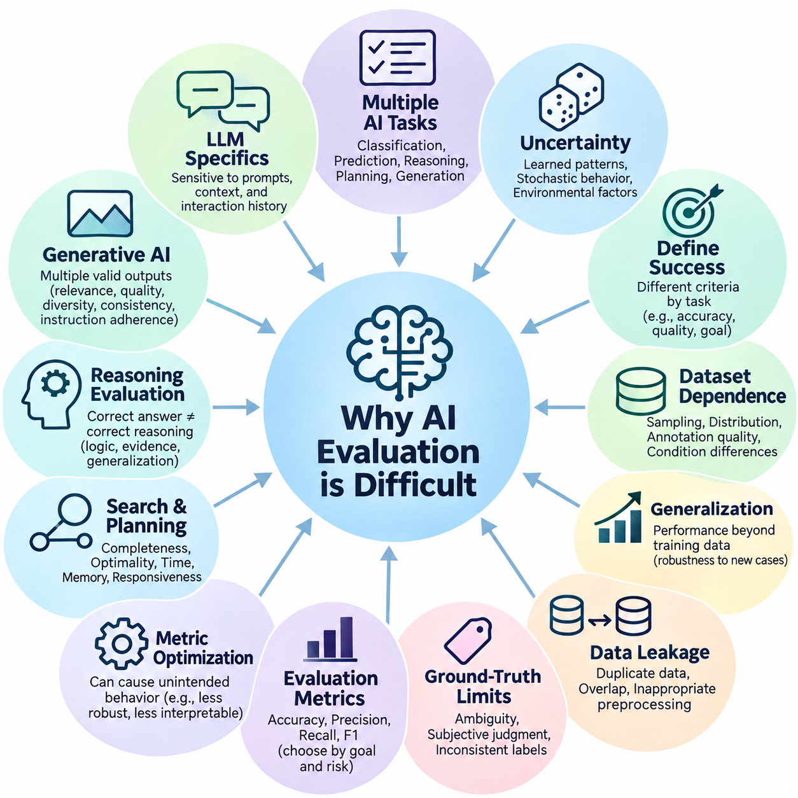
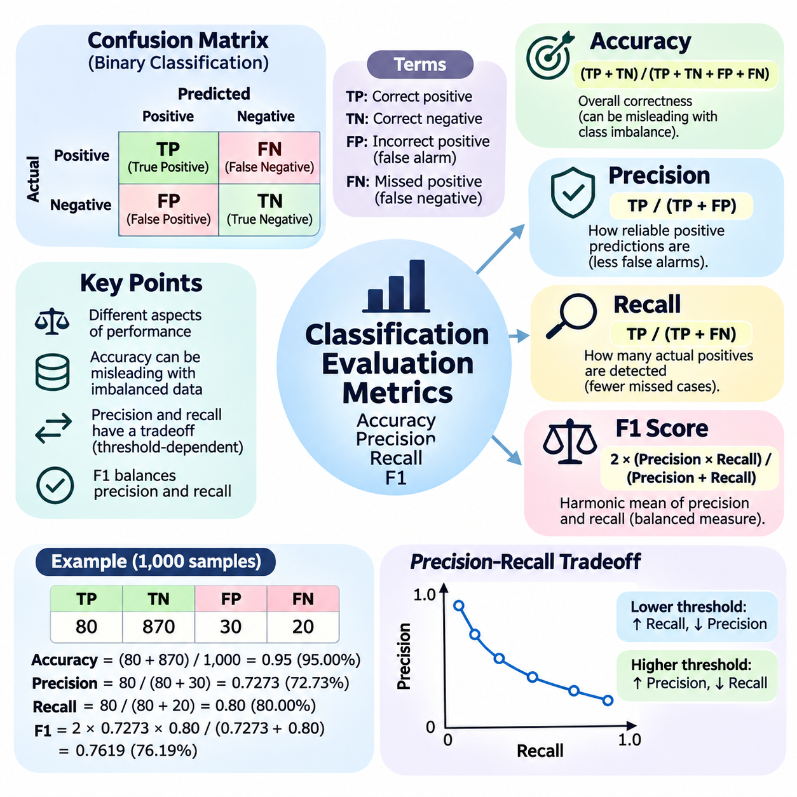
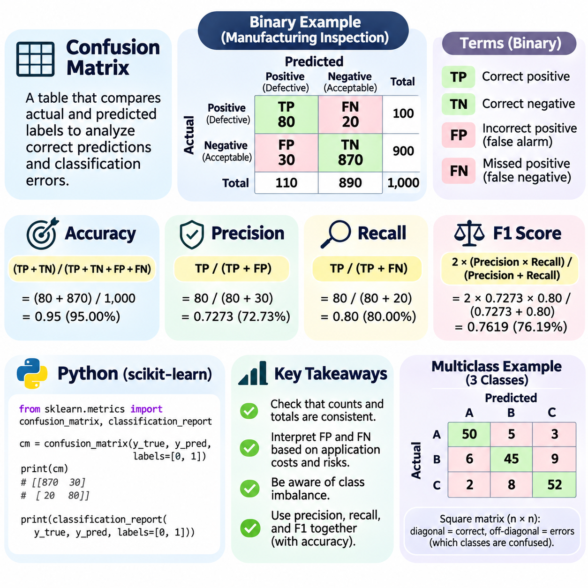
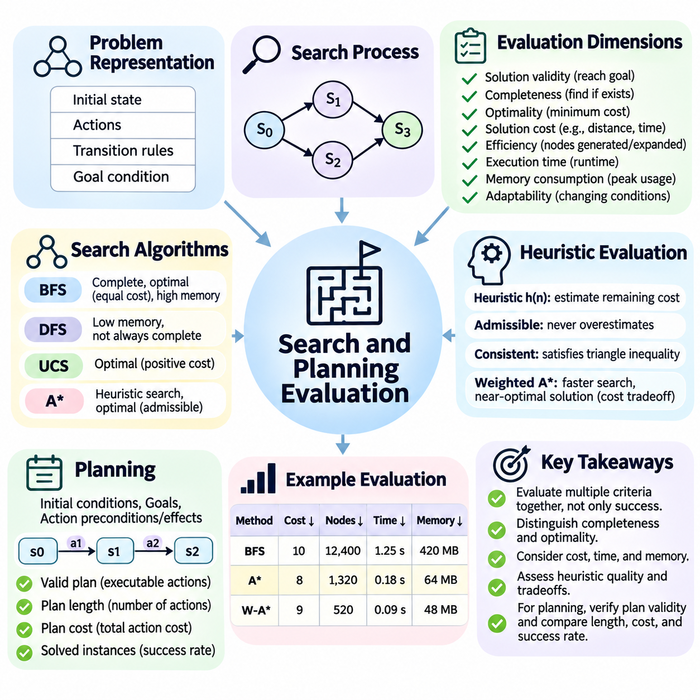
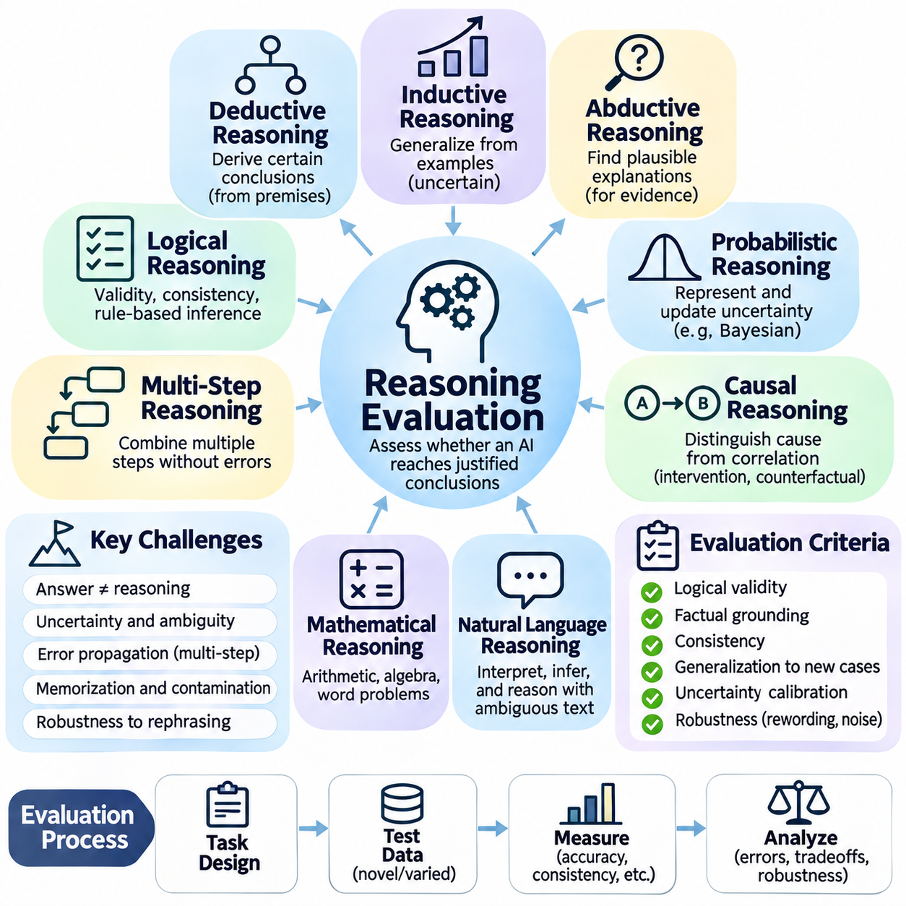
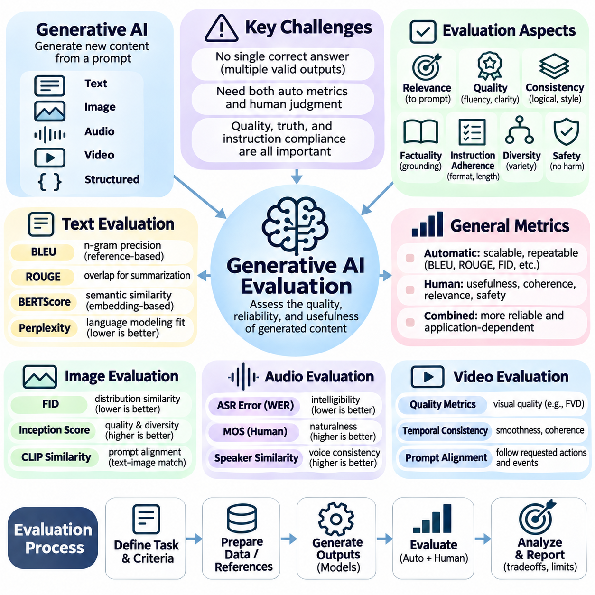
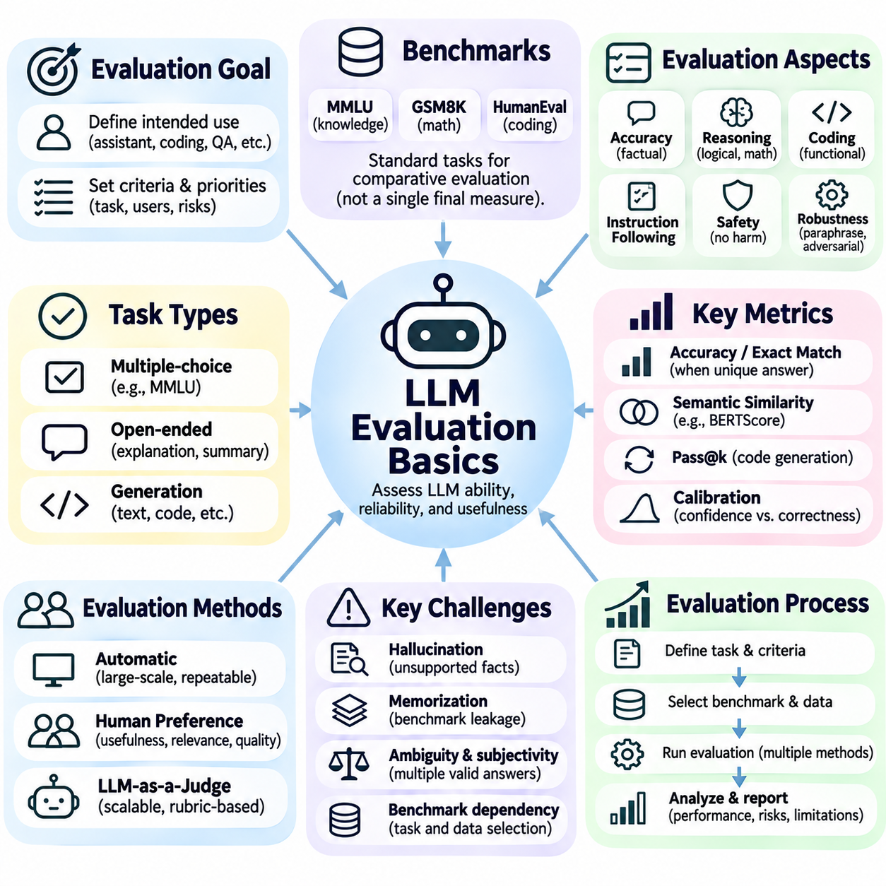
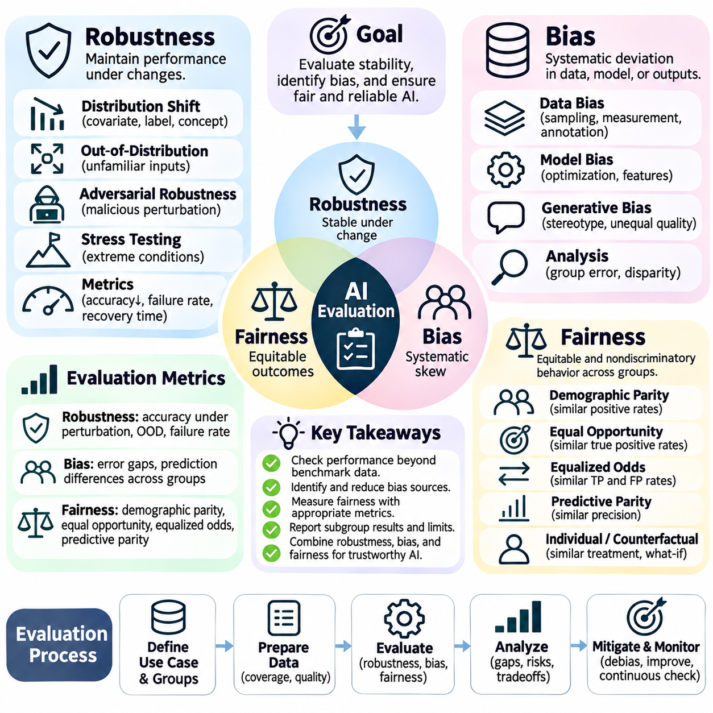
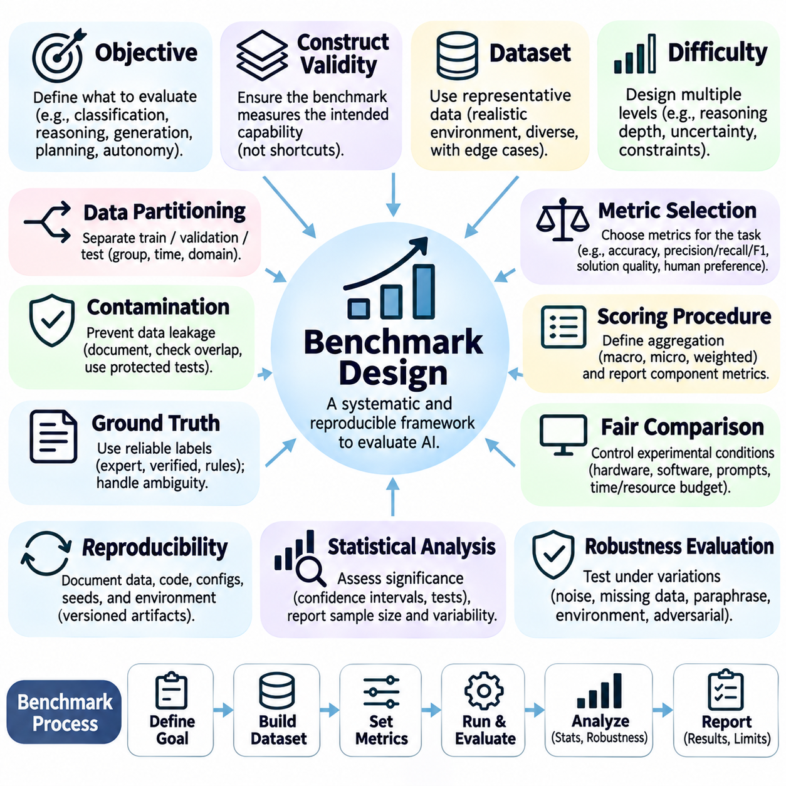

**Volume 04. Artificial Intelligence**

# 09. AI Evaluation and Benchmarking

## 09.00 Why AI Evaluation is Difficult

{width="7.268055555555556in" height="7.268055555555556in"}

Evaluating artificial intelligence is fundamentally difficult because intelligence cannot be represented by a single measurable property. AI systems perform diverse activities, including classification, prediction, reasoning, planning, generation, and decision-making. Each activity requires different evaluation criteria, making it challenging to establish a universal standard that accurately reflects the overall capability of an intelligent system.

Traditional software evaluation generally focuses on whether a program produces expected outputs for predefined inputs. Artificial intelligence introduces uncertainty because its behavior depends on learned patterns, statistical relationships, and environmental conditions. An AI model may produce different responses to similar inputs while remaining functionally acceptable, complicating the distinction between correct and incorrect behavior.

One major challenge is defining what successful intelligence actually means. A classification system may be evaluated through prediction accuracy, while a planning system must consider solution quality, computational efficiency, and goal achievement. A conversational AI system requires additional consideration of factual correctness, relevance, coherence, and contextual understanding. These dimensions cannot always be reduced to one numerical score.

Evaluation also depends heavily on the characteristics of the dataset used for testing. A model may achieve excellent results on a carefully prepared benchmark while performing poorly on unfamiliar real-world information. Differences in sampling methods, class distributions, annotation quality, and environmental conditions can significantly influence measured performance. Consequently, benchmark results describe behavior under particular conditions rather than universal competence.

The distinction between training performance and generalization represents another fundamental difficulty. AI systems can learn patterns that are highly effective within their training distributions without acquiring transferable understanding. When confronted with new situations, unfamiliar objects, or changed operating conditions, their performance may deteriorate. Reliable evaluation must therefore examine whether learned capabilities remain effective beyond previously observed examples.

Data leakage further complicates evaluation by allowing information from testing procedures to influence model development. Leakage may occur through duplicated samples, overlapping datasets, inappropriate preprocessing, or repeated benchmark-driven optimization. In such circumstances, reported performance may overestimate genuine generalization. Preventing leakage requires careful separation of training, validation, and testing information throughout development.

Another challenge arises from the limitations of ground-truth labels. Many evaluation procedures assume that each test example has a clearly defined correct answer. However, natural language interpretation, image annotation, ethical judgment, and complex decision-making frequently involve ambiguity. Different human experts may provide reasonable but inconsistent answers, making evaluation dependent on annotation policies and subjective assumptions.

The selection of evaluation metrics introduces additional complexity. Accuracy provides an intuitive measure of classification performance but may be misleading when classes are imbalanced. Precision and recall emphasize different types of prediction errors, while the F1 score combines them through a harmonic mean. Selecting an appropriate metric requires understanding the application, the distribution of errors, and the consequences associated with incorrect decisions.

Metric optimization can also create unintended behavior when the selected measurement does not fully represent the intended objective. A system optimized exclusively for benchmark accuracy may sacrifice robustness, interpretability, or computational efficiency. Similarly, a language model optimized for superficial response similarity may generate plausible statements without reliable factual grounding. Evaluation must distinguish measurable performance from meaningful task success.

Search and planning systems illustrate the importance of multidimensional assessment. Finding a valid solution does not necessarily mean finding the best solution, and achieving optimality may require excessive computation. Evaluators must consider completeness, optimality, execution time, memory consumption, and responsiveness to changing conditions. The relative importance of these properties depends on the operational requirements of the application.

Reasoning evaluation presents an especially difficult problem because correct conclusions do not necessarily demonstrate correct reasoning processes. A model may arrive at the expected answer through memorization, shortcuts, or accidental correlations. Conversely, a logically appropriate reasoning process may fail because of incomplete information. Evaluating reasoning therefore requires attention to logical consistency, evidence use, generalization, and intermediate decision quality.

Generative AI introduces challenges that differ substantially from conventional predictive modeling. A generative system may produce numerous acceptable outputs for the same prompt, making exact matching against a reference answer inadequate. Text, images, audio, and other generated content must be assessed through multiple dimensions, including semantic relevance, quality, diversity, consistency, and adherence to instructions. Human judgment often remains necessary.

Large language models further complicate evaluation because their capabilities vary with prompting strategies, contextual information, and interaction history. A model may answer a question correctly under one prompt formulation and incorrectly under another. Performance may also change when examples, retrieved documents, or external tools are introduced. Reliable evaluation must account for these conditions rather than treating model behavior as entirely fixed.

Factual correctness and linguistic fluency represent separate dimensions of language model quality. A response can be grammatically sophisticated, coherent, and persuasive while containing inaccurate information. Such errors are particularly problematic when users interpret fluent explanations as evidence of reliability. Evaluation must therefore distinguish presentation quality from factual grounding and examine whether generated claims are supported by appropriate evidence.

Robustness evaluation examines whether an AI system maintains acceptable behavior under disturbances and unexpected conditions. Small changes in image brightness, sensor noise, language phrasing, or input formatting may produce disproportionate changes in model outputs. Adversarial inputs can expose additional weaknesses. A robust evaluation framework must investigate sensitivity to perturbations and determine whether performance remains within acceptable operational limits.

Bias and fairness introduce evaluation requirements that extend beyond aggregate predictive performance. An AI system may achieve high overall accuracy while producing substantially different error rates across demographic groups or operating environments. These differences can remain hidden when results are summarized using a single average. Fairness assessment requires careful selection of relevant groups, performance measures, and application-specific criteria.

Real-world AI systems must also be evaluated according to their operational constraints. Computational latency, memory requirements, energy consumption, hardware compatibility, and system availability may determine whether a technically accurate model is practically useful. For embedded AI and autonomous robotics, delayed predictions can be as consequential as incorrect predictions. Evaluation must therefore consider the complete system rather than only the underlying algorithm.

Autonomous systems introduce additional difficulties because their decisions influence the environments in which they operate. A robot\'s actions change subsequent observations, creating feedback relationships between perception, reasoning, planning, and control. Evaluating individual components independently may overlook failures arising from their interactions. System-level assessment must examine complete behavioral sequences and the consequences of accumulated errors.

Safety-critical applications require particular attention to rare but consequential failures. A model may perform successfully across thousands of ordinary examples while failing under an unusual condition that creates substantial risk. Average performance metrics can obscure these low-frequency events. Evaluation should therefore include targeted scenarios, boundary conditions, failure analysis, and explicit consideration of the severity of potential consequences.

Reproducibility represents another essential challenge in AI benchmarking. Results may vary because of random initialization, dataset partitioning, software versions, hardware configurations, and nondeterministic computation. Comparisons between algorithms become unreliable when experimental conditions are inconsistent. Meaningful evaluation requires documented configurations, controlled procedures, repeated experiments, and appropriate reporting of performance variability.

Statistical uncertainty must also be considered when interpreting benchmark results. A small difference between two model scores does not automatically establish that one model is superior. Limited test samples and experimental randomness can produce apparent improvements that disappear under repeated measurement. Confidence intervals, statistical testing, and analysis across multiple datasets help distinguish meaningful performance differences from random variation.

Benchmark saturation creates a further limitation when increasingly capable models approach the maximum attainable score on established tests. Once many systems achieve similar results, the benchmark loses its ability to distinguish important differences in capability. Repeated exposure to popular evaluation datasets may also encourage benchmark-specific adaptation. New assessments must introduce meaningful challenges without sacrificing consistency and comparability.

The relationship between offline benchmarking and production performance is equally important. Controlled experiments generally operate on relatively stable datasets, while deployed systems encounter changing user behavior, evolving environments, and shifting input distributions. Performance measured before deployment may not remain representative afterward. Continuous monitoring, feedback collection, and periodic reevaluation are therefore necessary components of responsible AI operation.

Human evaluation provides valuable insight but introduces its own methodological difficulties. Human reviewers may disagree because of differences in expertise, interpretation, expectations, and cultural context. Evaluation outcomes can also be affected by presentation order, incomplete instructions, and reviewer fatigue. Structured assessment criteria, reviewer calibration, and agreement analysis help improve consistency without eliminating the inherent subjectivity of complex judgments.

Evaluation becomes more challenging when AI systems combine multiple capabilities into integrated workflows. An intelligent agent may retrieve information, interpret instructions, select tools, execute actions, and revise its plan based on feedback. Success depends not only on individual component performance but also on coordination across the entire workflow. A reliable assessment must identify where errors originate and how they propagate through subsequent decisions.

Ultimately, AI evaluation is not simply the calculation of a benchmark score. It is a systematic process of determining whether an intelligent system demonstrates the capabilities, reliability, efficiency, and safety required for its intended purpose. Effective evaluation combines quantitative metrics, qualitative assessment, controlled experimentation, and real-world observation. Its central objective is to establish credible evidence that an AI system can perform appropriately under the conditions in which it will actually be used.

## 09.01 Accuracy Precision Recall F1 [w/Code]

{width="7.268055555555556in" height="7.268055555555556in"}

Accuracy, precision, recall, and F1 score are fundamental evaluation metrics used to measure the performance of classification systems in artificial intelligence. Although these metrics are derived from the same prediction outcomes, they describe different aspects of model behavior. Understanding their mathematical definitions, practical interpretations, and limitations is essential for selecting appropriate evaluation criteria.

Classification evaluation begins by comparing predicted labels with actual labels in a labeled test dataset. For binary classification, outcomes are divided into true positives, true negatives, false positives, and false negatives. These four categories form the foundation of the confusion matrix and provide the numerical information required to calculate accuracy, precision, recall, and F1 score.

A true positive (TP) occurs when a model correctly predicts the positive class, while a true negative (TN) occurs when it correctly predicts the negative class. A false positive (FP) represents an incorrect positive prediction, and a false negative (FN) represents a missed positive instance. The practical consequences of these errors depend on the application and may differ substantially.

Accuracy measures the proportion of all predictions that are correct. It is calculated as Accuracy = (TP + TN) / (TP + TN + FP + FN). For example, if a classifier correctly predicts 900 out of 1,000 samples, its accuracy is 90 percent. This metric provides an intuitive summary of overall correctness when the test dataset adequately represents the intended operating conditions.

However, accuracy can become misleading when the dataset contains a substantial class imbalance. Consider a medical screening dataset containing 990 negative cases and only 10 positive cases. A classifier that predicts every sample as negative achieves 99 percent accuracy while failing to identify any positive cases. This example demonstrates why overall correctness alone cannot establish practical classification quality.

Precision measures the proportion of predicted positive instances that are actually positive. Its mathematical definition is Precision = TP / (TP + FP). A precision value of 0.90 means that 90 percent of the model\'s positive predictions are correct. Precision therefore describes the reliability of positive predictions and is especially important when false positive errors are expensive or disruptive.

For example, an automated industrial inspection system may classify manufactured components as defective or acceptable. If precision is low, many acceptable components may be incorrectly rejected as defective. This creates unnecessary inspection costs, material waste, and production delays. Improving precision reduces these false alarms, although it may also affect the system\'s ability to identify actual defects.

Recall measures the proportion of actual positive instances that the classifier successfully identifies. It is calculated as Recall = TP / (TP + FN). A recall value of 0.95 indicates that the model detects 95 percent of all positive instances in the evaluated dataset. Recall is particularly important when failing to identify a positive case creates significant safety, financial, or operational consequences.

In medical diagnosis, a false negative may allow a serious condition to remain undetected. Similarly, a robotic safety monitoring system may fail to recognize a person entering a restricted operating area. In these applications, high recall is often prioritized because missed detections can have severe consequences. Nevertheless, maximizing recall without controlling false positives can create excessive alarms.

Precision and recall frequently exhibit a tradeoff because classification decisions depend on a prediction threshold. Lowering the threshold for assigning the positive class generally increases the number of detected positive instances, improving recall while potentially reducing precision. Raising the threshold often improves precision by eliminating uncertain positive predictions but may increase false negatives.

The precision-recall tradeoff becomes especially important when classifiers produce probability estimates or confidence scores. Instead of relying exclusively on a default threshold of 0.5, engineers can examine how performance changes across different thresholds. The selected operating point should reflect the relative costs of false positives and false negatives rather than an arbitrary numerical convention.

The F1 score combines precision and recall into a single metric using their harmonic mean. Its mathematical definition is F1 = 2 × (Precision × Recall) / (Precision + Recall). When expressed through confusion matrix values, the equivalent formula is F1 = 2TP / (2TP + FP + FN). The harmonic mean penalizes large differences between precision and recall.

For example, consider a classifier with precision of 0.90 and recall of 0.60. Its F1 score is approximately 0.72, reflecting the imbalance between the two metrics. If both precision and recall increase to 0.80, the F1 score becomes 0.80. This behavior makes F1 useful when both false positives and false negatives deserve meaningful consideration.

A practical numerical example illustrates the relationship among these metrics. Suppose a binary classifier produces TP = 80, TN = 870, FP = 30, and FN = 20 across 1,000 samples. Its accuracy is 95 percent, precision is approximately 72.73 percent, recall is 80 percent, and F1 score is approximately 76.19 percent. The different values reveal information hidden by accuracy alone.

Although F1 provides a balanced summary of precision and recall, it does not incorporate true negatives directly. Consequently, two classifiers with identical TP, FP, and FN values but different numbers of true negatives have the same F1 score. This property is useful for some imbalanced classification problems but means that F1 should not automatically replace every other performance metric.

When precision and recall have unequal importance, the generalized F-beta score provides additional flexibility. Its formula is Fβ = (1 + β²) × Precision × Recall / (β² × Precision + Recall). Values of β greater than one emphasize recall, while values below one emphasize precision. The standard F1 score corresponds to β = 1 and assigns equal mathematical emphasis to both measures.

Multiclass classification introduces additional considerations because each class can be evaluated separately. A common approach treats one class as positive and all remaining classes as negative, producing class-specific precision, recall, and F1 scores. These values reveal whether the classifier performs consistently across categories or achieves strong overall results by favoring frequently occurring classes.

Macro averaging calculates the arithmetic mean of class-specific metrics, giving every class equal weight regardless of its frequency. Weighted averaging combines class-specific results according to the number of actual samples belonging to each class. Micro averaging aggregates confusion counts across classes before calculating the metrics. Each method represents a different perspective on classification performance.

For single-label multiclass classification, micro-averaged precision, recall, and F1 are equal to overall accuracy when every sample receives exactly one predicted class. However, macro-averaged and weighted scores may differ substantially. These distinctions are especially important for imbalanced datasets because a high aggregate score can conceal poor performance on rare but operationally significant categories.

Multilabel classification presents another evaluation scenario in which each sample may belong to several classes simultaneously. Precision, recall, and F1 can be calculated for individual labels, aggregated across all label decisions, or averaged across samples. The interpretation depends on the averaging strategy, making it necessary to document how predictions, thresholds, and metric calculations are defined.

Reliable implementation requires careful treatment of undefined mathematical expressions. Precision is undefined when a classifier produces no positive predictions, while recall is undefined when the evaluated dataset contains no actual positive instances. Software libraries may assign a configurable replacement value or generate warnings. Such cases should be reported explicitly rather than silently interpreted as ordinary performance measurements.

Evaluation metrics must also be interpreted in relation to statistical uncertainty and dataset quality. Small test sets can produce unstable precision and recall estimates, especially when positive examples are rare. Confidence intervals, repeated evaluation, and representative sampling help determine whether observed differences are meaningful. Metric values should therefore be accompanied by sufficient experimental context.

In practical AI engineering, metric selection should begin with the consequences of classification errors. Accuracy is useful for summarizing overall correctness, precision emphasizes the trustworthiness of positive predictions, recall measures the detection of actual positives, and F1 captures their combined behavior. A reliable evaluation process uses these complementary perspectives to determine whether a classifier satisfies its intended operational requirements.

## 09.02 Confusion Matrix Practice [w/Code]

{width="7.268055555555556in" height="7.268055555555556in"}

A confusion matrix is a fundamental evaluation tool used to examine how a classification model assigns predicted labels to actual categories. Unlike a single accuracy score, it reveals the distribution of correct predictions and classification errors. By organizing prediction outcomes into a structured representation, the confusion matrix helps engineers identify systematic weaknesses, understand class-specific behavior, and improve model reliability.

The basic construction of a confusion matrix begins with two sequences of labels: ground-truth labels and model-predicted labels. Each sample contributes one count to the cell corresponding to its actual class and predicted class. A common convention places actual classes along rows and predicted classes along columns. Because software implementations may use different conventions, axis definitions must always be verified.

For binary classification, the confusion matrix contains four fundamental outcomes: true positives, true negatives, false positives, and false negatives. True positives represent correctly identified positive samples, while true negatives represent correctly identified negative samples. False positives indicate negative samples incorrectly classified as positive, whereas false negatives represent positive samples incorrectly classified as negative.

Consider a binary classification system designed to identify defective manufactured components. Suppose the evaluation dataset contains 1,000 components, including 100 defective and 900 acceptable items. The classifier correctly detects 80 defective components and correctly accepts 870 normal components. It also incorrectly rejects 30 acceptable components and fails to detect 20 defective components.

These outcomes produce TP = 80, TN = 870, FP = 30, and FN = 20. The confusion matrix provides a complete accounting of all 1,000 evaluation samples. Its actual-positive row contains 80 true positives and 20 false negatives, while its actual-negative row contains 30 false positives and 870 true negatives. Row totals correspond to the actual class distribution.

The first practical step in confusion matrix analysis is validating the consistency of its counts. The sum of all cells must equal the total number of evaluated samples. For each actual class, the corresponding row total should match its ground-truth frequency. These simple checks can reveal missing predictions, inconsistent label mappings, duplicated samples, or errors in evaluation preprocessing.

Once the matrix has been validated, several performance metrics can be calculated directly. Accuracy equals (TP + TN) divided by the total number of samples. Precision equals TP divided by TP + FP, while recall equals TP divided by TP + FN. The F1 score combines precision and recall through their harmonic mean, providing an additional summary of positive-class performance.

For the industrial inspection example, accuracy is 95 percent, precision is approximately 72.73 percent, recall is 80 percent, and F1 score is approximately 76.19 percent. Although the overall accuracy appears strong, the matrix reveals that 20 defective components were missed and 30 acceptable components were rejected. These errors have different operational consequences and require separate consideration.

False positives and false negatives should be interpreted according to the objectives of the application. In industrial inspection, false positives can increase manual reinspection, material handling, and production costs. False negatives may allow defective components to proceed into assembly or delivery. The confusion matrix therefore supports risk-oriented evaluation rather than treating every classification error as equally important.

A confusion matrix also helps explain why class imbalance can distort aggregate performance measurements. When one class dominates a dataset, correctly predicting that class may produce high accuracy even if minority-class detection is poor. Examining individual cells exposes these weaknesses. Engineers should therefore inspect class frequencies and error counts alongside aggregate metrics, especially when rare events have significant consequences.

In practical machine learning workflows, confusion matrices are commonly generated using Python libraries such as scikit-learn. The confusion_matrix function accepts arrays of actual and predicted labels and returns a numerical matrix. Specifying the class order explicitly helps prevent interpretation errors. For binary labels ordered as negative followed by positive, the resulting matrix follows the arrangement TN, FP, FN, and TP.

A typical implementation begins by importing confusion_matrix and classification_report from sklearn.metrics. After obtaining predictions from a trained classifier, the evaluator calls confusion_matrix(y_true, y_pred, labels=[0, 1]). The returned array contains the four outcome counts. Additional calculations or classification_report can summarize precision, recall, F1 score, and support for each class.

The support of a class refers to the number of actual samples belonging to that class in the evaluation dataset. Support is important because performance estimates derived from very few samples may be unstable. A confusion matrix with only several positive examples cannot provide the same statistical confidence as one containing thousands of representative positive examples, even when their calculated metrics appear similar.

For multiclass classification, the confusion matrix expands into a square matrix whose dimensions equal the number of classes. Each diagonal element represents correctly classified samples, while off-diagonal elements represent misclassifications. The matrix therefore reveals not only how frequently errors occur but also which categories are confused with one another.

Consider an image classification system that recognizes pedestrians, bicycles, and vehicles. If bicycles are frequently predicted as motorcycles in a broader category set, the corresponding off-diagonal cells will contain elevated counts. This pattern may indicate insufficient training examples, visual similarity between categories, inadequate image resolution, or inconsistent annotation practices. The matrix identifies the error pattern but does not establish its cause.

Raw confusion matrices display absolute counts, which are useful for understanding the number of affected samples. However, comparisons become difficult when class frequencies differ substantially. Normalization converts counts into proportions, allowing performance patterns to be examined independently of some differences in dataset size or class prevalence. The chosen normalization method must be documented.

Row normalization divides each cell by the total number of actual samples in its row. Under the convention that rows represent actual classes, diagonal values then correspond to class-specific recall. Column normalization divides each cell by the total number of predictions assigned to its column, making diagonal values correspond to class-specific precision when denominators are nonzero.

Normalization across the entire matrix divides each cell by the total number of evaluated samples. This representation describes the proportion of all predictions belonging to each actual-predicted class combination. Although normalized matrices simplify comparisons, absolute counts remain necessary for understanding sample support, operational error volumes, and the statistical reliability of estimated performance.

Confusion matrices can also be examined across different classification thresholds. For models that output probabilities or confidence scores, changing the decision threshold alters the balance between positive and negative predictions. Lower thresholds generally increase positive detections while also increasing false positives. Higher thresholds generally reduce false positives but may increase false negatives.

Threshold analysis is especially useful when operational requirements impose explicit limits on certain error types. An industrial safety classifier may require very high recall to minimize missed hazards, while an automated rejection system may prioritize precision to avoid excessive waste. Comparing confusion matrices across candidate thresholds helps engineers select an operating point consistent with application requirements.

Error analysis should continue beyond numerical inspection by examining representative samples from important matrix cells. False-positive examples can reveal confusing backgrounds, misleading visual features, or incorrect labels. False-negative examples may expose small objects, occlusion, unusual lighting, or insufficient training coverage. These investigations connect quantitative evaluation with targeted dataset and model improvements.

A reliable evaluation workflow must also distinguish between validation and final testing. Validation data may be used repeatedly to select thresholds, tune hyperparameters, and compare model configurations. The final test dataset should remain separate from these decisions to provide a less biased estimate of generalization performance. Repeatedly optimizing against the test set can compromise the credibility of reported results.

When comparing two classifiers, confusion matrices should be generated using the same evaluation samples, class definitions, and label conventions. Differences in dataset composition or preprocessing can otherwise produce misleading conclusions. Engineers should compare not only overall error counts but also whether improvements in one class are accompanied by deteriorating performance in another.

For large-scale AI systems, confusion matrix analysis can be extended across operating conditions such as lighting, weather, camera position, geographic region, or equipment configuration. Separate matrices for relevant subsets can reveal performance degradation hidden within aggregate results. Such analysis is valuable for autonomous robotics, industrial inspection, medical screening, and other applications requiring dependable behavior.

The confusion matrix is ultimately more than a table of classification outcomes. It provides a structured foundation for understanding model errors, calculating evaluation metrics, identifying class-specific weaknesses, and selecting practical improvements. Effective confusion matrix practice combines correct construction, careful interpretation, normalization, threshold analysis, and representative error inspection to support reliable classification system development.

## 09.03 Search and Planning Evaluation

{width="7.268055555555556in" height="7.268055555555556in"}

Evaluating search and planning algorithms requires more than determining whether a system successfully reaches a goal. These algorithms explore possible states, select actions, and construct solutions under computational and environmental constraints. Their quality depends on solution validity, completeness, optimality, execution time, memory consumption, and adaptability. A reliable evaluation framework must examine these dimensions together.

Search evaluation begins with a clearly defined problem representation containing an initial state, available actions, transition rules, and a goal condition. The state space determines which configurations are reachable, while the search strategy determines how they are explored. Evaluation must verify that returned solutions respect the transition rules and actually satisfy the specified goal rather than merely producing plausible action sequences.

Completeness measures whether an algorithm is guaranteed to find a solution whenever one exists under its stated assumptions. Breadth-first search is complete when the branching factor is finite and a solution exists at finite depth. Depth-first search may fail to terminate in infinite-depth spaces. Evaluating completeness therefore requires examining the structure of the search space and the algorithm\'s assumptions.

Optimality concerns whether a search algorithm returns a solution with minimum cost according to a defined objective function. Breadth-first search produces shortest-depth solutions when actions have equal cost, while uniform-cost search can find minimum-cost solutions under suitable positive cost assumptions. Evaluation must distinguish solution existence from solution quality because a valid path is not necessarily optimal.

Solution cost provides a quantitative basis for comparing search algorithms. In route planning, cost may represent distance, travel time, energy consumption, or a weighted combination of objectives. In robotic manipulation, cost may include movement duration, actuator effort, and collision risk. Evaluators must define the cost function consistently because different objectives can produce different preferred solutions.

Search efficiency is commonly assessed through the number of generated and expanded nodes. Generated nodes represent discovered successor states, while expanded nodes represent states whose successors are examined. These measurements reveal the amount of exploration performed by an algorithm. However, node counts alone do not capture differences in successor-generation costs, data structures, or hardware execution efficiency.

Execution time measures the computational duration required to obtain a solution. Algorithms that expand fewer nodes are not always faster because heuristic calculations, memory management, and priority queue operations introduce additional overhead. Meaningful comparisons should use consistent hardware, software environments, implementation quality, and timing procedures to separate algorithmic improvements from experimental artifacts.

Memory consumption is another essential evaluation dimension because search algorithms often maintain large collections of unexplored or previously visited states. Breadth-first search can require substantial memory as the search frontier grows, while depth-first search typically uses less memory for path storage. Evaluation should measure peak memory usage and determine whether resource requirements remain practical.

Heuristic search introduces additional criteria because performance depends on the quality of estimated remaining costs. A heuristic function guides exploration toward promising states, potentially reducing computational effort. Its effectiveness can be assessed through solution cost, node expansions, and runtime. Evaluators must also consider the computational expense of the heuristic itself rather than assuming stronger guidance is always preferable.

Admissibility and consistency are important properties when evaluating heuristics for A\\\* search. An admissible heuristic never overestimates the true remaining optimal cost, while a consistent heuristic satisfies the appropriate triangle inequality across transitions. Under standard assumptions, these properties support optimality guarantees. Practical evaluation should distinguish theoretical guarantees from measured performance.

Weighted A\\\* illustrates the tradeoff between computational efficiency and solution optimality. By increasing the influence of heuristic estimates, the algorithm may reach a satisfactory solution more quickly while sacrificing strict optimality. Evaluation can compare the returned solution cost with an optimal reference cost. The resulting cost ratio helps quantify the quality loss associated with faster search.

Planning evaluation extends search assessment by considering structured action sequences and their effects on the environment. A planning problem specifies initial conditions, goals, action preconditions, and action effects. A valid plan must contain executable actions whose combined effects achieve the desired goal. Plan validation should independently verify these conditions rather than relying exclusively on planner-reported success.

In classical planning, benchmarks frequently use representations such as STRIPS and the Planning Domain Definition Language. These representations describe planning domains and problem instances through formal action models. Evaluation can compare planners using standardized tasks while measuring solved instances, plan lengths, action costs, and computational resources. Consistent domain definitions are essential for meaningful comparisons.

Plan length is a useful metric when each action has approximately equal significance, but shorter plans are not always better. One action may consume substantially more time, energy, or resources than several simpler actions. Cost-sensitive planning therefore evaluates cumulative action cost rather than relying only on the number of steps. The selected metric must reflect the actual operational objective.

Planning systems may also need to satisfy temporal and resource constraints. Actions can have durations, dependencies, deadlines, and requirements for shared equipment. Evaluation should consider makespan, resource utilization, constraint satisfaction, and scheduling feasibility. A plan that reaches its goal but violates timing or resource limitations cannot be considered operationally successful.

Robotic planning introduces additional complexity because physical actions must respect geometry, dynamics, and safety constraints. A planned trajectory may be collision-free in a simplified model but infeasible for the actual robot. Evaluation should examine collision avoidance, kinematic feasibility, dynamic limits, path smoothness, and execution accuracy. Simulation results should be interpreted alongside physical deployment evidence.

Dynamic environments require planning algorithms to respond when conditions change after a plan has been generated. Moving obstacles, unexpected failures, and updated task requirements may invalidate previously selected actions. Evaluation should measure replanning latency, recovery success, and the cost of adapting an existing plan. Responsiveness becomes especially important when decisions must be made under real-time constraints.

Robustness assessment examines whether search and planning systems remain effective across variations in problem difficulty and environmental conditions. Tests may vary state-space size, branching factor, obstacle density, action costs, and uncertainty. A robust algorithm should not depend exclusively on a narrow collection of favorable instances. Performance distributions provide more information than isolated benchmark results.

Scalability describes how computational requirements change as problem size increases. Search spaces can grow exponentially with depth or the number of decision variables, making small benchmark success an unreliable indicator of large-scale feasibility. Evaluation should examine runtime growth, memory growth, and solution quality across systematically increasing problem sizes. Resource limits must be reported explicitly.

Benchmark design must account for differences in problem structure and difficulty. Randomly generated instances may not represent realistic planning requirements, while familiar benchmarks can encourage algorithm-specific optimization. A balanced evaluation suite should include simple verification cases, difficult structured problems, and representative application scenarios. Clear instance definitions support reproducibility and fair comparison.

Success rate measures the proportion of problem instances solved within specified computational limits. This metric is particularly useful when some algorithms fail, exhaust memory, or exceed time budgets. However, success rate should be interpreted together with solution quality and resource consumption. An algorithm that solves more instances may still produce substantially more expensive solutions.

Statistical analysis is necessary because runtime and search behavior can vary across instances and experimental conditions. Average performance may conceal severe failures on difficult cases. Reporting medians, variability, failure frequencies, and performance across individual problem categories provides a more complete assessment. Repeated trials are especially valuable for randomized or nondeterministic algorithms.

Search and planning evaluation must also distinguish offline algorithmic performance from end-to-end system behavior. A planner may generate high-quality solutions but fail to meet operational requirements because perception, state estimation, or action execution introduces errors. Integrated evaluation should measure whether plans remain executable and whether completed actions achieve intended outcomes under realistic conditions.

Ultimately, evaluating search and planning systems requires balancing correctness, solution quality, computational efficiency, scalability, and operational reliability. No single metric captures every relevant capability. Effective evaluation combines formal guarantees, controlled benchmarks, statistical analysis, and realistic execution tests to establish whether an algorithm can solve its intended problems within acceptable resource and safety constraints.

## 09.04 Reasoning Evaluation

{width="7.268055555555556in" height="7.268055555555556in"}

Reasoning evaluation examines whether an artificial intelligence system can derive justified conclusions from available information rather than merely reproduce familiar answers. Unlike ordinary classification, reasoning involves relationships among premises, rules, evidence, and conclusions. A reliable assessment must consider logical validity, factual grounding, consistency, generalization, and the ability to recognize insufficient information.

The first challenge is distinguishing answer correctness from reasoning correctness. A model may produce the expected answer through memorization, statistical shortcuts, or accidental correlations without applying the intended reasoning principles. Conversely, a logically sound procedure may reach an uncertain conclusion when the available evidence is incomplete. Evaluation must therefore examine both outcomes and the justification supporting them.

Deductive reasoning evaluation focuses on whether conclusions necessarily follow from stated premises under valid logical rules. If all premises are true and the inference is valid, the conclusion must be true. Test problems may involve syllogisms, propositional logic, predicate logic, or rule-based inference. Evaluators should verify whether models preserve logical relationships rather than rely on familiar linguistic patterns.

Inductive reasoning evaluation examines how systems generalize from observed examples to broader conclusions. Unlike deduction, inductive conclusions remain uncertain because additional evidence may contradict existing patterns. Evaluation should measure predictive accuracy, generalization to unseen cases, and sensitivity to sample quality. Strong inductive reasoning requires recognizing uncertainty rather than presenting every inferred pattern as universal.

Abductive reasoning involves identifying plausible explanations for observed evidence. A diagnostic system may infer several possible causes from the same symptoms or equipment measurements. Evaluation must consider explanatory consistency, compatibility with evidence, and the relative plausibility of competing hypotheses. A reasonable explanation is not necessarily the only explanation or the objectively established cause.

Probabilistic reasoning evaluation examines whether a system correctly represents and updates uncertainty. Bayesian inference provides a framework for combining prior probabilities with new evidence. Assessment may compare predicted probabilities with reference calculations and examine whether confidence changes appropriately when evidence is introduced. Calibration is important because confident but incorrect conclusions can create substantial operational risk.

Causal reasoning requires distinguishing genuine cause-and-effect relationships from statistical associations. A model may recognize that two events frequently occur together without understanding whether one causes the other. Evaluation can introduce interventions, counterfactual questions, and changes in background conditions. Strong causal performance requires conclusions that remain consistent with the specified causal assumptions.

Logical consistency is a central evaluation dimension because reasoning systems should avoid deriving incompatible conclusions from equivalent information. Evaluators can present logically equivalent statements using different wording or rearranged premises. If a system produces contradictory answers, its reasoning may depend excessively on surface expressions. Consistency tests reveal weaknesses that ordinary answer accuracy can overlook.

Multi-step reasoning introduces additional difficulty because errors can accumulate across intermediate deductions. A system may correctly perform individual operations but fail when several dependent steps must be combined. Evaluation should measure final-answer correctness while examining whether intermediate conclusions follow from preceding information. Increasing reasoning depth helps reveal limitations in maintaining coherent logical dependencies.

Mathematical reasoning benchmarks commonly test arithmetic, algebra, symbolic manipulation, and word-problem interpretation. Correct evaluation requires distinguishing calculation errors from failures to construct an appropriate mathematical representation. A model may understand the problem but make an arithmetic mistake, or obtain a correct number through an invalid method. These failure types require different corrective strategies.

Symbolic reasoning systems can often be evaluated through formal verification because their rules and representations are explicitly defined. Automated theorem provers, constraint solvers, and logical inference engines provide opportunities to check whether conclusions satisfy formal requirements. However, formal correctness depends on the accuracy of the encoded premises and rules. Verification cannot compensate for an incorrect problem formulation.

Natural language reasoning is harder to evaluate because statements may contain ambiguity, implicit assumptions, and contextual dependencies. Questions involving everyday knowledge often permit several interpretations. Evaluators must distinguish genuine reasoning failures from disagreements caused by underspecified tasks. Clear instructions, carefully constructed reference answers, and explicit assumptions improve evaluation reliability.

Large language models introduce the additional challenge of separating demonstrated reasoning ability from memorized benchmark content. A model may have encountered similar questions during training and reproduce established solution patterns. Testing with novel problem instances, altered entities, and unfamiliar combinations of known rules helps investigate generalization. Such tests reduce, but cannot completely eliminate, contamination concerns.

Reasoning robustness can be examined through controlled modifications that preserve the underlying logical structure. Changing names, object labels, sentence order, or irrelevant background details should not alter a logically determined answer. Performance degradation under these transformations suggests sensitivity to superficial patterns. Evaluators should also distinguish harmless changes from modifications that genuinely alter the premises.

Compositional generalization measures whether a system can combine familiar reasoning operations in unfamiliar arrangements. A model may solve isolated comparisons, arithmetic steps, or logical implications but struggle when these operations are integrated. Evaluation should vary the number, order, and dependency structure of reasoning steps. This approach tests transferable reasoning capabilities rather than recognition of memorized templates.

Reasoning explanations can provide useful diagnostic evidence, but their presence does not guarantee that a model actually followed the described process. Generated explanations may be incomplete, misleading, or constructed after an answer has been selected. Evaluators should independently check verifiable intermediate claims and avoid treating fluent explanations as direct evidence of internal computation.

Process-oriented evaluation examines observable intermediate decisions, tool operations, or formally checkable reasoning steps when these are available. For example, a mathematical solution can be assessed by verifying equations and transformations, while a planning argument can be checked against stated constraints. Such evaluation can identify local errors, although it cannot always establish the model\'s underlying internal reasoning mechanism.

Outcome-based evaluation focuses on whether the final answer satisfies the task requirements. This approach is efficient when answers can be verified automatically, as in arithmetic problems or executable code tests. However, outcome correctness alone may conceal unreliable reasoning strategies. Combining outcome checks with independent evidence validation provides a more informative assessment when intermediate correctness matters.

Human evaluation remains important for reasoning tasks involving interpretation, explanation quality, or incomplete evidence. Expert reviewers can assess whether arguments are coherent, relevant, and appropriately qualified. Nevertheless, reviewers may disagree about acceptable assumptions or explanatory detail. Structured rubrics, reviewer calibration, and agreement analysis improve consistency across subjective assessments.

Reasoning evaluation should also measure uncertainty awareness and appropriate abstention. A system should recognize when premises are contradictory, evidence is insufficient, or multiple conclusions remain possible. Forcing a definite answer in every situation can reward unsupported certainty. Evaluation datasets should therefore include unanswerable questions, inconsistent premises, and cases requiring qualified conclusions.

Efficiency matters when reasoning systems operate under practical computational constraints. Complex inference may require substantial execution time, memory, or external tool usage. Evaluation should consider whether improvements in reasoning accuracy justify their computational cost. For real-time robotics and autonomous decision-making, delayed conclusions may be operationally ineffective even when logically correct.

Benchmark design should cover multiple reasoning types, difficulty levels, and domains rather than relying on a narrow collection of familiar puzzles. Tasks should include straightforward verification cases, multi-step dependencies, uncertainty, and adversarially constructed examples. Difficulty must be characterized carefully because longer questions are not necessarily logically harder. Transparent evaluation procedures support meaningful comparisons.

Statistical reliability is essential when comparing reasoning systems. Small score differences may result from sampling variation, prompt wording, or stochastic generation. Repeated trials, confidence intervals, and performance analysis across task categories help distinguish genuine improvements from experimental noise. Evaluation reports should document prompting conditions, scoring rules, and the treatment of ambiguous responses.

In integrated AI applications, reasoning quality must be evaluated through its consequences for subsequent actions. An autonomous agent may infer a correct relationship but select an inappropriate tool or execute an unsafe plan. System-level assessment should examine how reasoning interacts with perception, knowledge retrieval, planning, and control. This perspective connects abstract logical performance with dependable operational behavior.

Ultimately, reasoning evaluation seeks credible evidence that an AI system can apply appropriate inference principles across unfamiliar situations. Reliable assessment combines answer verification, logical consistency checks, uncertainty analysis, generalization tests, and practical execution measurements. The objective is not simply to reward convincing explanations but to establish whether conclusions are justified, reproducible, and useful for the intended application.

## 09.05 Generative AI Evaluation

{width="7.268055555555556in" height="7.268055555555556in"}

Evaluating generative artificial intelligence requires methods that extend beyond conventional classification accuracy. Generative models produce new text, images, audio, video, and structured content rather than selecting labels from predefined categories. Because multiple outputs may be acceptable for the same input, evaluation must examine quality, relevance, diversity, consistency, factual reliability, and alignment with user intentions.

A fundamental challenge is the absence of a unique correct answer for many generative tasks. A prompt requesting a summary, explanation, or creative description can produce several valid responses with different wording and structure. Exact matching against a reference output may therefore underestimate genuine quality. Evaluation must distinguish semantic equivalence from superficial textual similarity.

Generative AI evaluation generally combines automatic metrics with human assessment. Automatic measurements enable scalable, repeatable comparisons across large datasets, while human reviewers can judge contextual appropriateness and nuanced quality. Neither approach is sufficient for every application. A reliable evaluation framework should combine complementary methods while recognizing their individual limitations.

Text generation evaluation often begins with reference-based metrics that compare generated content against human-written examples. BLEU measures modified n-gram precision with a brevity penalty, while ROUGE measures forms of lexical overlap commonly used in summarization. These metrics are computationally efficient but may penalize valid paraphrases and reward superficial similarity without verifying factual correctness.

Semantic similarity metrics attempt to overcome some limitations of exact word matching. Embedding-based approaches represent generated and reference texts in continuous vector spaces, allowing comparisons based on semantic relationships. BERTScore uses contextual token representations to estimate similarity. However, semantic resemblance does not guarantee logical consistency, factual accuracy, or complete instruction satisfaction.

Perplexity is another metric frequently associated with language generation. It measures how well a probabilistic language model predicts a sequence of tokens, with lower values generally indicating better predictive fit under comparable conditions. Nevertheless, perplexity does not directly measure usefulness, truthfulness, or creativity. Comparisons also depend on tokenization, evaluation data, and probability definitions.

Factual correctness is particularly important when generative systems produce explanations, summaries, or knowledge-based responses. A model may generate fluent and convincing statements that are unsupported or incorrect. Evaluation should examine whether claims agree with reliable evidence and whether uncertainty is appropriately expressed. Linguistic quality must not be treated as a substitute for factual grounding.

Hallucination evaluation investigates unsupported or fabricated content in generated outputs. In document summarization, a hallucination may introduce information absent from the source material. In question answering, it may appear as an invented citation or inaccurate factual claim. Effective assessment requires identifying verifiable claims and comparing them with relevant evidence rather than relying exclusively on stylistic judgments.

Instruction adherence measures whether generated content satisfies explicit user requirements. These requirements may concern output format, language, length, subject matter, or prohibited content. A response can be coherent and factually correct while still failing the requested task. Evaluation should therefore distinguish general response quality from compliance with specific constraints and application objectives.

Diversity measures whether a generative model produces varied outputs rather than repeatedly generating nearly identical content. In text generation, lexical diversity and distinct n-gram ratios can provide partial indicators. However, excessive diversity may reduce coherence or relevance. The desired balance depends on whether the application emphasizes creative exploration, consistent communication, or controlled output generation.

Image generation evaluation introduces perceptual and distributional considerations. Fréchet Inception Distance, commonly called FID, compares statistical features of generated and reference image collections. Lower FID values generally indicate closer feature distributions under consistent evaluation settings. However, FID does not directly establish that an individual image correctly follows its prompt or contains accurate details.

Inception Score evaluates generated image collections using class predictions from a pretrained classifier. It rewards confident predictions and diversity across predicted categories, but its interpretation depends on the classifier and reference domain. It can overlook important visual defects and semantic mismatches. Consequently, image generation assessment should not depend on a single distribution-based metric.

Text-to-image systems require explicit evaluation of prompt alignment. A visually realistic image may fail if requested objects, spatial relationships, quantities, or attributes are missing. CLIP-based similarity can provide an approximate measure of correspondence between text and images. Nevertheless, similarity scores may overlook counting errors, compositional failures, and subtle violations of instructions.

Audio generation evaluation depends on whether the task involves speech, music, or environmental sounds. Speech synthesis may be assessed through intelligibility, pronunciation accuracy, naturalness, and speaker similarity. Automatic speech recognition can help estimate transcription errors, while listening tests capture perceptual quality. Each metric addresses only part of the overall listening experience.

Video generation introduces temporal consistency as an additional evaluation requirement. Individual frames may appear realistic while motion remains physically implausible or objects change identity across time. Evaluation should examine visual fidelity, temporal coherence, motion continuity, prompt adherence, and synchronization when audio is present. Frame-level image quality alone cannot establish video quality.

Human evaluation remains essential when automatic metrics fail to capture subjective properties such as naturalness, usefulness, and aesthetic appeal. Reviewers may assign ratings or compare outputs in pairwise preference tests. However, human judgments can vary with expertise, cultural expectations, presentation order, and evaluation instructions. Structured rubrics and reviewer agreement analysis help improve consistency.

Model-based evaluation uses another AI model to assess generated outputs according to predefined criteria. Such evaluators can scale qualitative assessment and provide detailed feedback, but they may introduce position bias, verbosity preferences, or systematic scoring errors. Their judgments should be calibrated against trusted references and human evaluations rather than assumed to be objectively correct.

Safety evaluation examines whether generative systems produce harmful, misleading, privacy-violating, or otherwise inappropriate content. Testing should include ordinary requests, ambiguous situations, and adversarial prompts designed to expose weaknesses. Safety performance must be considered alongside usefulness because excessive refusal can prevent legitimate assistance. Evaluation criteria should reflect the intended deployment context.

Robustness testing investigates whether small changes in prompts, formatting, language, or contextual information produce disproportionate changes in generated results. A reliable model should preserve essential meaning and follow equivalent instructions consistently. Evaluators can use paraphrased prompts, noisy inputs, and controlled perturbations to identify sensitivity. Such tests help distinguish stable capabilities from prompt-specific success.

Reproducibility is challenging because generation may depend on random sampling, temperature, decoding strategies, and implementation details. Different outputs can emerge from identical prompts when stochastic decoding is enabled. Evaluation reports should document model versions, prompts, sampling parameters, random seeds where applicable, and scoring procedures. Repeated trials provide a more representative view of performance variability.

Benchmark contamination can distort evaluation when test prompts or reference answers appear in model training data. A model may reproduce familiar examples without demonstrating transferable generative capability. Novel tasks, controlled test sets, and carefully managed data separation help reduce this risk. Benchmark performance should be interpreted as evidence under specified conditions rather than proof of universal competence.

Efficiency and deployment constraints also influence practical generative AI quality. Response latency, inference throughput, memory requirements, energy consumption, and generation cost determine whether a model can support its intended application. A larger model may produce better outputs but require unacceptable computational resources. Evaluation should therefore consider quality together with operational feasibility.

Application-level evaluation connects generated outputs with their intended use. A summarization system should preserve essential information, a coding assistant should produce functional code, and a design assistant should satisfy specified constraints. Task-specific verification often provides stronger evidence than generic similarity metrics. Real-world feedback can reveal failures that controlled benchmarks do not capture.

Ultimately, generative AI evaluation requires a multidimensional approach that combines automatic measurements, human judgment, factual verification, safety testing, and operational assessment. No single score can represent every aspect of generation quality. Effective evaluation establishes whether generated content is appropriate, reliable, useful, and consistent with the requirements of the environment in which the system operates.

## 09.06 LLM Evaluation Basics

{width="7.268055555555556in" height="7.268055555555556in"}

Large language model evaluation examines how effectively a model understands instructions, generates useful responses, applies knowledge, and performs language-related tasks. Unlike conventional classifiers, LLMs can produce many acceptable answers for the same prompt. Evaluation must therefore combine measurable task outcomes with assessments of factual accuracy, reasoning quality, instruction adherence, safety, robustness, and computational efficiency.

The first step is defining the intended use of the model. A general-purpose assistant, coding model, document summarizer, and domain-specific question-answering system require different evaluation priorities. A model that performs well on academic benchmarks may still fail in a practical application. Evaluation criteria should reflect the tasks, users, operating conditions, and consequences of incorrect outputs.

Benchmark-based evaluation provides standardized tasks for comparing language models. Benchmarks may examine knowledge, reading comprehension, mathematical reasoning, coding, and instruction following. Their results offer useful reference points, but scores depend on question selection, prompt formatting, and scoring procedures. No single benchmark can establish overall language model competence.

Multiple-choice evaluation is commonly used because answers can be scored automatically against predefined labels. The Massive Multitask Language Understanding benchmark, known as MMLU, covers knowledge and reasoning across many subjects. However, multiple-choice accuracy may reflect memorization or answer elimination rather than deeper understanding. Results should be interpreted alongside more demanding task formats.

Open-ended evaluation allows models to generate explanations, summaries, solutions, and other unconstrained responses. These outputs are more representative of practical interactions but harder to score consistently. Exact-match accuracy is useful when a unique answer exists, while semantic comparison may be appropriate when valid responses differ in wording. Evaluation methods must match the structure of the task.

Reasoning evaluation measures whether language models can solve problems requiring logical inference, mathematical operations, or multiple dependent steps. Benchmarks such as GSM8K examine mathematical word-problem solving. Final-answer accuracy provides a clear measurement, but it may conceal incorrect intermediate reasoning. Independently verifiable steps can provide additional diagnostic information.

Coding evaluation examines whether generated programs satisfy functional requirements. Benchmarks such as HumanEval use executable tests to assess code generation. Pass\\@k estimates the probability that at least one of k generated candidates passes the tests under the relevant sampling assumptions. Test coverage matters because passing incomplete tests does not establish full program correctness.

Factual accuracy is essential when LLMs answer questions or summarize information. Models can generate fluent statements that contain incorrect facts, invented references, or unsupported conclusions. Evaluation should compare verifiable claims against trustworthy evidence. For retrieval-augmented systems, it should also examine whether responses accurately reflect retrieved documents and distinguish supported information from speculation.

Hallucination assessment focuses on information presented without adequate supporting evidence. Errors may include fabricated citations, nonexistent entities, inaccurate numerical values, or claims contradicting supplied documents. Evaluation can measure the frequency and severity of unsupported statements. A useful assessment must distinguish genuine fabrication from reasonable uncertainty and information absent from the evaluation reference.

Instruction-following evaluation examines whether a model respects explicit requirements concerning format, language, length, content, and task boundaries. A response may be factually correct but still fail because it ignores a requested constraint. Automated validators can check structured outputs, while semantic requirements may require human or model-based assessment. Constraint satisfaction should be measured separately from general fluency.

Human preference evaluation compares model responses according to usefulness, clarity, relevance, and overall quality. Reviewers may assign numerical ratings or choose preferred answers in pairwise comparisons. Pairwise results can support comparative ranking methods, including Elo-style approaches. However, rankings depend on the evaluated prompts, reviewer population, and comparison procedures rather than representing universal model quality.

LLM-as-a-judge evaluation uses a language model to assess outputs from other models. This approach supports scalable evaluation of open-ended responses and can apply structured scoring rubrics. Nevertheless, automated judges may favor verbose answers, particular writing styles, or outputs resembling their own preferences. Human calibration, answer-order randomization, and independent verification help reduce these limitations.

Calibration evaluates whether a model\'s expressed confidence corresponds to its actual probability of being correct. A well-calibrated system should not express high certainty when evidence is weak. Evaluation may use confidence bins, reliability analysis, and proper scoring rules when meaningful probabilities are available. Appropriate uncertainty communication is particularly important in high-stakes decision support.

Robustness evaluation tests whether model performance remains stable when prompts are paraphrased, reordered, translated, or supplemented with irrelevant information. Equivalent questions should generally produce compatible answers. Adversarial examples can reveal sensitivity to misleading instructions or deceptive context. Performance across varied input conditions provides stronger evidence of reliability than a single prompt formulation.

Safety evaluation examines responses to harmful requests, privacy-sensitive information, manipulation attempts, and inappropriate instructions. Testing should consider both unsafe compliance and unnecessary refusal of legitimate requests. Prompt injection is especially relevant when models process external documents or tool outputs. Evaluation must distinguish trusted instructions from untrusted content and assess whether the model maintains intended boundaries.

Bias and fairness evaluation investigates whether model behavior differs unjustifiably across demographic groups, languages, or social contexts. Carefully controlled prompts can reveal differences in treatment, assumptions, or response quality. However, fairness cannot be reduced to a single universal metric. Evaluation should consider the application context, affected populations, and the consequences of unequal outcomes.

Multilingual evaluation examines whether language models maintain comprehension, reasoning, and instruction-following quality across different languages. Strong performance in English does not guarantee comparable results elsewhere. Translation-based benchmarks may introduce artifacts that distort difficulty. Native-language datasets and culturally appropriate evaluation criteria provide more representative measurements of multilingual capability.

Long-context evaluation tests whether models can retrieve, integrate, and reason over information distributed across lengthy inputs. Performance may decline when relevant evidence appears in less prominent positions. Tests should examine retrieval accuracy, cross-document consistency, and the ability to ignore irrelevant material. Advertised context-window capacity alone does not establish effective long-context understanding.

Tool-use evaluation examines whether an LLM selects appropriate external tools, supplies valid arguments, interprets returned information, and completes the intended task. A successful tool call is not sufficient if the final result is incorrect. Evaluation should measure task completion, tool selection accuracy, execution failures, and unnecessary operations. Multi-step agent workflows require assessment of the entire interaction sequence.

Benchmark contamination is a major concern because evaluation questions may overlap with training data. Memorized answers can inflate scores without demonstrating transferable capabilities. Private test sets, newly constructed problems, and controlled variations help investigate this risk. Evaluation reports should disclose known limitations and avoid interpreting benchmark results as definitive evidence of general intelligence.

Reproducibility requires documenting model versions, prompts, decoding parameters, scoring rules, and evaluation datasets. Temperature and sampling strategies may change outputs even when inputs remain identical. Repeated trials can reveal variability, while statistical confidence intervals help interpret differences between models. Fair comparisons should control evaluation conditions wherever practical.

Operational evaluation considers response latency, throughput, memory consumption, token usage, and monetary cost. A highly accurate model may be unsuitable when it cannot meet deployment constraints. Quality should therefore be compared against computational expenditure and service requirements. Practical evaluation may also measure failure recovery, availability, and performance under realistic workloads.

Ultimately, LLM evaluation requires a balanced framework combining standardized benchmarks, task-specific verification, human judgment, safety analysis, and operational measurements. Each method captures different aspects of model behavior and introduces distinct limitations. Reliable evaluation seeks evidence that a language model performs its intended tasks accurately, consistently, efficiently, and responsibly under realistic conditions.

## 09.07 Robustness Bias and Fairness

{width="7.268055555555556in" height="7.268055555555556in"}

Robustness, bias, and fairness are essential dimensions of artificial intelligence evaluation because accurate predictions alone do not guarantee dependable or equitable behavior. A model may perform well on benchmark data while failing under unfamiliar conditions or treating comparable individuals differently. Evaluation must therefore examine stability, systematic errors, unequal outcomes, and the consequences of deployment across diverse environments.

Robustness describes an AI system\'s ability to maintain acceptable performance when inputs, operating conditions, or data distributions change. These changes may involve sensor noise, missing information, image distortions, unfamiliar terminology, or unexpected environmental conditions. Robustness evaluation should identify the conditions under which performance deteriorates and determine whether failures remain within acceptable operational limits.

Distribution shift occurs when deployment data differs from the data used during model development. Covariate shift changes input characteristics, while label shift changes the relative frequency of target classes. Concept drift involves changes in relationships between inputs and outputs. Evaluation should distinguish these situations because each can require different monitoring strategies, adaptation methods, and corrective actions.

Out-of-distribution evaluation examines whether models behave reliably when encountering inputs outside their training experience. A recognition system trained on familiar environments may become unreliable in unusual lighting or weather. Evaluators should measure prediction quality, uncertainty estimates, and the ability to identify unfamiliar cases. Confident predictions on unsupported inputs can be more dangerous than explicit uncertainty.

Adversarial robustness concerns deliberate attempts to manipulate model behavior through carefully constructed inputs. Small perturbations may cause image classifiers to make incorrect predictions, while misleading instructions can redirect language models. Evaluation should consider realistic threat models, attacker capabilities, and permitted modifications. Defensive performance must be assessed against attacks that reflect plausible deployment risks.

Stress testing evaluates systems under extreme but relevant operating conditions. Autonomous robots may encounter dense obstacles, degraded sensors, communication delays, or unexpected movements. Financial and medical systems may face incomplete records or unusual input combinations. Stress tests should measure failure frequency, recovery behavior, and whether safety constraints remain satisfied when ordinary assumptions no longer hold.

Robustness metrics should reflect both average performance and worst-case behavior. Accuracy under perturbation, failure rate, recovery time, and performance degradation provide complementary information. A model with excellent average accuracy may still be unsuitable if rare failures have severe consequences. Evaluation should report performance across meaningful conditions rather than compressing all outcomes into one aggregate score.

Bias refers to systematic deviations that influence model predictions, decisions, or generated outputs. Bias may originate from data collection, historical inequalities, annotation practices, feature selection, or model optimization. Not every statistical difference constitutes unfair discrimination. Evaluation must investigate how observed differences arise and whether they produce unjustified disadvantages within the intended application.

Dataset bias can emerge when training examples fail to represent the population or environment where a model will operate. Sampling bias, measurement bias, and annotation bias can each distort learned relationships. Evaluation should examine data coverage, subgroup representation, label quality, and missing information. Balanced sample counts alone do not guarantee that a dataset accurately represents real-world conditions.

Fairness evaluation investigates whether AI systems distribute benefits, errors, and burdens appropriately across affected groups. Relevant groups may differ by demographic characteristics, language, geographic context, or accessibility requirements. The meaning of fairness depends on the task and its consequences. A fairness assessment must therefore identify the affected populations, decision mechanisms, and potential harms before selecting metrics.

Demographic parity compares positive decision rates across groups, while equal opportunity compares true positive rates among eligible cases. Equalized odds additionally considers false positive rates. Predictive parity examines whether positive predictions have comparable correctness across groups. These criteria capture different fairness objectives and may conflict, particularly when underlying outcome frequencies differ.

Individual fairness emphasizes that people who are similar with respect to task-relevant characteristics should receive similar treatment. Applying this principle requires a defensible definition of similarity. Counterfactual fairness considers whether a decision would remain unchanged under specified hypothetical changes to protected characteristics. Both approaches depend on assumptions that must be examined rather than treated as universally objective.

Subgroup analysis is necessary because aggregate performance can conceal substantial disparities. A model may achieve high overall accuracy while producing elevated error rates for smaller or underrepresented populations. Evaluation should examine intersections of relevant characteristics when sample sizes permit. Confidence intervals and transparent reporting help distinguish meaningful disparities from statistical uncertainty.

Bias in generative AI can appear through stereotypes, unequal response quality, selective omissions, or differences in refusal behavior. Language models may associate occupations, abilities, or social roles with particular groups without adequate justification. Evaluation can use carefully matched prompts that vary relevant attributes while preserving task meaning. Human review remains important for interpreting contextual and cultural implications.

Fairness and robustness are related but distinct properties. A model may remain stable under noise while consistently disadvantaging a subgroup, or demonstrate comparable subgroup performance under normal conditions but fail disproportionately during distribution shifts. Evaluation should therefore examine subgroup robustness across changing environments. Reliability improvements should not be assumed to produce fairness automatically.

Mitigation strategies may include improved data collection, reweighting, augmentation, constrained optimization, calibration, and post-processing. Each intervention can affect accuracy, fairness, robustness, or operational complexity differently. Evaluation should compare performance before and after mitigation using consistent test conditions. Improvements on one fairness metric should not conceal deterioration in other important outcomes.

Ultimately, robustness, bias, and fairness evaluation requires a combination of controlled experiments, subgroup analysis, realistic stress testing, and continuous monitoring. No single metric establishes that an AI system is universally reliable or fair. Effective assessment identifies relevant risks, makes tradeoffs explicit, and verifies that system behavior remains acceptable for the people and environments affected by its decisions.

## 09.08 Benchmark Design

{width="7.268055555555556in" height="7.268055555555556in"}

Benchmark design establishes a systematic framework for measuring artificial intelligence capabilities under controlled and reproducible conditions. A benchmark consists of defined tasks, representative test instances, evaluation metrics, and scoring procedures. Its purpose is not merely to rank competing models but to identify strengths, limitations, and operational suitability. Effective design connects measured performance with the capabilities required by intended applications.

The first step in benchmark design is defining the evaluation objective. A benchmark may target classification accuracy, search efficiency, reasoning ability, generative quality, or autonomous task completion. Each objective requires different datasets and measurements. Without a clearly specified evaluation target, benchmark scores may appear precise while providing little meaningful information about actual system capabilities.

Construct validity examines whether a benchmark genuinely measures the capability it claims to assess. A reasoning benchmark should require logical inference rather than memorized factual recall, while a planning benchmark should test action selection and constraint satisfaction. Superficial correlations may allow models to achieve high scores without demonstrating the intended skill. Careful task construction reduces these misleading shortcuts.

Representative datasets are essential because benchmark results depend strongly on the selected test instances. Evaluation data should reflect relevant operating environments, input distributions, task complexity, and expected variations. A dataset containing only simple or familiar examples may overestimate practical performance. Representative coverage should include both common operating conditions and important exceptional cases.

Benchmark difficulty must be designed systematically rather than inferred from question length or visual complexity. Difficulty may depend on reasoning depth, state-space size, uncertainty, distractors, or the number of interacting constraints. Including multiple difficulty levels reveals where performance begins to deteriorate. Difficulty categories should be defined using measurable task properties whenever possible.

Dataset partitioning helps prevent information leakage between model development and final evaluation. Training, validation, and test sets should be separated according to the intended generalization objective. Random splitting may be insufficient when near-duplicate examples, related documents, or correlated observations appear across partitions. Group-based, temporal, or domain-based separation may provide stronger evidence.

Benchmark contamination occurs when evaluation examples or their answers become available during model training or tuning. Contamination can inflate scores through memorization rather than genuine generalization. Benchmark designers should document data provenance, examine overlap, and maintain protected test instances where feasible. Newly generated evaluation cases can reduce exposure but do not automatically eliminate contamination risks.

Ground truth refers to the reference information used to determine whether an output is correct or acceptable. Ground-truth labels may originate from expert annotation, verified calculations, formal rules, or controlled observations. Their reliability directly affects benchmark credibility. Ambiguous cases should be documented, and disagreements among annotators should be investigated rather than silently discarded.

Metric selection must reflect the actual consequences of system behavior. Accuracy may suit balanced classification tasks, while precision, recall, and F1-score reveal different error characteristics. Search and planning systems require solution quality, runtime, and resource measurements. Generative systems may require factual verification, instruction adherence, human preference, and safety assessment. No metric is universally appropriate.

Scoring procedures should specify how individual results are combined and how failures are handled. Macro-averaging gives categories equal weight, while micro-averaging aggregates observations before computing certain metrics. Weighted scores may reflect operational priorities but can conceal weaknesses in critical categories. Benchmark reports should present component metrics alongside any overall score.

Fair comparison requires controlling experimental conditions across evaluated systems. Hardware, software versions, inference settings, prompts, time limits, and resource budgets can influence outcomes. Models should receive equivalent task information and comparable opportunities to produce valid responses. Differences in implementation or computational allowance must be disclosed to prevent misleading conclusions.

Reproducibility requires documenting datasets, preprocessing procedures, evaluation code, model configurations, random seeds, and scoring rules. Independent researchers should be able to repeat the experiment and obtain comparable results within expected variation. Versioned benchmark artifacts and explicit environment specifications improve traceability. Repeated trials are important when algorithms contain stochastic components.

Statistical analysis helps determine whether observed performance differences are meaningful. Confidence intervals, variability measures, and appropriate significance tests provide context beyond average scores. Paired comparisons can be useful when systems are evaluated on identical test instances. Reports should identify sample sizes, uncertainty, and failure distributions so small numerical advantages are not mistaken for decisive improvements.

Robustness evaluation should be incorporated into benchmark design through controlled changes in input conditions. Noise, missing data, paraphrasing, environmental variation, and adversarial perturbations can expose fragile behavior. Performance should be measured across perturbation severity and relevant subgroups. A benchmark that tests only ideal conditions cannot establish dependable performance under realistic deployment challenges.

Ultimately, benchmark design is an engineering and scientific process that connects evaluation objectives, representative tasks, reliable references, appropriate metrics, and reproducible experiments. A credible benchmark should reveal limitations as clearly as achievements. Its value depends on whether the resulting evidence supports informed decisions about model selection, system improvement, deployment readiness, and operational risk.
