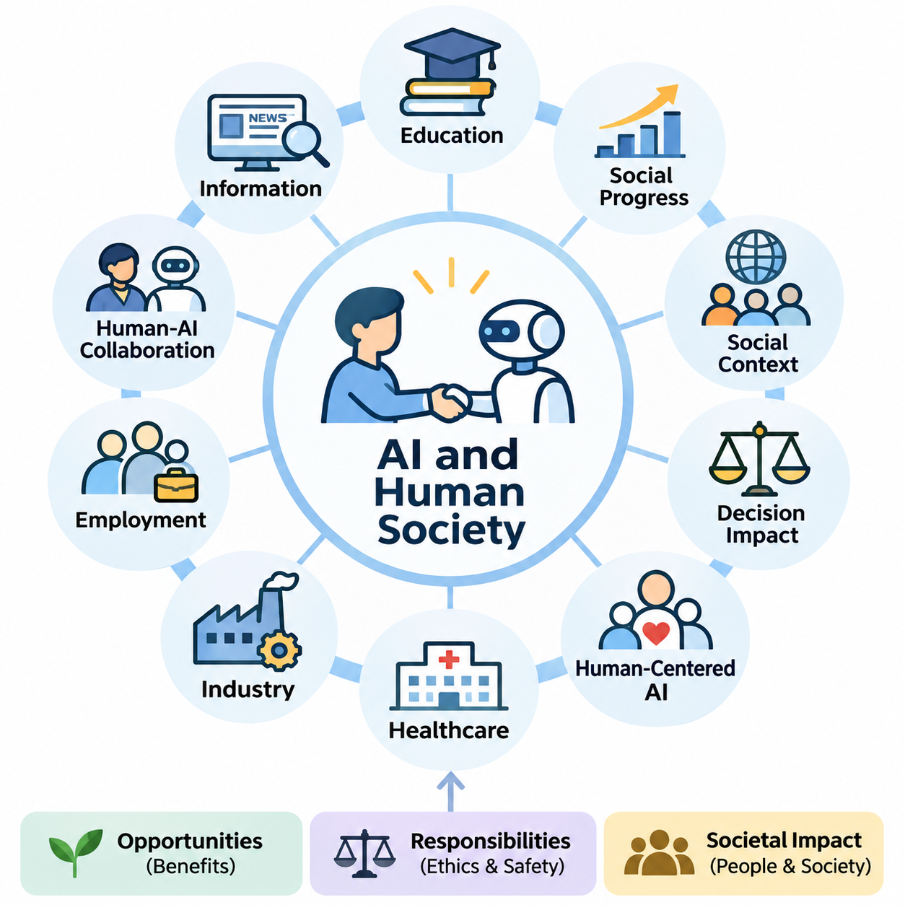
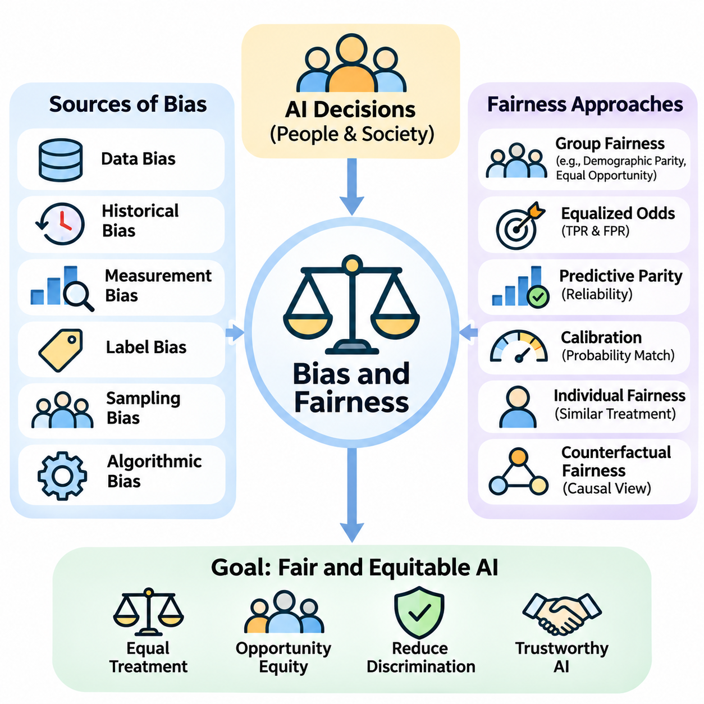
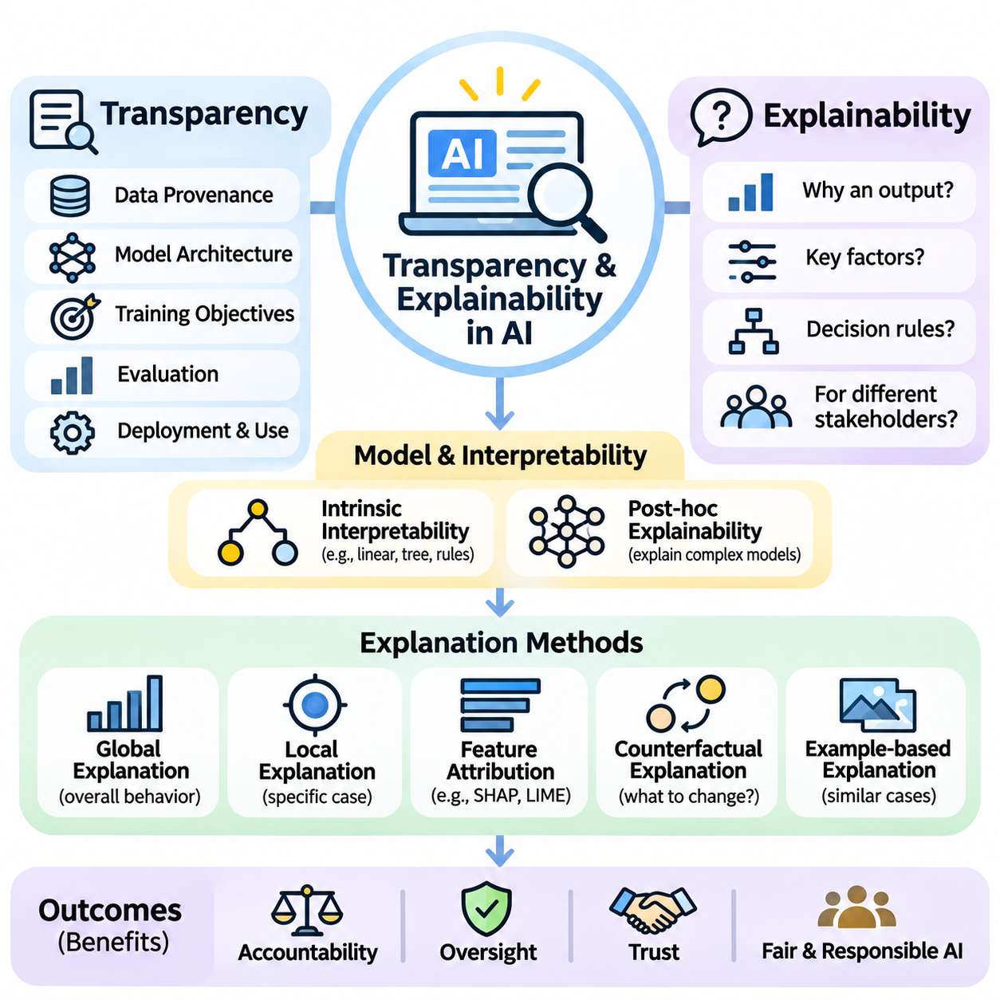
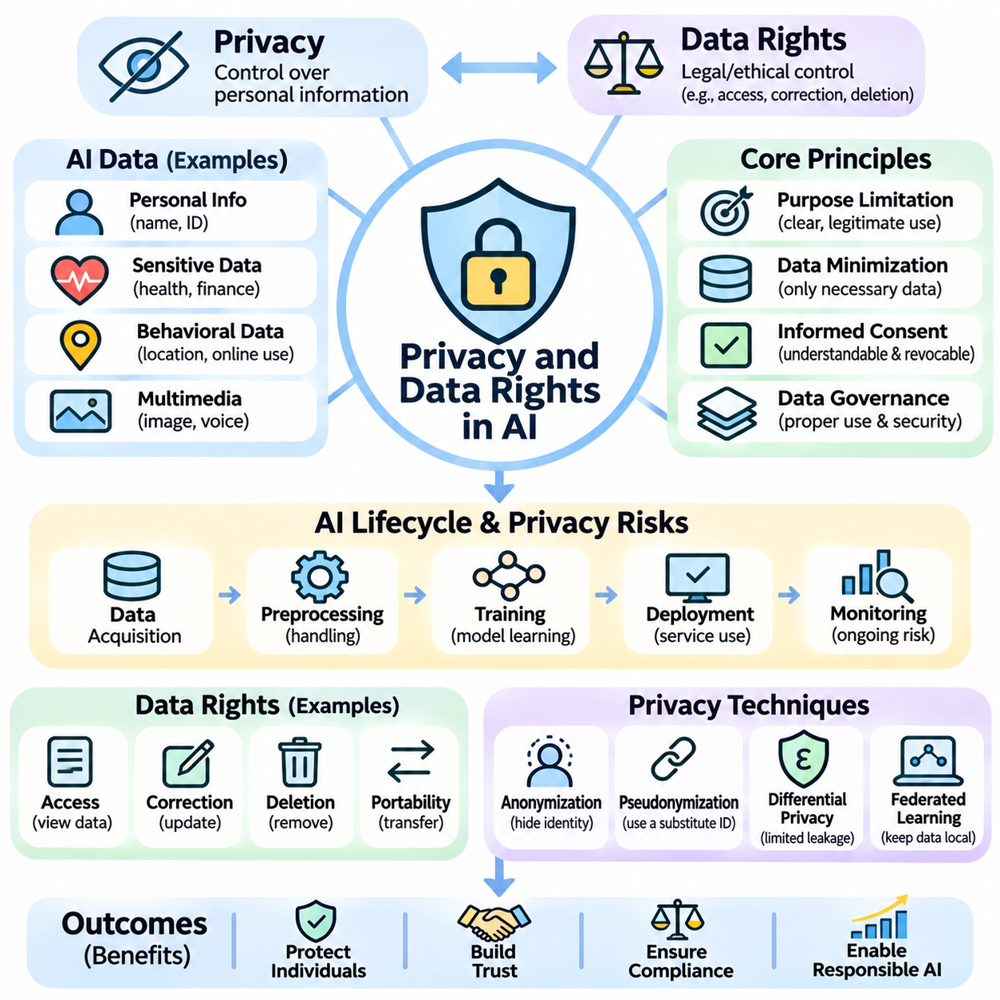
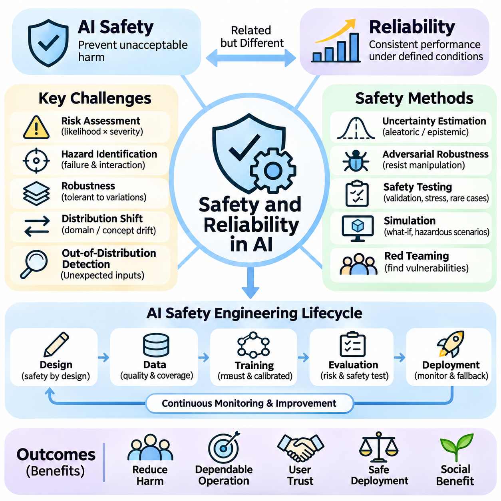
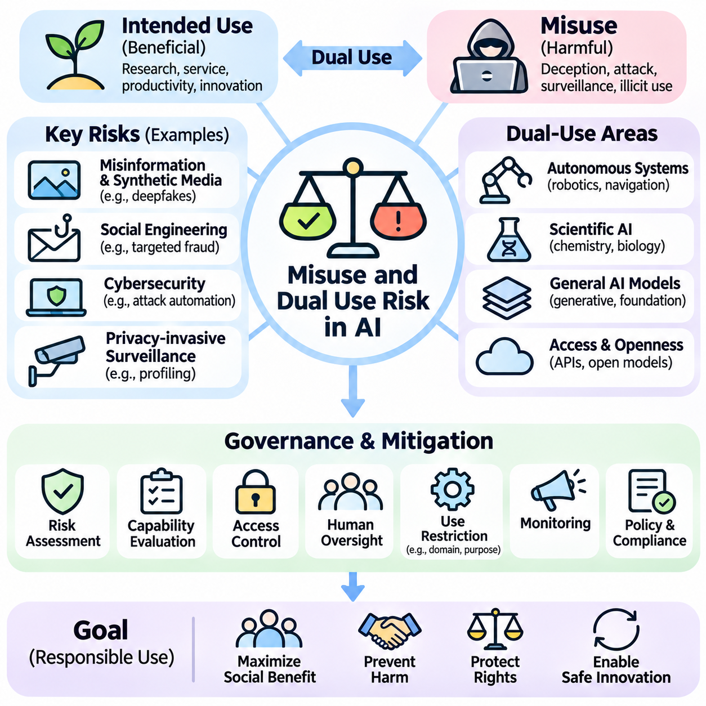
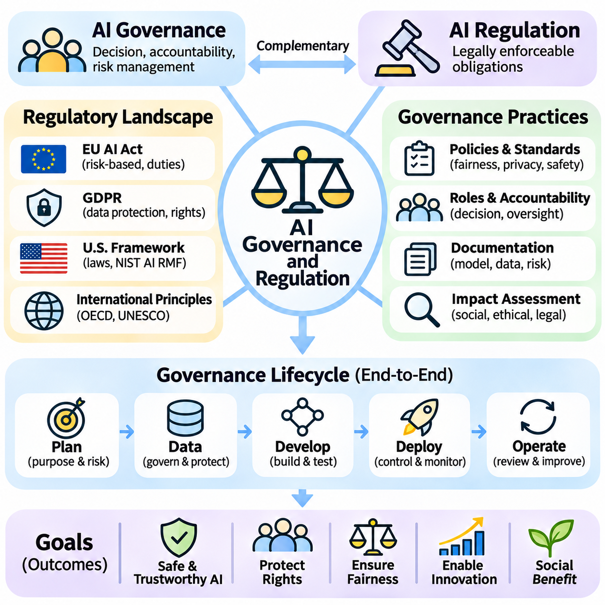
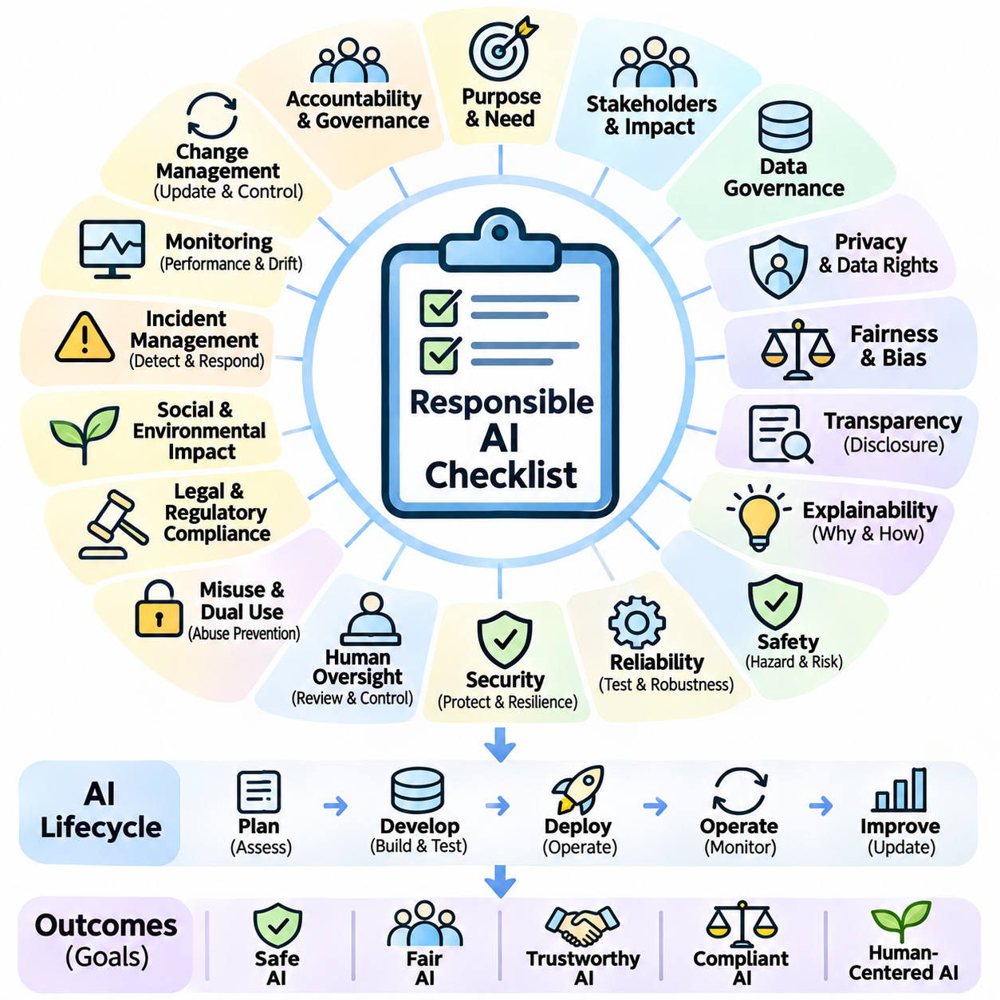

**Volume 04. Artificial Intelligence**


# 10. AI Ethics Safety and Society

## 10.00 AI and Human Society

{width="7.268055555555556in" height="7.268055555555556in"}

Artificial intelligence has become an increasingly influential force in human society, transforming how individuals communicate, work, learn, and make decisions. Unlike conventional software that follows explicitly defined instructions, modern AI systems can recognize patterns, generate information, and support complex reasoning. Their growing capabilities create opportunities for social progress while introducing new responsibilities concerning human welfare.

The relationship between artificial intelligence and society extends beyond technological performance. AI systems operate within environments shaped by cultural values, economic structures, political institutions, and human behavior. Their outputs can influence individual opportunities and collective decisions. Consequently, evaluating AI requires understanding not only computational accuracy but also the social conditions under which intelligent systems are developed and deployed.

Throughout history, technological innovations have transformed social organization by changing how people produce goods, exchange knowledge, and coordinate activities. Artificial intelligence represents another significant transition because it can automate selected cognitive tasks previously performed by humans. This development affects professional expertise, organizational decision-making, and the distribution of economic opportunities across different industries.

One important characteristic of AI is its ability to influence decisions at considerable scale. A recommendation algorithm may shape the information consumed by millions of users, while an automated screening system may affect employment or financial opportunities. Even small systematic errors can produce substantial consequences when repeated across large populations. Social responsibility therefore becomes inseparable from the engineering of reliable AI systems.

Human-centered artificial intelligence emphasizes that technological development should support human capabilities, dignity, and autonomy. Rather than treating computational efficiency as the only objective, human-centered design considers whether systems improve meaningful human outcomes. This perspective encourages developers to evaluate accessibility, usability, informed consent, and the ability of individuals to understand or challenge automated decisions.

Artificial intelligence can contribute significantly to education by providing personalized learning materials, adaptive assessments, and accessible instructional assistance. Intelligent tutoring systems can identify knowledge gaps and recommend appropriate exercises. However, educational benefits depend on instructional quality, equitable access, and responsible data practices. Excessive reliance on automated assistance may also weaken independent reasoning when learning environments are poorly designed.

Healthcare represents another important domain in which AI may improve social welfare. Machine learning systems can assist with medical imaging, clinical documentation, disease-risk estimation, and scientific research. These capabilities may support healthcare professionals and expand access to selected services. Nevertheless, medical decisions involve uncertainty, individual circumstances, and ethical obligations that require rigorous validation and appropriate professional oversight.

In industrial environments, AI supports predictive maintenance, quality inspection, production scheduling, and operational optimization. Intelligent automation can reduce repetitive work and improve consistency in complex manufacturing processes. At the same time, organizations must consider worker safety, changing skill requirements, and the consequences of automated decisions. Successful implementation requires integrating technical improvements with workforce development and organizational accountability.

The relationship between AI and employment is particularly complex because automation can replace certain tasks while creating demand for new capabilities. Some occupations may experience substantial restructuring, whereas others may benefit from AI-assisted productivity. The overall consequences depend on technological adoption, economic conditions, institutional responses, and access to retraining. Employment transitions therefore require coordinated planning rather than assumptions of universal benefit or inevitable displacement.

Human-AI collaboration offers an alternative to viewing intelligent systems exclusively as replacements for human workers. In collaborative environments, AI can process large datasets, identify patterns, and generate recommendations, while humans contribute contextual understanding, ethical judgment, and responsibility. Effective collaboration requires clearly defined authority, appropriate trust calibration, and mechanisms through which human operators can inspect, correct, or reject automated outputs.

The increasing presence of AI in information environments also changes how societies create and interpret knowledge. Search engines, recommendation systems, and generative models influence which information becomes visible and how it is presented. These technologies can improve accessibility and communication, but they may also amplify misinformation or reinforce existing viewpoints. Maintaining trustworthy information ecosystems requires attention to source quality, verification, and media literacy.

Generative artificial intelligence introduces additional challenges because synthetic text, images, audio, and video can closely resemble human-created content. Such systems support creativity, translation, communication, and knowledge production. However, they can also facilitate impersonation, deceptive narratives, and misleading representations. Societies must develop practical methods for establishing provenance, evaluating authenticity, and distinguishing credible evidence from fabricated material.

AI technologies may also influence democratic institutions and public administration. Governments can employ intelligent systems to analyze infrastructure, improve service delivery, and support policy evaluation. Yet automated public decisions can affect fundamental rights and access to essential services. Public-sector AI therefore requires transparency, procedural safeguards, proportionality, and meaningful opportunities for affected individuals to obtain explanations or request reconsideration.

Social inequality presents a major consideration in the distribution of AI benefits. Organizations with substantial computational resources, proprietary datasets, and specialized expertise may gain advantages over smaller institutions. Differences in digital infrastructure and educational access can further widen existing disparities. Inclusive AI development requires attention to affordability, accessibility, language diversity, and the needs of communities that are underrepresented in technological design.

Cultural and linguistic diversity is especially important because AI systems learn from datasets that may not represent all populations equally. Models trained predominantly on widely available languages or dominant cultural perspectives may perform less effectively in other contexts. This limitation can influence communication, education, and public services. Responsible development requires representative evaluation and mechanisms for adapting systems to different social environments.

Privacy is another foundational concern in the relationship between AI and society. Intelligent systems frequently depend on large collections of behavioral, personal, or organizational data. Although such information can improve predictive performance, inappropriate collection or processing may undermine individual autonomy. Privacy-conscious design involves data minimization, access restrictions, secure processing, and clear communication about how information is used.

The societal significance of AI safety increases when intelligent systems interact directly with physical environments. Autonomous vehicles, industrial robots, medical devices, and service robots can produce consequences beyond digital information. Errors in perception, planning, or control may create physical hazards. These applications require systematic risk assessment, operational boundaries, monitoring mechanisms, and dependable human intervention procedures.

Trust plays a central role in the adoption of artificial intelligence. Users are more likely to accept intelligent systems when they demonstrate consistent behavior, communicate limitations, and provide understandable explanations. However, excessive trust can be dangerous when users assume that sophisticated outputs are necessarily correct. Appropriate trust requires balancing confidence in validated capabilities with awareness of uncertainty, failure modes, and changing operating conditions.

Human autonomy must remain a central consideration as AI systems become more capable of recommending or executing actions. Automated assistance can reduce cognitive workload, but it can also encourage passive acceptance of machine-generated judgments. Meaningful human control requires more than providing an interface for approval. Individuals must possess sufficient information, time, authority, and practical ability to intervene when automated recommendations are inappropriate.

Environmental sustainability introduces another dimension of AI\'s social impact. Training and operating computationally intensive models can require substantial electricity, cooling infrastructure, and specialized hardware. Hardware manufacturing and replacement also involve material consumption and electronic waste. Sustainable AI engineering considers energy efficiency, equipment utilization, system lifetime, and the relationship between computational expenditure and measurable social benefit.

The concentration of AI capabilities within a limited number of organizations raises questions about economic power and technological dependence. Control over advanced models, computational infrastructure, and essential data resources can influence market competition and access to innovation. Open research, interoperable technologies, and appropriate competition policies may help broaden participation, although openness must also be balanced against security and misuse risks.

Artificial intelligence also changes the nature of professional responsibility. When an automated system contributes to a harmful outcome, responsibility cannot be assigned solely to the mathematical model. Developers, deployers, operators, and governing institutions may each influence system behavior. Effective accountability requires documented responsibilities, traceable decisions, incident reporting, and organizational processes for identifying and correcting failures.

Public participation is essential because the consequences of AI deployment extend beyond technical specialists and commercial organizations. Workers, educators, researchers, policymakers, and affected communities possess different forms of knowledge about potential benefits and risks. Including these perspectives can reveal problems that conventional technical evaluation overlooks. Participatory approaches can therefore improve the legitimacy and practical relevance of AI governance.

The long-term relationship between humans and artificial intelligence will depend on choices made during system design, institutional adoption, and public oversight. Technological capability alone cannot determine whether AI produces equitable or beneficial outcomes. Societies must continuously evaluate how intelligent systems affect human rights, economic opportunity, safety, and collective well-being while adapting institutions to emerging capabilities.

Ultimately, artificial intelligence should be understood as a sociotechnical system rather than an isolated computational achievement. Its value emerges through interactions among algorithms, data, infrastructure, institutions, and people. A responsible approach combines technical excellence with ethical reflection, democratic accountability, and sustained human oversight. The central objective is to ensure that increasingly capable AI systems contribute to human flourishing while preserving human agency and social trust.

인공지능(Artificial Intelligence, AI)은 인간 사회(Human Society)에 점점 더 큰 영향력을 미치는 기술로 발전하면서 사람들이 의사소통하고, 일하고, 학습하며, 의사결정(Decision-Making)을 수행하는 방식을 변화시키고 있다. 명시적으로 정의된 명령을 따르는 기존 소프트웨어(Conventional Software)와 달리, 현대 인공지능 시스템(Modern AI Systems)은 패턴(Pattern)을 인식하고, 정보를 생성하며, 복잡한 추론(Reasoning)을 지원할 수 있다. 이러한 능력의 발전은 사회적 진보(Social Progress)를 위한 기회를 제공하는 동시에 인간의 복지(Human Welfare)에 관한 새로운 책임을 발생시킨다.

인공지능과 사회의 관계는 단순한 기술적 성능(Technical Performance)을 넘어선다. 인공지능 시스템은 문화적 가치(Cultural Values), 경제 구조(Economic Structures), 정치 제도(Political Institutions), 인간 행동(Human Behavior)에 의해 형성되는 환경에서 작동한다. 인공지능의 출력 결과는 개인의 기회와 집단적 의사결정(Collective Decision-Making)에 영향을 미칠 수 있다. 따라서 인공지능을 평가할 때는 계산 정확도(Computational Accuracy)뿐만 아니라 지능형 시스템(Intelligent Systems)이 개발되고 배포되는 사회적 조건(Social Conditions)도 이해해야 한다.

역사적으로 기술 혁신(Technological Innovation)은 사람들이 상품을 생산하고, 지식을 교환하며, 활동을 조정하는 방식을 변화시킴으로써 사회 조직(Social Organization)을 재편해 왔다. 인공지능은 과거 인간이 수행하던 일부 인지적 작업(Cognitive Tasks)을 자동화할 수 있다는 점에서 또 하나의 중요한 전환을 의미한다. 이러한 발전은 전문 지식(Professional Expertise), 조직의 의사결정(Organizational Decision-Making), 다양한 산업 전반의 경제적 기회(Economic Opportunities) 분배에 영향을 미친다.

인공지능의 중요한 특징 중 하나는 대규모 의사결정에 영향을 미칠 수 있다는 점이다. 추천 알고리즘(Recommendation Algorithm)은 수백만 명의 사용자가 소비하는 정보를 결정하는 데 영향을 줄 수 있으며, 자동화된 심사 시스템(Automated Screening System)은 고용이나 금융 기회에 영향을 미칠 수 있다. 작은 체계적 오류(Systematic Errors)라도 대규모 인구에 걸쳐 반복되면 상당한 결과를 초래할 수 있다. 따라서 사회적 책임(Social Responsibility)은 신뢰할 수 있는 인공지능 시스템의 공학적 설계와 분리될 수 없다.

인간 중심 인공지능(Human-Centered Artificial Intelligence)은 기술 개발이 인간의 능력(Human Capabilities), 존엄성(Dignity), 자율성(Autonomy)을 지원해야 한다는 점을 강조한다. 계산 효율성(Computational Efficiency)을 유일한 목표로 취급하는 대신, 인간 중심 설계(Human-Centered Design)는 시스템이 실질적인 인간의 삶에 얼마나 긍정적인 결과를 제공하는지 고려한다. 이러한 관점은 개발자가 접근성(Accessibility), 사용성(Usability), 충분한 정보에 기반한 동의(Informed Consent), 자동화된 의사결정을 이해하거나 이의를 제기할 수 있는 능력을 평가하도록 유도한다.

인공지능은 개인화된 학습 자료(Personalized Learning Materials), 적응형 평가(Adaptive Assessment), 접근 가능한 교육 지원(Instructional Assistance)을 제공함으로써 교육(Education)에 크게 기여할 수 있다. 지능형 튜터링 시스템(Intelligent Tutoring Systems)은 지식의 부족한 부분(Knowledge Gaps)을 식별하고 적절한 연습 문제를 추천할 수 있다. 그러나 교육적 효과는 교수 품질(Instructional Quality), 공평한 접근성(Equitable Access), 책임 있는 데이터 관리(Data Practices)에 달려 있다. 또한 학습 환경이 적절하게 설계되지 않으면 자동화된 지원에 대한 과도한 의존이 독립적인 추론 능력(Independent Reasoning)을 약화시킬 수 있다.

의료(Healthcare)는 인공지능이 사회적 복지(Social Welfare)를 향상시킬 수 있는 또 다른 중요한 영역이다. 기계학습 시스템(Machine Learning Systems)은 의료 영상(Medical Imaging), 임상 문서 작성(Clinical Documentation), 질병 위험 추정(Disease-Risk Estimation), 과학 연구(Scientific Research)를 지원할 수 있다. 이러한 기능은 의료 전문가(Healthcare Professionals)를 보조하고 일부 의료 서비스의 접근성을 확대할 수 있다. 그러나 의료 의사결정에는 불확실성(Uncertainty), 개인별 상황(Individual Circumstances), 윤리적 의무(Ethical Obligations)가 포함되므로 엄격한 검증(Rigorous Validation)과 적절한 전문가 감독(Professional Oversight)이 필요하다.

산업 환경(Industrial Environments)에서 인공지능은 예지 보전(Predictive Maintenance), 품질 검사(Quality Inspection), 생산 일정 계획(Production Scheduling), 운영 최적화(Operational Optimization)를 지원한다. 지능형 자동화(Intelligent Automation)는 반복 작업을 줄이고 복잡한 제조 공정(Manufacturing Processes)의 일관성을 향상시킬 수 있다. 동시에 조직은 작업자 안전(Worker Safety), 변화하는 기술 요구사항(Skill Requirements), 자동화된 의사결정의 결과를 고려해야 한다. 성공적인 도입을 위해서는 기술적 개선과 인력 개발(Workforce Development), 조직적 책임성(Organizational Accountability)을 통합해야 한다.

인공지능과 고용(Employment)의 관계는 특히 복잡하다. 자동화(Automation)는 특정 작업을 대체하는 동시에 새로운 역량에 대한 수요를 창출할 수 있기 때문이다. 일부 직업은 상당한 구조적 변화(Restructuring)를 경험할 수 있지만, 다른 직업은 인공지능 지원 생산성(AI-Assisted Productivity)의 혜택을 받을 수 있다. 전체적인 영향은 기술 도입(Technological Adoption), 경제적 조건(Economic Conditions), 제도적 대응(Institutional Responses), 재교육(Retraining)에 대한 접근성에 따라 달라진다. 따라서 고용 전환(Employment Transitions)에는 보편적인 이익이나 불가피한 일자리 대체를 가정하기보다 체계적인 계획이 필요하다.

인간-인공지능 협업(Human-AI Collaboration)은 지능형 시스템을 인간 노동자의 대체 수단으로만 바라보는 관점에 대한 대안을 제공한다. 협업 환경(Collaborative Environments)에서 인공지능은 대규모 데이터셋(Datasets)을 처리하고, 패턴을 식별하며, 권고안을 생성할 수 있다. 반면 인간은 맥락적 이해(Contextual Understanding), 윤리적 판단(Ethical Judgment), 책임(Responsibility)을 제공한다. 효과적인 협업을 위해서는 명확하게 정의된 권한(Authority), 적절한 신뢰 수준 조정(Trust Calibration), 인간 운영자가 자동화된 결과를 검토하고 수정하거나 거부할 수 있는 메커니즘(Mechanisms)이 필요하다.

정보 환경(Information Environments)에서 인공지능의 영향력이 증가하면서 사회가 지식을 생성하고 해석하는 방식도 변화하고 있다. 검색 엔진(Search Engines), 추천 시스템(Recommendation Systems), 생성형 모델(Generative Models)은 어떤 정보가 노출되고 어떻게 제시되는지에 영향을 미친다. 이러한 기술은 접근성과 의사소통을 향상시킬 수 있지만, 잘못된 정보(Misinformation)를 증폭하거나 기존 관점을 강화할 수도 있다. 신뢰할 수 있는 정보 생태계(Trustworthy Information Ecosystems)를 유지하려면 정보 출처의 품질(Source Quality), 검증(Verification), 미디어 리터러시(Media Literacy)에 주의를 기울여야 한다.

생성형 인공지능(Generative Artificial Intelligence)은 합성 텍스트(Synthetic Text), 이미지(Images), 오디오(Audio), 비디오(Video)가 인간이 제작한 콘텐츠와 매우 유사하게 생성될 수 있다는 점에서 추가적인 문제를 제기한다. 이러한 시스템은 창의성(Creativity), 번역(Translation), 의사소통(Communication), 지식 생산(Knowledge Production)을 지원한다. 그러나 사칭(Impersonation), 기만적인 서사(Deceptive Narratives), 오해를 유발하는 표현(Misleading Representations)에도 악용될 수 있다. 따라서 사회는 콘텐츠의 출처(Provenance)를 확인하고, 진위성(Authenticity)을 평가하며, 신뢰할 수 있는 증거와 조작된 자료를 구별하는 실질적인 방법을 개발해야 한다.

인공지능 기술은 민주적 제도(Democratic Institutions)와 공공 행정(Public Administration)에도 영향을 미칠 수 있다. 정부는 지능형 시스템을 활용하여 기반시설(Infrastructure)을 분석하고, 공공 서비스 제공(Service Delivery)을 개선하며, 정책 평가(Policy Evaluation)를 지원할 수 있다. 그러나 자동화된 공공 의사결정(Automated Public Decisions)은 기본권(Fundamental Rights)과 필수 서비스에 대한 접근성에 영향을 줄 수 있다. 따라서 공공 부문의 인공지능(Public-Sector AI)에는 투명성(Transparency), 절차적 보호 장치(Procedural Safeguards), 비례성(Proportionality), 영향을 받는 개인이 설명을 요청하거나 재검토를 요구할 수 있는 실질적인 기회가 필요하다.

사회적 불평등(Social Inequality)은 인공지능의 혜택이 어떻게 분배되는지를 판단할 때 중요한 고려사항이다. 상당한 컴퓨팅 자원(Computational Resources), 독점 데이터셋(Proprietary Datasets), 전문 지식(Specialized Expertise)을 보유한 조직은 소규모 기관보다 유리한 위치를 차지할 수 있다. 디지털 인프라(Digital Infrastructure)와 교육 접근성(Educational Access)의 차이는 기존 격차를 더욱 확대할 수 있다. 포용적인 인공지능 개발(Inclusive AI Development)을 위해서는 경제적 부담 가능성(Affordability), 접근성(Accessibility), 언어적 다양성(Language Diversity), 기술 설계에서 충분히 대표되지 못한 공동체의 요구를 고려해야 한다.

문화적 다양성(Cultural Diversity)과 언어적 다양성(Linguistic Diversity)은 인공지능 시스템이 모든 인구 집단을 동등하게 대표하지 못할 수 있는 데이터셋에서 학습한다는 점에서 특히 중요하다. 널리 사용되는 언어나 지배적인 문화적 관점(Dominant Cultural Perspectives)에 편중된 데이터로 학습한 모델은 다른 환경에서 성능이 저하될 수 있다. 이러한 한계는 의사소통, 교육, 공공 서비스에 영향을 미칠 수 있다. 책임 있는 개발(Responsible Development)을 위해서는 대표성 있는 평가(Representative Evaluation)와 서로 다른 사회적 환경에 시스템을 적응시키는 메커니즘이 필요하다.

개인정보 보호(Privacy)는 인공지능과 사회의 관계에서 또 다른 근본적인 관심사이다. 지능형 시스템은 행동 데이터(Behavioral Data), 개인정보(Personal Data), 조직 데이터(Organizational Data)의 대규모 수집에 의존하는 경우가 많다. 이러한 정보는 예측 성능(Predictive Performance)을 향상시킬 수 있지만, 부적절한 수집이나 처리는 개인의 자율성(Individual Autonomy)을 침해할 수 있다. 개인정보 보호 중심 설계(Privacy-Conscious Design)에는 데이터 최소화(Data Minimization), 접근 제한(Access Restrictions), 안전한 처리(Secure Processing), 정보 활용 방식에 대한 명확한 설명이 포함된다.

인공지능 안전성(AI Safety)의 사회적 중요성은 지능형 시스템이 물리적 환경(Physical Environments)과 직접 상호작용할 때 더욱 커진다. 자율주행차(Autonomous Vehicles), 산업용 로봇(Industrial Robots), 의료기기(Medical Devices), 서비스 로봇(Service Robots)은 디지털 정보를 넘어서는 물리적 결과를 발생시킬 수 있다. 인지(Perception), 계획(Planning), 제어(Control)의 오류는 물리적 위험(Physical Hazards)을 초래할 수 있다. 이러한 응용 분야에는 체계적인 위험 평가(Risk Assessment), 운영 경계(Operational Boundaries), 모니터링 메커니즘(Monitoring Mechanisms), 신뢰할 수 있는 인간 개입 절차(Human Intervention Procedures)가 필요하다.

신뢰(Trust)는 인공지능의 도입(Adoption)에서 핵심적인 역할을 한다. 사용자는 지능형 시스템이 일관된 동작(Consistent Behavior)을 보여주고, 한계를 전달하며, 이해할 수 있는 설명(Understandable Explanations)을 제공할 때 이를 더 쉽게 수용한다. 그러나 정교한 출력 결과가 반드시 정확하다고 가정하면 과도한 신뢰(Excessive Trust)가 위험해질 수 있다. 적절한 신뢰를 형성하려면 검증된 능력(Validated Capabilities)에 대한 확신과 불확실성(Uncertainty), 실패 유형(Failure Modes), 변화하는 운영 조건(Operating Conditions)에 대한 인식을 균형 있게 유지해야 한다.

인공지능 시스템이 행동을 추천하거나 실행하는 능력이 향상될수록 인간의 자율성(Human Autonomy)은 더욱 중요한 고려사항이 된다. 자동화된 지원(Automated Assistance)은 인지적 작업 부담(Cognitive Workload)을 줄일 수 있지만, 기계가 생성한 판단을 수동적으로 수용하도록 유도할 수도 있다. 의미 있는 인간 통제(Meaningful Human Control)는 단순히 승인 인터페이스(Approval Interface)를 제공하는 것 이상을 요구한다. 개인은 자동화된 권고가 부적절할 때 개입할 수 있는 충분한 정보, 시간, 권한, 실질적인 능력을 갖추어야 한다.

환경적 지속가능성(Environmental Sustainability)은 인공지능의 사회적 영향에 또 다른 차원을 추가한다. 계산 집약적인 모델(Computationally Intensive Models)을 학습하고 운영하려면 상당한 전력(Electricity), 냉각 인프라(Cooling Infrastructure), 특수 하드웨어(Specialized Hardware)가 필요할 수 있다. 하드웨어 제조와 교체 과정에서도 자원 소비(Material Consumption)와 전자 폐기물(Electronic Waste)이 발생한다. 지속가능한 인공지능 공학(Sustainable AI Engineering)은 에너지 효율(Energy Efficiency), 장비 활용률(Equipment Utilization), 시스템 수명(System Lifetime), 계산 비용과 측정 가능한 사회적 편익 사이의 관계를 고려한다.

소수 조직에 인공지능 역량(AI Capabilities)이 집중되는 현상은 경제적 권력(Economic Power)과 기술적 의존성(Technological Dependence)에 관한 문제를 제기한다. 고급 모델(Advanced Models), 컴퓨팅 인프라(Computational Infrastructure), 핵심 데이터 자원(Essential Data Resources)에 대한 통제는 시장 경쟁(Market Competition)과 혁신에 대한 접근성에 영향을 줄 수 있다. 개방형 연구(Open Research), 상호운용 가능한 기술(Interoperable Technologies), 적절한 경쟁 정책(Competition Policies)은 참여 기회를 확대하는 데 도움이 될 수 있지만, 개방성(Openness)은 보안(Security) 및 오용 위험(Misuse Risks)과 균형을 이루어야 한다.

인공지능은 전문적 책임(Professional Responsibility)의 성격도 변화시킨다. 자동화된 시스템이 유해한 결과(Harmful Outcomes)에 기여했을 때 그 책임을 수학적 모델(Mathematical Model)에만 부여할 수는 없다. 개발자(Developers), 배포 담당자(Deployers), 운영자(Operators), 관리 기관(Governing Institutions)은 각각 시스템 동작에 영향을 미칠 수 있다. 효과적인 책임성(Accountability)을 확보하려면 문서화된 책임 범위(Documented Responsibilities), 추적 가능한 의사결정(Traceable Decisions), 사고 보고(Incident Reporting), 실패를 식별하고 수정하기 위한 조직적 절차(Organizational Processes)가 필요하다.

인공지능 배포(AI Deployment)의 결과는 기술 전문가와 상업 조직을 넘어 광범위한 사회 구성원에게 영향을 미치므로 공공 참여(Public Participation)가 필수적이다. 근로자(Workers), 교육자(Educators), 연구자(Researchers), 정책 입안자(Policymakers), 영향을 받는 공동체(Affected Communities)는 잠재적 이익과 위험에 관하여 서로 다른 형태의 지식을 보유하고 있다. 이러한 관점을 포함하면 기존의 기술적 평가(Technical Evaluation)에서 간과하기 쉬운 문제를 발견할 수 있다. 따라서 참여적 접근법(Participatory Approaches)은 인공지능 거버넌스(AI Governance)의 정당성(Legitimacy)과 실질적 적합성(Practical Relevance)을 향상시킬 수 있다.

인간과 인공지능의 장기적인 관계(Long-Term Relationship)는 시스템 설계(System Design), 제도적 도입(Institutional Adoption), 공공 감독(Public Oversight) 과정에서 이루어지는 선택에 따라 달라진다. 기술적 능력(Technological Capability)만으로 인공지능이 공평하거나 유익한 결과를 만들어낼지는 결정할 수 없다. 사회는 지능형 시스템이 인권(Human Rights), 경제적 기회(Economic Opportunity), 안전(Safety), 공동의 복지(Collective Well-Being)에 미치는 영향을 지속적으로 평가하면서 새로운 능력에 맞추어 제도를 조정해야 한다.

궁극적으로 인공지능은 독립적인 계산 기술의 성과(Isolated Computational Achievement)가 아니라 사회기술적 시스템(Sociotechnical System)으로 이해되어야 한다. 인공지능의 가치는 알고리즘(Algorithms), 데이터(Data), 인프라(Infrastructure), 제도(Institutions), 인간(People) 사이의 상호작용을 통해 형성된다. 책임 있는 접근법(Responsible Approach)은 기술적 우수성(Technical Excellence)을 윤리적 성찰(Ethical Reflection), 민주적 책임성(Democratic Accountability), 지속적인 인간 감독(Human Oversight)과 결합한다. 핵심 목표는 점점 더 높은 능력을 갖춘 인공지능 시스템이 인간의 주체성(Human Agency)과 사회적 신뢰(Social Trust)를 유지하면서 인간의 번영(Human Flourishing)에 기여하도록 보장하는 것이다.

## 10.01 Bias and Fairness

{width="7.268055555555556in" height="7.268055555555556in"}

Bias and fairness are fundamental concerns in artificial intelligence because automated systems increasingly influence decisions affecting individuals, organizations, and communities. Although AI models are often perceived as objective computational mechanisms, their behavior reflects the data, assumptions, and objectives used during development. Consequently, algorithmic decisions may reproduce existing inequalities or introduce new forms of discrimination.

Bias in artificial intelligence refers to systematic patterns that produce distorted predictions, unequal treatment, or disadvantages for particular populations. Such bias may arise even when developers do not intentionally discriminate. Statistical models learn relationships from historical observations, and these observations frequently reflect social inequalities, institutional practices, and incomplete representations of the real world.

Data bias is one of the most common sources of unfair AI behavior. Training datasets may overrepresent certain demographic groups, geographic regions, languages, or socioeconomic conditions while underrepresenting others. When a model learns primarily from dominant populations, its predictions may become less accurate for minority or marginalized groups. Dataset representativeness is therefore essential for equitable model performance.

Historical bias occurs when training data accurately records past decisions that were themselves influenced by discriminatory practices. For example, employment records may reflect unequal hiring opportunities, while lending histories may contain patterns associated with unequal access to financial services. A model trained to reproduce these outcomes can perpetuate historical disadvantages even when its mathematical optimization is technically correct.

Measurement bias emerges when collected variables or labels fail to represent the underlying concepts accurately. Educational achievement, professional competence, and medical risk are complex characteristics that cannot always be measured through simple numerical indicators. If proxy measurements systematically differ across populations, AI systems may generate misleading comparisons and reinforce unequal treatment.

Label bias is particularly important in supervised learning because models depend on target values that represent expected outcomes. Human annotators may apply inconsistent judgments, while institutional records may contain subjective classifications. When labels reflect stereotypes or incomplete information, the model can learn these distortions as predictive patterns. Label quality must therefore be evaluated alongside feature quality.

Sampling bias arises when the process used to collect observations produces a dataset that differs systematically from the population where the model will operate. Online surveys, voluntary participation, and geographically concentrated data collection may exclude important groups. Even large datasets can remain unrepresentative when their collection mechanisms are biased. Dataset size alone does not guarantee fairness.

Algorithmic bias can also emerge from model design, optimization objectives, and decision thresholds. A system optimized exclusively for overall accuracy may favor groups that dominate the training distribution. Similarly, a single classification threshold may produce different error rates across populations. Fairness evaluation must therefore examine how model behavior varies among relevant groups rather than relying solely on aggregate performance.

Fairness in artificial intelligence is a multidimensional concept involving equitable treatment, comparable opportunities, and appropriate distribution of benefits and burdens. Different applications require different interpretations of fairness because social contexts and decision consequences vary. A fair medical screening system may prioritize equitable detection performance, whereas a resource allocation system may emphasize access, need, or procedural consistency.

Group fairness evaluates whether outcomes or performance measures differ systematically among defined populations. Demographic parity, for example, examines whether positive decision rates are comparable across groups. Equal opportunity focuses on comparable true positive rates among individuals who actually satisfy the relevant condition. These definitions capture different ethical objectives and may produce conflicting assessments of the same system.

Equalized odds extends fairness evaluation by considering both true positive rates and false positive rates across groups. Predictive parity examines whether positive predictions have comparable reliability among populations. Calibration assesses whether predicted probabilities correspond to observed outcome frequencies within groups. These criteria cannot always be satisfied simultaneously, particularly when underlying outcome prevalence differs across populations.

Individual fairness emphasizes that similar individuals should receive similar treatment under a task-appropriate definition of similarity. This approach avoids relying exclusively on group-level statistics but introduces challenges in defining relevant characteristics. Two individuals may appear similar according to numerical features while differing in important contextual circumstances. Meaningful individual fairness therefore requires careful consideration of domain knowledge and social values.

Counterfactual fairness examines whether a prediction would remain appropriately unchanged if a protected characteristic were different under a specified causal model. This approach encourages developers to distinguish legitimate causal relationships from discriminatory pathways. However, constructing reliable causal models is difficult because social characteristics interact with education, income, geography, and institutional conditions through complex mechanisms.

Sensitive attributes such as race, gender, age, disability, and other legally protected characteristics require careful consideration in fairness analysis. Simply removing these attributes from training data does not necessarily eliminate discrimination. Other variables, including location, purchasing behavior, or educational history, may act as proxies. Detecting proxy discrimination requires examining correlations, causal relationships, and the broader decision context.

Fairness assessment should begin before model training through systematic examination of the intended application, affected populations, and potential harms. Developers should identify whose interests are represented, which outcomes matter, and how errors affect different stakeholders. This process helps determine appropriate evaluation metrics and acceptable trade-offs. Technical fairness objectives should follow clearly articulated social and operational requirements.

Bias mitigation can occur during data preparation, model training, or postprocessing. Preprocessing approaches may improve representation, adjust sample weights, or address problematic labels. In-processing techniques incorporate fairness-related constraints into optimization. Postprocessing methods modify decision thresholds or outputs to reduce selected disparities. Each approach introduces trade-offs involving accuracy, interpretability, and operational feasibility.

Reweighting techniques adjust the influence of training examples so that underrepresented groups or important cases contribute more strongly to learning. Resampling can similarly alter the distribution of training observations. These approaches may improve selected fairness metrics but cannot automatically correct historical discrimination or invalid labels. Their effectiveness depends on the underlying data-generating process and the fairness objective being pursued.

Fairness-aware optimization incorporates additional constraints or penalties into the model\'s training objective. Instead of minimizing prediction error alone, the learning process also considers disparities between groups. The resulting optimization problem may involve competing objectives, making trade-off analysis necessary. Developers must determine whether performance changes are acceptable given the consequences of incorrect decisions.

Postprocessing approaches can adjust classification thresholds or decision policies after model training. These methods are useful when modifying the underlying model is difficult or when fairness requirements differ across deployment contexts. However, threshold adjustments may create legal, operational, or ethical concerns depending on the application. Their use should be justified through documented objectives and careful evaluation.

Fairness evaluation requires disaggregated performance analysis across relevant demographic and contextual groups. Accuracy, precision, recall, false positive rates, and false negative rates should be examined separately when appropriate and lawful. Intersectional analysis is also important because individuals may experience overlapping disadvantages associated with multiple characteristics. Aggregate statistics can conceal significant disparities within smaller populations.

Statistical uncertainty must be considered when interpreting fairness measurements. Small subgroup samples may produce unstable estimates, while observed differences may reflect sampling variation rather than persistent model behavior. Confidence intervals, appropriate significance assessments, and repeated evaluations can improve interpretation. Fairness conclusions should not rely on isolated numerical comparisons without considering sample quality and uncertainty.

Fairness is not a property that can be established permanently through a single benchmark. Changes in population characteristics, institutional policies, data collection practices, and user behavior can alter model outcomes after deployment. Continuous monitoring is therefore necessary to identify emerging disparities and performance degradation. Responsible maintenance includes periodic reassessment, incident investigation, and corrective interventions.

Human oversight remains essential because mathematical fairness metrics cannot fully represent social justice or determine acceptable outcomes independently. Domain experts, affected communities, legal specialists, and system operators may identify harms that numerical evaluations overlook. Meaningful oversight requires transparent documentation, accessible complaint mechanisms, and procedures for reviewing contested decisions.

Ultimately, bias and fairness should be treated as continuous system-level responsibilities rather than isolated model properties. Equitable AI development combines representative data, appropriate objectives, rigorous evaluation, stakeholder participation, and accountable governance. The goal is not to claim that every algorithm can be perfectly neutral, but to identify unjustified disparities, reduce preventable harms, and ensure that intelligent systems serve people fairly across diverse social contexts.

편향(Bias)과 공정성(Fairness)은 자동화된 시스템(Automated Systems)이 개인, 조직, 공동체에 영향을 미치는 의사결정(Decision-Making)에 점점 더 많이 관여하고 있기 때문에 인공지능(Artificial Intelligence, AI)에서 근본적으로 중요한 문제이다. 인공지능 모델(AI Models)은 객관적인 계산 메커니즘(Objective Computational Mechanisms)으로 인식되는 경우가 많지만, 실제 동작은 개발 과정에서 사용된 데이터(Data), 가정(Assumptions), 목표(Objectives)를 반영한다. 따라서 알고리즘 기반 의사결정(Algorithmic Decisions)은 기존의 불평등(Inequalities)을 재생산하거나 새로운 형태의 차별(Discrimination)을 발생시킬 수 있다.

인공지능에서 편향(Bias)은 특정 인구 집단(Populations)에 대해 왜곡된 예측(Distorted Predictions), 불평등한 대우(Unequal Treatment), 불이익(Disadvantages)을 발생시키는 체계적인 패턴(Systematic Patterns)을 의미한다. 이러한 편향은 개발자가 의도적으로 차별하지 않더라도 발생할 수 있다. 통계 모델(Statistical Models)은 과거의 관측 데이터(Historical Observations)에서 관계를 학습하며, 이러한 데이터에는 사회적 불평등(Social Inequalities), 제도적 관행(Institutional Practices), 현실 세계에 대한 불완전한 표현(Incomplete Representations)이 반영되는 경우가 많다.

데이터 편향(Data Bias)은 불공정한 인공지능 동작(Unfair AI Behavior)을 발생시키는 가장 일반적인 원인 중 하나이다. 학습 데이터셋(Training Datasets)은 특정 인구통계학적 집단(Demographic Groups), 지리적 지역(Geographic Regions), 언어(Languages), 사회경제적 조건(Socioeconomic Conditions)을 과도하게 대표하는 반면 다른 집단은 충분히 포함하지 못할 수 있다. 모델이 주로 지배적인 인구 집단(Dominant Populations)의 데이터에서 학습하면 소수 집단(Minority Groups)이나 사회적으로 소외된 집단(Marginalized Groups)에 대한 예측 정확도가 낮아질 수 있다. 따라서 데이터셋의 대표성(Dataset Representativeness)은 공평한 모델 성능(Equitable Model Performance)을 확보하는 데 필수적이다.

역사적 편향(Historical Bias)은 학습 데이터(Training Data)가 과거의 의사결정을 정확하게 기록하고 있더라도 그 의사결정 자체가 차별적 관행(Discriminatory Practices)의 영향을 받았을 때 발생한다. 예를 들어 고용 기록(Employment Records)은 불평등한 채용 기회(Unequal Hiring Opportunities)를 반영할 수 있으며, 대출 이력(Lending Histories)에는 금융 서비스(Financial Services)에 대한 불평등한 접근과 관련된 패턴이 포함될 수 있다. 이러한 결과를 재현하도록 학습한 모델은 수학적 최적화(Mathematical Optimization)가 기술적으로 올바르더라도 과거의 불이익을 지속시킬 수 있다.

측정 편향(Measurement Bias)은 수집된 변수(Variables)나 레이블(Labels)이 실제로 측정하려는 개념(Underlying Concepts)을 정확하게 나타내지 못할 때 발생한다. 교육 성취도(Educational Achievement), 직무 역량(Professional Competence), 의료 위험(Medical Risk)은 단순한 수치 지표(Numerical Indicators)만으로 항상 측정할 수 없는 복잡한 특성이다. 대리 측정값(Proxy Measurements)이 인구 집단에 따라 체계적으로 다르게 나타나면 인공지능 시스템은 잘못된 비교(Misleading Comparisons)를 생성하고 불평등한 대우를 강화할 수 있다.

레이블 편향(Label Bias)은 모델이 기대 결과(Expected Outcomes)를 나타내는 목표값(Target Values)에 의존하는 지도학습(Supervised Learning)에서 특히 중요하다. 인간 주석자(Human Annotators)는 일관되지 않은 판단을 적용할 수 있으며, 기관의 기록(Institutional Records)에는 주관적인 분류(Subjective Classifications)가 포함될 수 있다. 레이블에 고정관념(Stereotypes)이나 불완전한 정보(Incomplete Information)가 반영되면 모델은 이러한 왜곡을 예측 패턴(Predictive Patterns)으로 학습할 수 있다. 따라서 레이블 품질(Label Quality)은 특성 품질(Feature Quality)과 함께 평가되어야 한다.

표본추출 편향(Sampling Bias)은 관측 데이터를 수집하는 과정이 모델이 실제로 작동할 대상 모집단(Target Population)과 체계적으로 다른 데이터셋을 생성할 때 발생한다. 온라인 설문조사(Online Surveys), 자발적 참여(Voluntary Participation), 특정 지역에 집중된 데이터 수집(Geographically Concentrated Data Collection)은 중요한 집단을 제외할 수 있다. 대규모 데이터셋(Large Datasets)이라도 수집 메커니즘(Collection Mechanisms)에 편향이 존재하면 대표성이 부족할 수 있다. 데이터셋의 크기(Dataset Size)만으로 공정성이 보장되지는 않는다.

알고리즘 편향(Algorithmic Bias)은 모델 설계(Model Design), 최적화 목표(Optimization Objectives), 의사결정 임계값(Decision Thresholds)에서도 발생할 수 있다. 전체 정확도(Overall Accuracy)만을 최적화하는 시스템은 학습 데이터 분포(Training Distribution)에서 비중이 큰 집단에 유리하게 작동할 수 있다. 마찬가지로 단일 분류 임계값(Classification Threshold)을 적용하면 인구 집단마다 서로 다른 오류율(Error Rates)이 나타날 수 있다. 따라서 공정성 평가(Fairness Evaluation)는 집계된 성능(Aggregate Performance)에만 의존하지 않고 관련 집단별 모델 동작을 분석해야 한다.

인공지능의 공정성(Fairness)은 공평한 대우(Equitable Treatment), 비교 가능한 기회(Comparable Opportunities), 혜택과 부담의 적절한 분배(Appropriate Distribution of Benefits and Burdens)를 포함하는 다차원적 개념(Multidimensional Concept)이다. 사회적 맥락(Social Contexts)과 의사결정의 결과(Decision Consequences)가 서로 다르기 때문에 응용 분야마다 공정성을 다르게 해석해야 한다. 공정한 의료 선별 시스템(Medical Screening System)은 집단 간 균등한 탐지 성능(Equitable Detection Performance)을 우선할 수 있지만, 자원 배분 시스템(Resource Allocation System)은 접근성(Access), 필요성(Need), 절차적 일관성(Procedural Consistency)을 강조할 수 있다.

집단 공정성(Group Fairness)은 정의된 인구 집단 사이에서 결과나 성능 지표(Performance Measures)가 체계적으로 다르게 나타나는지를 평가한다. 예를 들어 인구통계학적 동등성(Demographic Parity)은 집단 간 긍정적 의사결정 비율(Positive Decision Rates)이 비슷한지를 검토한다. 기회 균등(Equal Opportunity)은 실제로 관련 조건을 충족하는 개인들 사이에서 참양성률(True Positive Rates)이 비슷한지에 초점을 맞춘다. 이러한 정의는 서로 다른 윤리적 목표(Ethical Objectives)를 반영하며 동일한 시스템에 대해서도 상충하는 평가 결과를 생성할 수 있다.

균등화된 오즈(Equalized Odds)는 집단 간 참양성률(True Positive Rates)과 거짓양성률(False Positive Rates)을 모두 고려하여 공정성을 평가한다. 예측 동등성(Predictive Parity)은 긍정적 예측(Positive Predictions)의 신뢰성이 인구 집단 간에 비슷한지를 검토한다. 보정(Calibration)은 예측 확률(Predicted Probabilities)이 집단별 실제 관측 결과의 빈도(Observed Outcome Frequencies)와 일치하는지를 평가한다. 이러한 기준은 특히 집단 간 실제 결과의 발생 비율(Outcome Prevalence)이 다를 때 항상 동시에 충족될 수 있는 것은 아니다.

개인 공정성(Individual Fairness)은 작업에 적합한 유사성 정의(Task-Appropriate Definition of Similarity)에 따라 비슷한 개인이 비슷한 대우를 받아야 한다는 점을 강조한다. 이러한 접근법은 집단 수준 통계(Group-Level Statistics)에만 의존하지 않는다는 장점이 있지만, 관련 특성(Relevant Characteristics)을 정의하는 데 어려움이 있다. 두 개인이 수치적 특성(Numerical Features)에서는 비슷하게 보이더라도 중요한 맥락적 상황(Contextual Circumstances)은 다를 수 있다. 따라서 의미 있는 개인 공정성을 확보하려면 도메인 지식(Domain Knowledge)과 사회적 가치(Social Values)를 신중하게 고려해야 한다.

반사실적 공정성(Counterfactual Fairness)은 특정 인과 모델(Causal Model)에서 보호 대상 특성(Protected Characteristic)이 달라졌다고 가정하더라도 예측이 적절하게 유지되는지를 검토한다. 이러한 접근법은 개발자가 정당한 인과관계(Legitimate Causal Relationships)와 차별적인 인과 경로(Discriminatory Pathways)를 구분하도록 유도한다. 그러나 사회적 특성(Social Characteristics)은 교육(Education), 소득(Income), 지리적 위치(Geography), 제도적 조건(Institutional Conditions)과 복잡한 메커니즘을 통해 상호작용하므로 신뢰할 수 있는 인과 모델을 구성하기는 어렵다.

인종(Race), 성별(Gender), 연령(Age), 장애(Disability), 기타 법적으로 보호되는 특성(Legally Protected Characteristics)과 같은 민감 속성(Sensitive Attributes)은 공정성 분석(Fairness Analysis)에서 신중하게 고려해야 한다. 이러한 속성을 학습 데이터에서 단순히 제거한다고 해서 차별이 반드시 사라지는 것은 아니다. 위치(Location), 구매 행동(Purchasing Behavior), 교육 이력(Educational History)과 같은 다른 변수들이 대리 변수(Proxy Variables)로 작용할 수 있다. 대리 차별(Proxy Discrimination)을 탐지하려면 상관관계(Correlations), 인과관계(Causal Relationships), 보다 넓은 의사결정 맥락(Decision Context)을 분석해야 한다.

공정성 평가(Fairness Assessment)는 모델 학습(Model Training) 이전에 의도된 응용 분야(Intended Application), 영향을 받는 인구 집단(Affected Populations), 잠재적 피해(Potential Harms)를 체계적으로 검토하는 과정에서 시작되어야 한다. 개발자는 누구의 이해관계(Interests)가 반영되는지, 어떤 결과(Outcomes)가 중요한지, 오류가 서로 다른 이해관계자(Stakeholders)에게 어떤 영향을 미치는지 식별해야 한다. 이러한 과정은 적절한 평가 지표(Evaluation Metrics)와 수용 가능한 절충관계(Acceptable Trade-Offs)를 결정하는 데 도움이 된다. 기술적 공정성 목표(Technical Fairness Objectives)는 명확하게 정의된 사회적 요구사항(Social Requirements)과 운영 요구사항(Operational Requirements)에 따라 설정되어야 한다.

편향 완화(Bias Mitigation)는 데이터 준비(Data Preparation), 모델 학습(Model Training), 후처리(Postprocessing) 단계에서 수행할 수 있다. 전처리 접근법(Preprocessing Approaches)은 데이터의 대표성을 개선하거나 표본 가중치(Sample Weights)를 조정하고 문제가 있는 레이블을 수정할 수 있다. 학습 과정 내 기법(In-Processing Techniques)은 최적화 과정(Optimization)에 공정성 관련 제약조건(Fairness-Related Constraints)을 포함한다. 후처리 방법(Postprocessing Methods)은 선택된 불균형을 줄이기 위해 의사결정 임계값이나 출력 결과를 수정한다. 각 접근법에는 정확도(Accuracy), 해석 가능성(Interpretability), 운영 실현 가능성(Operational Feasibility) 사이의 절충관계가 존재한다.

재가중치 기법(Reweighting Techniques)은 학습 예제(Training Examples)의 영향력을 조정하여 충분히 대표되지 않은 집단(Underrepresented Groups)이나 중요한 사례(Important Cases)가 학습에 더 크게 기여하도록 한다. 재표본추출(Resampling)도 학습 관측값(Training Observations)의 분포를 변경할 수 있다. 이러한 접근법은 특정 공정성 지표(Fairness Metrics)를 개선할 수 있지만 역사적 차별(Historical Discrimination)이나 잘못된 레이블(Invalid Labels)을 자동으로 수정하지는 못한다. 효과는 기본적인 데이터 생성 과정(Data-Generating Process)과 추구하는 공정성 목표(Fairness Objective)에 따라 달라진다.

공정성 인식 최적화(Fairness-Aware Optimization)는 모델의 학습 목표(Training Objective)에 추가적인 제약조건(Constraints)이나 페널티(Penalties)를 포함한다. 학습 과정은 예측 오류(Prediction Error)를 최소화하는 것뿐만 아니라 집단 간 불균형(Disparities)도 고려한다. 그 결과 최적화 문제(Optimization Problem)에 서로 경쟁하는 목표(Competing Objectives)가 포함될 수 있으므로 절충관계 분석(Trade-Off Analysis)이 필요하다. 개발자는 잘못된 의사결정(Incorrect Decisions)의 결과를 고려하여 성능 변화(Performance Changes)가 수용 가능한지 판단해야 한다.

후처리 접근법(Postprocessing Approaches)은 모델 학습이 완료된 이후 분류 임계값(Classification Thresholds)이나 의사결정 정책(Decision Policies)을 조정할 수 있다. 이러한 방법은 기본 모델(Underlying Model)을 수정하기 어렵거나 배포 환경(Deployment Contexts)에 따라 공정성 요구사항(Fairness Requirements)이 달라질 때 유용하다. 그러나 임계값 조정(Threshold Adjustments)은 응용 분야에 따라 법적(Legal), 운영적(Operational), 윤리적(Ethical) 문제를 발생시킬 수 있다. 따라서 명확하게 문서화된 목표(Documented Objectives)와 신중한 평가를 통해 사용의 정당성을 확보해야 한다.

공정성 평가(Fairness Evaluation)를 위해서는 관련 인구통계학적 집단(Demographic Groups)과 맥락적 집단(Contextual Groups)에 대한 세분화된 성능 분석(Disaggregated Performance Analysis)이 필요하다. 정확도(Accuracy), 정밀도(Precision), 재현율(Recall), 거짓양성률(False Positive Rates), 거짓음성률(False Negative Rates)은 적절하고 법적으로 허용되는 경우 집단별로 분석해야 한다. 개인은 여러 특성과 관련된 중첩된 불이익(Overlapping Disadvantages)을 경험할 수 있으므로 교차성 분석(Intersectional Analysis)도 중요하다. 집계 통계(Aggregate Statistics)는 소규모 집단 내부에 존재하는 상당한 불균형을 감출 수 있다.

공정성 측정(Fairness Measurements)을 해석할 때는 통계적 불확실성(Statistical Uncertainty)을 고려해야 한다. 하위 집단(Subgroup)의 표본 크기가 작으면 불안정한 추정값(Unstable Estimates)이 생성될 수 있으며, 관측된 차이는 지속적인 모델 동작(Persistent Model Behavior)이 아니라 표본추출 변동(Sampling Variation)을 반영할 수도 있다. 신뢰구간(Confidence Intervals), 적절한 유의성 평가(Significance Assessments), 반복 평가(Repeated Evaluations)는 해석의 신뢰성을 높일 수 있다. 공정성에 관한 결론은 표본 품질(Sample Quality)과 불확실성을 고려하지 않은 단편적인 수치 비교에만 의존해서는 안 된다.

공정성(Fairness)은 단일 벤치마크(Benchmark)를 통해 영구적으로 확립할 수 있는 속성이 아니다. 인구 집단의 특성(Population Characteristics), 제도적 정책(Institutional Policies), 데이터 수집 관행(Data Collection Practices), 사용자 행동(User Behavior)의 변화는 배포 이후 모델의 결과를 바꿀 수 있다. 따라서 새롭게 발생하는 불균형(Emerging Disparities)과 성능 저하(Performance Degradation)를 식별하려면 지속적인 모니터링(Continuous Monitoring)이 필요하다. 책임 있는 유지관리(Responsible Maintenance)에는 정기적인 재평가(Periodic Reassessment), 사고 조사(Incident Investigation), 시정 조치(Corrective Interventions)가 포함된다.

수학적 공정성 지표(Mathematical Fairness Metrics)는 사회 정의(Social Justice)를 완전히 표현하거나 수용 가능한 결과를 독립적으로 결정할 수 없기 때문에 인간 감독(Human Oversight)은 여전히 필수적이다. 도메인 전문가(Domain Experts), 영향을 받는 공동체(Affected Communities), 법률 전문가(Legal Specialists), 시스템 운영자(System Operators)는 수치적 평가(Numerical Evaluations)에서 간과한 피해를 식별할 수 있다. 의미 있는 감독(Meaningful Oversight)을 위해서는 투명한 문서화(Transparent Documentation), 접근 가능한 이의제기 메커니즘(Accessible Complaint Mechanisms), 논쟁이 있는 의사결정을 검토하는 절차(Review Procedures)가 필요하다.

궁극적으로 편향(Bias)과 공정성(Fairness)은 개별 모델의 고립된 속성(Isolated Model Properties)이 아니라 지속적으로 관리해야 하는 시스템 수준의 책임(System-Level Responsibilities)으로 다루어져야 한다. 공평한 인공지능 개발(Equitable AI Development)은 대표성 있는 데이터(Representative Data), 적절한 목표(Appropriate Objectives), 엄격한 평가(Rigorous Evaluation), 이해관계자 참여(Stakeholder Participation), 책임 있는 거버넌스(Accountable Governance)를 결합한다. 목표는 모든 알고리즘(Algorithms)이 완벽하게 중립적(Perfectly Neutral)일 수 있다고 주장하는 것이 아니라 정당화되지 않은 불균형(Unjustified Disparities)을 식별하고, 예방 가능한 피해(Preventable Harms)를 줄이며, 지능형 시스템(Intelligent Systems)이 다양한 사회적 맥락(Social Contexts)에서 사람들에게 공정하게 기여하도록 보장하는 것이다.

## 10.02 Transparency and Explainability

{width="7.268055555555556in" height="7.268055555555556in"}

Transparency and explainability are essential principles of responsible artificial intelligence because intelligent systems increasingly influence decisions affecting individuals, organizations, and society. Transparency concerns the visibility of how AI systems are developed, operated, and governed, while explainability concerns the ability to communicate why particular outputs are produced. Together, these principles support accountability, informed oversight, and justified trust.

Modern AI systems often rely on complex mathematical models containing millions or billions of parameters. Although these models can achieve impressive predictive performance, their internal decision processes may be difficult to interpret. This challenge is particularly significant in deep learning, where information is distributed across interconnected computational layers. Understanding model behavior therefore requires methods that extend beyond conventional software inspection.

Transparency encompasses multiple dimensions, including data provenance, model architecture, training objectives, evaluation procedures, and deployment conditions. A transparent AI system provides relevant information about its intended purpose, capabilities, limitations, and operational assumptions. However, transparency does not necessarily require unrestricted disclosure of proprietary information or sensitive data. Appropriate disclosure depends on stakeholder needs, security considerations, and legal obligations.

Explainability focuses on producing understandable accounts of model predictions, recommendations, or actions. An explanation may describe influential input features, relevant decision rules, or the relationships between observed conditions and predicted outcomes. Effective explanations should be accurate, comprehensible, and appropriate for their intended audience. Technical developers, system operators, regulators, and affected individuals may require different levels of detail.

Interpretability and explainability are closely related but conceptually distinct. Interpretability generally refers to the extent to which humans can understand a model\'s internal structure or decision mechanisms. Explainability refers more broadly to methods that communicate or approximate the reasons behind model behavior. A simple decision tree may be directly interpretable, whereas a deep neural network often requires additional explanation techniques.

Intrinsic interpretability is achieved when a model\'s structure is sufficiently understandable without specialized explanatory tools. Linear models, small decision trees, and carefully designed rule-based systems can provide relatively accessible decision mechanisms. Their interpretability depends on factors such as feature complexity, model size, and interactions among variables. Simplicity alone does not guarantee that a model\'s behavior will be understood correctly.

Post-hoc explainability provides explanations after a model has generated predictions. These techniques are particularly relevant to complex models whose internal computations are difficult to inspect directly. Post-hoc methods may estimate feature importance, approximate local decision boundaries, or identify influential training examples. However, explanations generated through approximation may not faithfully represent the complete computational process.

Global explanations describe the general behavior of a model across many observations. They may reveal dominant features, common decision patterns, or relationships between inputs and outputs. Such explanations help developers evaluate whether a system behaves consistently with domain expectations. Nevertheless, global summaries can conceal important variations affecting particular individuals or unusual operating conditions.

Local explanations focus on understanding a specific prediction or decision. For example, an explanation of a loan application result might identify financial variables that contributed most strongly to the model\'s assessment. Local analysis can support individual review and error investigation. However, identifying influential variables does not necessarily establish causal relationships or justify the fairness of the resulting decision.

Feature attribution methods estimate how individual input variables contribute to model outputs. Techniques such as SHAP and LIME are commonly used to provide approximate explanations of complex predictive systems. SHAP assigns contributions using concepts derived from cooperative game theory, while LIME fits a simpler surrogate model around a selected prediction. Both require careful interpretation because their results depend on methodological assumptions.

Gradient-based explanation methods are frequently applied to differentiable neural networks. They examine how changes in input variables relate to changes in model outputs. In computer vision, saliency maps and related techniques can highlight image regions associated with particular predictions. However, visual emphasis does not necessarily demonstrate that highlighted regions represent meaningful causal evidence.

Counterfactual explanations describe how an input might need to change for a model to produce a different outcome. For example, a system may indicate which adjustable financial conditions could alter a credit decision. Such explanations can be actionable when suggested changes are realistic and permissible. Their usefulness depends on feasibility, causal validity, and whether the proposed changes respect relevant constraints.

Example-based explanations communicate model behavior through representative observations, prototypes, or similar historical cases. A medical classification system might present comparable validated examples to support professional review. These approaches can make complex predictions easier to understand through familiar comparisons. However, similarity does not guarantee equivalent outcomes, and example selection can introduce misleading impressions.

Transparency also depends on documenting the datasets used during model development. Dataset documentation should describe collection methods, intended uses, population coverage, labeling procedures, and known limitations. Such information helps reviewers identify potential biases, privacy concerns, and distribution mismatches. Without reliable data documentation, even a technically explainable model may remain difficult to evaluate responsibly.

Model documentation provides another mechanism for communicating system capabilities and limitations. Model cards and similar records can summarize intended applications, evaluation results, known failure modes, and relevant ethical considerations. Documentation should distinguish verified performance from assumptions or untested claims. Maintaining accurate records throughout the model lifecycle supports reproducibility, auditing, and responsible deployment decisions.

Explainability is especially important in high-stakes applications such as healthcare, employment, finance, and public administration. Decisions in these domains may affect fundamental opportunities, safety, or access to essential services. Explanations can support professional judgment, procedural review, and opportunities to contest outcomes. However, explanatory interfaces should not create an illusion of certainty when model predictions remain uncertain.

Human-centered explanations must account for the knowledge and objectives of their audiences. Engineers may require mathematical details, diagnostic metrics, and implementation traces, while affected individuals may need accessible descriptions of relevant factors and available remedies. Excessive technical complexity can reduce practical understanding. Effective explanation design therefore requires communication research, usability evaluation, and stakeholder participation.

A major challenge is explanation faithfulness, which concerns whether an explanation accurately reflects the behavior of the underlying model. A plausible narrative may appear convincing while misrepresenting the actual computation. Researchers therefore evaluate explanation stability, fidelity, and sensitivity to meaningful input changes. Explanations should be treated as evidence requiring validation rather than unquestionable descriptions of internal reasoning.

Transparency and explainability also involve important trade-offs. Detailed disclosures may expose personal information, proprietary methods, or security vulnerabilities. Simplified explanations may improve accessibility while omitting technical qualifications. Organizations must balance openness with privacy, intellectual property protection, and operational security. These tensions require context-sensitive governance rather than a universal disclosure policy.

Generative AI introduces additional explainability challenges because language models produce outputs through distributed statistical computations rather than explicit human-readable reasoning rules. Generated explanations may describe plausible reasoning without revealing the actual mechanisms responsible for an answer. Consequently, fluent justifications should not automatically be treated as faithful accounts of model computation. Independent verification and evidence-based evaluation remain essential.

Agentic AI systems introduce further complexity when models interact with external tools, retrieve information, and execute sequences of actions. Transparency must extend beyond individual model predictions to include tool selection, retrieved evidence, execution histories, and intervention points. Structured logs and traceable workflows can help operators reconstruct system behavior. Such records are particularly important when autonomous actions affect external systems.

Operational transparency requires organizations to communicate when AI is being used, what decisions it influences, and who remains responsible for outcomes. Users should understand whether they are interacting with automated systems and when human review is available. Monitoring, incident reporting, and change management further support accountability. Transparency is therefore an ongoing organizational practice rather than a feature added only during model development.

Ultimately, transparency and explainability should be integrated throughout the AI system lifecycle, from data collection and model design to deployment and continuous monitoring. Their purpose is not merely to produce attractive visual explanations but to enable meaningful understanding, verification, and accountability. Responsible AI systems should provide explanations that are sufficiently faithful, accessible, and useful to support informed human judgment and trustworthy governance.

투명성(Transparency)과 설명 가능성(Explainability)은 지능형 시스템(Intelligent Systems)이 개인, 조직, 사회에 영향을 미치는 의사결정(Decision-Making)에 점점 더 많이 관여하고 있기 때문에 책임 있는 인공지능(Responsible Artificial Intelligence)의 핵심 원칙이다. 투명성은 인공지능 시스템이 어떻게 개발되고, 운영되며, 관리되는지를 확인할 수 있는 정도를 의미하고, 설명 가능성은 특정 출력 결과가 생성된 이유를 전달할 수 있는 능력을 의미한다. 이 두 원칙은 책임성(Accountability), 충분한 정보에 기반한 감독(Informed Oversight), 정당한 신뢰(Justified Trust)를 지원한다.

현대 인공지능 시스템(Modern AI Systems)은 수백만 또는 수십억 개의 매개변수(Parameters)를 포함하는 복잡한 수학적 모델(Mathematical Models)에 의존하는 경우가 많다. 이러한 모델은 뛰어난 예측 성능(Predictive Performance)을 달성할 수 있지만, 내부 의사결정 과정(Internal Decision Processes)을 해석하기 어려울 수 있다. 이러한 문제는 정보가 상호 연결된 계산 계층(Computational Layers)에 분산되어 있는 딥러닝(Deep Learning)에서 특히 중요하다. 따라서 모델 동작(Model Behavior)을 이해하려면 기존 소프트웨어 검사(Conventional Software Inspection)를 넘어서는 방법이 필요하다.

투명성(Transparency)은 데이터 출처(Data Provenance), 모델 아키텍처(Model Architecture), 학습 목표(Training Objectives), 평가 절차(Evaluation Procedures), 배포 조건(Deployment Conditions)을 포함하는 여러 차원으로 구성된다. 투명한 인공지능 시스템(Transparent AI System)은 의도된 목적(Intended Purpose), 기능(Capabilities), 한계(Limitations), 운영 가정(Operational Assumptions)에 관한 관련 정보를 제공한다. 그러나 투명성이 독점 정보(Proprietary Information)나 민감 데이터(Sensitive Data)의 무제한 공개를 의미하는 것은 아니다. 적절한 정보 공개(Appropriate Disclosure)는 이해관계자의 요구(Stakeholder Needs), 보안 고려사항(Security Considerations), 법적 의무(Legal Obligations)에 따라 달라진다.

설명 가능성(Explainability)은 모델의 예측(Predictions), 권고(Recommendations), 행동(Actions)에 대해 이해할 수 있는 설명을 제공하는 데 초점을 맞춘다. 설명은 영향력이 큰 입력 특성(Influential Input Features), 관련 의사결정 규칙(Decision Rules), 관측 조건(Observed Conditions)과 예측 결과(Predicted Outcomes) 사이의 관계를 기술할 수 있다. 효과적인 설명(Effective Explanations)은 정확하고 이해하기 쉬우며 대상 독자(Intended Audience)에게 적합해야 한다. 기술 개발자(Technical Developers), 시스템 운영자(System Operators), 규제기관(Regulators), 영향을 받는 개인(Affected Individuals)은 서로 다른 수준의 상세 정보를 필요로 할 수 있다.

해석 가능성(Interpretability)과 설명 가능성(Explainability)은 밀접하게 관련되어 있지만 개념적으로 구별된다. 해석 가능성은 일반적으로 인간이 모델의 내부 구조(Internal Structure)나 의사결정 메커니즘(Decision Mechanisms)을 이해할 수 있는 정도를 의미한다. 반면 설명 가능성은 모델 동작의 원인을 전달하거나 근사적으로 설명하는 방법을 보다 폭넓게 의미한다. 단순한 의사결정 트리(Decision Tree)는 직접 해석할 수 있지만, 심층 신경망(Deep Neural Network)은 추가적인 설명 기법(Explanation Techniques)이 필요한 경우가 많다.

내재적 해석 가능성(Intrinsic Interpretability)은 특수한 설명 도구(Explanatory Tools) 없이도 모델 구조(Model Structure)를 충분히 이해할 수 있을 때 확보된다. 선형 모델(Linear Models), 소규모 의사결정 트리(Small Decision Trees), 신중하게 설계된 규칙 기반 시스템(Rule-Based Systems)은 비교적 이해하기 쉬운 의사결정 메커니즘을 제공할 수 있다. 이러한 모델의 해석 가능성은 특성 복잡도(Feature Complexity), 모델 크기(Model Size), 변수 간 상호작용(Variable Interactions) 등에 따라 달라진다. 단순성(Simplicity)만으로 모델 동작을 올바르게 이해할 수 있다고 보장되지는 않는다.

사후 설명 가능성(Post-Hoc Explainability)은 모델이 예측 결과를 생성한 이후 설명을 제공하는 접근법이다. 이러한 기법은 내부 계산(Internal Computations)을 직접 검사하기 어려운 복잡한 모델(Complex Models)에 특히 적합하다. 사후 설명 방법(Post-Hoc Methods)은 특성 중요도(Feature Importance)를 추정하거나, 국소 의사결정 경계(Local Decision Boundaries)를 근사하거나, 영향력이 큰 학습 사례(Influential Training Examples)를 식별할 수 있다. 그러나 근사화(Approximation)를 통해 생성된 설명이 전체 계산 과정(Complete Computational Process)을 충실하게 반영하지 못할 수 있다.

전역 설명(Global Explanations)은 다수의 관측값(Observations)에 걸쳐 나타나는 모델의 일반적인 동작(General Behavior)을 설명한다. 이러한 설명은 주요 특성(Dominant Features), 공통적인 의사결정 패턴(Common Decision Patterns), 입력과 출력 사이의 관계(Input-Output Relationships)를 보여줄 수 있다. 전역 설명은 개발자가 시스템 동작이 도메인에서 기대하는 결과(Domain Expectations)와 일치하는지 평가하는 데 도움이 된다. 그러나 전역 요약(Global Summaries)은 특정 개인이나 비정상적인 운영 조건(Unusual Operating Conditions)에 영향을 미치는 중요한 차이를 감출 수 있다.

국소 설명(Local Explanations)은 특정 예측(Specific Prediction)이나 의사결정(Decision)을 이해하는 데 초점을 맞춘다. 예를 들어 대출 신청 결과(Loan Application Result)에 대한 설명은 모델 평가(Model Assessment)에 가장 크게 기여한 금융 변수(Financial Variables)를 식별할 수 있다. 국소 분석(Local Analysis)은 개별 사례 검토(Individual Review)와 오류 조사(Error Investigation)를 지원한다. 그러나 영향력이 큰 변수를 식별하는 것이 반드시 인과관계(Causal Relationships)를 입증하거나 해당 의사결정의 공정성(Fairness)을 정당화하는 것은 아니다.

특성 기여도 분석 방법(Feature Attribution Methods)은 개별 입력 변수(Input Variables)가 모델 출력(Model Outputs)에 얼마나 기여하는지 추정한다. SHAP과 LIME 같은 기법은 복잡한 예측 시스템(Complex Predictive Systems)에 대한 근사적 설명(Approximate Explanations)을 제공하는 데 널리 사용된다. SHAP은 협력 게임 이론(Cooperative Game Theory)에서 유래한 개념을 활용하여 기여도를 할당하고, LIME은 선택된 예측 주변에 단순한 대리 모델(Surrogate Model)을 적합시킨다. 두 방법 모두 결과가 방법론적 가정(Methodological Assumptions)에 따라 달라지므로 신중하게 해석해야 한다.

기울기 기반 설명 방법(Gradient-Based Explanation Methods)은 미분 가능한 신경망(Differentiable Neural Networks)에 자주 적용된다. 이러한 방법은 입력 변수의 변화가 모델 출력의 변화와 어떻게 관련되는지 분석한다. 컴퓨터 비전(Computer Vision)에서는 현저성 지도(Saliency Maps)와 관련 기법을 사용하여 특정 예측과 연관된 이미지 영역(Image Regions)을 강조할 수 있다. 그러나 시각적으로 강조된 영역이 반드시 의미 있는 인과적 증거(Meaningful Causal Evidence)를 나타내는 것은 아니다.

반사실적 설명(Counterfactual Explanations)은 모델이 다른 결과를 생성하도록 하려면 입력이 어떻게 변경되어야 하는지를 설명한다. 예를 들어 시스템은 신용 의사결정(Credit Decision)을 변경할 수 있는 조정 가능한 금융 조건(Adjustable Financial Conditions)을 제시할 수 있다. 이러한 설명은 제안된 변경이 현실적이고 허용 가능할 때 실행 가능성(Actionability)을 제공한다. 유용성(Usefulness)은 실현 가능성(Feasibility), 인과적 타당성(Causal Validity), 제안된 변경이 관련 제약조건(Relevant Constraints)을 준수하는지에 따라 달라진다.

사례 기반 설명(Example-Based Explanations)은 대표적인 관측값(Representative Observations), 원형 사례(Prototypes), 유사한 과거 사례(Similar Historical Cases)를 통해 모델 동작을 전달한다. 의료 분류 시스템(Medical Classification System)은 전문가 검토(Professional Review)를 지원하기 위해 검증된 유사 사례(Validated Examples)를 제시할 수 있다. 이러한 접근법은 익숙한 비교(Familiar Comparisons)를 통해 복잡한 예측을 이해하기 쉽게 만든다. 그러나 유사성(Similarity)이 동일한 결과(Equivalent Outcomes)를 보장하지 않으며, 사례 선택(Example Selection)이 잘못된 인상을 유발할 수 있다.

투명성(Transparency)은 모델 개발(Model Development)에 사용된 데이터셋(Datasets)을 문서화하는 과정에도 의존한다. 데이터셋 문서(Dataset Documentation)에는 수집 방법(Collection Methods), 의도된 사용 목적(Intended Uses), 인구 집단의 포함 범위(Population Coverage), 레이블링 절차(Labeling Procedures), 알려진 한계(Known Limitations)가 기술되어야 한다. 이러한 정보는 검토자가 잠재적인 편향(Potential Biases), 개인정보 보호 문제(Privacy Concerns), 데이터 분포 불일치(Distribution Mismatches)를 식별하는 데 도움이 된다. 신뢰할 수 있는 데이터 문서화가 없다면 기술적으로 설명 가능한 모델이라도 책임 있게 평가하기 어려울 수 있다.

모델 문서화(Model Documentation)는 시스템의 기능과 한계를 전달하는 또 다른 메커니즘이다. 모델 카드(Model Cards)와 유사한 기록은 의도된 응용 분야(Intended Applications), 평가 결과(Evaluation Results), 알려진 실패 유형(Known Failure Modes), 관련 윤리적 고려사항(Ethical Considerations)을 요약할 수 있다. 문서에서는 검증된 성능(Verified Performance)과 가정(Assumptions) 또는 검증되지 않은 주장(Untested Claims)을 구분해야 한다. 모델 생명주기(Model Lifecycle) 전반에 걸쳐 정확한 기록을 유지하면 재현성(Reproducibility), 감사(Auditing), 책임 있는 배포 의사결정(Responsible Deployment Decisions)을 지원할 수 있다.

설명 가능성(Explainability)은 의료(Healthcare), 고용(Employment), 금융(Finance), 공공 행정(Public Administration)과 같은 고위험 응용 분야(High-Stakes Applications)에서 특히 중요하다. 이러한 영역의 의사결정은 기본적인 기회(Fundamental Opportunities), 안전(Safety), 필수 서비스 접근성(Access to Essential Services)에 영향을 미칠 수 있다. 설명은 전문가 판단(Professional Judgment), 절차적 검토(Procedural Review), 결과에 대한 이의제기(Opportunities to Contest Outcomes)를 지원할 수 있다. 그러나 모델 예측에 불확실성(Uncertainty)이 남아 있는 상황에서 설명 인터페이스(Explanatory Interfaces)가 확실성에 대한 착각(Illusion of Certainty)을 만들어서는 안 된다.

인간 중심 설명(Human-Centered Explanations)은 대상 사용자의 지식(Knowledge)과 목표(Objectives)를 고려해야 한다. 엔지니어(Engineers)는 수학적 세부사항(Mathematical Details), 진단 지표(Diagnostic Metrics), 구현 추적 정보(Implementation Traces)를 필요로 할 수 있지만, 영향을 받는 개인은 관련 요인(Relevant Factors)과 이용 가능한 구제 수단(Available Remedies)에 대한 이해하기 쉬운 설명이 필요할 수 있다. 과도한 기술적 복잡성(Technical Complexity)은 실질적인 이해(Practical Understanding)를 저하시킬 수 있다. 따라서 효과적인 설명 설계(Effective Explanation Design)에는 의사소통 연구(Communication Research), 사용성 평가(Usability Evaluation), 이해관계자 참여(Stakeholder Participation)가 필요하다.

주요 과제 중 하나는 설명 충실도(Explanation Faithfulness)이며, 이는 설명이 기본 모델(Underlying Model)의 동작을 얼마나 정확하게 반영하는지를 의미한다. 그럴듯한 서술(Plausible Narrative)은 설득력 있게 보이더라도 실제 계산 과정(Actual Computation)을 잘못 표현할 수 있다. 따라서 연구자들은 설명의 안정성(Explanation Stability), 충실도(Fidelity), 의미 있는 입력 변화에 대한 민감도(Sensitivity)를 평가한다. 설명은 내부 추론(Internal Reasoning)에 대한 의심할 여지 없는 기술이 아니라 검증이 필요한 증거(Evidence Requiring Validation)로 취급되어야 한다.

투명성(Transparency)과 설명 가능성(Explainability)에는 중요한 절충관계(Trade-Offs)도 존재한다. 상세한 정보 공개(Detailed Disclosures)는 개인정보(Personal Information), 독점 기술(Proprietary Methods), 보안 취약점(Security Vulnerabilities)을 노출할 수 있다. 단순화된 설명(Simplified Explanations)은 접근성(Accessibility)을 향상시키지만 기술적 제한사항(Technical Qualifications)을 생략할 수 있다. 조직은 개방성(Openness)과 개인정보 보호(Privacy), 지식재산권 보호(Intellectual Property Protection), 운영 보안(Operational Security) 사이에서 균형을 유지해야 한다. 이러한 긴장 관계는 보편적인 정보 공개 정책(Universal Disclosure Policy)이 아니라 상황에 적합한 거버넌스(Context-Sensitive Governance)를 요구한다.

생성형 인공지능(Generative AI)은 대규모 언어 모델(Large Language Models)이 명시적인 인간 가독형 추론 규칙(Explicit Human-Readable Reasoning Rules)이 아니라 분산된 통계적 계산(Distributed Statistical Computations)을 통해 출력을 생성하기 때문에 추가적인 설명 가능성 문제를 발생시킨다. 생성된 설명(Generated Explanations)은 답변의 실제 생성 메커니즘(Actual Mechanisms)을 드러내지 않으면서도 그럴듯한 추론(Plausible Reasoning)을 서술할 수 있다. 따라서 유창한 정당화(Fluent Justifications)를 모델 계산 과정에 대한 충실한 설명으로 자동 간주해서는 안 된다. 독립적인 검증(Independent Verification)과 증거 기반 평가(Evidence-Based Evaluation)는 여전히 필수적이다.

에이전트형 인공지능(Agentic AI) 시스템은 모델이 외부 도구(External Tools)와 상호작용하고, 정보를 검색하며, 일련의 행동(Sequences of Actions)을 실행할 때 복잡성을 더욱 증가시킨다. 투명성은 개별 모델 예측을 넘어 도구 선택(Tool Selection), 검색된 증거(Retrieved Evidence), 실행 이력(Execution Histories), 개입 지점(Intervention Points)까지 확장되어야 한다. 구조화된 로그(Structured Logs)와 추적 가능한 작업 흐름(Traceable Workflows)은 운영자가 시스템 동작을 재구성하는 데 도움이 된다. 이러한 기록은 자율적 행동(Autonomous Actions)이 외부 시스템(External Systems)에 영향을 미칠 때 특히 중요하다.

운영 투명성(Operational Transparency)은 조직이 인공지능의 사용 여부, 영향을 미치는 의사결정의 범위, 결과에 대한 책임 주체(Responsible Parties)를 명확하게 전달하도록 요구한다. 사용자는 자신이 자동화된 시스템(Automated Systems)과 상호작용하고 있는지, 언제 인간 검토(Human Review)를 요청할 수 있는지 이해해야 한다. 모니터링(Monitoring), 사고 보고(Incident Reporting), 변경 관리(Change Management)도 책임성(Accountability)을 지원한다. 따라서 투명성은 모델 개발 단계에서만 추가되는 기능이 아니라 지속적으로 수행해야 하는 조직적 실천(Organizational Practice)이다.

궁극적으로 투명성(Transparency)과 설명 가능성(Explainability)은 데이터 수집(Data Collection), 모델 설계(Model Design), 배포(Deployment), 지속적인 모니터링(Continuous Monitoring)에 이르는 인공지능 시스템 생명주기(AI System Lifecycle) 전반에 통합되어야 한다. 그 목적은 단순히 보기 좋은 시각적 설명(Visual Explanations)을 생성하는 것이 아니라 의미 있는 이해(Meaningful Understanding), 검증(Verification), 책임성(Accountability)을 가능하게 하는 것이다. 책임 있는 인공지능 시스템(Responsible AI Systems)은 충분한 충실도(Faithfulness), 접근성(Accessibility), 유용성(Usefulness)을 갖춘 설명을 제공하여 정보에 기반한 인간 판단(Informed Human Judgment)과 신뢰할 수 있는 거버넌스(Trustworthy Governance)를 지원해야 한다.

## 10.03 Privacy and Data Rights

{width="7.268055555555556in" height="7.268055555555556in"}

Privacy and data rights are fundamental concerns in artificial intelligence because intelligent systems increasingly depend on large collections of personal, behavioral, and organizational information. Data enables models to recognize patterns, generate predictions, and personalize services, but its collection and processing may expose individuals to surveillance, discrimination, or unauthorized disclosure. Responsible AI development must therefore protect personal autonomy and establish clear boundaries for information use.

Privacy refers to an individual\'s ability to maintain appropriate control over personal information and exposure to observation. Data rights concern the legal and ethical protections governing how information is collected, processed, shared, retained, and deleted. These concepts are closely connected but not identical. Privacy emphasizes protection against unwanted intrusion, while data rights establish mechanisms through which individuals can exercise control and seek accountability.

Modern AI systems process diverse information, including names, locations, financial records, medical histories, online behavior, images, and voice recordings. Some datasets contain directly identifiable information, while others include indirect identifiers that can become revealing when combined. Even seemingly anonymous records may expose sensitive characteristics through statistical inference. Effective privacy protection therefore requires understanding both explicit identifiers and hidden information relationships.

Personal data collection should follow clearly defined purposes rather than unrestricted accumulation. Purpose limitation requires organizations to identify legitimate reasons for processing information and avoid incompatible secondary uses. Data minimization further encourages collecting only information necessary for a specified task. These principles reduce unnecessary exposure and simplify security management while encouraging developers to distinguish genuinely useful features from excessive data collection.

Informed consent is an important mechanism for respecting individual autonomy, although it is not the only lawful basis for processing personal information. Meaningful consent requires understandable explanations of what data is collected, why it is needed, and how it may be used. Individuals should not be misled through confusing interfaces or excessive legal language. Where consent is the applicable basis, withdrawal mechanisms should be accessible and consistent with relevant legal requirements.

Data ownership is a complex concept because legal rights over information differ across jurisdictions and contexts. Individuals may possess rights of access, correction, deletion, objection, or portability without holding exclusive property ownership over every associated record. Organizations may also have contractual or statutory obligations concerning collected information. Responsible governance should distinguish personal data rights from intellectual property, database rights, and operational responsibilities.

The right of access allows individuals, where applicable, to obtain information about personal data held by an organization and how it is processed. Correction rights support the amendment of inaccurate or incomplete records, while deletion rights may permit removal under specified conditions. Data portability can enable certain information to move between services. The precise scope and exceptions of these rights depend on applicable laws and processing circumstances.

Privacy risks emerge throughout the AI lifecycle, beginning with data acquisition and continuing through preprocessing, training, deployment, and monitoring. Information may be exposed through insecure storage, excessive access permissions, poorly controlled transfers, or unintended model behavior. A lifecycle perspective helps identify vulnerabilities before they become operational incidents. Privacy controls should therefore be integrated into system architecture rather than added after deployment.

Anonymization attempts to prevent individuals from being identified within released or processed datasets. Techniques may remove direct identifiers, generalize attributes, or suppress sensitive combinations. However, anonymization is difficult when datasets contain rich behavioral patterns or can be linked with external information. Re-identification attacks demonstrate that removing names alone does not guarantee anonymity. Privacy claims must therefore consider realistic adversarial capabilities.

Pseudonymization replaces direct identifiers with alternative references while retaining the possibility of re-identification through separately protected information. It can reduce exposure during processing but does not necessarily transform personal data into anonymous data. Secure key management, access restrictions, and separation of identifying information are essential. Developers should distinguish pseudonymization from irreversible anonymization when describing privacy protections.

Differential privacy provides a mathematical framework for limiting how much an algorithm\'s output reveals about the participation of an individual record. It introduces carefully calibrated randomness into statistical computations or learning procedures. Privacy guarantees are commonly expressed through parameters such as epsilon and delta. Stronger privacy protection generally requires trade-offs involving statistical accuracy, model utility, or computational requirements.

Federated learning enables multiple devices or organizations to participate in model training without routinely transferring all raw training data to a central location. Participants compute local updates that contribute to a shared model. However, model updates may still reveal sensitive information through inference attacks. Secure aggregation, differential privacy, and robust communication security may therefore be necessary to strengthen protection in federated environments.

Encryption protects information against unauthorized access during storage and transmission. Encryption at rest secures stored datasets, while encryption in transit protects communications between system components. Advanced techniques such as homomorphic encryption and secure multiparty computation can support selected computations over protected information. Their practical adoption depends on computational overhead, implementation complexity, and application requirements.

Access control is another essential component of privacy-preserving AI infrastructure. Role-based and attribute-based access policies restrict information according to operational responsibilities and contextual conditions. Least-privilege principles ensure that users and services receive only necessary permissions. Authentication, authorization, audit logging, and periodic permission reviews reduce opportunities for unauthorized processing and support organizational accountability.

Machine learning models can unintentionally reveal information from their training datasets. Membership inference attacks attempt to determine whether particular records were included during training, while model inversion attacks seek to reconstruct sensitive attributes or representative inputs. Memorization may also cause generative models to reproduce training content. These risks demonstrate that protecting source datasets alone is insufficient when trained models remain externally accessible.

Privacy-preserving model development requires assessing potential leakage before deployment. Evaluation may include membership inference testing, memorization analysis, adversarial probing, and examination of model outputs. Training procedures can incorporate regularization, privacy-aware optimization, and controlled data retention. No single method eliminates every privacy risk, so layered defenses and repeated testing are necessary throughout development and maintenance.

Data retention policies determine how long personal information remains available after collection. Retaining information indefinitely increases exposure to breaches, unauthorized reuse, and changing legal obligations. Organizations should define retention periods based on legitimate operational needs and applicable requirements. Secure deletion, backup management, and lifecycle documentation help ensure that information is not preserved beyond its justified purpose.

Cross-border data transfers introduce additional challenges because privacy regulations, security expectations, and government access rules vary across jurisdictions. Organizations operating international AI infrastructure must understand where information is stored, processed, and accessed. Appropriate transfer mechanisms, contractual safeguards, and technical protections may be required. Geographic distribution of cloud resources does not eliminate responsibility for lawful data handling.

Privacy impact assessments help organizations identify and evaluate risks associated with personal data processing. Such assessments examine the nature of collected information, processing purposes, affected populations, potential harms, and proposed safeguards. High-risk AI applications may require more formal assessments under applicable regulations. Early evaluation enables developers to modify system designs before privacy vulnerabilities become embedded in operational workflows.

Regulatory frameworks establish important obligations concerning personal information. The European Union\'s General Data Protection Regulation provides principles and individual rights for covered processing activities, while other jurisdictions maintain distinct privacy laws. Compliance requires identifying applicable requirements rather than assuming one global standard. Legal obligations should be complemented by technical safeguards, organizational accountability, and ethical consideration.

Privacy also intersects with fairness, transparency, and security. Sensitive demographic information may be necessary for evaluating discriminatory outcomes, yet collecting it introduces additional privacy obligations. Explainability mechanisms may expose personal attributes if disclosures are poorly designed. Security controls protect confidentiality but do not independently establish lawful or fair processing. Responsible AI governance must therefore balance these objectives through context-sensitive decisions.

Ultimately, privacy and data rights should be treated as foundational requirements of trustworthy AI rather than obstacles to innovation. Effective protection combines purposeful collection, limited retention, secure infrastructure, privacy-enhancing technologies, transparent governance, and meaningful individual rights. The objective is to enable beneficial intelligence while preventing unnecessary surveillance, unauthorized exploitation, and avoidable harm to human dignity and autonomy.

개인정보 보호(Privacy)와 데이터 권리(Data Rights)는 지능형 시스템(Intelligent Systems)이 개인 정보(Personal Information), 행동 정보(Behavioral Information), 조직 정보(Organizational Information)의 대규모 수집에 점점 더 의존하고 있기 때문에 인공지능(Artificial Intelligence, AI)에서 근본적으로 중요한 문제이다. 데이터(Data)는 모델이 패턴(Patterns)을 인식하고, 예측(Predictions)을 생성하며, 서비스를 개인화(Personalization)할 수 있도록 하지만, 데이터의 수집과 처리 과정은 개인을 감시(Surveillance), 차별(Discrimination), 무단 공개(Unauthorized Disclosure)의 위험에 노출시킬 수 있다. 따라서 책임 있는 인공지능 개발(Responsible AI Development)은 개인의 자율성(Personal Autonomy)을 보호하고 정보 활용(Information Use)에 대한 명확한 경계를 설정해야 한다.

개인정보 보호(Privacy)는 개인이 자신의 개인정보(Personal Information)와 관찰 대상이 되는 범위(Exposure to Observation)를 적절하게 통제할 수 있는 능력을 의미한다. 데이터 권리(Data Rights)는 정보가 수집(Collection), 처리(Processing), 공유(Sharing), 보관(Retention), 삭제(Deletion)되는 방식을 규율하는 법적·윤리적 보호 장치(Legal and Ethical Protections)를 의미한다. 두 개념은 밀접하게 연결되어 있지만 동일하지는 않다. 개인정보 보호는 원하지 않는 침해(Unwanted Intrusion)로부터의 보호를 강조하는 반면, 데이터 권리는 개인이 통제권(Control)을 행사하고 책임성(Accountability)을 요구할 수 있는 메커니즘을 확립한다.

현대 인공지능 시스템(Modern AI Systems)은 이름(Names), 위치(Locations), 금융 기록(Financial Records), 의료 이력(Medical Histories), 온라인 행동(Online Behavior), 이미지(Images), 음성 녹음(Voice Recordings)을 포함하는 다양한 정보를 처리한다. 일부 데이터셋(Datasets)에는 직접 식별 가능한 정보(Directly Identifiable Information)가 포함되지만, 다른 데이터셋에는 결합될 경우 개인을 드러낼 수 있는 간접 식별자(Indirect Identifiers)가 포함된다. 겉으로는 익명화된 기록(Anonymous Records)이라도 통계적 추론(Statistical Inference)을 통해 민감한 특성(Sensitive Characteristics)을 노출할 수 있다. 따라서 효과적인 개인정보 보호(Effective Privacy Protection)를 위해서는 명시적 식별자(Explicit Identifiers)와 숨겨진 정보 관계(Hidden Information Relationships)를 모두 이해해야 한다.

개인정보 수집(Personal Data Collection)은 제한 없는 축적(Unrestricted Accumulation)이 아니라 명확하게 정의된 목적(Clearly Defined Purposes)을 따라야 한다. 목적 제한(Purpose Limitation)은 조직이 정보를 처리하는 정당한 이유(Legitimate Reasons)를 식별하고, 원래 목적과 양립하지 않는 이차적 이용(Incompatible Secondary Uses)을 피하도록 요구한다. 데이터 최소화(Data Minimization)는 지정된 작업(Specified Task)에 필요한 정보만 수집하도록 권장한다. 이러한 원칙은 불필요한 정보 노출(Unnecessary Exposure)을 줄이고 보안 관리(Security Management)를 단순화하는 동시에 개발자가 실제로 유용한 특성(Genuinely Useful Features)과 과도한 데이터 수집(Excessive Data Collection)을 구분하도록 유도한다.

충분한 정보에 기반한 동의(Informed Consent)는 개인의 자율성(Individual Autonomy)을 존중하기 위한 중요한 메커니즘이지만, 개인정보 처리(Personal Information Processing)를 위한 유일한 합법적 근거(Lawful Basis)는 아니다. 의미 있는 동의(Meaningful Consent)를 위해서는 어떤 데이터가 수집되고, 왜 필요하며, 어떻게 사용될 수 있는지 이해하기 쉽게 설명해야 한다. 개인은 혼란스러운 인터페이스(Confusing Interfaces)나 과도한 법률 용어(Excessive Legal Language)를 통해 오도되어서는 안 된다. 동의가 적용되는 법적 근거인 경우, 동의 철회 메커니즘(Withdrawal Mechanisms)은 접근하기 쉬워야 하며 관련 법적 요구사항(Legal Requirements)에 부합해야 한다.

데이터 소유권(Data Ownership)은 정보에 대한 법적 권리(Legal Rights)가 관할권(Jurisdictions)과 상황(Contexts)에 따라 달라지기 때문에 복잡한 개념이다. 개인은 관련된 모든 기록(Associated Records)에 대한 독점적 재산권(Exclusive Property Ownership)을 보유하지 않더라도 접근권(Right of Access), 정정권(Right to Correction), 삭제권(Right to Deletion), 반대권(Right to Object), 이동권(Right to Portability)을 가질 수 있다. 조직 역시 수집된 정보에 대해 계약상 의무(Contractual Obligations)나 법적 의무(Statutory Obligations)를 부담할 수 있다. 책임 있는 거버넌스(Responsible Governance)는 개인정보에 대한 권리(Personal Data Rights)를 지식재산권(Intellectual Property), 데이터베이스 권리(Database Rights), 운영 책임(Operational Responsibilities)과 구분해야 한다.

접근권(Right of Access)은 적용 가능한 경우 개인이 조직이 보유한 개인정보(Personal Data)와 그 처리 방식(Processing Methods)에 관한 정보를 얻을 수 있도록 한다. 정정권(Correction Rights)은 부정확하거나 불완전한 기록(Inaccurate or Incomplete Records)의 수정을 지원하며, 삭제권(Deletion Rights)은 특정 조건에서 정보 삭제(Removal)를 허용할 수 있다. 데이터 이동권(Data Portability)은 특정 정보를 서비스 간에 이전할 수 있도록 한다. 이러한 권리의 구체적인 범위(Scope)와 예외(Exceptions)는 적용 법률(Applicable Laws)과 처리 상황(Processing Circumstances)에 따라 달라진다.

개인정보 보호 위험(Privacy Risks)은 데이터 획득(Data Acquisition)에서 시작하여 전처리(Preprocessing), 학습(Training), 배포(Deployment), 모니터링(Monitoring)에 이르는 인공지능 생명주기(AI Lifecycle) 전반에서 발생한다. 정보는 안전하지 않은 저장소(Insecure Storage), 과도한 접근 권한(Excessive Access Permissions), 통제가 부족한 전송(Poorly Controlled Transfers), 의도하지 않은 모델 동작(Unintended Model Behavior)을 통해 노출될 수 있다. 생명주기 관점(Lifecycle Perspective)은 취약점(Vulnerabilities)이 실제 운영 사고(Operational Incidents)로 이어지기 전에 이를 식별하는 데 도움이 된다. 따라서 개인정보 보호 통제(Privacy Controls)는 배포 이후에 추가되는 것이 아니라 시스템 아키텍처(System Architecture)에 통합되어야 한다.

익명화(Anonymization)는 공개되거나 처리되는 데이터셋에서 개인을 식별할 수 없도록 하는 것을 목표로 한다. 이러한 기법은 직접 식별자(Direct Identifiers)를 제거하거나, 속성(Attributes)을 일반화하거나, 민감한 조합(Sensitive Combinations)을 억제할 수 있다. 그러나 데이터셋에 풍부한 행동 패턴(Behavioral Patterns)이 포함되어 있거나 외부 정보(External Information)와 연결될 수 있다면 익명화는 어려워진다. 재식별 공격(Re-Identification Attacks)은 이름만 제거한다고 익명성(Anonymity)이 보장되지 않음을 보여준다. 따라서 개인정보 보호에 관한 주장(Privacy Claims)은 현실적인 공격자 능력(Adversarial Capabilities)을 고려해야 한다.

가명처리(Pseudonymization)는 직접 식별자(Direct Identifiers)를 대체 참조값(Alternative References)으로 변경하면서 별도로 보호되는 정보(Separately Protected Information)를 통해 재식별(Re-Identification)이 가능하도록 유지하는 방법이다. 이러한 방법은 처리 과정에서 정보 노출(Information Exposure)을 줄일 수 있지만, 개인정보를 반드시 익명 데이터(Anonymous Data)로 전환하는 것은 아니다. 안전한 키 관리(Secure Key Management), 접근 제한(Access Restrictions), 식별 정보의 분리(Separation of Identifying Information)가 필수적이다. 개발자는 개인정보 보호 조치(Privacy Protections)를 설명할 때 가명처리와 비가역적 익명화(Irreversible Anonymization)를 구분해야 한다.

차등 개인정보 보호(Differential Privacy)는 알고리즘 출력(Algorithm Output)이 개별 기록(Individual Record)의 참여 여부에 관해 얼마나 많은 정보를 드러낼 수 있는지를 제한하는 수학적 프레임워크(Mathematical Framework)를 제공한다. 이 방법은 통계적 계산(Statistical Computations)이나 학습 절차(Learning Procedures)에 신중하게 조정된 무작위성(Calibrated Randomness)을 도입한다. 개인정보 보호 보장(Privacy Guarantees)은 일반적으로 엡실론(Epsilon)과 델타(Delta) 같은 매개변수(Parameters)로 표현된다. 더 강한 개인정보 보호(Stronger Privacy Protection)를 확보하려면 일반적으로 통계적 정확도(Statistical Accuracy), 모델 유용성(Model Utility), 계산 요구사항(Computational Requirements) 사이의 절충관계(Trade-Offs)가 필요하다.

연합학습(Federated Learning)은 모든 원시 학습 데이터(Raw Training Data)를 중앙 위치(Central Location)로 일상적으로 전송하지 않고도 여러 장치(Devices)나 조직(Organizations)이 모델 학습(Model Training)에 참여할 수 있도록 한다. 참여자는 공유 모델(Shared Model)에 기여하는 로컬 업데이트(Local Updates)를 계산한다. 그러나 모델 업데이트(Model Updates)는 추론 공격(Inference Attacks)을 통해 민감한 정보(Sensitive Information)를 노출할 수 있다. 따라서 연합 환경(Federated Environments)에서 보호 수준을 강화하려면 보안 집계(Secure Aggregation), 차등 개인정보 보호(Differential Privacy), 강력한 통신 보안(Robust Communication Security)이 필요할 수 있다.

암호화(Encryption)는 저장(Storage)과 전송(Transmission) 과정에서 무단 접근(Unauthorized Access)으로부터 정보를 보호한다. 저장 데이터 암호화(Encryption at Rest)는 저장된 데이터셋(Stored Datasets)을 보호하고, 전송 데이터 암호화(Encryption in Transit)는 시스템 구성요소(System Components) 간 통신을 보호한다. 동형암호(Homomorphic Encryption)와 안전한 다자간 계산(Secure Multiparty Computation) 같은 고급 기법(Advanced Techniques)은 보호된 정보(Protected Information)에 대한 특정 계산을 지원할 수 있다. 실제 도입 가능성(Practical Adoption)은 계산 오버헤드(Computational Overhead), 구현 복잡성(Implementation Complexity), 응용 분야 요구사항(Application Requirements)에 따라 달라진다.

접근 제어(Access Control)는 개인정보 보호형 인공지능 인프라(Privacy-Preserving AI Infrastructure)의 또 다른 필수 구성요소이다. 역할 기반 접근 제어(Role-Based Access Control)와 속성 기반 접근 제어(Attribute-Based Access Control)는 운영 책임(Operational Responsibilities)과 상황적 조건(Contextual Conditions)에 따라 정보 접근을 제한한다. 최소 권한 원칙(Least-Privilege Principle)은 사용자와 서비스에 필요한 권한만 부여하도록 한다. 인증(Authentication), 인가(Authorization), 감사 로깅(Audit Logging), 정기적인 권한 검토(Periodic Permission Reviews)는 무단 처리(Unauthorized Processing)의 가능성을 줄이고 조직적 책임성(Organizational Accountability)을 지원한다.

기계학습 모델(Machine Learning Models)은 학습 데이터셋(Training Datasets)에 포함된 정보를 의도하지 않게 노출할 수 있다. 멤버십 추론 공격(Membership Inference Attacks)은 특정 기록이 학습에 포함되었는지 확인하려고 시도하며, 모델 역전 공격(Model Inversion Attacks)은 민감한 속성(Sensitive Attributes)이나 대표적인 입력(Representative Inputs)을 재구성하려고 시도한다. 암기 현상(Memorization)은 생성형 모델(Generative Models)이 학습 콘텐츠(Training Content)를 재생산하도록 만들 수도 있다. 이러한 위험은 학습된 모델이 외부에서 접근 가능한 경우 원본 데이터셋(Source Datasets)만 보호하는 것으로는 충분하지 않음을 보여준다.

개인정보 보호형 모델 개발(Privacy-Preserving Model Development)은 배포 전에 잠재적인 정보 유출(Potential Leakage)을 평가해야 한다. 평가에는 멤버십 추론 테스트(Membership Inference Testing), 암기 현상 분석(Memorization Analysis), 적대적 탐색(Adversarial Probing), 모델 출력 검사(Examination of Model Outputs)가 포함될 수 있다. 학습 절차(Training Procedures)에는 정규화(Regularization), 개인정보 보호 인식 최적화(Privacy-Aware Optimization), 통제된 데이터 보관(Controlled Data Retention)을 적용할 수 있다. 어떤 단일 방법도 모든 개인정보 보호 위험을 제거할 수 없으므로 개발과 유지관리 전반에 걸쳐 다층 방어(Layered Defenses)와 반복 테스트(Repeated Testing)가 필요하다.

데이터 보관 정책(Data Retention Policies)은 수집 이후 개인정보(Personal Information)를 얼마나 오랫동안 유지할 것인지 결정한다. 정보를 무기한 보관(Indefinite Retention)하면 데이터 침해(Data Breaches), 무단 재사용(Unauthorized Reuse), 변화하는 법적 의무(Changing Legal Obligations)에 대한 노출이 증가한다. 조직은 정당한 운영상 필요(Legitimate Operational Needs)와 적용 가능한 요구사항(Applicable Requirements)에 따라 보관 기간(Retention Periods)을 정의해야 한다. 안전한 삭제(Secure Deletion), 백업 관리(Backup Management), 생명주기 문서화(Lifecycle Documentation)는 정보가 정당한 목적(Justified Purpose)을 넘어 보존되지 않도록 하는 데 도움이 된다.

국경 간 데이터 이전(Cross-Border Data Transfers)은 관할권(Jurisdictions)에 따라 개인정보 보호 규정(Privacy Regulations), 보안 기대 수준(Security Expectations), 정부의 정보 접근 규칙(Government Access Rules)이 다르기 때문에 추가적인 문제를 발생시킨다. 국제적인 인공지능 인프라(International AI Infrastructure)를 운영하는 조직은 정보가 어디에 저장되고, 처리되며, 접근되는지 이해해야 한다. 적절한 이전 메커니즘(Transfer Mechanisms), 계약상 보호 장치(Contractual Safeguards), 기술적 보호 조치(Technical Protections)가 필요할 수 있다. 클라우드 자원(Cloud Resources)이 지리적으로 분산되어 있다고 해서 합법적인 데이터 처리(Lawful Data Handling)에 대한 책임이 사라지는 것은 아니다.

개인정보 영향평가(Privacy Impact Assessments)는 조직이 개인정보 처리(Personal Data Processing)와 관련된 위험을 식별하고 평가하는 데 도움이 된다. 이러한 평가는 수집 정보의 성격(Nature of Collected Information), 처리 목적(Processing Purposes), 영향을 받는 인구 집단(Affected Populations), 잠재적 피해(Potential Harms), 제안된 보호 장치(Proposed Safeguards)를 검토한다. 고위험 인공지능 응용 분야(High-Risk AI Applications)는 적용 규정(Applicable Regulations)에 따라 보다 공식적인 평가(Formal Assessments)가 필요할 수 있다. 초기 평가(Early Evaluation)는 개인정보 보호 취약점(Privacy Vulnerabilities)이 운영 작업 흐름(Operational Workflows)에 고착되기 전에 개발자가 시스템 설계(System Designs)를 수정할 수 있도록 한다.

규제 프레임워크(Regulatory Frameworks)는 개인정보(Personal Information)에 관한 중요한 의무(Obligations)를 확립한다. 유럽연합(European Union)의 일반개인정보보호법(General Data Protection Regulation, GDPR)은 적용 대상인 개인정보 처리 활동(Covered Processing Activities)에 대한 원칙(Principles)과 개인의 권리(Individual Rights)를 제공하며, 다른 관할권에서도 서로 다른 개인정보 보호법(Privacy Laws)을 운영하고 있다. 규제 준수(Compliance)를 위해서는 단일한 세계 공통 기준(Global Standard)을 가정하기보다 실제로 적용되는 요구사항(Applicable Requirements)을 식별해야 한다. 법적 의무(Legal Obligations)는 기술적 보호 장치(Technical Safeguards), 조직적 책임성(Organizational Accountability), 윤리적 고려(Ethical Consideration)와 함께 이행되어야 한다.

개인정보 보호(Privacy)는 공정성(Fairness), 투명성(Transparency), 보안(Security)과도 밀접하게 연결된다. 민감한 인구통계학적 정보(Sensitive Demographic Information)는 차별적인 결과(Discriminatory Outcomes)를 평가하는 데 필요할 수 있지만, 이러한 정보를 수집하면 추가적인 개인정보 보호 의무(Privacy Obligations)가 발생한다. 설명 가능성 메커니즘(Explainability Mechanisms)은 정보 공개 방식이 적절하게 설계되지 않으면 개인의 속성(Personal Attributes)을 노출할 수 있다. 보안 통제(Security Controls)는 기밀성(Confidentiality)을 보호하지만, 그 자체로 합법적이거나 공정한 데이터 처리(Lawful or Fair Processing)를 보장하지는 않는다. 따라서 책임 있는 인공지능 거버넌스(Responsible AI Governance)는 상황에 적합한 의사결정(Context-Sensitive Decisions)을 통해 이러한 목표의 균형을 유지해야 한다.

궁극적으로 개인정보 보호(Privacy)와 데이터 권리(Data Rights)는 혁신(Innovation)의 장애물이 아니라 신뢰할 수 있는 인공지능(Trustworthy AI)의 기본 요구사항(Foundational Requirements)으로 다루어져야 한다. 효과적인 보호(Effective Protection)는 목적에 부합하는 데이터 수집(Purposeful Collection), 제한된 보관(Limited Retention), 안전한 인프라(Secure Infrastructure), 개인정보 보호 강화 기술(Privacy-Enhancing Technologies), 투명한 거버넌스(Transparent Governance), 실질적인 개인의 권리(Meaningful Individual Rights)를 결합한다. 핵심 목표는 유익한 지능(Beneficial Intelligence)의 활용을 가능하게 하면서 불필요한 감시(Unnecessary Surveillance), 무단 악용(Unauthorized Exploitation), 인간의 존엄성(Human Dignity)과 자율성(Autonomy)에 대한 예방 가능한 피해(Avoidable Harm)를 방지하는 것이다.

## 10.04 Safety and Reliability

{width="7.268055555555556in" height="7.268055555555556in"}

Safety and reliability are fundamental requirements of artificial intelligence because intelligent systems increasingly influence decisions and actions with real-world consequences. AI safety focuses on preventing unacceptable harm, while reliability concerns consistent performance under specified operating conditions. These objectives are closely related but distinct. A system may produce accurate predictions under normal circumstances yet become unsafe when unexpected conditions arise.

AI safety extends beyond conventional software correctness because learning-based systems derive behavior from data rather than exclusively from explicit programming rules. Their responses may change when inputs differ from training distributions or when environmental conditions evolve. Consequently, successful testing on historical datasets does not guarantee dependable operation in deployment. Safety engineering must consider uncertainty, operational boundaries, and potential consequences of failure.

Reliability describes the ability of an AI system to perform its intended functions consistently over time and across defined conditions. Relevant measurements may include error rates, availability, failure frequency, and recovery performance. Reliability requirements depend on application context. A recommendation engine may tolerate occasional inaccuracies, whereas an autonomous vehicle or medical monitoring system requires much stronger assurance against harmful failures.

Risk assessment provides a structured foundation for AI safety engineering. Risk generally combines the likelihood of an undesirable event with the severity of its consequences. Developers identify hazards, analyze possible failure scenarios, and establish mitigation measures. Techniques such as failure mode and effects analysis and fault tree analysis can support systematic investigation. However, statistical risk estimates must account for uncertainty and incomplete evidence.

Hazard identification should begin during system design rather than after deployment. Potential hazards may originate from incorrect predictions, sensor failures, communication interruptions, software defects, or inappropriate human interaction. In physical AI systems, perception errors can propagate into planning and control decisions. A comprehensive hazard analysis therefore examines interactions among algorithms, hardware, operators, and operating environments.

Robustness refers to a model\'s ability to maintain acceptable performance despite variations in inputs or operating conditions. Real-world data may contain noise, missing values, sensor distortions, or unexpected patterns. A robust model should tolerate reasonable disturbances without producing disproportionate errors. Robustness evaluation requires testing across representative variations rather than relying only on clean benchmark datasets.

Distribution shift occurs when deployment data differs from the information encountered during training. Changes in lighting, weather, equipment, user behavior, or population characteristics can degrade predictive performance. Domain shift and concept drift represent different forms of this challenge. Monitoring input distributions and model outcomes helps identify emerging mismatches, although detecting every meaningful shift remains difficult.

Out-of-distribution detection attempts to identify inputs that differ substantially from the model\'s expected operating domain. Such mechanisms can trigger warnings, additional verification, or fallback procedures. However, detection methods are imperfect and may fail to recognize unfamiliar conditions. Safety-critical systems should therefore avoid assuming that every unexpected input can be detected reliably before it influences downstream decisions.

Uncertainty estimation helps distinguish confident predictions from cases requiring additional review. Aleatoric uncertainty reflects variability inherent in observations, while epistemic uncertainty concerns limitations in model knowledge. Calibration evaluates whether predicted confidence corresponds to observed correctness. Well-calibrated uncertainty can support safer decisions, but confidence estimates should not be interpreted as guarantees of accuracy.

Adversarial robustness addresses failures caused by deliberately manipulated inputs. Small perturbations, deceptive instructions, or maliciously constructed observations may alter model behavior unexpectedly. In computer vision, adversarial examples can influence classification results, while language-based systems may encounter prompt injection attacks. Defensive strategies include adversarial testing, input validation, access controls, and carefully designed operational safeguards.

Safety testing should combine conventional validation with stress testing, scenario analysis, and targeted examination of rare events. Average benchmark accuracy may conceal dangerous failures affecting uncommon but consequential situations. Developers should evaluate boundary conditions, degraded sensor inputs, unexpected user actions, and combinations of component faults. Test coverage must reflect operational hazards rather than simply maximizing the number of evaluated examples.

Simulation provides a controlled environment for examining hazardous scenarios without exposing people or equipment to unnecessary danger. Digital environments can reproduce unusual traffic conditions, sensor disturbances, communication failures, and complex interactions among autonomous agents. Nevertheless, simulation models cannot perfectly reproduce physical reality. Differences between simulated and real environments require validation through carefully controlled physical testing.

Red teaming involves structured attempts to discover vulnerabilities, unsafe behaviors, and unintended capabilities before adversaries or ordinary users encounter them. Evaluation teams may construct challenging prompts, manipulate environmental assumptions, or probe system boundaries. Findings should be documented and translated into corrective actions. Red teaming complements formal testing but cannot establish that every possible failure mode has been discovered.

Fail-safe design ensures that systems respond appropriately when normal operation cannot be maintained. Depending on the application, a safe response may involve stopping movement, rejecting a command, reducing functionality, or transferring control to a qualified operator. Graceful degradation allows limited operation when certain components fail. Effective fallback behavior must be explicitly defined, tested, and matched to the system\'s physical and operational constraints.

Redundancy can improve reliability by providing alternative sensing, computation, communication, or control capabilities. Multiple sensors may help detect inconsistent observations, while backup controllers can support recovery from hardware failures. However, redundant components may share common failure causes, including software defects or environmental disturbances. Independence, fault detection, and recovery procedures are therefore as important as component duplication.

Human oversight remains essential in applications where AI errors may cause substantial harm. Human-in-the-loop systems require approval before selected actions, while human-on-the-loop arrangements emphasize supervision and intervention. Oversight is effective only when operators possess sufficient information, authority, and response time. Poorly designed interfaces or excessive automation can undermine human control even when intervention mechanisms technically exist.

Safety assurance requires evidence that identified risks have been reduced to acceptable levels for a defined application. Assurance cases organize claims, supporting arguments, and verification evidence into a structured justification. Relevant evidence may include testing results, hazard analyses, design reviews, and operational procedures. Assurance should communicate residual uncertainty rather than implying that complex AI systems can be proven universally safe.

Monitoring after deployment is necessary because operational environments, data distributions, and user behavior change over time. Organizations should track performance indicators, abnormal outputs, incidents, and near misses. Logging and traceability support investigation and corrective maintenance. Monitoring systems must also distinguish genuine safety concerns from harmless fluctuations to avoid overwhelming operators with unnecessary alerts.

Model updates introduce additional safety challenges because retraining, fine-tuning, or replacing components can alter previously validated behavior. A modification intended to improve accuracy may unexpectedly affect robustness or decision boundaries. Regression testing, version control, staged deployment, and rollback mechanisms help manage these risks. Significant changes should trigger renewed safety evaluation before unrestricted operational use.

Security and safety are interconnected because unauthorized access or malicious interference can create hazardous system behavior. Compromised sensors, manipulated data, or unauthorized commands may undermine otherwise reliable AI components. Secure development practices, authentication, software integrity checks, and protected communication channels therefore contribute to safety. Security controls must be integrated into the broader system risk management process.

Organizational responsibility is as important as technical protection. Safety governance should define decision authority, escalation procedures, incident reporting obligations, and criteria for suspending unsafe operations. Engineers, operators, management, and independent reviewers may hold different responsibilities. Clear documentation and accountability help ensure that identified hazards receive timely attention rather than remaining unresolved across organizational boundaries.

Ultimately, safety and reliability must be engineered throughout the AI lifecycle, from requirements and architecture to training, validation, deployment, and maintenance. No individual algorithm, benchmark, or safeguard can eliminate every source of failure. Trustworthy AI depends on layered defenses, realistic testing, continuous monitoring, and meaningful human accountability. The objective is to deliver useful intelligent behavior while keeping foreseeable risks within justified operational limits.

안전성(Safety)과 신뢰성(Reliability)은 지능형 시스템(Intelligent Systems)이 현실 세계에 영향을 미치는 의사결정(Decisions)과 행동(Actions)에 점점 더 많이 관여하고 있기 때문에 인공지능(Artificial Intelligence, AI)의 기본 요구사항이다. 인공지능 안전성(AI Safety)은 허용할 수 없는 피해(Unacceptable Harm)를 방지하는 데 초점을 맞추며, 신뢰성은 지정된 운영 조건(Specified Operating Conditions)에서 일관된 성능(Consistent Performance)을 유지하는 능력을 의미한다. 두 목표는 밀접하게 관련되어 있지만 서로 구별된다. 시스템은 정상적인 상황에서 정확한 예측을 생성하더라도 예상하지 못한 조건이 발생하면 안전하지 않은 상태가 될 수 있다.

인공지능 안전성(AI Safety)은 학습 기반 시스템(Learning-Based Systems)이 명시적인 프로그래밍 규칙(Explicit Programming Rules)에만 의존하지 않고 데이터(Data)에서 동작을 학습하기 때문에 기존 소프트웨어 정확성(Conventional Software Correctness)의 범위를 넘어선다. 시스템의 반응은 입력이 학습 분포(Training Distributions)와 달라지거나 환경 조건(Environmental Conditions)이 변화할 때 달라질 수 있다. 따라서 과거 데이터셋(Historical Datasets)에서 성공적으로 테스트되었다고 해서 실제 배포 환경(Deployment Environment)에서도 안정적으로 작동한다고 보장할 수는 없다. 안전 공학(Safety Engineering)은 불확실성(Uncertainty), 운영 경계(Operational Boundaries), 잠재적인 고장 결과(Potential Consequences of Failure)를 고려해야 한다.

신뢰성(Reliability)은 인공지능 시스템이 시간의 흐름과 정의된 조건(Defined Conditions)에 걸쳐 의도된 기능(Intended Functions)을 일관되게 수행할 수 있는 능력을 나타낸다. 관련 측정 지표(Relevant Measurements)에는 오류율(Error Rates), 가용성(Availability), 고장 빈도(Failure Frequency), 복구 성능(Recovery Performance)이 포함될 수 있다. 신뢰성 요구사항(Reliability Requirements)은 응용 분야의 맥락(Application Context)에 따라 달라진다. 추천 엔진(Recommendation Engine)은 가끔 발생하는 부정확성을 허용할 수 있지만, 자율주행차(Autonomous Vehicle)나 의료 모니터링 시스템(Medical Monitoring System)은 유해한 고장을 방지하기 위해 훨씬 높은 수준의 보증(Assurance)이 필요하다.

위험 평가(Risk Assessment)는 인공지능 안전 공학(AI Safety Engineering)을 위한 체계적인 기반을 제공한다. 위험(Risk)은 일반적으로 바람직하지 않은 사건(Undesirable Event)의 발생 가능성(Likelihood)과 그 결과의 심각도(Severity)를 결합하여 평가한다. 개발자는 위험요인(Hazards)을 식별하고, 가능한 고장 시나리오(Failure Scenarios)를 분석하며, 위험 완화 조치(Mitigation Measures)를 수립한다. 고장 형태 및 영향 분석(Failure Mode and Effects Analysis, FMEA)과 결함 트리 분석(Fault Tree Analysis, FTA) 같은 기법은 체계적인 조사를 지원할 수 있다. 그러나 통계적 위험 추정(Statistical Risk Estimates)은 불확실성과 불완전한 증거(Incomplete Evidence)를 고려해야 한다.

위험요인 식별(Hazard Identification)은 배포 이후가 아니라 시스템 설계(System Design) 단계에서 시작되어야 한다. 잠재적인 위험요인(Potential Hazards)은 잘못된 예측(Incorrect Predictions), 센서 고장(Sensor Failures), 통신 중단(Communication Interruptions), 소프트웨어 결함(Software Defects), 부적절한 인간 상호작용(Inappropriate Human Interaction)에서 발생할 수 있다. 피지컬 인공지능 시스템(Physical AI Systems)에서는 인지 오류(Perception Errors)가 계획(Planning)과 제어(Control)의 의사결정으로 전파될 수 있다. 따라서 포괄적인 위험요인 분석(Comprehensive Hazard Analysis)은 알고리즘(Algorithms), 하드웨어(Hardware), 운영자(Operators), 운영 환경(Operating Environments) 사이의 상호작용을 검토해야 한다.

강건성(Robustness)은 입력이나 운영 조건(Operating Conditions)에 변화가 발생하더라도 모델이 허용 가능한 성능(Acceptable Performance)을 유지하는 능력을 의미한다. 현실 세계의 데이터(Real-World Data)에는 잡음(Noise), 결측값(Missing Values), 센서 왜곡(Sensor Distortions), 예상하지 못한 패턴(Unexpected Patterns)이 포함될 수 있다. 강건한 모델(Robust Model)은 합리적인 수준의 교란(Reasonable Disturbances)을 견디면서 과도한 오류(Disproportionate Errors)를 발생시키지 않아야 한다. 강건성 평가(Robustness Evaluation)는 정제된 벤치마크 데이터셋(Clean Benchmark Datasets)에만 의존하지 않고 대표적인 변동 조건(Representative Variations)에서 테스트해야 한다.

분포 이동(Distribution Shift)은 배포 데이터(Deployment Data)가 학습 과정에서 사용된 정보(Training Information)와 달라질 때 발생한다. 조명(Lighting), 날씨(Weather), 장비(Equipment), 사용자 행동(User Behavior), 인구 집단 특성(Population Characteristics)의 변화는 예측 성능(Predictive Performance)을 저하시킬 수 있다. 도메인 이동(Domain Shift)과 개념 드리프트(Concept Drift)는 이러한 문제의 서로 다른 형태를 나타낸다. 입력 분포(Input Distributions)와 모델 결과(Model Outcomes)를 모니터링하면 새롭게 발생하는 불일치(Emerging Mismatches)를 식별하는 데 도움이 되지만, 의미 있는 모든 변화를 탐지하는 것은 여전히 어렵다.

분포 외 탐지(Out-of-Distribution Detection, OOD Detection)는 모델이 예상하는 운영 영역(Expected Operating Domain)과 상당히 다른 입력을 식별하려는 방법이다. 이러한 메커니즘은 경고(Warning), 추가 검증(Additional Verification), 대체 처리 절차(Fallback Procedures)를 실행할 수 있다. 그러나 탐지 방법(Detection Methods)은 완벽하지 않으며 익숙하지 않은 조건(Unfamiliar Conditions)을 인식하지 못할 수도 있다. 따라서 안전 필수 시스템(Safety-Critical Systems)은 모든 예상 밖의 입력을 후속 의사결정(Downstream Decisions)에 영향을 미치기 전에 신뢰성 있게 탐지할 수 있다고 가정해서는 안 된다.

불확실성 추정(Uncertainty Estimation)은 확신도가 높은 예측(Confident Predictions)과 추가 검토(Additional Review)가 필요한 사례를 구분하는 데 도움이 된다. 우연적 불확실성(Aleatoric Uncertainty)은 관측값(Observations)에 내재된 변동성을 반영하며, 인식적 불확실성(Epistemic Uncertainty)은 모델 지식(Model Knowledge)의 한계와 관련된다. 보정(Calibration)은 예측된 신뢰도(Predicted Confidence)가 실제 관측된 정확성(Observed Correctness)과 일치하는지를 평가한다. 적절하게 보정된 불확실성(Well-Calibrated Uncertainty)은 더 안전한 의사결정을 지원할 수 있지만, 신뢰도 추정값(Confidence Estimates)을 정확성의 보장(Guarantees of Accuracy)으로 해석해서는 안 된다.

적대적 강건성(Adversarial Robustness)은 의도적으로 조작된 입력(Deliberately Manipulated Inputs)으로 인해 발생하는 고장에 대응한다. 작은 교란(Small Perturbations), 기만적인 명령(Deceptive Instructions), 악의적으로 구성된 관측값(Maliciously Constructed Observations)은 모델 동작(Model Behavior)을 예상하지 못한 방식으로 변경할 수 있다. 컴퓨터 비전(Computer Vision)에서는 적대적 예제(Adversarial Examples)가 분류 결과(Classification Results)에 영향을 미칠 수 있으며, 언어 기반 시스템(Language-Based Systems)은 프롬프트 인젝션 공격(Prompt Injection Attacks)에 노출될 수 있다. 방어 전략(Defensive Strategies)에는 적대적 테스트(Adversarial Testing), 입력 검증(Input Validation), 접근 제어(Access Controls), 신중하게 설계된 운영 안전장치(Operational Safeguards)가 포함된다.

안전성 테스트(Safety Testing)는 기존 검증(Conventional Validation)에 스트레스 테스트(Stress Testing), 시나리오 분석(Scenario Analysis), 희귀 사건(Rare Events)에 대한 집중적인 검토를 결합해야 한다. 평균 벤치마크 정확도(Average Benchmark Accuracy)는 발생 빈도는 낮지만 결과가 심각한 상황에서 나타나는 위험한 고장(Dangerous Failures)을 감출 수 있다. 개발자는 경계 조건(Boundary Conditions), 성능이 저하된 센서 입력(Degraded Sensor Inputs), 예상하지 못한 사용자 행동(Unexpected User Actions), 구성요소 고장의 조합(Combinations of Component Faults)을 평가해야 한다. 테스트 범위(Test Coverage)는 단순히 평가 사례의 수를 최대화하는 것이 아니라 운영상 위험요인(Operational Hazards)을 반영해야 한다.

시뮬레이션(Simulation)은 사람이나 장비를 불필요한 위험에 노출시키지 않고 위험한 시나리오(Hazardous Scenarios)를 검토할 수 있는 통제된 환경(Controlled Environment)을 제공한다. 디지털 환경(Digital Environments)은 비정상적인 교통 조건(Unusual Traffic Conditions), 센서 교란(Sensor Disturbances), 통신 고장(Communication Failures), 자율 에이전트(Autonomous Agents) 사이의 복잡한 상호작용을 재현할 수 있다. 그러나 시뮬레이션 모델(Simulation Models)이 물리적 현실(Physical Reality)을 완벽하게 재현할 수는 없다. 시뮬레이션 환경(Simulated Environments)과 실제 환경(Real Environments)의 차이는 신중하게 통제된 물리적 테스트(Controlled Physical Testing)를 통해 검증해야 한다.

레드팀 활동(Red Teaming)은 공격자(Adversaries)나 일반 사용자(Ordinary Users)가 문제를 경험하기 전에 취약점(Vulnerabilities), 안전하지 않은 동작(Unsafe Behaviors), 의도하지 않은 기능(Unintended Capabilities)을 발견하기 위한 체계적인 시도를 의미한다. 평가팀(Evaluation Teams)은 어려운 프롬프트(Challenging Prompts)를 구성하거나, 환경적 가정(Environmental Assumptions)을 조작하거나, 시스템 경계(System Boundaries)를 탐색할 수 있다. 발견된 문제(Findings)는 문서화하고 시정 조치(Corrective Actions)로 연결해야 한다. 레드팀 활동은 공식적인 테스트(Formal Testing)를 보완하지만 가능한 모든 고장 형태(Failure Modes)를 발견했다는 사실을 보장하지는 못한다.

고장 안전 설계(Fail-Safe Design)는 정상적인 운영(Normal Operation)을 유지할 수 없을 때 시스템이 적절하게 대응하도록 보장한다. 응용 분야에 따라 안전한 대응(Safe Response)은 이동 중지(Stopping Movement), 명령 거부(Rejecting a Command), 기능 축소(Reducing Functionality), 자격을 갖춘 운영자(Qualified Operator)에게 제어권을 이전하는 방식으로 이루어질 수 있다. 점진적 성능 저하(Graceful Degradation)는 일부 구성요소가 고장 나더라도 제한적인 운영(Limited Operation)을 가능하게 한다. 효과적인 대체 동작(Fallback Behavior)은 명확하게 정의되고 테스트되어야 하며 시스템의 물리적 제약(Physical Constraints)과 운영 제약(Operational Constraints)에 적합해야 한다.

중복성(Redundancy)은 센싱(Sensing), 계산(Computation), 통신(Communication), 제어(Control)에 대한 대체 기능(Alternative Capabilities)을 제공하여 신뢰성(Reliability)을 향상시킬 수 있다. 여러 센서(Multiple Sensors)는 일관되지 않은 관측값(Inconsistent Observations)을 탐지하는 데 도움이 되며, 백업 제어기(Backup Controllers)는 하드웨어 고장(Hardware Failures)으로부터의 복구를 지원할 수 있다. 그러나 중복 구성요소(Redundant Components)는 소프트웨어 결함(Software Defects)이나 환경적 교란(Environmental Disturbances)과 같은 공통 원인 고장(Common-Cause Failures)을 공유할 수 있다. 따라서 독립성(Independence), 결함 탐지(Fault Detection), 복구 절차(Recovery Procedures)는 구성요소를 단순히 복제하는 것만큼 중요하다.

인공지능 오류(AI Errors)가 상당한 피해(Substantial Harm)를 초래할 수 있는 응용 분야에서는 인간 감독(Human Oversight)이 여전히 필수적이다. 인간 참여형 시스템(Human-in-the-Loop Systems)은 특정 행동을 수행하기 전에 인간의 승인을 요구하며, 인간 감독형 시스템(Human-on-the-Loop Systems)은 감독(Supervision)과 개입(Intervention)을 강조한다. 감독은 운영자가 충분한 정보(Information), 권한(Authority), 대응 시간(Response Time)을 확보한 경우에만 효과적이다. 부적절하게 설계된 인터페이스(Poorly Designed Interfaces)나 과도한 자동화(Excessive Automation)는 기술적으로 개입 메커니즘이 존재하더라도 인간 통제(Human Control)를 약화시킬 수 있다.

안전성 보증(Safety Assurance)은 정의된 응용 분야(Defined Application)에서 식별된 위험(Identified Risks)이 허용 가능한 수준(Acceptable Levels)으로 감소했다는 증거를 요구한다. 보증 사례(Assurance Cases)는 주장(Claims), 이를 뒷받침하는 논증(Supporting Arguments), 검증 증거(Verification Evidence)를 구조화된 정당화(Structured Justification)로 구성한다. 관련 증거(Relevant Evidence)에는 테스트 결과(Testing Results), 위험요인 분석(Hazard Analyses), 설계 검토(Design Reviews), 운영 절차(Operational Procedures)가 포함될 수 있다. 안전성 보증은 복잡한 인공지능 시스템이 모든 상황에서 안전하다고 증명할 수 있다는 인상을 주기보다 잔여 불확실성(Residual Uncertainty)을 전달해야 한다.

배포 이후 모니터링(Post-Deployment Monitoring)은 운영 환경(Operational Environments), 데이터 분포(Data Distributions), 사용자 행동(User Behavior)이 시간에 따라 변화하기 때문에 필요하다. 조직은 성능 지표(Performance Indicators), 비정상적인 출력(Abnormal Outputs), 사고(Incidents), 아차사고(Near Misses)를 추적해야 한다. 로깅(Logging)과 추적 가능성(Traceability)은 사고 조사(Investigation)와 시정 유지관리(Corrective Maintenance)를 지원한다. 또한 모니터링 시스템(Monitoring Systems)은 불필요한 경고(Unnecessary Alerts)로 운영자에게 과도한 부담을 주지 않도록 실제 안전 문제(Genuine Safety Concerns)와 무해한 변동(Harmless Fluctuations)을 구분해야 한다.

모델 업데이트(Model Updates)는 재학습(Retraining), 미세조정(Fine-Tuning), 구성요소 교체(Component Replacement)가 이전에 검증된 동작(Previously Validated Behavior)을 변경할 수 있기 때문에 추가적인 안전성 문제를 발생시킨다. 정확도(Accuracy)를 향상시키기 위한 수정이 강건성(Robustness)이나 의사결정 경계(Decision Boundaries)에 예상하지 못한 영향을 줄 수 있다. 회귀 테스트(Regression Testing), 버전 관리(Version Control), 단계적 배포(Staged Deployment), 롤백 메커니즘(Rollback Mechanisms)은 이러한 위험을 관리하는 데 도움이 된다. 중요한 변경사항(Significant Changes)은 제한 없는 운영(Unrestricted Operational Use)에 적용하기 전에 안전성을 다시 평가해야 한다.

보안(Security)과 안전성(Safety)은 무단 접근(Unauthorized Access)이나 악의적인 간섭(Malicious Interference)이 위험한 시스템 동작(Hazardous System Behavior)을 발생시킬 수 있기 때문에 서로 연결되어 있다. 손상된 센서(Compromised Sensors), 조작된 데이터(Manipulated Data), 승인되지 않은 명령(Unauthorized Commands)은 정상적으로 신뢰할 수 있는 인공지능 구성요소(AI Components)의 동작을 저해할 수 있다. 따라서 안전한 개발 관행(Secure Development Practices), 인증(Authentication), 소프트웨어 무결성 검사(Software Integrity Checks), 보호된 통신 채널(Protected Communication Channels)은 안전성에 기여한다. 보안 통제(Security Controls)는 보다 광범위한 시스템 위험 관리(System Risk Management) 과정에 통합되어야 한다.

조직적 책임(Organizational Responsibility)은 기술적 보호(Technical Protection)만큼 중요하다. 안전 거버넌스(Safety Governance)는 의사결정 권한(Decision Authority), 보고 및 상향 조치 절차(Escalation Procedures), 사고 보고 의무(Incident Reporting Obligations), 안전하지 않은 운영을 중단하기 위한 기준(Criteria for Suspending Unsafe Operations)을 정의해야 한다. 엔지니어(Engineers), 운영자(Operators), 경영진(Management), 독립 검토자(Independent Reviewers)는 서로 다른 책임을 가질 수 있다. 명확한 문서화(Documentation)와 책임성(Accountability)은 식별된 위험요인(Identified Hazards)이 조직 간 경계(Organizational Boundaries)에서 해결되지 않은 채 방치되지 않고 적시에 처리되도록 지원한다.

궁극적으로 안전성(Safety)과 신뢰성(Reliability)은 요구사항(Requirements)과 아키텍처(Architecture)에서 시작하여 학습(Training), 검증(Validation), 배포(Deployment), 유지관리(Maintenance)에 이르는 인공지능 생명주기(AI Lifecycle) 전반에서 공학적으로 확보되어야 한다. 어떤 단일 알고리즘(Algorithm), 벤치마크(Benchmark), 안전장치(Safeguard)도 모든 고장 원인(Sources of Failure)을 제거할 수는 없다. 신뢰할 수 있는 인공지능(Trustworthy AI)은 다층 방어(Layered Defenses), 현실적인 테스트(Realistic Testing), 지속적인 모니터링(Continuous Monitoring), 실질적인 인간 책임성(Meaningful Human Accountability)에 의존한다. 핵심 목표는 예측 가능한 위험(Foreseeable Risks)을 정당화된 운영 한계(Justified Operational Limits) 내에서 관리하면서 유용한 지능형 동작(Useful Intelligent Behavior)을 제공하는 것이다.

## 10.05 Misuse and Dual Use Risk

{width="7.268055555555556in" height="7.268055555555556in"}

Misuse and dual-use risk are major concerns in artificial intelligence because technologies developed for beneficial purposes can also enable harmful activities. AI systems support research, communication, automation, and scientific discovery, but similar capabilities may facilitate deception, surveillance, or malicious operations. Responsible development therefore requires evaluating not only intended applications but also foreseeable ways in which capabilities could be exploited.

AI misuse occurs when individuals or organizations deliberately employ intelligent systems for harmful, deceptive, unauthorized, or unlawful purposes. Dual-use risk describes the possibility that the same technology can support both legitimate and harmful applications. These concepts overlap but are not identical. A general-purpose model may be designed responsibly while still providing capabilities that malicious actors attempt to repurpose.

The dual-use nature of AI arises from the flexibility and scalability of machine learning systems. Capabilities such as language generation, pattern recognition, optimization, and autonomous planning are useful across many domains. However, their broad applicability makes strict separation between beneficial and harmful uses difficult. Risk assessment must therefore consider user intentions, deployment environments, accessibility, and potential downstream consequences.

Generative AI introduces significant concerns involving misinformation and deceptive content. Language models can produce convincing articles, messages, and fabricated narratives at relatively low cost. Image, audio, and video generation can also create synthetic media that resembles authentic recordings. These capabilities support creativity and accessibility but may also undermine information integrity when used to impersonate individuals or manipulate public understanding.

Deepfakes illustrate how synthetic media can create dual-use challenges. The underlying technology can support entertainment, education, accessibility, and legitimate content production. Yet deceptive applications may involve identity impersonation, reputational damage, or fabricated evidence. Effective responses combine technical detection, content provenance mechanisms, public awareness, and procedures for reporting harmful material rather than assuming that detection alone will eliminate misuse.

AI-assisted social engineering is another important risk because automated systems can personalize deceptive communications. Malicious actors may use language generation to create persuasive fraudulent messages or imitate familiar communication styles. The resulting harm depends on deployment context, access to personal information, and the effectiveness of organizational defenses. Security awareness, identity verification, and communication safeguards help reduce exposure.

Cybersecurity demonstrates the complex relationship between beneficial and harmful AI capabilities. Machine learning can improve threat detection, anomaly analysis, vulnerability prioritization, and incident response. Similar analytical capabilities may also be misused to support malicious reconnaissance or automate selected stages of cyberattacks. Responsible security research requires controlled testing, appropriate authorization, and safeguards against distributing unnecessarily actionable harmful techniques.

Privacy-invasive surveillance represents another potential misuse of AI. Computer vision, biometric recognition, behavioral analytics, and large-scale data integration can support legitimate security or accessibility functions. However, these technologies may also enable intrusive monitoring, unauthorized profiling, or discriminatory targeting. Risk evaluation should consider consent, proportionality, legal authority, data retention, and the possibility of function creep.

Function creep occurs when a system originally introduced for a limited purpose gradually expands into additional uses without adequate review or authorization. For example, analytical tools deployed for operational efficiency may later be used for intrusive employee monitoring. Such changes can alter the balance between organizational benefits and individual rights. Clear purpose limitations, governance reviews, and transparent change procedures help prevent unjustified expansion.

Autonomous systems create distinctive dual-use concerns because AI decisions can produce direct physical consequences. Navigation, object recognition, and robotic coordination support manufacturing, logistics, disaster response, and exploration. The same general capabilities may be redirected toward harmful physical activities. Safety controls, restricted operating domains, human authorization, and appropriate access management become particularly important when systems can act independently.

Scientific AI also presents dual-use challenges. Models that accelerate chemical discovery, biological research, and materials engineering can contribute to medicine and industrial innovation. However, certain capabilities may increase access to knowledge or processes associated with hazardous applications. Responsible research requires proportionate safeguards, expert review, controlled access where justified, and careful consideration of what technical information should be released.

Dual-use risk is influenced by the accessibility of AI capabilities. Openly available models, application programming interfaces, specialized tools, and inexpensive computing resources can expand legitimate participation in innovation. They may also reduce barriers for harmful actors. Restricting access can reduce some risks but may also limit beneficial research and independent scrutiny. Governance decisions must therefore evaluate both the benefits of openness and the consequences of unrestricted availability.

Capability evaluation is an important component of misuse prevention. Developers should investigate whether models can meaningfully assist harmful tasks, bypass restrictions, or operate effectively in dangerous contexts. Evaluations should focus on realistic threat models and measurable capabilities rather than speculative assumptions. Testing procedures must themselves be designed carefully so that assessment activities do not unnecessarily create or disseminate harmful operational knowledge.

Threat modeling identifies potential adversaries, their objectives, available resources, and plausible pathways to misuse. Different threats may involve individual fraudsters, organized criminal groups, malicious insiders, or sophisticated institutional actors. Their capabilities and incentives vary considerably. Effective defenses therefore require prioritizing credible scenarios and distinguishing low-probability possibilities from risks supported by evidence.

Risk mitigation can be implemented through model design, access management, monitoring, and organizational policy. Safety-oriented training may reduce assistance with harmful requests, while authentication and rate limits can constrain abusive usage patterns. Additional measures include anomaly detection, abuse reporting, and selective restrictions on sensitive capabilities. These controls should be evaluated for effectiveness because determined adversaries may attempt to circumvent them.

Defense in depth recognizes that no single safeguard can prevent every form of AI misuse. Model-level restrictions may fail under adversarial prompting, while application-level controls may be bypassed through compromised credentials or external integrations. Combining technical barriers, operational monitoring, human review, and incident response reduces dependence on individual protections. Safeguards should reflect the severity and likelihood of anticipated harm.

Responsible disclosure is especially important when researchers discover dangerous capabilities or vulnerabilities. Publishing every technical detail immediately may expose systems or communities to avoidable risks. Conversely, excessive secrecy can prevent independent verification and public accountability. Coordinated disclosure processes seek to balance scientific openness with sufficient time for remediation, stakeholder notification, and implementation of protective measures.

Misuse prevention also depends on understanding downstream deployment. A model provider may impose restrictions, but third-party developers can integrate the technology into applications with different incentives and safeguards. Risks may emerge through tool connections, autonomous workflows, or combinations of individually harmless components. Evaluating system-level interactions is therefore necessary alongside assessment of isolated model capabilities.

Governance frameworks should assign clear responsibilities across the AI supply chain. Model developers, infrastructure providers, application operators, and deploying organizations influence different aspects of risk. Contracts, acceptable-use policies, auditing procedures, and incident escalation mechanisms can establish operational expectations. Accountability requires more than written policies; organizations must demonstrate that safeguards are implemented and maintained.

International coordination matters because AI capabilities, digital services, and misuse activities frequently cross national boundaries. Regulatory requirements and enforcement capabilities differ across jurisdictions, complicating consistent oversight. Cooperation among governments, researchers, industry, and civil society can support shared evaluation practices and responsible information exchange. Such coordination should respect human rights while addressing credible cross-border threats.

Education and public resilience complement technical misuse prevention. Individuals who understand synthetic media, automated deception, and information verification are better equipped to recognize suspicious content. Organizations can strengthen resilience through staff training, authentication procedures, and established reporting channels. Public awareness should encourage informed skepticism without creating generalized distrust of legitimate digital information.

Ultimately, misuse and dual-use risk must be addressed throughout the AI lifecycle rather than treated as exceptional problems after deployment. Responsible governance combines capability assessment, threat modeling, proportionate restrictions, monitoring, disclosure practices, and continuous reassessment. The objective is to preserve the scientific and social benefits of AI while reducing opportunities for deliberate harm and ensuring accountability for foreseeable misuse.

오용(Misuse)과 이중용도 위험(Dual-Use Risk)은 유익한 목적으로 개발된 기술이 유해한 활동에도 활용될 수 있기 때문에 인공지능(Artificial Intelligence, AI)에서 중요한 문제이다. 인공지능 시스템(AI Systems)은 연구(Research), 의사소통(Communication), 자동화(Automation), 과학적 발견(Scientific Discovery)을 지원하지만, 유사한 기능이 기만(Deception), 감시(Surveillance), 악의적인 활동(Malicious Operations)을 촉진할 수도 있다. 따라서 책임 있는 개발(Responsible Development)은 의도된 응용 분야(Intended Applications)뿐만 아니라 기술적 기능이 악용될 수 있는 예측 가능한 방식(Foreseeable Misuse Pathways)도 평가해야 한다.

인공지능 오용(AI Misuse)은 개인이나 조직이 지능형 시스템(Intelligent Systems)을 유해하거나 기만적이거나 승인되지 않았거나 불법적인 목적(Harmful, Deceptive, Unauthorized, or Unlawful Purposes)으로 의도적으로 사용하는 경우를 의미한다. 이중용도 위험(Dual-Use Risk)은 동일한 기술이 합법적이고 유익한 응용 분야(Legitimate Applications)와 유해한 응용 분야(Harmful Applications)를 모두 지원할 수 있는 가능성을 의미한다. 두 개념은 서로 중첩되지만 동일하지는 않다. 범용 모델(General-Purpose Model)은 책임 있게 설계되었더라도 악의적인 행위자(Malicious Actors)가 다른 목적으로 활용하려는 기능을 제공할 수 있다.

인공지능의 이중용도 특성(Dual-Use Nature)은 기계학습 시스템(Machine Learning Systems)의 유연성(Flexibility)과 확장성(Scalability)에서 비롯된다. 언어 생성(Language Generation), 패턴 인식(Pattern Recognition), 최적화(Optimization), 자율 계획(Autonomous Planning)과 같은 기능은 다양한 분야에서 유용하다. 그러나 이러한 기능의 폭넓은 적용 가능성(Broad Applicability)으로 인해 유익한 사용(Beneficial Uses)과 유해한 사용(Harmful Uses)을 엄격하게 구분하기 어렵다. 따라서 위험 평가(Risk Assessment)는 사용자의 의도(User Intentions), 배포 환경(Deployment Environments), 접근성(Accessibility), 잠재적인 후속 결과(Downstream Consequences)를 고려해야 한다.

생성형 인공지능(Generative AI)은 허위정보(Misinformation)와 기만적 콘텐츠(Deceptive Content)에 관한 중요한 우려를 발생시킨다. 언어 모델(Language Models)은 비교적 낮은 비용으로 설득력 있는 기사(Articles), 메시지(Messages), 조작된 서사(Fabricated Narratives)를 생성할 수 있다. 이미지 생성(Image Generation), 오디오 생성(Audio Generation), 비디오 생성(Video Generation) 기술도 실제 기록(Authentic Recordings)과 유사한 합성 미디어(Synthetic Media)를 만들 수 있다. 이러한 기능은 창의성(Creativity)과 접근성(Accessibility)을 지원하지만, 개인을 사칭(Impersonation)하거나 대중의 이해(Public Understanding)를 조작하는 데 사용되면 정보 무결성(Information Integrity)을 훼손할 수 있다.

딥페이크(Deepfakes)는 합성 미디어(Synthetic Media)가 어떻게 이중용도 문제(Dual-Use Challenges)를 발생시키는지 보여준다. 기반 기술(Underlying Technology)은 엔터테인먼트(Entertainment), 교육(Education), 접근성(Accessibility), 합법적인 콘텐츠 제작(Legitimate Content Production)을 지원할 수 있다. 그러나 기만적인 응용(Deceptive Applications)은 신원 사칭(Identity Impersonation), 평판 훼손(Reputational Damage), 조작된 증거(Fabricated Evidence)를 포함할 수 있다. 효과적인 대응(Effective Responses)은 기술적 탐지(Technical Detection), 콘텐츠 출처 확인 메커니즘(Content Provenance Mechanisms), 대중 인식(Public Awareness), 유해 자료 신고 절차(Reporting Procedures)를 결합해야 하며, 탐지 기술만으로 오용을 완전히 제거할 수 있다고 가정해서는 안 된다.

인공지능 지원 사회공학 공격(AI-Assisted Social Engineering)은 자동화된 시스템(Automated Systems)이 기만적인 의사소통(Deceptive Communications)을 개인화할 수 있기 때문에 또 다른 중요한 위험이다. 악의적인 행위자(Malicious Actors)는 언어 생성(Language Generation)을 사용하여 설득력 있는 사기 메시지(Fraudulent Messages)를 작성하거나 익숙한 의사소통 방식(Familiar Communication Styles)을 모방할 수 있다. 그 결과 발생하는 피해(Harm)는 배포 맥락(Deployment Context), 개인정보 접근성(Access to Personal Information), 조직적 방어(Organizational Defenses)의 효과에 따라 달라진다. 보안 인식(Security Awareness), 신원 확인(Identity Verification), 통신 보호 장치(Communication Safeguards)는 이러한 위험에 대한 노출을 줄이는 데 도움이 된다.

사이버보안(Cybersecurity)은 유익한 인공지능 기능(Beneficial AI Capabilities)과 유해한 활용(Harmful Applications) 사이의 복잡한 관계를 보여준다. 기계학습(Machine Learning)은 위협 탐지(Threat Detection), 이상 징후 분석(Anomaly Analysis), 취약점 우선순위 지정(Vulnerability Prioritization), 사고 대응(Incident Response)을 개선할 수 있다. 그러나 유사한 분석 기능(Analytical Capabilities)이 악의적인 정찰(Malicious Reconnaissance)을 지원하거나 사이버공격(Cyberattacks)의 특정 단계를 자동화하는 데 오용될 수도 있다. 책임 있는 보안 연구(Responsible Security Research)는 통제된 테스트(Controlled Testing), 적절한 승인(Appropriate Authorization), 불필요하게 실행 가능한 유해 기술(Actionable Harmful Techniques)의 배포를 방지하기 위한 보호 장치를 요구한다.

개인정보를 침해하는 감시(Privacy-Invasive Surveillance)는 인공지능의 또 다른 잠재적인 오용이다. 컴퓨터 비전(Computer Vision), 생체인식(Biometric Recognition), 행동 분석(Behavioral Analytics), 대규모 데이터 통합(Large-Scale Data Integration)은 합법적인 보안 기능(Legitimate Security Functions)이나 접근성 지원(Accessibility Functions)을 제공할 수 있다. 그러나 이러한 기술은 침해적인 모니터링(Intrusive Monitoring), 승인되지 않은 프로파일링(Unauthorized Profiling), 차별적인 표적화(Discriminatory Targeting)를 가능하게 할 수도 있다. 위험 평가(Risk Evaluation)는 동의(Consent), 비례성(Proportionality), 법적 권한(Legal Authority), 데이터 보관(Data Retention), 목적 외 사용 확대(Function Creep)의 가능성을 고려해야 한다.

목적 외 사용 확대(Function Creep)는 원래 제한된 목적(Limited Purpose)으로 도입된 시스템이 적절한 검토(Review)나 승인(Authorization) 없이 점진적으로 추가적인 용도(Additional Uses)로 확장되는 현상을 의미한다. 예를 들어 운영 효율성(Operational Efficiency)을 위해 배포된 분석 도구(Analytical Tools)가 이후 침해적인 직원 감시(Intrusive Employee Monitoring)에 사용될 수 있다. 이러한 변화는 조직적 이익(Organizational Benefits)과 개인의 권리(Individual Rights) 사이의 균형을 바꿀 수 있다. 명확한 목적 제한(Purpose Limitations), 거버넌스 검토(Governance Reviews), 투명한 변경 절차(Transparent Change Procedures)는 정당화되지 않은 사용 확대를 방지하는 데 도움이 된다.

자율 시스템(Autonomous Systems)은 인공지능의 의사결정(AI Decisions)이 직접적인 물리적 결과(Physical Consequences)를 발생시킬 수 있기 때문에 독특한 이중용도 문제를 제기한다. 내비게이션(Navigation), 객체 인식(Object Recognition), 로봇 협조 제어(Robotic Coordination)는 제조(Manufacturing), 물류(Logistics), 재난 대응(Disaster Response), 탐사(Exploration)를 지원한다. 그러나 동일한 일반적 기능(General Capabilities)이 유해한 물리적 활동(Harmful Physical Activities)으로 전용될 수도 있다. 시스템이 독립적으로 행동할 수 있는 경우 안전 통제(Safety Controls), 제한된 운영 영역(Restricted Operating Domains), 인간 승인(Human Authorization), 적절한 접근 관리(Access Management)가 특히 중요해진다.

과학 인공지능(Scientific AI)도 이중용도 문제(Dual-Use Challenges)를 제기한다. 화학적 발견(Chemical Discovery), 생물학적 연구(Biological Research), 재료공학(Materials Engineering)을 가속하는 모델은 의학(Medicine)과 산업 혁신(Industrial Innovation)에 기여할 수 있다. 그러나 특정 기능은 위험한 응용 분야(Hazardous Applications)와 관련된 지식(Knowledge)이나 공정(Processes)에 대한 접근성을 높일 수 있다. 책임 있는 연구(Responsible Research)는 위험 수준에 비례하는 보호 장치(Proportionate Safeguards), 전문가 검토(Expert Review), 정당한 경우의 접근 통제(Controlled Access), 공개할 기술 정보(Technical Information)의 범위에 대한 신중한 고려를 요구한다.

이중용도 위험(Dual-Use Risk)은 인공지능 기능(AI Capabilities)의 접근성(Accessibility)에 영향을 받는다. 공개적으로 이용 가능한 모델(Openly Available Models), 응용 프로그래밍 인터페이스(Application Programming Interfaces, APIs), 전문 도구(Specialized Tools), 저렴한 컴퓨팅 자원(Inexpensive Computing Resources)은 혁신(Innovation)에 대한 합법적인 참여를 확대할 수 있다. 동시에 유해한 행위자(Harmful Actors)의 진입 장벽(Barriers)을 낮출 수도 있다. 접근 제한(Access Restrictions)은 일부 위험을 줄일 수 있지만 유익한 연구(Beneficial Research)와 독립적인 검토(Independent Scrutiny)를 제한할 수도 있다. 따라서 거버넌스 의사결정(Governance Decisions)은 개방성(Openness)의 이점과 무제한 접근(Unrestricted Availability)의 결과를 함께 평가해야 한다.

역량 평가(Capability Evaluation)는 오용 방지(Misuse Prevention)의 중요한 구성요소이다. 개발자는 모델이 유해한 작업(Harmful Tasks)을 실질적으로 지원하거나, 제한 조치(Restrictions)를 우회하거나, 위험한 환경(Dangerous Contexts)에서 효과적으로 작동할 수 있는지 조사해야 한다. 평가는 추측에 기반한 가정(Speculative Assumptions)이 아니라 현실적인 위협 모델(Realistic Threat Models)과 측정 가능한 기능(Measurable Capabilities)에 초점을 맞추어야 한다. 평가 활동(Assessment Activities) 자체가 유해한 운영 지식(Harmful Operational Knowledge)을 불필요하게 생성하거나 확산하지 않도록 테스트 절차(Testing Procedures)도 신중하게 설계해야 한다.

위협 모델링(Threat Modeling)은 잠재적인 공격자(Potential Adversaries), 그들의 목표(Objectives), 이용 가능한 자원(Available Resources), 오용으로 이어질 수 있는 현실적인 경로(Plausible Misuse Pathways)를 식별한다. 위협에는 개인 사기범(Individual Fraudsters), 조직범죄 집단(Organized Criminal Groups), 악의적인 내부자(Malicious Insiders), 고도화된 기관 행위자(Sophisticated Institutional Actors)가 관여할 수 있다. 이들의 역량(Capabilities)과 동기(Incentives)는 상당히 다르다. 따라서 효과적인 방어(Effective Defenses)를 위해서는 신뢰할 수 있는 시나리오(Credible Scenarios)에 우선순위를 부여하고, 발생 가능성이 낮은 가설적 상황(Low-Probability Possibilities)과 증거에 의해 뒷받침되는 위험(Evidence-Supported Risks)을 구분해야 한다.

위험 완화(Risk Mitigation)는 모델 설계(Model Design), 접근 관리(Access Management), 모니터링(Monitoring), 조직 정책(Organizational Policy)을 통해 구현할 수 있다. 안전성 중심 학습(Safety-Oriented Training)은 유해한 요청(Harmful Requests)에 대한 지원을 줄일 수 있으며, 인증(Authentication)과 요청 빈도 제한(Rate Limits)은 악용 패턴(Abusive Usage Patterns)을 억제할 수 있다. 추가적인 조치에는 이상 징후 탐지(Anomaly Detection), 악용 신고(Abuse Reporting), 민감한 기능(Sensitive Capabilities)에 대한 선택적 제한(Selective Restrictions)이 포함된다. 악의적인 공격자(Determined Adversaries)가 이러한 조치를 우회하려고 시도할 수 있으므로 통제 수단의 효과(Effectiveness)를 평가해야 한다.

심층 방어(Defense in Depth)는 어떤 단일 안전장치(Safeguard)도 모든 형태의 인공지능 오용(AI Misuse)을 방지할 수 없다는 점을 인정한다. 모델 수준의 제한(Model-Level Restrictions)은 적대적 프롬프팅(Adversarial Prompting)에 의해 실패할 수 있으며, 응용 계층의 통제(Application-Level Controls)는 탈취된 인증정보(Compromised Credentials)나 외부 통합(External Integrations)을 통해 우회될 수 있다. 기술적 장벽(Technical Barriers), 운영 모니터링(Operational Monitoring), 인간 검토(Human Review), 사고 대응(Incident Response)을 결합하면 개별 보호 조치에 대한 의존도를 줄일 수 있다. 안전장치는 예상되는 피해(Anticipated Harm)의 심각도(Severity)와 발생 가능성(Likelihood)을 반영해야 한다.

책임 있는 공개(Responsible Disclosure)는 연구자가 위험한 기능(Dangerous Capabilities)이나 취약점(Vulnerabilities)을 발견했을 때 특히 중요하다. 모든 기술적 세부사항(Technical Details)을 즉시 공개하면 시스템이나 공동체(Communities)가 예방 가능한 위험(Avoidable Risks)에 노출될 수 있다. 반대로 지나친 비공개(Excessive Secrecy)는 독립적인 검증(Independent Verification)과 공공 책임성(Public Accountability)을 방해할 수 있다. 조정된 공개 절차(Coordinated Disclosure Processes)는 과학적 개방성(Scientific Openness)을 유지하면서 문제 해결(Remediation), 이해관계자 통지(Stakeholder Notification), 보호 조치(Protective Measures)의 구현에 필요한 시간을 확보하는 균형을 추구한다.

오용 방지(Misuse Prevention)는 후속 배포(Downstream Deployment)에 대한 이해에도 의존한다. 모델 제공자(Model Providers)는 사용 제한(Usage Restrictions)을 적용할 수 있지만, 제3자 개발자(Third-Party Developers)는 서로 다른 동기(Incentives)와 안전장치(Safeguards)를 가진 응용 프로그램(Applications)에 해당 기술을 통합할 수 있다. 위험은 도구 연결(Tool Connections), 자율 작업 흐름(Autonomous Workflows), 개별적으로는 무해한 구성요소(Individually Harmless Components)의 조합을 통해 발생할 수 있다. 따라서 개별 모델 기능(Isolated Model Capabilities)의 평가와 함께 시스템 수준의 상호작용(System-Level Interactions)을 분석해야 한다.

거버넌스 프레임워크(Governance Frameworks)는 인공지능 공급망(AI Supply Chain) 전반에 걸쳐 명확한 책임(Responsibilities)을 할당해야 한다. 모델 개발자(Model Developers), 인프라 제공자(Infrastructure Providers), 응용 프로그램 운영자(Application Operators), 배포 조직(Deploying Organizations)은 위험의 서로 다른 측면에 영향을 미친다. 계약(Contracts), 허용 가능한 사용 정책(Acceptable-Use Policies), 감사 절차(Auditing Procedures), 사고 상향 보고 메커니즘(Incident Escalation Mechanisms)은 운영상 기대사항(Operational Expectations)을 확립할 수 있다. 책임성(Accountability)은 문서화된 정책만으로 확보되지 않으며, 조직은 안전장치가 실제로 구현되고 유지되고 있음을 입증해야 한다.

국제적 협력(International Coordination)은 인공지능 기능(AI Capabilities), 디지털 서비스(Digital Services), 오용 활동(Misuse Activities)이 국가 경계를 넘어 이루어지는 경우가 많기 때문에 중요하다. 규제 요구사항(Regulatory Requirements)과 집행 역량(Enforcement Capabilities)은 관할권(Jurisdictions)에 따라 달라 일관된 감독(Consistent Oversight)을 어렵게 만든다. 정부(Governments), 연구자(Researchers), 산업계(Industry), 시민사회(Civil Society) 사이의 협력은 공통 평가 관행(Shared Evaluation Practices)과 책임 있는 정보 교환(Responsible Information Exchange)을 지원할 수 있다. 이러한 협력은 신뢰할 수 있는 초국경적 위협(Credible Cross-Border Threats)에 대응하면서 인권(Human Rights)을 존중해야 한다.

교육(Education)과 사회적 대응 역량(Public Resilience)은 기술적 오용 방지(Technical Misuse Prevention)를 보완한다. 합성 미디어(Synthetic Media), 자동화된 기만(Automated Deception), 정보 검증(Information Verification)을 이해하는 개인은 의심스러운 콘텐츠(Suspicious Content)를 더 효과적으로 식별할 수 있다. 조직은 직원 교육(Staff Training), 인증 절차(Authentication Procedures), 확립된 신고 채널(Established Reporting Channels)을 통해 대응 역량을 강화할 수 있다. 대중 인식(Public Awareness)은 합법적인 디지털 정보(Legitimate Digital Information)에 대한 전반적인 불신(Generalized Distrust)을 조성하지 않으면서 충분한 정보에 기반한 회의적 태도(Informed Skepticism)를 장려해야 한다.

궁극적으로 오용(Misuse)과 이중용도 위험(Dual-Use Risk)은 배포 이후에 발생하는 예외적인 문제(Exceptional Problems)가 아니라 인공지능 생명주기(AI Lifecycle) 전반에서 다루어야 할 핵심 과제이다. 책임 있는 거버넌스(Responsible Governance)는 역량 평가(Capability Assessment), 위협 모델링(Threat Modeling), 위험에 비례하는 제한(Proportionate Restrictions), 모니터링(Monitoring), 공개 관행(Disclosure Practices), 지속적인 재평가(Continuous Reassessment)를 결합한다. 핵심 목표는 인공지능의 과학적·사회적 이익(Scientific and Social Benefits)을 보존하면서 의도적인 피해(Deliberate Harm)의 기회를 줄이고, 예측 가능한 오용(Foreseeable Misuse)에 대한 책임성(Accountability)을 보장하는 것이다.

## 10.06 AI Governance and Regulation

{width="7.268055555555556in" height="7.268055555555556in"}

AI governance and regulation establish the principles, responsibilities, and institutional mechanisms needed to guide the development and deployment of artificial intelligence. Governance concerns how organizations make decisions, assign accountability, and manage risks, while regulation establishes legally enforceable obligations. Together, they seek to ensure that AI systems remain beneficial, trustworthy, and consistent with societal values.

AI governance extends beyond compliance with legislation because many ethical and operational challenges arise before formal legal requirements become applicable. Organizations must establish internal policies addressing fairness, privacy, transparency, safety, and human oversight. Effective governance connects these principles to engineering practices, management decisions, and operational controls rather than treating responsible AI as a separate administrative activity.

Regulatory approaches differ across jurisdictions because governments balance innovation, economic competitiveness, individual rights, and public safety differently. Some frameworks establish comprehensive AI-specific obligations, while others rely on existing privacy, consumer protection, product safety, and sector-specific laws. International organizations also publish voluntary principles and technical guidance. Understanding these distinctions is essential for organizations operating across borders.

Risk-based regulation applies different levels of oversight according to the potential consequences of an AI application. Systems affecting employment, education, healthcare, critical infrastructure, or fundamental rights may require stronger safeguards than low-impact applications. Risk classification considers intended purposes, operating contexts, and foreseeable harms. However, classifications must be reviewed when system capabilities or deployment conditions change.

The European Union AI Act provides an important example of a risk-based regulatory framework. It distinguishes prohibited practices, high-risk applications, transparency obligations, and requirements concerning certain general-purpose AI models. High-risk systems may face obligations involving risk management, documentation, data governance, human oversight, and monitoring. Applicable duties and implementation timelines depend on the relevant provisions and organizational roles.

The General Data Protection Regulation addresses personal data processing that may occur during AI development and operation. Its principles include lawfulness, fairness, transparency, purpose limitation, data minimization, and accountability. Certain automated decisions may also trigger specific protections for affected individuals. Compliance requires examining the actual processing activities rather than assuming that using AI automatically creates identical legal obligations.

In the United States, AI oversight involves a combination of federal and state laws, sector-specific requirements, agency enforcement, and voluntary standards. The National Institute of Standards and Technology AI Risk Management Framework offers guidance for identifying, measuring, managing, and governing AI risks. Although voluntary in itself, such guidance can inform organizational controls, procurement expectations, and contractual requirements.

International principles help establish common expectations despite differences in national legislation. The Organisation for Economic Co-operation and Development promotes principles concerning trustworthy AI, human rights, transparency, robustness, and accountability. UNESCO emphasizes ethical considerations, human dignity, and societal impacts. These frameworks encourage cooperation but do not automatically create identical binding obligations across jurisdictions.

Corporate AI governance requires clearly defined roles and decision-making authority. Senior leadership establishes risk tolerance and organizational priorities, while engineering teams implement technical controls. Legal, security, privacy, and compliance specialists evaluate relevant obligations and operational exposure. Independent review functions can challenge assumptions and assess evidence. Effective accountability requires identifying who approves deployment and who can suspend unsafe operations.

AI governance should begin with an inventory of systems, models, datasets, and external services. Organizations need to understand where AI is used, which decisions it influences, and what dependencies it introduces. Classification procedures can identify applications requiring enhanced scrutiny. Maintaining current records supports audits, incident investigations, and change management while reducing the likelihood of unmanaged or unauthorized AI deployments.

Documentation provides evidence that governance requirements have been translated into operational practices. Model cards, dataset records, risk assessments, evaluation reports, and deployment logs describe system capabilities and limitations. Traceability links requirements to design choices, testing results, and corrective actions. Documentation should remain accurate throughout the lifecycle because outdated records can undermine both accountability and regulatory compliance.

Algorithmic impact assessments examine how AI systems may affect individuals, communities, and institutions. They consider potential discrimination, privacy violations, safety failures, and restrictions on meaningful human choice. Assessments should evaluate both intended benefits and foreseeable negative outcomes. Where appropriate, consultation with affected stakeholders can reveal risks overlooked by technical teams and improve the legitimacy of governance decisions.

Human oversight is a recurring regulatory and ethical requirement, particularly in consequential applications. Oversight mechanisms may include approval checkpoints, escalation procedures, appeal channels, and authority to override automated outputs. Effective oversight requires meaningful information and sufficient intervention time. Merely placing a human within an automated workflow does not guarantee responsible control if the person cannot understand or challenge the system.

Transparency obligations may require organizations to disclose when individuals interact with AI or encounter certain synthetic content. Other contexts may require information about system purposes, limitations, or automated decision processes. The appropriate disclosure depends on applicable law and the nature of the application. Transparency should provide actionable understanding rather than overwhelming users with technical details that do not support informed decisions.

Auditing and independent evaluation strengthen confidence that AI governance operates as intended. Internal audits assess adherence to policies, while external reviews may examine compliance, security, fairness, or safety claims. Evidence can include testing records, access logs, incident reports, and management decisions. Audit findings should lead to corrective actions with assigned responsibilities, deadlines, and verification of completion.

Third-party AI services create governance challenges because organizations may depend on models or infrastructure they do not directly control. Procurement reviews should examine provider documentation, contractual protections, security practices, data handling, and incident notification procedures. Responsibility must be allocated across developers, integrators, and deployers. Outsourcing technical components does not automatically eliminate an organization\'s obligations to affected users.

Regulatory compliance must also account for system evolution. Retraining, fine-tuning, integration with external tools, or expansion into new applications can change risk profiles and legal responsibilities. Change management procedures should determine when additional testing, documentation, or approval is required. Continuous monitoring helps detect emerging problems, while rollback and suspension mechanisms support timely intervention when unacceptable risks appear.

Incident reporting and redress mechanisms are essential for accountability. Organizations should define how safety failures, discriminatory outcomes, privacy breaches, and other harmful events are identified, investigated, and escalated. Affected individuals may require accessible complaint or appeal procedures. Incident analysis should examine organizational decisions and technical causes, enabling corrective improvements rather than focusing exclusively on individual mistakes.

Regulation can support public trust, but excessive complexity or inconsistent requirements may impose substantial burdens on smaller organizations. Policymakers must consider proportionality, technological neutrality, enforcement capacity, and opportunities for innovation. Regulatory sandboxes and supervised experimentation can provide controlled environments for evaluating emerging applications. Such mechanisms should preserve appropriate protections while enabling evidence-based policy development.

International AI deployment introduces challenges involving jurisdiction, cross-border data flows, technical standards, and conflicting legal obligations. Organizations may need to satisfy multiple regulatory systems simultaneously. Harmonized standards and mutual recognition arrangements can reduce unnecessary duplication, although complete global uniformity remains unlikely. Governance architectures should therefore support jurisdiction-specific requirements without compromising fundamental safety and accountability principles.

Responsible governance also requires participation beyond governments and technology providers. Researchers, civil society organizations, workers, consumers, and affected communities contribute perspectives on social consequences and acceptable risks. Public consultation can improve legitimacy and reveal overlooked impacts. Governance should remain adaptable because technological capabilities, societal expectations, and regulatory interpretations evolve over time.

Ultimately, AI governance and regulation provide complementary mechanisms for aligning technological progress with human rights, public safety, and institutional accountability. Effective implementation combines clear responsibilities, risk assessment, documentation, oversight, auditing, and continuous improvement. The objective is not merely to satisfy legal requirements but to establish durable practices that enable beneficial AI innovation while preventing foreseeable harm.

인공지능 거버넌스(AI Governance)와 규제(Regulation)는 인공지능(Artificial Intelligence, AI)의 개발(Development)과 배포(Deployment)를 올바른 방향으로 이끌기 위해 필요한 원칙(Principles), 책임(Responsibilities), 제도적 메커니즘(Institutional Mechanisms)을 확립한다. 거버넌스(Governance)는 조직이 의사결정(Decision-Making)을 수행하고, 책임성(Accountability)을 부여하며, 위험(Risks)을 관리하는 방식과 관련된다. 반면 규제는 법적으로 집행 가능한 의무(Legally Enforceable Obligations)를 확립한다. 두 체계는 함께 인공지능 시스템(AI Systems)이 유익하고 신뢰할 수 있으며 사회적 가치(Societal Values)에 부합하도록 보장하는 것을 목표로 한다.

인공지능 거버넌스(AI Governance)는 공식적인 법적 요구사항(Formal Legal Requirements)이 적용되기 전에도 많은 윤리적·운영상의 문제(Ethical and Operational Challenges)가 발생하기 때문에 법률 준수(Legal Compliance)의 범위를 넘어선다. 조직은 공정성(Fairness), 개인정보 보호(Privacy), 투명성(Transparency), 안전성(Safety), 인간 감독(Human Oversight)을 다루는 내부 정책(Internal Policies)을 수립해야 한다. 효과적인 거버넌스(Effective Governance)는 책임 있는 인공지능(Responsible AI)을 별도의 행정 활동(Administrative Activity)으로 취급하지 않고 이러한 원칙을 엔지니어링 실무(Engineering Practices), 경영 의사결정(Management Decisions), 운영 통제(Operational Controls)와 연결한다.

규제 접근법(Regulatory Approaches)은 정부마다 혁신(Innovation), 경제적 경쟁력(Economic Competitiveness), 개인의 권리(Individual Rights), 공공 안전(Public Safety) 사이의 균형을 다르게 설정하기 때문에 관할권(Jurisdictions)에 따라 차이가 있다. 일부 규제 프레임워크(Regulatory Frameworks)는 인공지능에 특화된 포괄적인 의무(Comprehensive AI-Specific Obligations)를 확립하는 반면, 다른 체계는 기존의 개인정보 보호법(Privacy Laws), 소비자 보호법(Consumer Protection Laws), 제품 안전법(Product Safety Laws), 분야별 법률(Sector-Specific Laws)에 의존한다. 국제기구(International Organizations) 역시 자발적 원칙(Voluntary Principles)과 기술 지침(Technical Guidance)을 발표한다. 이러한 차이를 이해하는 것은 국경을 넘어 사업을 운영하는 조직에 필수적이다.

위험 기반 규제(Risk-Based Regulation)는 인공지능 응용 분야(AI Applications)의 잠재적인 결과(Potential Consequences)에 따라 서로 다른 수준의 감독(Oversight)을 적용한다. 고용(Employment), 교육(Education), 의료(Healthcare), 핵심 기반시설(Critical Infrastructure), 기본권(Fundamental Rights)에 영향을 미치는 시스템은 영향이 작은 응용 분야(Low-Impact Applications)보다 강력한 안전장치(Safeguards)를 요구할 수 있다. 위험 분류(Risk Classification)는 의도된 목적(Intended Purposes), 운영 맥락(Operating Contexts), 예측 가능한 피해(Foreseeable Harms)를 고려한다. 그러나 시스템의 기능(System Capabilities)이나 배포 조건(Deployment Conditions)이 변경되면 위험 분류를 재검토해야 한다.

유럽연합 인공지능법(European Union AI Act)은 위험 기반 규제 프레임워크(Risk-Based Regulatory Framework)의 중요한 사례를 제공한다. 이 법은 금지된 인공지능 관행(Prohibited AI Practices), 고위험 응용 분야(High-Risk Applications), 투명성 의무(Transparency Obligations), 특정 범용 인공지능 모델(General-Purpose AI Models)에 관한 요구사항을 구분한다. 고위험 시스템(High-Risk Systems)은 위험 관리(Risk Management), 문서화(Documentation), 데이터 거버넌스(Data Governance), 인간 감독(Human Oversight), 모니터링(Monitoring)에 관한 의무를 부담할 수 있다. 적용되는 의무(Applicable Duties)와 시행 일정(Implementation Timelines)은 관련 조항(Relevant Provisions)과 조직의 역할(Organizational Roles)에 따라 달라진다.

일반개인정보보호법(General Data Protection Regulation, GDPR)은 인공지능 개발(AI Development)과 운영(Operation) 과정에서 발생할 수 있는 개인정보 처리(Personal Data Processing)를 규율한다. 주요 원칙(Principles)에는 적법성(Lawfulness), 공정성(Fairness), 투명성(Transparency), 목적 제한(Purpose Limitation), 데이터 최소화(Data Minimization), 책임성(Accountability)이 포함된다. 특정 자동화된 의사결정(Automated Decisions)은 영향을 받는 개인(Affected Individuals)에 대한 별도의 보호 조치를 요구할 수도 있다. 규제 준수(Compliance)를 위해서는 인공지능 사용 자체가 동일한 법적 의무를 자동으로 발생시킨다고 가정하기보다 실제 개인정보 처리 활동(Processing Activities)을 검토해야 한다.

미국(United States)의 인공지능 감독(AI Oversight)은 연방법(Federal Laws), 주법(State Laws), 분야별 요구사항(Sector-Specific Requirements), 규제기관의 집행(Agency Enforcement), 자발적 표준(Voluntary Standards)이 결합된 형태로 이루어진다. 미국 국립표준기술연구소(National Institute of Standards and Technology, NIST)의 인공지능 위험 관리 프레임워크(AI Risk Management Framework, AI RMF)는 인공지능 위험을 식별(Identify), 측정(Measure), 관리(Manage), 거버넌스 체계에서 감독(Govern)하기 위한 지침을 제공한다. 이러한 지침은 그 자체로는 자발적이지만 조직의 통제 체계(Organizational Controls), 조달 요구사항(Procurement Expectations), 계약상 요구사항(Contractual Requirements)을 수립하는 데 활용될 수 있다.

국제적 원칙(International Principles)은 국가별 법률(National Legislation)의 차이에도 불구하고 공통적인 기대 수준(Common Expectations)을 확립하는 데 도움이 된다. 경제협력개발기구(Organisation for Economic Co-operation and Development, OECD)는 신뢰할 수 있는 인공지능(Trustworthy AI), 인권(Human Rights), 투명성(Transparency), 강건성(Robustness), 책임성(Accountability)에 관한 원칙을 촉진한다. 유네스코(UNESCO)는 윤리적 고려(Ethical Considerations), 인간의 존엄성(Human Dignity), 사회적 영향(Societal Impacts)을 강조한다. 이러한 프레임워크는 국제 협력(International Cooperation)을 장려하지만 모든 관할권에 동일한 법적 구속력(Binding Obligations)을 자동으로 발생시키지는 않는다.

기업의 인공지능 거버넌스(Corporate AI Governance)는 명확하게 정의된 역할(Roles)과 의사결정 권한(Decision-Making Authority)을 요구한다. 최고경영진(Senior Leadership)은 위험 허용 수준(Risk Tolerance)과 조직의 우선순위(Organizational Priorities)를 설정하며, 엔지니어링 팀(Engineering Teams)은 기술적 통제(Technical Controls)를 구현한다. 법무(Legal), 보안(Security), 개인정보 보호(Privacy), 규제 준수(Compliance) 전문가는 관련 의무(Relevant Obligations)와 운영상 위험 노출(Operational Exposure)을 평가한다. 독립적인 검토 조직(Independent Review Functions)은 가정(Assumptions)에 이의를 제기하고 증거(Evidence)를 평가할 수 있다. 효과적인 책임성은 배포를 승인하는 주체와 안전하지 않은 운영을 중단할 권한을 가진 주체를 명확히 식별해야 한다.

인공지능 거버넌스(AI Governance)는 시스템(Systems), 모델(Models), 데이터셋(Datasets), 외부 서비스(External Services)에 대한 목록화(Inventory)에서 시작되어야 한다. 조직은 인공지능이 어디에서 사용되는지, 어떤 의사결정(Decisions)에 영향을 미치는지, 어떤 의존성(Dependencies)을 발생시키는지 이해해야 한다. 분류 절차(Classification Procedures)는 강화된 검토(Enhanced Scrutiny)가 필요한 응용 분야를 식별할 수 있다. 최신 기록(Current Records)을 유지하면 감사(Audits), 사고 조사(Incident Investigations), 변경 관리(Change Management)를 지원하는 동시에 관리되지 않거나 승인되지 않은 인공지능 배포(Unmanaged or Unauthorized AI Deployments)의 가능성을 줄일 수 있다.

문서화(Documentation)는 거버넌스 요구사항(Governance Requirements)이 실제 운영 관행(Operational Practices)으로 전환되었다는 증거를 제공한다. 모델 카드(Model Cards), 데이터셋 기록(Dataset Records), 위험 평가(Risk Assessments), 평가 보고서(Evaluation Reports), 배포 로그(Deployment Logs)는 시스템의 기능(Capabilities)과 한계(Limitations)를 설명한다. 추적 가능성(Traceability)은 요구사항(Requirements)을 설계 선택(Design Choices), 테스트 결과(Testing Results), 시정 조치(Corrective Actions)와 연결한다. 오래된 기록(Outdated Records)은 책임성과 규제 준수(Regulatory Compliance)를 약화시킬 수 있으므로 문서는 생명주기(Lifecycle) 전반에 걸쳐 정확하게 유지되어야 한다.

알고리즘 영향평가(Algorithmic Impact Assessments)는 인공지능 시스템이 개인(Individuals), 공동체(Communities), 기관(Institutions)에 어떤 영향을 미칠 수 있는지 검토한다. 이러한 평가는 잠재적인 차별(Potential Discrimination), 개인정보 침해(Privacy Violations), 안전성 실패(Safety Failures), 의미 있는 인간 선택(Meaningful Human Choice)에 대한 제한을 고려한다. 평가는 의도된 이익(Intended Benefits)과 예측 가능한 부정적 결과(Foreseeable Negative Outcomes)를 모두 검토해야 한다. 적절한 경우 영향을 받는 이해관계자(Affected Stakeholders)와의 협의(Consultation)는 기술팀이 간과한 위험을 발견하고 거버넌스 의사결정(Governance Decisions)의 정당성(Legitimacy)을 높일 수 있다.

인간 감독(Human Oversight)은 특히 중대한 영향을 미치는 응용 분야(Consequential Applications)에서 반복적으로 강조되는 규제적·윤리적 요구사항(Regulatory and Ethical Requirement)이다. 감독 메커니즘(Oversight Mechanisms)에는 승인 점검 단계(Approval Checkpoints), 상향 보고 절차(Escalation Procedures), 이의제기 채널(Appeal Channels), 자동화된 출력(Automated Outputs)을 무효화할 권한(Override Authority)이 포함될 수 있다. 효과적인 감독은 의미 있는 정보(Meaningful Information)와 충분한 개입 시간(Sufficient Intervention Time)을 요구한다. 자동화된 작업 흐름(Automated Workflow)에 단순히 사람을 배치하는 것만으로는 해당 사람이 시스템을 이해하거나 이의를 제기할 수 없다면 책임 있는 통제(Responsible Control)가 보장되지 않는다.

투명성 의무(Transparency Obligations)는 개인이 인공지능과 상호작용(Interaction)하거나 특정 합성 콘텐츠(Synthetic Content)를 접할 때 조직이 이를 공개하도록 요구할 수 있다. 다른 상황에서는 시스템의 목적(System Purposes), 한계(Limitations), 자동화된 의사결정 과정(Automated Decision Processes)에 관한 정보 제공이 필요할 수 있다. 적절한 공개(Appropriate Disclosure)의 범위는 적용 법률(Applicable Law)과 응용 분야의 성격(Application Nature)에 따라 달라진다. 투명성(Transparency)은 정보에 기반한 의사결정(Informed Decisions)에 도움이 되지 않는 기술적 세부사항(Technical Details)으로 사용자를 압도하기보다 실제로 활용 가능한 이해(Actionable Understanding)를 제공해야 한다.

감사(Auditing)와 독립적인 평가(Independent Evaluation)는 인공지능 거버넌스가 의도한 대로 작동한다는 신뢰를 강화한다. 내부 감사(Internal Audits)는 정책 준수(Policy Adherence)를 평가하며, 외부 검토(External Reviews)는 규제 준수(Compliance), 보안(Security), 공정성(Fairness), 안전성(Safety)에 관한 주장을 검토할 수 있다. 증거(Evidence)에는 테스트 기록(Testing Records), 접근 로그(Access Logs), 사고 보고서(Incident Reports), 경영 의사결정(Management Decisions)이 포함될 수 있다. 감사 결과(Audit Findings)는 담당 책임(Assigned Responsibilities), 기한(Deadlines), 완료 검증(Verification of Completion)이 명시된 시정 조치(Corrective Actions)로 이어져야 한다.

제3자 인공지능 서비스(Third-Party AI Services)는 조직이 직접 통제하지 않는 모델(Models)이나 인프라(Infrastructure)에 의존할 수 있기 때문에 거버넌스 문제(Governance Challenges)를 발생시킨다. 조달 검토(Procurement Reviews)는 공급자 문서(Provider Documentation), 계약상 보호 장치(Contractual Protections), 보안 관행(Security Practices), 데이터 처리(Data Handling), 사고 통지 절차(Incident Notification Procedures)를 검토해야 한다. 책임(Responsibility)은 개발자(Developers), 통합 사업자(Integrators), 배포 운영자(Deployers) 사이에 배분되어야 한다. 기술적 구성요소(Technical Components)를 외부에 위탁(Outsourcing)한다고 해서 영향을 받는 사용자(Affected Users)에 대한 조직의 의무가 자동으로 사라지는 것은 아니다.

규제 준수(Regulatory Compliance)는 시스템의 진화(System Evolution)도 고려해야 한다. 재학습(Retraining), 미세조정(Fine-Tuning), 외부 도구와의 통합(Integration with External Tools), 새로운 응용 분야로의 확장(Expansion into New Applications)은 위험 프로파일(Risk Profiles)과 법적 책임(Legal Responsibilities)을 변경할 수 있다. 변경 관리 절차(Change Management Procedures)는 추가적인 테스트(Testing), 문서화(Documentation), 승인(Approval)이 필요한 시점을 결정해야 한다. 지속적인 모니터링(Continuous Monitoring)은 새롭게 발생하는 문제(Emerging Problems)를 탐지하는 데 도움이 되며, 롤백(Rollback)과 운영 중단 메커니즘(Suspension Mechanisms)은 허용할 수 없는 위험(Unacceptable Risks)이 발생했을 때 적시에 개입할 수 있도록 지원한다.

사고 보고(Incident Reporting)와 구제 메커니즘(Redress Mechanisms)은 책임성(Accountability)을 확보하는 데 필수적이다. 조직은 안전성 실패(Safety Failures), 차별적인 결과(Discriminatory Outcomes), 개인정보 침해(Privacy Breaches), 기타 유해한 사건(Harmful Events)을 식별하고 조사하며 상위 책임자에게 보고하는 방법을 정의해야 한다. 영향을 받는 개인(Affected Individuals)에게는 접근 가능한 불만 제기 절차(Complaint Procedures)나 이의신청 절차(Appeal Procedures)가 필요할 수 있다. 사고 분석(Incident Analysis)은 개인의 실수(Individual Mistakes)에만 초점을 맞추지 않고 조직적 의사결정(Organizational Decisions)과 기술적 원인(Technical Causes)을 검토하여 시정 개선(Corrective Improvements)으로 이어져야 한다.

규제(Regulation)는 공공 신뢰(Public Trust)를 지원할 수 있지만 지나치게 복잡하거나 일관되지 않은 요구사항(Requirements)은 소규모 조직(Smaller Organizations)에 상당한 부담을 줄 수 있다. 정책 입안자(Policymakers)는 비례성(Proportionality), 기술 중립성(Technological Neutrality), 집행 역량(Enforcement Capacity), 혁신 기회(Opportunities for Innovation)를 고려해야 한다. 규제 샌드박스(Regulatory Sandboxes)와 감독하의 실험(Supervised Experimentation)은 새로운 응용 분야(Emerging Applications)를 평가하기 위한 통제된 환경(Controlled Environments)을 제공할 수 있다. 이러한 메커니즘은 증거 기반 정책 개발(Evidence-Based Policy Development)을 가능하게 하면서 적절한 보호 조치(Appropriate Protections)를 유지해야 한다.

국제적인 인공지능 배포(International AI Deployment)는 관할권(Jurisdiction), 국경 간 데이터 흐름(Cross-Border Data Flows), 기술 표준(Technical Standards), 상충하는 법적 의무(Conflicting Legal Obligations)와 관련된 문제를 발생시킨다. 조직은 여러 규제 체계(Regulatory Systems)를 동시에 충족해야 할 수 있다. 조화된 표준(Harmonized Standards)과 상호 인정 협정(Mutual Recognition Arrangements)은 불필요한 중복(Unnecessary Duplication)을 줄일 수 있지만 완전한 세계적 통일성(Global Uniformity)을 달성하기는 어렵다. 따라서 거버넌스 아키텍처(Governance Architectures)는 기본적인 안전성(Safety)과 책임성(Accountability)의 원칙을 훼손하지 않으면서 관할권별 요구사항(Jurisdiction-Specific Requirements)을 지원해야 한다.

책임 있는 거버넌스(Responsible Governance)는 정부(Governments)와 기술 제공자(Technology Providers)를 넘어서는 다양한 주체의 참여(Participation)를 요구한다. 연구자(Researchers), 시민사회단체(Civil Society Organizations), 근로자(Workers), 소비자(Consumers), 영향을 받는 공동체(Affected Communities)는 사회적 결과(Social Consequences)와 허용 가능한 위험(Acceptable Risks)에 대한 다양한 관점을 제공한다. 공공 협의(Public Consultation)는 정당성(Legitimacy)을 높이고 간과된 영향(Overlooked Impacts)을 발견하는 데 도움이 된다. 기술적 역량(Technological Capabilities), 사회적 기대(Societal Expectations), 규제 해석(Regulatory Interpretations)은 시간에 따라 변화하므로 거버넌스는 적응 가능성(Adaptability)을 유지해야 한다.

궁극적으로 인공지능 거버넌스(AI Governance)와 규제(Regulation)는 기술 발전(Technological Progress)을 인권(Human Rights), 공공 안전(Public Safety), 제도적 책임성(Institutional Accountability)과 조화시키기 위한 상호보완적 메커니즘(Complementary Mechanisms)을 제공한다. 효과적인 구현(Effective Implementation)은 명확한 책임(Clear Responsibilities), 위험 평가(Risk Assessment), 문서화(Documentation), 감독(Oversight), 감사(Auditing), 지속적인 개선(Continuous Improvement)을 결합한다. 핵심 목표는 단순히 법적 요구사항(Legal Requirements)을 충족하는 것이 아니라 예측 가능한 피해(Foreseeable Harm)를 방지하면서 유익한 인공지능 혁신(Beneficial AI Innovation)을 가능하게 하는 지속 가능한 운영 관행(Durable Practices)을 확립하는 것이다.

## 10.07 Responsible AI Checklist

{width="7.268055555555556in" height="7.268055555555556in"}

Responsible AI requires a systematic approach to ensuring that artificial intelligence systems are developed, deployed, and maintained in ways that respect human rights, safety, fairness, and accountability. A responsible AI checklist translates broad ethical principles into practical engineering and organizational activities. Rather than serving as a one-time approval document, it should guide decisions throughout the AI lifecycle and provide evidence that important risks have been examined.

The first consideration is whether the proposed AI application has a legitimate and clearly defined purpose. Developers should identify the problem being addressed, expected benefits, affected populations, and possible negative consequences. They should also determine whether AI is necessary or whether simpler methods could achieve comparable results. A justified application begins with a documented objective and an explicit understanding of its social and operational context.

Stakeholder identification is essential because AI systems can affect individuals who never directly interact with them. Developers should identify users, operators, decision subjects, vulnerable populations, and organizations exposed to system outcomes. Consultation helps reveal overlooked requirements and conflicting expectations. Responsible design considers both intended beneficiaries and people who may experience unintended disadvantages or exclusion.

Data governance should verify that training, validation, and operational datasets are collected and processed appropriately. Relevant checks include lawful acquisition, documented provenance, purpose limitation, data minimization, and retention controls. Dataset quality must also be examined for missing values, labeling errors, outdated records, and inappropriate representation. Poor data governance can undermine fairness, reliability, and legal compliance simultaneously.

Privacy assessment should determine whether personal or sensitive information is necessary for the intended application. Organizations should evaluate consent or other lawful processing grounds, access restrictions, encryption, anonymization, and deletion procedures. Potential information leakage through model outputs must also be considered. Privacy protection should extend across data collection, training, inference, logging, and third-party integrations.

Fairness evaluation should identify whether model performance or decisions differ unjustifiably across relevant populations. Appropriate demographic groups and fairness metrics depend on the application and its legal context. Developers should examine representation, historical bias, error distributions, and potential discriminatory outcomes. Fairness cannot be guaranteed by a single numerical score, so quantitative testing should be complemented by contextual review.

Transparency requires clear communication about the system\'s purpose, capabilities, limitations, and appropriate operating conditions. Users should understand when AI contributes to decisions and when outputs require independent verification. Documentation may include model cards, dataset descriptions, and operational instructions. Transparency should be proportionate to stakeholder needs and should not disclose sensitive information unnecessarily.

Explainability assessment examines whether important model outputs can be understood sufficiently for their intended use. The necessary level of explanation depends on decision consequences and stakeholder responsibilities. Feature attribution, interpretable models, and case-specific explanations may support investigation and review. However, explanations should be tested for faithfulness because plausible descriptions do not necessarily represent actual model behavior.

Safety evaluation begins with identifying foreseeable hazards and assessing their likelihood and severity. Developers should examine incorrect predictions, unexpected interactions, component failures, and potentially harmful automated actions. High-consequence applications require stronger verification and operational restrictions. Safety requirements should define acceptable behavior, prohibited conditions, and procedures for responding when system confidence or performance becomes inadequate.

Reliability testing should establish whether the system performs consistently under representative operating conditions. Evaluation should include accuracy, robustness, availability, recovery behavior, and performance under degraded inputs. Distribution shifts and rare but consequential scenarios deserve particular attention. Testing results should be compared against predefined acceptance criteria rather than interpreted solely through average benchmark performance.

Security assessment should address threats to data, models, infrastructure, and connected tools. Organizations should evaluate authentication, authorization, software integrity, secure communication, vulnerability management, and incident response. Adversarial inputs and unauthorized model access may introduce additional risks. Security testing should consider realistic attack pathways while avoiding the unnecessary exposure of sensitive technical details.

Human oversight should be matched to the consequences of automated decisions. Responsible systems provide appropriate opportunities for approval, intervention, correction, or appeal. Operators require understandable information, sufficient authority, and realistic response time. An oversight mechanism is ineffective when human reviewers cannot recognize failures or meaningfully challenge outputs. Responsibilities for final decisions should be explicitly assigned.

Misuse assessment should examine whether system capabilities could support deception, surveillance, unauthorized access, or harmful physical actions. Developers should identify credible threat actors and foreseeable misuse scenarios. Depending on risk, safeguards may include capability restrictions, controlled access, monitoring, and abuse reporting. Dual-use evaluation should balance beneficial innovation against the potential consequences of unrestricted deployment.

Legal and regulatory review should identify requirements applicable to the system\'s jurisdiction, sector, and intended purpose. Relevant obligations may involve privacy, consumer protection, product safety, employment, accessibility, or AI-specific legislation. Compliance responsibilities should be documented and assigned. Because regulations and interpretations evolve, legal assessment must be revisited when applications, operating environments, or organizational roles change.

Documentation and traceability should connect system requirements to design decisions, data sources, evaluation results, and deployment approvals. Records should identify model versions, known limitations, residual risks, and responsible personnel. Traceable evidence supports auditing, incident investigation, and reproducibility. Documentation must remain current because changes to models, datasets, or infrastructure can invalidate earlier assessments.

Deployment readiness requires confirming that identified risks have been addressed or explicitly accepted by authorized decision-makers. Operational procedures should define monitoring responsibilities, access permissions, escalation routes, and fallback behavior. Staged deployment can reveal problems before unrestricted release. Systems should not enter high-consequence environments merely because laboratory evaluations demonstrate promising accuracy.

Continuous monitoring is necessary because real-world conditions change after deployment. Organizations should track model performance, data drift, harmful outcomes, security events, and user complaints. Alert thresholds and review procedures help distinguish meaningful deterioration from ordinary variation. Monitoring findings should trigger investigation, corrective action, or suspension when necessary. Responsible AI therefore requires ongoing operational evidence rather than static certification.

Change management should ensure that retraining, fine-tuning, software updates, and new integrations do not introduce unexamined risks. Significant modifications may require renewed fairness, privacy, safety, and security evaluations. Version control, regression testing, staged rollout, and rollback procedures support controlled evolution. Previously approved systems should not automatically retain their approval when capabilities or operating assumptions materially change.

Incident management should establish procedures for detecting, reporting, investigating, and correcting harmful system behavior. Organizations need clear escalation authority and mechanisms for notifying affected stakeholders when appropriate. Root-cause analysis should consider technical defects, organizational decisions, and human-system interactions. Lessons from incidents and near misses should inform future design, training, and governance improvements.

Accountability requires assigning ownership for every significant stage of the AI lifecycle. Product leaders, engineers, data specialists, security teams, legal advisers, and operational managers may hold different responsibilities. Independent review can provide additional assurance for high-risk applications. Governance should identify who approves risk acceptance, who monitors outcomes, and who has authority to stop deployment when safeguards prove insufficient.

The checklist should also examine accessibility, environmental impact, and broader social consequences. AI applications may create barriers for people with disabilities, shift employment responsibilities, or consume substantial computational resources. These effects should be evaluated proportionately to the system\'s scale and context. Responsible innovation considers long-term societal outcomes rather than limiting evaluation to immediate technical performance.

Ultimately, a responsible AI checklist is a continuous governance instrument connecting ethical principles with measurable engineering practices. Its effectiveness depends on documented evidence, meaningful stakeholder participation, clear accountability, and repeated evaluation. Completing individual checklist items does not automatically establish trustworthiness. The objective is to create a disciplined process through which AI benefits can be realized while foreseeable harms are identified, reduced, and responsibly managed.

책임 있는 인공지능(Responsible AI)은 인공지능 시스템(Artificial Intelligence Systems)이 인권(Human Rights), 안전성(Safety), 공정성(Fairness), 책임성(Accountability)을 존중하는 방식으로 개발(Development), 배포(Deployment), 유지관리(Maintenance)되도록 보장하기 위한 체계적인 접근법(Systematic Approach)을 요구한다. 책임 있는 인공지능 체크리스트(Responsible AI Checklist)는 광범위한 윤리적 원칙(Ethical Principles)을 실제 엔지니어링 활동(Engineering Activities)과 조직적 활동(Organizational Activities)으로 전환한다. 이 체크리스트는 일회성 승인 문서(One-Time Approval Document)가 아니라 인공지능 생명주기(AI Lifecycle) 전반의 의사결정을 안내하고 중요한 위험이 검토되었다는 증거를 제공해야 한다.

첫 번째 고려사항은 제안된 인공지능 응용 분야(AI Application)가 정당하고 명확하게 정의된 목적(Legitimate and Clearly Defined Purpose)을 가지고 있는지 확인하는 것이다. 개발자는 해결하려는 문제(Problem), 기대되는 이익(Expected Benefits), 영향을 받는 인구 집단(Affected Populations), 발생 가능한 부정적 결과(Possible Negative Consequences)를 식별해야 한다. 또한 인공지능이 반드시 필요한지, 아니면 더 단순한 방법(Simpler Methods)으로 유사한 결과(Comparable Results)를 달성할 수 있는지 판단해야 한다. 정당화된 응용 분야(Justified Application)는 문서화된 목표(Documented Objective)와 사회적·운영적 맥락(Social and Operational Context)에 대한 명확한 이해에서 시작된다.

이해관계자 식별(Stakeholder Identification)은 인공지능 시스템이 직접 상호작용하지 않는 개인에게도 영향을 미칠 수 있기 때문에 필수적이다. 개발자는 사용자(Users), 운영자(Operators), 의사결정 대상자(Decision Subjects), 취약 계층(Vulnerable Populations), 시스템 결과(System Outcomes)에 영향을 받는 조직을 식별해야 한다. 이해관계자 협의(Stakeholder Consultation)는 간과된 요구사항(Overlooked Requirements)과 상충하는 기대(Conflicting Expectations)를 발견하는 데 도움이 된다. 책임 있는 설계(Responsible Design)는 의도된 수혜자(Intended Beneficiaries)뿐만 아니라 예상하지 못한 불이익(Unintended Disadvantages)이나 배제(Exclusion)를 경험할 수 있는 사람도 고려한다.

데이터 거버넌스(Data Governance)는 학습 데이터셋(Training Datasets), 검증 데이터셋(Validation Datasets), 운영 데이터셋(Operational Datasets)이 적절하게 수집되고 처리되는지 확인해야 한다. 관련 점검사항(Relevant Checks)에는 합법적인 데이터 획득(Lawful Acquisition), 문서화된 데이터 출처(Documented Provenance), 목적 제한(Purpose Limitation), 데이터 최소화(Data Minimization), 보관 통제(Retention Controls)가 포함된다. 데이터셋 품질(Dataset Quality) 역시 결측값(Missing Values), 라벨링 오류(Labeling Errors), 오래된 기록(Outdated Records), 부적절한 대표성(Inappropriate Representation)을 기준으로 검토해야 한다. 부실한 데이터 거버넌스(Poor Data Governance)는 공정성, 신뢰성, 법적 준수(Legal Compliance)를 동시에 약화시킬 수 있다.

개인정보 보호 평가(Privacy Assessment)는 의도된 응용 분야(Intended Application)에 개인정보(Personal Information)나 민감정보(Sensitive Information)가 실제로 필요한지 판단해야 한다. 조직은 동의(Consent) 또는 기타 합법적인 처리 근거(Lawful Processing Grounds), 접근 제한(Access Restrictions), 암호화(Encryption), 익명화(Anonymization), 삭제 절차(Deletion Procedures)를 평가해야 한다. 모델 출력(Model Outputs)을 통한 잠재적인 정보 유출(Potential Information Leakage)도 고려해야 한다. 개인정보 보호(Privacy Protection)는 데이터 수집(Data Collection), 학습(Training), 추론(Inference), 로깅(Logging), 제3자 통합(Third-Party Integrations) 전반에 걸쳐 적용되어야 한다.

공정성 평가(Fairness Evaluation)는 모델 성능(Model Performance)이나 의사결정(Decisions)이 관련 인구 집단(Relevant Populations) 사이에서 정당한 이유 없이 차이를 보이는지 식별해야 한다. 적절한 인구통계학적 집단(Demographic Groups)과 공정성 지표(Fairness Metrics)는 응용 분야와 법적 맥락(Legal Context)에 따라 달라진다. 개발자는 대표성(Representation), 역사적 편향(Historical Bias), 오류 분포(Error Distributions), 잠재적인 차별적 결과(Potential Discriminatory Outcomes)를 검토해야 한다. 공정성은 단일 수치 점수(Numerical Score)만으로 보장할 수 없으므로 정량적 테스트(Quantitative Testing)를 맥락적 검토(Contextual Review)와 결합해야 한다.

투명성(Transparency)은 시스템의 목적(Purpose), 기능(Capabilities), 한계(Limitations), 적절한 운영 조건(Operating Conditions)에 관한 명확한 의사소통을 요구한다. 사용자는 인공지능이 언제 의사결정(Decisions)에 기여하는지, 언제 출력 결과(Outputs)에 대한 독립적인 검증(Independent Verification)이 필요한지 이해해야 한다. 문서화(Documentation)에는 모델 카드(Model Cards), 데이터셋 설명(Dataset Descriptions), 운영 지침(Operational Instructions)이 포함될 수 있다. 투명성은 이해관계자의 요구(Stakeholder Needs)에 비례해야 하며 민감한 정보(Sensitive Information)를 불필요하게 공개해서는 안 된다.

설명 가능성 평가(Explainability Assessment)는 중요한 모델 출력(Model Outputs)을 의도된 용도(Intended Use)에 충분한 수준으로 이해할 수 있는지 검토한다. 필요한 설명 수준(Level of Explanation)은 의사결정의 결과(Decision Consequences)와 이해관계자의 책임(Stakeholder Responsibilities)에 따라 달라진다. 특성 기여도(Feature Attribution), 해석 가능한 모델(Interpretable Models), 사례별 설명(Case-Specific Explanations)은 조사(Investigation)와 검토(Review)를 지원할 수 있다. 그러나 그럴듯한 설명(Plausible Descriptions)이 실제 모델 동작(Actual Model Behavior)을 반드시 반영하는 것은 아니므로 설명의 충실도(Faithfulness)를 테스트해야 한다.

안전성 평가(Safety Evaluation)는 예측 가능한 위험요인(Foreseeable Hazards)을 식별하고 발생 가능성(Likelihood)과 심각도(Severity)를 평가하는 것에서 시작된다. 개발자는 잘못된 예측(Incorrect Predictions), 예상하지 못한 상호작용(Unexpected Interactions), 구성요소 고장(Component Failures), 잠재적으로 유해한 자동화 행동(Potentially Harmful Automated Actions)을 검토해야 한다. 결과의 영향이 큰 응용 분야(High-Consequence Applications)는 더욱 강력한 검증(Verification)과 운영 제한(Operational Restrictions)을 요구한다. 안전성 요구사항(Safety Requirements)은 허용 가능한 동작(Acceptable Behavior), 금지된 조건(Prohibited Conditions), 시스템 신뢰도(System Confidence)나 성능(Performance)이 불충분해졌을 때의 대응 절차를 정의해야 한다.

신뢰성 테스트(Reliability Testing)는 시스템이 대표적인 운영 조건(Representative Operating Conditions)에서 일관되게 작동하는지 확인해야 한다. 평가에는 정확도(Accuracy), 강건성(Robustness), 가용성(Availability), 복구 동작(Recovery Behavior), 성능이 저하된 입력(Degraded Inputs)에서의 작동 성능이 포함되어야 한다. 분포 이동(Distribution Shifts)과 발생 빈도는 낮지만 결과가 중대한 시나리오(Rare but Consequential Scenarios)에 특별한 주의를 기울여야 한다. 테스트 결과(Testing Results)는 평균 벤치마크 성능(Average Benchmark Performance)만으로 해석하기보다 사전에 정의된 합격 기준(Predefined Acceptance Criteria)과 비교해야 한다.

보안 평가(Security Assessment)는 데이터(Data), 모델(Models), 인프라(Infrastructure), 연결된 도구(Connected Tools)에 대한 위협(Threats)을 다루어야 한다. 조직은 인증(Authentication), 인가(Authorization), 소프트웨어 무결성(Software Integrity), 안전한 통신(Secure Communication), 취약점 관리(Vulnerability Management), 사고 대응(Incident Response)을 평가해야 한다. 적대적 입력(Adversarial Inputs)과 승인되지 않은 모델 접근(Unauthorized Model Access)은 추가적인 위험을 발생시킬 수 있다. 보안 테스트(Security Testing)는 민감한 기술적 세부사항(Sensitive Technical Details)을 불필요하게 노출하지 않으면서 현실적인 공격 경로(Realistic Attack Pathways)를 고려해야 한다.

인간 감독(Human Oversight)은 자동화된 의사결정(Automated Decisions)의 결과가 미치는 영향에 맞게 설계되어야 한다. 책임 있는 시스템(Responsible Systems)은 승인(Approval), 개입(Intervention), 수정(Correction), 이의제기(Appeal)를 위한 적절한 기회를 제공한다. 운영자(Operators)는 이해할 수 있는 정보(Understandable Information), 충분한 권한(Sufficient Authority), 현실적인 대응 시간(Realistic Response Time)을 확보해야 한다. 인간 검토자(Human Reviewers)가 고장을 인식하거나 출력 결과에 실질적으로 이의를 제기할 수 없다면 감독 메커니즘(Oversight Mechanism)은 효과적이지 않다. 최종 의사결정(Final Decisions)에 대한 책임은 명확하게 할당되어야 한다.

오용 평가(Misuse Assessment)는 시스템 기능(System Capabilities)이 기만(Deception), 감시(Surveillance), 승인되지 않은 접근(Unauthorized Access), 유해한 물리적 행동(Harmful Physical Actions)을 지원할 수 있는지 검토해야 한다. 개발자는 신뢰할 수 있는 위협 행위자(Credible Threat Actors)와 예측 가능한 오용 시나리오(Foreseeable Misuse Scenarios)를 식별해야 한다. 위험 수준에 따라 안전장치(Safeguards)에는 기능 제한(Capability Restrictions), 통제된 접근(Controlled Access), 모니터링(Monitoring), 악용 신고(Abuse Reporting)가 포함될 수 있다. 이중용도 평가(Dual-Use Evaluation)는 유익한 혁신(Beneficial Innovation)과 제한 없는 배포(Unrestricted Deployment)가 초래할 수 있는 잠재적 결과 사이의 균형을 고려해야 한다.

법률 및 규제 검토(Legal and Regulatory Review)는 시스템의 관할권(Jurisdiction), 산업 분야(Sector), 의도된 목적(Intended Purpose)에 적용되는 요구사항을 식별해야 한다. 관련 의무(Relevant Obligations)에는 개인정보 보호(Privacy), 소비자 보호(Consumer Protection), 제품 안전(Product Safety), 고용(Employment), 접근성(Accessibility), 인공지능 관련 특별법(AI-Specific Legislation)이 포함될 수 있다. 규제 준수 책임(Compliance Responsibilities)은 문서화하고 담당자를 지정해야 한다. 규정(Regulations)과 해석(Interpretations)은 변화하므로 응용 분야, 운영 환경(Operating Environments), 조직의 역할(Organizational Roles)이 변경될 때 법적 평가(Legal Assessment)를 다시 수행해야 한다.

문서화(Documentation)와 추적 가능성(Traceability)은 시스템 요구사항(System Requirements)을 설계 의사결정(Design Decisions), 데이터 출처(Data Sources), 평가 결과(Evaluation Results), 배포 승인(Deployment Approvals)과 연결해야 한다. 기록(Records)에는 모델 버전(Model Versions), 알려진 한계(Known Limitations), 잔여 위험(Residual Risks), 책임자(Responsible Personnel)가 명시되어야 한다. 추적 가능한 증거(Traceable Evidence)는 감사(Auditing), 사고 조사(Incident Investigation), 재현성(Reproducibility)을 지원한다. 모델, 데이터셋, 인프라의 변경이 이전 평가(Earlier Assessments)를 무효화할 수 있으므로 문서는 항상 최신 상태로 유지되어야 한다.

배포 준비 상태(Deployment Readiness)는 식별된 위험(Identified Risks)이 해결되었거나 권한 있는 의사결정자(Authorized Decision-Makers)에 의해 명시적으로 수용되었는지 확인하는 것을 요구한다. 운영 절차(Operational Procedures)는 모니터링 책임(Monitoring Responsibilities), 접근 권한(Access Permissions), 상향 보고 경로(Escalation Routes), 대체 동작(Fallback Behavior)을 정의해야 한다. 단계적 배포(Staged Deployment)는 제한 없는 공개(Unrestricted Release) 이전에 문제를 발견할 수 있도록 한다. 실험실 평가(Laboratory Evaluations)에서 유망한 정확도(Promising Accuracy)를 보였다는 이유만으로 시스템을 중대한 영향을 미치는 환경(High-Consequence Environments)에 투입해서는 안 된다.

지속적인 모니터링(Continuous Monitoring)은 배포 이후 현실 세계의 조건(Real-World Conditions)이 변화하기 때문에 필요하다. 조직은 모델 성능(Model Performance), 데이터 드리프트(Data Drift), 유해한 결과(Harmful Outcomes), 보안 사고(Security Events), 사용자 불만(User Complaints)을 추적해야 한다. 경고 임계값(Alert Thresholds)과 검토 절차(Review Procedures)는 의미 있는 성능 저하(Meaningful Deterioration)와 일반적인 변동(Ordinary Variation)을 구분하는 데 도움이 된다. 모니터링 결과(Monitoring Findings)는 필요한 경우 조사(Investigation), 시정 조치(Corrective Action), 운영 중단(Suspension)으로 이어져야 한다. 따라서 책임 있는 인공지능은 정적인 인증(Static Certification)이 아니라 지속적인 운영 증거(Ongoing Operational Evidence)를 요구한다.

변경 관리(Change Management)는 재학습(Retraining), 미세조정(Fine-Tuning), 소프트웨어 업데이트(Software Updates), 새로운 통합(New Integrations)이 검토되지 않은 위험(Unexamined Risks)을 발생시키지 않도록 보장해야 한다. 중요한 수정(Significant Modifications)은 공정성(Fairness), 개인정보 보호(Privacy), 안전성(Safety), 보안(Security)에 대한 재평가(Renewed Evaluations)를 요구할 수 있다. 버전 관리(Version Control), 회귀 테스트(Regression Testing), 단계적 출시(Staged Rollout), 롤백 절차(Rollback Procedures)는 통제된 시스템 진화(Controlled Evolution)를 지원한다. 기능(Capabilities)이나 운영 가정(Operating Assumptions)이 실질적으로 변경된 경우 이전에 승인된 시스템이 자동으로 승인 상태를 유지해서는 안 된다.

사고 관리(Incident Management)는 유해한 시스템 동작(Harmful System Behavior)을 탐지(Detection), 보고(Reporting), 조사(Investigation), 시정(Correction)하기 위한 절차를 확립해야 한다. 조직은 명확한 상향 보고 권한(Escalation Authority)과 필요한 경우 영향을 받는 이해관계자(Affected Stakeholders)에게 통지하는 메커니즘(Notification Mechanisms)을 마련해야 한다. 근본 원인 분석(Root-Cause Analysis)은 기술적 결함(Technical Defects), 조직적 의사결정(Organizational Decisions), 인간과 시스템의 상호작용(Human-System Interactions)을 고려해야 한다. 사고(Incidents)와 아차사고(Near Misses)에서 얻은 교훈(Lessons Learned)은 향후 설계(Design), 학습(Training), 거버넌스(Governance)의 개선에 반영되어야 한다.

책임성(Accountability)은 인공지능 생명주기(AI Lifecycle)의 모든 중요한 단계에 대해 책임 주체(Ownership)를 지정하는 것을 요구한다. 제품 책임자(Product Leaders), 엔지니어(Engineers), 데이터 전문가(Data Specialists), 보안팀(Security Teams), 법률 자문가(Legal Advisers), 운영 관리자(Operational Managers)는 서로 다른 책임을 가질 수 있다. 독립적인 검토(Independent Review)는 고위험 응용 분야(High-Risk Applications)에 추가적인 보증(Assurance)을 제공할 수 있다. 거버넌스(Governance)는 위험 수용(Risk Acceptance)을 승인하는 주체, 결과(Outcomes)를 모니터링하는 주체, 안전장치(Safeguards)가 불충분하다고 판단될 때 배포를 중단할 권한을 가진 주체를 명확히 식별해야 한다.

체크리스트(Checklist)는 접근성(Accessibility), 환경적 영향(Environmental Impact), 보다 광범위한 사회적 결과(Broader Social Consequences)도 검토해야 한다. 인공지능 응용 분야(AI Applications)는 장애인(People with Disabilities)에게 장벽(Barriers)을 만들거나, 고용상 책임(Employment Responsibilities)을 변화시키거나, 상당한 계산 자원(Computational Resources)을 소비할 수 있다. 이러한 영향은 시스템의 규모(Scale)와 맥락(Context)에 비례하여 평가되어야 한다. 책임 있는 혁신(Responsible Innovation)은 평가 범위를 즉각적인 기술적 성능(Immediate Technical Performance)에만 한정하지 않고 장기적인 사회적 결과(Long-Term Societal Outcomes)를 고려한다.

궁극적으로 책임 있는 인공지능 체크리스트(Responsible AI Checklist)는 윤리적 원칙(Ethical Principles)을 측정 가능한 엔지니어링 실무(Measurable Engineering Practices)와 연결하는 지속적인 거버넌스 도구(Continuous Governance Instrument)이다. 그 효과(Effectiveness)는 문서화된 증거(Documented Evidence), 실질적인 이해관계자 참여(Meaningful Stakeholder Participation), 명확한 책임성(Clear Accountability), 반복적인 평가(Repeated Evaluation)에 달려 있다. 개별 체크리스트 항목(Checklist Items)을 완료했다고 해서 신뢰성(Trustworthiness)이 자동으로 확보되는 것은 아니다. 핵심 목표는 예측 가능한 피해(Foreseeable Harms)를 식별하고 줄이며 책임 있게 관리하는 동시에 인공지능의 이익(AI Benefits)을 실현할 수 있는 체계적인 프로세스(Disciplined Process)를 구축하는 것이다.
