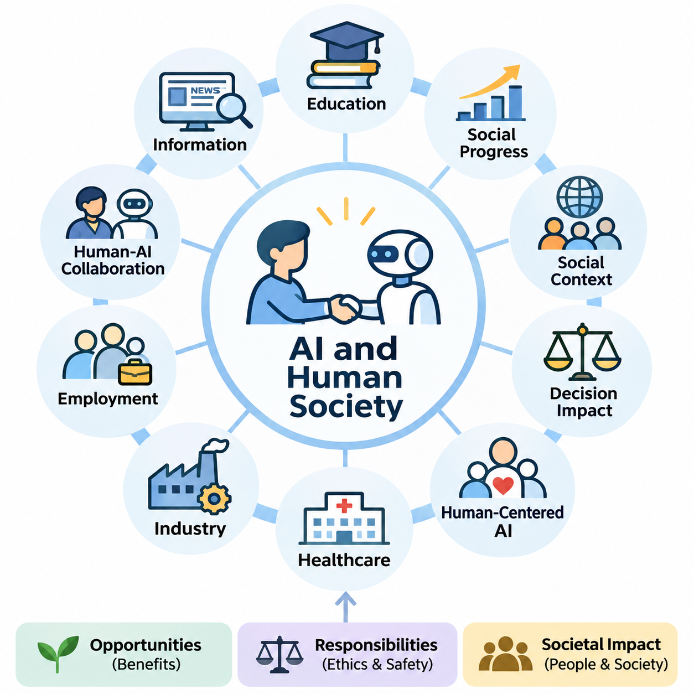
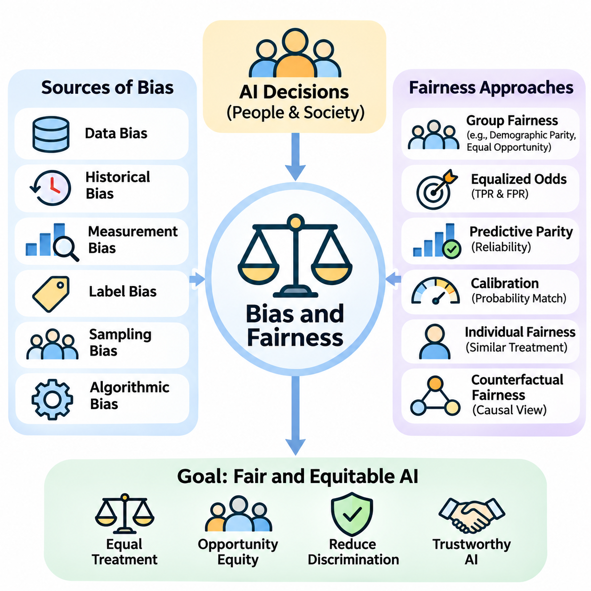
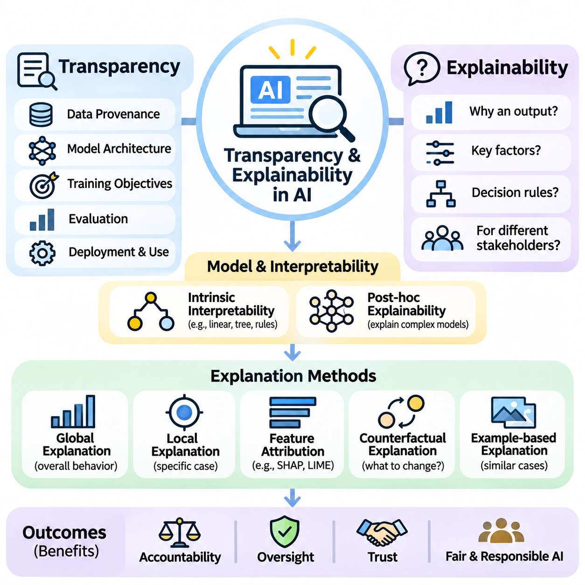
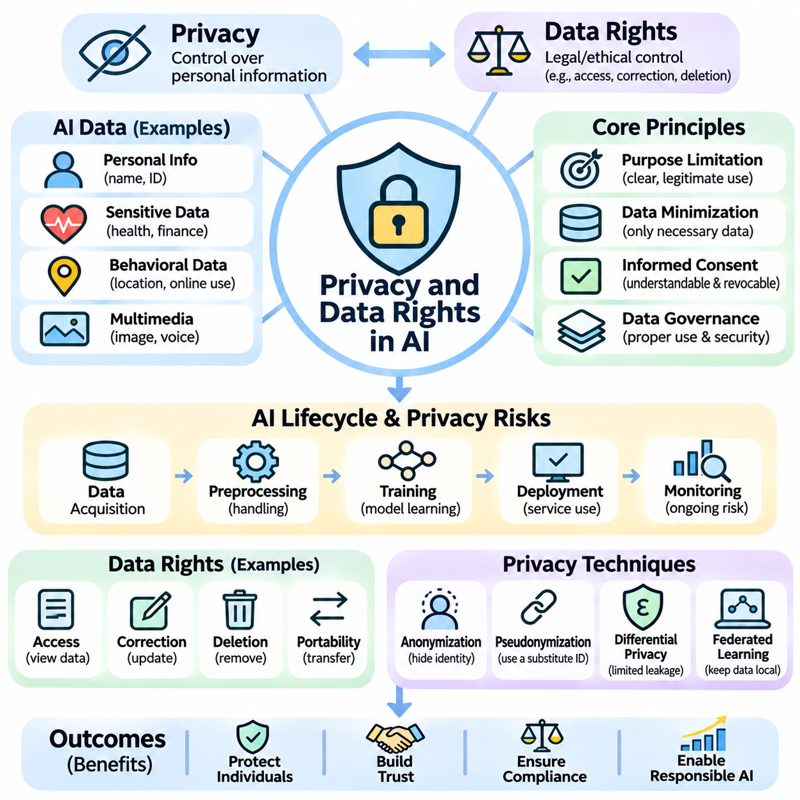
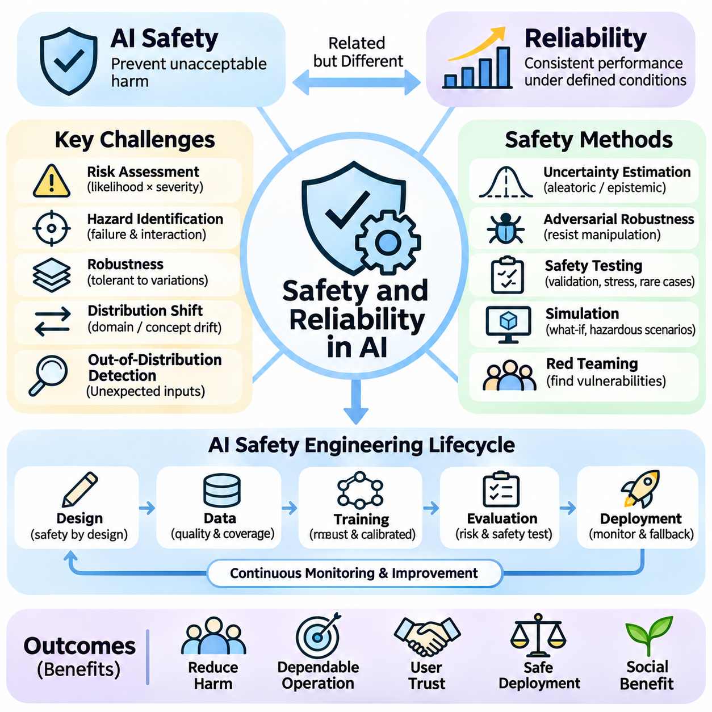
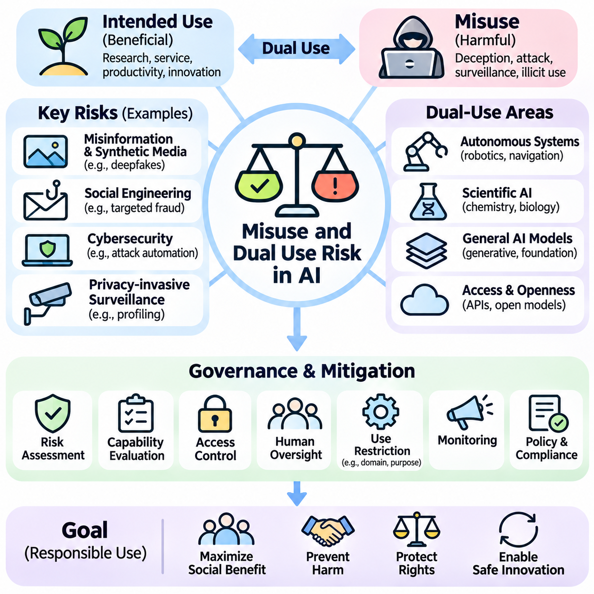
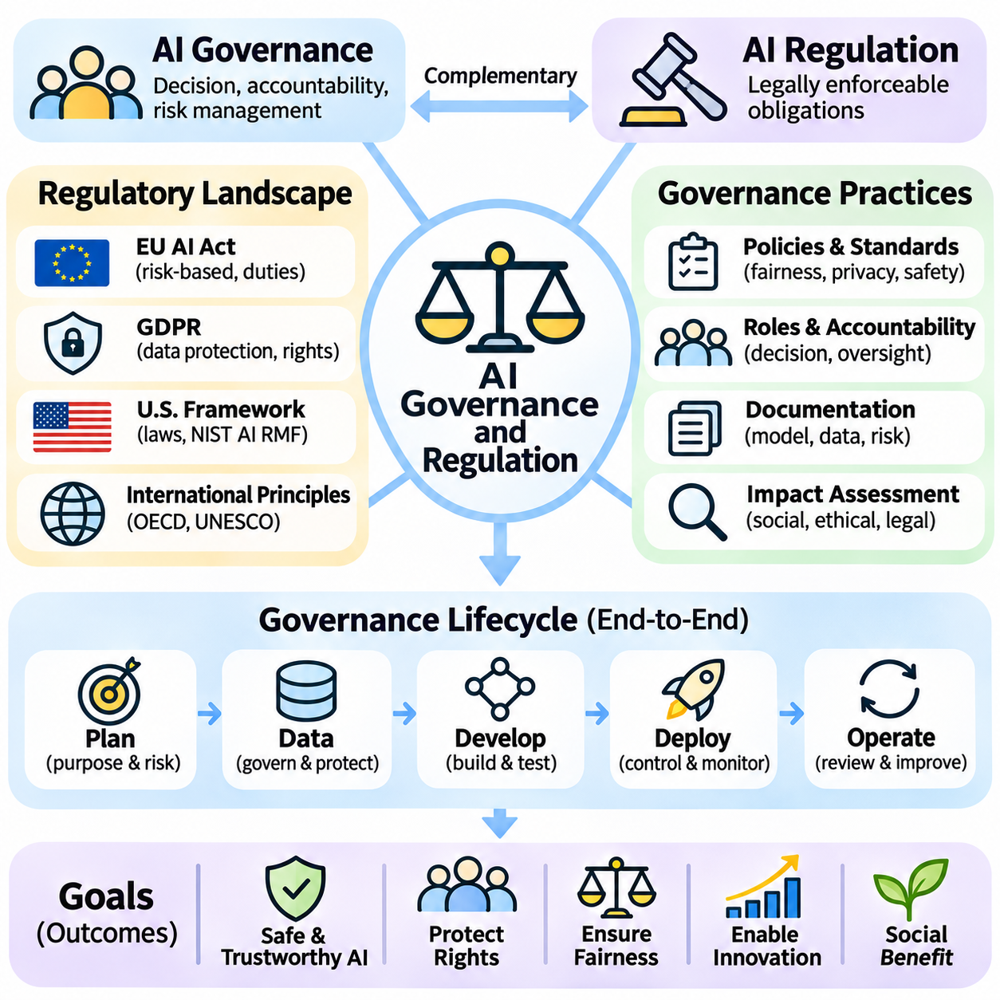
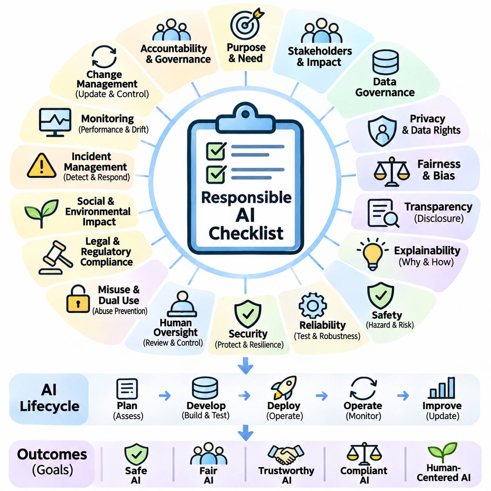

**Volume 04. Artificial Intelligence**

# 10. AI Ethics Safety and Society

## 10.00 AI and Human Society

{width="7.268055555555556in" height="7.268055555555556in"}

Artificial intelligence has become an increasingly influential force in human society, transforming how individuals communicate, work, learn, and make decisions. Unlike conventional software that follows explicitly defined instructions, modern AI systems can recognize patterns, generate information, and support complex reasoning. Their growing capabilities create opportunities for social progress while introducing new responsibilities concerning human welfare.

The relationship between artificial intelligence and society extends beyond technological performance. AI systems operate within environments shaped by cultural values, economic structures, political institutions, and human behavior. Their outputs can influence individual opportunities and collective decisions. Consequently, evaluating AI requires understanding not only computational accuracy but also the social conditions under which intelligent systems are developed and deployed.

Throughout history, technological innovations have transformed social organization by changing how people produce goods, exchange knowledge, and coordinate activities. Artificial intelligence represents another significant transition because it can automate selected cognitive tasks previously performed by humans. This development affects professional expertise, organizational decision-making, and the distribution of economic opportunities across different industries.

One important characteristic of AI is its ability to influence decisions at considerable scale. A recommendation algorithm may shape the information consumed by millions of users, while an automated screening system may affect employment or financial opportunities. Even small systematic errors can produce substantial consequences when repeated across large populations. Social responsibility therefore becomes inseparable from the engineering of reliable AI systems.

Human-centered artificial intelligence emphasizes that technological development should support human capabilities, dignity, and autonomy. Rather than treating computational efficiency as the only objective, human-centered design considers whether systems improve meaningful human outcomes. This perspective encourages developers to evaluate accessibility, usability, informed consent, and the ability of individuals to understand or challenge automated decisions.

Artificial intelligence can contribute significantly to education by providing personalized learning materials, adaptive assessments, and accessible instructional assistance. Intelligent tutoring systems can identify knowledge gaps and recommend appropriate exercises. However, educational benefits depend on instructional quality, equitable access, and responsible data practices. Excessive reliance on automated assistance may also weaken independent reasoning when learning environments are poorly designed.

Healthcare represents another important domain in which AI may improve social welfare. Machine learning systems can assist with medical imaging, clinical documentation, disease-risk estimation, and scientific research. These capabilities may support healthcare professionals and expand access to selected services. Nevertheless, medical decisions involve uncertainty, individual circumstances, and ethical obligations that require rigorous validation and appropriate professional oversight.

In industrial environments, AI supports predictive maintenance, quality inspection, production scheduling, and operational optimization. Intelligent automation can reduce repetitive work and improve consistency in complex manufacturing processes. At the same time, organizations must consider worker safety, changing skill requirements, and the consequences of automated decisions. Successful implementation requires integrating technical improvements with workforce development and organizational accountability.

The relationship between AI and employment is particularly complex because automation can replace certain tasks while creating demand for new capabilities. Some occupations may experience substantial restructuring, whereas others may benefit from AI-assisted productivity. The overall consequences depend on technological adoption, economic conditions, institutional responses, and access to retraining. Employment transitions therefore require coordinated planning rather than assumptions of universal benefit or inevitable displacement.

Human-AI collaboration offers an alternative to viewing intelligent systems exclusively as replacements for human workers. In collaborative environments, AI can process large datasets, identify patterns, and generate recommendations, while humans contribute contextual understanding, ethical judgment, and responsibility. Effective collaboration requires clearly defined authority, appropriate trust calibration, and mechanisms through which human operators can inspect, correct, or reject automated outputs.

The increasing presence of AI in information environments also changes how societies create and interpret knowledge. Search engines, recommendation systems, and generative models influence which information becomes visible and how it is presented. These technologies can improve accessibility and communication, but they may also amplify misinformation or reinforce existing viewpoints. Maintaining trustworthy information ecosystems requires attention to source quality, verification, and media literacy.

Generative artificial intelligence introduces additional challenges because synthetic text, images, audio, and video can closely resemble human-created content. Such systems support creativity, translation, communication, and knowledge production. However, they can also facilitate impersonation, deceptive narratives, and misleading representations. Societies must develop practical methods for establishing provenance, evaluating authenticity, and distinguishing credible evidence from fabricated material.

AI technologies may also influence democratic institutions and public administration. Governments can employ intelligent systems to analyze infrastructure, improve service delivery, and support policy evaluation. Yet automated public decisions can affect fundamental rights and access to essential services. Public-sector AI therefore requires transparency, procedural safeguards, proportionality, and meaningful opportunities for affected individuals to obtain explanations or request reconsideration.

Social inequality presents a major consideration in the distribution of AI benefits. Organizations with substantial computational resources, proprietary datasets, and specialized expertise may gain advantages over smaller institutions. Differences in digital infrastructure and educational access can further widen existing disparities. Inclusive AI development requires attention to affordability, accessibility, language diversity, and the needs of communities that are underrepresented in technological design.

Cultural and linguistic diversity is especially important because AI systems learn from datasets that may not represent all populations equally. Models trained predominantly on widely available languages or dominant cultural perspectives may perform less effectively in other contexts. This limitation can influence communication, education, and public services. Responsible development requires representative evaluation and mechanisms for adapting systems to different social environments.

Privacy is another foundational concern in the relationship between AI and society. Intelligent systems frequently depend on large collections of behavioral, personal, or organizational data. Although such information can improve predictive performance, inappropriate collection or processing may undermine individual autonomy. Privacy-conscious design involves data minimization, access restrictions, secure processing, and clear communication about how information is used.

The societal significance of AI safety increases when intelligent systems interact directly with physical environments. Autonomous vehicles, industrial robots, medical devices, and service robots can produce consequences beyond digital information. Errors in perception, planning, or control may create physical hazards. These applications require systematic risk assessment, operational boundaries, monitoring mechanisms, and dependable human intervention procedures.

Trust plays a central role in the adoption of artificial intelligence. Users are more likely to accept intelligent systems when they demonstrate consistent behavior, communicate limitations, and provide understandable explanations. However, excessive trust can be dangerous when users assume that sophisticated outputs are necessarily correct. Appropriate trust requires balancing confidence in validated capabilities with awareness of uncertainty, failure modes, and changing operating conditions.

Human autonomy must remain a central consideration as AI systems become more capable of recommending or executing actions. Automated assistance can reduce cognitive workload, but it can also encourage passive acceptance of machine-generated judgments. Meaningful human control requires more than providing an interface for approval. Individuals must possess sufficient information, time, authority, and practical ability to intervene when automated recommendations are inappropriate.

Environmental sustainability introduces another dimension of AI\'s social impact. Training and operating computationally intensive models can require substantial electricity, cooling infrastructure, and specialized hardware. Hardware manufacturing and replacement also involve material consumption and electronic waste. Sustainable AI engineering considers energy efficiency, equipment utilization, system lifetime, and the relationship between computational expenditure and measurable social benefit.

The concentration of AI capabilities within a limited number of organizations raises questions about economic power and technological dependence. Control over advanced models, computational infrastructure, and essential data resources can influence market competition and access to innovation. Open research, interoperable technologies, and appropriate competition policies may help broaden participation, although openness must also be balanced against security and misuse risks.

Artificial intelligence also changes the nature of professional responsibility. When an automated system contributes to a harmful outcome, responsibility cannot be assigned solely to the mathematical model. Developers, deployers, operators, and governing institutions may each influence system behavior. Effective accountability requires documented responsibilities, traceable decisions, incident reporting, and organizational processes for identifying and correcting failures.

Public participation is essential because the consequences of AI deployment extend beyond technical specialists and commercial organizations. Workers, educators, researchers, policymakers, and affected communities possess different forms of knowledge about potential benefits and risks. Including these perspectives can reveal problems that conventional technical evaluation overlooks. Participatory approaches can therefore improve the legitimacy and practical relevance of AI governance.

The long-term relationship between humans and artificial intelligence will depend on choices made during system design, institutional adoption, and public oversight. Technological capability alone cannot determine whether AI produces equitable or beneficial outcomes. Societies must continuously evaluate how intelligent systems affect human rights, economic opportunity, safety, and collective well-being while adapting institutions to emerging capabilities.

Ultimately, artificial intelligence should be understood as a sociotechnical system rather than an isolated computational achievement. Its value emerges through interactions among algorithms, data, infrastructure, institutions, and people. A responsible approach combines technical excellence with ethical reflection, democratic accountability, and sustained human oversight. The central objective is to ensure that increasingly capable AI systems contribute to human flourishing while preserving human agency and social trust.

## 10.01 Bias and Fairness

{width="7.268055555555556in" height="7.268055555555556in"}

Bias and fairness are fundamental concerns in artificial intelligence because automated systems increasingly influence decisions affecting individuals, organizations, and communities. Although AI models are often perceived as objective computational mechanisms, their behavior reflects the data, assumptions, and objectives used during development. Consequently, algorithmic decisions may reproduce existing inequalities or introduce new forms of discrimination.

Bias in artificial intelligence refers to systematic patterns that produce distorted predictions, unequal treatment, or disadvantages for particular populations. Such bias may arise even when developers do not intentionally discriminate. Statistical models learn relationships from historical observations, and these observations frequently reflect social inequalities, institutional practices, and incomplete representations of the real world.

Data bias is one of the most common sources of unfair AI behavior. Training datasets may overrepresent certain demographic groups, geographic regions, languages, or socioeconomic conditions while underrepresenting others. When a model learns primarily from dominant populations, its predictions may become less accurate for minority or marginalized groups. Dataset representativeness is therefore essential for equitable model performance.

Historical bias occurs when training data accurately records past decisions that were themselves influenced by discriminatory practices. For example, employment records may reflect unequal hiring opportunities, while lending histories may contain patterns associated with unequal access to financial services. A model trained to reproduce these outcomes can perpetuate historical disadvantages even when its mathematical optimization is technically correct.

Measurement bias emerges when collected variables or labels fail to represent the underlying concepts accurately. Educational achievement, professional competence, and medical risk are complex characteristics that cannot always be measured through simple numerical indicators. If proxy measurements systematically differ across populations, AI systems may generate misleading comparisons and reinforce unequal treatment.

Label bias is particularly important in supervised learning because models depend on target values that represent expected outcomes. Human annotators may apply inconsistent judgments, while institutional records may contain subjective classifications. When labels reflect stereotypes or incomplete information, the model can learn these distortions as predictive patterns. Label quality must therefore be evaluated alongside feature quality.

Sampling bias arises when the process used to collect observations produces a dataset that differs systematically from the population where the model will operate. Online surveys, voluntary participation, and geographically concentrated data collection may exclude important groups. Even large datasets can remain unrepresentative when their collection mechanisms are biased. Dataset size alone does not guarantee fairness.

Algorithmic bias can also emerge from model design, optimization objectives, and decision thresholds. A system optimized exclusively for overall accuracy may favor groups that dominate the training distribution. Similarly, a single classification threshold may produce different error rates across populations. Fairness evaluation must therefore examine how model behavior varies among relevant groups rather than relying solely on aggregate performance.

Fairness in artificial intelligence is a multidimensional concept involving equitable treatment, comparable opportunities, and appropriate distribution of benefits and burdens. Different applications require different interpretations of fairness because social contexts and decision consequences vary. A fair medical screening system may prioritize equitable detection performance, whereas a resource allocation system may emphasize access, need, or procedural consistency.

Group fairness evaluates whether outcomes or performance measures differ systematically among defined populations. Demographic parity, for example, examines whether positive decision rates are comparable across groups. Equal opportunity focuses on comparable true positive rates among individuals who actually satisfy the relevant condition. These definitions capture different ethical objectives and may produce conflicting assessments of the same system.

Equalized odds extends fairness evaluation by considering both true positive rates and false positive rates across groups. Predictive parity examines whether positive predictions have comparable reliability among populations. Calibration assesses whether predicted probabilities correspond to observed outcome frequencies within groups. These criteria cannot always be satisfied simultaneously, particularly when underlying outcome prevalence differs across populations.

Individual fairness emphasizes that similar individuals should receive similar treatment under a task-appropriate definition of similarity. This approach avoids relying exclusively on group-level statistics but introduces challenges in defining relevant characteristics. Two individuals may appear similar according to numerical features while differing in important contextual circumstances. Meaningful individual fairness therefore requires careful consideration of domain knowledge and social values.

Counterfactual fairness examines whether a prediction would remain appropriately unchanged if a protected characteristic were different under a specified causal model. This approach encourages developers to distinguish legitimate causal relationships from discriminatory pathways. However, constructing reliable causal models is difficult because social characteristics interact with education, income, geography, and institutional conditions through complex mechanisms.

Sensitive attributes such as race, gender, age, disability, and other legally protected characteristics require careful consideration in fairness analysis. Simply removing these attributes from training data does not necessarily eliminate discrimination. Other variables, including location, purchasing behavior, or educational history, may act as proxies. Detecting proxy discrimination requires examining correlations, causal relationships, and the broader decision context.

Fairness assessment should begin before model training through systematic examination of the intended application, affected populations, and potential harms. Developers should identify whose interests are represented, which outcomes matter, and how errors affect different stakeholders. This process helps determine appropriate evaluation metrics and acceptable trade-offs. Technical fairness objectives should follow clearly articulated social and operational requirements.

Bias mitigation can occur during data preparation, model training, or postprocessing. Preprocessing approaches may improve representation, adjust sample weights, or address problematic labels. In-processing techniques incorporate fairness-related constraints into optimization. Postprocessing methods modify decision thresholds or outputs to reduce selected disparities. Each approach introduces trade-offs involving accuracy, interpretability, and operational feasibility.

Reweighting techniques adjust the influence of training examples so that underrepresented groups or important cases contribute more strongly to learning. Resampling can similarly alter the distribution of training observations. These approaches may improve selected fairness metrics but cannot automatically correct historical discrimination or invalid labels. Their effectiveness depends on the underlying data-generating process and the fairness objective being pursued.

Fairness-aware optimization incorporates additional constraints or penalties into the model\'s training objective. Instead of minimizing prediction error alone, the learning process also considers disparities between groups. The resulting optimization problem may involve competing objectives, making trade-off analysis necessary. Developers must determine whether performance changes are acceptable given the consequences of incorrect decisions.

Postprocessing approaches can adjust classification thresholds or decision policies after model training. These methods are useful when modifying the underlying model is difficult or when fairness requirements differ across deployment contexts. However, threshold adjustments may create legal, operational, or ethical concerns depending on the application. Their use should be justified through documented objectives and careful evaluation.

Fairness evaluation requires disaggregated performance analysis across relevant demographic and contextual groups. Accuracy, precision, recall, false positive rates, and false negative rates should be examined separately when appropriate and lawful. Intersectional analysis is also important because individuals may experience overlapping disadvantages associated with multiple characteristics. Aggregate statistics can conceal significant disparities within smaller populations.

Statistical uncertainty must be considered when interpreting fairness measurements. Small subgroup samples may produce unstable estimates, while observed differences may reflect sampling variation rather than persistent model behavior. Confidence intervals, appropriate significance assessments, and repeated evaluations can improve interpretation. Fairness conclusions should not rely on isolated numerical comparisons without considering sample quality and uncertainty.

Fairness is not a property that can be established permanently through a single benchmark. Changes in population characteristics, institutional policies, data collection practices, and user behavior can alter model outcomes after deployment. Continuous monitoring is therefore necessary to identify emerging disparities and performance degradation. Responsible maintenance includes periodic reassessment, incident investigation, and corrective interventions.

Human oversight remains essential because mathematical fairness metrics cannot fully represent social justice or determine acceptable outcomes independently. Domain experts, affected communities, legal specialists, and system operators may identify harms that numerical evaluations overlook. Meaningful oversight requires transparent documentation, accessible complaint mechanisms, and procedures for reviewing contested decisions.

Ultimately, bias and fairness should be treated as continuous system-level responsibilities rather than isolated model properties. Equitable AI development combines representative data, appropriate objectives, rigorous evaluation, stakeholder participation, and accountable governance. The goal is not to claim that every algorithm can be perfectly neutral, but to identify unjustified disparities, reduce preventable harms, and ensure that intelligent systems serve people fairly across diverse social contexts.

## 10.02 Transparency and Explainability

{width="7.268055555555556in" height="7.268055555555556in"}

Transparency and explainability are essential principles of responsible artificial intelligence because intelligent systems increasingly influence decisions affecting individuals, organizations, and society. Transparency concerns the visibility of how AI systems are developed, operated, and governed, while explainability concerns the ability to communicate why particular outputs are produced. Together, these principles support accountability, informed oversight, and justified trust.

Modern AI systems often rely on complex mathematical models containing millions or billions of parameters. Although these models can achieve impressive predictive performance, their internal decision processes may be difficult to interpret. This challenge is particularly significant in deep learning, where information is distributed across interconnected computational layers. Understanding model behavior therefore requires methods that extend beyond conventional software inspection.

Transparency encompasses multiple dimensions, including data provenance, model architecture, training objectives, evaluation procedures, and deployment conditions. A transparent AI system provides relevant information about its intended purpose, capabilities, limitations, and operational assumptions. However, transparency does not necessarily require unrestricted disclosure of proprietary information or sensitive data. Appropriate disclosure depends on stakeholder needs, security considerations, and legal obligations.

Explainability focuses on producing understandable accounts of model predictions, recommendations, or actions. An explanation may describe influential input features, relevant decision rules, or the relationships between observed conditions and predicted outcomes. Effective explanations should be accurate, comprehensible, and appropriate for their intended audience. Technical developers, system operators, regulators, and affected individuals may require different levels of detail.

Interpretability and explainability are closely related but conceptually distinct. Interpretability generally refers to the extent to which humans can understand a model\'s internal structure or decision mechanisms. Explainability refers more broadly to methods that communicate or approximate the reasons behind model behavior. A simple decision tree may be directly interpretable, whereas a deep neural network often requires additional explanation techniques.

Intrinsic interpretability is achieved when a model\'s structure is sufficiently understandable without specialized explanatory tools. Linear models, small decision trees, and carefully designed rule-based systems can provide relatively accessible decision mechanisms. Their interpretability depends on factors such as feature complexity, model size, and interactions among variables. Simplicity alone does not guarantee that a model\'s behavior will be understood correctly.

Post-hoc explainability provides explanations after a model has generated predictions. These techniques are particularly relevant to complex models whose internal computations are difficult to inspect directly. Post-hoc methods may estimate feature importance, approximate local decision boundaries, or identify influential training examples. However, explanations generated through approximation may not faithfully represent the complete computational process.

Global explanations describe the general behavior of a model across many observations. They may reveal dominant features, common decision patterns, or relationships between inputs and outputs. Such explanations help developers evaluate whether a system behaves consistently with domain expectations. Nevertheless, global summaries can conceal important variations affecting particular individuals or unusual operating conditions.

Local explanations focus on understanding a specific prediction or decision. For example, an explanation of a loan application result might identify financial variables that contributed most strongly to the model\'s assessment. Local analysis can support individual review and error investigation. However, identifying influential variables does not necessarily establish causal relationships or justify the fairness of the resulting decision.

Feature attribution methods estimate how individual input variables contribute to model outputs. Techniques such as SHAP and LIME are commonly used to provide approximate explanations of complex predictive systems. SHAP assigns contributions using concepts derived from cooperative game theory, while LIME fits a simpler surrogate model around a selected prediction. Both require careful interpretation because their results depend on methodological assumptions.

Gradient-based explanation methods are frequently applied to differentiable neural networks. They examine how changes in input variables relate to changes in model outputs. In computer vision, saliency maps and related techniques can highlight image regions associated with particular predictions. However, visual emphasis does not necessarily demonstrate that highlighted regions represent meaningful causal evidence.

Counterfactual explanations describe how an input might need to change for a model to produce a different outcome. For example, a system may indicate which adjustable financial conditions could alter a credit decision. Such explanations can be actionable when suggested changes are realistic and permissible. Their usefulness depends on feasibility, causal validity, and whether the proposed changes respect relevant constraints.

Example-based explanations communicate model behavior through representative observations, prototypes, or similar historical cases. A medical classification system might present comparable validated examples to support professional review. These approaches can make complex predictions easier to understand through familiar comparisons. However, similarity does not guarantee equivalent outcomes, and example selection can introduce misleading impressions.

Transparency also depends on documenting the datasets used during model development. Dataset documentation should describe collection methods, intended uses, population coverage, labeling procedures, and known limitations. Such information helps reviewers identify potential biases, privacy concerns, and distribution mismatches. Without reliable data documentation, even a technically explainable model may remain difficult to evaluate responsibly.

Model documentation provides another mechanism for communicating system capabilities and limitations. Model cards and similar records can summarize intended applications, evaluation results, known failure modes, and relevant ethical considerations. Documentation should distinguish verified performance from assumptions or untested claims. Maintaining accurate records throughout the model lifecycle supports reproducibility, auditing, and responsible deployment decisions.

Explainability is especially important in high-stakes applications such as healthcare, employment, finance, and public administration. Decisions in these domains may affect fundamental opportunities, safety, or access to essential services. Explanations can support professional judgment, procedural review, and opportunities to contest outcomes. However, explanatory interfaces should not create an illusion of certainty when model predictions remain uncertain.

Human-centered explanations must account for the knowledge and objectives of their audiences. Engineers may require mathematical details, diagnostic metrics, and implementation traces, while affected individuals may need accessible descriptions of relevant factors and available remedies. Excessive technical complexity can reduce practical understanding. Effective explanation design therefore requires communication research, usability evaluation, and stakeholder participation.

A major challenge is explanation faithfulness, which concerns whether an explanation accurately reflects the behavior of the underlying model. A plausible narrative may appear convincing while misrepresenting the actual computation. Researchers therefore evaluate explanation stability, fidelity, and sensitivity to meaningful input changes. Explanations should be treated as evidence requiring validation rather than unquestionable descriptions of internal reasoning.

Transparency and explainability also involve important trade-offs. Detailed disclosures may expose personal information, proprietary methods, or security vulnerabilities. Simplified explanations may improve accessibility while omitting technical qualifications. Organizations must balance openness with privacy, intellectual property protection, and operational security. These tensions require context-sensitive governance rather than a universal disclosure policy.

Generative AI introduces additional explainability challenges because language models produce outputs through distributed statistical computations rather than explicit human-readable reasoning rules. Generated explanations may describe plausible reasoning without revealing the actual mechanisms responsible for an answer. Consequently, fluent justifications should not automatically be treated as faithful accounts of model computation. Independent verification and evidence-based evaluation remain essential.

Agentic AI systems introduce further complexity when models interact with external tools, retrieve information, and execute sequences of actions. Transparency must extend beyond individual model predictions to include tool selection, retrieved evidence, execution histories, and intervention points. Structured logs and traceable workflows can help operators reconstruct system behavior. Such records are particularly important when autonomous actions affect external systems.

Operational transparency requires organizations to communicate when AI is being used, what decisions it influences, and who remains responsible for outcomes. Users should understand whether they are interacting with automated systems and when human review is available. Monitoring, incident reporting, and change management further support accountability. Transparency is therefore an ongoing organizational practice rather than a feature added only during model development.

Ultimately, transparency and explainability should be integrated throughout the AI system lifecycle, from data collection and model design to deployment and continuous monitoring. Their purpose is not merely to produce attractive visual explanations but to enable meaningful understanding, verification, and accountability. Responsible AI systems should provide explanations that are sufficiently faithful, accessible, and useful to support informed human judgment and trustworthy governance.

## 10.03 Privacy and Data Rights

{width="7.268055555555556in" height="7.268055555555556in"}

Privacy and data rights are fundamental concerns in artificial intelligence because intelligent systems increasingly depend on large collections of personal, behavioral, and organizational information. Data enables models to recognize patterns, generate predictions, and personalize services, but its collection and processing may expose individuals to surveillance, discrimination, or unauthorized disclosure. Responsible AI development must therefore protect personal autonomy and establish clear boundaries for information use.

Privacy refers to an individual\'s ability to maintain appropriate control over personal information and exposure to observation. Data rights concern the legal and ethical protections governing how information is collected, processed, shared, retained, and deleted. These concepts are closely connected but not identical. Privacy emphasizes protection against unwanted intrusion, while data rights establish mechanisms through which individuals can exercise control and seek accountability.

Modern AI systems process diverse information, including names, locations, financial records, medical histories, online behavior, images, and voice recordings. Some datasets contain directly identifiable information, while others include indirect identifiers that can become revealing when combined. Even seemingly anonymous records may expose sensitive characteristics through statistical inference. Effective privacy protection therefore requires understanding both explicit identifiers and hidden information relationships.

Personal data collection should follow clearly defined purposes rather than unrestricted accumulation. Purpose limitation requires organizations to identify legitimate reasons for processing information and avoid incompatible secondary uses. Data minimization further encourages collecting only information necessary for a specified task. These principles reduce unnecessary exposure and simplify security management while encouraging developers to distinguish genuinely useful features from excessive data collection.

Informed consent is an important mechanism for respecting individual autonomy, although it is not the only lawful basis for processing personal information. Meaningful consent requires understandable explanations of what data is collected, why it is needed, and how it may be used. Individuals should not be misled through confusing interfaces or excessive legal language. Where consent is the applicable basis, withdrawal mechanisms should be accessible and consistent with relevant legal requirements.

Data ownership is a complex concept because legal rights over information differ across jurisdictions and contexts. Individuals may possess rights of access, correction, deletion, objection, or portability without holding exclusive property ownership over every associated record. Organizations may also have contractual or statutory obligations concerning collected information. Responsible governance should distinguish personal data rights from intellectual property, database rights, and operational responsibilities.

The right of access allows individuals, where applicable, to obtain information about personal data held by an organization and how it is processed. Correction rights support the amendment of inaccurate or incomplete records, while deletion rights may permit removal under specified conditions. Data portability can enable certain information to move between services. The precise scope and exceptions of these rights depend on applicable laws and processing circumstances.

Privacy risks emerge throughout the AI lifecycle, beginning with data acquisition and continuing through preprocessing, training, deployment, and monitoring. Information may be exposed through insecure storage, excessive access permissions, poorly controlled transfers, or unintended model behavior. A lifecycle perspective helps identify vulnerabilities before they become operational incidents. Privacy controls should therefore be integrated into system architecture rather than added after deployment.

Anonymization attempts to prevent individuals from being identified within released or processed datasets. Techniques may remove direct identifiers, generalize attributes, or suppress sensitive combinations. However, anonymization is difficult when datasets contain rich behavioral patterns or can be linked with external information. Re-identification attacks demonstrate that removing names alone does not guarantee anonymity. Privacy claims must therefore consider realistic adversarial capabilities.

Pseudonymization replaces direct identifiers with alternative references while retaining the possibility of re-identification through separately protected information. It can reduce exposure during processing but does not necessarily transform personal data into anonymous data. Secure key management, access restrictions, and separation of identifying information are essential. Developers should distinguish pseudonymization from irreversible anonymization when describing privacy protections.

Differential privacy provides a mathematical framework for limiting how much an algorithm\'s output reveals about the participation of an individual record. It introduces carefully calibrated randomness into statistical computations or learning procedures. Privacy guarantees are commonly expressed through parameters such as epsilon and delta. Stronger privacy protection generally requires trade-offs involving statistical accuracy, model utility, or computational requirements.

Federated learning enables multiple devices or organizations to participate in model training without routinely transferring all raw training data to a central location. Participants compute local updates that contribute to a shared model. However, model updates may still reveal sensitive information through inference attacks. Secure aggregation, differential privacy, and robust communication security may therefore be necessary to strengthen protection in federated environments.

Encryption protects information against unauthorized access during storage and transmission. Encryption at rest secures stored datasets, while encryption in transit protects communications between system components. Advanced techniques such as homomorphic encryption and secure multiparty computation can support selected computations over protected information. Their practical adoption depends on computational overhead, implementation complexity, and application requirements.

Access control is another essential component of privacy-preserving AI infrastructure. Role-based and attribute-based access policies restrict information according to operational responsibilities and contextual conditions. Least-privilege principles ensure that users and services receive only necessary permissions. Authentication, authorization, audit logging, and periodic permission reviews reduce opportunities for unauthorized processing and support organizational accountability.

Machine learning models can unintentionally reveal information from their training datasets. Membership inference attacks attempt to determine whether particular records were included during training, while model inversion attacks seek to reconstruct sensitive attributes or representative inputs. Memorization may also cause generative models to reproduce training content. These risks demonstrate that protecting source datasets alone is insufficient when trained models remain externally accessible.

Privacy-preserving model development requires assessing potential leakage before deployment. Evaluation may include membership inference testing, memorization analysis, adversarial probing, and examination of model outputs. Training procedures can incorporate regularization, privacy-aware optimization, and controlled data retention. No single method eliminates every privacy risk, so layered defenses and repeated testing are necessary throughout development and maintenance.

Data retention policies determine how long personal information remains available after collection. Retaining information indefinitely increases exposure to breaches, unauthorized reuse, and changing legal obligations. Organizations should define retention periods based on legitimate operational needs and applicable requirements. Secure deletion, backup management, and lifecycle documentation help ensure that information is not preserved beyond its justified purpose.

Cross-border data transfers introduce additional challenges because privacy regulations, security expectations, and government access rules vary across jurisdictions. Organizations operating international AI infrastructure must understand where information is stored, processed, and accessed. Appropriate transfer mechanisms, contractual safeguards, and technical protections may be required. Geographic distribution of cloud resources does not eliminate responsibility for lawful data handling.

Privacy impact assessments help organizations identify and evaluate risks associated with personal data processing. Such assessments examine the nature of collected information, processing purposes, affected populations, potential harms, and proposed safeguards. High-risk AI applications may require more formal assessments under applicable regulations. Early evaluation enables developers to modify system designs before privacy vulnerabilities become embedded in operational workflows.

Regulatory frameworks establish important obligations concerning personal information. The European Union\'s General Data Protection Regulation provides principles and individual rights for covered processing activities, while other jurisdictions maintain distinct privacy laws. Compliance requires identifying applicable requirements rather than assuming one global standard. Legal obligations should be complemented by technical safeguards, organizational accountability, and ethical consideration.

Privacy also intersects with fairness, transparency, and security. Sensitive demographic information may be necessary for evaluating discriminatory outcomes, yet collecting it introduces additional privacy obligations. Explainability mechanisms may expose personal attributes if disclosures are poorly designed. Security controls protect confidentiality but do not independently establish lawful or fair processing. Responsible AI governance must therefore balance these objectives through context-sensitive decisions.

Ultimately, privacy and data rights should be treated as foundational requirements of trustworthy AI rather than obstacles to innovation. Effective protection combines purposeful collection, limited retention, secure infrastructure, privacy-enhancing technologies, transparent governance, and meaningful individual rights. The objective is to enable beneficial intelligence while preventing unnecessary surveillance, unauthorized exploitation, and avoidable harm to human dignity and autonomy.

## 10.04 Safety and Reliability

{width="7.268055555555556in" height="7.268055555555556in"}

Safety and reliability are fundamental requirements of artificial intelligence because intelligent systems increasingly influence decisions and actions with real-world consequences. AI safety focuses on preventing unacceptable harm, while reliability concerns consistent performance under specified operating conditions. These objectives are closely related but distinct. A system may produce accurate predictions under normal circumstances yet become unsafe when unexpected conditions arise.

AI safety extends beyond conventional software correctness because learning-based systems derive behavior from data rather than exclusively from explicit programming rules. Their responses may change when inputs differ from training distributions or when environmental conditions evolve. Consequently, successful testing on historical datasets does not guarantee dependable operation in deployment. Safety engineering must consider uncertainty, operational boundaries, and potential consequences of failure.

Reliability describes the ability of an AI system to perform its intended functions consistently over time and across defined conditions. Relevant measurements may include error rates, availability, failure frequency, and recovery performance. Reliability requirements depend on application context. A recommendation engine may tolerate occasional inaccuracies, whereas an autonomous vehicle or medical monitoring system requires much stronger assurance against harmful failures.

Risk assessment provides a structured foundation for AI safety engineering. Risk generally combines the likelihood of an undesirable event with the severity of its consequences. Developers identify hazards, analyze possible failure scenarios, and establish mitigation measures. Techniques such as failure mode and effects analysis and fault tree analysis can support systematic investigation. However, statistical risk estimates must account for uncertainty and incomplete evidence.

Hazard identification should begin during system design rather than after deployment. Potential hazards may originate from incorrect predictions, sensor failures, communication interruptions, software defects, or inappropriate human interaction. In physical AI systems, perception errors can propagate into planning and control decisions. A comprehensive hazard analysis therefore examines interactions among algorithms, hardware, operators, and operating environments.

Robustness refers to a model\'s ability to maintain acceptable performance despite variations in inputs or operating conditions. Real-world data may contain noise, missing values, sensor distortions, or unexpected patterns. A robust model should tolerate reasonable disturbances without producing disproportionate errors. Robustness evaluation requires testing across representative variations rather than relying only on clean benchmark datasets.

Distribution shift occurs when deployment data differs from the information encountered during training. Changes in lighting, weather, equipment, user behavior, or population characteristics can degrade predictive performance. Domain shift and concept drift represent different forms of this challenge. Monitoring input distributions and model outcomes helps identify emerging mismatches, although detecting every meaningful shift remains difficult.

Out-of-distribution detection attempts to identify inputs that differ substantially from the model\'s expected operating domain. Such mechanisms can trigger warnings, additional verification, or fallback procedures. However, detection methods are imperfect and may fail to recognize unfamiliar conditions. Safety-critical systems should therefore avoid assuming that every unexpected input can be detected reliably before it influences downstream decisions.

Uncertainty estimation helps distinguish confident predictions from cases requiring additional review. Aleatoric uncertainty reflects variability inherent in observations, while epistemic uncertainty concerns limitations in model knowledge. Calibration evaluates whether predicted confidence corresponds to observed correctness. Well-calibrated uncertainty can support safer decisions, but confidence estimates should not be interpreted as guarantees of accuracy.

Adversarial robustness addresses failures caused by deliberately manipulated inputs. Small perturbations, deceptive instructions, or maliciously constructed observations may alter model behavior unexpectedly. In computer vision, adversarial examples can influence classification results, while language-based systems may encounter prompt injection attacks. Defensive strategies include adversarial testing, input validation, access controls, and carefully designed operational safeguards.

Safety testing should combine conventional validation with stress testing, scenario analysis, and targeted examination of rare events. Average benchmark accuracy may conceal dangerous failures affecting uncommon but consequential situations. Developers should evaluate boundary conditions, degraded sensor inputs, unexpected user actions, and combinations of component faults. Test coverage must reflect operational hazards rather than simply maximizing the number of evaluated examples.

Simulation provides a controlled environment for examining hazardous scenarios without exposing people or equipment to unnecessary danger. Digital environments can reproduce unusual traffic conditions, sensor disturbances, communication failures, and complex interactions among autonomous agents. Nevertheless, simulation models cannot perfectly reproduce physical reality. Differences between simulated and real environments require validation through carefully controlled physical testing.

Red teaming involves structured attempts to discover vulnerabilities, unsafe behaviors, and unintended capabilities before adversaries or ordinary users encounter them. Evaluation teams may construct challenging prompts, manipulate environmental assumptions, or probe system boundaries. Findings should be documented and translated into corrective actions. Red teaming complements formal testing but cannot establish that every possible failure mode has been discovered.

Fail-safe design ensures that systems respond appropriately when normal operation cannot be maintained. Depending on the application, a safe response may involve stopping movement, rejecting a command, reducing functionality, or transferring control to a qualified operator. Graceful degradation allows limited operation when certain components fail. Effective fallback behavior must be explicitly defined, tested, and matched to the system\'s physical and operational constraints.

Redundancy can improve reliability by providing alternative sensing, computation, communication, or control capabilities. Multiple sensors may help detect inconsistent observations, while backup controllers can support recovery from hardware failures. However, redundant components may share common failure causes, including software defects or environmental disturbances. Independence, fault detection, and recovery procedures are therefore as important as component duplication.

Human oversight remains essential in applications where AI errors may cause substantial harm. Human-in-the-loop systems require approval before selected actions, while human-on-the-loop arrangements emphasize supervision and intervention. Oversight is effective only when operators possess sufficient information, authority, and response time. Poorly designed interfaces or excessive automation can undermine human control even when intervention mechanisms technically exist.

Safety assurance requires evidence that identified risks have been reduced to acceptable levels for a defined application. Assurance cases organize claims, supporting arguments, and verification evidence into a structured justification. Relevant evidence may include testing results, hazard analyses, design reviews, and operational procedures. Assurance should communicate residual uncertainty rather than implying that complex AI systems can be proven universally safe.

Monitoring after deployment is necessary because operational environments, data distributions, and user behavior change over time. Organizations should track performance indicators, abnormal outputs, incidents, and near misses. Logging and traceability support investigation and corrective maintenance. Monitoring systems must also distinguish genuine safety concerns from harmless fluctuations to avoid overwhelming operators with unnecessary alerts.

Model updates introduce additional safety challenges because retraining, fine-tuning, or replacing components can alter previously validated behavior. A modification intended to improve accuracy may unexpectedly affect robustness or decision boundaries. Regression testing, version control, staged deployment, and rollback mechanisms help manage these risks. Significant changes should trigger renewed safety evaluation before unrestricted operational use.

Security and safety are interconnected because unauthorized access or malicious interference can create hazardous system behavior. Compromised sensors, manipulated data, or unauthorized commands may undermine otherwise reliable AI components. Secure development practices, authentication, software integrity checks, and protected communication channels therefore contribute to safety. Security controls must be integrated into the broader system risk management process.

Organizational responsibility is as important as technical protection. Safety governance should define decision authority, escalation procedures, incident reporting obligations, and criteria for suspending unsafe operations. Engineers, operators, management, and independent reviewers may hold different responsibilities. Clear documentation and accountability help ensure that identified hazards receive timely attention rather than remaining unresolved across organizational boundaries.

Ultimately, safety and reliability must be engineered throughout the AI lifecycle, from requirements and architecture to training, validation, deployment, and maintenance. No individual algorithm, benchmark, or safeguard can eliminate every source of failure. Trustworthy AI depends on layered defenses, realistic testing, continuous monitoring, and meaningful human accountability. The objective is to deliver useful intelligent behavior while keeping foreseeable risks within justified operational limits.

## 10.05 Misuse and Dual Use Risk

{width="7.268055555555556in" height="7.268055555555556in"}

Misuse and dual-use risk are major concerns in artificial intelligence because technologies developed for beneficial purposes can also enable harmful activities. AI systems support research, communication, automation, and scientific discovery, but similar capabilities may facilitate deception, surveillance, or malicious operations. Responsible development therefore requires evaluating not only intended applications but also foreseeable ways in which capabilities could be exploited.

AI misuse occurs when individuals or organizations deliberately employ intelligent systems for harmful, deceptive, unauthorized, or unlawful purposes. Dual-use risk describes the possibility that the same technology can support both legitimate and harmful applications. These concepts overlap but are not identical. A general-purpose model may be designed responsibly while still providing capabilities that malicious actors attempt to repurpose.

The dual-use nature of AI arises from the flexibility and scalability of machine learning systems. Capabilities such as language generation, pattern recognition, optimization, and autonomous planning are useful across many domains. However, their broad applicability makes strict separation between beneficial and harmful uses difficult. Risk assessment must therefore consider user intentions, deployment environments, accessibility, and potential downstream consequences.

Generative AI introduces significant concerns involving misinformation and deceptive content. Language models can produce convincing articles, messages, and fabricated narratives at relatively low cost. Image, audio, and video generation can also create synthetic media that resembles authentic recordings. These capabilities support creativity and accessibility but may also undermine information integrity when used to impersonate individuals or manipulate public understanding.

Deepfakes illustrate how synthetic media can create dual-use challenges. The underlying technology can support entertainment, education, accessibility, and legitimate content production. Yet deceptive applications may involve identity impersonation, reputational damage, or fabricated evidence. Effective responses combine technical detection, content provenance mechanisms, public awareness, and procedures for reporting harmful material rather than assuming that detection alone will eliminate misuse.

AI-assisted social engineering is another important risk because automated systems can personalize deceptive communications. Malicious actors may use language generation to create persuasive fraudulent messages or imitate familiar communication styles. The resulting harm depends on deployment context, access to personal information, and the effectiveness of organizational defenses. Security awareness, identity verification, and communication safeguards help reduce exposure.

Cybersecurity demonstrates the complex relationship between beneficial and harmful AI capabilities. Machine learning can improve threat detection, anomaly analysis, vulnerability prioritization, and incident response. Similar analytical capabilities may also be misused to support malicious reconnaissance or automate selected stages of cyberattacks. Responsible security research requires controlled testing, appropriate authorization, and safeguards against distributing unnecessarily actionable harmful techniques.

Privacy-invasive surveillance represents another potential misuse of AI. Computer vision, biometric recognition, behavioral analytics, and large-scale data integration can support legitimate security or accessibility functions. However, these technologies may also enable intrusive monitoring, unauthorized profiling, or discriminatory targeting. Risk evaluation should consider consent, proportionality, legal authority, data retention, and the possibility of function creep.

Function creep occurs when a system originally introduced for a limited purpose gradually expands into additional uses without adequate review or authorization. For example, analytical tools deployed for operational efficiency may later be used for intrusive employee monitoring. Such changes can alter the balance between organizational benefits and individual rights. Clear purpose limitations, governance reviews, and transparent change procedures help prevent unjustified expansion.

Autonomous systems create distinctive dual-use concerns because AI decisions can produce direct physical consequences. Navigation, object recognition, and robotic coordination support manufacturing, logistics, disaster response, and exploration. The same general capabilities may be redirected toward harmful physical activities. Safety controls, restricted operating domains, human authorization, and appropriate access management become particularly important when systems can act independently.

Scientific AI also presents dual-use challenges. Models that accelerate chemical discovery, biological research, and materials engineering can contribute to medicine and industrial innovation. However, certain capabilities may increase access to knowledge or processes associated with hazardous applications. Responsible research requires proportionate safeguards, expert review, controlled access where justified, and careful consideration of what technical information should be released.

Dual-use risk is influenced by the accessibility of AI capabilities. Openly available models, application programming interfaces, specialized tools, and inexpensive computing resources can expand legitimate participation in innovation. They may also reduce barriers for harmful actors. Restricting access can reduce some risks but may also limit beneficial research and independent scrutiny. Governance decisions must therefore evaluate both the benefits of openness and the consequences of unrestricted availability.

Capability evaluation is an important component of misuse prevention. Developers should investigate whether models can meaningfully assist harmful tasks, bypass restrictions, or operate effectively in dangerous contexts. Evaluations should focus on realistic threat models and measurable capabilities rather than speculative assumptions. Testing procedures must themselves be designed carefully so that assessment activities do not unnecessarily create or disseminate harmful operational knowledge.

Threat modeling identifies potential adversaries, their objectives, available resources, and plausible pathways to misuse. Different threats may involve individual fraudsters, organized criminal groups, malicious insiders, or sophisticated institutional actors. Their capabilities and incentives vary considerably. Effective defenses therefore require prioritizing credible scenarios and distinguishing low-probability possibilities from risks supported by evidence.

Risk mitigation can be implemented through model design, access management, monitoring, and organizational policy. Safety-oriented training may reduce assistance with harmful requests, while authentication and rate limits can constrain abusive usage patterns. Additional measures include anomaly detection, abuse reporting, and selective restrictions on sensitive capabilities. These controls should be evaluated for effectiveness because determined adversaries may attempt to circumvent them.

Defense in depth recognizes that no single safeguard can prevent every form of AI misuse. Model-level restrictions may fail under adversarial prompting, while application-level controls may be bypassed through compromised credentials or external integrations. Combining technical barriers, operational monitoring, human review, and incident response reduces dependence on individual protections. Safeguards should reflect the severity and likelihood of anticipated harm.

Responsible disclosure is especially important when researchers discover dangerous capabilities or vulnerabilities. Publishing every technical detail immediately may expose systems or communities to avoidable risks. Conversely, excessive secrecy can prevent independent verification and public accountability. Coordinated disclosure processes seek to balance scientific openness with sufficient time for remediation, stakeholder notification, and implementation of protective measures.

Misuse prevention also depends on understanding downstream deployment. A model provider may impose restrictions, but third-party developers can integrate the technology into applications with different incentives and safeguards. Risks may emerge through tool connections, autonomous workflows, or combinations of individually harmless components. Evaluating system-level interactions is therefore necessary alongside assessment of isolated model capabilities.

Governance frameworks should assign clear responsibilities across the AI supply chain. Model developers, infrastructure providers, application operators, and deploying organizations influence different aspects of risk. Contracts, acceptable-use policies, auditing procedures, and incident escalation mechanisms can establish operational expectations. Accountability requires more than written policies; organizations must demonstrate that safeguards are implemented and maintained.

International coordination matters because AI capabilities, digital services, and misuse activities frequently cross national boundaries. Regulatory requirements and enforcement capabilities differ across jurisdictions, complicating consistent oversight. Cooperation among governments, researchers, industry, and civil society can support shared evaluation practices and responsible information exchange. Such coordination should respect human rights while addressing credible cross-border threats.

Education and public resilience complement technical misuse prevention. Individuals who understand synthetic media, automated deception, and information verification are better equipped to recognize suspicious content. Organizations can strengthen resilience through staff training, authentication procedures, and established reporting channels. Public awareness should encourage informed skepticism without creating generalized distrust of legitimate digital information.

Ultimately, misuse and dual-use risk must be addressed throughout the AI lifecycle rather than treated as exceptional problems after deployment. Responsible governance combines capability assessment, threat modeling, proportionate restrictions, monitoring, disclosure practices, and continuous reassessment. The objective is to preserve the scientific and social benefits of AI while reducing opportunities for deliberate harm and ensuring accountability for foreseeable misuse.

## 10.06 AI Governance and Regulation

{width="7.268055555555556in" height="7.268055555555556in"}

AI governance and regulation establish the principles, responsibilities, and institutional mechanisms needed to guide the development and deployment of artificial intelligence. Governance concerns how organizations make decisions, assign accountability, and manage risks, while regulation establishes legally enforceable obligations. Together, they seek to ensure that AI systems remain beneficial, trustworthy, and consistent with societal values.

AI governance extends beyond compliance with legislation because many ethical and operational challenges arise before formal legal requirements become applicable. Organizations must establish internal policies addressing fairness, privacy, transparency, safety, and human oversight. Effective governance connects these principles to engineering practices, management decisions, and operational controls rather than treating responsible AI as a separate administrative activity.

Regulatory approaches differ across jurisdictions because governments balance innovation, economic competitiveness, individual rights, and public safety differently. Some frameworks establish comprehensive AI-specific obligations, while others rely on existing privacy, consumer protection, product safety, and sector-specific laws. International organizations also publish voluntary principles and technical guidance. Understanding these distinctions is essential for organizations operating across borders.

Risk-based regulation applies different levels of oversight according to the potential consequences of an AI application. Systems affecting employment, education, healthcare, critical infrastructure, or fundamental rights may require stronger safeguards than low-impact applications. Risk classification considers intended purposes, operating contexts, and foreseeable harms. However, classifications must be reviewed when system capabilities or deployment conditions change.

The European Union AI Act provides an important example of a risk-based regulatory framework. It distinguishes prohibited practices, high-risk applications, transparency obligations, and requirements concerning certain general-purpose AI models. High-risk systems may face obligations involving risk management, documentation, data governance, human oversight, and monitoring. Applicable duties and implementation timelines depend on the relevant provisions and organizational roles.

The General Data Protection Regulation addresses personal data processing that may occur during AI development and operation. Its principles include lawfulness, fairness, transparency, purpose limitation, data minimization, and accountability. Certain automated decisions may also trigger specific protections for affected individuals. Compliance requires examining the actual processing activities rather than assuming that using AI automatically creates identical legal obligations.

In the United States, AI oversight involves a combination of federal and state laws, sector-specific requirements, agency enforcement, and voluntary standards. The National Institute of Standards and Technology AI Risk Management Framework offers guidance for identifying, measuring, managing, and governing AI risks. Although voluntary in itself, such guidance can inform organizational controls, procurement expectations, and contractual requirements.

International principles help establish common expectations despite differences in national legislation. The Organisation for Economic Co-operation and Development promotes principles concerning trustworthy AI, human rights, transparency, robustness, and accountability. UNESCO emphasizes ethical considerations, human dignity, and societal impacts. These frameworks encourage cooperation but do not automatically create identical binding obligations across jurisdictions.

Corporate AI governance requires clearly defined roles and decision-making authority. Senior leadership establishes risk tolerance and organizational priorities, while engineering teams implement technical controls. Legal, security, privacy, and compliance specialists evaluate relevant obligations and operational exposure. Independent review functions can challenge assumptions and assess evidence. Effective accountability requires identifying who approves deployment and who can suspend unsafe operations.

AI governance should begin with an inventory of systems, models, datasets, and external services. Organizations need to understand where AI is used, which decisions it influences, and what dependencies it introduces. Classification procedures can identify applications requiring enhanced scrutiny. Maintaining current records supports audits, incident investigations, and change management while reducing the likelihood of unmanaged or unauthorized AI deployments.

Documentation provides evidence that governance requirements have been translated into operational practices. Model cards, dataset records, risk assessments, evaluation reports, and deployment logs describe system capabilities and limitations. Traceability links requirements to design choices, testing results, and corrective actions. Documentation should remain accurate throughout the lifecycle because outdated records can undermine both accountability and regulatory compliance.

Algorithmic impact assessments examine how AI systems may affect individuals, communities, and institutions. They consider potential discrimination, privacy violations, safety failures, and restrictions on meaningful human choice. Assessments should evaluate both intended benefits and foreseeable negative outcomes. Where appropriate, consultation with affected stakeholders can reveal risks overlooked by technical teams and improve the legitimacy of governance decisions.

Human oversight is a recurring regulatory and ethical requirement, particularly in consequential applications. Oversight mechanisms may include approval checkpoints, escalation procedures, appeal channels, and authority to override automated outputs. Effective oversight requires meaningful information and sufficient intervention time. Merely placing a human within an automated workflow does not guarantee responsible control if the person cannot understand or challenge the system.

Transparency obligations may require organizations to disclose when individuals interact with AI or encounter certain synthetic content. Other contexts may require information about system purposes, limitations, or automated decision processes. The appropriate disclosure depends on applicable law and the nature of the application. Transparency should provide actionable understanding rather than overwhelming users with technical details that do not support informed decisions.

Auditing and independent evaluation strengthen confidence that AI governance operates as intended. Internal audits assess adherence to policies, while external reviews may examine compliance, security, fairness, or safety claims. Evidence can include testing records, access logs, incident reports, and management decisions. Audit findings should lead to corrective actions with assigned responsibilities, deadlines, and verification of completion.

Third-party AI services create governance challenges because organizations may depend on models or infrastructure they do not directly control. Procurement reviews should examine provider documentation, contractual protections, security practices, data handling, and incident notification procedures. Responsibility must be allocated across developers, integrators, and deployers. Outsourcing technical components does not automatically eliminate an organization\'s obligations to affected users.

Regulatory compliance must also account for system evolution. Retraining, fine-tuning, integration with external tools, or expansion into new applications can change risk profiles and legal responsibilities. Change management procedures should determine when additional testing, documentation, or approval is required. Continuous monitoring helps detect emerging problems, while rollback and suspension mechanisms support timely intervention when unacceptable risks appear.

Incident reporting and redress mechanisms are essential for accountability. Organizations should define how safety failures, discriminatory outcomes, privacy breaches, and other harmful events are identified, investigated, and escalated. Affected individuals may require accessible complaint or appeal procedures. Incident analysis should examine organizational decisions and technical causes, enabling corrective improvements rather than focusing exclusively on individual mistakes.

Regulation can support public trust, but excessive complexity or inconsistent requirements may impose substantial burdens on smaller organizations. Policymakers must consider proportionality, technological neutrality, enforcement capacity, and opportunities for innovation. Regulatory sandboxes and supervised experimentation can provide controlled environments for evaluating emerging applications. Such mechanisms should preserve appropriate protections while enabling evidence-based policy development.

International AI deployment introduces challenges involving jurisdiction, cross-border data flows, technical standards, and conflicting legal obligations. Organizations may need to satisfy multiple regulatory systems simultaneously. Harmonized standards and mutual recognition arrangements can reduce unnecessary duplication, although complete global uniformity remains unlikely. Governance architectures should therefore support jurisdiction-specific requirements without compromising fundamental safety and accountability principles.

Responsible governance also requires participation beyond governments and technology providers. Researchers, civil society organizations, workers, consumers, and affected communities contribute perspectives on social consequences and acceptable risks. Public consultation can improve legitimacy and reveal overlooked impacts. Governance should remain adaptable because technological capabilities, societal expectations, and regulatory interpretations evolve over time.

Ultimately, AI governance and regulation provide complementary mechanisms for aligning technological progress with human rights, public safety, and institutional accountability. Effective implementation combines clear responsibilities, risk assessment, documentation, oversight, auditing, and continuous improvement. The objective is not merely to satisfy legal requirements but to establish durable practices that enable beneficial AI innovation while preventing foreseeable harm.

## 10.07 Responsible AI Checklist

{width="7.268055555555556in" height="7.268055555555556in"}

Responsible AI requires a systematic approach to ensuring that artificial intelligence systems are developed, deployed, and maintained in ways that respect human rights, safety, fairness, and accountability. A responsible AI checklist translates broad ethical principles into practical engineering and organizational activities. Rather than serving as a one-time approval document, it should guide decisions throughout the AI lifecycle and provide evidence that important risks have been examined.

The first consideration is whether the proposed AI application has a legitimate and clearly defined purpose. Developers should identify the problem being addressed, expected benefits, affected populations, and possible negative consequences. They should also determine whether AI is necessary or whether simpler methods could achieve comparable results. A justified application begins with a documented objective and an explicit understanding of its social and operational context.

Stakeholder identification is essential because AI systems can affect individuals who never directly interact with them. Developers should identify users, operators, decision subjects, vulnerable populations, and organizations exposed to system outcomes. Consultation helps reveal overlooked requirements and conflicting expectations. Responsible design considers both intended beneficiaries and people who may experience unintended disadvantages or exclusion.

Data governance should verify that training, validation, and operational datasets are collected and processed appropriately. Relevant checks include lawful acquisition, documented provenance, purpose limitation, data minimization, and retention controls. Dataset quality must also be examined for missing values, labeling errors, outdated records, and inappropriate representation. Poor data governance can undermine fairness, reliability, and legal compliance simultaneously.

Privacy assessment should determine whether personal or sensitive information is necessary for the intended application. Organizations should evaluate consent or other lawful processing grounds, access restrictions, encryption, anonymization, and deletion procedures. Potential information leakage through model outputs must also be considered. Privacy protection should extend across data collection, training, inference, logging, and third-party integrations.

Fairness evaluation should identify whether model performance or decisions differ unjustifiably across relevant populations. Appropriate demographic groups and fairness metrics depend on the application and its legal context. Developers should examine representation, historical bias, error distributions, and potential discriminatory outcomes. Fairness cannot be guaranteed by a single numerical score, so quantitative testing should be complemented by contextual review.

Transparency requires clear communication about the system\'s purpose, capabilities, limitations, and appropriate operating conditions. Users should understand when AI contributes to decisions and when outputs require independent verification. Documentation may include model cards, dataset descriptions, and operational instructions. Transparency should be proportionate to stakeholder needs and should not disclose sensitive information unnecessarily.

Explainability assessment examines whether important model outputs can be understood sufficiently for their intended use. The necessary level of explanation depends on decision consequences and stakeholder responsibilities. Feature attribution, interpretable models, and case-specific explanations may support investigation and review. However, explanations should be tested for faithfulness because plausible descriptions do not necessarily represent actual model behavior.

Safety evaluation begins with identifying foreseeable hazards and assessing their likelihood and severity. Developers should examine incorrect predictions, unexpected interactions, component failures, and potentially harmful automated actions. High-consequence applications require stronger verification and operational restrictions. Safety requirements should define acceptable behavior, prohibited conditions, and procedures for responding when system confidence or performance becomes inadequate.

Reliability testing should establish whether the system performs consistently under representative operating conditions. Evaluation should include accuracy, robustness, availability, recovery behavior, and performance under degraded inputs. Distribution shifts and rare but consequential scenarios deserve particular attention. Testing results should be compared against predefined acceptance criteria rather than interpreted solely through average benchmark performance.

Security assessment should address threats to data, models, infrastructure, and connected tools. Organizations should evaluate authentication, authorization, software integrity, secure communication, vulnerability management, and incident response. Adversarial inputs and unauthorized model access may introduce additional risks. Security testing should consider realistic attack pathways while avoiding the unnecessary exposure of sensitive technical details.

Human oversight should be matched to the consequences of automated decisions. Responsible systems provide appropriate opportunities for approval, intervention, correction, or appeal. Operators require understandable information, sufficient authority, and realistic response time. An oversight mechanism is ineffective when human reviewers cannot recognize failures or meaningfully challenge outputs. Responsibilities for final decisions should be explicitly assigned.

Misuse assessment should examine whether system capabilities could support deception, surveillance, unauthorized access, or harmful physical actions. Developers should identify credible threat actors and foreseeable misuse scenarios. Depending on risk, safeguards may include capability restrictions, controlled access, monitoring, and abuse reporting. Dual-use evaluation should balance beneficial innovation against the potential consequences of unrestricted deployment.

Legal and regulatory review should identify requirements applicable to the system\'s jurisdiction, sector, and intended purpose. Relevant obligations may involve privacy, consumer protection, product safety, employment, accessibility, or AI-specific legislation. Compliance responsibilities should be documented and assigned. Because regulations and interpretations evolve, legal assessment must be revisited when applications, operating environments, or organizational roles change.

Documentation and traceability should connect system requirements to design decisions, data sources, evaluation results, and deployment approvals. Records should identify model versions, known limitations, residual risks, and responsible personnel. Traceable evidence supports auditing, incident investigation, and reproducibility. Documentation must remain current because changes to models, datasets, or infrastructure can invalidate earlier assessments.

Deployment readiness requires confirming that identified risks have been addressed or explicitly accepted by authorized decision-makers. Operational procedures should define monitoring responsibilities, access permissions, escalation routes, and fallback behavior. Staged deployment can reveal problems before unrestricted release. Systems should not enter high-consequence environments merely because laboratory evaluations demonstrate promising accuracy.

Continuous monitoring is necessary because real-world conditions change after deployment. Organizations should track model performance, data drift, harmful outcomes, security events, and user complaints. Alert thresholds and review procedures help distinguish meaningful deterioration from ordinary variation. Monitoring findings should trigger investigation, corrective action, or suspension when necessary. Responsible AI therefore requires ongoing operational evidence rather than static certification.

Change management should ensure that retraining, fine-tuning, software updates, and new integrations do not introduce unexamined risks. Significant modifications may require renewed fairness, privacy, safety, and security evaluations. Version control, regression testing, staged rollout, and rollback procedures support controlled evolution. Previously approved systems should not automatically retain their approval when capabilities or operating assumptions materially change.

Incident management should establish procedures for detecting, reporting, investigating, and correcting harmful system behavior. Organizations need clear escalation authority and mechanisms for notifying affected stakeholders when appropriate. Root-cause analysis should consider technical defects, organizational decisions, and human-system interactions. Lessons from incidents and near misses should inform future design, training, and governance improvements.

Accountability requires assigning ownership for every significant stage of the AI lifecycle. Product leaders, engineers, data specialists, security teams, legal advisers, and operational managers may hold different responsibilities. Independent review can provide additional assurance for high-risk applications. Governance should identify who approves risk acceptance, who monitors outcomes, and who has authority to stop deployment when safeguards prove insufficient.

The checklist should also examine accessibility, environmental impact, and broader social consequences. AI applications may create barriers for people with disabilities, shift employment responsibilities, or consume substantial computational resources. These effects should be evaluated proportionately to the system\'s scale and context. Responsible innovation considers long-term societal outcomes rather than limiting evaluation to immediate technical performance.

Ultimately, a responsible AI checklist is a continuous governance instrument connecting ethical principles with measurable engineering practices. Its effectiveness depends on documented evidence, meaningful stakeholder participation, clear accountability, and repeated evaluation. Completing individual checklist items does not automatically establish trustworthiness. The objective is to create a disciplined process through which AI benefits can be realized while foreseeable harms are identified, reduced, and responsibly managed.
