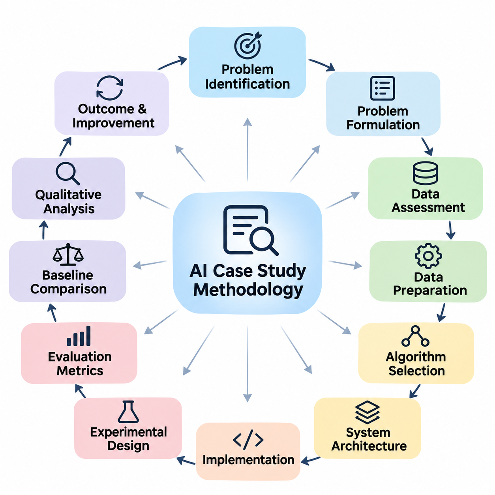
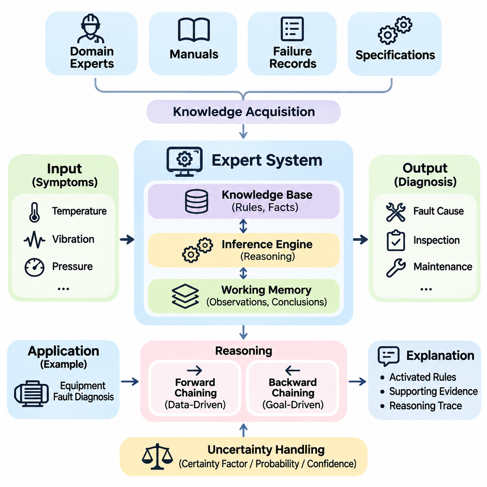
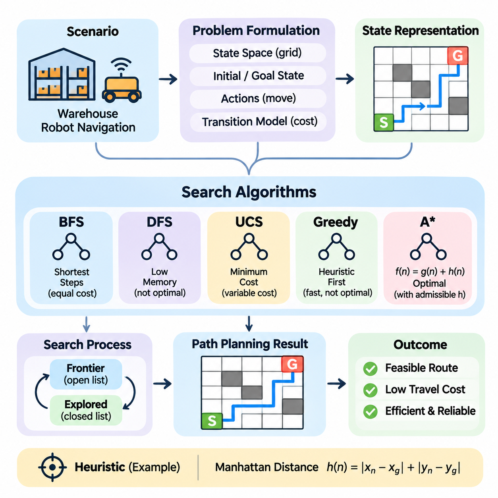
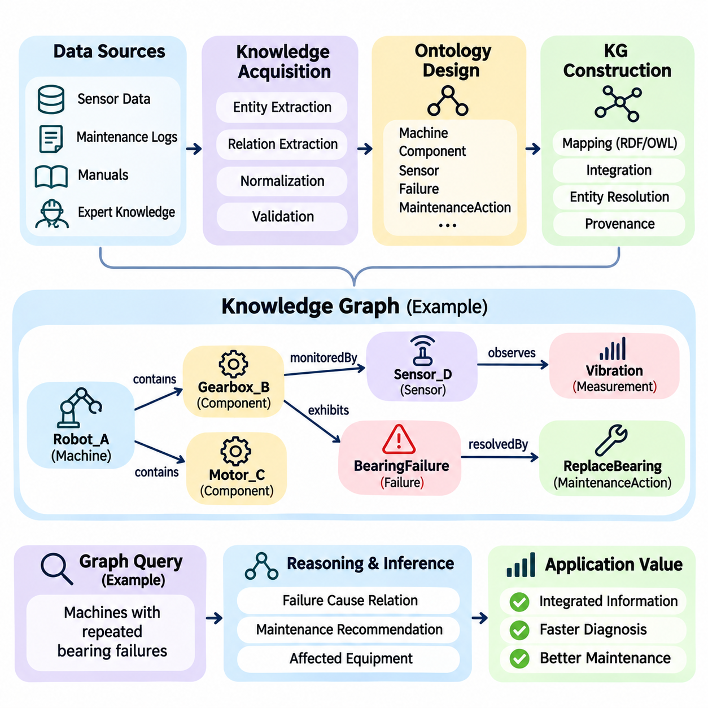
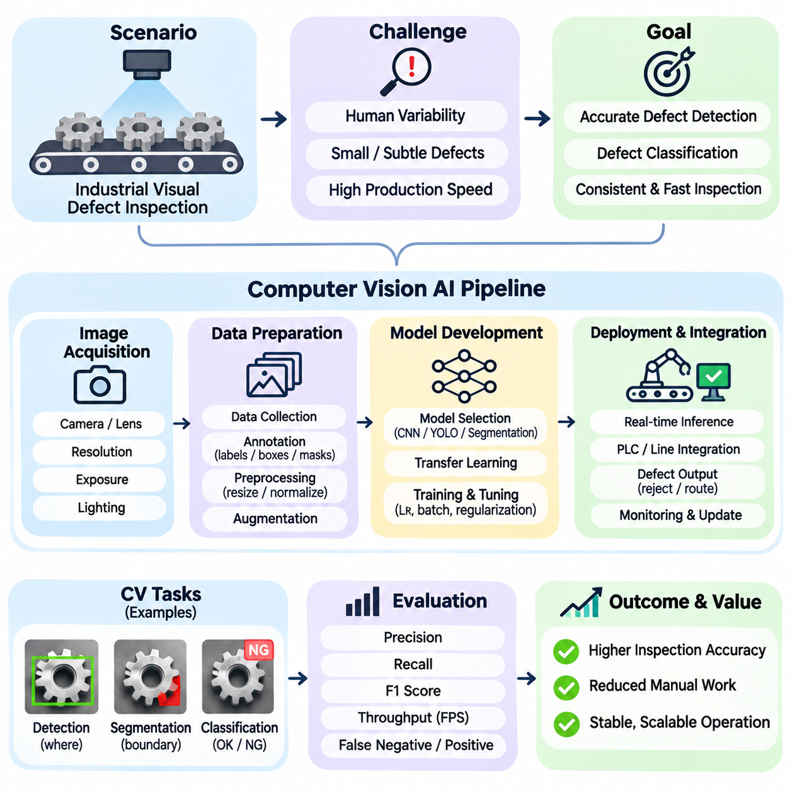
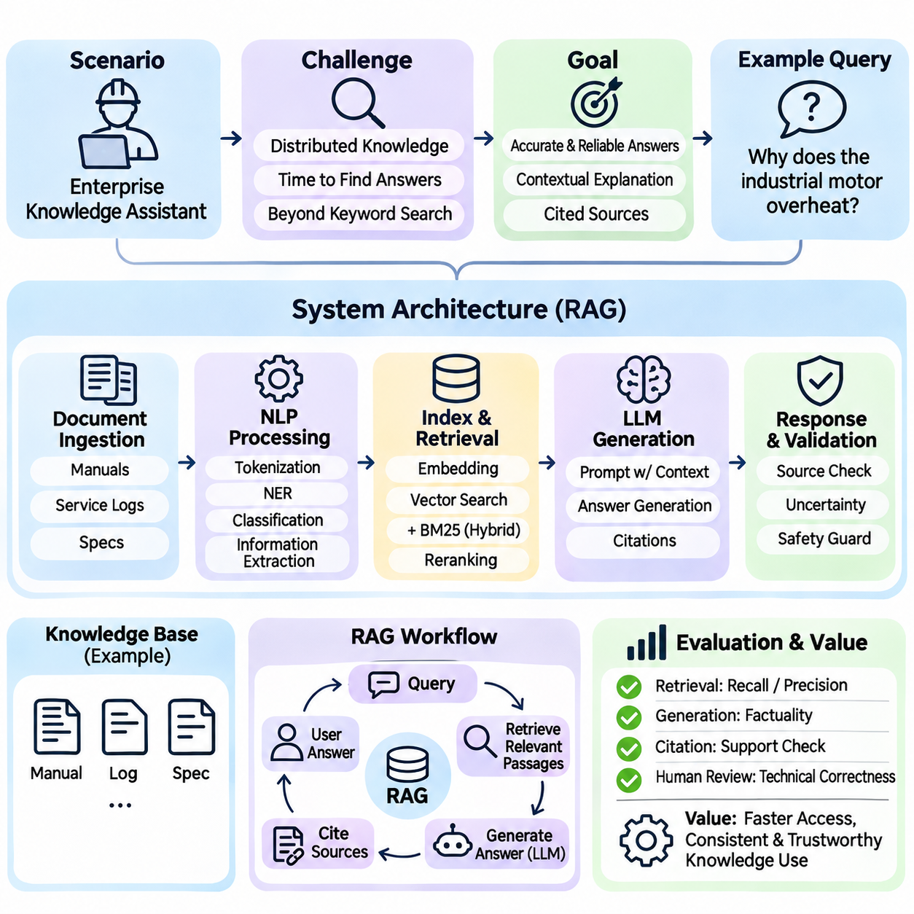
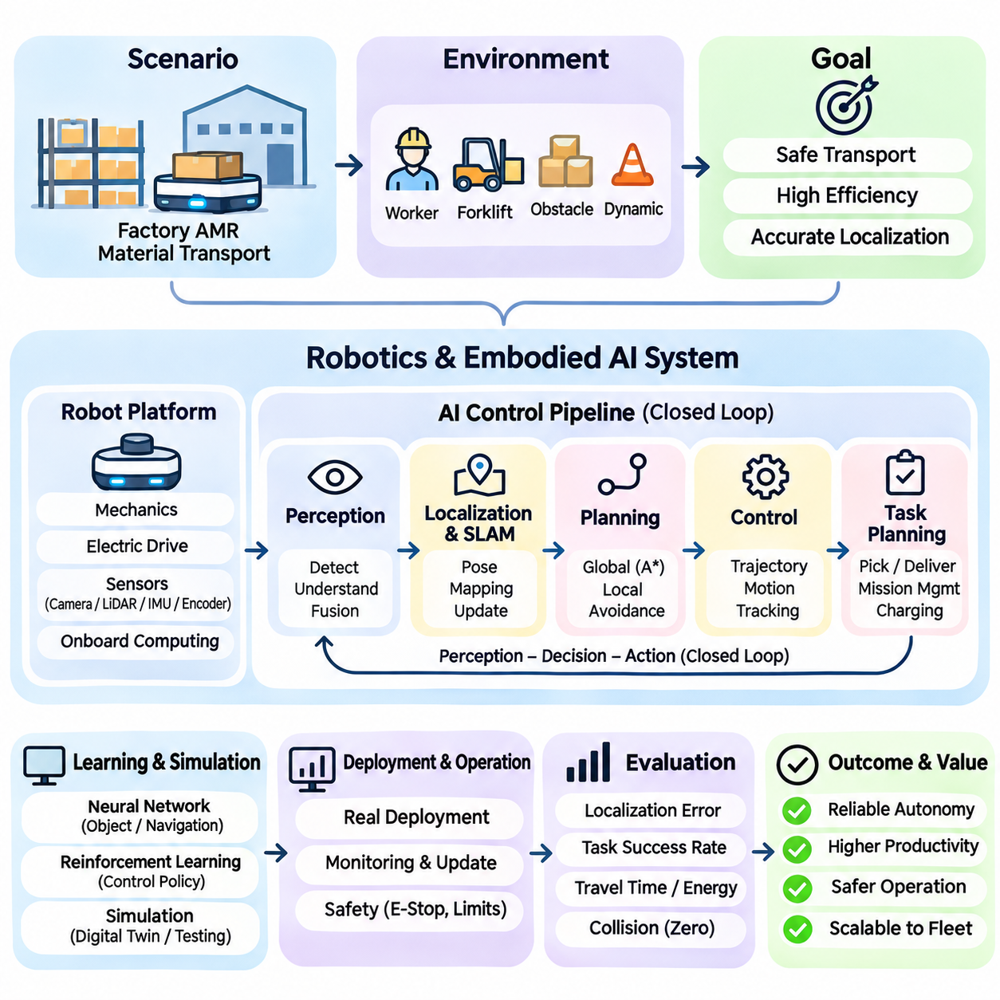
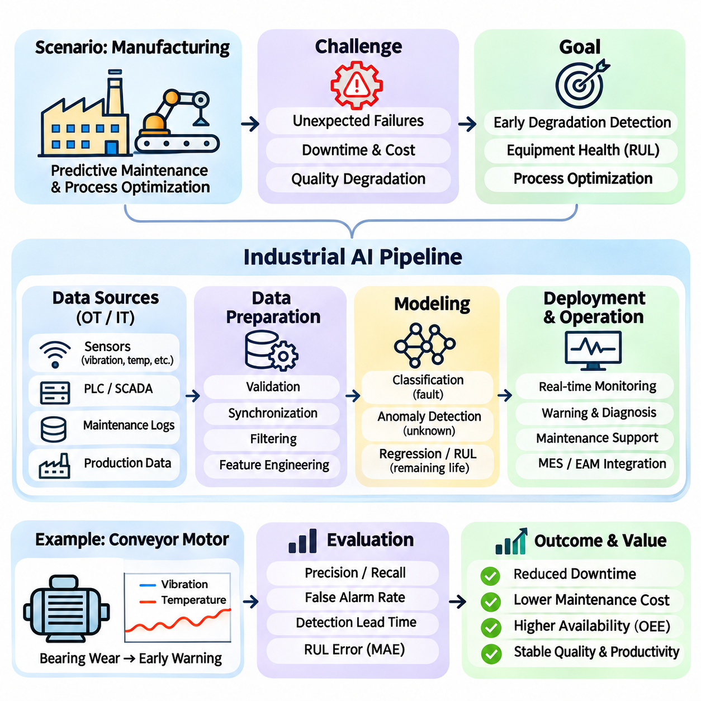

**Volume 04. Artificial Intelligence**

# 11. Case Studies

## 11.00 Case Study Methodology

{width="7.268055555555556in" height="7.268055555555556in"}

A case study methodology provides a systematic framework for examining how artificial intelligence concepts are translated into practical systems. Rather than evaluating algorithms in isolation, it investigates the relationship between problem requirements, data characteristics, computational methods, system architecture, and operational outcomes. This approach reveals how theoretical principles influence engineering decisions and real-world performance.

The primary objective of an AI case study is to understand why a particular solution was selected, how it was implemented, and whether it successfully addressed the original problem. A comprehensive investigation considers technical effectiveness, resource limitations, organizational requirements, and environmental conditions. It also identifies assumptions, design compromises, unexpected difficulties, and opportunities for improvement.

An effective methodology begins with problem identification and contextual analysis. The investigator defines the operational environment, stakeholders, existing processes, and limitations of conventional solutions. The problem must be expressed through observable conditions and measurable objectives. Clearly distinguishing the underlying business or engineering need from a proposed AI technique prevents premature selection of unnecessarily complex technologies.

Problem formulation translates operational requirements into computational objectives. Depending on the application, the task may involve classification, prediction, search, planning, reasoning, generation, or autonomous decision-making. The formulation identifies system inputs, expected outputs, constraints, and acceptable errors. It also determines whether the problem requires deterministic reasoning, statistical learning, or a combination of approaches.

The next stage examines available information and data resources. Investigators assess data sources, collection procedures, representation formats, labeling quality, completeness, and relevance. For symbolic systems, this assessment includes rules, facts, ontologies, and knowledge structures. For learning-based systems, it includes datasets, feature distributions, annotation consistency, and potential sampling biases.

Data preparation is evaluated as an essential component of the overall solution rather than a secondary implementation detail. Cleaning, normalization, transformation, feature extraction, and dataset partitioning can substantially influence system behavior. Investigators should document how missing values, inconsistent records, class imbalance, and distribution shifts were handled, allowing subsequent analysis to distinguish data-related limitations from algorithmic weaknesses.

Algorithm selection requires examining the correspondence between problem characteristics and computational mechanisms. Rule-based reasoning may be appropriate when domain knowledge is explicit and auditable, while neural networks may be preferable for complex perceptual patterns. Search algorithms, probabilistic models, knowledge graphs, and foundation models offer different advantages depending on uncertainty, interpretability, scalability, and available resources.

A meaningful case study explains the rationale behind architectural choices. The analysis should identify major components, their responsibilities, and the interfaces connecting them. An AI application may combine data ingestion, preprocessing, inference, reasoning, decision logic, and user interaction. Understanding these relationships is essential because overall reliability depends on coordinated system behavior rather than model accuracy alone.

Implementation analysis investigates how the selected approach becomes an operational system. Relevant considerations include programming frameworks, computational infrastructure, memory requirements, processing latency, communication mechanisms, and integration with existing software. The methodology should distinguish experimental prototypes from production deployments because their performance expectations, operational constraints, and maintenance responsibilities differ.

Experimental design establishes the evidence needed to evaluate a proposed solution. Each investigation should define measurable hypotheses, representative test conditions, appropriate baselines, and evaluation procedures before interpreting results. Controlled experiments help isolate the effects of individual design choices. When direct comparisons are impossible, investigators should explicitly describe the limitations of the available evidence.

Evaluation metrics must correspond to the actual purpose of the system. Classification applications may emphasize precision, recall, and F1 score, while search systems may prioritize solution quality, computational complexity, and completion time. Generative applications require assessments of relevance, factual consistency, and usefulness. Autonomous systems additionally require attention to safety, responsiveness, and operational reliability.

Quantitative measurements provide important evidence, but they rarely explain system behavior completely. Qualitative investigation examines error patterns, exceptional situations, user experiences, and operational failures. A model achieving high average accuracy may still perform poorly under unusual conditions. Combining numerical evaluation with detailed behavioral analysis produces a more realistic understanding of system capabilities.

Baseline comparisons establish whether artificial intelligence provides meaningful improvements over existing alternatives. A proposed solution should be compared with conventional algorithms, simpler models, manual procedures, or established operational methods when appropriate. Comparisons must account for differences in computational resources, data availability, implementation effort, and evaluation conditions to avoid misleading conclusions.

Reproducibility strengthens the credibility of a case study by allowing independent investigators to reconstruct its essential findings. Documentation should describe datasets, software versions, model configurations, experimental settings, and evaluation procedures. Random seeds and hardware characteristics may also be relevant. When proprietary information prevents full disclosure, the study should clearly identify which elements cannot be independently verified.

Error analysis investigates the mechanisms responsible for incorrect predictions, unsuccessful plans, inconsistent reasoning, or unsafe actions. Errors can originate from incomplete knowledge, noisy observations, unsuitable representations, inadequate training, or integration failures. Categorizing failures according to their causes supports targeted improvements and helps distinguish fundamental algorithmic limitations from correctable engineering problems.

Robustness analysis examines whether performance remains acceptable when operating conditions change. Relevant variations may include sensor noise, incomplete inputs, unfamiliar environments, adversarial manipulation, or differences between training and deployment data. Stress testing and scenario-based evaluation reveal vulnerabilities that ordinary benchmark measurements may overlook, particularly in systems operating outside controlled environments.

Ethical and societal considerations form an integral part of the methodology. Investigators should examine privacy, fairness, transparency, accountability, and potential misuse in relation to the application context. Systems affecting individuals or physical environments require particular attention to harmful outcomes. Responsible evaluation therefore considers not only whether the technology functions correctly but also whether its operation is justified and appropriately governed.

Human involvement must be examined whenever users, operators, or domain experts influence system decisions. Human-in-the-loop mechanisms may support data annotation, exception handling, result verification, and corrective feedback. A case study should clarify the division of responsibility between automated components and human participants, including when intervention is required and how disagreements or uncertain outcomes are resolved.

Operational feasibility extends beyond algorithmic performance to include cost, scalability, maintainability, and deployment constraints. Investigators should consider computational expenditure, energy consumption, infrastructure requirements, integration complexity, and expected maintenance effort. A technically sophisticated solution may offer limited practical value when its operational burden exceeds the benefits achieved under realistic conditions.

Case studies should also investigate how AI systems evolve after initial deployment. Monitoring mechanisms can detect performance degradation, changing data distributions, emerging failure modes, and shifts in user requirements. Feedback may lead to rule revisions, dataset updates, model retraining, or architectural modifications. This lifecycle perspective treats implementation as the beginning of continuous evaluation rather than the conclusion of development.

The methodology must accommodate differences between major AI paradigms. Expert systems emphasize knowledge acquisition, rule consistency, and inference transparency. Search-based applications emphasize state representation, heuristic quality, and computational efficiency. Knowledge graph applications emphasize entity relationships, semantic consistency, and query correctness. Each paradigm requires evaluation methods aligned with its underlying computational principles.

Learning-oriented applications introduce additional methodological requirements. Computer vision systems must account for image quality, annotation accuracy, environmental variation, and inference latency. Natural language processing and large language model applications require examination of linguistic ambiguity, factual reliability, contextual relevance, and generated content quality. These considerations demonstrate why a single evaluation metric cannot adequately characterize every AI system.

Robotics and embodied AI require investigation of the complete perception, reasoning, planning, and action cycle. Their performance depends on interactions among sensors, computational models, controllers, actuators, and physical environments. Simulation can support controlled experimentation, but physical validation remains important because environmental uncertainty, mechanical limitations, and real-time constraints can produce behaviors absent from simulated conditions.

Industrial AI introduces additional concerns involving production continuity, equipment compatibility, quality assurance, and operational safety. Investigators must determine whether improvements in prediction or automation translate into measurable process benefits. Relevant evidence may include defect detection performance, equipment downtime, throughput, resource utilization, and maintenance requirements. Such measurements connect technical results with practical organizational value.

Cross-case comparison provides an opportunity to identify principles that extend beyond individual applications. By examining expert systems, search algorithms, knowledge graphs, computer vision, language models, robotics, and industrial systems through a consistent analytical framework, investigators can identify recurring architectural patterns. They can also distinguish broadly applicable engineering practices from requirements specific to particular domains.

A useful comparative analysis separates observed results from interpretations and proposed explanations. Reported performance should be supported by identifiable evidence, while causal claims require appropriate experimental justification. Investigators should avoid attributing success exclusively to model architecture when improvements may also reflect better data, additional computational resources, revised workflows, or differences in evaluation conditions.

The final stage synthesizes findings into transferable engineering knowledge. A strong case study explains the original problem, documents the chosen solution, evaluates its outcomes, identifies limitations, and derives lessons for future implementations. It should communicate both successful practices and unsuccessful decisions. This balanced interpretation allows readers to understand not only what worked but also the circumstances under which similar approaches may fail.

Ultimately, case study methodology connects foundational AI theory with practical system engineering. Its value lies in disciplined observation, transparent evaluation, contextual interpretation, and evidence-based conclusions. By applying a consistent methodology across different artificial intelligence domains, researchers and engineers can develop a deeper understanding of system behavior and make more reliable decisions when designing future AI applications.

## 11.01 Expert System Case Study

{width="7.268055555555556in" height="7.268055555555556in"}

Expert systems represent one of the earliest successful approaches to artificial intelligence, demonstrating how specialized human knowledge can be encoded into computational rules. Unlike machine learning systems that discover patterns from training data, traditional expert systems rely on explicitly represented facts and logical relationships. Their primary objective is to reproduce selected aspects of expert decision-making within a narrowly defined domain.

A representative expert system case study examines a rule-based diagnostic application designed to identify equipment faults from observable symptoms. Industrial machinery provides a suitable environment because many failures exhibit recognizable relationships between sensor readings, operating conditions, and component behavior. The system aims to support maintenance personnel by producing consistent diagnostic recommendations.

The operational problem begins with the difficulty of diagnosing equipment failures under time and resource constraints. Technicians may encounter abnormal temperatures, excessive vibration, pressure fluctuations, or unexpected shutdowns. Different faults can produce similar symptoms, making diagnosis dependent on experience and contextual knowledge. An expert system organizes this knowledge into a repeatable decision process.

The first development stage involves knowledge acquisition from experienced engineers, maintenance manuals, historical failure reports, and equipment specifications. Domain experts explain how particular symptoms relate to possible faults and which observations distinguish competing explanations. Knowledge engineers translate these explanations into structured representations while preserving the conditions and exceptions that influence diagnostic decisions.

Knowledge representation is typically based on production rules consisting of conditions and conclusions. A rule may state that if motor temperature exceeds an established threshold and cooling airflow is insufficient, a cooling-system malfunction should be considered. Another rule may associate excessive vibration and abnormal bearing noise with mechanical wear. These relationships form the foundation of the system\'s reasoning capability.

The knowledge base stores diagnostic rules separately from the inference engine that executes them. This separation allows domain knowledge to be modified without redesigning the reasoning mechanism. The working memory maintains observations, intermediate conclusions, and facts established during an investigation. Together, these components provide a modular architecture for representing knowledge and deriving recommendations.

Forward chaining begins with available observations and repeatedly applies rules whose conditions are satisfied. For example, an elevated temperature reading may activate a rule requesting additional cooling-system information. Subsequent observations can trigger further rules until the system identifies plausible failure categories. This data-driven reasoning approach is useful when sensor measurements are continuously available.

Backward chaining begins with a diagnostic hypothesis and searches for evidence supporting its required conditions. If the system considers bearing failure, it may examine vibration characteristics, acoustic measurements, lubrication conditions, and maintenance history. The reasoning process continues until the hypothesis is supported, rejected, or remains unresolved because essential information is unavailable.

A practical diagnostic system may combine forward and backward chaining to improve efficiency. Forward chaining identifies candidate faults from initial observations, while backward chaining evaluates individual hypotheses through targeted questions. This hybrid reasoning strategy reduces unnecessary investigations and provides a structured explanation of how conclusions were reached.

The user interface plays an important role because expert systems frequently depend on interaction with human operators. A technician may enter observed symptoms, confirm equipment conditions, or answer questions generated by the inference engine. The system then presents candidate diagnoses, supporting evidence, and recommended inspection procedures. Clear communication helps operators understand the reasoning rather than treating results as unexplained commands.

Explanation facilities distinguish many traditional expert systems from opaque decision mechanisms. The system can identify which rules were activated, which observations supported a conclusion, and why additional information was requested. This traceability improves user confidence and supports technical auditing. However, an explanation of rule execution does not automatically establish that the underlying domain knowledge is correct.

Uncertainty presents a major challenge because industrial symptoms rarely determine a unique failure cause. Some expert systems address uncertainty through certainty factors, probabilistic reasoning, or confidence annotations attached to rules. These mechanisms help represent incomplete or conflicting evidence, although their numerical interpretations depend on the chosen framework and must not automatically be treated as calibrated probabilities.

A diagnostic example illustrates the interaction between knowledge and inference. Suppose a motor exhibits excessive temperature, reduced rotational efficiency, and intermittent vibration. The system initially considers cooling failure, mechanical friction, and electrical overload. Additional observations concerning airflow, bearing condition, and electrical current help eliminate unsupported hypotheses and narrow the remaining possibilities.

The quality of the resulting diagnosis depends heavily on the completeness and consistency of the knowledge base. Missing rules may prevent the identification of unusual faults, while contradictory rules may generate incompatible recommendations. Knowledge validation therefore requires systematic examination of rule coverage, logical consistency, threshold accuracy, and correspondence with established engineering principles.

Testing should include normal operating conditions, common failure scenarios, ambiguous observations, and previously unseen combinations of symptoms. Domain experts can review whether the conclusions and explanations are technically reasonable. Historical maintenance records may provide additional evaluation cases, provided their diagnoses are sufficiently reliable. Carefully designed tests reveal both incorrect conclusions and situations in which the system should abstain.

Evaluation metrics must reflect the purpose of diagnostic assistance. Relevant measurements include diagnostic accuracy, fault detection rate, false alarm frequency, reasoning time, and the number of questions required to reach a conclusion. Operational assessments may additionally examine maintenance efficiency and technician workload. These measurements should be compared with suitable baselines rather than interpreted independently.

An important advantage of expert systems is their interpretability and predictable rule execution. Explicit knowledge structures allow engineers to inspect the decision logic and identify the conditions associated with particular recommendations. Expert systems can also operate with limited training data because they do not necessarily require statistical model fitting. These properties remain valuable in domains governed by established procedures.

Nevertheless, rule-based systems encounter difficulties when knowledge becomes extensive or operating conditions change rapidly. Large rule collections can produce complex dependencies, conflicting conclusions, and maintenance burdens. Expert knowledge may also be difficult to articulate precisely, particularly when experienced practitioners rely on intuition or subtle perceptual cues. This knowledge acquisition bottleneck limits scalability.

Another limitation involves the treatment of unfamiliar situations. Traditional expert systems generally cannot infer reliable conclusions about conditions outside their encoded knowledge without additional reasoning mechanisms. Sensor noise, novel failure modes, and changing equipment configurations can reduce diagnostic effectiveness. Unlike adaptive learning systems, conventional rule engines do not automatically improve from accumulated operational experience.

Knowledge maintenance therefore becomes a central lifecycle activity. Engineers must revise rules when equipment specifications change, new faults are discovered, or maintenance procedures are updated. Version control, expert review, regression testing, and documentation help prevent modifications from introducing unexpected behavior. A controlled update process is particularly important when diagnostic recommendations affect operational safety.

Expert systems can be extended through integration with machine learning and statistical analysis. A predictive model may detect abnormal sensor patterns, while a rule-based component interprets those patterns according to engineering knowledge. Such hybrid architectures combine data-driven perception with explicit reasoning. However, integration introduces additional requirements for uncertainty handling, interface consistency, and system-level validation.

Knowledge graphs offer another extension by representing relationships among equipment, components, symptoms, operating conditions, and failure mechanisms. Graph-based representations can improve knowledge organization and support queries across interconnected assets. Rule engines may then operate over graph-derived facts, allowing diagnostic reasoning to incorporate structural relationships that would otherwise require numerous independent rules.

Safety considerations are essential when expert systems influence maintenance decisions. Incorrect recommendations may lead to unnecessary equipment replacement, extended downtime, or hazardous interventions. The system should distinguish confirmed findings from tentative hypotheses and identify situations requiring qualified human judgment. Critical actions must remain subject to appropriate operational procedures and authorization.

The historical significance of expert systems is illustrated by systems such as MYCIN, which investigated rule-based reasoning for medical diagnosis, and XCON, which supported computer configuration. These systems demonstrated the practical potential of explicit knowledge representation while revealing challenges in knowledge acquisition, validation, and maintenance. Their lessons remain relevant to contemporary decision-support applications.

The industrial diagnostic example demonstrates how problem formulation, knowledge acquisition, rule representation, inference mechanisms, and evaluation combine into a coherent AI application. Its value does not depend solely on producing correct fault labels but also on explaining decisions and supporting repeatable troubleshooting. Successful deployment requires reliable knowledge, appropriate interfaces, and continuous technical oversight.

The broader lesson is that intelligence can emerge from structured reasoning over explicitly represented domain knowledge without requiring large-scale statistical learning. Expert systems remain useful when rules are well understood, decisions must be explainable, and operational constraints favor deterministic execution. Their limitations also demonstrate why modern AI increasingly combines symbolic reasoning with learning-based and probabilistic methods.

## 11.02 Search AI Case Study [w/Code]

{width="7.268055555555556in" height="7.268055555555556in"}

Search-based artificial intelligence represents a foundational approach to solving problems through systematic exploration of possible states and actions. Unlike learning-based methods that infer patterns from data, search algorithms construct solutions by examining transitions within a defined problem space. Their effectiveness depends on state representation, action modeling, search strategy, and the computational resources available for exploration.

A representative search AI case study examines autonomous mobile robot navigation in a structured warehouse environment. The robot must travel from an initial location to a designated destination while avoiding obstacles and respecting movement constraints. This scenario illustrates how classical search algorithms transform spatial information into actionable navigation plans and how algorithmic decisions influence efficiency and reliability.

The operational environment contains storage shelves, corridors, loading stations, and restricted areas. A robot receives transportation assignments requiring movement between specific locations. Direct travel may be impossible because obstacles interrupt potential routes. The navigation system must therefore identify a feasible sequence of movements that connects the starting position to the destination without violating environmental constraints.

Problem formulation begins by defining the state space, initial state, goal state, available actions, and transition model. In a simplified grid representation, each traversable cell corresponds to a possible robot position. Actions move the robot between neighboring cells, while blocked cells represent obstacles. The goal test determines whether the robot has reached its destination, establishing a precise computational definition of successful navigation.

State representation significantly influences search complexity and solution quality. A two-dimensional grid provides a simple abstraction, but it may ignore robot orientation, turning radius, acceleration limits, and physical dimensions. More realistic models incorporate heading, motion primitives, and collision constraints. Increasing representational detail improves physical relevance while expanding the number of states that the algorithm must examine.

The transition model specifies how actions change the current state. In a four-connected grid, the robot may move upward, downward, leftward, or rightward when neighboring cells are accessible. Each transition can be assigned a cost representing distance, travel time, energy consumption, or operational risk. A consistent cost model enables the search algorithm to distinguish merely feasible routes from preferable solutions.

Breadth-first search explores states according to their distance in the number of transitions from the starting position. When every movement has equal cost, it can identify a path containing the minimum number of steps. However, its memory requirements increase rapidly as the reachable state space expands. This limitation makes breadth-first search more suitable for relatively small or simplified navigation problems.

Depth-first search follows one sequence of transitions before exploring alternative branches. Its memory requirements can be relatively modest, but it does not generally guarantee the shortest route. In environments containing cycles, visited-state tracking is necessary to prevent repeated exploration. Depth-first search therefore illustrates the distinction between finding a feasible solution and finding an optimal one.

Uniform-cost search expands the frontier state with the lowest accumulated path cost. Unlike breadth-first search, it accommodates movements with different nonnegative costs and can identify minimum-cost routes under standard assumptions. This capability is useful when warehouse corridors have different travel penalties. Its principal limitation is the potentially large number of states explored before reaching a distant destination.

Heuristic search introduces estimates of the remaining cost to guide exploration toward promising states. A heuristic function evaluates the approximate distance between a candidate position and the goal. In a four-connected grid with unit movement costs, Manhattan distance provides a useful estimate. Effective heuristics reduce unnecessary exploration while preserving an interpretable relationship between estimated and actual travel costs.

Greedy best-first search prioritizes states with the smallest estimated remaining cost. This strategy often moves rapidly toward the destination but may select inefficient routes when obstacles force substantial detours. Because accumulated travel cost is not the primary selection criterion, the resulting path is not necessarily optimal. Its behavior demonstrates the trade-off between aggressive goal-directed exploration and solution quality.

The A\\\* algorithm combines accumulated path cost and estimated remaining cost through the evaluation function f(n) = g(n) + h(n). Here, g(n) represents the cost from the initial state to node n, while h(n) estimates the remaining cost to the goal. With an admissible heuristic and appropriate search implementation, A\\\* can identify an optimal path while exploring fewer states than uninformed methods.

Consider a warehouse grid in which the robot starts near a loading station and must reach a storage location behind several shelving rows. A direct Manhattan route intersects blocked cells, forcing the robot to navigate through accessible corridors. A\\\* evaluates alternative paths using accumulated travel distance and remaining-distance estimates, progressively selecting promising states until a valid route reaches the destination.

The search process maintains a frontier of candidate states and records previously explored configurations. For each expanded state, the algorithm generates valid successors, computes transition costs, and updates the best-known routes. Parent references allow the final path to be reconstructed after reaching the goal. These mechanisms demonstrate how abstract graph exploration becomes a concrete sequence of navigation commands.

Implementation requires careful handling of repeated states, priority ordering, and cost updates. A state discovered through a lower-cost route should receive an improved cost record, and its priority must be updated appropriately. Incorrect handling can increase computational work or compromise optimality. Explicit obstacle validation and consistent coordinate conventions are equally important for preventing invalid navigation plans.

Heuristic design determines how efficiently informed search operates. An admissible heuristic never overestimates the true remaining cost, while a consistent heuristic satisfies a triangle-like inequality across transitions. These properties support optimality guarantees under appropriate conditions. More informative heuristics can improve performance, provided they remain compatible with movement rules and transition costs.

Weighted A\\\* modifies the evaluation function by increasing the influence of the heuristic estimate. This approach may reduce exploration time at the expense of guaranteed optimality. Under suitable assumptions, bounded-suboptimal variants provide limits on solution cost. Such trade-offs can be valuable when rapid planning is more important than finding the absolute shortest route.

Experimental evaluation should compare search algorithms under identical environmental conditions. Representative scenarios include open spaces, narrow corridors, complex obstacle arrangements, and destinations separated by long detours. Relevant measurements include path cost, number of expanded states, execution time, peak memory consumption, and success rate. These metrics reveal different aspects of algorithmic effectiveness.

A meaningful benchmark must account for environment size, obstacle density, connectivity, and goal distance. Results obtained from a small empty grid may not generalize to large warehouse layouts. Randomly generated maps can support broad comparisons, while realistic layouts reveal application-specific constraints. Repeated experiments help distinguish consistent performance differences from variations caused by individual scenarios.

Dynamic obstacles introduce challenges beyond conventional static path planning. Workers, forklifts, and other robots may temporarily block previously accessible corridors. A route calculated from an outdated map can become invalid during execution. The navigation system must therefore monitor environmental changes and initiate replanning when obstacles or operational conditions invalidate the current path.

Incremental search algorithms can exploit information from previous planning attempts instead of solving every modified problem from the beginning. Methods such as D\\\* Lite update route information as environmental costs change. Their usefulness depends on the structure of the problem and the frequency of modifications. This approach illustrates how classical search principles extend into adaptive navigation systems.

Multi-robot operation introduces additional coordination requirements. Two robots may independently identify valid routes that conflict when executed simultaneously. Reservation-based planning, prioritized planning, and conflict-based search address interactions among multiple agents. These methods extend single-agent pathfinding by incorporating temporal occupancy and collision avoidance, although computational complexity increases with the number of interacting robots.

Safety constraints must be considered separately from geometric path feasibility. A route through accessible cells may still violate minimum clearance distances, speed restrictions, or emergency stopping requirements. Practical systems therefore integrate search-based planning with localization, obstacle detection, trajectory generation, and motion control. A discrete route serves as a planning reference rather than a complete executable control policy.

The case study also highlights the importance of abstraction. Grid-based search simplifies navigation into discrete decisions, allowing algorithmic properties to be examined clearly. Real robots operate in continuous environments with uncertain localization and imperfect sensing. Translating a discrete route into reliable movement requires additional engineering mechanisms that account for geometry, dynamics, and environmental uncertainty.

The broader lesson is that successful search AI depends on the interaction between problem representation, algorithm selection, heuristic quality, and operational constraints. No single search strategy dominates every environment or objective. By comparing uninformed, cost-based, and heuristic approaches within a consistent navigation problem, the case study demonstrates how systematic exploration becomes an essential component of intelligent autonomous systems.

## 11.03 Knowledge Graph Case Study [w/Code]

{width="7.268055555555556in" height="7.268055555555556in"}

Knowledge graphs provide a structured approach to representing entities, relationships, and contextual information within artificial intelligence systems. Unlike isolated database records, knowledge graphs connect facts through explicit semantic relationships, allowing information to be interpreted across multiple domains. Their primary value lies in supporting knowledge integration, complex querying, logical inference, and explainable decision-making.

A representative knowledge graph case study examines intelligent maintenance management in an industrial manufacturing facility. The facility operates interconnected machines, sensors, production lines, and maintenance systems that generate heterogeneous information. The objective is to construct a unified knowledge representation that connects equipment configurations, operational observations, failure histories, and maintenance procedures.

The operational challenge arises because relevant information is distributed across multiple systems. Sensor databases contain temperature and vibration measurements, maintenance records describe historical repairs, and technical manuals specify component relationships. Although each source provides useful information, conventional data separation makes it difficult to identify relationships between equipment behavior, failure mechanisms, and corrective actions.

Problem formulation begins by identifying the questions the knowledge graph must answer. Engineers may need to determine which components are associated with abnormal vibration, which machines share a defective component type, or which maintenance procedures apply to a particular failure. These questions establish the required entities, relationships, attributes, and inference capabilities before implementation begins.

Knowledge acquisition combines structured databases, equipment documentation, maintenance logs, and expert knowledge. Structured sources provide identifiers and measurable attributes, while unstructured documents contain descriptions of failures and repair procedures. Information extraction techniques can identify relevant entities and relationships from text, although automated extraction requires validation to prevent incorrect associations.

Ontology design establishes the conceptual structure of the knowledge graph. An ontology defines classes such as Machine, Component, Sensor, Failure, MaintenanceAction, and ProductionLine. It also specifies relationships including containsComponent, monitoredBy, exhibitsFailure, and resolvedBy. These definitions provide shared semantics that enable information from different sources to be interpreted consistently.

Entity modeling determines how individual objects are represented. A manufacturing robot may be modeled as a Machine entity connected to motors, gearboxes, controllers, and sensors. Each component can possess attributes such as manufacturer, model number, installation date, and operating limits. Stable identifiers are essential because different information systems may refer to the same physical object using different naming conventions.

Relationship modeling captures the connections that make knowledge graphs more expressive than isolated tables. A vibration sensor may monitor a gearbox, while the gearbox belongs to a particular robot and has a documented history of bearing failures. By traversing these relationships, the system can associate abnormal measurements with relevant components and maintenance knowledge without requiring every connection to be manually reconstructed.

A graph can be represented using subject-predicate-object triples. For example, Robot_A containsComponent Gearbox_B expresses a structural relationship, while Gearbox_B monitoredBy Sensor_C identifies an observation source. Additional triples can associate Sensor_C with measurements and Gearbox_B with known failure modes. These statements form a connected network of machine-readable knowledge.

Implementation may use the Resource Description Framework, commonly known as RDF, together with ontology languages such as OWL. RDF provides a standardized graph representation, while OWL supports formal descriptions of classes and relationships. Alternatively, property graph databases represent entities and relationships with associated properties. The appropriate choice depends on interoperability, query requirements, reasoning needs, and operational constraints.

Data integration requires transforming heterogeneous source formats into consistent graph structures. Equipment identifiers must be reconciled, measurement units standardized, and timestamps aligned where temporal relationships matter. Entity resolution determines whether records from different systems refer to the same object. Incorrect merging can create false relationships, while incomplete matching can fragment knowledge about a single component.

Knowledge graph construction follows an extraction, transformation, and loading process. Source records are examined, relevant entities and relationships are extracted, and the resulting information is mapped to the graph schema. Validation rules check structural consistency and required attributes before insertion. Provenance metadata can preserve the origin of each assertion, supporting traceability and later correction.

Graph querying enables engineers to retrieve information through connected relationships rather than isolated records. A query might identify all machines containing a gearbox model associated with repeated bearing failures. Another query may retrieve sensors monitoring components affected by a particular maintenance bulletin. Query languages such as SPARQL or Cypher support these operations within their respective graph models.

The case study becomes particularly valuable when relationships span multiple information systems. Suppose a vibration sensor reports abnormal oscillation on a production robot. The graph identifies the monitored gearbox, its bearing assembly, previous repair events, and applicable maintenance instructions. Engineers can then examine a connected explanation of the problem instead of manually searching unrelated databases.

Logical reasoning extends graph querying by deriving additional relationships from existing knowledge. If a component belongs to a machine and the machine belongs to a production line, appropriate rules may infer that the component is associated with that line. Ontology-based reasoning can also identify class memberships or inconsistencies. Such conclusions depend on explicitly defined semantics and should not be confused with independently verified physical facts.

Rule-based inference can incorporate domain-specific maintenance knowledge. A rule may identify a gearbox as requiring inspection when excessive vibration, elevated temperature, and relevant operating conditions occur together. The graph supplies contextual relationships, while the inference mechanism evaluates the conditions. This combination supports explainable diagnostic recommendations grounded in connected equipment information.

Uncertainty must be addressed because graph assertions can originate from incomplete records or imperfect extraction models. Conflicting maintenance reports may describe different causes for the same failure, while automated entity linking may introduce incorrect relationships. Confidence annotations, provenance tracking, and human validation can help manage these issues, but conventional knowledge graph reasoning does not automatically quantify uncertainty.

Temporal information is essential for industrial applications because equipment configurations and operating conditions change. A sensor may be replaced, a component transferred, or a maintenance action completed at a particular time. Temporal modeling associates relationships and observations with valid periods, preventing historical facts from being interpreted as current conditions. This distinction is critical for accurate maintenance analysis.

Graph quality evaluation examines completeness, consistency, correctness, and connectivity. Completeness measures whether required entities and relationships are represented, while correctness concerns whether assertions match reliable evidence. Consistency checks identify incompatible classifications or relationships under defined constraints. Connectivity analysis reveals disconnected components that may indicate missing integration links.

Application-level evaluation determines whether the graph improves practical maintenance workflows. Relevant measures include query response time, entity resolution accuracy, relationship extraction quality, diagnostic retrieval accuracy, and time required to locate maintenance information. Comparisons with conventional database searches or manual procedures help establish whether the graph delivers measurable operational benefits.

Scalability becomes important as facilities accumulate millions of sensor observations and maintenance events. Storing every high-frequency measurement directly as graph entities may create unnecessary complexity. A practical architecture can retain time-series measurements in specialized databases while storing equipment relationships and references in the knowledge graph. This separation balances semantic expressiveness with storage and query efficiency.

Knowledge graph maintenance requires continuous synchronization with operational systems. New equipment installations, component replacements, updated manuals, and revised maintenance procedures must be reflected in the graph. Automated ingestion pipelines can reduce manual effort, but validation and version management remain necessary. Without systematic updates, the graph may become internally coherent yet operationally outdated.

Integration with machine learning provides additional capabilities. Predictive models can identify abnormal operating patterns, while the knowledge graph supplies relationships among sensors, components, and failure mechanisms. Graph neural networks may learn relational representations for prediction or classification tasks. However, learned associations should be distinguished from formally derived logical conclusions and verified engineering knowledge.

Explainability is a major advantage of knowledge graph applications because retrieved information can be connected to explicit relationships and source records. A maintenance recommendation may be accompanied by the relevant equipment hierarchy, observed symptoms, historical failures, and supporting procedures. This transparency assists expert review, although the presence of an explanatory path does not guarantee that the recommendation is correct.

The case study demonstrates that knowledge graphs are not merely alternative storage structures but mechanisms for organizing interconnected domain knowledge. Their effectiveness depends on ontology quality, reliable data integration, accurate relationships, suitable reasoning methods, and continuous governance. When these conditions are satisfied, knowledge graphs can transform fragmented industrial information into a coherent foundation for intelligent analysis and decision support.

## 11.04 Computer Vision AI Case Study

{width="7.268055555555556in" height="7.268055555555556in"}

Computer vision artificial intelligence enables machines to interpret visual information and transform images into meaningful decisions. Its applications include object detection, image classification, segmentation, tracking, and visual inspection. A computer vision case study demonstrates how image acquisition, data preparation, model development, and operational integration combine to create a reliable perception system.

A representative case examines automated visual defect inspection on an industrial production line. Manufactured components move along a conveyor belt while cameras capture images for quality assessment. The AI system must identify defective products, distinguish defect categories, and communicate inspection results to downstream equipment. Its objective is to improve inspection consistency while maintaining production throughput.

The operational challenge arises because manual inspection depends on human attention, experience, and working conditions. Small scratches, surface contamination, dimensional irregularities, and assembly defects may be difficult to recognize consistently. High production speeds further reduce available inspection time. Automated vision offers repeatable evaluation, but its effectiveness depends on both image quality and model reliability.

Problem formulation begins by defining the inspection task and acceptable performance criteria. Image classification determines whether a product is defective, while object detection identifies the location of visible defects. Semantic or instance segmentation can provide more precise defect boundaries. The selected task determines annotation requirements, model architecture, evaluation metrics, and integration complexity.

Image acquisition is a critical engineering stage because visual models cannot recover information that the imaging system fails to capture. Camera resolution, lens selection, working distance, exposure time, and sensor characteristics influence defect visibility. Global shutter cameras may be preferable for moving products because they avoid rolling-shutter distortion. The imaging configuration must match the smallest defect requiring detection.

Lighting conditions strongly influence inspection accuracy. Reflections, shadows, uneven illumination, and changes in ambient light can alter the appearance of otherwise identical products. Controlled illumination improves repeatability by reducing irrelevant visual variation. Depending on the inspected material, diffuse lighting, directional lighting, or backlighting may reveal different defect characteristics.

Dataset construction requires collecting representative images from actual operating conditions. The dataset should include acceptable products, common defects, rare failure patterns, and realistic variations in orientation and surface appearance. Defective samples may be scarce because production processes are designed to minimize failures. This imbalance complicates training and requires careful dataset planning.

Annotation quality determines how accurately supervised learning models can associate visual patterns with defect categories. Classification labels describe entire images, bounding boxes identify localized regions, and segmentation masks define pixel-level defect boundaries. Annotation guidelines must establish consistent definitions for ambiguous cases. Expert review helps reduce disagreements concerning defect severity and classification.

Data preparation typically includes resizing, normalization, color conversion, and augmentation. Augmentation may introduce controlled changes in brightness, rotation, position, or image noise to improve robustness. However, transformations must preserve the physical meaning of defects. Excessive resizing can remove small scratches, while unrealistic augmentation may teach the model patterns that never occur during production.

Dataset partitioning should prevent information leakage between training, validation, and test sets. Images of the same physical component or closely related production sequence may contain highly similar visual characteristics. Random image-level splitting can therefore overestimate generalization performance. Partitioning by product instance, production batch, or acquisition session provides a more realistic assessment.

Model selection depends on the required inspection output and deployment constraints. Convolutional neural networks can perform image classification, while detection architectures such as YOLO identify defect locations. Segmentation models provide detailed boundaries when defect area or geometry matters. Architecture selection should consider accuracy, inference latency, model size, memory consumption, and available hardware acceleration.

Transfer learning can reduce development effort when labeled industrial images are limited. A model pretrained on a large visual dataset provides reusable feature representations that can be adapted to the inspection domain. Fine-tuning adjusts model parameters using application-specific examples. Nevertheless, differences between natural images and industrial surfaces may limit transfer effectiveness, particularly for subtle defects.

Training involves optimizing model parameters to minimize prediction errors on labeled examples. Classification models commonly use cross-entropy-based objectives, while detection and segmentation models combine task-specific losses. Learning rate, batch size, image resolution, and regularization influence convergence. Training curves should be examined for overfitting, unstable optimization, and insufficient learning.

Evaluation must reflect the operational consequences of incorrect predictions. Precision measures the proportion of reported defects that are genuine, while recall measures the proportion of actual defects successfully identified. False negatives may allow defective products to pass inspection, whereas false positives may increase unnecessary rejection. The preferred balance depends on product safety, defect severity, and inspection costs.

Object detection systems are commonly evaluated using intersection over union and mean average precision. Intersection over union measures overlap between predicted and reference regions, while mean average precision summarizes detection performance across defined conditions. Segmentation systems may use Dice score or pixel-level overlap metrics. These measurements should be supplemented with defect-specific error analysis.

A practical evaluation includes defects of different sizes, shapes, and visual contrast. Small scratches may be missed because they occupy few pixels, while reflective surfaces can produce false detections resembling cracks. Confusion matrices and representative failure examples help identify systematic weaknesses. Performance should also be examined across product variants, lighting conditions, and production batches.

Inference performance is particularly important when inspection operates on a moving conveyor. The system must complete image acquisition, preprocessing, model inference, and decision communication within the available inspection interval. Throughput is influenced by camera frame rate, processor capability, memory transfers, and software overhead. Average latency alone is insufficient when occasional delays can disrupt production.

System integration connects visual predictions to physical production actions. A programmable logic controller may receive inspection results and activate a rejection mechanism when a defective product reaches a designated position. Accurate timing requires coordination between camera triggering, conveyor motion, object identification, and actuator control. Communication failures and synchronization errors can undermine an otherwise accurate model.

Deployment hardware may include industrial computers, GPUs, or edge AI accelerators. Hardware selection depends on inference requirements, environmental conditions, energy consumption, and maintenance accessibility. Model optimization techniques such as quantization, pruning, and accelerated inference runtimes can reduce computational demands. Optimization must be validated because reduced precision may disproportionately affect small or low-contrast defects.

Robustness testing examines how the inspection system behaves under changing operational conditions. Camera vibration, lens contamination, illumination drift, product misalignment, and sensor noise can reduce prediction reliability. Controlled stress tests help establish acceptable operating ranges. Monitoring image quality and environmental conditions can provide early warnings before inspection accuracy deteriorates.

Explainability supports quality engineers when reviewing automated decisions. Detection boxes, segmentation masks, and attention visualizations may indicate which image regions influenced a prediction. These outputs help investigate false alarms and missed defects, although visual explanations do not necessarily establish causal correctness. Human review remains valuable for uncertain cases and newly observed defect patterns.

Continuous improvement requires collecting operational feedback and maintaining a controlled model lifecycle. Incorrect predictions, emerging defect types, and changes in manufacturing processes should inform dataset updates and retraining decisions. Version management, regression testing, and staged deployment reduce the risk of introducing new failures. Production monitoring should distinguish model degradation from imaging or equipment problems.

The case study demonstrates that computer vision performance cannot be evaluated solely through model accuracy. Reliable inspection emerges from coordinated design across optics, illumination, datasets, learning algorithms, computing infrastructure, and production control. A technically strong model may still fail operationally if acquisition quality, timing, or integration is inadequate.

The broader lesson is that successful computer vision AI requires an end-to-end engineering perspective. Problem definition determines what must be observed, imaging determines what information is available, learning determines how patterns are recognized, and integration determines how predictions become actions. This relationship makes visual inspection a representative example of transforming AI perception into measurable industrial value.

## 11.05 NLP and LLM Case Study

{width="7.268055555555556in" height="7.268055555555556in"}

Natural language processing enables AI systems to analyze, interpret, and generate human language. Large language models extend these capabilities through large-scale pretraining and contextual text generation. A representative case study examines an enterprise knowledge assistant that answers technical questions using internal manuals, maintenance records, and operational documents while preserving factual reliability.

The operational challenge arises because organizational knowledge is distributed across documents, databases, and communication systems. Employees often spend considerable time locating relevant procedures or interpreting technical specifications. Traditional keyword search can retrieve documents but may not directly answer complex questions. An NLP and LLM assistant aims to connect information retrieval with contextual explanation.

Problem formulation begins by defining supported questions, authorized information sources, and acceptable response behavior. The assistant may summarize maintenance procedures, explain equipment specifications, or compare operational requirements. It must distinguish documented facts from uncertain interpretations. Questions requiring unavailable evidence should produce qualified responses rather than fabricated conclusions.

The system architecture combines document ingestion, text preprocessing, semantic retrieval, language generation, and response validation. Source documents are converted into machine-readable text and divided into manageable passages. Relevant passages are retrieved for each user query and supplied to the language model as contextual evidence. This approach is commonly called retrieval-augmented generation.

Document preparation strongly influences answer quality. Technical manuals may contain tables, formulas, section references, and specialized terminology that lose meaning during extraction. Chunking strategies should preserve logical boundaries and important contextual relationships. Metadata describing document titles, versions, publication dates, and access permissions supports reliable retrieval and source identification.

Traditional NLP techniques remain useful within the system. Tokenization separates text into processing units, named entity recognition identifies equipment names or component identifiers, and text classification organizes documents by topic. Information extraction can identify relationships among faults, symptoms, and corrective actions. These structured signals complement the broader linguistic capabilities of LLMs.

Semantic embeddings represent text passages as numerical vectors that capture aspects of contextual similarity. A user question is transformed into an embedding and compared with stored document vectors. Approximate nearest-neighbor search retrieves potentially relevant passages efficiently. However, semantic similarity does not guarantee factual relevance, particularly when technical documents contain closely related but distinct specifications.

Hybrid retrieval combines semantic vector search with lexical methods such as BM25. Lexical matching is valuable for exact model numbers, error codes, and specialized terminology, while semantic retrieval captures paraphrased questions. Reranking models can evaluate candidate passages more precisely. The retrieval pipeline should prioritize evidence quality rather than merely maximizing the number of returned passages.

Prompt construction determines how retrieved evidence is presented to the language model. Instructions can require the assistant to answer using authorized sources, identify uncertainty, and cite supporting passages. Context organization should make document boundaries and source identifiers clear. Nevertheless, prompt instructions alone cannot guarantee compliance or eliminate unsupported generation.

A practical example involves a technician asking why an industrial motor repeatedly overheats. The retrieval system identifies relevant maintenance instructions, cooling-system specifications, and historical service records. The language model synthesizes these sources into possible explanations and recommended inspection steps. It should avoid presenting a specific failure cause as confirmed unless the available evidence supports that conclusion.

Hallucination is a central concern because language models may generate plausible statements that are unsupported or incorrect. Retrieval reduces this risk by supplying external evidence, but it does not eliminate it. Models can misinterpret passages, combine incompatible facts, or invent details absent from the retrieved context. Evidence verification and calibrated uncertainty handling are therefore essential.

Citation generation improves traceability by linking statements to source documents. A reliable system should preserve passage identifiers and verify that cited material actually supports the corresponding claim. Merely attaching a document reference does not establish factual correctness. Citation quality must be evaluated separately from linguistic fluency and apparent answer completeness.

Evaluation requires a representative question-answer dataset developed from realistic organizational tasks. Questions should cover direct factual lookup, multi-document synthesis, ambiguous requests, and cases where the answer is unavailable. Domain experts can prepare reference answers and assess technical correctness. Test data should remain separate from development examples to reduce evaluation bias.

Retrieval performance can be measured using recall at a specified rank, precision, and ranking metrics such as mean reciprocal rank. Generation quality requires additional assessment of factual consistency, relevance, completeness, and citation support. Human evaluation remains important for complex technical explanations. No single metric adequately captures the reliability of the complete system.

Latency and computational cost influence deployment feasibility. Response time includes query processing, retrieval, reranking, model inference, and optional verification. Larger models may improve some reasoning tasks but require more memory and computation. Caching, model selection, context reduction, and batching can improve efficiency, provided these optimizations do not compromise response accuracy.

Security requirements are particularly important when enterprise documents contain confidential information. Retrieval must enforce user-specific access permissions before restricted content enters the model context. Encryption, authentication, audit logging, and data retention policies support governance. An assistant must not reveal protected information merely because semantically related passages exist in its document index.

Prompt injection introduces another risk when retrieved documents contain instructions intended to manipulate the assistant. External text must be treated as evidence rather than trusted operational commands. The application should separate system instructions from retrieved content and restrict tool execution through explicit authorization. Defensive testing should include malicious or misleading document passages.

Human oversight is necessary when generated answers influence safety-critical or financially significant decisions. The assistant can support information discovery and preliminary analysis, but qualified personnel should validate consequential recommendations. Interfaces should communicate uncertainty and distinguish retrieved facts from generated interpretations. Escalation mechanisms are appropriate when evidence is insufficient or contradictory.

Knowledge maintenance requires synchronizing the retrieval index with evolving source documents. Updated manuals, revised procedures, and superseded specifications must be reflected in the system. Version-aware retrieval helps prevent outdated instructions from appearing authoritative. Monitoring should identify recurring retrieval failures, unsupported answers, and changes in user information needs.

Fine-tuning provides an alternative or complementary adaptation strategy. Supervised fine-tuning can improve response style, terminology usage, and task-specific behavior, while retrieval supplies frequently changing factual knowledge. Fine-tuning does not inherently guarantee factual accuracy or current information. The choice between adaptation methods depends on data availability, update frequency, privacy constraints, and operational objectives.

The case study demonstrates that enterprise NLP and LLM applications are complete information systems rather than isolated language models. Their reliability depends on document quality, retrieval effectiveness, contextual reasoning, access control, evaluation, and continuous maintenance. Successful deployment transforms fragmented organizational knowledge into accessible assistance while preserving evidence-based decision-making.

## 11.06 Robotics and Embodied AI Case Study

{width="7.268055555555556in" height="7.268055555555556in"}

Robotics and embodied artificial intelligence integrate perception, reasoning, planning, and physical action within environments that continuously change. Unlike software-only AI systems, embodied agents interact with the world through sensors and actuators, making their decisions subject to physical constraints. A representative case study examines an autonomous mobile robot performing material transportation inside a manufacturing facility.

The robot must transport components between storage areas, production stations, and designated delivery locations. Its operating environment contains moving workers, forklifts, temporary obstacles, and changing traffic conditions. The objective is to complete transportation missions safely and efficiently while maintaining localization accuracy, avoiding collisions, and responding appropriately to unexpected events.

Problem formulation begins by defining the robot\'s observable state, available actions, operational goals, and safety constraints. The state may include position, orientation, velocity, obstacle locations, battery level, and mission status. Actions include steering, acceleration, braking, and task selection. The robot must select actions using incomplete observations while respecting its mechanical and computational limitations.

The robotic platform combines mechanical structures, electric drives, sensors, embedded controllers, and onboard computing resources. Wheel configuration, payload capacity, turning radius, and braking performance determine feasible motion. Cameras, LiDAR, inertial sensors, and wheel encoders provide complementary observations. Their integration establishes the physical foundation for autonomous operation.

Perception transforms raw sensor measurements into representations of the surrounding environment. LiDAR provides geometric information about nearby surfaces, while cameras capture appearance and semantic details. Sensor fusion combines these observations to improve environmental understanding. Calibration and timestamp synchronization are essential because inconsistent measurements can produce incorrect obstacle positions or unstable localization.

Localization estimates the robot\'s position and orientation relative to a reference map. Wheel odometry predicts motion from encoder measurements but accumulates error over time. Inertial measurements provide additional motion information, while LiDAR or visual observations help correct drift. Probabilistic estimation methods combine these signals to maintain a consistent estimate of the robot\'s pose.

Simultaneous localization and mapping enables the robot to construct a map while estimating its location. During initial deployment, the robot explores accessible areas and identifies persistent environmental features. The resulting map supports navigation between workstations. However, map quality depends on sensor coverage, environmental stability, and the ability to distinguish permanent structures from temporary obstacles.

Path planning determines how the robot should travel from its current location to a destination. A global planner may use graph search or A\\\* to calculate a route through mapped free space. Local planning then adjusts motion in response to nearby obstacles and dynamic conditions. The distinction between global and local planning allows efficient route selection while preserving responsiveness during execution.

Motion control converts planned trajectories into actuator commands. A controller regulates wheel velocities or steering angles to follow the desired path while respecting acceleration and braking limits. Feedback from encoders and localization estimates corrects deviations. Controller performance must account for payload changes, wheel slip, uneven surfaces, and delays between sensing and actuation.

Dynamic obstacle avoidance is particularly important in shared industrial environments. Workers and forklifts may cross the robot\'s planned route without warning. The perception system detects nearby objects, while motion prediction estimates possible future positions. The planner evaluates collision risks and selects appropriate responses, including slowing down, stopping, or choosing an alternative path.

Task planning operates above the navigation layer and determines which transportation missions should be performed. A mission may require collecting a container, traveling to a production station, confirming delivery, and returning to a charging area. Task dependencies and resource availability influence execution order. Mission management must also handle interrupted deliveries and failed docking attempts.

Embodied intelligence emerges from the continuous interaction between perception, decision-making, and action. A navigation decision changes the robot\'s physical position, which alters subsequent sensor observations and available actions. This closed-loop relationship distinguishes embodied agents from systems that process static inputs. Effective behavior therefore requires continuous adaptation rather than isolated predictions.

Learning-based methods can complement conventional robotics algorithms. Neural networks may recognize objects, classify traversable regions, or predict pedestrian movement. Reinforcement learning can optimize selected control policies through interaction with simulated environments. Nevertheless, learned policies require careful validation because successful training performance does not guarantee safe behavior under unfamiliar physical conditions.

Simulation provides a controlled environment for developing and testing robotic behavior. A digital representation of the facility can reproduce robot dynamics, sensor observations, obstacles, and mission scenarios. Developers can evaluate navigation failures without exposing workers or equipment to unnecessary risk. Simulation fidelity remains important because inaccurate friction, sensing, or motion models can distort results.

The simulation-to-reality gap describes differences between simulated training conditions and physical deployment. Real sensors experience noise, lighting changes, calibration errors, and environmental interference that may not be fully represented in simulation. Domain randomization can expose learning algorithms to varied conditions. Physical testing remains necessary to establish whether simulated improvements transfer to actual operation.

Safety engineering must be integrated independently of task optimization. Emergency stopping, speed limits, protective sensing, and controlled recovery procedures provide safeguards against hazardous motion. Safety-related functions require appropriate hardware, software, and validation practices. An AI planner should not be treated as the sole mechanism responsible for preventing collisions or protecting personnel.

System integration connects autonomous navigation with manufacturing operations. Fleet management software assigns missions, monitors robot status, and coordinates shared resources. Interfaces with production systems communicate pickup requests and delivery confirmations. Reliable communication is important, but the robot must also respond safely when network connectivity is interrupted or supervisory commands are delayed.

Evaluation combines navigation accuracy, task completion, safety, and operational efficiency. Relevant measures include localization error, path deviation, mission success rate, travel time, energy consumption, and recovery frequency. Collision-free operation should be examined across representative scenarios rather than inferred from average performance. Testing must include crowded conditions, blocked routes, and unexpected equipment behavior.

Reliability testing evaluates how the robot responds to sensor degradation, actuator faults, battery limitations, and communication failures. Fault detection mechanisms identify abnormal conditions, while recovery strategies determine whether a mission can continue safely. Some failures require controlled stopping and human intervention. Clear operational boundaries prevent autonomous recovery attempts from creating additional hazards.

Deployment requires continuous monitoring and maintenance. Sensor calibration, wheel wear, map changes, and software updates can affect performance over time. Operational logs support failure analysis and systematic improvement. Updated navigation models or control parameters should undergo regression testing before release, particularly when modifications influence safety-related behavior.

The case study demonstrates that robotics and embodied AI cannot be reduced to a single perception model or planning algorithm. Successful autonomy depends on coordinated engineering across mechanics, sensing, estimation, planning, control, learning, and safety. The broader lesson is that intelligent physical behavior emerges when these components operate reliably within a continuous feedback loop connecting computation to the real world.

## 11.07 Industrial AI Case Study

{width="7.268055555555556in" height="7.268055555555556in"}

Industrial artificial intelligence integrates machine learning, data analytics, automation, and domain knowledge to improve manufacturing operations. Unlike isolated AI demonstrations, industrial applications must operate within established production processes and engineering constraints. A representative case study examines predictive maintenance and process optimization in a manufacturing facility containing interconnected machines and automated production lines.

The facility operates motors, pumps, conveyors, robotic equipment, and industrial controllers that generate continuous operational data. Unexpected equipment failures can interrupt production, increase maintenance expenses, and reduce product quality. The AI system aims to identify early signs of degradation, estimate equipment health, and support maintenance decisions without unnecessarily disrupting normal operations.

Problem formulation begins by defining measurable operational objectives. These may include reducing unplanned downtime, improving equipment availability, detecting abnormal behavior, and minimizing maintenance costs. The system must distinguish between normal operating variation and conditions indicating potential failure. Success criteria should reflect actual production outcomes rather than model accuracy alone.

Industrial data originates from sensors, programmable logic controllers, supervisory control systems, maintenance databases, and production management platforms. Measurements may include vibration, temperature, current, pressure, rotational speed, and operating hours. These heterogeneous sources provide complementary information, but their integration requires consistent identifiers, timestamps, measurement units, and equipment relationships.

Data acquisition must account for industrial communication protocols and operational reliability. Systems may use OPC UA, Modbus, MQTT, or other interfaces to exchange measurements and status information. Sampling frequency depends on the monitored phenomenon, since vibration analysis may require much higher temporal resolution than temperature monitoring. Data collection should avoid interfering with critical control functions.

Data quality presents a major challenge because industrial measurements frequently contain missing values, noise, sensor drift, and inconsistent sampling intervals. Equipment shutdowns and maintenance activities may also create unusual patterns unrelated to failure. Preprocessing therefore includes validation, synchronization, filtering, and contextual interpretation. Incorrect treatment of operating states can produce misleading training examples.

Historical maintenance records provide important supervision signals, but failure labels are often incomplete or ambiguous. A recorded component replacement does not necessarily identify the original failure mechanism. Engineers must associate sensor histories with verified maintenance events and distinguish preventive replacements from actual breakdowns. Reliable labeling requires cooperation between data specialists and maintenance personnel.

Exploratory analysis examines relationships between equipment conditions and observed failures. Temperature trends may reveal cooling problems, while changes in vibration spectra can indicate mechanical degradation. Electrical current patterns may provide evidence of abnormal loading. However, correlations alone do not establish causal failure mechanisms, and domain expertise is necessary to interpret observed patterns.

Feature engineering transforms raw measurements into representations suitable for machine learning. Statistical features may include mean, variance, peak amplitude, and rate of change. Frequency-domain features can characterize periodic vibration patterns, while temporal features describe evolving equipment behavior. Feature selection should reflect physical mechanisms and avoid introducing information unavailable during real-time operation.

Model selection depends on available labels and the required prediction task. Supervised classification can distinguish normal and faulty states when representative examples exist. Anomaly detection can identify unusual patterns when failure data is scarce. Regression or survival models may estimate degradation trends or remaining useful life. Each approach makes different assumptions about equipment behavior and data availability.

Training procedures must respect the temporal structure of industrial observations. Randomly distributing adjacent time windows across training and testing sets can create information leakage and exaggerated performance estimates. Chronological splitting and evaluation across different machines or operating periods provide stronger evidence of generalization. Equipment-specific differences should be considered when models are transferred between production lines.

Evaluation requires metrics aligned with maintenance consequences. Precision and recall describe fault detection behavior, while false alarm frequency indicates unnecessary maintenance burden. Detection lead time measures how early a potential failure is identified. Remaining useful life predictions may be evaluated using absolute error and uncertainty estimates. Operational value also depends on whether warnings provide sufficient time for intervention.

A representative operating scenario involves a conveyor motor developing progressive bearing wear. Vibration measurements begin showing abnormal frequency components, while temperature increases under comparable loading conditions. The AI model detects a deviation from established behavior and generates a maintenance warning. Engineers review supporting evidence before deciding whether inspection or replacement is necessary.

Decision support should connect model predictions with actionable maintenance procedures. A warning may include the affected equipment, abnormal measurements, estimated severity, and relevant historical patterns. Maintenance teams can combine this information with production schedules, spare-part availability, and inspection requirements. The AI system supports decisions rather than independently confirming every suspected failure.

Process optimization extends industrial AI beyond equipment health monitoring. Production data can reveal relationships among machine settings, cycle times, energy consumption, and product quality. Predictive models may estimate quality outcomes under different operating conditions. Optimization algorithms can recommend parameter adjustments, but proposed changes must remain within validated engineering and safety limits.

Integration with manufacturing execution systems and enterprise maintenance platforms enables AI outputs to influence established workflows. Predictions may generate inspection requests, maintenance notifications, or planning recommendations. Interfaces must preserve equipment identifiers and event traceability. Automated actions require explicit authorization and safeguards, particularly when recommendations could affect production continuity or physical equipment.

Deployment architecture may distribute computation between edge devices, on-premises servers, and cloud infrastructure. Edge processing supports low-latency monitoring and continued operation during network interruptions. Centralized infrastructure can aggregate historical data and support computationally intensive training. Architecture selection should consider bandwidth, cybersecurity, reliability, data governance, and maintenance requirements.

Cybersecurity is essential because industrial AI systems connect information technology with operational technology. Unauthorized access, manipulated sensor data, or compromised model updates can affect operational decisions. Network segmentation, authentication, encryption, logging, and controlled software deployment reduce exposure. AI integration must respect existing industrial safety and security boundaries.

Model drift occurs when equipment characteristics, production conditions, or sensor behavior change after deployment. New materials, altered operating schedules, component replacements, and calibration changes can modify data distributions. Continuous monitoring should track prediction quality, input characteristics, and alert frequency. Retraining requires validated data and controlled release procedures rather than automatic acceptance of every observed change.

Human oversight remains central to industrial AI because maintenance and production decisions involve physical consequences. Engineers must understand model limitations, investigate uncertain warnings, and determine appropriate interventions. Explainable outputs can support this process by presenting influential measurements and historical comparisons. However, explanations should not be mistaken for verified causal diagnoses.

The case study demonstrates that industrial AI creates value through integration with engineering knowledge and operational processes. Effective systems combine reliable sensing, validated datasets, appropriate algorithms, secure infrastructure, and accountable decision-making. The broader lesson is that industrial intelligence emerges not from prediction alone, but from converting trustworthy analytical results into safe, measurable improvements in production performance.
