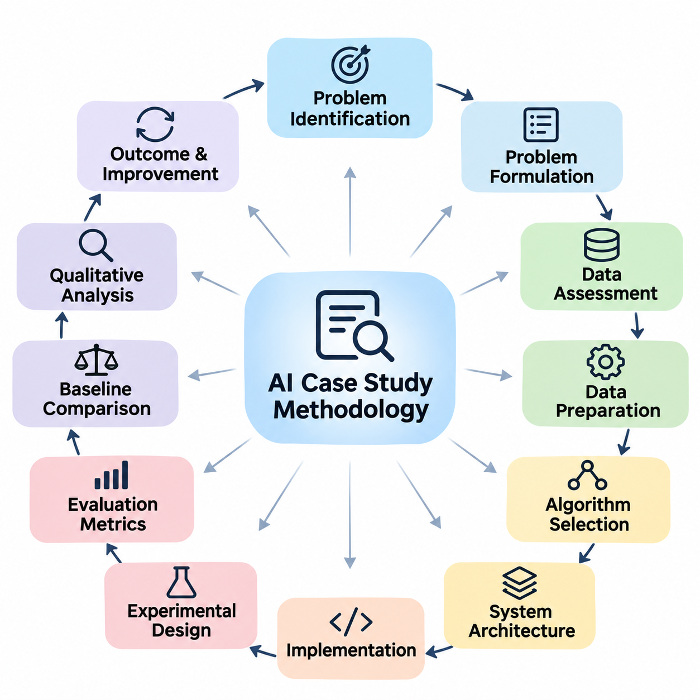
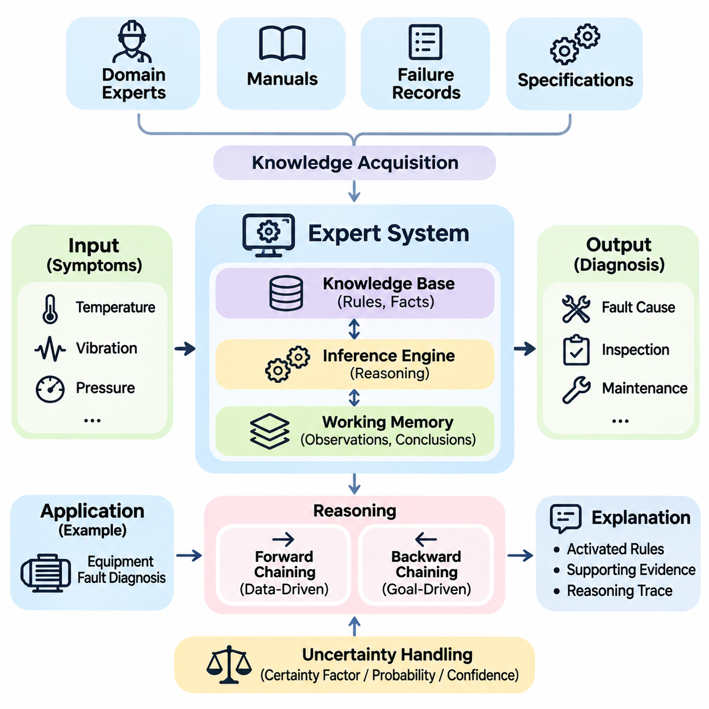
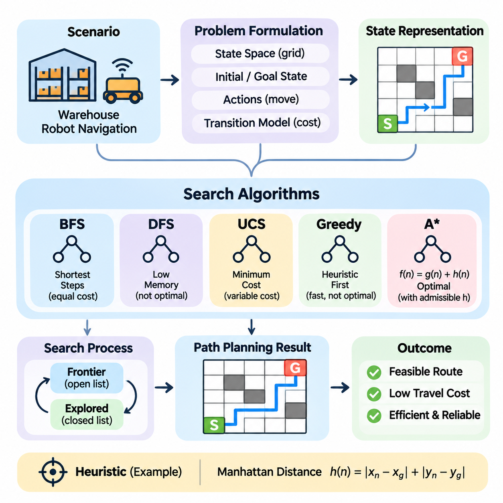
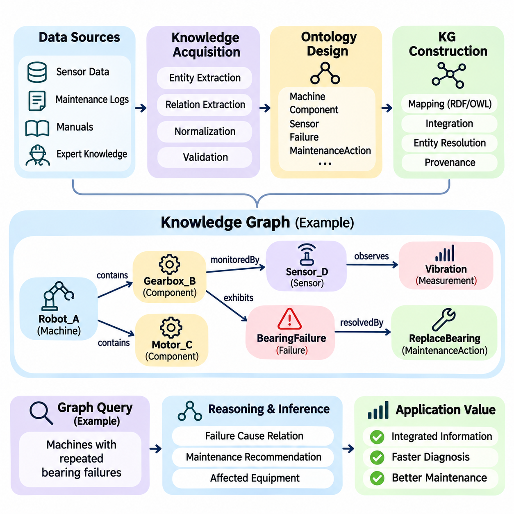
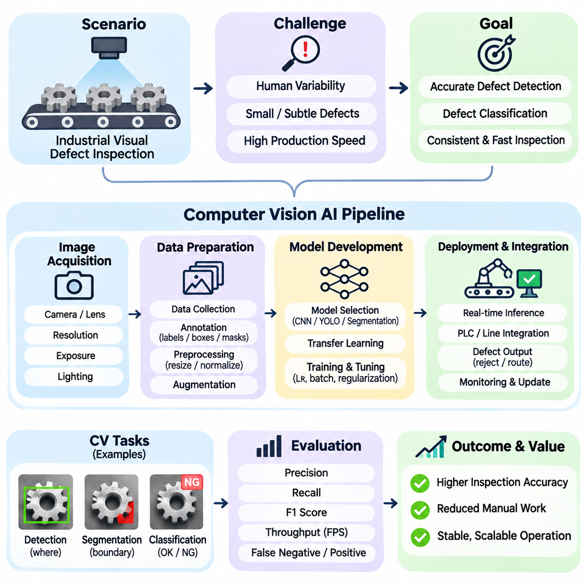
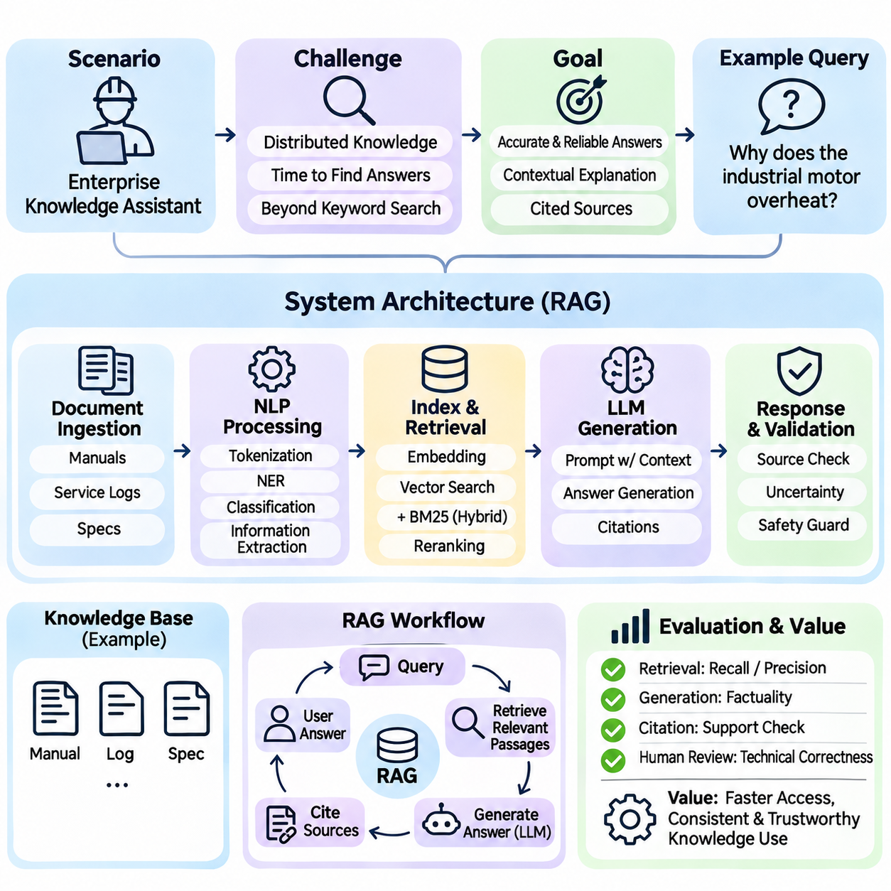
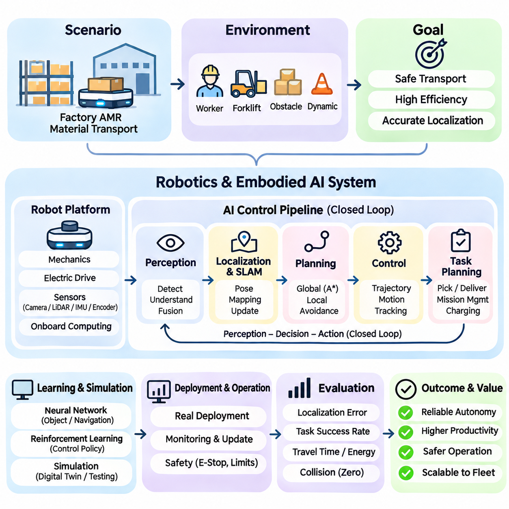
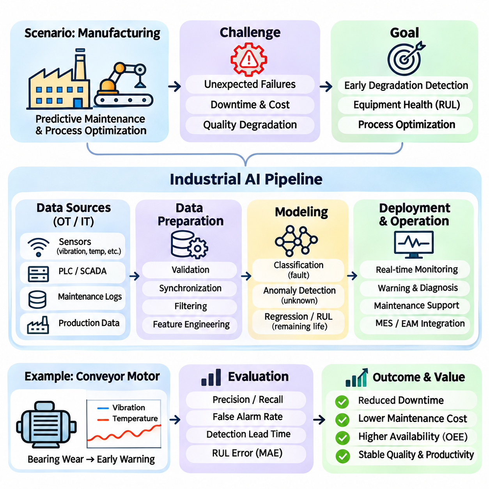

**Volume 04. Artificial Intelligence**

# 11. Case Studies

## 11.00 Case Study Methodology

{width="7.268055555555556in" height="7.268055555555556in"}

사례 연구 방법론(Case Study Methodology)은 인공지능(Artificial Intelligence, AI)의 개념이 실제 시스템(Practical Systems)으로 구현되는 과정을 체계적으로 분석하기 위한 프레임워크(Framework)를 제공한다. 개별 알고리즘(Algorithm)을 독립적으로 평가하는 대신, 문제 요구사항(Problem Requirements), 데이터 특성(Data Characteristics), 계산 방법(Computational Methods), 시스템 아키텍처(System Architecture), 운영 결과(Operational Outcomes) 사이의 관계를 조사한다. 이러한 접근법은 이론적 원리가 엔지니어링 의사결정과 실제 성능에 어떠한 영향을 미치는지 보여준다.

인공지능 사례 연구(AI Case Study)의 주요 목적은 특정 솔루션(Solution)이 선택된 이유, 구현된 방식, 그리고 최초의 문제를 성공적으로 해결했는지를 이해하는 것이다. 포괄적인 분석(Comprehensive Analysis)은 기술적 효과성(Technical Effectiveness), 자원 제약(Resource Constraints), 조직적 요구사항(Organizational Requirements), 환경적 조건(Environmental Conditions)을 고려한다. 또한 기본 가정(Assumptions), 설계 절충(Design Trade-offs), 예상하지 못한 문제, 개선 가능성을 식별한다.

효과적인 방법론(Methodology)은 문제 식별(Problem Identification)과 상황 분석(Contextual Analysis)에서 시작된다. 연구자는 운영 환경(Operational Environment), 이해관계자(Stakeholders), 기존 프로세스(Existing Processes), 전통적인 솔루션의 한계를 정의한다. 문제는 관찰 가능한 조건(Observable Conditions)과 측정 가능한 목표(Measurable Objectives)를 통해 표현되어야 한다. 근본적인 비즈니스 또는 엔지니어링 요구사항과 제안된 인공지능 기술을 명확하게 구분하면 불필요하게 복잡한 기술을 성급하게 선택하는 일을 방지할 수 있다.

문제 정식화(Problem Formulation)는 운영 요구사항(Operational Requirements)을 계산 가능한 목표(Computational Objectives)로 변환한다. 응용 분야에 따라 작업은 분류(Classification), 예측(Prediction), 탐색(Search), 계획(Planning), 추론(Reasoning), 생성(Generation), 자율적 의사결정(Autonomous Decision-making)을 포함할 수 있다. 문제 정식화에서는 시스템 입력(System Inputs), 예상 출력(Expected Outputs), 제약조건(Constraints), 허용 가능한 오류(Acceptable Errors)를 정의한다. 또한 결정론적 추론(Deterministic Reasoning), 통계적 학습(Statistical Learning), 또는 이들의 결합이 필요한지를 판단한다.

다음 단계에서는 사용 가능한 정보(Information)와 데이터 자원(Data Resources)을 조사한다. 연구자는 데이터 출처(Data Sources), 수집 절차(Collection Procedures), 표현 형식(Representation Formats), 레이블 품질(Label Quality), 완전성(Completeness), 관련성(Relevance)을 평가한다. 기호 기반 시스템(Symbolic Systems)에서는 규칙(Rules), 사실(Facts), 온톨로지(Ontologies), 지식 구조(Knowledge Structures)가 포함된다. 학습 기반 시스템(Learning-based Systems)에서는 데이터셋(Datasets), 특징 분포(Feature Distributions), 주석 일관성(Annotation Consistency), 잠재적인 표본 편향(Sampling Biases)을 검토한다.

데이터 준비(Data Preparation)는 부차적인 구현 작업이 아니라 전체 솔루션의 필수 구성요소(Essential Component)로 평가되어야 한다. 데이터 정제(Data Cleaning), 정규화(Normalization), 변환(Transformation), 특징 추출(Feature Extraction), 데이터셋 분할(Dataset Partitioning)은 시스템 동작에 상당한 영향을 미칠 수 있다. 연구자는 결측값(Missing Values), 불일치 기록(Inconsistent Records), 클래스 불균형(Class Imbalance), 분포 변화(Distribution Shifts)의 처리 방법을 문서화해야 한다. 이를 통해 데이터 관련 한계와 알고리즘 자체의 약점을 구분할 수 있다.

알고리즘 선택(Algorithm Selection)에서는 문제 특성(Problem Characteristics)과 계산 메커니즘(Computational Mechanisms)의 적합성을 검토한다. 도메인 지식(Domain Knowledge)이 명시적이고 감사 가능한 경우 규칙 기반 추론(Rule-based Reasoning)이 적합할 수 있으며, 복잡한 지각 패턴(Perceptual Patterns)을 처리할 때는 신경망(Neural Networks)이 유리할 수 있다. 탐색 알고리즘(Search Algorithms), 확률 모델(Probabilistic Models), 지식 그래프(Knowledge Graphs), 파운데이션 모델(Foundation Models)은 불확실성(Uncertainty), 해석 가능성(Interpretability), 확장성(Scalability), 가용 자원(Available Resources)에 따라 서로 다른 장점을 제공한다.

의미 있는 사례 연구는 아키텍처 선택(Architectural Choices)의 근거를 설명해야 한다. 분석에서는 주요 구성요소(Major Components), 각 구성요소의 책임(Responsibilities), 그리고 이들을 연결하는 인터페이스(Interfaces)를 식별해야 한다. 인공지능 응용 시스템은 데이터 수집(Data Ingestion), 전처리(Preprocessing), 추론(Inference), 논리적 추론(Reasoning), 의사결정 로직(Decision Logic), 사용자 상호작용(User Interaction)을 결합할 수 있다. 이러한 관계를 이해하는 것은 전체 신뢰성(System Reliability)이 모델 정확도(Model Accuracy)뿐 아니라 구성요소 간 협력에 의존하기 때문에 중요하다.

구현 분석(Implementation Analysis)은 선택한 접근법이 실제 운영 시스템(Operational System)으로 전환되는 과정을 조사한다. 주요 고려사항에는 프로그래밍 프레임워크(Programming Frameworks), 컴퓨팅 인프라(Computational Infrastructure), 메모리 요구사항(Memory Requirements), 처리 지연시간(Processing Latency), 통신 메커니즘(Communication Mechanisms), 기존 소프트웨어와의 통합(Integration)이 포함된다. 실험용 프로토타입(Experimental Prototypes)과 실제 운영 배포(Production Deployments)는 성능 기대치, 운영 제약, 유지보수 책임이 다르므로 구분해야 한다.

실험 설계(Experimental Design)는 제안된 솔루션을 평가하는 데 필요한 근거(Evidence)를 확립한다. 각 연구에서는 결과를 해석하기 전에 측정 가능한 가설(Measurable Hypotheses), 대표적인 시험 조건(Representative Test Conditions), 적절한 기준 모델(Baselines), 평가 절차(Evaluation Procedures)를 정의해야 한다. 통제 실험(Controlled Experiments)은 개별 설계 선택의 영향을 분리하는 데 도움이 된다. 직접 비교가 불가능한 경우에는 확보된 근거의 한계를 명확하게 설명해야 한다.

평가 지표(Evaluation Metrics)는 시스템의 실제 목적과 일치해야 한다. 분류 응용(Classification Applications)에서는 정밀도(Precision), 재현율(Recall), F1 점수(F1 Score)를 중요하게 고려할 수 있으며, 탐색 시스템(Search Systems)에서는 해의 품질(Solution Quality), 계산 복잡도(Computational Complexity), 완료 시간(Completion Time)을 우선할 수 있다. 생성형 응용(Generative Applications)은 관련성(Relevance), 사실적 일관성(Factual Consistency), 유용성(Usefulness)을 평가해야 한다. 자율 시스템(Autonomous Systems)은 안전성(Safety), 응답성(Responsiveness), 운영 신뢰성(Operational Reliability)도 고려해야 한다.

정량적 측정(Quantitative Measurements)은 중요한 근거를 제공하지만 시스템 동작(System Behavior)을 완전하게 설명하지는 못한다. 정성적 분석(Qualitative Investigation)은 오류 패턴(Error Patterns), 예외 상황(Exceptional Situations), 사용자 경험(User Experiences), 운영 실패(Operational Failures)를 검토한다. 높은 평균 정확도(Average Accuracy)를 달성한 모델도 비정상적인 조건에서는 성능이 저하될 수 있다. 수치 평가(Numerical Evaluation)와 상세한 동작 분석(Behavioral Analysis)을 결합하면 시스템 역량(System Capabilities)을 더욱 현실적으로 이해할 수 있다.

기준 모델 비교(Baseline Comparison)는 인공지능이 기존 대안보다 실질적인 개선을 제공하는지 판단하는 데 사용된다. 제안된 솔루션은 적절한 경우 전통적인 알고리즘(Conventional Algorithms), 단순한 모델(Simpler Models), 수작업 절차(Manual Procedures), 기존 운영 방법(Established Operational Methods)과 비교해야 한다. 비교 과정에서는 컴퓨팅 자원(Computational Resources), 데이터 가용성(Data Availability), 구현 노력(Implementation Effort), 평가 조건(Evaluation Conditions)의 차이를 고려하여 잘못된 결론을 방지해야 한다.

재현 가능성(Reproducibility)은 독립적인 연구자가 핵심 결과를 재구성할 수 있도록 하여 사례 연구의 신뢰성(Credibility)을 강화한다. 문서에는 데이터셋(Datasets), 소프트웨어 버전(Software Versions), 모델 구성(Model Configurations), 실험 설정(Experimental Settings), 평가 절차(Evaluation Procedures)를 기술해야 한다. 난수 시드(Random Seeds)와 하드웨어 특성(Hardware Characteristics)도 중요할 수 있다. 독점 정보(Proprietary Information)로 인해 전체 공개가 불가능하다면 독립적으로 검증할 수 없는 요소를 명확히 밝혀야 한다.

오류 분석(Error Analysis)은 잘못된 예측(Incorrect Predictions), 실패한 계획(Unsuccessful Plans), 일관성 없는 추론(Inconsistent Reasoning), 안전하지 않은 행동(Unsafe Actions)의 원인을 조사한다. 오류는 불완전한 지식(Incomplete Knowledge), 잡음이 포함된 관측(Noisy Observations), 부적절한 표현(Unsuitable Representations), 불충분한 학습(Inadequate Training), 통합 실패(Integration Failures)에서 발생할 수 있다. 원인에 따른 오류 분류(Error Categorization)는 목표 지향적인 개선을 지원하고 근본적인 알고리즘 한계와 수정 가능한 엔지니어링 문제를 구분하는 데 도움이 된다.

강건성 분석(Robustness Analysis)은 운영 조건이 변화하더라도 성능이 허용 가능한 수준을 유지하는지 조사한다. 관련 변화에는 센서 잡음(Sensor Noise), 불완전한 입력(Incomplete Inputs), 익숙하지 않은 환경(Unfamiliar Environments), 적대적 조작(Adversarial Manipulation), 학습 데이터와 배포 데이터의 차이(Distribution Differences)가 포함될 수 있다. 스트레스 테스트(Stress Testing)와 시나리오 기반 평가(Scenario-based Evaluation)는 일반적인 벤치마크(Benchmark) 측정에서 발견하기 어려운 취약점을 드러낸다.

윤리적·사회적 고려사항(Ethical and Societal Considerations)은 방법론의 필수적인 부분을 구성한다. 연구자는 응용 환경에 따라 개인정보 보호(Privacy), 공정성(Fairness), 투명성(Transparency), 책임성(Accountability), 잠재적 오용(Potential Misuse)을 검토해야 한다. 개인이나 물리적 환경에 영향을 미치는 시스템은 유해한 결과(Harmful Outcomes)에 특별한 주의가 필요하다. 책임 있는 평가(Responsible Evaluation)는 기술이 올바르게 작동하는지뿐 아니라 운영의 정당성과 적절한 거버넌스(Governance)도 고려한다.

인간 참여(Human Involvement)는 사용자, 운영자, 도메인 전문가(Domain Experts)가 시스템 의사결정에 영향을 미치는 경우 반드시 검토해야 한다. 인간 참여형 메커니즘(Human-in-the-loop Mechanisms)은 데이터 주석(Data Annotation), 예외 처리(Exception Handling), 결과 검증(Result Verification), 수정 피드백(Corrective Feedback)을 지원할 수 있다. 사례 연구에서는 자동화 구성요소와 인간 참여자 사이의 책임 분담을 명확히 하고, 개입이 필요한 시점과 의견 불일치 또는 불확실한 결과를 해결하는 방법을 설명해야 한다.

운영 타당성(Operational Feasibility)은 알고리즘 성능을 넘어 비용(Cost), 확장성(Scalability), 유지보수성(Maintainability), 배포 제약(Deployment Constraints)을 포함한다. 연구자는 컴퓨팅 비용(Computational Expenditure), 에너지 소비(Energy Consumption), 인프라 요구사항(Infrastructure Requirements), 통합 복잡도(Integration Complexity), 예상 유지보수 노력(Maintenance Effort)을 고려해야 한다. 기술적으로 정교한 솔루션이라도 운영 부담이 현실적인 이익을 초과한다면 실용적 가치는 제한될 수 있다.

사례 연구에서는 초기 배포(Initial Deployment) 이후 인공지능 시스템이 어떻게 발전하는지도 조사해야 한다. 모니터링 메커니즘(Monitoring Mechanisms)은 성능 저하(Performance Degradation), 데이터 분포 변화(Changing Data Distributions), 새로운 실패 유형(Emerging Failure Modes), 사용자 요구사항 변화(Changing User Requirements)를 탐지할 수 있다. 피드백(Feedback)은 규칙 수정(Rule Revisions), 데이터셋 업데이트(Dataset Updates), 모델 재학습(Model Retraining), 아키텍처 변경(Architectural Modifications)으로 이어질 수 있다. 이러한 생명주기 관점(Lifecycle Perspective)은 구현을 개발의 종료가 아니라 지속적인 평가의 시작으로 간주한다.

방법론은 주요 인공지능 패러다임(AI Paradigms) 사이의 차이를 수용해야 한다. 전문가 시스템(Expert Systems)은 지식 획득(Knowledge Acquisition), 규칙 일관성(Rule Consistency), 추론 투명성(Inference Transparency)을 강조한다. 탐색 기반 응용(Search-based Applications)은 상태 표현(State Representation), 휴리스틱 품질(Heuristic Quality), 계산 효율성(Computational Efficiency)을 강조한다. 지식 그래프 응용(Knowledge Graph Applications)은 엔터티 관계(Entity Relationships), 의미적 일관성(Semantic Consistency), 질의 정확성(Query Correctness)을 중시한다. 각 패러다임에는 기본 계산 원리에 적합한 평가 방법이 필요하다.

학습 중심 응용(Learning-oriented Applications)에는 추가적인 방법론적 요구사항(Methodological Requirements)이 존재한다. 컴퓨터 비전 시스템(Computer Vision Systems)은 이미지 품질(Image Quality), 주석 정확도(Annotation Accuracy), 환경 변화(Environmental Variation), 추론 지연시간(Inference Latency)을 고려해야 한다. 자연어 처리(Natural Language Processing, NLP)와 대규모 언어 모델(Large Language Models, LLMs) 응용에서는 언어적 모호성(Linguistic Ambiguity), 사실적 신뢰성(Factual Reliability), 문맥적 관련성(Contextual Relevance), 생성 콘텐츠 품질(Generated Content Quality)을 검토해야 한다. 이러한 차이는 단일 평가 지표가 모든 인공지능 시스템을 충분히 설명할 수 없음을 보여준다.

로보틱스(Robotics)와 체화 인공지능(Embodied AI)은 지각(Perception), 추론(Reasoning), 계획(Planning), 행동(Action)으로 이어지는 전체 순환 구조를 조사해야 한다. 성능은 센서(Sensors), 계산 모델(Computational Models), 제어기(Controllers), 액추에이터(Actuators), 물리적 환경(Physical Environments) 사이의 상호작용에 의존한다. 시뮬레이션(Simulation)은 통제된 실험을 지원하지만, 환경적 불확실성(Environmental Uncertainty), 기계적 한계(Mechanical Limitations), 실시간 제약(Real-time Constraints)이 시뮬레이션에서 나타나지 않는 동작을 유발할 수 있으므로 실제 물리적 검증(Physical Validation)이 중요하다.

산업 인공지능(Industrial AI)은 생산 연속성(Production Continuity), 장비 호환성(Equipment Compatibility), 품질 보증(Quality Assurance), 운영 안전성(Operational Safety)에 관한 추가적인 고려사항을 포함한다. 연구자는 예측이나 자동화의 개선이 측정 가능한 공정 이익(Process Benefits)으로 연결되는지 판단해야 한다. 관련 근거에는 결함 검출 성능(Defect Detection Performance), 장비 가동 중단 시간(Equipment Downtime), 처리량(Throughput), 자원 활용률(Resource Utilization), 유지보수 요구사항(Maintenance Requirements)이 포함될 수 있다. 이러한 측정은 기술적 결과와 조직의 실질적 가치를 연결한다.

사례 간 비교(Cross-case Comparison)는 개별 응용을 넘어 적용 가능한 원칙을 식별할 기회를 제공한다. 전문가 시스템(Expert Systems), 탐색 알고리즘(Search Algorithms), 지식 그래프(Knowledge Graphs), 컴퓨터 비전(Computer Vision), 언어 모델(Language Models), 로보틱스(Robotics), 산업 시스템(Industrial Systems)을 일관된 분석 프레임워크(Analytical Framework)로 조사하면 반복적으로 나타나는 아키텍처 패턴(Architectural Patterns)을 발견할 수 있다. 또한 광범위하게 적용 가능한 엔지니어링 관행과 특정 도메인에만 해당하는 요구사항을 구분할 수 있다.

유용한 비교 분석(Comparative Analysis)은 관찰된 결과(Observed Results), 해석(Interpretations), 제안된 설명(Proposed Explanations)을 구분해야 한다. 보고된 성능(Reported Performance)은 식별 가능한 근거(Identifiable Evidence)에 의해 뒷받침되어야 하며, 인과적 주장(Causal Claims)에는 적절한 실험적 정당화(Experimental Justification)가 필요하다. 개선 효과가 더 나은 데이터, 추가 컴퓨팅 자원, 수정된 작업 흐름, 평가 조건 차이에서 비롯되었을 가능성이 있다면 성공 원인을 모델 아키텍처(Model Architecture)에만 귀속해서는 안 된다.

마지막 단계에서는 연구 결과(Findings)를 다른 상황에도 적용할 수 있는 엔지니어링 지식(Transferable Engineering Knowledge)으로 종합한다. 우수한 사례 연구는 최초의 문제를 설명하고, 선택한 솔루션을 문서화하며, 결과를 평가하고, 한계를 식별한 뒤 향후 구현을 위한 교훈(Lessons Learned)을 도출한다. 성공적인 관행(Successful Practices)뿐 아니라 실패한 의사결정(Unsuccessful Decisions)도 전달해야 한다. 이러한 균형 잡힌 해석은 독자가 무엇이 효과적이었는지뿐 아니라 유사한 접근법이 어떤 조건에서 실패할 수 있는지도 이해하도록 돕는다.

궁극적으로 사례 연구 방법론(Case Study Methodology)은 인공지능의 기초 이론(Foundational AI Theory)과 실제 시스템 엔지니어링(Practical System Engineering)을 연결한다. 그 가치는 체계적인 관찰(Disciplined Observation), 투명한 평가(Transparent Evaluation), 맥락에 기반한 해석(Contextual Interpretation), 근거 기반 결론(Evidence-based Conclusions)에 있다. 서로 다른 인공지능 도메인(AI Domains)에 일관된 방법론을 적용함으로써 연구자와 엔지니어는 시스템 동작(System Behavior)을 더욱 깊이 이해하고 미래 인공지능 응용 시스템을 설계할 때 더욱 신뢰할 수 있는 의사결정을 내릴 수 있다.

## 11.01 Expert System Case Study

{width="7.268055555555556in" height="7.268055555555556in"}

전문가 시스템(Expert Systems)은 인공지능(Artificial Intelligence, AI)의 초기 성공적인 접근법 중 하나로, 전문적인 인간 지식(Human Knowledge)을 계산 가능한 규칙(Computational Rules)으로 표현하는 방법을 보여준다. 학습 데이터(Training Data)에서 패턴을 발견하는 기계학습 시스템(Machine Learning Systems)과 달리, 전통적인 전문가 시스템은 명시적으로 표현된 사실(Facts)과 논리적 관계(Logical Relationships)에 의존한다. 주요 목적은 명확하게 정의된 특정 도메인(Domain)에서 전문가 의사결정(Expert Decision-making)의 일부를 재현하는 것이다.

대표적인 전문가 시스템 사례 연구(Expert System Case Study)는 관찰 가능한 증상(Observable Symptoms)을 바탕으로 장비 결함(Equipment Faults)을 식별하는 규칙 기반 진단 응용(Rule-based Diagnostic Application)을 분석한다. 산업용 기계(Industrial Machinery)는 많은 고장이 센서 측정값(Sensor Readings), 운영 조건(Operating Conditions), 구성요소 동작(Component Behavior) 사이의 식별 가능한 관계를 나타내므로 적절한 적용 환경이다. 시스템은 일관된 진단 권고(Diagnostic Recommendations)를 제공하여 유지보수 담당자(Maintenance Personnel)를 지원하는 것을 목표로 한다.

운영상의 문제(Operational Problem)는 시간과 자원의 제약(Time and Resource Constraints) 속에서 장비 고장(Equipment Failures)을 진단하기 어렵다는 점에서 시작된다. 기술자는 비정상적인 온도(Abnormal Temperatures), 과도한 진동(Excessive Vibration), 압력 변동(Pressure Fluctuations), 예상치 못한 정지(Unexpected Shutdowns)를 경험할 수 있다. 서로 다른 고장이 유사한 증상을 발생시킬 수 있으므로 진단은 경험(Experience)과 상황적 지식(Contextual Knowledge)에 의존한다. 전문가 시스템은 이러한 지식을 반복 가능한 의사결정 과정(Repeatable Decision Process)으로 구성한다.

첫 번째 개발 단계(Development Stage)는 숙련된 엔지니어(Experienced Engineers), 유지보수 매뉴얼(Maintenance Manuals), 과거 고장 보고서(Historical Failure Reports), 장비 사양(Equipment Specifications)에서 지식을 획득하는 것이다. 도메인 전문가(Domain Experts)는 특정 증상이 가능한 고장과 어떻게 연결되는지, 경쟁하는 설명을 구별하는 관측 정보가 무엇인지 설명한다. 지식 엔지니어(Knowledge Engineers)는 진단 결정에 영향을 미치는 조건과 예외를 유지하면서 이러한 설명을 구조화된 표현(Structured Representations)으로 변환한다.

지식 표현(Knowledge Representation)은 일반적으로 조건(Conditions)과 결론(Conclusions)으로 구성된 생성 규칙(Production Rules)을 기반으로 한다. 예를 들어 모터 온도(Motor Temperature)가 설정된 임계값(Threshold)을 초과하고 냉각 공기 흐름(Cooling Airflow)이 충분하지 않다면 냉각 시스템 오작동(Cooling-system Malfunction)을 고려해야 한다는 규칙을 정의할 수 있다. 또 다른 규칙은 과도한 진동과 비정상적인 베어링 소음(Abnormal Bearing Noise)을 기계적 마모(Mechanical Wear)와 연결할 수 있다. 이러한 관계는 시스템 추론 능력(Reasoning Capability)의 기초를 형성한다.

지식 베이스(Knowledge Base)는 진단 규칙(Diagnostic Rules)을 저장하며, 이를 실행하는 추론 엔진(Inference Engine)과 분리된다. 이러한 분리는 추론 메커니즘(Reasoning Mechanism)을 재설계하지 않고도 도메인 지식(Domain Knowledge)을 수정할 수 있게 한다. 작업 메모리(Working Memory)는 조사 과정에서 확보한 관측 정보(Observations), 중간 결론(Intermediate Conclusions), 확인된 사실(Established Facts)을 유지한다. 이 구성요소들은 지식을 표현하고 진단 권고를 도출하기 위한 모듈형 아키텍처(Modular Architecture)를 제공한다.

전방향 추론(Forward Chaining)은 사용 가능한 관측 정보에서 시작하여 조건이 충족된 규칙을 반복적으로 적용한다. 예를 들어 온도 상승(Elevated Temperature Reading)은 냉각 시스템(Cooling System)에 관한 추가 정보를 요청하는 규칙을 활성화할 수 있다. 이후 관측 정보는 추가 규칙을 실행하여 시스템이 가능한 고장 범주(Failure Categories)를 식별하도록 한다. 이러한 데이터 주도 추론(Data-driven Reasoning)은 센서 측정값(Sensor Measurements)을 지속적으로 확보할 수 있는 환경에서 유용하다.

후방향 추론(Backward Chaining)은 진단 가설(Diagnostic Hypothesis)에서 시작하여 해당 가설에 필요한 조건을 뒷받침하는 증거(Evidence)를 탐색한다. 시스템이 베어링 고장(Bearing Failure)을 의심한다면 진동 특성(Vibration Characteristics), 음향 측정값(Acoustic Measurements), 윤활 상태(Lubrication Conditions), 유지보수 이력(Maintenance History)을 조사할 수 있다. 추론 과정은 가설이 지지되거나 기각되거나, 필수 정보 부족으로 판단이 보류될 때까지 계속된다.

실용적인 진단 시스템(Practical Diagnostic System)은 효율성을 높이기 위해 전방향 추론(Forward Chaining)과 후방향 추론(Backward Chaining)을 결합할 수 있다. 전방향 추론은 초기 관측 정보에서 고장 후보(Candidate Faults)를 식별하고, 후방향 추론은 목표 지향적인 질문(Targeted Questions)을 통해 개별 가설을 평가한다. 이러한 하이브리드 추론 전략(Hybrid Reasoning Strategy)은 불필요한 조사를 줄이고 결론에 도달한 과정을 구조적으로 설명한다.

사용자 인터페이스(User Interface)는 전문가 시스템이 인간 운영자(Human Operators)와의 상호작용에 의존하는 경우가 많으므로 중요한 역할을 한다. 기술자는 관찰된 증상(Observed Symptoms)을 입력하고 장비 상태(Equipment Conditions)를 확인하거나 추론 엔진(Inference Engine)이 생성한 질문에 답할 수 있다. 시스템은 이후 진단 후보(Candidate Diagnoses), 뒷받침하는 증거(Supporting Evidence), 권장 검사 절차(Recommended Inspection Procedures)를 제시한다. 명확한 의사소통은 운영자가 결과를 설명되지 않은 명령으로 받아들이지 않고 추론 과정을 이해하도록 돕는다.

설명 기능(Explanation Facilities)은 많은 전통적인 전문가 시스템을 불투명한 의사결정 메커니즘(Opaque Decision Mechanisms)과 구별하는 특징이다. 시스템은 활성화된 규칙(Activated Rules), 결론을 뒷받침한 관측 정보(Supporting Observations), 추가 정보를 요청한 이유를 식별할 수 있다. 이러한 추적 가능성(Traceability)은 사용자 신뢰(User Confidence)를 높이고 기술 감사(Technical Auditing)를 지원한다. 그러나 규칙 실행(Rule Execution)에 대한 설명이 기본 도메인 지식의 정확성까지 자동으로 보장하는 것은 아니다.

불확실성(Uncertainty)은 산업 현장의 증상이 단일 고장 원인(Failure Cause)을 명확하게 결정하지 못하는 경우가 많기 때문에 중요한 과제이다. 일부 전문가 시스템은 확신도 계수(Certainty Factors), 확률적 추론(Probabilistic Reasoning), 규칙에 부여된 신뢰도 주석(Confidence Annotations)을 통해 불확실성을 처리한다. 이러한 메커니즘은 불완전하거나 상충하는 증거를 표현하는 데 도움이 된다. 그러나 수치의 의미는 선택한 프레임워크(Framework)에 따라 달라지므로 이를 자동으로 보정된 확률(Calibrated Probabilities)로 해석해서는 안 된다.

진단 사례(Diagnostic Example)는 지식과 추론 사이의 상호작용을 보여준다. 모터에서 과도한 온도(Excessive Temperature), 회전 효율 저하(Reduced Rotational Efficiency), 간헐적 진동(Intermittent Vibration)이 나타난다고 가정할 수 있다. 시스템은 초기 단계에서 냉각 고장(Cooling Failure), 기계적 마찰(Mechanical Friction), 전기적 과부하(Electrical Overload)를 고려한다. 공기 흐름(Airflow), 베어링 상태(Bearing Condition), 전류(Electrical Current)에 관한 추가 관측을 통해 근거가 부족한 가설을 제거하고 남은 가능성을 좁혀 나간다.

진단 결과의 품질(Diagnostic Quality)은 지식 베이스(Knowledge Base)의 완전성(Completeness)과 일관성(Consistency)에 크게 의존한다. 누락된 규칙(Missing Rules)은 드문 고장을 식별하지 못하게 할 수 있으며, 모순된 규칙(Contradictory Rules)은 서로 양립할 수 없는 권고를 생성할 수 있다. 따라서 지식 검증(Knowledge Validation)에서는 규칙 적용 범위(Rule Coverage), 논리적 일관성(Logical Consistency), 임계값 정확도(Threshold Accuracy), 확립된 엔지니어링 원칙(Engineering Principles)과의 일치 여부를 체계적으로 검토해야 한다.

시험(Testing)에는 정상 운영 조건(Normal Operating Conditions), 일반적인 고장 시나리오(Common Failure Scenarios), 모호한 관측 정보(Ambiguous Observations), 이전에 확인되지 않은 증상 조합(Unseen Symptom Combinations)이 포함되어야 한다. 도메인 전문가(Domain Experts)는 결론과 설명이 기술적으로 타당한지 검토할 수 있다. 과거 유지보수 기록(Historical Maintenance Records)은 진단 결과의 신뢰성이 충분하다면 추가 평가 사례로 활용할 수 있다. 신중하게 설계된 시험은 잘못된 결론뿐 아니라 시스템이 판단을 보류해야 하는 상황도 식별한다.

평가 지표(Evaluation Metrics)는 진단 지원(Diagnostic Assistance)의 목적을 반영해야 한다. 관련 측정 항목에는 진단 정확도(Diagnostic Accuracy), 고장 탐지율(Fault Detection Rate), 오경보 빈도(False Alarm Frequency), 추론 시간(Reasoning Time), 결론에 도달하기 위해 필요한 질문 수(Number of Questions)가 포함된다. 운영 평가(Operational Assessments)에서는 유지보수 효율성(Maintenance Efficiency)과 기술자 업무 부담(Technician Workload)도 조사할 수 있다. 이러한 측정값은 독립적으로 해석하기보다 적절한 기준 모델(Baselines)과 비교해야 한다.

전문가 시스템의 중요한 장점은 해석 가능성(Interpretability)과 예측 가능한 규칙 실행(Predictable Rule Execution)이다. 명시적인 지식 구조(Explicit Knowledge Structures)를 통해 엔지니어는 의사결정 로직(Decision Logic)을 검사하고 특정 권고와 관련된 조건을 식별할 수 있다. 또한 전문가 시스템은 반드시 통계적 모델 학습(Statistical Model Fitting)을 요구하지 않으므로 제한된 학습 데이터(Limited Training Data)만으로도 작동할 수 있다. 이러한 특성은 확립된 절차를 따르는 도메인에서 여전히 가치가 있다.

그러나 규칙 기반 시스템(Rule-based Systems)은 지식이 방대해지거나 운영 조건이 빠르게 변화할 때 어려움을 겪는다. 대규모 규칙 집합(Large Rule Collections)은 복잡한 의존성(Complex Dependencies), 상충하는 결론(Conflicting Conclusions), 유지보수 부담(Maintenance Burdens)을 발생시킬 수 있다. 또한 숙련된 전문가가 직관(Intuition)이나 미묘한 지각 단서(Perceptual Cues)에 의존하는 경우 전문 지식을 정확하게 표현하기 어렵다. 이러한 지식 획득 병목현상(Knowledge Acquisition Bottleneck)은 확장성(Scalability)을 제한한다.

또 다른 한계는 익숙하지 않은 상황(Unfamiliar Situations)의 처리와 관련된다. 전통적인 전문가 시스템은 추가적인 추론 메커니즘(Reasoning Mechanisms)이 없다면 인코딩된 지식(Encoded Knowledge)의 범위를 벗어나는 조건에 대해 신뢰할 수 있는 결론을 도출하기 어렵다. 센서 잡음(Sensor Noise), 새로운 고장 유형(Novel Failure Modes), 장비 구성 변경(Changing Equipment Configurations)은 진단 효과를 저하시킬 수 있다. 적응형 학습 시스템(Adaptive Learning Systems)과 달리 전통적인 규칙 엔진(Rule Engines)은 축적된 운영 경험으로부터 자동으로 개선되지 않는다.

따라서 지식 유지보수(Knowledge Maintenance)는 시스템 생명주기(System Lifecycle)의 핵심 활동이 된다. 엔지니어는 장비 사양(Equipment Specifications)이 변경되거나 새로운 고장이 발견되거나 유지보수 절차(Maintenance Procedures)가 갱신될 때 규칙을 수정해야 한다. 버전 관리(Version Control), 전문가 검토(Expert Review), 회귀 테스트(Regression Testing), 문서화(Documentation)는 수정으로 인해 예상하지 못한 동작이 발생하는 것을 방지한다. 통제된 업데이트 프로세스(Controlled Update Process)는 진단 권고가 운영 안전성에 영향을 미치는 경우 특히 중요하다.

전문가 시스템은 기계학습(Machine Learning)과 통계 분석(Statistical Analysis)을 통합하여 확장할 수 있다. 예측 모델(Predictive Model)은 비정상적인 센서 패턴(Abnormal Sensor Patterns)을 탐지하고, 규칙 기반 구성요소(Rule-based Component)는 엔지니어링 지식(Engineering Knowledge)에 따라 해당 패턴을 해석할 수 있다. 이러한 하이브리드 아키텍처(Hybrid Architectures)는 데이터 주도 지각(Data-driven Perception)과 명시적 추론(Explicit Reasoning)을 결합한다. 그러나 통합 과정에서는 불확실성 처리(Uncertainty Handling), 인터페이스 일관성(Interface Consistency), 시스템 수준 검증(System-level Validation)에 대한 추가 요구사항이 발생한다.

지식 그래프(Knowledge Graphs)는 장비(Equipment), 구성요소(Components), 증상(Symptoms), 운영 조건(Operating Conditions), 고장 메커니즘(Failure Mechanisms) 사이의 관계를 표현하는 또 다른 확장 방법이다. 그래프 기반 표현(Graph-based Representations)은 지식 구성(Knowledge Organization)을 개선하고 상호 연결된 자산(Interconnected Assets)에 대한 질의(Queries)를 지원할 수 있다. 이후 규칙 엔진(Rule Engines)은 그래프에서 도출된 사실(Graph-derived Facts)을 기반으로 작동하여, 다수의 독립적인 규칙이 필요했던 구조적 관계(Structural Relationships)를 진단 추론에 반영할 수 있다.

안전성 고려사항(Safety Considerations)은 전문가 시스템이 유지보수 의사결정(Maintenance Decisions)에 영향을 미칠 때 필수적이다. 잘못된 권고(Incorrect Recommendations)는 불필요한 장비 교체(Unnecessary Equipment Replacement), 가동 중단 시간 증가(Extended Downtime), 위험한 작업(Hazardous Interventions)으로 이어질 수 있다. 시스템은 확인된 결과(Confirmed Findings)와 잠정적 가설(Tentative Hypotheses)을 구분하고 자격을 갖춘 전문가의 판단(Qualified Human Judgment)이 필요한 상황을 식별해야 한다. 중요한 작업(Critical Actions)은 적절한 운영 절차(Operational Procedures)와 승인(Authorization)에 따라 수행되어야 한다.

전문가 시스템의 역사적 중요성(Historical Significance)은 의료 진단(Medical Diagnosis)을 위한 규칙 기반 추론(Rule-based Reasoning)을 연구한 마이신(MYCIN)과 컴퓨터 구성(Computer Configuration)을 지원한 엑스콘(XCON) 같은 시스템에서 확인할 수 있다. 이러한 시스템은 명시적 지식 표현(Explicit Knowledge Representation)의 실용적 가능성을 보여주는 동시에 지식 획득(Knowledge Acquisition), 검증(Validation), 유지보수(Maintenance)의 어려움을 드러냈다. 이들로부터 얻은 교훈은 현대의 의사결정 지원 응용(Decision-support Applications)에도 여전히 유효하다.

산업용 진단 사례(Industrial Diagnostic Example)는 문제 정식화(Problem Formulation), 지식 획득(Knowledge Acquisition), 규칙 표현(Rule Representation), 추론 메커니즘(Inference Mechanisms), 평가(Evaluation)가 어떻게 하나의 일관된 인공지능 응용(AI Application)으로 결합되는지 보여준다. 시스템의 가치는 정확한 고장 레이블(Fault Labels)을 생성하는 것뿐 아니라 의사결정을 설명하고 반복 가능한 문제 해결(Repeatable Troubleshooting)을 지원하는 데 있다. 성공적인 배포(Successful Deployment)를 위해서는 신뢰할 수 있는 지식(Reliable Knowledge), 적절한 인터페이스(Appropriate Interfaces), 지속적인 기술적 감독(Continuous Technical Oversight)이 필요하다.

보다 광범위한 교훈은 대규모 통계적 학습(Large-scale Statistical Learning) 없이도 명시적으로 표현된 도메인 지식(Domain Knowledge)에 대한 구조화된 추론(Structured Reasoning)을 통해 지능적인 동작(Intelligent Behavior)을 구현할 수 있다는 것이다. 전문가 시스템은 규칙이 명확하게 이해되고, 의사결정의 설명 가능성(Explainability)이 중요하며, 운영 제약이 결정론적 실행(Deterministic Execution)에 유리한 환경에서 여전히 유용하다. 동시에 전문가 시스템의 한계는 현대 인공지능(Modern AI)이 기호적 추론(Symbolic Reasoning)을 학습 기반 방법(Learning-based Methods) 및 확률적 방법(Probabilistic Methods)과 점차 결합하는 이유를 보여준다.

## 11.02 Search AI Case Study [w/Code]

{width="7.268055555555556in" height="7.268055555555556in"}

탐색 기반 인공지능(Search-based Artificial Intelligence)은 가능한 상태(States)와 행동(Actions)을 체계적으로 탐색하여 문제를 해결하는 기초적인 접근법이다. 데이터에서 패턴을 추론하는 학습 기반 방법(Learning-based Methods)과 달리, 탐색 알고리즘(Search Algorithms)은 정의된 문제 공간(Problem Space) 내의 상태 전이(State Transitions)를 조사하여 해결책을 구성한다. 탐색의 효과성은 상태 표현(State Representation), 행동 모델링(Action Modeling), 탐색 전략(Search Strategy), 탐색에 사용할 수 있는 계산 자원(Computational Resources)에 따라 결정된다.

대표적인 탐색 인공지능 사례 연구(Search AI Case Study)는 구조화된 창고 환경(Structured Warehouse Environment)에서 자율이동로봇(Autonomous Mobile Robot, AMR)의 내비게이션(Navigation)을 분석한다. 로봇은 장애물(Obstacles)을 회피하고 이동 제약조건(Movement Constraints)을 준수하면서 초기 위치(Initial Location)에서 지정된 목적지(Designated Destination)까지 이동해야 한다. 이 사례는 고전적 탐색 알고리즘(Classical Search Algorithms)이 공간 정보(Spatial Information)를 실행 가능한 이동 경로(Navigation Plans)로 변환하는 과정과 알고리즘 의사결정이 효율성 및 신뢰성에 미치는 영향을 보여준다.

운영 환경(Operational Environment)은 보관 선반(Storage Shelves), 통로(Corridors), 적재 구역(Loading Stations), 출입 제한 구역(Restricted Areas)으로 구성된다. 로봇은 특정 위치 사이를 이동해야 하는 운송 작업(Transportation Assignments)을 수신한다. 장애물이 잠재적인 이동 경로를 차단할 수 있으므로 직선 이동(Direct Travel)이 불가능할 수 있다. 따라서 내비게이션 시스템(Navigation System)은 환경적 제약조건(Environmental Constraints)을 위반하지 않으면서 출발 위치와 목적지를 연결하는 실행 가능한 이동 순서(Feasible Sequence of Movements)를 찾아야 한다.

문제 정식화(Problem Formulation)는 상태 공간(State Space), 초기 상태(Initial State), 목표 상태(Goal State), 사용 가능한 행동(Available Actions), 전이 모델(Transition Model)을 정의하는 것으로 시작한다. 단순화된 격자 표현(Grid Representation)에서는 이동 가능한 각 셀(Cell)이 로봇의 가능한 위치에 해당한다. 행동은 로봇을 인접한 셀로 이동시키며, 차단된 셀(Blocked Cells)은 장애물을 나타낸다. 목표 검사(Goal Test)는 로봇이 목적지에 도달했는지 판단하여 성공적인 내비게이션의 계산적 정의(Computational Definition)를 확립한다.

상태 표현(State Representation)은 탐색 복잡도(Search Complexity)와 해의 품질(Solution Quality)에 상당한 영향을 미친다. 2차원 격자(Two-dimensional Grid)는 단순한 추상화(Abstraction)를 제공하지만 로봇의 방향(Orientation), 회전 반경(Turning Radius), 가속도 제한(Acceleration Limits), 물리적 크기(Physical Dimensions)를 무시할 수 있다. 보다 현실적인 모델은 진행 방향(Heading), 이동 기본 동작(Motion Primitives), 충돌 제약조건(Collision Constraints)을 포함한다. 표현의 세부 수준을 높이면 물리적 현실성(Physical Relevance)이 향상되지만 알고리즘이 조사해야 하는 상태의 수도 증가한다.

전이 모델(Transition Model)은 행동이 현재 상태(Current State)를 어떻게 변화시키는지 정의한다. 4방향 연결 격자(Four-connected Grid)에서 로봇은 인접한 셀에 접근할 수 있을 때 위쪽, 아래쪽, 왼쪽, 오른쪽으로 이동할 수 있다. 각 전이(Transition)에는 거리(Distance), 이동 시간(Travel Time), 에너지 소비(Energy Consumption), 운영 위험(Operational Risk)을 나타내는 비용(Cost)을 부여할 수 있다. 일관된 비용 모델(Consistent Cost Model)은 탐색 알고리즘이 단순히 실행 가능한 경로와 더 바람직한 경로를 구분할 수 있도록 한다.

너비 우선 탐색(Breadth-first Search, BFS)은 시작 위치로부터의 전이 횟수(Number of Transitions)에 따라 상태를 탐색한다. 모든 이동 비용이 동일할 경우 최소 단계 수(Minimum Number of Steps)를 갖는 경로를 찾을 수 있다. 그러나 도달 가능한 상태 공간(Reachable State Space)이 확장될수록 메모리 요구량(Memory Requirements)이 빠르게 증가한다. 이러한 한계로 인해 너비 우선 탐색은 상대적으로 작거나 단순화된 내비게이션 문제에 더 적합하다.

깊이 우선 탐색(Depth-first Search, DFS)은 하나의 전이 경로를 따라 탐색한 후 다른 분기(Alternative Branches)를 조사한다. 메모리 요구량은 상대적으로 적을 수 있지만 일반적으로 최단 경로(Shortest Route)를 보장하지 않는다. 순환 경로(Cycles)가 존재하는 환경에서는 반복 탐색을 방지하기 위해 방문 상태 추적(Visited-state Tracking)이 필요하다. 따라서 깊이 우선 탐색은 실행 가능한 해(Feasible Solution)를 찾는 것과 최적해(Optimal Solution)를 찾는 것의 차이를 보여준다.

균일 비용 탐색(Uniform-cost Search, UCS)은 누적 경로 비용(Accumulated Path Cost)이 가장 낮은 탐색 후보 상태(Frontier State)를 확장한다. 너비 우선 탐색과 달리 서로 다른 비음수 비용(Nonnegative Costs)을 갖는 이동을 처리할 수 있으며, 표준적인 가정(Standard Assumptions) 아래에서 최소 비용 경로(Minimum-cost Route)를 찾을 수 있다. 이러한 특성은 창고 통로마다 이동 비용이 다른 경우 유용하다. 주요 한계는 먼 목적지에 도달하기 전에 매우 많은 상태를 탐색할 수 있다는 점이다.

휴리스틱 탐색(Heuristic Search)은 남은 비용(Remaining Cost)의 추정값을 도입하여 유망한 상태(Promising States)로 탐색을 유도한다. 휴리스틱 함수(Heuristic Function)는 후보 위치(Candidate Position)와 목표 지점(Goal) 사이의 대략적인 거리를 평가한다. 이동 비용이 1인 4방향 연결 격자에서는 맨해튼 거리(Manhattan Distance)가 유용한 추정값을 제공한다. 효과적인 휴리스틱은 추정 이동 비용과 실제 이동 비용 사이의 해석 가능한 관계를 유지하면서 불필요한 탐색을 줄인다.

탐욕적 최선 우선 탐색(Greedy Best-first Search)은 추정된 잔여 비용(Estimated Remaining Cost)이 가장 작은 상태를 우선적으로 선택한다. 이 전략은 목적지를 향해 빠르게 진행하는 경우가 많지만 장애물로 인해 상당한 우회가 필요한 상황에서는 비효율적인 경로를 선택할 수 있다. 누적 이동 비용(Accumulated Travel Cost)이 주요 선택 기준이 아니므로 결과 경로가 반드시 최적이라는 보장은 없다. 이러한 동작은 적극적인 목표 지향 탐색(Goal-directed Exploration)과 해의 품질 사이의 절충 관계(Trade-off)를 보여준다.

A\\\* 알고리즘(A\\\* Algorithm)은 평가 함수(Evaluation Function) f(n) = g(n) + h(n)을 통해 누적 경로 비용과 추정 잔여 비용을 결합한다. 여기서 g(n)은 초기 상태에서 노드 n까지의 비용을 나타내고, h(n)은 목표까지 남은 비용을 추정한다. 허용적 휴리스틱(Admissible Heuristic)과 적절한 탐색 구현(Search Implementation)을 사용하면 A\\\*는 비정보 탐색(Uninformed Search)보다 적은 상태를 탐색하면서 최적 경로(Optimal Path)를 찾을 수 있다.

로봇이 적재 구역(Loading Station) 근처에서 출발하여 여러 선반 뒤에 있는 보관 위치(Storage Location)까지 이동해야 하는 창고 격자(Warehouse Grid)를 가정할 수 있다. 직접적인 맨해튼 경로(Manhattan Route)는 차단된 셀과 교차하므로 로봇은 접근 가능한 통로를 따라 이동해야 한다. A\\\*는 누적 이동 거리(Accumulated Travel Distance)와 잔여 거리 추정값(Remaining-distance Estimates)을 이용하여 대체 경로를 평가하고, 유효한 경로가 목적지에 도달할 때까지 유망한 상태를 점진적으로 선택한다.

탐색 과정(Search Process)은 후보 상태의 프런티어(Frontier)를 유지하고 이전에 탐색한 구성(Explored Configurations)을 기록한다. 확장된 각 상태에 대해 알고리즘은 유효한 후속 상태(Valid Successors)를 생성하고 전이 비용(Transition Costs)을 계산하며 현재까지 알려진 최선의 경로(Best-known Routes)를 갱신한다. 부모 노드 참조(Parent References)는 목표에 도달한 후 최종 경로를 재구성(Path Reconstruction)할 수 있도록 한다. 이러한 메커니즘은 추상적인 그래프 탐색(Graph Exploration)이 구체적인 내비게이션 명령(Navigation Commands)의 순서로 변환되는 과정을 보여준다.

구현(Implementation)에서는 중복 상태(Repeated States), 우선순위 정렬(Priority Ordering), 비용 갱신(Cost Updates)을 신중하게 처리해야 한다. 더 낮은 비용의 경로를 통해 발견된 상태는 개선된 비용 기록(Improved Cost Record)을 반영해야 하며 우선순위도 적절하게 갱신해야 한다. 잘못된 처리는 계산 작업을 증가시키거나 최적성(Optimality)을 훼손할 수 있다. 명시적인 장애물 검증(Obstacle Validation)과 일관된 좌표 규칙(Coordinate Conventions) 역시 유효하지 않은 내비게이션 경로를 방지하는 데 중요하다.

휴리스틱 설계(Heuristic Design)는 정보 기반 탐색(Informed Search)의 효율성을 결정한다. 허용적 휴리스틱(Admissible Heuristic)은 실제 남은 비용(True Remaining Cost)을 초과하여 추정하지 않으며, 일관적 휴리스틱(Consistent Heuristic)은 상태 전이 사이에서 삼각 부등식과 유사한 조건(Triangle-like Inequality)을 만족한다. 이러한 속성은 적절한 조건에서 최적성 보장(Optimality Guarantees)을 지원한다. 더 많은 정보를 반영하는 휴리스틱은 이동 규칙(Movement Rules)과 전이 비용(Transition Costs)에 부합하는 한 성능을 향상시킬 수 있다.

가중 A\\\*(Weighted A\\\*)는 휴리스틱 추정값(Heuristic Estimate)의 영향력을 높이는 방식으로 평가 함수(Evaluation Function)를 수정한다. 이러한 접근법은 최적성 보장(Optimality Guarantee)을 희생하는 대신 탐색 시간을 줄일 수 있다. 적절한 가정 아래에서는 제한된 준최적성(Bounded Suboptimality)을 제공하는 변형 알고리즘이 해의 비용에 대한 상한을 제시한다. 이러한 절충은 절대적인 최단 경로를 찾는 것보다 빠른 계획 수립(Rapid Planning)이 중요한 상황에서 유용할 수 있다.

실험 평가(Experimental Evaluation)에서는 동일한 환경 조건(Environmental Conditions)에서 탐색 알고리즘을 비교해야 한다. 대표적인 시나리오에는 개방 공간(Open Spaces), 좁은 통로(Narrow Corridors), 복잡한 장애물 배치(Complex Obstacle Arrangements), 긴 우회 경로로 분리된 목적지(Destinations Separated by Long Detours)가 포함된다. 관련 측정 항목에는 경로 비용(Path Cost), 확장된 상태 수(Number of Expanded States), 실행 시간(Execution Time), 최대 메모리 사용량(Peak Memory Consumption), 성공률(Success Rate)이 있다. 이러한 지표는 알고리즘 효과성의 서로 다른 측면을 보여준다.

의미 있는 벤치마크(Benchmark)는 환경 크기(Environment Size), 장애물 밀도(Obstacle Density), 연결성(Connectivity), 목표 거리(Goal Distance)를 고려해야 한다. 작고 장애물이 없는 격자에서 얻은 결과는 대규모 창고 배치(Large Warehouse Layouts)에 일반화되지 않을 수 있다. 무작위로 생성된 지도(Randomly Generated Maps)는 폭넓은 비교를 지원하고, 현실적인 배치(Realistic Layouts)는 응용 분야에 특화된 제약조건을 드러낸다. 반복 실험(Repeated Experiments)은 일관된 성능 차이와 개별 시나리오에서 발생한 변동을 구분하는 데 도움이 된다.

동적 장애물(Dynamic Obstacles)은 전통적인 정적 경로 계획(Static Path Planning)을 넘어서는 문제를 발생시킨다. 작업자(Workers), 지게차(Forklifts), 다른 로봇(Other Robots)은 이전에 접근 가능했던 통로를 일시적으로 차단할 수 있다. 오래된 지도(Outdated Map)를 기반으로 계산된 경로는 실행 중 무효화될 수 있다. 따라서 내비게이션 시스템은 환경 변화(Environmental Changes)를 모니터링하고 장애물이나 운영 조건이 현재 경로를 무효화하면 재계획(Replanning)을 시작해야 한다.

증분 탐색 알고리즘(Incremental Search Algorithms)은 수정된 문제를 처음부터 다시 해결하는 대신 이전 계획 결과(Previous Planning Results)의 정보를 활용할 수 있다. D\\\* Lite와 같은 방법은 환경 비용(Environmental Costs)이 변화함에 따라 경로 정보를 갱신한다. 유용성은 문제 구조(Problem Structure)와 변경 빈도(Frequency of Modifications)에 따라 달라진다. 이러한 접근법은 고전적 탐색 원리(Classical Search Principles)가 적응형 내비게이션 시스템(Adaptive Navigation Systems)으로 확장되는 방식을 보여준다.

다중 로봇 운영(Multi-robot Operation)은 추가적인 협조 요구사항(Coordination Requirements)을 발생시킨다. 두 로봇이 독립적으로 유효한 경로를 찾더라도 동시에 실행하면 충돌할 수 있다. 예약 기반 계획(Reservation-based Planning), 우선순위 기반 계획(Prioritized Planning), 충돌 기반 탐색(Conflict-based Search)은 여러 에이전트(Multiple Agents) 사이의 상호작용을 처리한다. 이러한 방법은 시간적 점유(Temporal Occupancy)와 충돌 회피(Collision Avoidance)를 포함하여 단일 에이전트 경로 탐색(Single-agent Pathfinding)을 확장하지만, 상호작용하는 로봇 수가 증가할수록 계산 복잡도도 높아진다.

안전 제약조건(Safety Constraints)은 기하학적 경로 실행 가능성(Geometric Path Feasibility)과 별도로 고려해야 한다. 접근 가능한 셀을 통과하는 경로라도 최소 이격 거리(Minimum Clearance Distances), 속도 제한(Speed Restrictions), 비상 정지 요구사항(Emergency Stopping Requirements)을 위반할 수 있다. 따라서 실제 시스템은 탐색 기반 계획(Search-based Planning)을 위치 추정(Localization), 장애물 탐지(Obstacle Detection), 궤적 생성(Trajectory Generation), 운동 제어(Motion Control)와 통합한다. 이산 경로(Discrete Route)는 완전한 실행 가능 제어 정책(Executable Control Policy)이 아니라 계획을 위한 기준(Planning Reference)으로 사용된다.

이 사례 연구는 추상화(Abstraction)의 중요성도 강조한다. 격자 기반 탐색(Grid-based Search)은 내비게이션을 이산적인 의사결정(Discrete Decisions)으로 단순화하여 알고리즘의 속성을 명확하게 분석할 수 있게 한다. 실제 로봇은 불확실한 위치 추정(Uncertain Localization)과 불완전한 센싱(Imperfect Sensing)이 존재하는 연속적인 환경(Continuous Environments)에서 작동한다. 이산 경로를 신뢰할 수 있는 이동으로 변환하려면 기하학(Geometry), 동역학(Dynamics), 환경적 불확실성(Environmental Uncertainty)을 고려하는 추가적인 엔지니어링 메커니즘(Engineering Mechanisms)이 필요하다.

보다 광범위한 교훈은 성공적인 탐색 인공지능(Search AI)이 문제 표현(Problem Representation), 알고리즘 선택(Algorithm Selection), 휴리스틱 품질(Heuristic Quality), 운영 제약조건(Operational Constraints) 사이의 상호작용에 의존한다는 것이다. 어떤 단일 탐색 전략(Search Strategy)도 모든 환경이나 목표에서 우월하지는 않다. 일관된 내비게이션 문제에서 비정보 탐색(Uninformed Search), 비용 기반 탐색(Cost-based Search), 휴리스틱 기반 접근법(Heuristic Approaches)을 비교함으로써 이 사례 연구는 체계적인 탐색(Systematic Exploration)이 지능형 자율 시스템(Intelligent Autonomous Systems)의 필수 구성요소가 되는 과정을 보여준다.

## 11.03 Knowledge Graph Case Study [w/Code]

{width="7.268055555555556in" height="7.268055555555556in"}

지식 그래프(Knowledge Graphs)는 인공지능 시스템(Artificial Intelligence Systems)에서 엔터티(Entities), 관계(Relationships), 맥락 정보(Contextual Information)를 표현하기 위한 구조화된 접근법(Structured Approach)을 제공한다. 독립적인 데이터베이스 레코드(Isolated Database Records)와 달리, 지식 그래프는 명시적인 의미적 관계(Semantic Relationships)를 통해 사실(Facts)을 연결하여 여러 도메인(Domains)에 걸친 정보를 해석할 수 있도록 한다. 주요 가치는 지식 통합(Knowledge Integration), 복잡한 질의(Complex Querying), 논리적 추론(Logical Inference), 설명 가능한 의사결정(Explainable Decision-making)을 지원하는 데 있다.

대표적인 지식 그래프 사례 연구(Knowledge Graph Case Study)는 산업 제조 시설(Industrial Manufacturing Facility)의 지능형 유지보수 관리(Intelligent Maintenance Management)를 분석한다. 시설에서는 상호 연결된 기계(Machines), 센서(Sensors), 생산 라인(Production Lines), 유지보수 시스템(Maintenance Systems)이 운영되며 다양한 형태의 정보(Heterogeneous Information)를 생성한다. 목표는 장비 구성(Equipment Configurations), 운영 관측 정보(Operational Observations), 고장 이력(Failure Histories), 유지보수 절차(Maintenance Procedures)를 연결하는 통합 지식 표현(Unified Knowledge Representation)을 구축하는 것이다.

운영상의 과제(Operational Challenge)는 관련 정보가 여러 시스템에 분산되어 있다는 점에서 발생한다. 센서 데이터베이스(Sensor Databases)에는 온도와 진동 측정값(Temperature and Vibration Measurements)이 저장되고, 유지보수 기록(Maintenance Records)에는 과거 수리 내역(Historical Repairs)이 기술되며, 기술 매뉴얼(Technical Manuals)에는 구성요소 간 관계(Component Relationships)가 명시된다. 각 정보원은 유용한 정보를 제공하지만, 기존의 데이터 분리(Data Separation)는 장비 동작(Equipment Behavior), 고장 메커니즘(Failure Mechanisms), 시정 조치(Corrective Actions) 사이의 관계를 식별하기 어렵게 만든다.

문제 정식화(Problem Formulation)는 지식 그래프가 답해야 할 질문을 식별하는 것에서 시작한다. 엔지니어는 비정상적인 진동(Abnormal Vibration)과 관련된 구성요소가 무엇인지, 어떤 기계들이 동일한 결함 구성요소 유형(Defective Component Type)을 공유하는지, 특정 고장에 어떤 유지보수 절차가 적용되는지 확인해야 할 수 있다. 이러한 질문은 구현을 시작하기 전에 필요한 엔터티(Entities), 관계(Relationships), 속성(Attributes), 추론 기능(Inference Capabilities)을 정의하는 기준이 된다.

지식 획득(Knowledge Acquisition)은 구조화된 데이터베이스(Structured Databases), 장비 문서(Equipment Documentation), 유지보수 로그(Maintenance Logs), 전문가 지식(Expert Knowledge)을 결합한다. 구조화된 정보원은 식별자(Identifiers)와 측정 가능한 속성(Measurable Attributes)을 제공하며, 비정형 문서(Unstructured Documents)에는 고장과 수리 절차에 관한 설명이 포함된다. 정보 추출 기법(Information Extraction Techniques)은 텍스트에서 관련 엔터티와 관계를 식별할 수 있지만, 자동 추출(Automated Extraction)로 인해 잘못된 연관 관계가 생성되지 않도록 검증(Validation)이 필요하다.

온톨로지 설계(Ontology Design)는 지식 그래프의 개념적 구조(Conceptual Structure)를 확립한다. 온톨로지(Ontology)는 기계(Machine), 구성요소(Component), 센서(Sensor), 고장(Failure), 유지보수 조치(MaintenanceAction), 생산 라인(ProductionLine)과 같은 클래스(Classes)를 정의한다. 또한 containsComponent, monitoredBy, exhibitsFailure, resolvedBy와 같은 관계를 명시한다. 이러한 정의는 서로 다른 정보원에서 수집한 정보를 일관되게 해석할 수 있도록 공통 의미 체계(Shared Semantics)를 제공한다.

엔터티 모델링(Entity Modeling)은 개별 객체(Individual Objects)를 표현하는 방식을 결정한다. 제조용 로봇(Manufacturing Robot)은 모터(Motors), 기어박스(Gearboxes), 제어기(Controllers), 센서(Sensors)와 연결된 기계 엔터티(Machine Entity)로 모델링할 수 있다. 각 구성요소는 제조업체(Manufacturer), 모델 번호(Model Number), 설치 날짜(Installation Date), 운영 한계(Operating Limits) 등의 속성을 가질 수 있다. 서로 다른 정보 시스템이 동일한 물리적 객체(Physical Object)를 다른 명명 규칙(Naming Conventions)으로 표현할 수 있으므로 안정적인 식별자(Stable Identifiers)가 필수적이다.

관계 모델링(Relationship Modeling)은 지식 그래프가 독립적인 테이블보다 풍부한 표현력을 갖도록 하는 연결 관계(Connections)를 포착한다. 진동 센서(Vibration Sensor)는 기어박스(Gearbox)를 모니터링하고, 해당 기어박스는 특정 로봇에 속하며 베어링 고장 이력(Bearing Failure History)을 가질 수 있다. 시스템은 이러한 관계를 탐색(Traversal)하여 비정상적인 측정값(Abnormal Measurements)을 관련 구성요소 및 유지보수 지식(Maintenance Knowledge)과 연결할 수 있으며, 모든 관계를 수작업으로 재구성할 필요가 없다.

그래프(Graph)는 주어-술어-목적어 삼중항(Subject-Predicate-Object Triples)을 사용하여 표현할 수 있다. 예를 들어 Robot_A containsComponent Gearbox_B는 구조적 관계(Structural Relationship)를 나타내며, Gearbox_B monitoredBy Sensor_C는 관측 정보원(Observation Source)을 식별한다. 추가적인 삼중항(Triples)은 Sensor_C를 측정값(Measurements)과 연결하고 Gearbox_B를 알려진 고장 유형(Known Failure Modes)과 연결할 수 있다. 이러한 명제(Statements)는 기계가 읽을 수 있는 지식(Machine-readable Knowledge)의 연결된 네트워크를 형성한다.

구현(Implementation)에서는 일반적으로 RDF(Resource Description Framework)와 OWL(Web Ontology Language) 같은 온톨로지 언어(Ontology Languages)를 사용할 수 있다. RDF는 표준화된 그래프 표현(Standardized Graph Representation)을 제공하며, OWL은 클래스와 관계에 대한 형식적 기술(Formal Descriptions)을 지원한다. 대안으로 속성 그래프 데이터베이스(Property Graph Databases)는 엔터티와 관계를 관련 속성과 함께 표현한다. 적절한 기술 선택은 상호운용성(Interoperability), 질의 요구사항(Query Requirements), 추론 요구사항(Reasoning Needs), 운영 제약조건(Operational Constraints)에 따라 달라진다.

데이터 통합(Data Integration)은 이질적인 원본 형식(Heterogeneous Source Formats)을 일관된 그래프 구조(Consistent Graph Structures)로 변환해야 한다. 장비 식별자(Equipment Identifiers)를 조정하고 측정 단위(Measurement Units)를 표준화하며, 시간적 관계(Temporal Relationships)가 중요한 경우 타임스탬프(Timestamps)를 정렬해야 한다. 엔터티 식별 및 통합(Entity Resolution)은 서로 다른 시스템의 레코드가 동일한 객체를 가리키는지 판단한다. 잘못된 병합(Incorrect Merging)은 허위 관계(False Relationships)를 생성할 수 있고, 불완전한 매칭(Incomplete Matching)은 단일 구성요소에 대한 지식을 분산시킬 수 있다.

지식 그래프 구축(Knowledge Graph Construction)은 추출·변환·적재(Extraction, Transformation, and Loading, ETL) 프로세스를 따른다. 원본 레코드(Source Records)를 조사하여 관련 엔터티와 관계를 추출하고, 생성된 정보를 그래프 스키마(Graph Schema)에 매핑한다. 검증 규칙(Validation Rules)은 삽입 전에 구조적 일관성(Structural Consistency)과 필수 속성(Required Attributes)을 검사한다. 출처 메타데이터(Provenance Metadata)는 각 명제(Assertion)의 원천을 보존하여 추적 가능성(Traceability)과 이후 수정(Correction)을 지원할 수 있다.

그래프 질의(Graph Querying)는 엔지니어가 독립적인 레코드가 아닌 연결된 관계를 통해 정보를 검색할 수 있도록 한다. 예를 들어 반복적인 베어링 고장(Repeated Bearing Failures)과 관련된 기어박스 모델(Gearbox Model)을 포함하는 모든 기계를 식별할 수 있다. 또 다른 질의는 특정 유지보수 공지(Maintenance Bulletin)의 영향을 받는 구성요소를 모니터링하는 센서를 검색할 수 있다. SPARQL이나 Cypher와 같은 질의 언어(Query Languages)는 각각의 그래프 모델(Graph Models)에서 이러한 작업을 지원한다.

이 사례 연구는 여러 정보 시스템에 걸쳐 관계가 형성될 때 특히 가치가 있다. 생산 로봇(Production Robot)의 진동 센서(Vibration Sensor)가 비정상적인 진동(Abnormal Oscillation)을 보고한다고 가정할 수 있다. 그래프는 해당 센서가 모니터링하는 기어박스, 베어링 조립체(Bearing Assembly), 이전 수리 이력(Previous Repair Events), 적용 가능한 유지보수 지침(Maintenance Instructions)을 식별한다. 엔지니어는 서로 관련 없는 데이터베이스를 수동으로 검색하는 대신 문제에 대한 연결된 설명(Connected Explanation)을 검토할 수 있다.

논리적 추론(Logical Reasoning)은 기존 지식에서 추가적인 관계를 도출함으로써 그래프 질의(Graph Querying)를 확장한다. 구성요소가 특정 기계에 속하고 해당 기계가 생산 라인에 속한다면, 적절한 규칙을 통해 구성요소가 해당 생산 라인과 연관되어 있음을 추론할 수 있다. 온톨로지 기반 추론(Ontology-based Reasoning)은 클래스 소속 관계(Class Memberships)나 불일치(Inconsistencies)를 식별할 수도 있다. 이러한 결론은 명시적으로 정의된 의미 체계(Explicitly Defined Semantics)에 의존하며, 독립적으로 검증된 물리적 사실(Verified Physical Facts)과 혼동해서는 안 된다.

규칙 기반 추론(Rule-based Inference)은 도메인에 특화된 유지보수 지식(Domain-specific Maintenance Knowledge)을 통합할 수 있다. 예를 들어 과도한 진동(Excessive Vibration), 온도 상승(Elevated Temperature), 관련 운영 조건(Relevant Operating Conditions)이 동시에 발생하면 기어박스 검사가 필요하다고 판단하는 규칙을 정의할 수 있다. 그래프는 맥락적 관계(Contextual Relationships)를 제공하고 추론 메커니즘(Inference Mechanism)은 조건을 평가한다. 이러한 결합은 연결된 장비 정보(Connected Equipment Information)를 기반으로 설명 가능한 진단 권고(Explainable Diagnostic Recommendations)를 지원한다.

그래프 명제(Graph Assertions)는 불완전한 기록(Incomplete Records)이나 정확하지 않은 추출 모델(Imperfect Extraction Models)에서 생성될 수 있으므로 불확실성(Uncertainty)을 처리해야 한다. 서로 충돌하는 유지보수 보고서(Conflicting Maintenance Reports)는 동일한 고장에 대해 서로 다른 원인을 기술할 수 있으며, 자동 엔터티 연결(Automated Entity Linking)은 잘못된 관계를 도입할 수 있다. 신뢰도 주석(Confidence Annotations), 출처 추적(Provenance Tracking), 인간 검증(Human Validation)은 이러한 문제를 관리하는 데 도움이 되지만, 일반적인 지식 그래프 추론(Knowledge Graph Reasoning)이 불확실성을 자동으로 정량화하는 것은 아니다.

시간 정보(Temporal Information)는 장비 구성(Equipment Configurations)과 운영 조건(Operating Conditions)이 변화하기 때문에 산업 응용(Industrial Applications)에서 필수적이다. 센서가 교체되거나 구성요소가 다른 위치로 이동하거나 특정 시점에 유지보수 조치가 완료될 수 있다. 시간 모델링(Temporal Modeling)은 관계와 관측 정보를 유효 기간(Valid Periods)에 연결하여 과거 사실(Historical Facts)이 현재 조건(Current Conditions)으로 잘못 해석되는 것을 방지한다. 이러한 구분은 정확한 유지보수 분석(Maintenance Analysis)에 매우 중요하다.

그래프 품질 평가(Graph Quality Evaluation)는 완전성(Completeness), 일관성(Consistency), 정확성(Correctness), 연결성(Connectivity)을 조사한다. 완전성은 필요한 엔터티와 관계가 표현되었는지를 측정하며, 정확성은 명제(Assertions)가 신뢰할 수 있는 근거(Reliable Evidence)와 일치하는지를 평가한다. 일관성 검사는 정의된 제약조건(Defined Constraints) 아래에서 양립할 수 없는 분류(Incompatible Classifications)나 관계를 식별한다. 연결성 분석(Connectivity Analysis)은 통합 연결(Integration Links)이 누락되었을 가능성을 나타내는 분리된 구성요소(Disconnected Components)를 발견한다.

응용 수준 평가(Application-level Evaluation)는 지식 그래프가 실제 유지보수 작업 흐름(Maintenance Workflows)을 개선하는지 판단한다. 관련 측정 항목에는 질의 응답 시간(Query Response Time), 엔터티 식별 정확도(Entity Resolution Accuracy), 관계 추출 품질(Relationship Extraction Quality), 진단 정보 검색 정확도(Diagnostic Retrieval Accuracy), 유지보수 정보를 찾는 데 필요한 시간(Time Required to Locate Maintenance Information)이 포함된다. 기존 데이터베이스 검색(Conventional Database Searches)이나 수작업 절차(Manual Procedures)와의 비교는 그래프가 측정 가능한 운영상 이점(Operational Benefits)을 제공하는지 판단하는 데 도움이 된다.

확장성(Scalability)은 시설에서 수백만 건의 센서 관측 정보(Sensor Observations)와 유지보수 이벤트(Maintenance Events)가 축적됨에 따라 중요해진다. 모든 고주파 측정값(High-frequency Measurements)을 그래프 엔터티(Graph Entities)로 직접 저장하면 불필요한 복잡성이 발생할 수 있다. 실용적인 아키텍처(Practical Architecture)는 시계열 측정값(Time-series Measurements)을 전문 데이터베이스(Specialized Databases)에 보관하고 장비 관계(Equipment Relationships)와 참조 정보(References)를 지식 그래프에 저장할 수 있다. 이러한 분리는 의미적 표현력(Semantic Expressiveness)과 저장 및 질의 효율성(Storage and Query Efficiency)의 균형을 유지한다.

지식 그래프 유지보수(Knowledge Graph Maintenance)는 운영 시스템(Operational Systems)과의 지속적인 동기화(Continuous Synchronization)를 요구한다. 신규 장비 설치(New Equipment Installations), 구성요소 교체(Component Replacements), 매뉴얼 업데이트(Updated Manuals), 유지보수 절차 개정(Revised Maintenance Procedures)을 그래프에 반영해야 한다. 자동화된 데이터 수집 파이프라인(Automated Ingestion Pipelines)은 수작업을 줄일 수 있지만 검증(Validation)과 버전 관리(Version Management)는 여전히 필요하다. 체계적인 업데이트가 없으면 그래프는 내부적으로 일관성을 유지하더라도 운영 관점에서는 오래된 정보가 될 수 있다.

기계학습(Machine Learning)과의 통합은 추가적인 기능을 제공한다. 예측 모델(Predictive Models)은 비정상적인 운영 패턴(Abnormal Operating Patterns)을 식별하고, 지식 그래프는 센서(Sensors), 구성요소(Components), 고장 메커니즘(Failure Mechanisms) 사이의 관계를 제공할 수 있다. 그래프 신경망(Graph Neural Networks, GNNs)은 예측(Prediction)이나 분류(Classification) 작업을 위한 관계 표현(Relational Representations)을 학습할 수 있다. 그러나 학습된 연관 관계(Learned Associations)는 형식적으로 도출된 논리적 결론(Formally Derived Logical Conclusions) 및 검증된 엔지니어링 지식(Verified Engineering Knowledge)과 구분해야 한다.

설명 가능성(Explainability)은 검색된 정보를 명시적인 관계(Explicit Relationships)와 원본 레코드(Source Records)에 연결할 수 있기 때문에 지식 그래프 응용(Knowledge Graph Applications)의 주요 장점이다. 유지보수 권고(Maintenance Recommendation)에는 관련 장비 계층 구조(Equipment Hierarchy), 관측된 증상(Observed Symptoms), 과거 고장(Historical Failures), 뒷받침하는 절차(Supporting Procedures)를 함께 제시할 수 있다. 이러한 투명성(Transparency)은 전문가 검토(Expert Review)를 지원하지만, 설명 경로(Explanatory Path)가 존재한다는 사실만으로 권고의 정확성이 보장되는 것은 아니다.

이 사례 연구는 지식 그래프가 단순히 대체 저장 구조(Alternative Storage Structures)가 아니라 상호 연결된 도메인 지식(Interconnected Domain Knowledge)을 구성하기 위한 메커니즘임을 보여준다. 효과성은 온톨로지 품질(Ontology Quality), 신뢰할 수 있는 데이터 통합(Reliable Data Integration), 정확한 관계(Accurate Relationships), 적절한 추론 방법(Suitable Reasoning Methods), 지속적인 거버넌스(Continuous Governance)에 따라 결정된다. 이러한 조건이 충족되면 지식 그래프는 분산된 산업 정보(Fragmented Industrial Information)를 지능형 분석(Intelligent Analysis)과 의사결정 지원(Decision Support)을 위한 일관된 기반(Coherent Foundation)으로 전환할 수 있다.

## 11.04 Computer Vision AI Case Study

{width="7.268055555555556in" height="7.268055555555556in"}

컴퓨터 비전 인공지능(Computer Vision Artificial Intelligence)은 기계가 시각 정보(Visual Information)를 해석하고 이미지를 의미 있는 의사결정(Meaningful Decisions)으로 변환할 수 있도록 한다. 주요 응용 분야에는 객체 탐지(Object Detection), 이미지 분류(Image Classification), 분할(Segmentation), 추적(Tracking), 시각적 검사(Visual Inspection)가 포함된다. 컴퓨터 비전 사례 연구(Computer Vision Case Study)는 이미지 획득(Image Acquisition), 데이터 준비(Data Preparation), 모델 개발(Model Development), 운영 통합(Operational Integration)이 결합되어 신뢰할 수 있는 인식 시스템(Perception System)을 구축하는 과정을 보여준다.

대표적인 사례는 산업 생산 라인(Industrial Production Line)에서 수행되는 자동화된 시각적 결함 검사(Automated Visual Defect Inspection)를 분석한다. 제조된 구성요소(Manufactured Components)는 컨베이어 벨트(Conveyor Belt)를 따라 이동하고, 카메라(Cameras)는 품질 평가(Quality Assessment)를 위한 이미지를 획득한다. 인공지능 시스템(AI System)은 결함 제품(Defective Products)을 식별하고 결함 범주(Defect Categories)를 구분하며 검사 결과(Inspection Results)를 후속 장비(Downstream Equipment)에 전달해야 한다. 목표는 생산 처리량(Production Throughput)을 유지하면서 검사 일관성(Inspection Consistency)을 향상시키는 것이다.

운영상의 과제(Operational Challenge)는 수동 검사(Manual Inspection)가 인간의 주의력(Human Attention), 경험(Experience), 작업 조건(Working Conditions)에 의존한다는 점에서 발생한다. 미세한 긁힘(Small Scratches), 표면 오염(Surface Contamination), 치수 불규칙성(Dimensional Irregularities), 조립 결함(Assembly Defects)은 일관되게 식별하기 어려울 수 있다. 높은 생산 속도(High Production Speeds)는 검사에 사용할 수 있는 시간을 더욱 감소시킨다. 자동화된 비전(Automated Vision)은 반복 가능한 평가(Repeatable Evaluation)를 제공하지만 효과성은 이미지 품질(Image Quality)과 모델 신뢰성(Model Reliability)에 모두 의존한다.

문제 정식화(Problem Formulation)는 검사 작업(Inspection Task)과 허용 가능한 성능 기준(Acceptable Performance Criteria)을 정의하는 것으로 시작한다. 이미지 분류(Image Classification)는 제품의 결함 여부를 판단하고, 객체 탐지(Object Detection)는 눈에 보이는 결함의 위치를 식별한다. 의미론적 분할(Semantic Segmentation)이나 인스턴스 분할(Instance Segmentation)은 보다 정밀한 결함 경계(Defect Boundaries)를 제공할 수 있다. 선택한 작업은 주석 요구사항(Annotation Requirements), 모델 아키텍처(Model Architecture), 평가 지표(Evaluation Metrics), 통합 복잡도(Integration Complexity)를 결정한다.

이미지 획득(Image Acquisition)은 영상 시스템(Imaging System)이 포착하지 못한 정보를 시각 모델(Visual Models)이 복원할 수 없기 때문에 중요한 엔지니어링 단계(Engineering Stage)이다. 카메라 해상도(Camera Resolution), 렌즈 선택(Lens Selection), 작업 거리(Working Distance), 노출 시간(Exposure Time), 센서 특성(Sensor Characteristics)은 결함의 가시성(Defect Visibility)에 영향을 미친다. 글로벌 셔터 카메라(Global Shutter Cameras)는 롤링 셔터 왜곡(Rolling-shutter Distortion)을 방지하므로 이동하는 제품에 더 적합할 수 있다. 영상 구성(Imaging Configuration)은 탐지해야 하는 최소 결함 크기(Smallest Defect Size)에 맞춰야 한다.

조명 조건(Lighting Conditions)은 검사 정확도(Inspection Accuracy)에 큰 영향을 미친다. 반사(Reflections), 그림자(Shadows), 불균일한 조도(Uneven Illumination), 주변광 변화(Changes in Ambient Light)는 동일한 제품의 외관을 다르게 보이게 할 수 있다. 제어된 조명(Controlled Illumination)은 불필요한 시각적 변동(Irrelevant Visual Variation)을 줄여 반복 가능성(Repeatability)을 향상시킨다. 검사 대상 재료(Inspected Material)에 따라 확산 조명(Diffuse Lighting), 방향성 조명(Directional Lighting), 백라이트(Backlighting)는 서로 다른 결함 특성(Defect Characteristics)을 드러낼 수 있다.

데이터셋 구축(Dataset Construction)에는 실제 운영 조건(Actual Operating Conditions)을 대표하는 이미지 수집이 필요하다. 데이터셋(Dataset)에는 정상 제품(Acceptable Products), 일반적인 결함(Common Defects), 드문 고장 패턴(Rare Failure Patterns), 방향과 표면 외관의 현실적인 변화(Realistic Variations)가 포함되어야 한다. 생산 공정(Production Processes)은 고장을 최소화하도록 설계되므로 결함 샘플(Defective Samples)이 부족할 수 있다. 이러한 불균형(Imbalance)은 학습(Training)을 어렵게 만들며 신중한 데이터셋 계획(Dataset Planning)을 요구한다.

주석 품질(Annotation Quality)은 지도학습 모델(Supervised Learning Models)이 시각적 패턴(Visual Patterns)을 결함 범주(Defect Categories)와 얼마나 정확하게 연결할 수 있는지를 결정한다. 분류 레이블(Classification Labels)은 전체 이미지를 설명하고, 경계 상자(Bounding Boxes)는 국소 영역(Localized Regions)을 식별하며, 분할 마스크(Segmentation Masks)는 픽셀 수준의 결함 경계(Pixel-level Defect Boundaries)를 정의한다. 주석 지침(Annotation Guidelines)은 모호한 사례(Ambiguous Cases)에 대한 일관된 정의를 확립해야 한다. 전문가 검토(Expert Review)는 결함 심각도(Defect Severity)와 분류(Classification)에 관한 의견 차이를 줄이는 데 도움이 된다.

데이터 준비(Data Preparation)에는 일반적으로 크기 조정(Resizing), 정규화(Normalization), 색상 변환(Color Conversion), 데이터 증강(Data Augmentation)이 포함된다. 데이터 증강은 강건성(Robustness)을 향상시키기 위해 밝기(Brightness), 회전(Rotation), 위치(Position), 이미지 잡음(Image Noise)에 통제된 변화를 적용할 수 있다. 그러나 이러한 변환은 결함의 물리적 의미(Physical Meaning)를 보존해야 한다. 과도한 크기 조정은 미세한 긁힘을 제거할 수 있으며, 비현실적인 증강(Unrealistic Augmentation)은 생산 현장에서 발생하지 않는 패턴을 모델이 학습하도록 만들 수 있다.

데이터셋 분할(Dataset Partitioning)은 학습 세트(Training Set), 검증 세트(Validation Set), 테스트 세트(Test Set) 사이의 정보 누출(Information Leakage)을 방지해야 한다. 동일한 물리적 구성요소(Physical Component)나 밀접하게 연관된 생산 시퀀스(Production Sequence)의 이미지는 매우 유사한 시각적 특성(Visual Characteristics)을 포함할 수 있다. 따라서 무작위 이미지 수준 분할(Random Image-level Splitting)은 일반화 성능(Generalization Performance)을 과대평가할 수 있다. 제품 개체(Product Instance), 생산 배치(Production Batch), 이미지 획득 세션(Acquisition Session)을 기준으로 분할하면 보다 현실적인 평가가 가능하다.

모델 선택(Model Selection)은 필요한 검사 출력(Inspection Output)과 배포 제약조건(Deployment Constraints)에 따라 달라진다. 합성곱 신경망(Convolutional Neural Networks, CNNs)은 이미지 분류를 수행할 수 있으며, YOLO와 같은 탐지 아키텍처(Detection Architectures)는 결함 위치를 식별한다. 분할 모델(Segmentation Models)은 결함 면적(Defect Area)이나 기하학적 형태(Geometry)가 중요한 경우 상세한 경계를 제공한다. 아키텍처 선택에서는 정확도(Accuracy), 추론 지연시간(Inference Latency), 모델 크기(Model Size), 메모리 소비(Memory Consumption), 사용 가능한 하드웨어 가속(Hardware Acceleration)을 고려해야 한다.

전이학습(Transfer Learning)은 레이블이 부여된 산업 이미지(Labeled Industrial Images)가 제한적인 경우 개발 노력(Development Effort)을 줄일 수 있다. 대규모 시각 데이터셋(Large Visual Dataset)으로 사전학습된 모델(Pretrained Model)은 검사 도메인(Inspection Domain)에 적용할 수 있는 재사용 가능한 특징 표현(Reusable Feature Representations)을 제공한다. 미세조정(Fine-tuning)은 응용 분야에 특화된 사례(Application-specific Examples)를 사용하여 모델 매개변수(Model Parameters)를 조정한다. 그러나 자연 이미지(Natural Images)와 산업용 표면(Industrial Surfaces) 사이의 차이는 특히 미세한 결함(Subtle Defects)에 대한 전이 효과(Transfer Effectiveness)를 제한할 수 있다.

학습(Training)은 레이블이 부여된 사례(Labeled Examples)에 대한 예측 오류(Prediction Errors)를 최소화하도록 모델 매개변수(Model Parameters)를 최적화하는 과정이다. 분류 모델(Classification Models)은 일반적으로 교차 엔트로피 기반 목적함수(Cross-entropy-based Objectives)를 사용하며, 탐지 및 분할 모델(Detection and Segmentation Models)은 작업별 손실 함수(Task-specific Losses)를 결합한다. 학습률(Learning Rate), 배치 크기(Batch Size), 이미지 해상도(Image Resolution), 정규화 기법(Regularization)은 수렴(Convergence)에 영향을 미친다. 학습 곡선(Training Curves)을 검토하여 과적합(Overfitting), 불안정한 최적화(Unstable Optimization), 불충분한 학습(Insufficient Learning)을 식별해야 한다.

평가(Evaluation)는 잘못된 예측(Incorrect Predictions)이 운영에 미치는 영향을 반영해야 한다. 정밀도(Precision)는 결함으로 보고된 항목 중 실제 결함의 비율을 측정하며, 재현율(Recall)은 실제 결함 중 성공적으로 식별된 비율을 측정한다. 거짓 음성(False Negatives)은 결함 제품이 검사를 통과하게 할 수 있으며, 거짓 양성(False Positives)은 불필요한 제품 배제를 증가시킬 수 있다. 적절한 균형(Preferred Balance)은 제품 안전성(Product Safety), 결함 심각도(Defect Severity), 검사 비용(Inspection Costs)에 따라 결정된다.

객체 탐지 시스템(Object Detection Systems)은 일반적으로 교집합 대비 합집합 비율(Intersection over Union, IoU)과 평균 정밀도 평균(Mean Average Precision, mAP)을 사용하여 평가한다. IoU는 예측 영역(Predicted Regions)과 기준 영역(Reference Regions) 사이의 겹침 정도를 측정하며, mAP는 정의된 조건에서 탐지 성능(Detection Performance)을 종합한다. 분할 시스템(Segmentation Systems)은 다이스 점수(Dice Score)나 픽셀 수준 중첩 지표(Pixel-level Overlap Metrics)를 사용할 수 있다. 이러한 측정은 결함별 오류 분석(Defect-specific Error Analysis)으로 보완해야 한다.

실용적인 평가(Practical Evaluation)에는 크기(Size), 형태(Shape), 시각적 대비(Visual Contrast)가 서로 다른 결함을 포함해야 한다. 미세한 긁힘(Small Scratches)은 차지하는 픽셀 수가 적기 때문에 탐지되지 않을 수 있으며, 반사 표면(Reflective Surfaces)은 균열과 유사한 거짓 탐지(False Detections)를 발생시킬 수 있다. 혼동 행렬(Confusion Matrices)과 대표적인 실패 사례(Representative Failure Examples)는 체계적인 약점(Systematic Weaknesses)을 식별하는 데 도움이 된다. 제품 변형(Product Variants), 조명 조건(Lighting Conditions), 생산 배치(Production Batches)에 따른 성능도 조사해야 한다.

추론 성능(Inference Performance)은 이동하는 컨베이어(Conveyor)에서 검사가 수행될 때 특히 중요하다. 시스템은 사용 가능한 검사 시간(Inspection Interval) 내에 이미지 획득(Image Acquisition), 전처리(Preprocessing), 모델 추론(Model Inference), 의사결정 전달(Decision Communication)을 완료해야 한다. 처리량(Throughput)은 카메라 프레임 속도(Camera Frame Rate), 프로세서 성능(Processor Capability), 메모리 전송(Memory Transfers), 소프트웨어 오버헤드(Software Overhead)의 영향을 받는다. 간헐적인 지연(Occasional Delays)이 생산을 방해할 수 있으므로 평균 지연시간(Average Latency)만으로는 충분하지 않다.

시스템 통합(System Integration)은 시각적 예측(Visual Predictions)을 물리적인 생산 동작(Physical Production Actions)과 연결한다. 프로그래머블 로직 컨트롤러(Programmable Logic Controller, PLC)는 검사 결과(Inspection Results)를 수신하고 결함 제품이 지정된 위치에 도달하면 배제 장치(Rejection Mechanism)를 작동시킬 수 있다. 정확한 타이밍(Accurate Timing)을 위해서는 카메라 트리거(Camera Triggering), 컨베이어 이동(Conveyor Motion), 객체 식별(Object Identification), 액추에이터 제어(Actuator Control) 사이의 협조가 필요하다. 통신 장애(Communication Failures)와 동기화 오류(Synchronization Errors)는 정확한 모델의 성능조차 저하시킬 수 있다.

배포 하드웨어(Deployment Hardware)에는 산업용 컴퓨터(Industrial Computers), 그래픽 처리 장치(Graphics Processing Units, GPUs), 엣지 인공지능 가속기(Edge AI Accelerators)가 포함될 수 있다. 하드웨어 선택(Hardware Selection)은 추론 요구사항(Inference Requirements), 환경 조건(Environmental Conditions), 에너지 소비(Energy Consumption), 유지보수 접근성(Maintenance Accessibility)에 따라 달라진다. 양자화(Quantization), 가지치기(Pruning), 가속 추론 런타임(Accelerated Inference Runtimes)과 같은 모델 최적화 기법(Model Optimization Techniques)은 계산 요구량을 줄일 수 있다. 그러나 정밀도 감소(Reduced Precision)가 작거나 대비가 낮은 결함(Small or Low-contrast Defects)에 불균형적으로 영향을 미칠 수 있으므로 최적화 결과를 검증해야 한다.

강건성 시험(Robustness Testing)은 운영 조건(Operational Conditions)이 변화할 때 검사 시스템(Inspection System)이 어떻게 동작하는지 조사한다. 카메라 진동(Camera Vibration), 렌즈 오염(Lens Contamination), 조명 변화(Illumination Drift), 제품 정렬 불량(Product Misalignment), 센서 잡음(Sensor Noise)은 예측 신뢰성(Prediction Reliability)을 저하시킬 수 있다. 통제된 스트레스 테스트(Controlled Stress Tests)는 허용 가능한 운영 범위(Acceptable Operating Ranges)를 설정하는 데 도움이 된다. 이미지 품질(Image Quality)과 환경 조건(Environmental Conditions)을 모니터링하면 검사 정확도가 저하되기 전에 조기 경고(Early Warnings)를 제공할 수 있다.

설명 가능성(Explainability)은 품질 엔지니어(Quality Engineers)가 자동화된 의사결정(Automated Decisions)을 검토하는 데 도움을 준다. 탐지 경계 상자(Detection Boxes), 분할 마스크(Segmentation Masks), 어텐션 시각화(Attention Visualizations)는 예측에 영향을 미친 이미지 영역(Image Regions)을 나타낼 수 있다. 이러한 출력은 오경보(False Alarms)와 탐지 누락(Missed Defects)을 조사하는 데 유용하지만, 시각적 설명(Visual Explanations)이 반드시 인과적 정확성(Causal Correctness)을 입증하는 것은 아니다. 불확실한 사례(Uncertain Cases)와 새롭게 관찰된 결함 패턴(Newly Observed Defect Patterns)에 대해서는 인간 검토(Human Review)가 여전히 중요하다.

지속적인 개선(Continuous Improvement)을 위해서는 운영 피드백(Operational Feedback)을 수집하고 통제된 모델 생명주기(Controlled Model Lifecycle)를 유지해야 한다. 잘못된 예측(Incorrect Predictions), 새롭게 나타나는 결함 유형(Emerging Defect Types), 제조 공정 변화(Changes in Manufacturing Processes)는 데이터셋 업데이트(Dataset Updates)와 재학습 결정(Retraining Decisions)에 반영되어야 한다. 버전 관리(Version Management), 회귀 테스트(Regression Testing), 단계적 배포(Staged Deployment)는 새로운 실패를 도입할 위험을 줄인다. 생산 모니터링(Production Monitoring)은 모델 성능 저하(Model Degradation)를 영상 시스템이나 장비 문제(Imaging or Equipment Problems)와 구분해야 한다.

이 사례 연구는 컴퓨터 비전 성능(Computer Vision Performance)을 모델 정확도(Model Accuracy)만으로 평가할 수 없음을 보여준다. 신뢰할 수 있는 검사(Reliable Inspection)는 광학(Optics), 조명(Illumination), 데이터셋(Datasets), 학습 알고리즘(Learning Algorithms), 컴퓨팅 인프라(Computing Infrastructure), 생산 제어(Production Control) 전반에 걸친 조정된 설계(Coordinated Design)에서 비롯된다. 기술적으로 우수한 모델이라도 이미지 획득 품질(Acquisition Quality), 타이밍(Timing), 시스템 통합(System Integration)이 부적절하면 실제 운영에서 실패할 수 있다.

보다 광범위한 교훈은 성공적인 컴퓨터 비전 인공지능(Computer Vision AI)이 종단 간 엔지니어링 관점(End-to-end Engineering Perspective)을 필요로 한다는 것이다. 문제 정의(Problem Definition)는 무엇을 관찰해야 하는지 결정하고, 영상 획득(Imaging)은 어떤 정보를 사용할 수 있는지 결정하며, 학습(Learning)은 패턴을 인식하는 방법을 결정하고, 통합(Integration)은 예측이 실제 동작으로 전환되는 방식을 결정한다. 이러한 관계는 시각적 검사(Visual Inspection)가 인공지능 인식(AI Perception)을 측정 가능한 산업적 가치(Measurable Industrial Value)로 전환하는 대표적인 사례임을 보여준다.

## 11.05 NLP and LLM Case Study

{width="7.268055555555556in" height="7.268055555555556in"}

자연어 처리(Natural Language Processing, NLP)는 인공지능 시스템(AI Systems)이 인간 언어(Human Language)를 분석하고 해석하며 생성할 수 있도록 한다. 대규모 언어 모델(Large Language Models, LLMs)은 대규모 사전학습(Large-scale Pretraining)과 문맥 기반 텍스트 생성(Contextual Text Generation)을 통해 이러한 기능을 확장한다. 대표적인 사례 연구는 사실적 신뢰성(Factual Reliability)을 유지하면서 내부 매뉴얼(Internal Manuals), 유지보수 기록(Maintenance Records), 운영 문서(Operational Documents)를 활용하여 기술적 질문에 답변하는 기업용 지식 어시스턴트(Enterprise Knowledge Assistant)를 분석한다.

운영상의 과제(Operational Challenge)는 조직의 지식(Organizational Knowledge)이 문서(Documents), 데이터베이스(Databases), 커뮤니케이션 시스템(Communication Systems)에 분산되어 있다는 점에서 발생한다. 직원들은 관련 절차를 찾거나 기술 사양(Technical Specifications)을 해석하는 데 상당한 시간을 소비하는 경우가 많다. 전통적인 키워드 검색(Keyword Search)은 문서를 검색할 수 있지만 복잡한 질문에 직접 답변하지 못할 수 있다. 자연어 처리 및 대규모 언어 모델 기반 어시스턴트(NLP and LLM Assistant)는 정보 검색(Information Retrieval)과 문맥적 설명(Contextual Explanation)을 연결하는 것을 목표로 한다.

문제 정식화(Problem Formulation)는 지원할 질문(Supported Questions), 허가된 정보원(Authorized Information Sources), 허용 가능한 응답 동작(Acceptable Response Behavior)을 정의하는 것으로 시작한다. 어시스턴트는 유지보수 절차(Maintenance Procedures)를 요약하거나 장비 사양(Equipment Specifications)을 설명하고 운영 요구사항(Operational Requirements)을 비교할 수 있다. 문서화된 사실(Documented Facts)과 불확실한 해석(Uncertain Interpretations)을 구분해야 한다. 필요한 근거(Evidence)를 확보할 수 없는 질문에는 조작된 결론(Fabricated Conclusions)이 아니라 불확실성을 명시한 응답(Qualified Responses)을 제공해야 한다.

시스템 아키텍처(System Architecture)는 문서 수집(Document Ingestion), 텍스트 전처리(Text Preprocessing), 의미 기반 검색(Semantic Retrieval), 언어 생성(Language Generation), 응답 검증(Response Validation)을 결합한다. 원본 문서(Source Documents)는 기계가 읽을 수 있는 텍스트(Machine-readable Text)로 변환되고 관리 가능한 문서 구간(Passages)으로 분할된다. 각 사용자 질의(User Query)에 관련된 구간을 검색하여 언어 모델(Language Model)에 문맥적 근거(Contextual Evidence)로 제공한다. 이러한 접근법을 일반적으로 검색 증강 생성(Retrieval-Augmented Generation, RAG)이라고 한다.

문서 준비(Document Preparation)는 답변 품질(Answer Quality)에 큰 영향을 미친다. 기술 매뉴얼(Technical Manuals)에는 추출 과정에서 의미가 손실될 수 있는 표(Tables), 수식(Formulas), 절 참조(Section References), 전문 용어(Specialized Terminology)가 포함될 수 있다. 청크 분할 전략(Chunking Strategies)은 논리적 경계(Logical Boundaries)와 중요한 문맥적 관계(Contextual Relationships)를 보존해야 한다. 문서 제목(Document Titles), 버전(Versions), 발행 날짜(Publication Dates), 접근 권한(Access Permissions)을 설명하는 메타데이터(Metadata)는 신뢰할 수 있는 검색(Reliable Retrieval)과 출처 식별(Source Identification)을 지원한다.

전통적인 자연어 처리 기법(Traditional NLP Techniques)은 시스템 내에서 여전히 유용하다. 토큰화(Tokenization)는 텍스트를 처리 단위(Processing Units)로 분리하고, 개체명 인식(Named Entity Recognition, NER)은 장비 이름(Equipment Names)이나 구성요소 식별자(Component Identifiers)를 식별하며, 텍스트 분류(Text Classification)는 문서를 주제별로 구성한다. 정보 추출(Information Extraction)은 고장(Faults), 증상(Symptoms), 시정 조치(Corrective Actions) 사이의 관계를 식별할 수 있다. 이러한 구조화된 신호(Structured Signals)는 대규모 언어 모델의 폭넓은 언어적 능력(Linguistic Capabilities)을 보완한다.

의미 임베딩(Semantic Embeddings)은 문맥적 유사성(Contextual Similarity)의 일부 특성을 포착하는 수치 벡터(Numerical Vectors)로 텍스트 구간을 표현한다. 사용자 질문(User Question)은 임베딩(Embedding)으로 변환되어 저장된 문서 벡터(Document Vectors)와 비교된다. 근사 최근접 이웃 탐색(Approximate Nearest-neighbor Search)은 잠재적으로 관련된 문서 구간을 효율적으로 검색한다. 그러나 의미적 유사성(Semantic Similarity)이 반드시 사실적 관련성(Factual Relevance)을 보장하는 것은 아니며, 특히 기술 문서에 서로 밀접하지만 다른 사양이 포함된 경우 주의가 필요하다.

하이브리드 검색(Hybrid Retrieval)은 의미 벡터 검색(Semantic Vector Search)과 BM25 같은 어휘 기반 검색 방법(Lexical Methods)을 결합한다. 어휘 기반 매칭(Lexical Matching)은 정확한 모델 번호(Model Numbers), 오류 코드(Error Codes), 전문 용어(Specialized Terminology)를 찾는 데 유용하며, 의미 기반 검색(Semantic Retrieval)은 다르게 표현된 질문(Paraphrased Questions)을 처리한다. 재순위화 모델(Reranking Models)은 후보 문서 구간(Candidate Passages)을 더욱 정밀하게 평가할 수 있다. 검색 파이프라인(Retrieval Pipeline)은 반환되는 문서 구간의 수를 최대화하기보다 근거 품질(Evidence Quality)을 우선해야 한다.

프롬프트 구성(Prompt Construction)은 검색된 근거(Retrieved Evidence)가 언어 모델(Language Model)에 어떻게 제시되는지를 결정한다. 지침(Instructions)은 어시스턴트가 허가된 정보원(Authorized Sources)을 사용하여 답변하고, 불확실성(Uncertainty)을 식별하며, 근거 문서 구간(Supporting Passages)을 인용하도록 요구할 수 있다. 문맥 구성(Context Organization)은 문서 경계(Document Boundaries)와 출처 식별자(Source Identifiers)를 명확하게 해야 한다. 그러나 프롬프트 지침만으로는 준수(Compliance)를 보장하거나 근거 없는 생성(Unsupported Generation)을 완전히 제거할 수 없다.

실용적인 사례로 산업용 모터(Industrial Motor)가 반복적으로 과열되는 이유를 기술자가 질문하는 상황을 고려할 수 있다. 검색 시스템(Retrieval System)은 관련 유지보수 지침(Maintenance Instructions), 냉각 시스템 사양(Cooling-system Specifications), 과거 서비스 기록(Historical Service Records)을 식별한다. 언어 모델(Language Model)은 이러한 정보원을 종합하여 가능한 설명(Possible Explanations)과 권장 검사 단계(Recommended Inspection Steps)를 생성한다. 사용 가능한 근거가 결론을 뒷받침하지 않는다면 특정 고장 원인(Specific Failure Cause)을 확인된 사실로 제시해서는 안 된다.

환각(Hallucination)은 언어 모델(Language Models)이 그럴듯하지만 근거가 없거나 잘못된 진술(Plausible but Unsupported or Incorrect Statements)을 생성할 수 있기 때문에 핵심적인 문제이다. 검색(Retrieval)은 외부 근거(External Evidence)를 제공하여 이러한 위험을 줄이지만 완전히 제거하지는 못한다. 모델은 문서 구간(Passages)을 잘못 해석하거나 양립할 수 없는 사실(Incompatible Facts)을 결합하거나 검색된 문맥(Retrieved Context)에 없는 세부 정보를 만들어낼 수 있다. 따라서 근거 검증(Evidence Verification)과 보정된 불확실성 처리(Calibrated Uncertainty Handling)가 필수적이다.

인용 생성(Citation Generation)은 진술을 원본 문서(Source Documents)에 연결하여 추적 가능성(Traceability)을 향상시킨다. 신뢰할 수 있는 시스템(Reliable System)은 문서 구간 식별자(Passage Identifiers)를 보존하고 인용된 자료(Cited Material)가 해당 주장(Corresponding Claim)을 실제로 뒷받침하는지 검증해야 한다. 단순히 문서 참조(Document Reference)를 첨부하는 것만으로 사실적 정확성(Factual Correctness)이 확립되지는 않는다. 인용 품질(Citation Quality)은 언어적 유창성(Linguistic Fluency)과 겉으로 드러나는 답변 완전성(Apparent Answer Completeness)과 별도로 평가해야 한다.

평가(Evaluation)에는 현실적인 조직 업무(Realistic Organizational Tasks)를 기반으로 개발된 대표적인 질문-답변 데이터셋(Question-answer Dataset)이 필요하다. 질문에는 직접적인 사실 조회(Direct Factual Lookup), 여러 문서의 정보 종합(Multi-document Synthesis), 모호한 요청(Ambiguous Requests), 답변을 찾을 수 없는 사례(Unanswerable Cases)가 포함되어야 한다. 도메인 전문가(Domain Experts)는 기준 답변(Reference Answers)을 작성하고 기술적 정확성(Technical Correctness)을 평가할 수 있다. 평가 편향(Evaluation Bias)을 줄이기 위해 테스트 데이터(Test Data)는 개발 사례(Development Examples)와 분리해야 한다.

검색 성능(Retrieval Performance)은 특정 순위까지의 재현율(Recall at a Specified Rank), 정밀도(Precision), 평균 역순위(Mean Reciprocal Rank, MRR)와 같은 순위 평가 지표(Ranking Metrics)를 사용하여 측정할 수 있다. 생성 품질(Generation Quality)은 사실적 일관성(Factual Consistency), 관련성(Relevance), 완전성(Completeness), 인용 근거(Citation Support)에 대한 추가 평가가 필요하다. 복잡한 기술적 설명(Complex Technical Explanations)에는 인간 평가(Human Evaluation)가 여전히 중요하다. 어떤 단일 지표(Single Metric)도 전체 시스템(Complete System)의 신뢰성을 충분히 포착하지 못한다.

지연시간(Latency)과 계산 비용(Computational Cost)은 배포 타당성(Deployment Feasibility)에 영향을 미친다. 응답 시간(Response Time)에는 질의 처리(Query Processing), 검색(Retrieval), 재순위화(Reranking), 모델 추론(Model Inference), 선택적 검증(Optional Verification)이 포함된다. 대형 모델(Larger Models)은 일부 추론 작업(Reasoning Tasks)을 개선할 수 있지만 더 많은 메모리(Memory)와 계산 자원(Computation)을 요구한다. 캐싱(Caching), 모델 선택(Model Selection), 문맥 축소(Context Reduction), 배치 처리(Batching)는 응답 정확도(Response Accuracy)를 저하시키지 않는 범위에서 효율성을 향상시킬 수 있다.

보안 요구사항(Security Requirements)은 기업 문서(Enterprise Documents)에 기밀 정보(Confidential Information)가 포함된 경우 특히 중요하다. 검색 시스템은 제한된 콘텐츠(Restricted Content)가 모델 문맥(Model Context)에 입력되기 전에 사용자별 접근 권한(User-specific Access Permissions)을 적용해야 한다. 암호화(Encryption), 인증(Authentication), 감사 로깅(Audit Logging), 데이터 보존 정책(Data Retention Policies)은 거버넌스(Governance)를 지원한다. 어시스턴트는 의미적으로 관련된 문서 구간이 검색 인덱스(Document Index)에 존재한다는 이유만으로 보호된 정보(Protected Information)를 공개해서는 안 된다.

프롬프트 인젝션(Prompt Injection)은 검색된 문서에 어시스턴트를 조작하려는 지침(Manipulative Instructions)이 포함될 때 발생하는 또 다른 위험이다. 외부 텍스트(External Text)는 신뢰할 수 있는 운영 명령(Trusted Operational Commands)이 아니라 근거(Evidence)로 취급해야 한다. 응용 시스템(Application)은 시스템 지침(System Instructions)과 검색된 콘텐츠(Retrieved Content)를 분리하고 명시적인 승인(Explicit Authorization)을 통해 도구 실행(Tool Execution)을 제한해야 한다. 방어적 시험(Defensive Testing)에는 악의적이거나 오해를 유발하는 문서 구간(Malicious or Misleading Document Passages)을 포함해야 한다.

생성된 답변(Generated Answers)이 안전상 중요하거나 재정적으로 중대한 의사결정(Safety-critical or Financially Significant Decisions)에 영향을 미치는 경우 인간 감독(Human Oversight)이 필요하다. 어시스턴트는 정보 탐색(Information Discovery)과 예비 분석(Preliminary Analysis)을 지원할 수 있지만, 중요한 권고(Consequential Recommendations)는 자격을 갖춘 담당자(Qualified Personnel)가 검증해야 한다. 인터페이스(Interfaces)는 불확실성(Uncertainty)을 전달하고 검색된 사실(Retrieved Facts)과 생성된 해석(Generated Interpretations)을 구분해야 한다. 근거가 불충분하거나 상충하는 경우에는 상위 검토 절차(Escalation Mechanisms)가 적절하다.

지식 유지보수(Knowledge Maintenance)는 변화하는 원본 문서(Source Documents)와 검색 인덱스(Retrieval Index)를 동기화해야 한다. 업데이트된 매뉴얼(Updated Manuals), 개정된 절차(Revised Procedures), 대체된 사양(Superseded Specifications)이 시스템에 반영되어야 한다. 버전 인식 검색(Version-aware Retrieval)은 오래된 지침(Outdated Instructions)이 권위 있는 정보처럼 제시되는 것을 방지하는 데 도움이 된다. 모니터링(Monitoring)은 반복적인 검색 실패(Recurring Retrieval Failures), 근거 없는 답변(Unsupported Answers), 사용자 정보 요구사항의 변화(Changes in User Information Needs)를 식별해야 한다.

미세조정(Fine-tuning)은 대안적이거나 상호 보완적인 적응 전략(Adaptation Strategy)을 제공한다. 지도 미세조정(Supervised Fine-tuning)은 응답 스타일(Response Style), 전문 용어 사용(Terminology Usage), 작업별 동작(Task-specific Behavior)을 개선할 수 있으며, 검색(Retrieval)은 자주 변경되는 사실적 지식(Factual Knowledge)을 제공한다. 미세조정 자체가 사실적 정확성(Factual Accuracy)이나 최신 정보(Current Information)를 보장하는 것은 아니다. 적응 방법(Adaptation Methods)의 선택은 데이터 가용성(Data Availability), 업데이트 빈도(Update Frequency), 개인정보 보호 제약조건(Privacy Constraints), 운영 목표(Operational Objectives)에 따라 결정된다.

이 사례 연구는 기업용 자연어 처리 및 대규모 언어 모델 응용(Enterprise NLP and LLM Applications)이 독립적인 언어 모델(Isolated Language Models)이 아니라 완전한 정보 시스템(Complete Information Systems)임을 보여준다. 신뢰성(Reliability)은 문서 품질(Document Quality), 검색 효과성(Retrieval Effectiveness), 문맥적 추론(Contextual Reasoning), 접근 제어(Access Control), 평가(Evaluation), 지속적인 유지보수(Continuous Maintenance)에 의존한다. 성공적인 배포(Successful Deployment)는 분산된 조직 지식(Fragmented Organizational Knowledge)을 접근 가능한 지능형 지원(Accessible Assistance)으로 전환하면서 근거 기반 의사결정(Evidence-based Decision-making)을 유지한다.

## 11.06 Robotics and Embodied AI Case Study

{width="7.268055555555556in" height="7.268055555555556in"}

로보틱스(Robotics)와 체화 인공지능(Embodied Artificial Intelligence)은 지속적으로 변화하는 환경(Environment) 내에서 인식(Perception), 추론(Reasoning), 계획(Planning), 물리적 행동(Physical Action)을 통합한다. 소프트웨어 전용 인공지능 시스템(Software-only AI Systems)과 달리, 체화 에이전트(Embodied Agents)는 센서(Sensors)와 액추에이터(Actuators)를 통해 실제 세계와 상호작용하므로 의사결정(Decisions)이 물리적 제약조건(Physical Constraints)의 영향을 받는다. 대표적인 사례 연구는 제조 시설(Manufacturing Facility) 내부에서 자재 운송(Material Transportation)을 수행하는 자율이동로봇(Autonomous Mobile Robot, AMR)을 분석한다.

로봇은 보관 구역(Storage Areas), 생산 작업장(Production Stations), 지정된 배송 위치(Designated Delivery Locations) 사이에서 구성요소(Components)를 운송해야 한다. 운영 환경(Operating Environment)에는 이동하는 작업자(Workers), 지게차(Forklifts), 임시 장애물(Temporary Obstacles), 변화하는 교통 상황(Changing Traffic Conditions)이 존재한다. 목표는 위치 추정 정확도(Localization Accuracy)를 유지하고 충돌(Collisions)을 회피하며 예상하지 못한 상황(Unexpected Events)에 적절하게 대응하면서 운송 임무(Transportation Missions)를 안전하고 효율적으로 완료하는 것이다.

문제 정식화(Problem Formulation)는 로봇의 관측 가능한 상태(Observable State), 사용 가능한 행동(Available Actions), 운영 목표(Operational Goals), 안전 제약조건(Safety Constraints)을 정의하는 것으로 시작한다. 상태(State)에는 위치(Position), 방향(Orientation), 속도(Velocity), 장애물 위치(Obstacle Locations), 배터리 잔량(Battery Level), 임무 상태(Mission Status)가 포함될 수 있다. 행동(Actions)에는 조향(Steering), 가속(Acceleration), 제동(Braking), 작업 선택(Task Selection)이 포함된다. 로봇은 기계적·계산적 한계(Mechanical and Computational Limitations)를 준수하면서 불완전한 관측(Incomplete Observations)을 바탕으로 행동을 선택해야 한다.

로봇 플랫폼(Robotic Platform)은 기계 구조(Mechanical Structures), 전기 구동 장치(Electric Drives), 센서(Sensors), 임베디드 제어기(Embedded Controllers), 온보드 컴퓨팅 자원(Onboard Computing Resources)을 결합한다. 바퀴 구성(Wheel Configuration), 적재 용량(Payload Capacity), 회전 반경(Turning Radius), 제동 성능(Braking Performance)은 실현 가능한 이동(Motion)을 결정한다. 카메라(Cameras), 라이다(LiDAR), 관성 센서(Inertial Sensors), 휠 엔코더(Wheel Encoders)는 상호 보완적인 관측 정보(Complementary Observations)를 제공한다. 이러한 요소의 통합은 자율 운용(Autonomous Operation)을 위한 물리적 기반(Physical Foundation)을 확립한다.

인식(Perception)은 원시 센서 측정값(Raw Sensor Measurements)을 주변 환경(Surrounding Environment)에 대한 표현(Representations)으로 변환한다. 라이다(LiDAR)는 주변 표면(Nearby Surfaces)에 관한 기하학적 정보(Geometric Information)를 제공하고, 카메라(Cameras)는 외관(Appearance)과 의미적 세부 정보(Semantic Details)를 포착한다. 센서 융합(Sensor Fusion)은 이러한 관측 정보를 결합하여 환경 이해(Environmental Understanding)를 향상시킨다. 보정(Calibration)과 타임스탬프 동기화(Timestamp Synchronization)는 필수적이며, 일관되지 않은 측정값(Inconsistent Measurements)은 잘못된 장애물 위치(Incorrect Obstacle Positions)나 불안정한 위치 추정(Unstable Localization)을 초래할 수 있다.

위치 추정(Localization)은 기준 지도(Reference Map)를 바탕으로 로봇의 위치(Position)와 방향(Orientation)을 추정한다. 휠 오도메트리(Wheel Odometry)는 엔코더 측정값(Encoder Measurements)을 이용하여 이동을 예측하지만 시간이 지남에 따라 오차(Error)가 누적된다. 관성 측정값(Inertial Measurements)은 추가적인 이동 정보(Motion Information)를 제공하며, 라이다 또는 시각적 관측(LiDAR or Visual Observations)은 드리프트(Drift)를 보정하는 데 도움이 된다. 확률적 추정 방법(Probabilistic Estimation Methods)은 이러한 신호를 결합하여 로봇 자세(Pose)에 대한 일관된 추정값(Consistent Estimate)을 유지한다.

동시적 위치 추정 및 지도 작성(Simultaneous Localization and Mapping, SLAM)은 로봇이 자신의 위치를 추정하면서 지도를 구축할 수 있도록 한다. 초기 배포(Initial Deployment) 과정에서 로봇은 접근 가능한 구역(Accessible Areas)을 탐색하고 지속적으로 존재하는 환경 특징(Persistent Environmental Features)을 식별한다. 생성된 지도(Map)는 작업장(Workstations) 사이의 내비게이션(Navigation)을 지원한다. 그러나 지도 품질(Map Quality)은 센서 관측 범위(Sensor Coverage), 환경 안정성(Environmental Stability), 영구 구조물(Permanent Structures)과 임시 장애물(Temporary Obstacles)을 구분하는 능력에 따라 달라진다.

경로 계획(Path Planning)은 로봇이 현재 위치(Current Location)에서 목적지(Destination)까지 이동하는 방법을 결정한다. 전역 경로 계획기(Global Planner)는 그래프 탐색(Graph Search)이나 A\\\* 알고리즘(A\\\* Algorithm)을 사용하여 지도상 자유 공간(Free Space)을 통과하는 경로(Route)를 계산할 수 있다. 이후 지역 경로 계획(Local Planning)은 주변 장애물(Nearby Obstacles)과 동적 조건(Dynamic Conditions)에 대응하여 이동을 조정한다. 전역 계획(Global Planning)과 지역 계획(Local Planning)의 구분은 실행 중 대응성(Responsiveness)을 유지하면서 효율적인 경로 선택(Efficient Route Selection)을 가능하게 한다.

운동 제어(Motion Control)는 계획된 궤적(Planned Trajectories)을 액추에이터 명령(Actuator Commands)으로 변환한다. 제어기(Controller)는 가속 및 제동 한계(Acceleration and Braking Limits)를 준수하면서 바퀴 속도(Wheel Velocities)나 조향각(Steering Angles)을 조절하여 목표 경로(Desired Path)를 추종한다. 엔코더(Encoders)와 위치 추정값(Localization Estimates)의 피드백(Feedback)은 경로 이탈(Deviations)을 보정한다. 제어기 성능(Controller Performance)은 적재 하중 변화(Payload Changes), 바퀴 미끄러짐(Wheel Slip), 불균일한 노면(Uneven Surfaces), 감지와 구동 사이의 지연(Delays Between Sensing and Actuation)을 고려해야 한다.

동적 장애물 회피(Dynamic Obstacle Avoidance)는 여러 주체가 공간을 공유하는 산업 환경(Shared Industrial Environments)에서 특히 중요하다. 작업자(Workers)와 지게차(Forklifts)는 사전 경고 없이 로봇의 계획 경로(Planned Route)를 가로지를 수 있다. 인식 시스템(Perception System)은 주변 객체(Nearby Objects)를 탐지하고, 움직임 예측(Motion Prediction)은 가능한 미래 위치(Possible Future Positions)를 추정한다. 경로 계획기(Planner)는 충돌 위험(Collision Risks)을 평가하고 감속(Slowing Down), 정지(Stopping), 대체 경로 선택(Alternative Path Selection) 등 적절한 대응을 선택한다.

작업 계획(Task Planning)은 내비게이션 계층(Navigation Layer)의 상위에서 작동하며 어떤 운송 임무(Transportation Missions)를 수행할지 결정한다. 임무(Mission)에는 컨테이너 수거(Collecting a Container), 생산 작업장으로 이동(Traveling to a Production Station), 배송 확인(Confirming Delivery), 충전 구역 복귀(Returning to a Charging Area)가 포함될 수 있다. 작업 의존성(Task Dependencies)과 자원 가용성(Resource Availability)은 실행 순서(Execution Order)에 영향을 미친다. 임무 관리(Mission Management)는 중단된 배송(Interrupted Deliveries)과 도킹 실패(Failed Docking Attempts)도 처리해야 한다.

체화 지능(Embodied Intelligence)은 인식(Perception), 의사결정(Decision-making), 행동(Action) 사이의 지속적인 상호작용(Continuous Interaction)에서 나타난다. 내비게이션 결정(Navigation Decision)은 로봇의 물리적 위치(Physical Position)를 변화시키며, 이는 이후의 센서 관측(Subsequent Sensor Observations)과 사용 가능한 행동(Available Actions)을 변경한다. 이러한 폐루프 관계(Closed-loop Relationship)는 체화 에이전트(Embodied Agents)를 정적인 입력(Static Inputs)을 처리하는 시스템과 구별한다. 따라서 효과적인 동작(Effective Behavior)을 위해서는 독립적인 예측(Isolated Predictions)이 아니라 지속적인 적응(Continuous Adaptation)이 필요하다.

학습 기반 방법(Learning-based Methods)은 전통적인 로보틱스 알고리즘(Conventional Robotics Algorithms)을 보완할 수 있다. 신경망(Neural Networks)은 객체(Object)를 인식하거나 주행 가능한 영역(Traversable Regions)을 분류하고 보행자 움직임(Pedestrian Movement)을 예측할 수 있다. 강화학습(Reinforcement Learning)은 시뮬레이션 환경(Simulated Environments)과의 상호작용을 통해 특정 제어 정책(Control Policies)을 최적화할 수 있다. 그러나 학습된 정책(Learned Policies)은 익숙하지 않은 물리적 조건(Unfamiliar Physical Conditions)에서 안전한 동작(Safe Behavior)을 보장하지 않으므로 신중한 검증(Validation)이 필요하다.

시뮬레이션(Simulation)은 로봇 동작(Robotic Behavior)을 개발하고 시험하기 위한 통제된 환경(Controlled Environment)을 제공한다. 시설의 디지털 표현(Digital Representation)은 로봇 동역학(Robot Dynamics), 센서 관측(Sensor Observations), 장애물(Obstacles), 임무 시나리오(Mission Scenarios)를 재현할 수 있다. 개발자는 작업자나 장비를 불필요한 위험(Unnecessary Risk)에 노출하지 않고 내비게이션 실패(Navigation Failures)를 평가할 수 있다. 마찰(Friction), 센싱(Sensing), 운동 모델(Motion Models)이 부정확하면 결과가 왜곡될 수 있으므로 시뮬레이션 충실도(Simulation Fidelity)는 여전히 중요하다.

시뮬레이션과 현실 간 격차(Simulation-to-Reality Gap, Sim-to-Real Gap)는 시뮬레이션 학습 조건(Simulated Training Conditions)과 실제 물리적 배포(Physical Deployment) 사이의 차이를 의미한다. 실제 센서(Real Sensors)는 시뮬레이션에서 완전히 표현되지 않을 수 있는 잡음(Noise), 조명 변화(Lighting Changes), 보정 오류(Calibration Errors), 환경 간섭(Environmental Interference)을 경험한다. 도메인 무작위화(Domain Randomization)는 학습 알고리즘(Learning Algorithms)이 다양한 조건을 경험하도록 할 수 있다. 시뮬레이션에서 얻은 개선 사항이 실제 운용(Actual Operation)으로 전이되는지 확인하려면 물리적 시험(Physical Testing)이 필요하다.

안전 엔지니어링(Safety Engineering)은 작업 최적화(Task Optimization)와 독립적으로 통합되어야 한다. 비상 정지(Emergency Stopping), 속도 제한(Speed Limits), 보호 감지(Protective Sensing), 통제된 복구 절차(Controlled Recovery Procedures)는 위험한 움직임(Hazardous Motion)에 대한 안전장치(Safeguards)를 제공한다. 안전 관련 기능(Safety-related Functions)은 적절한 하드웨어(Hardware), 소프트웨어(Software), 검증 절차(Validation Practices)를 필요로 한다. 인공지능 경로 계획기(AI Planner)를 충돌 방지(Preventing Collisions)나 인명 보호(Protecting Personnel)를 전적으로 책임지는 유일한 메커니즘(Sole Mechanism)으로 간주해서는 안 된다.

시스템 통합(System Integration)은 자율 내비게이션(Autonomous Navigation)을 제조 운영(Manufacturing Operations)과 연결한다. 군집 관리 소프트웨어(Fleet Management Software)는 임무(Missions)를 할당하고 로봇 상태(Robot Status)를 모니터링하며 공유 자원(Shared Resources)을 조정한다. 생산 시스템(Production Systems)과의 인터페이스(Interfaces)는 수거 요청(Pickup Requests)과 배송 완료 확인(Delivery Confirmations)을 전달한다. 안정적인 통신(Reliable Communication)은 중요하지만 네트워크 연결(Network Connectivity)이 중단되거나 상위 감독 명령(Supervisory Commands)이 지연되는 경우에도 로봇은 안전하게 대응해야 한다.

평가(Evaluation)는 내비게이션 정확도(Navigation Accuracy), 작업 완료(Task Completion), 안전성(Safety), 운영 효율성(Operational Efficiency)을 결합한다. 관련 측정 항목에는 위치 추정 오차(Localization Error), 경로 이탈(Path Deviation), 임무 성공률(Mission Success Rate), 이동 시간(Travel Time), 에너지 소비(Energy Consumption), 복구 빈도(Recovery Frequency)가 포함된다. 충돌 없는 운용(Collision-free Operation)은 평균 성능(Average Performance)만으로 추론해서는 안 되며 대표적인 시나리오(Representative Scenarios) 전반에서 검토해야 한다. 시험에는 혼잡한 조건(Crowded Conditions), 차단된 경로(Blocked Routes), 예상하지 못한 장비 동작(Unexpected Equipment Behavior)이 포함되어야 한다.

신뢰성 시험(Reliability Testing)은 센서 성능 저하(Sensor Degradation), 액추에이터 고장(Actuator Faults), 배터리 제약(Battery Limitations), 통신 장애(Communication Failures)에 로봇이 어떻게 대응하는지 평가한다. 고장 탐지 메커니즘(Fault Detection Mechanisms)은 비정상 상태(Abnormal Conditions)를 식별하며, 복구 전략(Recovery Strategies)은 임무를 안전하게 계속 수행할 수 있는지 결정한다. 일부 고장은 통제된 정지(Controlled Stopping)와 인간 개입(Human Intervention)을 필요로 한다. 명확한 운영 경계(Operational Boundaries)는 자율 복구 시도(Autonomous Recovery Attempts)가 추가적인 위험(Additional Hazards)을 발생시키는 것을 방지한다.

배포(Deployment)에는 지속적인 모니터링(Continuous Monitoring)과 유지보수(Maintenance)가 필요하다. 센서 보정(Sensor Calibration), 바퀴 마모(Wheel Wear), 지도 변경(Map Changes), 소프트웨어 업데이트(Software Updates)는 시간이 지남에 따라 성능에 영향을 미칠 수 있다. 운영 로그(Operational Logs)는 고장 분석(Failure Analysis)과 체계적인 개선(Systematic Improvement)을 지원한다. 업데이트된 내비게이션 모델(Navigation Models)이나 제어 매개변수(Control Parameters)는 배포 전에 회귀 테스트(Regression Testing)를 거쳐야 하며, 특히 변경 사항이 안전 관련 동작(Safety-related Behavior)에 영향을 미치는 경우 더욱 중요하다.

이 사례 연구는 로보틱스(Robotics)와 체화 인공지능(Embodied AI)을 단일 인식 모델(Perception Model)이나 계획 알고리즘(Planning Algorithm)으로 축소할 수 없음을 보여준다. 성공적인 자율성(Successful Autonomy)은 기계 구조(Mechanics), 센싱(Sensing), 상태 추정(Estimation), 계획(Planning), 제어(Control), 학습(Learning), 안전(Safety) 전반에 걸친 조정된 엔지니어링(Coordinated Engineering)에 의존한다. 보다 광범위한 교훈은 이러한 구성요소가 계산(Computation)과 실제 세계(Real World)를 연결하는 지속적인 피드백 루프(Continuous Feedback Loop) 내에서 안정적으로 작동할 때 지능적인 물리적 행동(Intelligent Physical Behavior)이 나타난다는 것이다.

## 11.07 Industrial AI Case Study

{width="7.268055555555556in" height="7.268055555555556in"}

산업 인공지능(Industrial Artificial Intelligence)은 제조 운영(Manufacturing Operations)을 개선하기 위해 기계학습(Machine Learning), 데이터 분석(Data Analytics), 자동화(Automation), 도메인 지식(Domain Knowledge)을 통합한다. 독립적인 인공지능 시연(Isolated AI Demonstrations)과 달리 산업 응용(Industrial Applications)은 기존 생산 공정(Established Production Processes)과 엔지니어링 제약조건(Engineering Constraints) 내에서 작동해야 한다. 대표적인 사례 연구는 상호 연결된 기계(Interconnected Machines)와 자동화된 생산 라인(Automated Production Lines)을 갖춘 제조 시설에서의 예지보전(Predictive Maintenance)과 공정 최적화(Process Optimization)를 분석한다.

시설에서는 모터(Motors), 펌프(Pumps), 컨베이어(Conveyors), 로봇 장비(Robotic Equipment), 산업용 제어기(Industrial Controllers)가 운영되며 지속적인 운영 데이터(Operational Data)를 생성한다. 예상하지 못한 장비 고장(Unexpected Equipment Failures)은 생산을 중단시키고 유지보수 비용(Maintenance Expenses)을 증가시키며 제품 품질(Product Quality)을 저하시킬 수 있다. 인공지능 시스템(AI System)은 정상 운영(Normal Operations)을 불필요하게 방해하지 않으면서 성능 저하(Degradation)의 초기 징후를 식별하고 장비 건전성(Equipment Health)을 추정하며 유지보수 의사결정(Maintenance Decisions)을 지원하는 것을 목표로 한다.

문제 정식화(Problem Formulation)는 측정 가능한 운영 목표(Measurable Operational Objectives)를 정의하는 것으로 시작한다. 이러한 목표에는 계획되지 않은 가동 중단(Unplanned Downtime) 감소, 장비 가용성(Equipment Availability) 향상, 비정상 동작(Abnormal Behavior) 탐지, 유지보수 비용(Maintenance Costs) 최소화가 포함될 수 있다. 시스템은 정상적인 운영 변동(Normal Operating Variation)과 잠재적 고장(Potential Failure)을 나타내는 조건을 구분해야 한다. 성공 기준(Success Criteria)은 모델 정확도(Model Accuracy)뿐만 아니라 실제 생산 성과(Actual Production Outcomes)를 반영해야 한다.

산업 데이터(Industrial Data)는 센서(Sensors), 프로그래머블 로직 컨트롤러(Programmable Logic Controllers, PLCs), 감시 제어 시스템(Supervisory Control Systems), 유지보수 데이터베이스(Maintenance Databases), 생산 관리 플랫폼(Production Management Platforms)에서 생성된다. 측정 항목에는 진동(Vibration), 온도(Temperature), 전류(Current), 압력(Pressure), 회전 속도(Rotational Speed), 운영 시간(Operating Hours)이 포함될 수 있다. 이러한 이질적인 정보원(Heterogeneous Sources)은 상호 보완적인 정보를 제공하지만, 통합을 위해서는 일관된 식별자(Identifiers), 타임스탬프(Timestamps), 측정 단위(Measurement Units), 장비 관계(Equipment Relationships)가 필요하다.

데이터 획득(Data Acquisition)은 산업용 통신 프로토콜(Industrial Communication Protocols)과 운영 신뢰성(Operational Reliability)을 고려해야 한다. 시스템은 OPC UA, Modbus, MQTT 또는 기타 인터페이스(Interfaces)를 사용하여 측정값(Measurements)과 상태 정보(Status Information)를 교환할 수 있다. 샘플링 주파수(Sampling Frequency)는 모니터링 대상 현상(Monitored Phenomenon)에 따라 달라지며, 진동 분석(Vibration Analysis)은 온도 모니터링(Temperature Monitoring)보다 훨씬 높은 시간 해상도(Temporal Resolution)를 요구할 수 있다. 데이터 수집(Data Collection)은 중요한 제어 기능(Critical Control Functions)을 방해하지 않아야 한다.

데이터 품질(Data Quality)은 산업 측정값(Industrial Measurements)에 결측값(Missing Values), 잡음(Noise), 센서 드리프트(Sensor Drift), 불규칙한 샘플링 간격(Inconsistent Sampling Intervals)이 자주 포함되기 때문에 주요 과제가 된다. 장비 정지(Equipment Shutdowns)와 유지보수 활동(Maintenance Activities)도 고장과 관련 없는 비정상적인 패턴(Unusual Patterns)을 생성할 수 있다. 따라서 전처리(Preprocessing)에는 검증(Validation), 동기화(Synchronization), 필터링(Filtering), 맥락적 해석(Contextual Interpretation)이 포함된다. 운영 상태(Operating States)를 잘못 처리하면 오해를 유발하는 학습 사례(Misleading Training Examples)가 생성될 수 있다.

과거 유지보수 기록(Historical Maintenance Records)은 중요한 지도 신호(Supervision Signals)를 제공하지만, 고장 레이블(Failure Labels)은 불완전하거나 모호한 경우가 많다. 기록된 구성요소 교체(Component Replacement)가 반드시 최초의 고장 메커니즘(Original Failure Mechanism)을 식별하는 것은 아니다. 엔지니어는 센서 이력(Sensor Histories)을 검증된 유지보수 이벤트(Verified Maintenance Events)와 연결하고 예방적 교체(Preventive Replacements)와 실제 고장(Actual Breakdowns)을 구분해야 한다. 신뢰할 수 있는 레이블링(Reliable Labeling)을 위해서는 데이터 전문가(Data Specialists)와 유지보수 담당자(Maintenance Personnel) 사이의 협력이 필요하다.

탐색적 분석(Exploratory Analysis)은 장비 상태(Equipment Conditions)와 관측된 고장(Observed Failures) 사이의 관계를 조사한다. 온도 추세(Temperature Trends)는 냉각 문제(Cooling Problems)를 드러낼 수 있으며, 진동 스펙트럼(Vibration Spectra)의 변화는 기계적 성능 저하(Mechanical Degradation)를 나타낼 수 있다. 전류 패턴(Electrical Current Patterns)은 비정상적인 부하(Abnormal Loading)의 근거를 제공할 수 있다. 그러나 상관관계(Correlations)만으로는 인과적 고장 메커니즘(Causal Failure Mechanisms)을 확립할 수 없으며, 관측된 패턴을 해석하기 위해서는 도메인 전문성(Domain Expertise)이 필요하다.

특징 공학(Feature Engineering)은 원시 측정값(Raw Measurements)을 기계학습(Machine Learning)에 적합한 표현(Representations)으로 변환한다. 통계적 특징(Statistical Features)에는 평균(Mean), 분산(Variance), 최대 진폭(Peak Amplitude), 변화율(Rate of Change)이 포함될 수 있다. 주파수 영역 특징(Frequency-domain Features)은 주기적인 진동 패턴(Periodic Vibration Patterns)을 특성화할 수 있으며, 시간적 특징(Temporal Features)은 변화하는 장비 동작(Evolving Equipment Behavior)을 설명한다. 특징 선택(Feature Selection)은 물리적 메커니즘(Physical Mechanisms)을 반영해야 하며 실시간 운영(Real-time Operation) 중 사용할 수 없는 정보를 도입하지 않아야 한다.

모델 선택(Model Selection)은 사용 가능한 레이블(Available Labels)과 필요한 예측 작업(Prediction Task)에 따라 달라진다. 지도 분류(Supervised Classification)는 대표적인 사례가 존재할 때 정상 상태(Normal States)와 고장 상태(Faulty States)를 구분할 수 있다. 이상 탐지(Anomaly Detection)는 고장 데이터(Failure Data)가 부족한 경우 비정상적인 패턴(Unusual Patterns)을 식별할 수 있다. 회귀 모델(Regression Models)이나 생존 모델(Survival Models)은 성능 저하 추세(Degradation Trends) 또는 잔여 유효 수명(Remaining Useful Life, RUL)을 추정할 수 있다. 각 접근법은 장비 동작(Equipment Behavior)과 데이터 가용성(Data Availability)에 대해 서로 다른 가정을 사용한다.

학습 절차(Training Procedures)는 산업 관측 데이터(Industrial Observations)의 시간적 구조(Temporal Structure)를 준수해야 한다. 인접한 시간 구간(Adjacent Time Windows)을 학습 세트(Training Set)와 테스트 세트(Test Set)에 무작위로 분배하면 정보 누출(Information Leakage)이 발생하고 성능 추정(Performance Estimates)이 과장될 수 있다. 시간 순서에 따른 분할(Chronological Splitting)과 서로 다른 기계 또는 운영 기간에 대한 평가(Evaluation)는 일반화(Generalization)에 관한 더 강력한 근거를 제공한다. 모델을 생산 라인(Production Lines) 사이에 전이할 때는 장비별 차이(Equipment-specific Differences)를 고려해야 한다.

평가(Evaluation)에는 유지보수 결과(Maintenance Consequences)와 일치하는 지표(Metrics)가 필요하다. 정밀도(Precision)와 재현율(Recall)은 고장 탐지 동작(Fault Detection Behavior)을 설명하며, 오경보 빈도(False Alarm Frequency)는 불필요한 유지보수 부담(Unnecessary Maintenance Burden)을 나타낸다. 탐지 선행 시간(Detection Lead Time)은 잠재적 고장(Potential Failure)을 얼마나 일찍 식별하는지 측정한다. 잔여 유효 수명 예측(Remaining Useful Life Predictions)은 절대 오차(Absolute Error)와 불확실성 추정(Uncertainty Estimates)을 사용하여 평가할 수 있다. 운영 가치(Operational Value)는 경고가 개입(Intervention)에 충분한 시간을 제공하는지에도 영향을 받는다.

대표적인 운영 시나리오(Representative Operating Scenario)는 컨베이어 모터(Conveyor Motor)에서 베어링 마모(Bearing Wear)가 점진적으로 진행되는 상황이다. 진동 측정값(Vibration Measurements)에서 비정상적인 주파수 성분(Abnormal Frequency Components)이 나타나기 시작하고, 유사한 부하 조건(Comparable Loading Conditions)에서 온도(Temperature)가 상승한다. 인공지능 모델(AI Model)은 기존 동작(Established Behavior)으로부터의 편차(Deviation)를 탐지하고 유지보수 경고(Maintenance Warning)를 생성한다. 엔지니어는 검사(Inspection)나 교체(Replacement)가 필요한지 결정하기 전에 뒷받침하는 근거(Supporting Evidence)를 검토한다.

의사결정 지원(Decision Support)은 모델 예측(Model Predictions)을 실행 가능한 유지보수 절차(Actionable Maintenance Procedures)와 연결해야 한다. 경고(Warning)에는 영향을 받는 장비(Affected Equipment), 비정상 측정값(Abnormal Measurements), 추정 심각도(Estimated Severity), 관련 과거 패턴(Relevant Historical Patterns)이 포함될 수 있다. 유지보수 팀(Maintenance Teams)은 이러한 정보를 생산 일정(Production Schedules), 예비 부품 가용성(Spare-part Availability), 검사 요구사항(Inspection Requirements)과 결합할 수 있다. 인공지능 시스템(AI System)은 의사결정을 지원하지만 의심되는 모든 고장(Suspected Failures)을 독립적으로 확정하는 것은 아니다.

공정 최적화(Process Optimization)는 산업 인공지능(Industrial AI)을 장비 건전성 모니터링(Equipment Health Monitoring) 이상으로 확장한다. 생산 데이터(Production Data)는 기계 설정(Machine Settings), 사이클 시간(Cycle Times), 에너지 소비(Energy Consumption), 제품 품질(Product Quality) 사이의 관계를 드러낼 수 있다. 예측 모델(Predictive Models)은 서로 다른 운영 조건(Operating Conditions)에서의 품질 결과(Quality Outcomes)를 추정할 수 있다. 최적화 알고리즘(Optimization Algorithms)은 매개변수 조정(Parameter Adjustments)을 권고할 수 있지만, 제안된 변경 사항은 검증된 엔지니어링 및 안전 한계(Validated Engineering and Safety Limits) 내에 있어야 한다.

제조 실행 시스템(Manufacturing Execution Systems, MES) 및 기업 유지보수 플랫폼(Enterprise Maintenance Platforms)과의 통합(Integration)은 인공지능 출력(AI Outputs)이 기존 작업 흐름(Established Workflows)에 영향을 미칠 수 있도록 한다. 예측(Predictions)은 검사 요청(Inspection Requests), 유지보수 알림(Maintenance Notifications), 계획 권고(Planning Recommendations)를 생성할 수 있다. 인터페이스(Interfaces)는 장비 식별자(Equipment Identifiers)와 이벤트 추적 가능성(Event Traceability)을 유지해야 한다. 자동화된 동작(Automated Actions)은 특히 권고가 생산 연속성(Production Continuity)이나 물리적 장비(Physical Equipment)에 영향을 미칠 수 있는 경우 명시적인 승인(Explicit Authorization)과 안전장치(Safeguards)를 필요로 한다.

배포 아키텍처(Deployment Architecture)는 엣지 장치(Edge Devices), 온프레미스 서버(On-premises Servers), 클라우드 인프라(Cloud Infrastructure) 사이에 계산 작업(Computation)을 분산할 수 있다. 엣지 처리(Edge Processing)는 저지연 모니터링(Low-latency Monitoring)과 네트워크 중단(Network Interruptions) 중에도 지속적인 운영(Continued Operation)을 지원한다. 중앙 집중식 인프라(Centralized Infrastructure)는 과거 데이터(Historical Data)를 집계하고 계산 집약적인 학습(Computationally Intensive Training)을 지원할 수 있다. 아키텍처 선택(Architecture Selection)은 대역폭(Bandwidth), 사이버보안(Cybersecurity), 신뢰성(Reliability), 데이터 거버넌스(Data Governance), 유지보수 요구사항(Maintenance Requirements)을 고려해야 한다.

사이버보안(Cybersecurity)은 산업 인공지능 시스템(Industrial AI Systems)이 정보기술(Information Technology, IT)과 운영기술(Operational Technology, OT)을 연결하기 때문에 필수적이다. 무단 접근(Unauthorized Access), 조작된 센서 데이터(Manipulated Sensor Data), 손상된 모델 업데이트(Compromised Model Updates)는 운영 의사결정(Operational Decisions)에 영향을 미칠 수 있다. 네트워크 분리(Network Segmentation), 인증(Authentication), 암호화(Encryption), 로깅(Logging), 통제된 소프트웨어 배포(Controlled Software Deployment)는 위험 노출(Exposure)을 줄인다. 인공지능 통합(AI Integration)은 기존 산업 안전 및 보안 경계(Industrial Safety and Security Boundaries)를 준수해야 한다.

모델 드리프트(Model Drift)는 배포 이후 장비 특성(Equipment Characteristics), 생산 조건(Production Conditions), 센서 동작(Sensor Behavior)이 변화할 때 발생한다. 새로운 재료(New Materials), 변경된 운영 일정(Altered Operating Schedules), 구성요소 교체(Component Replacements), 보정 변경(Calibration Changes)은 데이터 분포(Data Distributions)를 변화시킬 수 있다. 지속적인 모니터링(Continuous Monitoring)은 예측 품질(Prediction Quality), 입력 특성(Input Characteristics), 경고 빈도(Alert Frequency)를 추적해야 한다. 재학습(Retraining)은 관측된 모든 변화를 자동으로 수용하는 방식이 아니라 검증된 데이터(Validated Data)와 통제된 배포 절차(Controlled Release Procedures)를 기반으로 수행해야 한다.

인간 감독(Human Oversight)은 유지보수 및 생산 의사결정(Maintenance and Production Decisions)이 물리적 결과(Physical Consequences)를 수반하기 때문에 산업 인공지능(Industrial AI)에서 핵심적인 역할을 유지한다. 엔지니어는 모델의 한계(Model Limitations)를 이해하고 불확실한 경고(Uncertain Warnings)를 조사하며 적절한 개입(Appropriate Interventions)을 결정해야 한다. 설명 가능한 출력(Explainable Outputs)은 영향력이 큰 측정값(Influential Measurements)과 과거 비교(Historical Comparisons)를 제시하여 이러한 과정을 지원할 수 있다. 그러나 설명(Explanations)을 검증된 인과적 진단(Verified Causal Diagnoses)과 혼동해서는 안 된다.

이 사례 연구는 산업 인공지능(Industrial AI)이 엔지니어링 지식(Engineering Knowledge)과 운영 프로세스(Operational Processes)의 통합을 통해 가치를 창출한다는 것을 보여준다. 효과적인 시스템(Effective Systems)은 신뢰할 수 있는 센싱(Reliable Sensing), 검증된 데이터셋(Validated Datasets), 적절한 알고리즘(Appropriate Algorithms), 안전한 인프라(Secure Infrastructure), 책임 있는 의사결정(Accountable Decision-making)을 결합한다. 보다 광범위한 교훈은 산업 지능(Industrial Intelligence)이 단순한 예측(Prediction)에서 발생하는 것이 아니라 신뢰할 수 있는 분석 결과(Trustworthy Analytical Results)를 생산 성능(Production Performance)의 안전하고 측정 가능한 개선(Safe, Measurable Improvements)으로 전환하는 과정에서 실현된다는 것이다.
