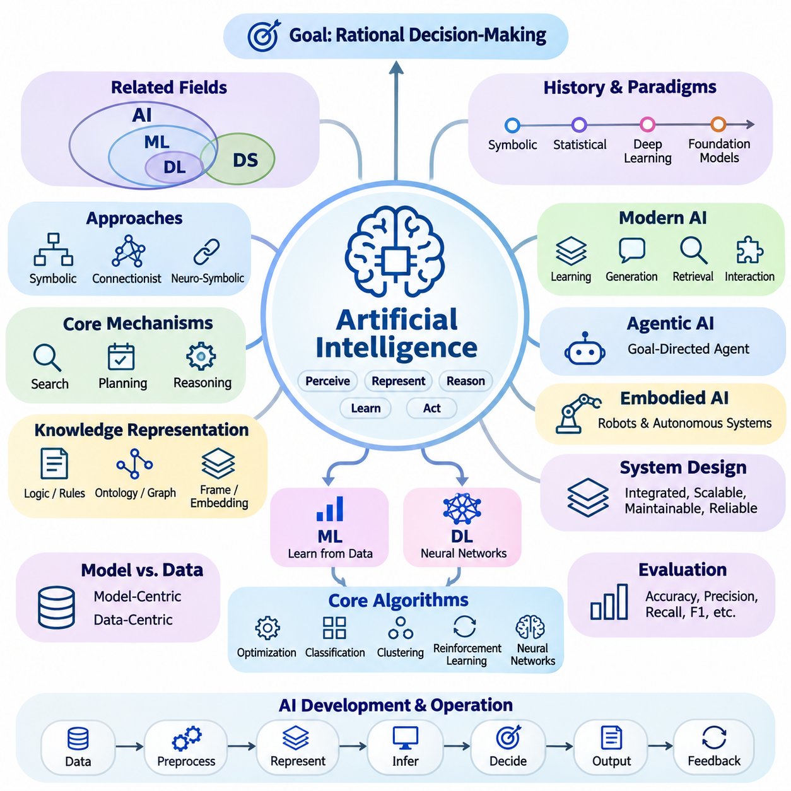
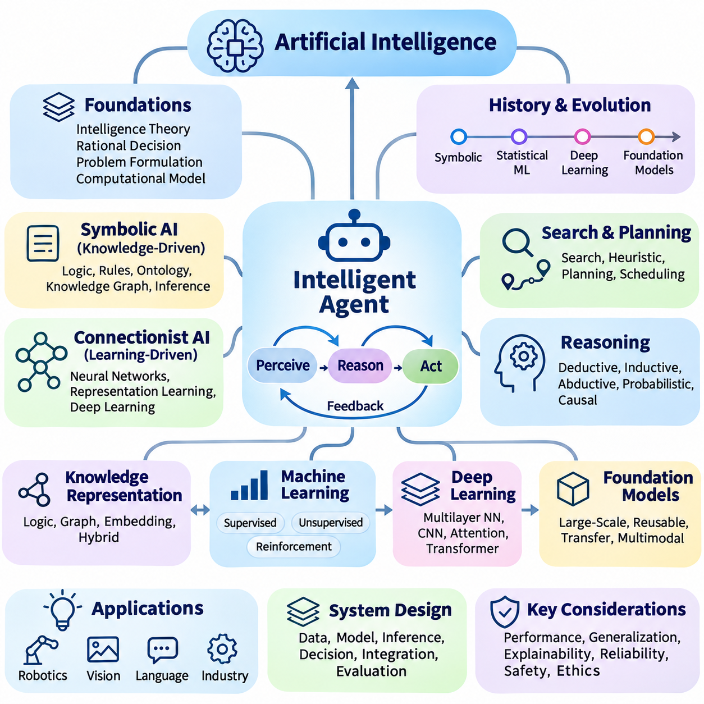
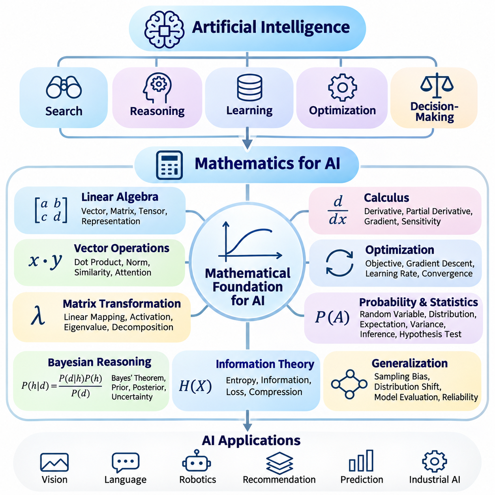
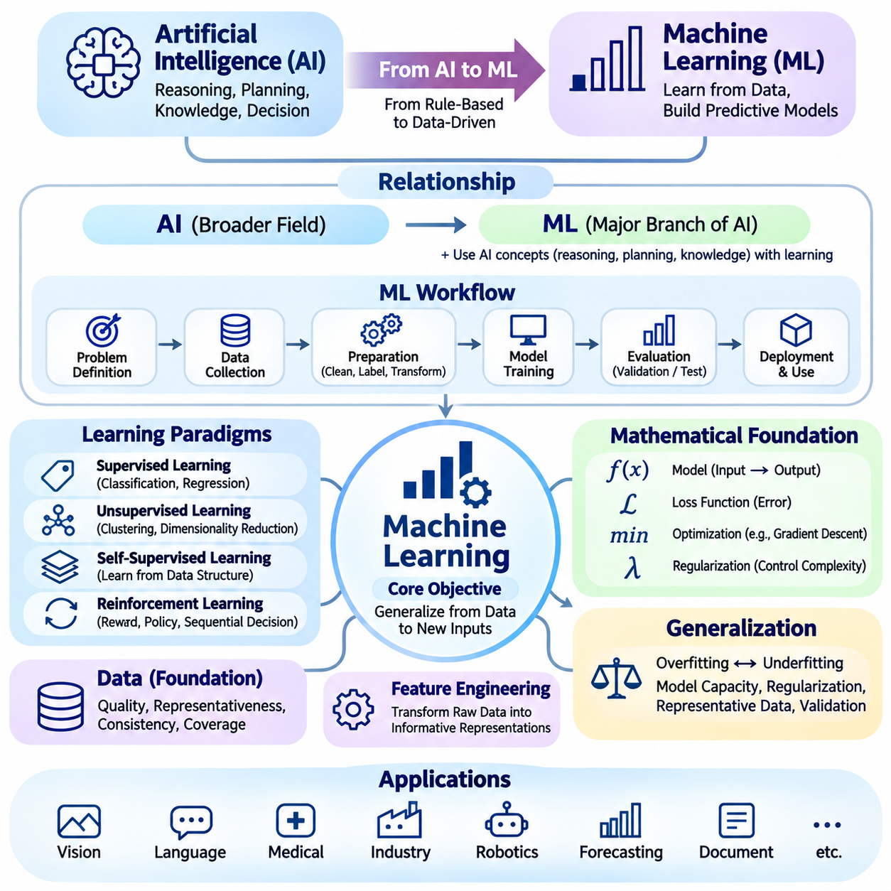
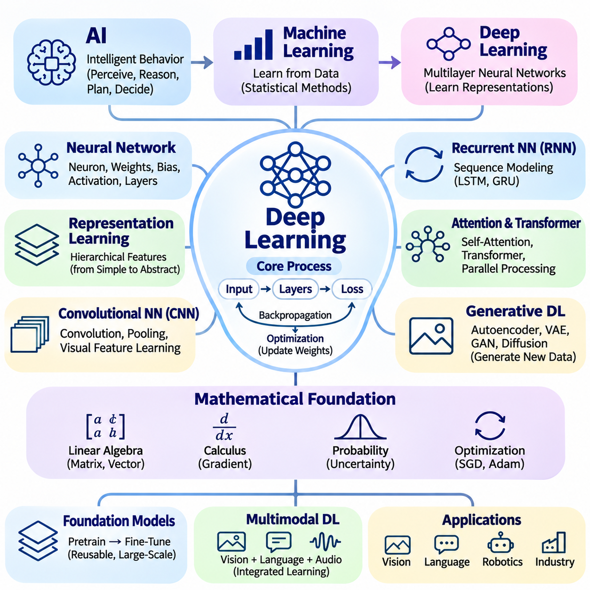
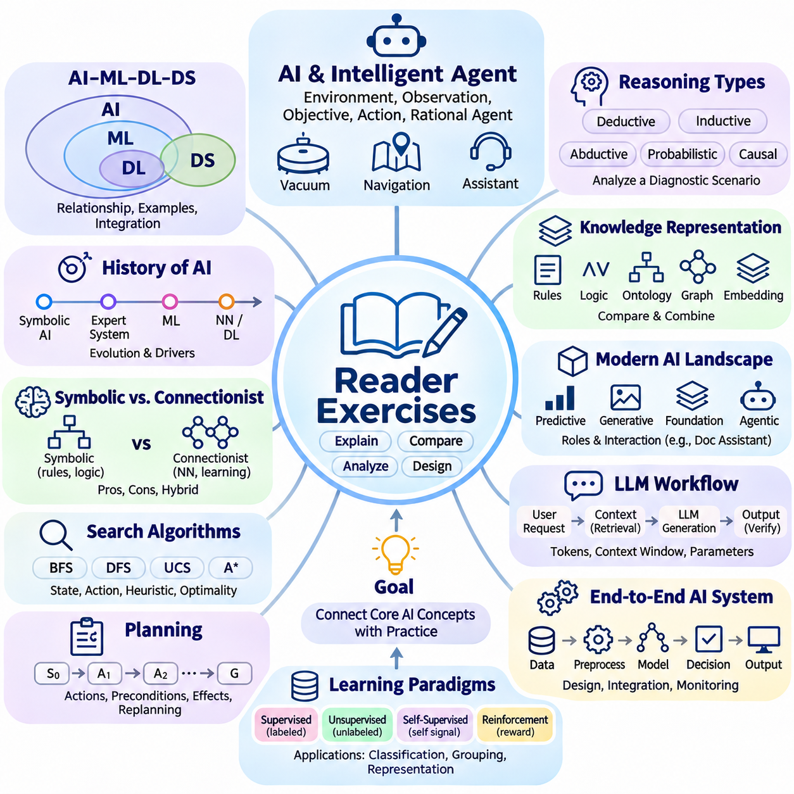
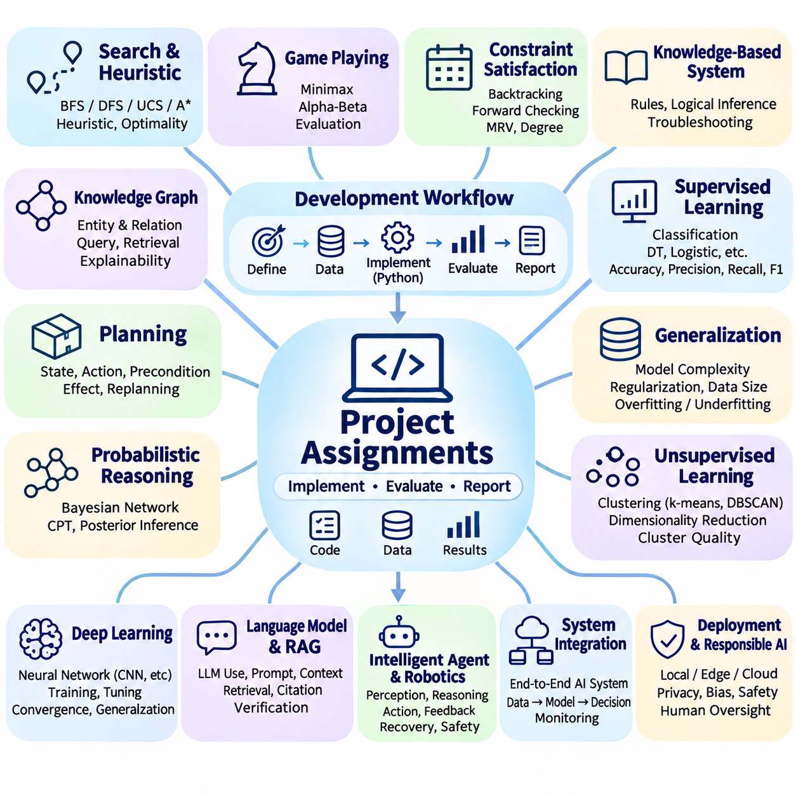

**Volume 04. Artificial Intelligence**


# 12. Summary and Next Steps

## 12.00 Key Takeaways

{width="7.268055555555556in" height="7.268055555555556in"}

Artificial intelligence is best understood as the study and engineering of systems that perceive information, represent knowledge, reason about alternatives, learn from experience, and select actions toward defined objectives. Its central purpose extends beyond reproducing human behavior to constructing computational agents capable of making rational decisions under uncertainty, resource limitations, and changing environmental conditions.

The distinction between artificial intelligence, machine learning, deep learning, and data science establishes an essential conceptual foundation. Artificial intelligence represents the broader discipline, while machine learning develops methods that improve through data. Deep learning uses multilayer neural networks to learn representations, whereas data science combines statistical analysis, computation, and domain knowledge to extract useful insights from information.

The historical development of artificial intelligence demonstrates that progress emerges through successive advances in theory, algorithms, computing infrastructure, and available data. Early symbolic systems emphasized explicit reasoning and logical manipulation, while statistical learning introduced data-driven inference. Deep learning and foundation models subsequently expanded the scale, adaptability, and diversity of tasks that computational intelligence can address.

Symbolic artificial intelligence and connectionism provide complementary approaches to intelligent computation. Symbolic methods represent concepts through logical structures, rules, and relationships, supporting explicit inference and interpretable decisions. Connectionist methods learn distributed representations from examples, enabling flexible pattern recognition. Neuro-symbolic approaches seek to combine these strengths within integrated reasoning and learning systems.

Search, planning, and reasoning remain fundamental mechanisms of artificial intelligence regardless of the underlying computational architecture. Search algorithms explore possible states and actions, while heuristic functions prioritize promising alternatives. Planning methods organize actions toward desired outcomes, and reasoning mechanisms derive conclusions from available evidence. Together, these capabilities transform information into purposeful decision-making.

Knowledge representation determines how an intelligent system organizes facts, concepts, relationships, and contextual information. Logical expressions, production rules, ontologies, knowledge graphs, frames, and vector embeddings offer different ways to structure knowledge. Their effectiveness depends on the intended reasoning process, required interpretability, computational constraints, and the complexity of relationships within the application domain.

Modern artificial intelligence increasingly combines learning, reasoning, generation, retrieval, and interaction within unified computational workflows. Foundation models provide reusable representations across tasks, while large language models support natural language understanding and generation. Multimodal systems integrate diverse information sources, and retrieval-augmented generation connects model capabilities with externally maintained knowledge.

Agentic artificial intelligence extends conventional prediction systems by introducing goal-directed interaction with tools, external services, and operational environments. An intelligent agent can interpret objectives, construct intermediate plans, execute permitted operations, evaluate results, and revise subsequent actions. Reliable agent behavior requires controlled execution, explicit constraints, state management, error recovery, and appropriate human supervision.

Embodied artificial intelligence demonstrates the importance of connecting computational intelligence with physical environments. Robots and autonomous systems must interpret sensor measurements, estimate environmental states, plan feasible movements, and control physical actions. Their performance depends not only on learning algorithms but also on perception accuracy, timing constraints, actuator capabilities, environmental uncertainty, and operational safety.

Artificial intelligence system design requires a broader perspective than selecting an individual model or algorithm. Effective systems integrate data acquisition, preprocessing, knowledge representation, inference, decision logic, output generation, and feedback mechanisms. Architectural decisions must consider scalability, maintainability, computational efficiency, reliability, and the relationship between system behavior and actual operational requirements.

The distinction between model-centric and data-centric development highlights the importance of information quality throughout the artificial intelligence lifecycle. Improving model architecture cannot compensate for every limitation caused by incomplete, inconsistent, biased, or unrepresentative data. Dataset design, labeling consistency, distribution analysis, and continuous data refinement are therefore essential elements of dependable intelligent systems.

Core algorithms provide the computational building blocks underlying advanced artificial intelligence applications. Optimization methods adjust parameters or select favorable solutions, classification algorithms assign categories, and clustering methods identify structures in unlabeled observations. Reinforcement learning develops action policies through interaction, while neural networks construct representations that support increasingly complex prediction and generation tasks.

Artificial intelligence evaluation must reflect the actual objectives and operating conditions of the system being examined. Accuracy, precision, recall, and F1 score characterize different aspects of classification performance, but no single metric captures every requirement. Search efficiency, planning quality, reasoning consistency, generation reliability, computational latency, and robustness require additional evaluation methods appropriate to their respective tasks.

Benchmark design introduces important methodological considerations concerning dataset representativeness, experimental reproducibility, statistical uncertainty, and realistic operating conditions. Strong benchmark results do not automatically establish dependable real-world performance. Evaluation should therefore include representative scenarios, failure analysis, distribution shifts, resource consumption, and comparisons against meaningful baselines before deployment decisions are made.

Responsible artificial intelligence requires safety, fairness, transparency, privacy, and accountability to be incorporated throughout system development. Bias can arise from datasets, modeling assumptions, and deployment contexts, while opaque decisions may complicate verification and oversight. Governance mechanisms, risk assessments, human intervention procedures, and continuous monitoring help align intelligent systems with organizational responsibilities and societal expectations.

Practical case studies reveal how theoretical concepts become operational capabilities through engineering integration. Expert systems illustrate explicit knowledge-based reasoning, search applications demonstrate systematic exploration, and knowledge graphs organize connected information. Computer vision, language models, robotics, and industrial applications further demonstrate how algorithm selection must respond to domain-specific constraints and measurable objectives.

A recurring lesson across artificial intelligence applications is that successful deployment depends on coordinated system behavior rather than isolated algorithmic sophistication. A highly accurate model may provide limited practical value when its latency, memory requirements, maintenance burden, or failure characteristics conflict with operational needs. Engineering tradeoffs must therefore be evaluated against the complete system and its intended environment.

Human participation remains essential in defining objectives, interpreting uncertain outcomes, evaluating consequences, and maintaining accountability. Human-in-the-loop architectures can combine automated computation with expert judgment during data annotation, decision verification, exception handling, and operational supervision. The appropriate degree of autonomy depends on task complexity, potential consequences, system reliability, and the availability of effective safeguards.

The next stage of artificial intelligence study requires deeper mathematical understanding of the mechanisms introduced throughout this volume. Linear algebra explains vector representations and neural computation, calculus supports gradient-based optimization, and probability provides a foundation for reasoning under uncertainty. Statistics, information theory, and numerical methods further establish the analytical tools needed to understand learning behavior and computational performance.

Machine learning extends these foundations into systematic methods for extracting predictive structures from data. Supervised learning, unsupervised learning, reinforcement learning, and representation learning introduce distinct approaches to acquiring useful computational behavior. Understanding their assumptions, optimization objectives, generalization properties, and evaluation procedures provides the foundation for progressing toward more sophisticated artificial intelligence architectures.

Deep learning builds upon machine learning through hierarchical representation learning and large-scale parameter optimization. Neural networks, convolutional architectures, sequence models, attention mechanisms, and transformers provide specialized computational structures for different information types. Their practical effectiveness depends on training procedures, architecture design, regularization, computational resources, and careful experimental validation.

The most important outcome of studying artificial intelligence is the ability to connect conceptual understanding with disciplined system development. Intelligent behavior emerges through the coordinated interaction of representation, learning, reasoning, planning, action, and evaluation. By understanding these relationships, practitioners can progress from isolated demonstrations toward reliable, adaptive, and maintainable artificial intelligence systems that address meaningful real-world problems.

인공지능(Artificial Intelligence, AI)은 정보를 인식하고, 지식을 표현하며, 대안을 추론하고, 경험으로부터 학습하며, 정의된 목표를 달성하기 위한 행동을 선택하는 시스템을 연구하고 설계하는 학문으로 이해할 수 있다. 인공지능의 핵심 목적은 인간의 행동을 단순히 재현하는 것을 넘어, 불확실성(Uncertainty), 자원 제약(Resource Constraints), 변화하는 환경 조건(Changing Environmental Conditions)에서도 합리적인 의사결정(Rational Decision-Making)을 수행할 수 있는 계산적 에이전트(Computational Agent)를 구축하는 데 있다.

인공지능(Artificial Intelligence), 기계학습(Machine Learning), 딥러닝(Deep Learning), 데이터 과학(Data Science)의 차이를 이해하는 것은 필수적인 개념적 기초(Conceptual Foundation)를 형성한다. 인공지능은 가장 포괄적인 학문 분야이며, 기계학습은 데이터를 통해 성능을 개선하는 방법을 개발한다. 딥러닝은 다층 신경망(Multilayer Neural Networks)을 사용하여 표현(Representation)을 학습하는 반면, 데이터 과학은 통계 분석(Statistical Analysis), 계산(Computation), 도메인 지식(Domain Knowledge)을 결합하여 정보로부터 유용한 통찰(Insight)을 추출한다.

인공지능의 역사적 발전(Historical Development)은 이론(Theory), 알고리즘(Algorithms), 컴퓨팅 인프라(Computing Infrastructure), 가용 데이터(Available Data)의 연속적인 발전을 통해 기술적 진보가 이루어진다는 사실을 보여준다. 초기 기호주의 시스템(Symbolic Systems)은 명시적 추론(Explicit Reasoning)과 논리적 조작(Logical Manipulation)을 강조하였으며, 통계적 학습(Statistical Learning)은 데이터 기반 추론(Data-Driven Inference)을 도입하였다. 이후 딥러닝과 파운데이션 모델(Foundation Models)은 계산 지능(Computational Intelligence)이 수행할 수 있는 작업의 규모, 적응성, 다양성을 크게 확장하였다.

기호주의 인공지능(Symbolic Artificial Intelligence)과 연결주의(Connectionism)는 지능형 계산(Intelligent Computation)을 구현하기 위한 상호보완적인 접근법이다. 기호주의 방법은 논리 구조(Logical Structures), 규칙(Rules), 관계(Relationships)를 통해 개념을 표현하여 명시적 추론과 해석 가능한 의사결정을 지원한다. 연결주의 방법은 사례로부터 분산 표현(Distributed Representations)을 학습하여 유연한 패턴 인식(Pattern Recognition)을 가능하게 한다. 신경기호 인공지능(Neuro-Symbolic AI)은 이러한 장점을 통합된 추론 및 학습 시스템에서 결합하고자 한다.

탐색(Search), 계획(Planning), 추론(Reasoning)은 기반 계산 구조와 관계없이 인공지능의 핵심 메커니즘(Core Mechanisms)으로 작용한다. 탐색 알고리즘(Search Algorithms)은 가능한 상태와 행동을 탐색하며, 휴리스틱 함수(Heuristic Functions)는 유망한 대안에 우선순위를 부여한다. 계획 방법(Planning Methods)은 원하는 결과를 달성하기 위한 행동을 조직하고, 추론 메커니즘(Reasoning Mechanisms)은 이용 가능한 증거로부터 결론을 도출한다. 이러한 기능은 정보를 목적 지향적인 의사결정(Goal-Directed Decision-Making)으로 변환한다.

지식 표현(Knowledge Representation)은 지능형 시스템이 사실(Facts), 개념(Concepts), 관계(Relationships), 맥락 정보(Contextual Information)를 구성하는 방식을 결정한다. 논리 표현(Logical Expressions), 생성 규칙(Production Rules), 온톨로지(Ontologies), 지식 그래프(Knowledge Graphs), 프레임(Frames), 벡터 임베딩(Vector Embeddings)은 지식을 구조화하는 서로 다른 방법을 제공한다. 각 방법의 효과는 의도된 추론 과정, 요구되는 해석 가능성(Interpretability), 계산 제약, 응용 분야의 관계 복잡성에 따라 달라진다.

현대 인공지능(Modern Artificial Intelligence)은 학습(Learning), 추론(Reasoning), 생성(Generation), 검색(Retrieval), 상호작용(Interaction)을 통합된 계산 워크플로(Computational Workflow)에서 결합하는 방향으로 발전하고 있다. 파운데이션 모델(Foundation Models)은 다양한 작업에 재사용할 수 있는 표현을 제공하며, 대규모 언어 모델(Large Language Models, LLMs)은 자연어 이해(Natural Language Understanding)와 생성을 지원한다. 멀티모달 시스템(Multimodal Systems)은 다양한 정보원을 통합하고, 검색 증강 생성(Retrieval-Augmented Generation, RAG)은 모델의 능력을 외부에서 관리되는 지식과 연결한다.

에이전트형 인공지능(Agentic AI)은 도구(Tools), 외부 서비스(External Services), 운영 환경(Operational Environments)과의 목표 지향적 상호작용(Goal-Directed Interaction)을 도입하여 기존 예측 시스템의 기능을 확장한다. 지능형 에이전트(Intelligent Agent)는 목표를 해석하고, 중간 계획을 수립하며, 허용된 작업을 실행하고, 결과를 평가한 후 후속 행동을 수정할 수 있다. 신뢰할 수 있는 에이전트 동작에는 통제된 실행(Controlled Execution), 명시적 제약(Explicit Constraints), 상태 관리(State Management), 오류 복구(Error Recovery), 적절한 인간 감독(Human Supervision)이 필요하다.

체화 인공지능(Embodied AI)은 계산 지능을 물리적 환경(Physical Environment)과 연결하는 것이 얼마나 중요한지를 보여준다. 로봇(Robots)과 자율 시스템(Autonomous Systems)은 센서 측정값(Sensor Measurements)을 해석하고, 환경 상태(Environmental States)를 추정하며, 실행 가능한 움직임을 계획하고, 물리적 행동을 제어해야 한다. 이러한 시스템의 성능은 학습 알고리즘뿐 아니라 인식 정확도(Perception Accuracy), 시간 제약(Timing Constraints), 구동기 성능(Actuator Capabilities), 환경 불확실성(Environmental Uncertainty), 운영 안전성(Operational Safety)에 의해서도 결정된다.

인공지능 시스템 설계(AI System Design)는 개별 모델이나 알고리즘을 선택하는 것보다 폭넓은 관점을 요구한다. 효과적인 시스템은 데이터 수집(Data Acquisition), 전처리(Preprocessing), 지식 표현(Knowledge Representation), 추론(Inference), 의사결정 논리(Decision Logic), 출력 생성(Output Generation), 피드백 메커니즘(Feedback Mechanisms)을 통합한다. 아키텍처 결정(Architectural Decisions)에서는 확장성(Scalability), 유지보수성(Maintainability), 계산 효율성(Computational Efficiency), 신뢰성(Reliability), 실제 운영 요구사항과 시스템 동작 사이의 관계를 고려해야 한다.

모델 중심 개발(Model-Centric Development)과 데이터 중심 개발(Data-Centric Development)의 차이는 인공지능 생명주기(AI Lifecycle) 전반에서 정보 품질(Information Quality)의 중요성을 강조한다. 모델 아키텍처를 개선하더라도 불완전하거나 일관성이 부족하고, 편향되거나 대표성이 부족한 데이터에서 발생하는 모든 한계를 해결할 수는 없다. 따라서 데이터셋 설계(Dataset Design), 레이블링 일관성(Labeling Consistency), 분포 분석(Distribution Analysis), 지속적인 데이터 개선(Continuous Data Refinement)은 신뢰할 수 있는 지능형 시스템을 구성하는 필수 요소이다.

핵심 알고리즘(Core Algorithms)은 고급 인공지능 응용을 구성하는 계산적 기본 요소(Computational Building Blocks)를 제공한다. 최적화 방법(Optimization Methods)은 매개변수를 조정하거나 유리한 해를 선택하며, 분류 알고리즘(Classification Algorithms)은 범주를 할당하고, 군집화 방법(Clustering Methods)은 레이블이 없는 관측 데이터에서 구조를 발견한다. 강화학습(Reinforcement Learning)은 상호작용을 통해 행동 정책(Action Policies)을 개발하며, 신경망(Neural Networks)은 복잡한 예측과 생성 작업을 지원하는 표현을 구성한다.

인공지능 평가(AI Evaluation)는 평가 대상 시스템의 실제 목표와 운영 조건을 반영해야 한다. 정확도(Accuracy), 정밀도(Precision), 재현율(Recall), F1 점수(F1 Score)는 분류 성능(Classification Performance)의 서로 다른 측면을 나타내지만, 단일 지표만으로 모든 요구사항을 설명할 수는 없다. 탐색 효율성(Search Efficiency), 계획 품질(Planning Quality), 추론 일관성(Reasoning Consistency), 생성 신뢰성(Generation Reliability), 계산 지연시간(Computational Latency), 강건성(Robustness)은 각각에 적합한 추가 평가 방법을 요구한다.

벤치마크 설계(Benchmark Design)에서는 데이터셋 대표성(Dataset Representativeness), 실험 재현성(Experimental Reproducibility), 통계적 불확실성(Statistical Uncertainty), 현실적인 운영 조건(Realistic Operating Conditions)을 고려해야 한다. 우수한 벤치마크 결과가 실제 환경에서의 신뢰할 수 있는 성능을 자동으로 보장하지는 않는다. 따라서 배포 결정(Deployment Decisions)에 앞서 대표적인 시나리오, 실패 분석(Failure Analysis), 분포 변화(Distribution Shifts), 자원 소비(Resource Consumption), 의미 있는 기준 모델(Baselines)과의 비교를 포함하여 평가해야 한다.

책임 있는 인공지능(Responsible AI)은 안전성(Safety), 공정성(Fairness), 투명성(Transparency), 개인정보 보호(Privacy), 책임성(Accountability)을 시스템 개발 전반에 통합할 것을 요구한다. 편향(Bias)은 데이터셋, 모델링 가정(Modeling Assumptions), 배포 환경(Deployment Contexts)에서 발생할 수 있으며, 불투명한 의사결정은 검증과 감독을 어렵게 만든다. 거버넌스 메커니즘(Governance Mechanisms), 위험 평가(Risk Assessments), 인간 개입 절차(Human Intervention Procedures), 지속적인 모니터링(Continuous Monitoring)은 지능형 시스템을 조직의 책임과 사회적 기대에 부합하도록 관리하는 데 기여한다.

실제 사례 연구(Practical Case Studies)는 이론적 개념이 공학적 통합(Engineering Integration)을 통해 운영 능력(Operational Capabilities)으로 전환되는 과정을 보여준다. 전문가 시스템(Expert Systems)은 명시적 지식 기반 추론(Knowledge-Based Reasoning)을 설명하고, 탐색 응용(Search Applications)은 체계적인 탐색 과정을 보여주며, 지식 그래프는 연결된 정보를 조직한다. 컴퓨터 비전(Computer Vision), 언어 모델(Language Models), 로보틱스(Robotics), 산업용 인공지능(Industrial AI)은 알고리즘 선택이 도메인별 제약과 측정 가능한 목표에 따라 이루어져야 함을 보여준다.

인공지능 응용 전반에서 반복적으로 확인되는 교훈은 성공적인 배포(Successful Deployment)가 개별 알고리즘의 정교함보다 시스템 전체의 조화로운 동작(Coordinated System Behavior)에 달려 있다는 점이다. 높은 정확도를 가진 모델이라도 지연시간(Latency), 메모리 요구사항(Memory Requirements), 유지보수 부담(Maintenance Burden), 실패 특성(Failure Characteristics)이 운영 요구와 충돌하면 실질적인 가치가 제한될 수 있다. 따라서 공학적 절충(Engineering Tradeoffs)은 전체 시스템과 의도된 운영 환경을 기준으로 평가해야 한다.

인간의 참여(Human Participation)는 목표 정의(Objective Definition), 불확실한 결과의 해석(Interpretation), 결과의 영향 평가(Consequence Evaluation), 책임성 유지(Accountability)에 여전히 필수적이다. 인간 참여형 아키텍처(Human-in-the-Loop Architecture)는 데이터 주석(Data Annotation), 의사결정 검증(Decision Verification), 예외 처리(Exception Handling), 운영 감독(Operational Supervision)에서 자동화된 계산과 전문가 판단을 결합할 수 있다. 적절한 자율성 수준(Autonomy Level)은 작업 복잡성, 잠재적 결과, 시스템 신뢰성, 효과적인 안전장치의 가용성에 따라 결정된다.

인공지능 학습의 다음 단계에서는 지금까지 소개한 메커니즘을 더욱 깊이 이해하기 위한 수학적 기초(Mathematical Foundations)가 필요하다. 선형대수학(Linear Algebra)은 벡터 표현(Vector Representations)과 신경 계산(Neural Computation)을 설명하고, 미적분학(Calculus)은 경사 기반 최적화(Gradient-Based Optimization)를 지원하며, 확률론(Probability Theory)은 불확실성 아래에서의 추론을 위한 기초를 제공한다. 통계학(Statistics), 정보이론(Information Theory), 수치해석(Numerical Methods)은 학습 동작과 계산 성능을 이해하는 데 필요한 분석 도구를 제공한다.

기계학습(Machine Learning)은 이러한 기초를 확장하여 데이터로부터 예측 구조(Predictive Structures)를 체계적으로 추출하는 방법을 제공한다. 지도학습(Supervised Learning), 비지도학습(Unsupervised Learning), 강화학습(Reinforcement Learning), 표현학습(Representation Learning)은 유용한 계산적 동작을 획득하기 위한 서로 다른 접근법을 제시한다. 각 방법의 가정(Assumptions), 최적화 목표(Optimization Objectives), 일반화 특성(Generalization Properties), 평가 절차(Evaluation Procedures)를 이해하는 것은 더욱 정교한 인공지능 아키텍처로 발전하기 위한 기반이 된다.

딥러닝(Deep Learning)은 계층적 표현학습(Hierarchical Representation Learning)과 대규모 매개변수 최적화(Large-Scale Parameter Optimization)를 통해 기계학습을 확장한다. 신경망(Neural Networks), 합성곱 아키텍처(Convolutional Architectures), 시퀀스 모델(Sequence Models), 어텐션 메커니즘(Attention Mechanisms), 트랜스포머(Transformers)는 서로 다른 정보 유형을 처리하기 위한 특화된 계산 구조를 제공한다. 실제 효과는 학습 절차(Training Procedures), 아키텍처 설계(Architecture Design), 정규화(Regularization), 계산 자원(Computational Resources), 신중한 실험 검증(Experimental Validation)에 따라 달라진다.

인공지능을 학습하는 과정에서 얻어야 할 가장 중요한 성과는 개념적 이해(Conceptual Understanding)를 체계적인 시스템 개발(System Development)과 연결하는 능력이다. 지능적 행동(Intelligent Behavior)은 표현(Representation), 학습(Learning), 추론(Reasoning), 계획(Planning), 행동(Action), 평가(Evaluation)의 조화로운 상호작용을 통해 나타난다. 이러한 관계를 이해함으로써 개발자와 연구자는 개별적인 기술 시연을 넘어, 실제 세계의 의미 있는 문제를 해결하는 신뢰성(Reliability), 적응성(Adaptability), 유지보수성(Maintainability)을 갖춘 인공지능 시스템으로 발전할 수 있다.

## 12.01 Concept Map of AI

{width="7.268055555555556in" height="7.268055555555556in"}

A concept map of artificial intelligence provides a unified perspective on how fundamental theories, computational mechanisms, learning methods, and practical applications relate to one another. Rather than treating artificial intelligence as a collection of isolated technologies, the conceptual map organizes its components into an interconnected framework. This perspective helps explain how intelligent behavior emerges from coordinated processes involving perception, representation, reasoning, learning, planning, and action.

At the center of the conceptual framework is the intelligent agent, a computational entity that observes its environment, interprets available information, and selects actions according to defined objectives. The agent operates through a continuous perception, reasoning, and action cycle. Environmental feedback influences subsequent decisions, allowing the system to respond to changing conditions while maintaining consistency with its goals, operational constraints, and available computational resources.

The foundational layer of artificial intelligence includes theories of intelligence, rational decision-making, problem formulation, and computational representation. These concepts establish what an intelligent system should accomplish and how its behavior can be evaluated. Rational agent models connect objectives with actions, while problem formulation defines states, available operations, transition rules, and success conditions. Together, these foundations provide a systematic basis for designing intelligent systems.

Historical developments form another dimension of the conceptual map, explaining how different approaches to intelligence emerged and evolved. Symbolic artificial intelligence introduced explicit knowledge manipulation, logical inference, and rule-based decision-making. Statistical machine learning shifted attention toward patterns extracted from data, while deep learning enabled increasingly complex representation learning. Foundation models subsequently expanded the reuse of learned capabilities across diverse tasks.

Symbolic artificial intelligence occupies the knowledge-driven branch of the conceptual framework. Its primary mechanisms include logic, production rules, ontologies, knowledge graphs, and structured reasoning procedures. These representations allow systems to express relationships, enforce constraints, and derive conclusions through explicit operations. Symbolic approaches are particularly valuable when decisions require traceability, formal consistency, or clearly defined domain knowledge.

Connectionist artificial intelligence represents the learning-driven branch, where computational models acquire useful representations through parameter adjustment. Artificial neural networks transform input signals through interconnected processing units, allowing statistical relationships to be encoded within learned parameters. Deep learning extends this principle through hierarchical architectures capable of processing images, language, audio, and other complex information without requiring every relevant feature to be manually specified.

Search and planning connect knowledge representation with purposeful action. Search algorithms explore alternative states or candidate solutions, while heuristic functions guide exploration toward promising possibilities. Planning systems construct sequences of actions that satisfy goals and operational constraints. These mechanisms apply to navigation, scheduling, game playing, automated problem solving, and robotic task execution, demonstrating their importance across symbolic and learning-based architectures.

Reasoning forms a conceptual bridge between stored knowledge, observed evidence, and decision-making. Deductive reasoning derives conclusions from established premises, while inductive reasoning identifies general patterns from observations. Abductive reasoning proposes plausible explanations, probabilistic reasoning manages uncertainty, and causal reasoning examines relationships between interventions and outcomes. Each approach addresses a different aspect of intelligent inference.

Knowledge representation provides the structural foundation connecting symbolic reasoning with modern learning systems. Logic-based representations support explicit relationships and inference, while vector representations encode statistical similarities in continuous spaces. Knowledge graphs organize entities and relationships, and embeddings enable efficient semantic comparison. Hybrid architectures can combine these representations to support both structured reasoning and flexible pattern recognition.

Machine learning introduces adaptive mechanisms that allow systems to improve through experience rather than relying exclusively on predefined instructions. Supervised learning uses labeled examples to estimate predictive relationships, while unsupervised learning discovers structures within unlabeled data. Reinforcement learning develops action policies through interaction and feedback. These paradigms connect statistical modeling, optimization, evaluation, and environmental adaptation within the broader artificial intelligence framework.

Deep learning provides a major architectural connection between machine learning and modern foundation models. Multilayer neural networks learn progressively abstract representations, while convolutional architectures support spatial processing and attention mechanisms capture relationships across information elements. Transformers extend these capabilities to language, vision, and multimodal processing. Their effectiveness depends on optimization procedures, training data, computational resources, and generalization behavior.

Foundation models occupy an increasingly important position within the modern artificial intelligence landscape because they provide reusable capabilities developed through large-scale training. Large language models process and generate natural language, while multimodal models combine textual, visual, auditory, and other information. Generative artificial intelligence produces new content from learned distributions, extending intelligent computation beyond classification and prediction into synthesis and interactive assistance.

Retrieval-augmented generation connects learned model representations with externally maintained information sources. Retrieval mechanisms identify relevant documents or knowledge records, and generation models incorporate retrieved context when producing responses. This relationship illustrates how statistical learning can be integrated with structured information management. Effective implementations require retrieval quality assessment, context selection, source validation, and mechanisms for handling incomplete or conflicting evidence.

Agentic artificial intelligence connects language understanding, reasoning, planning, memory, and external tool execution within goal-directed workflows. An agent can interpret instructions, decompose objectives into subtasks, select appropriate operations, and evaluate intermediate outcomes. Its effectiveness depends on coordination among model inference, environmental observations, tool interfaces, and execution controls. Human supervision and operational safeguards remain essential when actions produce consequential external effects.

Embodied artificial intelligence extends the conceptual framework into physical interaction through robotics and autonomous systems. Sensors provide observations, perception algorithms estimate environmental conditions, and planning mechanisms identify feasible actions. Control systems translate decisions into physical movement while receiving feedback from the environment. This integration connects machine learning, reasoning, state estimation, real-time computation, and safety engineering within a unified operational cycle.

Artificial intelligence system architecture organizes these conceptual components into practical computational workflows. Input interfaces collect information, processing modules transform data, models generate predictions or representations, and decision mechanisms select responses. Output interfaces deliver results or control actions, while monitoring systems capture feedback for evaluation and improvement. Effective architectures must coordinate functionality with reliability, scalability, latency, resource availability, and maintainability.

Evaluation and benchmarking form a cross-cutting dimension that connects every component of the conceptual map to measurable performance. Classification metrics assess predictive behavior, while planning metrics examine solution quality and computational efficiency. Generative systems require assessments of factual reliability, relevance, and consistency. Robustness testing, distribution analysis, and reproducible experiments establish whether observed capabilities remain dependable under realistic operating conditions.

Ethics, safety, and governance surround the entire artificial intelligence framework rather than functioning as isolated technical subjects. Fairness concerns influence data collection and model behavior, while privacy requirements shape information processing and storage. Transparency supports meaningful oversight, and safety engineering addresses foreseeable failures and misuse. Responsible system development integrates these considerations into design decisions, evaluation procedures, deployment controls, and ongoing monitoring.

Practical applications demonstrate how different branches of artificial intelligence converge around domain-specific requirements. Industrial inspection combines perception, classification, and operational decision-making, while autonomous robotics integrates localization, planning, and control. Language-based assistants combine foundation models, retrieval, and interaction mechanisms. These examples illustrate that effective applications typically depend on multiple coordinated capabilities rather than a single algorithm.

The conceptual map ultimately reveals artificial intelligence as a layered and interconnected engineering discipline. Mathematical foundations support algorithms, algorithms enable representations and learning, and these mechanisms contribute to reasoning, planning, and intelligent action. System architecture integrates the components, evaluation measures their effectiveness, and governance establishes responsible operating boundaries. Understanding these connections prepares readers for deeper study of mathematics, machine learning, deep learning, and advanced intelligent systems.

인공지능 개념도(Concept Map of Artificial Intelligence)는 기본 이론(Fundamental Theories), 계산 메커니즘(Computational Mechanisms), 학습 방법(Learning Methods), 실제 응용(Practical Applications)이 서로 어떻게 연결되는지를 통합적인 관점에서 보여준다. 인공지능을 독립적인 기술들의 집합으로 취급하는 대신, 개념도는 구성 요소들을 상호 연결된 프레임워크(Interconnected Framework)로 조직한다. 이러한 관점은 인식(Perception), 표현(Representation), 추론(Reasoning), 학습(Learning), 계획(Planning), 행동(Action)의 조화로운 과정을 통해 지능적 행동(Intelligent Behavior)이 어떻게 나타나는지를 설명하는 데 도움이 된다.

개념적 프레임워크(Conceptual Framework)의 중심에는 환경을 관찰하고, 이용 가능한 정보를 해석하며, 정의된 목표에 따라 행동을 선택하는 계산적 개체인 지능형 에이전트(Intelligent Agent)가 존재한다. 에이전트는 인식(Perception), 추론(Reasoning), 행동(Action)의 연속적인 순환 구조를 통해 작동한다. 환경 피드백(Environmental Feedback)은 이후의 의사결정에 영향을 미치며, 시스템이 목표, 운영 제약(Operational Constraints), 가용 계산 자원(Available Computational Resources)과의 일관성을 유지하면서 변화하는 조건에 대응할 수 있도록 한다.

인공지능의 기초 계층(Foundational Layer)에는 지능 이론(Theories of Intelligence), 합리적 의사결정(Rational Decision-Making), 문제 정식화(Problem Formulation), 계산적 표현(Computational Representation)이 포함된다. 이러한 개념은 지능형 시스템이 무엇을 달성해야 하며, 그 행동을 어떻게 평가할 수 있는지를 정의한다. 합리적 에이전트 모델(Rational Agent Models)은 목표와 행동을 연결하고, 문제 정식화는 상태(States), 사용 가능한 연산(Available Operations), 상태 전이 규칙(Transition Rules), 성공 조건(Success Conditions)을 정의한다. 이러한 기초는 지능형 시스템을 체계적으로 설계하기 위한 기반을 제공한다.

역사적 발전(Historical Developments)은 지능에 대한 서로 다른 접근법이 어떻게 등장하고 진화했는지를 설명하는 개념도의 또 다른 차원을 형성한다. 기호주의 인공지능(Symbolic Artificial Intelligence)은 명시적 지식 조작(Explicit Knowledge Manipulation), 논리적 추론(Logical Inference), 규칙 기반 의사결정(Rule-Based Decision-Making)을 도입하였다. 통계적 기계학습(Statistical Machine Learning)은 데이터에서 추출한 패턴으로 관심을 이동시켰으며, 딥러닝(Deep Learning)은 더욱 복잡한 표현학습(Representation Learning)을 가능하게 하였다. 이후 파운데이션 모델(Foundation Models)은 다양한 작업에서 학습된 능력을 재사용할 수 있는 범위를 확장하였다.

기호주의 인공지능(Symbolic Artificial Intelligence)은 개념적 프레임워크에서 지식 중심 분기(Knowledge-Driven Branch)를 차지한다. 주요 메커니즘에는 논리(Logic), 생성 규칙(Production Rules), 온톨로지(Ontologies), 지식 그래프(Knowledge Graphs), 구조화된 추론 절차(Structured Reasoning Procedures)가 포함된다. 이러한 표현은 시스템이 관계를 명시하고, 제약을 적용하며, 명시적인 연산을 통해 결론을 도출할 수 있도록 한다. 기호주의 접근법(Symbolic Approaches)은 의사결정의 추적 가능성(Traceability), 형식적 일관성(Formal Consistency), 명확하게 정의된 도메인 지식(Domain Knowledge)이 요구되는 경우 특히 유용하다.

연결주의 인공지능(Connectionist Artificial Intelligence)은 계산 모델이 매개변수 조정(Parameter Adjustment)을 통해 유용한 표현을 획득하는 학습 중심 분기(Learning-Driven Branch)를 나타낸다. 인공 신경망(Artificial Neural Networks)은 상호 연결된 처리 단위(Interconnected Processing Units)를 통해 입력 신호를 변환하고, 통계적 관계(Statistical Relationships)를 학습된 매개변수에 인코딩한다. 딥러닝은 계층적 아키텍처(Hierarchical Architectures)를 통해 이러한 원리를 확장하며, 관련 특징을 모두 수동으로 지정하지 않고도 이미지, 언어, 오디오 및 기타 복잡한 정보를 처리할 수 있도록 한다.

탐색(Search)과 계획(Planning)은 지식 표현(Knowledge Representation)을 목적 지향적 행동(Purposeful Action)과 연결한다. 탐색 알고리즘(Search Algorithms)은 대안적인 상태나 후보 해를 탐색하며, 휴리스틱 함수(Heuristic Functions)는 유망한 가능성을 향해 탐색을 유도한다. 계획 시스템(Planning Systems)은 목표와 운영 제약을 만족하는 행동 순서(Action Sequences)를 구성한다. 이러한 메커니즘은 내비게이션(Navigation), 일정 관리(Scheduling), 게임 수행(Game Playing), 자동화된 문제 해결(Automated Problem Solving), 로봇 작업 실행(Robotic Task Execution)에 적용되며, 기호주의 및 학습 기반 아키텍처 모두에서 중요성을 보여준다.

추론(Reasoning)은 저장된 지식(Stored Knowledge), 관측된 증거(Observed Evidence), 의사결정(Decision-Making)을 연결하는 개념적 가교(Conceptual Bridge)를 형성한다. 연역적 추론(Deductive Reasoning)은 확립된 전제로부터 결론을 도출하고, 귀납적 추론(Inductive Reasoning)은 관측으로부터 일반적인 패턴을 발견한다. 가설적 추론(Abductive Reasoning)은 가능한 설명을 제안하며, 확률적 추론(Probabilistic Reasoning)은 불확실성을 처리하고, 인과적 추론(Causal Reasoning)은 개입(Interventions)과 결과(Outcomes) 사이의 관계를 분석한다. 각 접근법은 지능적 추론(Intelligent Inference)의 서로 다른 측면을 다룬다.

지식 표현(Knowledge Representation)은 기호적 추론(Symbolic Reasoning)과 현대 학습 시스템(Modern Learning Systems)을 연결하는 구조적 기반(Structural Foundation)을 제공한다. 논리 기반 표현(Logic-Based Representations)은 명시적 관계와 추론을 지원하며, 벡터 표현(Vector Representations)은 연속 공간(Continuous Spaces)에서 통계적 유사성(Statistical Similarities)을 인코딩한다. 지식 그래프는 개체(Entities)와 관계(Relationships)를 조직하고, 임베딩(Embeddings)은 효율적인 의미적 비교(Semantic Comparison)를 가능하게 한다. 하이브리드 아키텍처(Hybrid Architectures)는 이러한 표현을 결합하여 구조화된 추론과 유연한 패턴 인식을 동시에 지원할 수 있다.

기계학습(Machine Learning)은 사전에 정의된 명령에만 의존하지 않고 경험을 통해 시스템이 개선될 수 있도록 하는 적응 메커니즘(Adaptive Mechanisms)을 도입한다. 지도학습(Supervised Learning)은 레이블이 지정된 사례(Labeled Examples)를 사용하여 예측 관계(Predictive Relationships)를 추정하고, 비지도학습(Unsupervised Learning)은 레이블이 없는 데이터에서 구조를 발견한다. 강화학습(Reinforcement Learning)은 상호작용과 피드백을 통해 행동 정책(Action Policies)을 개발한다. 이러한 학습 패러다임(Learning Paradigms)은 통계적 모델링(Statistical Modeling), 최적화(Optimization), 평가(Evaluation), 환경 적응(Environmental Adaptation)을 인공지능의 전체 프레임워크 안에서 연결한다.

딥러닝(Deep Learning)은 기계학습과 현대 파운데이션 모델(Foundation Models)을 연결하는 주요 아키텍처적 기반(Architectural Foundation)을 제공한다. 다층 신경망(Multilayer Neural Networks)은 점진적으로 추상화된 표현(Abstract Representations)을 학습하며, 합성곱 아키텍처(Convolutional Architectures)는 공간 정보 처리(Spatial Processing)를 지원하고, 어텐션 메커니즘(Attention Mechanisms)은 정보 요소 사이의 관계를 포착한다. 트랜스포머(Transformers)는 이러한 능력을 언어, 비전, 멀티모달 처리(Multimodal Processing)로 확장한다. 그 효과는 최적화 절차, 학습 데이터, 계산 자원, 일반화 동작(Generalization Behavior)에 따라 달라진다.

파운데이션 모델(Foundation Models)은 대규모 학습(Large-Scale Training)을 통해 개발된 재사용 가능한 능력을 제공하기 때문에 현대 인공지능 환경에서 점점 더 중요한 위치를 차지한다. 대규모 언어 모델(Large Language Models)은 자연어를 처리하고 생성하며, 멀티모달 모델(Multimodal Models)은 텍스트, 시각, 청각 및 기타 정보를 결합한다. 생성형 인공지능(Generative Artificial Intelligence)은 학습된 분포(Learned Distributions)를 바탕으로 새로운 콘텐츠를 생성하여 지능형 계산의 범위를 분류(Classification)와 예측(Prediction)에서 합성(Synthesis)과 대화형 지원(Interactive Assistance)으로 확장한다.

검색 증강 생성(Retrieval-Augmented Generation, RAG)은 학습된 모델 표현(Learned Model Representations)을 외부에서 관리되는 정보원(Externally Maintained Information Sources)과 연결한다. 검색 메커니즘(Retrieval Mechanisms)은 관련 문서나 지식 기록을 식별하고, 생성 모델(Generation Models)은 검색된 맥락(Retrieved Context)을 응답 생성에 반영한다. 이러한 관계는 통계적 학습(Statistical Learning)이 구조화된 정보 관리(Structured Information Management)와 어떻게 통합될 수 있는지를 보여준다. 효과적인 구현에는 검색 품질 평가(Retrieval Quality Assessment), 맥락 선택(Context Selection), 출처 검증(Source Validation), 불완전하거나 상충하는 증거를 처리하는 메커니즘이 필요하다.

에이전트형 인공지능(Agentic Artificial Intelligence)은 언어 이해(Language Understanding), 추론(Reasoning), 계획(Planning), 메모리(Memory), 외부 도구 실행(External Tool Execution)을 목표 지향적 워크플로(Goal-Directed Workflows) 안에서 연결한다. 에이전트는 명령을 해석하고, 목표를 하위 작업(Subtasks)으로 분해하며, 적절한 연산을 선택하고, 중간 결과를 평가할 수 있다. 그 효과는 모델 추론(Model Inference), 환경 관측(Environmental Observations), 도구 인터페이스(Tool Interfaces), 실행 제어(Execution Controls) 사이의 조정에 따라 달라진다. 행동이 중요한 외부 결과를 발생시키는 경우 인간 감독(Human Supervision)과 운영 안전장치(Operational Safeguards)는 필수적이다.

체화 인공지능(Embodied Artificial Intelligence)은 로보틱스(Robotics)와 자율 시스템(Autonomous Systems)을 통한 물리적 상호작용(Physical Interaction)으로 개념적 프레임워크를 확장한다. 센서(Sensors)는 관측 정보를 제공하고, 인식 알고리즘(Perception Algorithms)은 환경 조건을 추정하며, 계획 메커니즘(Planning Mechanisms)은 실행 가능한 행동을 식별한다. 제어 시스템(Control Systems)은 의사결정을 물리적 움직임으로 변환하면서 환경으로부터 피드백을 수신한다. 이러한 통합은 기계학습, 추론, 상태 추정(State Estimation), 실시간 계산(Real-Time Computation), 안전 공학(Safety Engineering)을 하나의 운영 순환 구조로 연결한다.

인공지능 시스템 아키텍처(AI System Architecture)는 이러한 개념적 구성 요소들을 실제 계산 워크플로(Computational Workflows)로 조직한다. 입력 인터페이스(Input Interfaces)는 정보를 수집하고, 처리 모듈(Processing Modules)은 데이터를 변환하며, 모델(Models)은 예측이나 표현을 생성하고, 의사결정 메커니즘(Decision Mechanisms)은 응답을 선택한다. 출력 인터페이스(Output Interfaces)는 결과나 제어 행동을 전달하고, 모니터링 시스템(Monitoring Systems)은 평가와 개선을 위한 피드백을 수집한다. 효과적인 아키텍처는 기능성과 신뢰성, 확장성, 지연시간, 자원 가용성, 유지보수성을 조화롭게 관리해야 한다.

평가(Evaluation)와 벤치마킹(Benchmarking)은 개념도의 모든 구성 요소를 측정 가능한 성능(Measurable Performance)과 연결하는 횡단적 차원(Cross-Cutting Dimension)을 형성한다. 분류 지표(Classification Metrics)는 예측 동작을 평가하고, 계획 지표(Planning Metrics)는 해의 품질과 계산 효율성을 분석한다. 생성 시스템(Generative Systems)은 사실적 신뢰성(Factual Reliability), 관련성(Relevance), 일관성(Consistency)에 대한 평가가 필요하다. 강건성 시험(Robustness Testing), 분포 분석(Distribution Analysis), 재현 가능한 실험(Reproducible Experiments)은 관측된 능력이 실제 운영 조건에서도 신뢰할 수 있는지를 확인하는 기반을 제공한다.

윤리(Ethics), 안전성(Safety), 거버넌스(Governance)는 독립된 기술 주제로만 기능하는 것이 아니라 인공지능 프레임워크 전체를 포괄한다. 공정성(Fairness)에 대한 고려는 데이터 수집과 모델 동작에 영향을 미치며, 개인정보 보호 요구사항(Privacy Requirements)은 정보 처리와 저장 방식을 결정한다. 투명성(Transparency)은 의미 있는 감독을 지원하고, 안전 공학(Safety Engineering)은 예측 가능한 실패와 오용(Misuse)에 대응한다. 책임 있는 시스템 개발(Responsible System Development)은 이러한 고려사항을 설계 결정, 평가 절차, 배포 제어(Deployment Controls), 지속적인 모니터링에 통합한다.

실제 응용(Practical Applications)은 인공지능의 서로 다른 분기들이 도메인별 요구사항(Domain-Specific Requirements)을 중심으로 어떻게 융합되는지를 보여준다. 산업 검사(Industrial Inspection)는 인식(Perception), 분류(Classification), 운영 의사결정(Operational Decision-Making)을 결합하며, 자율 로보틱스(Autonomous Robotics)는 위치 추정(Localization), 계획(Planning), 제어(Control)를 통합한다. 언어 기반 어시스턴트(Language-Based Assistants)는 파운데이션 모델, 검색, 상호작용 메커니즘을 결합한다. 이러한 사례는 효과적인 응용이 일반적으로 단일 알고리즘보다 여러 능력의 조화로운 결합에 의존한다는 사실을 보여준다.

궁극적으로 인공지능 개념도(Concept Map of Artificial Intelligence)는 인공지능이 계층적이고 상호 연결된 공학 분야(Layered and Interconnected Engineering Discipline)임을 보여준다. 수학적 기초(Mathematical Foundations)는 알고리즘을 지원하고, 알고리즘은 표현과 학습을 가능하게 하며, 이러한 메커니즘은 추론, 계획, 지능적 행동에 기여한다. 시스템 아키텍처(System Architecture)는 구성 요소들을 통합하고, 평가(Evaluation)는 효과를 측정하며, 거버넌스(Governance)는 책임 있는 운영 경계(Responsible Operating Boundaries)를 설정한다. 이러한 연결 관계를 이해하는 것은 수학(Mathematics), 기계학습(Machine Learning), 딥러닝(Deep Learning), 고급 지능형 시스템(Advanced Intelligent Systems)에 대한 심화 학습을 준비하는 기반이 된다.

## 12.02 From AI to Mathematics for AI

{width="7.268055555555556in" height="7.268055555555556in"}

Artificial intelligence becomes more understandable when its computational mechanisms are connected to the mathematical principles that support them. Search, reasoning, learning, optimization, and decision-making all rely on formal structures that describe information and relationships. Mathematics provides a precise language for expressing these mechanisms, analyzing their behavior, and determining the conditions under which intelligent systems can operate reliably.

The transition from artificial intelligence to mathematics begins with the recognition that intelligent behavior must be represented computationally. Environmental observations become numerical measurements, knowledge relationships become structured representations, and decisions become mathematical operations. This transformation allows abstract concepts such as similarity, uncertainty, preference, and optimality to be examined through explicit models rather than informal descriptions.

Linear algebra provides the fundamental language for representing information in modern artificial intelligence. Vectors describe numerical features, matrices organize transformations and relationships, and tensors extend these structures to higher-dimensional data. Images, text embeddings, sensor measurements, and neural network parameters can all be represented through linear algebraic structures, enabling efficient computation across diverse artificial intelligence applications.

Vector operations explain how intelligent systems compare and transform information. Dot products measure alignment between representations, vector norms characterize magnitude, and matrix multiplication combines multiple numerical relationships. These operations appear in similarity search, recommendation systems, attention mechanisms, and neural network inference. Understanding their mathematical properties reveals how complex computational behaviors emerge from relatively simple numerical procedures.

Matrix transformations connect input representations with learned computational structures. A neural network layer commonly applies a linear transformation followed by a nonlinear activation function, allowing information to be progressively reorganized. Eigenvalues, eigenvectors, and matrix decompositions provide additional tools for understanding structural relationships, dimensionality reduction, and numerical behavior. These concepts establish an essential foundation for representation learning.

Calculus introduces the mathematical tools required to analyze how computational outputs change when inputs or parameters vary. Derivatives describe local sensitivity, while partial derivatives extend this concept to functions with multiple variables. Gradients combine partial derivatives into directions of change, allowing learning algorithms to identify how model parameters influence prediction errors. These ideas form the mathematical basis of gradient-driven optimization.

The chain rule connects calculus directly to neural network training. Multilayer models contain sequences of transformations, and the effect of an individual parameter must be traced through subsequent operations. Backpropagation applies the chain rule efficiently to calculate gradients throughout a computational graph. This process enables neural networks to adjust large numbers of parameters according to an objective function without independently recomputing every derivative.

Optimization transforms mathematical sensitivity into systematic improvement. An objective function defines the quantity to minimize or maximize, while optimization algorithms determine how candidate solutions should change. Gradient descent iteratively updates parameters in directions intended to reduce loss. Learning rates, convergence behavior, local minima, and numerical stability influence the effectiveness of this process and explain many practical challenges encountered during model training.

Probability theory provides a formal framework for reasoning under uncertainty. Intelligent systems frequently operate with incomplete observations, ambiguous evidence, and unpredictable outcomes. Random variables represent uncertain quantities, probability distributions describe possible outcomes, and conditional probabilities express relationships between events. These concepts allow artificial intelligence systems to estimate uncertainty rather than treating every observation or prediction as completely certain.

Bayesian reasoning demonstrates how prior knowledge and new evidence can be combined mathematically. Bayes\' theorem updates beliefs about hypotheses when additional observations become available. This principle supports probabilistic diagnosis, sensor fusion, classification, and state estimation. It also connects classical reasoning approaches with statistical learning by representing uncertainty through explicit probability relationships.

Statistics extends probability theory into the analysis of observed data. Descriptive statistics summarize distributions, while statistical inference estimates properties of larger populations from limited samples. Concepts such as expectation, variance, covariance, confidence intervals, and hypothesis testing help characterize model behavior and experimental results. These tools are essential for distinguishing meaningful performance improvements from random variation.

Statistical thinking also explains why training performance does not automatically guarantee reliable predictions on unseen data. Sampling bias, distribution shifts, measurement noise, and limited dataset coverage can distort conclusions. Generalization requires understanding how observed samples relate to the broader population of possible inputs. Statistical methods therefore connect dataset construction, model evaluation, uncertainty estimation, and experimental reproducibility.

Information theory provides a mathematical perspective on uncertainty, information content, and representation efficiency. Entropy measures uncertainty within a probability distribution, while cross-entropy compares predicted probabilities with observed outcomes. Kullback--Leibler divergence quantifies differences between probability distributions, and mutual information characterizes statistical dependence. These concepts appear in classification objectives, generative modeling, and representation learning.

Information-theoretic principles also help explain how intelligent systems compress and preserve useful information. A representation should retain features relevant to a task while reducing unnecessary complexity when appropriate. This perspective connects feature extraction, dimensionality reduction, communication efficiency, and learned embeddings. It also provides conceptual foundations for understanding how models balance information preservation with computational constraints.

Numerical methods connect mathematical theory with executable artificial intelligence algorithms. Real computers operate with finite precision, limited memory, and bounded processing capacity. Numerical approximation makes it possible to solve problems that lack convenient analytical solutions, while iterative methods support large-scale computation. Understanding approximation error, conditioning, convergence, and floating-point behavior is essential for implementing reliable algorithms.

Numerical stability becomes particularly important when artificial intelligence models involve repeated transformations or extreme numerical values. Poorly conditioned calculations can amplify small errors, while inappropriate precision can produce overflow, underflow, or inaccurate gradients. Stable mathematical formulations, normalization techniques, and suitable numerical representations help maintain computational reliability during training and inference.

The mathematical foundations of artificial intelligence are closely interconnected rather than independent subjects. Linear algebra represents data and transformations, calculus describes sensitivity, and optimization determines parameter updates. Probability and statistics characterize uncertainty and evidence, while information theory analyzes distributions and representations. Numerical methods ensure that these mathematical operations can be implemented effectively on computational hardware.

A practical learning progression begins by connecting mathematical concepts to familiar artificial intelligence operations. Vector similarity can be studied through embedding comparisons, derivatives through simple optimization problems, and probability through uncertain classification. Statistical evaluation can be explored using prediction results, while information theory can be connected to classification losses. Such examples transform mathematical notation into observable computational behavior.

The purpose of mathematical study is not merely to memorize equations but to understand the assumptions, limitations, and consequences of computational methods. Mathematical reasoning helps explain why an algorithm converges, when a model becomes unstable, how uncertainty affects decisions, and whether experimental evidence supports a conclusion. This understanding enables more systematic debugging, algorithm selection, and architectural design.

Mathematics for artificial intelligence therefore serves as the bridge between conceptual intelligence and rigorous computational engineering. It transforms representations, learning mechanisms, and reasoning procedures into analyzable mathematical systems. Mastery of linear algebra, calculus, probability, statistics, information theory, and numerical methods prepares readers for deeper study of optimization, machine learning, neural networks, and advanced intelligent systems.

인공지능(Artificial Intelligence)의 계산 메커니즘(Computational Mechanisms)을 이를 뒷받침하는 수학적 원리(Mathematical Principles)와 연결하면 인공지능을 더욱 명확하게 이해할 수 있다. 탐색(Search), 추론(Reasoning), 학습(Learning), 최적화(Optimization), 의사결정(Decision-Making)은 모두 정보와 관계를 기술하는 형식적 구조(Formal Structures)에 의존한다. 수학(Mathematics)은 이러한 메커니즘을 정확하게 표현하고, 동작을 분석하며, 지능형 시스템(Intelligent Systems)이 신뢰성 있게 작동할 수 있는 조건을 결정하기 위한 정밀한 언어를 제공한다.

인공지능에서 수학으로의 전환은 지능적 행동(Intelligent Behavior)을 계산적으로 표현해야 한다는 인식에서 시작된다. 환경 관측(Environmental Observations)은 수치 측정값(Numerical Measurements)으로 변환되고, 지식 관계(Knowledge Relationships)는 구조화된 표현(Structured Representations)이 되며, 의사결정은 수학적 연산(Mathematical Operations)으로 구현된다. 이러한 변환을 통해 유사성(Similarity), 불확실성(Uncertainty), 선호도(Preference), 최적성(Optimality)과 같은 추상적 개념을 비형식적인 설명이 아니라 명시적인 모델(Explicit Models)을 통해 분석할 수 있다.

선형대수학(Linear Algebra)은 현대 인공지능에서 정보를 표현하기 위한 기본적인 수학적 언어를 제공한다. 벡터(Vectors)는 수치적 특징(Numerical Features)을 나타내고, 행렬(Matrices)은 변환과 관계를 조직하며, 텐서(Tensors)는 이러한 구조를 고차원 데이터(Higher-Dimensional Data)로 확장한다. 이미지(Images), 텍스트 임베딩(Text Embeddings), 센서 측정값(Sensor Measurements), 신경망 매개변수(Neural Network Parameters)는 모두 선형대수적 구조(Linear Algebraic Structures)로 표현할 수 있으며, 이를 통해 다양한 인공지능 응용에서 효율적인 계산이 가능해진다.

벡터 연산(Vector Operations)은 지능형 시스템이 정보를 비교하고 변환하는 방식을 설명한다. 내적(Dot Products)은 표현 사이의 정렬 정도(Alignment)를 측정하고, 벡터 노름(Vector Norms)은 크기(Magnitude)를 나타내며, 행렬 곱셈(Matrix Multiplication)은 여러 수치적 관계를 결합한다. 이러한 연산은 유사도 검색(Similarity Search), 추천 시스템(Recommendation Systems), 어텐션 메커니즘(Attention Mechanisms), 신경망 추론(Neural Network Inference)에 활용된다. 수학적 특성을 이해하면 비교적 단순한 수치 연산으로부터 복잡한 계산 동작이 어떻게 나타나는지를 파악할 수 있다.

행렬 변환(Matrix Transformations)은 입력 표현(Input Representations)을 학습된 계산 구조(Learned Computational Structures)와 연결한다. 신경망 계층(Neural Network Layer)은 일반적으로 선형 변환(Linear Transformation)을 적용한 다음 비선형 활성화 함수(Nonlinear Activation Function)를 사용하여 정보를 점진적으로 재구성한다. 고유값(Eigenvalues), 고유벡터(Eigenvectors), 행렬 분해(Matrix Decompositions)는 구조적 관계(Structural Relationships), 차원 축소(Dimensionality Reduction), 수치적 동작(Numerical Behavior)을 이해하기 위한 추가적인 도구를 제공한다. 이러한 개념은 표현학습(Representation Learning)의 필수적인 기초를 형성한다.

미적분학(Calculus)은 입력이나 매개변수가 변화할 때 계산 결과가 어떻게 달라지는지를 분석하는 수학적 도구를 제공한다. 도함수(Derivatives)는 국소적 민감도(Local Sensitivity)를 설명하고, 편도함수(Partial Derivatives)는 이러한 개념을 여러 변수를 가진 함수로 확장한다. 기울기(Gradients)는 편도함수들을 변화 방향으로 결합하여 학습 알고리즘(Learning Algorithms)이 모델 매개변수(Model Parameters)가 예측 오차(Prediction Errors)에 미치는 영향을 파악하도록 한다. 이러한 개념은 기울기 기반 최적화(Gradient-Driven Optimization)의 수학적 기초를 형성한다.

연쇄 법칙(Chain Rule)은 미적분학을 신경망 학습(Neural Network Training)과 직접 연결한다. 다층 모델(Multilayer Models)은 연속적인 변환으로 구성되며, 개별 매개변수의 영향은 이후 연산을 거쳐 추적되어야 한다. 역전파(Backpropagation)는 연쇄 법칙을 효율적으로 적용하여 계산 그래프(Computational Graph) 전체의 기울기를 계산한다. 이러한 과정은 모든 도함수를 독립적으로 다시 계산하지 않고도 목적 함수(Objective Function)에 따라 신경망의 수많은 매개변수를 조정할 수 있도록 한다.

최적화(Optimization)는 수학적 민감도(Mathematical Sensitivity)를 체계적인 개선(Systematic Improvement)으로 전환한다. 목적 함수(Objective Function)는 최소화하거나 최대화할 값을 정의하고, 최적화 알고리즘(Optimization Algorithms)은 후보 해(Candidate Solutions)가 어떻게 변화해야 하는지를 결정한다. 경사하강법(Gradient Descent)은 손실(Loss)을 줄이기 위한 방향으로 매개변수를 반복적으로 갱신한다. 학습률(Learning Rates), 수렴 동작(Convergence Behavior), 국소 최솟값(Local Minima), 수치적 안정성(Numerical Stability)은 이 과정의 효과에 영향을 미치며, 모델 학습 과정에서 발생하는 여러 실질적인 문제를 설명한다.

확률론(Probability Theory)은 불확실성 아래에서 추론하기 위한 형식적 프레임워크(Formal Framework)를 제공한다. 지능형 시스템은 불완전한 관측(Incomplete Observations), 모호한 증거(Ambiguous Evidence), 예측할 수 없는 결과(Unpredictable Outcomes)를 다루는 경우가 많다. 확률변수(Random Variables)는 불확실한 양을 표현하고, 확률분포(Probability Distributions)는 가능한 결과를 기술하며, 조건부 확률(Conditional Probabilities)은 사건 사이의 관계를 나타낸다. 이러한 개념을 통해 인공지능 시스템은 모든 관측이나 예측을 완전히 확실한 것으로 취급하지 않고 불확실성을 추정할 수 있다.

베이지안 추론(Bayesian Reasoning)은 사전 지식(Prior Knowledge)과 새로운 증거(New Evidence)를 수학적으로 결합하는 방법을 보여준다. 베이즈 정리(Bayes\' Theorem)는 추가적인 관측이 제공될 때 가설(Hypotheses)에 대한 믿음(Beliefs)을 갱신한다. 이러한 원리는 확률적 진단(Probabilistic Diagnosis), 센서 융합(Sensor Fusion), 분류(Classification), 상태 추정(State Estimation)을 지원한다. 또한 명시적인 확률 관계(Probability Relationships)를 통해 불확실성을 표현함으로써 고전적 추론 접근법(Classical Reasoning Approaches)과 통계적 학습(Statistical Learning)을 연결한다.

통계학(Statistics)은 확률론을 관측 데이터(Observed Data)의 분석으로 확장한다. 기술통계(Descriptive Statistics)는 분포를 요약하고, 통계적 추론(Statistical Inference)은 제한된 표본(Samples)으로부터 더 큰 모집단(Populations)의 특성을 추정한다. 기댓값(Expectation), 분산(Variance), 공분산(Covariance), 신뢰구간(Confidence Intervals), 가설검정(Hypothesis Testing)과 같은 개념은 모델 동작과 실험 결과를 분석하는 데 도움이 된다. 이러한 도구는 의미 있는 성능 개선(Performance Improvements)과 무작위 변동(Random Variation)을 구분하는 데 필수적이다.

통계적 사고(Statistical Thinking)는 학습 성능(Training Performance)이 보지 못한 데이터(Unseen Data)에 대한 신뢰할 수 있는 예측을 자동으로 보장하지 않는 이유도 설명한다. 표본 편향(Sampling Bias), 분포 변화(Distribution Shifts), 측정 잡음(Measurement Noise), 제한된 데이터셋 범위(Limited Dataset Coverage)는 결론을 왜곡할 수 있다. 일반화(Generalization)를 이해하려면 관측된 표본이 가능한 입력의 전체 모집단과 어떤 관계를 가지는지 파악해야 한다. 따라서 통계적 방법은 데이터셋 구성, 모델 평가, 불확실성 추정, 실험 재현성(Experimental Reproducibility)을 연결한다.

정보이론(Information Theory)은 불확실성(Uncertainty), 정보량(Information Content), 표현 효율성(Representation Efficiency)을 수학적으로 분석하는 관점을 제공한다. 엔트로피(Entropy)는 확률분포 내의 불확실성을 측정하고, 교차 엔트로피(Cross-Entropy)는 예측 확률과 관측 결과를 비교한다. 쿨백-라이블러 발산(Kullback--Leibler Divergence)은 확률분포 사이의 차이를 정량화하며, 상호정보량(Mutual Information)은 통계적 의존성(Statistical Dependence)을 나타낸다. 이러한 개념은 분류 목적 함수(Classification Objectives), 생성 모델링(Generative Modeling), 표현학습(Representation Learning)에 활용된다.

정보이론적 원리(Information-Theoretic Principles)는 지능형 시스템이 유용한 정보를 압축하고 보존하는 방법을 설명하는 데도 도움이 된다. 표현(Representation)은 작업과 관련된 특징을 유지하면서 필요에 따라 불필요한 복잡성을 줄여야 한다. 이러한 관점은 특징 추출(Feature Extraction), 차원 축소(Dimensionality Reduction), 통신 효율성(Communication Efficiency), 학습된 임베딩(Learned Embeddings)을 연결한다. 또한 모델이 정보 보존(Information Preservation)과 계산 제약(Computational Constraints) 사이의 균형을 유지하는 방법을 이해하기 위한 개념적 기초를 제공한다.

수치해석(Numerical Methods)은 수학적 이론(Mathematical Theory)을 실행 가능한 인공지능 알고리즘(Executable AI Algorithms)과 연결한다. 실제 컴퓨터는 유한 정밀도(Finite Precision), 제한된 메모리(Limited Memory), 한정된 처리 능력(Bounded Processing Capacity)으로 작동한다. 수치 근사(Numerical Approximation)는 편리한 해석적 해(Analytical Solutions)가 존재하지 않는 문제를 해결할 수 있도록 하며, 반복법(Iterative Methods)은 대규모 계산을 지원한다. 근사 오차(Approximation Error), 조건성(Conditioning), 수렴(Convergence), 부동소수점 동작(Floating-Point Behavior)을 이해하는 것은 신뢰할 수 있는 알고리즘을 구현하는 데 필수적이다.

수치적 안정성(Numerical Stability)은 인공지능 모델이 반복적인 변환이나 극단적인 수치 값을 포함할 때 특히 중요하다. 조건이 나쁜 계산(Ill-Conditioned Calculations)은 작은 오차를 증폭시킬 수 있으며, 부적절한 정밀도(Inappropriate Precision)는 오버플로(Overflow), 언더플로(Underflow), 부정확한 기울기(Inaccurate Gradients)를 발생시킬 수 있다. 안정적인 수학적 정식화(Stable Mathematical Formulations), 정규화 기법(Normalization Techniques), 적절한 수치 표현(Numerical Representations)은 학습과 추론 과정에서 계산 신뢰성(Computational Reliability)을 유지하는 데 도움이 된다.

인공지능의 수학적 기초(Mathematical Foundations)는 서로 독립적인 주제가 아니라 긴밀하게 연결된 분야들이다. 선형대수학(Linear Algebra)은 데이터와 변환을 표현하고, 미적분학(Calculus)은 민감도(Sensitivity)를 설명하며, 최적화(Optimization)는 매개변수 갱신(Parameter Updates)을 결정한다. 확률론(Probability Theory)과 통계학(Statistics)은 불확실성과 증거를 분석하고, 정보이론(Information Theory)은 분포와 표현을 분석한다. 수치해석(Numerical Methods)은 이러한 수학적 연산이 계산 하드웨어(Computational Hardware)에서 효과적으로 구현될 수 있도록 한다.

실용적인 학습 진행 과정(Practical Learning Progression)은 수학적 개념을 익숙한 인공지능 연산과 연결하는 것에서 시작된다. 벡터 유사도(Vector Similarity)는 임베딩 비교(Embedding Comparisons)를 통해 학습할 수 있고, 도함수(Derivatives)는 단순한 최적화 문제(Simple Optimization Problems)를 통해 이해할 수 있으며, 확률(Probability)은 불확실한 분류(Uncertain Classification)를 통해 탐구할 수 있다. 통계적 평가(Statistical Evaluation)는 예측 결과를 활용하여 실습할 수 있고, 정보이론은 분류 손실(Classification Losses)과 연결할 수 있다. 이러한 사례는 수학적 표기(Mathematical Notation)를 관측 가능한 계산 동작(Observable Computational Behavior)으로 전환한다.

수학 학습(Mathematical Study)의 목적은 단순히 방정식(Equations)을 암기하는 것이 아니라 계산 방법의 가정(Assumptions), 한계(Limitations), 결과(Consequences)를 이해하는 데 있다. 수학적 추론(Mathematical Reasoning)은 알고리즘이 수렴하는 이유, 모델이 불안정해지는 조건, 불확실성이 의사결정에 미치는 영향, 실험적 증거(Experimental Evidence)가 결론을 뒷받침하는지를 설명하는 데 도움이 된다. 이러한 이해는 더욱 체계적인 디버깅(Debugging), 알고리즘 선택(Algorithm Selection), 아키텍처 설계(Architectural Design)를 가능하게 한다.

따라서 인공지능을 위한 수학(Mathematics for Artificial Intelligence)은 개념적 지능(Conceptual Intelligence)과 엄밀한 계산 공학(Rigorous Computational Engineering)을 연결하는 가교 역할을 한다. 수학은 표현(Representations), 학습 메커니즘(Learning Mechanisms), 추론 절차(Reasoning Procedures)를 분석 가능한 수학적 시스템(Analyzable Mathematical Systems)으로 변환한다. 선형대수학, 미적분학, 확률론, 통계학, 정보이론, 수치해석을 충분히 이해하면 최적화, 기계학습(Machine Learning), 신경망(Neural Networks), 고급 지능형 시스템(Advanced Intelligent Systems)을 더욱 깊이 학습할 수 있는 기반을 갖추게 된다.

## 12.03 From AI to Machine Learning

{width="7.268055555555556in" height="7.268055555555556in"}

The transition from artificial intelligence to machine learning represents a fundamental shift from explicitly programmed intelligence toward systems that acquire useful behavior through data and experience. Traditional artificial intelligence often relies on predefined rules, search procedures, and structured knowledge, while machine learning develops computational models by identifying patterns in observations. Both approaches pursue intelligent behavior, but they differ in how knowledge is acquired, represented, and improved.

Machine learning is a major branch of artificial intelligence rather than a replacement for its broader principles. Reasoning, planning, knowledge representation, and decision-making remain essential concepts, while learning algorithms provide mechanisms for adapting to unfamiliar situations. This relationship explains why intelligent systems frequently combine learned predictions with symbolic constraints, optimization procedures, and domain-specific decision rules.

The central objective of machine learning is to construct models that generalize beyond the examples used during development. A model receives observations, identifies statistical relationships, and produces predictions, classifications, or actions for new inputs. Successful learning therefore requires more than memorizing training samples. It involves discovering meaningful regularities that remain useful when the system encounters previously unseen conditions.

Data forms the operational foundation of machine learning because the information available during training determines what relationships a model can discover. Structured records, images, language, audio, and sensor measurements provide different forms of learning evidence. Data quality, representativeness, consistency, and coverage directly influence model performance. Poorly collected or biased datasets can produce unreliable behavior even when sophisticated learning algorithms are employed.

A typical machine learning workflow begins with problem definition and data preparation. Developers identify the intended prediction task, determine appropriate inputs and outputs, and establish evaluation criteria. Data collection is followed by cleaning, labeling when necessary, transformation, and partitioning into development and evaluation subsets. These activities connect the conceptual objectives of artificial intelligence with measurable learning procedures.

Supervised learning develops predictive models using examples associated with known target values. Classification assigns observations to categories, while regression estimates continuous quantities. During training, the model compares its predictions with reference targets and adjusts its parameters to reduce error. Supervised learning supports applications such as defect detection, medical image analysis, demand forecasting, and automated document classification.

Unsupervised learning investigates structures within data without requiring predefined target labels. Clustering groups observations according to similarity, dimensionality reduction constructs compact representations, and density estimation characterizes underlying data distributions. These methods help reveal previously unknown relationships and organize complex information. They are especially useful for exploratory analysis, anomaly detection, and representation discovery.

Self-supervised learning creates training objectives from the internal structure of available data rather than depending entirely on manually assigned labels. Models may learn by predicting missing information, comparing related observations, or reconstructing transformed inputs. This approach supports the acquisition of reusable representations from large datasets and provides an important foundation for modern language, vision, and multimodal learning systems.

Reinforcement learning connects machine learning with sequential decision-making and intelligent agent behavior. An agent interacts with an environment, observes consequences, and receives reward signals that evaluate its actions. Learning algorithms seek policies that maximize expected cumulative rewards rather than simply matching predetermined target outputs. This framework supports robotics, adaptive control, resource allocation, and autonomous planning.

The mathematical formulation of machine learning connects data, model parameters, objective functions, and optimization algorithms. A model transforms input variables into estimated outputs, while a loss function quantifies discrepancies between predictions and desired behavior. Optimization adjusts parameters to improve the objective. Regularization and model constraints help control complexity, illustrating how mathematical foundations become practical mechanisms for learning.

Generalization is one of the most important concepts connecting machine learning theory with reliable artificial intelligence. Overfitting occurs when a model adapts excessively to training examples, including incidental noise, while underfitting occurs when the model cannot capture meaningful relationships. Appropriate model capacity, regularization, representative datasets, and careful validation help balance learning flexibility with performance on unseen observations.

Training, validation, and testing serve different purposes within the machine learning lifecycle. Training data supports parameter estimation, validation data guides model selection and development decisions, and test data provides a final assessment on held-out examples. Maintaining separation between these datasets reduces misleading conclusions. Cross-validation and carefully designed experimental protocols can further improve the reliability of performance estimates.

Feature engineering connects domain knowledge with statistical learning by transforming raw observations into informative model inputs. Traditional methods often depend on manually designed features, while representation learning allows models to discover useful transformations automatically. Feature selection, normalization, categorical encoding, and dimensionality reduction influence computational efficiency and predictive performance. These operations demonstrate the importance of representation quality.

Model evaluation requires metrics aligned with the intended task and its operational consequences. Accuracy may summarize classification performance, but precision, recall, and F1 score provide additional information when errors have different costs. Regression tasks use measures such as mean absolute error and mean squared error. Calibration, robustness, latency, and resource consumption extend evaluation beyond predictive correctness toward practical system reliability.

Machine learning also introduces important challenges involving uncertainty, distribution shifts, and dataset bias. A model trained under one set of conditions may behave differently when deployed in unfamiliar environments. Changes in sensor characteristics, user behavior, operating procedures, or input distributions can reduce predictive reliability. Monitoring, uncertainty estimation, periodic evaluation, and controlled model updating help address these challenges.

Deep learning extends machine learning through multilayer neural networks that learn hierarchical representations from data. Convolutional networks, recurrent architectures, transformers, and other neural structures support complex perception and sequence-processing tasks. However, machine learning also includes decision trees, support vector machines, probabilistic models, and ensemble methods. Understanding this broader landscape prevents the mistaken assumption that all machine learning requires deep neural networks.

The relationship between machine learning and knowledge-based artificial intelligence is increasingly complementary. Learned models provide flexible pattern recognition and prediction, while symbolic representations support explicit constraints, structured relationships, and interpretable reasoning. Hybrid systems may combine neural perception with rule-based verification or probabilistic inference with planning algorithms. Such integration can improve system adaptability while preserving operational control.

Practical machine learning development extends beyond training an algorithm. Data pipelines, experiment tracking, version control, deployment interfaces, monitoring, and reproducibility procedures determine whether a model can operate consistently in production. Machine learning operations, commonly called MLOps, coordinate these activities throughout the system lifecycle. Reliable deployment requires attention to data drift, performance degradation, security, and maintenance responsibilities.

Responsible machine learning requires careful consideration of fairness, privacy, transparency, and accountability. Training data may encode historical biases, while complex models can make decisions difficult to interpret. Sensitive information requires appropriate protection, and consequential predictions should be evaluated for potential harm. Human oversight, documented limitations, and risk-based validation connect technical performance with responsible artificial intelligence practice.

The transition from artificial intelligence to machine learning therefore establishes a progression from general theories of intelligent behavior toward systematic methods for acquiring capabilities from experience. Data representation, learning paradigms, mathematical optimization, generalization, evaluation, and deployment form the essential foundation. Mastering these relationships prepares readers to study deep learning, foundation models, reinforcement learning, and increasingly autonomous intelligent systems.

인공지능(Artificial Intelligence)에서 기계학습(Machine Learning)으로의 전환은 명시적으로 프로그래밍된 지능(Explicitly Programmed Intelligence)에서 데이터와 경험을 통해 유용한 행동을 획득하는 시스템으로의 근본적인 변화를 의미한다. 전통적인 인공지능은 사전에 정의된 규칙(Predefined Rules), 탐색 절차(Search Procedures), 구조화된 지식(Structured Knowledge)에 의존하는 경우가 많지만, 기계학습은 관측 데이터에서 패턴을 식별하여 계산 모델(Computational Models)을 개발한다. 두 접근법 모두 지능적 행동(Intelligent Behavior)을 추구하지만, 지식을 획득하고 표현하며 개선하는 방식에서 차이가 있다.

기계학습(Machine Learning)은 인공지능의 광범위한 원리를 대체하는 기술이 아니라 인공지능의 주요 하위 분야(Major Branch)이다. 추론(Reasoning), 계획(Planning), 지식 표현(Knowledge Representation), 의사결정(Decision-Making)은 여전히 필수적인 개념이며, 학습 알고리즘(Learning Algorithms)은 익숙하지 않은 상황에 적응하기 위한 메커니즘을 제공한다. 이러한 관계는 지능형 시스템(Intelligent Systems)이 학습된 예측(Learned Predictions)을 기호적 제약(Symbolic Constraints), 최적화 절차(Optimization Procedures), 도메인별 의사결정 규칙(Domain-Specific Decision Rules)과 결합하는 이유를 설명한다.

기계학습의 핵심 목표(Central Objective)는 개발 과정에서 사용된 사례를 넘어 일반화(Generalization)할 수 있는 모델을 구축하는 것이다. 모델(Model)은 관측값을 입력받아 통계적 관계(Statistical Relationships)를 식별하고, 새로운 입력에 대한 예측(Predictions), 분류(Classifications), 행동(Actions)을 생성한다. 따라서 성공적인 학습(Successful Learning)은 학습 표본(Training Samples)을 단순히 암기하는 것 이상을 요구한다. 시스템이 이전에 경험하지 못한 조건에서도 유용하게 적용할 수 있는 의미 있는 규칙성(Meaningful Regularities)을 발견하는 것이 중요하다.

데이터(Data)는 학습 과정에서 이용할 수 있는 정보가 모델이 발견할 수 있는 관계를 결정하기 때문에 기계학습의 운영적 기반(Operational Foundation)을 형성한다. 구조화된 기록(Structured Records), 이미지(Images), 언어(Language), 오디오(Audio), 센서 측정값(Sensor Measurements)은 서로 다른 형태의 학습 증거(Learning Evidence)를 제공한다. 데이터 품질(Data Quality), 대표성(Representativeness), 일관성(Consistency), 포괄성(Coverage)은 모델 성능에 직접적인 영향을 미친다. 정교한 학습 알고리즘을 사용하더라도 수집 품질이 낮거나 편향된 데이터셋(Biased Datasets)은 신뢰할 수 없는 동작을 초래할 수 있다.

일반적인 기계학습 워크플로(Machine Learning Workflow)는 문제 정의(Problem Definition)와 데이터 준비(Data Preparation)에서 시작된다. 개발자는 의도된 예측 작업(Prediction Task)을 식별하고, 적절한 입력과 출력을 결정하며, 평가 기준(Evaluation Criteria)을 수립한다. 데이터 수집(Data Collection) 이후에는 정제(Cleaning), 필요한 경우 레이블링(Labeling), 변환(Transformation), 개발 및 평가용 부분집합(Development and Evaluation Subsets)으로의 분할이 수행된다. 이러한 활동은 인공지능의 개념적 목표(Conceptual Objectives)를 측정 가능한 학습 절차(Measurable Learning Procedures)와 연결한다.

지도학습(Supervised Learning)은 알려진 목표값(Target Values)과 연결된 사례를 사용하여 예측 모델(Predictive Models)을 개발한다. 분류(Classification)는 관측값을 범주(Categories)에 할당하고, 회귀(Regression)는 연속적인 수치(Continuous Quantities)를 추정한다. 학습 과정에서 모델은 예측값을 참조 목표값(Reference Targets)과 비교하고, 오차를 줄이기 위해 매개변수(Parameters)를 조정한다. 지도학습은 결함 검출(Defect Detection), 의료 영상 분석(Medical Image Analysis), 수요 예측(Demand Forecasting), 자동 문서 분류(Automated Document Classification)와 같은 응용을 지원한다.

비지도학습(Unsupervised Learning)은 사전에 정의된 목표 레이블(Target Labels) 없이 데이터 내부의 구조를 탐색한다. 군집화(Clustering)는 유사성(Similarity)에 따라 관측값을 그룹화하고, 차원 축소(Dimensionality Reduction)는 압축된 표현(Compact Representations)을 구성하며, 밀도 추정(Density Estimation)은 데이터의 기저 분포(Underlying Data Distributions)를 분석한다. 이러한 방법은 이전에 알려지지 않은 관계를 발견하고 복잡한 정보를 조직하는 데 도움이 된다. 특히 탐색적 분석(Exploratory Analysis), 이상 탐지(Anomaly Detection), 표현 발견(Representation Discovery)에 유용하다.

자기지도학습(Self-Supervised Learning)은 수동으로 부여된 레이블에 전적으로 의존하는 대신, 이용 가능한 데이터의 내부 구조(Internal Structure)로부터 학습 목표(Training Objectives)를 생성한다. 모델은 누락된 정보(Missing Information)를 예측하거나, 관련된 관측값(Related Observations)을 비교하거나, 변환된 입력(Transformed Inputs)을 복원하는 방식으로 학습할 수 있다. 이러한 접근법은 대규모 데이터셋(Large Datasets)에서 재사용 가능한 표현(Reusable Representations)을 획득하도록 지원하며, 현대 언어(Language), 비전(Vision), 멀티모달 학습 시스템(Multimodal Learning Systems)의 중요한 기반을 제공한다.

강화학습(Reinforcement Learning)은 기계학습을 순차적 의사결정(Sequential Decision-Making) 및 지능형 에이전트 행동(Intelligent Agent Behavior)과 연결한다. 에이전트(Agent)는 환경(Environment)과 상호작용하고, 행동의 결과를 관측하며, 행동을 평가하는 보상 신호(Reward Signals)를 수신한다. 학습 알고리즘은 사전에 결정된 목표 출력을 단순히 일치시키는 대신, 기대 누적 보상(Expected Cumulative Rewards)을 최대화하는 정책(Policies)을 탐색한다. 이러한 프레임워크는 로보틱스(Robotics), 적응 제어(Adaptive Control), 자원 할당(Resource Allocation), 자율 계획(Autonomous Planning)을 지원한다.

기계학습의 수학적 정식화(Mathematical Formulation)는 데이터(Data), 모델 매개변수(Model Parameters), 목적 함수(Objective Functions), 최적화 알고리즘(Optimization Algorithms)을 연결한다. 모델은 입력 변수(Input Variables)를 추정 출력(Estimated Outputs)으로 변환하고, 손실 함수(Loss Function)는 예측과 원하는 동작 사이의 차이를 정량화한다. 최적화(Optimization)는 목적 함수를 개선하기 위해 매개변수를 조정한다. 정규화(Regularization)와 모델 제약(Model Constraints)은 복잡성을 제어하는 데 도움이 되며, 수학적 기초가 학습을 위한 실제 메커니즘으로 전환되는 과정을 보여준다.

일반화(Generalization)는 기계학습 이론(Machine Learning Theory)을 신뢰할 수 있는 인공지능(Reliable Artificial Intelligence)과 연결하는 가장 중요한 개념 중 하나이다. 과적합(Overfitting)은 모델이 우연한 잡음(Incidental Noise)을 포함하여 학습 사례에 지나치게 적응할 때 발생하고, 과소적합(Underfitting)은 모델이 의미 있는 관계를 충분히 포착하지 못할 때 발생한다. 적절한 모델 용량(Model Capacity), 정규화(Regularization), 대표성 있는 데이터셋(Representative Datasets), 신중한 검증(Careful Validation)은 학습 유연성(Learning Flexibility)과 관측되지 않은 데이터에 대한 성능 사이의 균형을 유지하는 데 도움이 된다.

학습(Training), 검증(Validation), 테스트(Testing)는 기계학습 생명주기(Machine Learning Lifecycle)에서 서로 다른 목적을 수행한다. 학습 데이터(Training Data)는 매개변수 추정(Parameter Estimation)을 지원하고, 검증 데이터(Validation Data)는 모델 선택(Model Selection)과 개발 의사결정을 안내하며, 테스트 데이터(Test Data)는 별도로 보관된 사례(Held-Out Examples)에 대한 최종 평가를 제공한다. 이러한 데이터셋 사이의 분리를 유지하면 잘못된 결론을 줄일 수 있다. 교차검증(Cross-Validation)과 신중하게 설계된 실험 프로토콜(Experimental Protocols)은 성능 추정(Performance Estimates)의 신뢰성을 더욱 높일 수 있다.

특징 공학(Feature Engineering)은 원시 관측값(Raw Observations)을 정보성이 높은 모델 입력(Informative Model Inputs)으로 변환하여 도메인 지식(Domain Knowledge)을 통계적 학습(Statistical Learning)과 연결한다. 전통적인 방법은 수동으로 설계된 특징(Manually Designed Features)에 의존하는 경우가 많지만, 표현학습(Representation Learning)은 모델이 유용한 변환을 자동으로 발견하도록 한다. 특징 선택(Feature Selection), 정규화(Normalization), 범주형 인코딩(Categorical Encoding), 차원 축소(Dimensionality Reduction)는 계산 효율성(Computational Efficiency)과 예측 성능(Predictive Performance)에 영향을 미친다. 이러한 연산은 표현 품질(Representation Quality)의 중요성을 보여준다.

모델 평가(Model Evaluation)에는 의도된 작업과 운영상 결과(Operational Consequences)에 부합하는 지표(Metrics)가 필요하다. 정확도(Accuracy)는 분류 성능(Classification Performance)을 요약할 수 있지만, 오류의 비용이 서로 다른 경우 정밀도(Precision), 재현율(Recall), F1 점수(F1 Score)가 추가적인 정보를 제공한다. 회귀 작업(Regression Tasks)은 평균 절대 오차(Mean Absolute Error)와 평균 제곱 오차(Mean Squared Error) 등의 지표를 사용한다. 보정(Calibration), 강건성(Robustness), 지연시간(Latency), 자원 소비(Resource Consumption)는 평가 범위를 예측 정확성(Predictive Correctness)에서 실제 시스템 신뢰성(Practical System Reliability)으로 확장한다.

기계학습은 불확실성(Uncertainty), 분포 변화(Distribution Shifts), 데이터셋 편향(Dataset Bias)과 관련된 중요한 과제도 제시한다. 특정 조건에서 학습된 모델은 익숙하지 않은 환경에 배포되면 다르게 동작할 수 있다. 센서 특성(Sensor Characteristics), 사용자 행동(User Behavior), 운영 절차(Operating Procedures), 입력 분포(Input Distributions)의 변화는 예측 신뢰성(Predictive Reliability)을 감소시킬 수 있다. 모니터링(Monitoring), 불확실성 추정(Uncertainty Estimation), 주기적인 평가(Periodic Evaluation), 통제된 모델 갱신(Controlled Model Updating)은 이러한 문제를 해결하는 데 도움이 된다.

딥러닝(Deep Learning)은 데이터로부터 계층적 표현(Hierarchical Representations)을 학습하는 다층 신경망(Multilayer Neural Networks)을 통해 기계학습을 확장한다. 합성곱 신경망(Convolutional Networks), 순환 아키텍처(Recurrent Architectures), 트랜스포머(Transformers) 및 기타 신경망 구조(Neural Structures)는 복잡한 인식(Perception)과 시퀀스 처리(Sequence Processing) 작업을 지원한다. 그러나 기계학습에는 의사결정 트리(Decision Trees), 서포트 벡터 머신(Support Vector Machines), 확률 모델(Probabilistic Models), 앙상블 방법(Ensemble Methods)도 포함된다. 이러한 폭넓은 분야를 이해하면 모든 기계학습이 심층 신경망(Deep Neural Networks)을 필요로 한다는 잘못된 가정을 피할 수 있다.

기계학습과 지식 기반 인공지능(Knowledge-Based Artificial Intelligence)의 관계는 점점 더 상호보완적(Complementary)으로 발전하고 있다. 학습된 모델(Learned Models)은 유연한 패턴 인식(Pattern Recognition)과 예측(Prediction)을 제공하고, 기호적 표현(Symbolic Representations)은 명시적 제약(Explicit Constraints), 구조화된 관계(Structured Relationships), 해석 가능한 추론(Interpretable Reasoning)을 지원한다. 하이브리드 시스템(Hybrid Systems)은 신경망 기반 인식(Neural Perception)과 규칙 기반 검증(Rule-Based Verification)을 결합하거나, 확률적 추론(Probabilistic Inference)과 계획 알고리즘(Planning Algorithms)을 통합할 수 있다. 이러한 통합은 운영 통제(Operational Control)를 유지하면서 시스템 적응성(System Adaptability)을 향상시킬 수 있다.

실제 기계학습 개발(Practical Machine Learning Development)은 알고리즘 학습을 넘어서는 활동을 포함한다. 데이터 파이프라인(Data Pipelines), 실험 추적(Experiment Tracking), 버전 관리(Version Control), 배포 인터페이스(Deployment Interfaces), 모니터링(Monitoring), 재현성 절차(Reproducibility Procedures)는 모델이 운영 환경(Production Environment)에서 일관되게 작동할 수 있는지를 결정한다. 일반적으로 머신러닝 운영(Machine Learning Operations, MLOps)이라고 부르는 분야는 시스템 생명주기(System Lifecycle) 전반에서 이러한 활동을 조정한다. 신뢰할 수 있는 배포에는 데이터 드리프트(Data Drift), 성능 저하(Performance Degradation), 보안(Security), 유지보수 책임(Maintenance Responsibilities)에 대한 고려가 필요하다.

책임 있는 기계학습(Responsible Machine Learning)은 공정성(Fairness), 개인정보 보호(Privacy), 투명성(Transparency), 책임성(Accountability)을 신중하게 고려해야 한다. 학습 데이터(Training Data)는 역사적 편향(Historical Biases)을 포함할 수 있으며, 복잡한 모델(Complex Models)은 의사결정을 해석하기 어렵게 만들 수 있다. 민감한 정보(Sensitive Information)는 적절하게 보호되어야 하며, 중요한 결과를 초래하는 예측(Consequential Predictions)은 잠재적인 피해(Potential Harm)에 대해 평가되어야 한다. 인간 감독(Human Oversight), 문서화된 한계(Documented Limitations), 위험 기반 검증(Risk-Based Validation)은 기술적 성능을 책임 있는 인공지능 실천(Responsible Artificial Intelligence Practice)과 연결한다.

따라서 인공지능에서 기계학습으로의 전환은 지능적 행동(Intelligent Behavior)에 대한 일반 이론(General Theories)에서 경험을 통해 능력을 획득하는 체계적인 방법(Systematic Methods)으로 발전하는 과정을 확립한다. 데이터 표현(Data Representation), 학습 패러다임(Learning Paradigms), 수학적 최적화(Mathematical Optimization), 일반화(Generalization), 평가(Evaluation), 배포(Deployment)는 필수적인 기초를 형성한다. 이러한 관계를 충분히 이해하면 딥러닝(Deep Learning), 파운데이션 모델(Foundation Models), 강화학습(Reinforcement Learning), 점점 더 높은 자율성을 갖춘 지능형 시스템(Autonomous Intelligent Systems)을 심화 학습할 수 있는 기반을 마련할 수 있다.

## 12.04 From AI to Deep Learning

{width="7.268055555555556in" height="7.268055555555556in"}

The transition from artificial intelligence to deep learning represents a progression from general theories of intelligent behavior toward computational architectures capable of learning complex representations directly from data. Artificial intelligence establishes the objectives of perception, reasoning, planning, and decision-making, while machine learning introduces adaptive statistical methods. Deep learning extends these methods through multilayer neural networks that progressively transform information into useful representations.

Deep learning is a specialized branch of machine learning rather than an independent replacement for artificial intelligence. Traditional machine learning frequently depends on manually designed features, while deep neural networks can learn multiple levels of representation through optimization. This capability supports complex tasks involving images, language, audio, and sensor measurements. Nevertheless, successful intelligent systems still require appropriate objectives, reliable data, evaluation procedures, and operational constraints.

Artificial neural networks provide the computational foundation of deep learning. Each processing unit combines numerical inputs with learned weights and biases before applying an activation function. Multiple units form layers, and connected layers construct progressively more expressive transformations. The resulting architecture can approximate complex nonlinear relationships, allowing models to capture patterns that are difficult to describe through explicit rules or simple statistical equations.

Representation learning explains why network depth is important. Early layers may identify relatively simple patterns, while deeper layers combine intermediate features into increasingly abstract descriptions. In image processing, these representations may progress from local visual structures toward object-related features. In language processing, they can encode contextual relationships and semantic information. Such hierarchies reduce dependence on manually specifying every relevant characteristic.

The mathematical foundation of deep learning combines linear algebra, calculus, probability, and optimization. Matrix multiplication performs transformations between layers, nonlinear functions introduce expressive capacity, and objective functions quantify prediction errors. Gradients describe how parameter changes influence the objective, while optimization algorithms adjust weights to improve performance. These mathematical connections transform neural network architectures into trainable computational systems.

Backpropagation is the central mechanism for calculating gradients in multilayer neural networks. During forward propagation, input information passes through successive layers to produce an output. A loss function evaluates the difference between predictions and desired results. Backpropagation applies the chain rule to propagate gradient information backward through the computational graph, enabling efficient parameter updates across complex architectures.

Optimization determines how effectively neural networks learn from available data. Stochastic gradient descent and adaptive optimizers iteratively update parameters using gradient estimates. Learning rates influence update magnitude, while batch sizes affect computational efficiency and gradient variability. Training stability also depends on initialization, normalization, regularization, and numerical precision. These factors demonstrate that successful deep learning requires coordinated mathematical and engineering decisions.

Convolutional neural networks introduced specialized operations for learning spatial relationships in structured data. Convolutional filters process local regions while sharing parameters across positions, supporting efficient visual feature extraction. Pooling and hierarchical transformations can reduce spatial resolution while preserving task-relevant information. These architectures have supported image classification, object detection, semantic segmentation, and numerous industrial vision applications.

Sequential information requires architectures capable of representing dependencies across observations. Recurrent neural networks maintain hidden states that summarize preceding inputs, while long short-term memory and gated recurrent units introduce mechanisms for managing information over longer sequences. These approaches have been applied to language modeling, speech recognition, and time-series prediction, although their limitations motivated the development of alternative sequence-processing architectures.

Attention mechanisms enable neural networks to determine which information elements are most relevant when constructing a representation. Self-attention models relationships among elements within the same sequence, allowing contextual dependencies to influence processing. Transformers combine attention operations with feedforward transformations and positional information. Their parallelizable architecture has become a foundation for modern language models and many vision and multimodal systems.

Generative deep learning extends neural networks beyond discriminative prediction into the creation of new content. Autoencoders learn compressed representations, variational autoencoders introduce probabilistic latent structures, and generative adversarial networks use competing networks to model data distributions. Diffusion models learn processes for generating samples through iterative denoising. These approaches support image synthesis, data augmentation, simulation, and creative applications.

Foundation models demonstrate how large-scale deep learning can produce reusable capabilities across multiple tasks. Pretraining develops general representations from extensive datasets, while fine-tuning adapts models to specific objectives. Transfer learning reduces the need to train every application from the beginning. Parameter-efficient adaptation methods further support customization under limited computational resources, connecting large-scale model development with practical deployment requirements.

Multimodal deep learning integrates information from different sensory or symbolic sources. Vision-language models connect image representations with textual descriptions, while audio-language systems combine speech and linguistic processing. Robotic learning may integrate camera observations, proprioceptive measurements, language instructions, and action sequences. Such systems demonstrate how learned representations can support increasingly integrated perception, reasoning, and interaction.

Deep reinforcement learning combines neural representation learning with sequential decision-making. Neural networks can approximate value functions, action policies, or environmental models when state spaces are too complex for explicit tables. Agents improve through interaction and reward-based feedback, enabling adaptive behavior in simulated and physical environments. Practical applications require attention to exploration, sample efficiency, safety constraints, and transfer from training conditions to deployment.

Data quality remains a fundamental determinant of deep learning performance. Large datasets may improve representation learning, but their value depends on diversity, relevance, annotation quality, and distributional coverage. Data augmentation can introduce useful variations, while preprocessing establishes consistent numerical inputs. Poorly represented operating conditions can produce systematic failures, emphasizing the importance of data-centric development alongside architectural innovation.

Generalization and robustness determine whether deep learning models remain useful beyond their training environments. Overfitting occurs when networks capture incidental training patterns rather than transferable relationships. Regularization, early stopping, appropriate validation, and representative testing help control this problem. Distribution shifts, adversarial perturbations, and unfamiliar environmental conditions require additional evaluation because strong benchmark performance does not guarantee operational reliability.

Computational infrastructure strongly influences deep learning development. Graphics processing units and specialized accelerators support parallel tensor operations, while distributed training enables larger models and datasets. Memory capacity, communication bandwidth, numerical precision, and energy consumption affect achievable performance. Techniques such as mixed-precision computation, quantization, pruning, and knowledge distillation can improve efficiency for deployment on constrained hardware.

Deep learning system engineering extends beyond model architecture and training accuracy. Reliable deployment requires data pipelines, experiment tracking, version control, inference optimization, monitoring, and controlled updates. Edge devices may prioritize latency and energy efficiency, while cloud systems emphasize scalability and throughput. These considerations connect neural network research with maintainable artificial intelligence services and autonomous systems operating under real-world constraints.

Responsible deep learning requires attention to interpretability, privacy, fairness, security, and safety. Complex neural representations can make individual predictions difficult to explain, while training data may contain biases or sensitive information. Evaluation should examine failure modes and potential consequences rather than relying exclusively on aggregate accuracy. Human oversight, documented limitations, and operational safeguards remain necessary when models influence consequential decisions.

The progression from artificial intelligence through machine learning to deep learning establishes a coherent path from conceptual intelligence to advanced representation learning. Artificial intelligence defines intelligent objectives, machine learning develops methods for acquiring behavior from experience, and deep learning provides scalable architectures for complex information processing. Understanding these relationships prepares readers to investigate transformers, foundation models, generative systems, and embodied intelligence in greater depth.

인공지능(Artificial Intelligence)에서 딥러닝(Deep Learning)으로의 전환은 지능적 행동(Intelligent Behavior)에 관한 일반적인 이론에서 데이터로부터 복잡한 표현(Complex Representations)을 직접 학습할 수 있는 계산 아키텍처(Computational Architectures)로 발전하는 과정을 의미한다. 인공지능은 인식(Perception), 추론(Reasoning), 계획(Planning), 의사결정(Decision-Making)의 목표를 정의하며, 기계학습(Machine Learning)은 적응형 통계적 방법(Adaptive Statistical Methods)을 도입한다. 딥러닝은 정보를 유용한 표현으로 점진적으로 변환하는 다층 신경망(Multilayer Neural Networks)을 통해 이러한 방법을 확장한다.

딥러닝(Deep Learning)은 인공지능을 독립적으로 대체하는 기술이 아니라 기계학습(Machine Learning)의 특화된 하위 분야(Specialized Branch)이다. 전통적인 기계학습은 수동으로 설계된 특징(Manually Designed Features)에 의존하는 경우가 많지만, 심층 신경망(Deep Neural Networks)은 최적화(Optimization)를 통해 여러 수준의 표현을 학습할 수 있다. 이러한 능력은 이미지(Images), 언어(Language), 오디오(Audio), 센서 측정값(Sensor Measurements)을 포함하는 복잡한 작업을 지원한다. 그러나 성공적인 지능형 시스템에는 여전히 적절한 목표(Objectives), 신뢰할 수 있는 데이터(Reliable Data), 평가 절차(Evaluation Procedures), 운영 제약(Operational Constraints)이 필요하다.

인공 신경망(Artificial Neural Networks)은 딥러닝의 계산적 기반(Computational Foundation)을 제공한다. 각 처리 단위(Processing Unit)는 활성화 함수(Activation Function)를 적용하기 전에 수치 입력(Numerical Inputs)을 학습된 가중치(Weights) 및 편향(Biases)과 결합한다. 여러 처리 단위가 계층(Layers)을 형성하고, 연결된 계층들은 점진적으로 표현력이 높은 변환(Expressive Transformations)을 구성한다. 이러한 아키텍처는 복잡한 비선형 관계(Nonlinear Relationships)를 근사할 수 있으므로, 명시적인 규칙이나 단순한 통계 방정식으로 설명하기 어려운 패턴을 모델이 포착할 수 있도록 한다.

표현학습(Representation Learning)은 신경망의 깊이(Network Depth)가 중요한 이유를 설명한다. 초기 계층(Early Layers)은 비교적 단순한 패턴을 식별할 수 있으며, 더 깊은 계층(Deeper Layers)은 중간 특징(Intermediate Features)을 결합하여 점점 더 추상적인 설명(Abstract Descriptions)을 구성한다. 이미지 처리(Image Processing)에서는 이러한 표현이 국소적인 시각 구조(Local Visual Structures)에서 객체 관련 특징(Object-Related Features)으로 발전할 수 있다. 언어 처리(Language Processing)에서는 문맥적 관계(Contextual Relationships)와 의미 정보(Semantic Information)를 인코딩할 수 있다. 이러한 계층 구조(Hierarchies)는 모든 관련 특성을 수동으로 지정해야 하는 의존성을 줄여준다.

딥러닝의 수학적 기초(Mathematical Foundation)는 선형대수학(Linear Algebra), 미적분학(Calculus), 확률론(Probability), 최적화(Optimization)를 결합한다. 행렬 곱셈(Matrix Multiplication)은 계층 사이의 변환을 수행하고, 비선형 함수(Nonlinear Functions)는 표현 능력(Expressive Capacity)을 도입하며, 목적 함수(Objective Functions)는 예측 오차(Prediction Errors)를 정량화한다. 기울기(Gradients)는 매개변수 변화가 목적 함수에 미치는 영향을 설명하고, 최적화 알고리즘(Optimization Algorithms)은 성능을 개선하기 위해 가중치를 조정한다. 이러한 수학적 연결은 신경망 아키텍처를 학습 가능한 계산 시스템(Trainable Computational Systems)으로 전환한다.

역전파(Backpropagation)는 다층 신경망(Multilayer Neural Networks)에서 기울기를 계산하는 핵심 메커니즘(Central Mechanism)이다. 순전파(Forward Propagation) 과정에서는 입력 정보가 연속적인 계층을 통과하여 출력을 생성한다. 손실 함수(Loss Function)는 예측값과 원하는 결과 사이의 차이를 평가한다. 역전파는 연쇄 법칙(Chain Rule)을 적용하여 계산 그래프(Computational Graph)를 따라 기울기 정보를 역방향으로 전달하며, 복잡한 아키텍처 전반에서 효율적인 매개변수 갱신(Parameter Updates)을 가능하게 한다.

최적화(Optimization)는 신경망이 이용 가능한 데이터로부터 얼마나 효과적으로 학습하는지를 결정한다. 확률적 경사하강법(Stochastic Gradient Descent)과 적응형 최적화 알고리즘(Adaptive Optimizers)은 기울기 추정값(Gradient Estimates)을 사용하여 매개변수를 반복적으로 갱신한다. 학습률(Learning Rates)은 갱신 크기(Update Magnitude)에 영향을 미치고, 배치 크기(Batch Sizes)는 계산 효율성(Computational Efficiency)과 기울기 변동성(Gradient Variability)에 영향을 미친다. 학습 안정성(Training Stability)은 초기화(Initialization), 정규화(Normalization), 규제화(Regularization), 수치 정밀도(Numerical Precision)에 의해서도 결정된다. 이러한 요소들은 성공적인 딥러닝이 수학적 결정과 공학적 결정의 조화로운 결합을 요구한다는 사실을 보여준다.

합성곱 신경망(Convolutional Neural Networks)은 구조화된 데이터(Structured Data)에서 공간적 관계(Spatial Relationships)를 학습하기 위한 특화된 연산을 도입하였다. 합성곱 필터(Convolutional Filters)는 위치 전반에 걸쳐 매개변수를 공유하면서 국소 영역(Local Regions)을 처리하므로 효율적인 시각적 특징 추출(Visual Feature Extraction)을 지원한다. 풀링(Pooling)과 계층적 변환(Hierarchical Transformations)은 작업과 관련된 정보를 보존하면서 공간 해상도(Spatial Resolution)를 줄일 수 있다. 이러한 아키텍처는 이미지 분류(Image Classification), 객체 검출(Object Detection), 의미론적 분할(Semantic Segmentation), 다양한 산업용 비전 응용(Industrial Vision Applications)을 지원해 왔다.

순차적 정보(Sequential Information)를 처리하려면 관측값 사이의 의존성(Dependencies)을 표현할 수 있는 아키텍처가 필요하다. 순환 신경망(Recurrent Neural Networks)은 이전 입력을 요약하는 은닉 상태(Hidden States)를 유지하며, 장단기 기억(Long Short-Term Memory, LSTM)과 게이트 순환 유닛(Gated Recurrent Units, GRU)은 더 긴 시퀀스에 걸쳐 정보를 관리하기 위한 메커니즘을 도입한다. 이러한 접근법은 언어 모델링(Language Modeling), 음성 인식(Speech Recognition), 시계열 예측(Time-Series Prediction)에 적용되어 왔지만, 그 한계는 대안적인 시퀀스 처리 아키텍처(Sequence-Processing Architectures)의 개발을 촉진하였다.

어텐션 메커니즘(Attention Mechanisms)은 신경망이 표현을 구성할 때 어떤 정보 요소(Information Elements)가 가장 관련성이 높은지를 결정할 수 있도록 한다. 자기 어텐션(Self-Attention)은 동일한 시퀀스 내부의 요소 사이 관계를 모델링하여 문맥적 의존성(Contextual Dependencies)이 처리 과정에 영향을 미치도록 한다. 트랜스포머(Transformers)는 어텐션 연산(Attention Operations)을 피드포워드 변환(Feedforward Transformations) 및 위치 정보(Positional Information)와 결합한다. 병렬화 가능한 아키텍처(Parallelizable Architecture)는 현대 언어 모델(Language Models)과 다양한 비전 및 멀티모달 시스템(Vision and Multimodal Systems)의 기반이 되었다.

생성형 딥러닝(Generative Deep Learning)은 신경망의 활용 범위를 판별적 예측(Discriminative Prediction)에서 새로운 콘텐츠의 생성으로 확장한다. 오토인코더(Autoencoders)는 압축된 표현(Compressed Representations)을 학습하고, 변분 오토인코더(Variational Autoencoders)는 확률적 잠재 구조(Probabilistic Latent Structures)를 도입하며, 생성적 적대 신경망(Generative Adversarial Networks)은 경쟁하는 신경망을 사용하여 데이터 분포(Data Distributions)를 모델링한다. 확산 모델(Diffusion Models)은 반복적인 잡음 제거(Iterative Denoising)를 통해 표본을 생성하는 과정을 학습한다. 이러한 접근법은 이미지 합성(Image Synthesis), 데이터 증강(Data Augmentation), 시뮬레이션(Simulation), 창의적 응용(Creative Applications)을 지원한다.

파운데이션 모델(Foundation Models)은 대규모 딥러닝(Large-Scale Deep Learning)이 여러 작업에서 재사용할 수 있는 능력을 생성하는 방법을 보여준다. 사전학습(Pretraining)은 방대한 데이터셋으로부터 일반적인 표현(General Representations)을 개발하고, 미세조정(Fine-Tuning)은 모델을 특정 목표에 적응시킨다. 전이학습(Transfer Learning)은 모든 응용 모델을 처음부터 학습해야 하는 필요성을 줄여준다. 매개변수 효율적 적응 방법(Parameter-Efficient Adaptation Methods)은 제한된 계산 자원(Computational Resources)에서도 사용자 정의(Customization)를 지원하여 대규모 모델 개발과 실제 배포 요구사항(Practical Deployment Requirements)을 연결한다.

멀티모달 딥러닝(Multimodal Deep Learning)은 서로 다른 감각적 또는 기호적 정보원(Sensory or Symbolic Sources)의 정보를 통합한다. 비전-언어 모델(Vision-Language Models)은 이미지 표현(Image Representations)을 텍스트 설명(Textual Descriptions)과 연결하고, 오디오-언어 시스템(Audio-Language Systems)은 음성(Speech)과 언어 처리(Linguistic Processing)를 결합한다. 로봇 학습(Robotic Learning)은 카메라 관측(Camera Observations), 고유수용성 측정값(Proprioceptive Measurements), 언어 명령(Language Instructions), 행동 시퀀스(Action Sequences)를 통합할 수 있다. 이러한 시스템은 학습된 표현이 점점 더 통합된 인식, 추론, 상호작용을 지원할 수 있음을 보여준다.

심층 강화학습(Deep Reinforcement Learning)은 신경망 기반 표현학습(Neural Representation Learning)을 순차적 의사결정(Sequential Decision-Making)과 결합한다. 상태 공간(State Spaces)이 명시적인 테이블로 표현하기에 지나치게 복잡한 경우, 신경망은 가치 함수(Value Functions), 행동 정책(Action Policies), 환경 모델(Environmental Models)을 근사할 수 있다. 에이전트(Agents)는 상호작용과 보상 기반 피드백(Reward-Based Feedback)을 통해 개선되며, 시뮬레이션 환경(Simulated Environments)과 물리적 환경(Physical Environments)에서 적응형 행동(Adaptive Behavior)을 가능하게 한다. 실제 응용에서는 탐색(Exploration), 표본 효율성(Sample Efficiency), 안전 제약(Safety Constraints), 학습 조건에서 배포 환경으로의 전이(Transfer)에 주의를 기울여야 한다.

데이터 품질(Data Quality)은 딥러닝 성능(Deep Learning Performance)을 결정하는 근본적인 요소로 남아 있다. 대규모 데이터셋(Large Datasets)은 표현학습(Representation Learning)을 개선할 수 있지만, 그 가치는 다양성(Diversity), 관련성(Relevance), 주석 품질(Annotation Quality), 분포적 포괄성(Distributional Coverage)에 따라 달라진다. 데이터 증강(Data Augmentation)은 유용한 변형(Variations)을 도입할 수 있으며, 전처리(Preprocessing)는 일관된 수치 입력(Numerical Inputs)을 확립한다. 운영 조건(Operating Conditions)이 충분히 표현되지 않으면 체계적인 실패(Systematic Failures)가 발생할 수 있으므로, 아키텍처 혁신(Architectural Innovation)과 함께 데이터 중심 개발(Data-Centric Development)의 중요성이 강조된다.

일반화(Generalization)와 강건성(Robustness)은 딥러닝 모델이 학습 환경을 벗어나서도 유용하게 작동할 수 있는지를 결정한다. 과적합(Overfitting)은 신경망이 전이 가능한 관계(Transferable Relationships)보다 우연한 학습 패턴(Incidental Training Patterns)을 학습할 때 발생한다. 규제화(Regularization), 조기 종료(Early Stopping), 적절한 검증(Appropriate Validation), 대표성 있는 테스트(Representative Testing)는 이러한 문제를 제어하는 데 도움이 된다. 분포 변화(Distribution Shifts), 적대적 교란(Adversarial Perturbations), 익숙하지 않은 환경 조건(Unfamiliar Environmental Conditions)은 추가적인 평가를 요구한다. 우수한 벤치마크 성능(Benchmark Performance)이 운영 신뢰성(Operational Reliability)을 보장하지는 않기 때문이다.

계산 인프라(Computational Infrastructure)는 딥러닝 개발(Deep Learning Development)에 큰 영향을 미친다. 그래픽 처리 장치(Graphics Processing Units, GPUs)와 특수 목적 가속기(Specialized Accelerators)는 병렬 텐서 연산(Parallel Tensor Operations)을 지원하며, 분산 학습(Distributed Training)은 더 큰 모델과 데이터셋을 처리할 수 있도록 한다. 메모리 용량(Memory Capacity), 통신 대역폭(Communication Bandwidth), 수치 정밀도(Numerical Precision), 에너지 소비(Energy Consumption)는 달성 가능한 성능에 영향을 미친다. 혼합 정밀도 계산(Mixed-Precision Computation), 양자화(Quantization), 가지치기(Pruning), 지식 증류(Knowledge Distillation)와 같은 기법은 자원이 제한된 하드웨어(Constrained Hardware)에서의 배포 효율성을 향상시킬 수 있다.

딥러닝 시스템 공학(Deep Learning System Engineering)은 모델 아키텍처(Model Architecture)와 학습 정확도(Training Accuracy)를 넘어서는 영역을 포함한다. 신뢰할 수 있는 배포(Reliable Deployment)를 위해서는 데이터 파이프라인(Data Pipelines), 실험 추적(Experiment Tracking), 버전 관리(Version Control), 추론 최적화(Inference Optimization), 모니터링(Monitoring), 통제된 갱신(Controlled Updates)이 필요하다. 엣지 장치(Edge Devices)는 지연시간(Latency)과 에너지 효율성(Energy Efficiency)을 우선시할 수 있으며, 클라우드 시스템(Cloud Systems)은 확장성(Scalability)과 처리량(Throughput)을 강조한다. 이러한 고려사항은 신경망 연구(Neural Network Research)를 유지보수 가능한 인공지능 서비스(Maintainable AI Services) 및 실제 환경에서 작동하는 자율 시스템(Autonomous Systems)과 연결한다.

책임 있는 딥러닝(Responsible Deep Learning)은 해석 가능성(Interpretability), 개인정보 보호(Privacy), 공정성(Fairness), 보안(Security), 안전성(Safety)에 대한 고려를 요구한다. 복잡한 신경망 표현(Complex Neural Representations)은 개별 예측을 설명하기 어렵게 만들 수 있으며, 학습 데이터(Training Data)에는 편향(Biases)이나 민감한 정보(Sensitive Information)가 포함될 수 있다. 평가는 전체 정확도(Aggregate Accuracy)에만 의존하지 않고 실패 유형(Failure Modes)과 잠재적 결과(Potential Consequences)를 분석해야 한다. 모델이 중요한 의사결정(Consequential Decisions)에 영향을 미치는 경우 인간 감독(Human Oversight), 문서화된 한계(Documented Limitations), 운영 안전장치(Operational Safeguards)는 여전히 필요하다.

인공지능(Artificial Intelligence)에서 기계학습(Machine Learning)을 거쳐 딥러닝(Deep Learning)으로 이어지는 발전 과정은 개념적 지능(Conceptual Intelligence)에서 고급 표현학습(Advanced Representation Learning)으로 연결되는 일관된 경로를 형성한다. 인공지능은 지능적 목표(Intelligent Objectives)를 정의하고, 기계학습은 경험으로부터 행동을 획득하는 방법을 개발하며, 딥러닝은 복잡한 정보 처리를 위한 확장 가능한 아키텍처(Scalable Architectures)를 제공한다. 이러한 관계를 이해하면 트랜스포머(Transformers), 파운데이션 모델(Foundation Models), 생성형 시스템(Generative Systems), 체화 지능(Embodied Intelligence)을 더욱 깊이 탐구할 수 있는 기반을 마련할 수 있다.

## 12.05 Reader Exercises

{width="7.268055555555556in" height="7.268055555555556in"}

Reader exercises provide an opportunity to consolidate the fundamental concepts of artificial intelligence through explanation, comparison, analysis, and practical reasoning. Rather than memorizing isolated definitions, readers should demonstrate how different AI mechanisms contribute to intelligent behavior. Each exercise encourages connections among perception, knowledge representation, search, planning, learning, evaluation, and responsible system design.

Begin by explaining artificial intelligence in terms of intelligent agents, environmental observations, objectives, and actions. Describe how a rational agent differs from a system that merely follows fixed instructions. Consider a robotic vacuum cleaner, a navigation application, and an automated customer assistant. Identify their environments, available observations, possible actions, and performance objectives, then explain which capabilities make their behavior intelligent.

Examine the relationships among artificial intelligence, machine learning, deep learning, and data science. Explain why machine learning is a subset of artificial intelligence and why deep learning represents a specialized family of learning methods. Identify an application that uses explicit rules without statistical learning and another that relies on learned representations. Discuss how both approaches can contribute to a larger intelligent system.

Review the historical development of artificial intelligence by connecting major research approaches with their underlying assumptions. Compare symbolic reasoning, expert systems, statistical machine learning, and neural network methods. Explain how changes in computing resources, available datasets, and algorithmic techniques influenced their development. Consider why contemporary AI increasingly combines capabilities that originated in different research traditions.

Compare symbolic artificial intelligence with connectionist approaches by examining how each represents knowledge and produces conclusions. Describe the advantages of explicit logical rules when transparency and formal constraints are important. Explain why neural networks are effective for complex pattern recognition. Propose a hybrid application in which learned perception supplies information to a symbolic reasoning component.

Investigate search algorithms by defining states, actions, transition rules, initial conditions, and goal conditions for a simple navigation problem. Compare breadth-first search, depth-first search, uniform-cost search, and A\\\* search in terms of exploration strategy and computational requirements. Explain how heuristic functions guide informed search and identify the conditions under which A\\\* can guarantee an optimal solution.

Explore planning by describing a task that requires several coordinated actions, such as warehouse item delivery or robotic inspection. Identify the initial state, desired goal, available actions, preconditions, and effects. Explain how a planning system constructs a valid action sequence and why changing environmental conditions may require replanning. Discuss the relationship between planning, search, and execution monitoring.

Analyze deductive, inductive, abductive, probabilistic, and causal reasoning through a common diagnostic scenario. Consider a machine that unexpectedly stops operating and produces several sensor warnings. Explain how each reasoning approach would interpret the available evidence and what conclusions it could support. Distinguish logically guaranteed conclusions from plausible explanations and statistically supported predictions.

Examine knowledge representation by selecting a domain containing entities, attributes, and relationships. Explain how the same information could be represented through production rules, logical statements, ontologies, knowledge graphs, or vector embeddings. Compare these approaches in terms of expressiveness, interpretability, flexibility, and computational efficiency. Identify situations where combining structured knowledge with learned representations would be beneficial.

Investigate the modern AI landscape by comparing predictive models, generative models, foundation models, and agentic systems. Explain how their objectives, inputs, outputs, and interaction patterns differ. Consider an intelligent document assistant that retrieves technical references, summarizes information, and performs authorized operations. Identify which components require retrieval, language generation, planning, external tools, and human supervision.

Study the conceptual workflow of a large language model application. Describe how a user request becomes model input, how contextual information influences generation, and how the resulting output is delivered. Explain the role of tokens, context windows, inference parameters, and application interfaces. Discuss why external knowledge retrieval and output verification may be necessary even when a language model produces fluent responses.

Design a simple end-to-end artificial intelligence system for a practical application such as visual defect detection or automated document classification. Identify data sources, preprocessing requirements, model components, decision logic, output interfaces, and monitoring mechanisms. Explain how information moves through the system and where errors might occur. Consider how system reliability depends on interactions among components rather than model accuracy alone.

Compare supervised learning, unsupervised learning, self-supervised learning, and reinforcement learning. For each paradigm, describe the information available during training and the objective that guides improvement. Select an appropriate method for product classification, customer grouping, language representation learning, and robotic navigation. Explain why the characteristics of the problem determine the most suitable learning strategy.

Investigate the mathematical foundations underlying machine learning and deep learning. Explain how vectors and matrices represent information, how derivatives support optimization, and how probability distributions describe uncertainty. Consider a classification model trained through gradient descent and describe the relationships among inputs, parameters, predictions, loss functions, and updates. Identify which mathematical concepts are required to understand each stage.

Evaluate an artificial intelligence classifier using a hypothetical confusion matrix containing true positives, false positives, true negatives, and false negatives. Explain how accuracy, precision, recall, and F1 score capture different aspects of performance. Consider an application where false negatives have serious consequences and another where false positives are expensive. Discuss why evaluation metrics must reflect operational objectives and error costs.

Examine the difference between benchmark performance and real-world reliability. Consider a model that performs well on a controlled dataset but encounters unfamiliar lighting, sensor noise, or changing user behavior after deployment. Explain how distribution shifts can affect predictions and why validation datasets may not represent every operating condition. Propose evaluation procedures involving robustness testing, error analysis, reproducibility, and continuous monitoring.

Analyze ethical and societal considerations in artificial intelligence by examining fairness, privacy, transparency, accountability, and safety. Select an application involving consequential decisions and identify potential sources of bias or harm. Explain how dataset selection, model design, evaluation, and deployment policies influence responsible behavior. Discuss when human oversight should be required and how limitations should be communicated to users.

Compare several artificial intelligence applications to identify shared computational principles and domain-specific requirements. Examine search engines, recommendation systems, industrial inspection platforms, autonomous robots, and conversational assistants. Explain how perception, knowledge representation, reasoning, learning, and decision-making appear in different combinations. Identify why an algorithm suitable for one environment may be inappropriate for another.

Develop a conceptual comparison between cloud-based AI, edge AI, and hybrid deployment architectures. Explain how computational capacity, communication latency, privacy, availability, and energy consumption influence architectural decisions. Consider an autonomous mobile robot that performs local obstacle avoidance while receiving fleet-level assignments from a central service. Discuss which functions should remain local and which may benefit from centralized coordination.

Conclude the exercises by constructing a coherent explanation of how artificial intelligence connects to mathematics, machine learning, and deep learning. Describe the progression from formal problem representation to statistical learning and advanced neural architectures. Identify the knowledge required to design, evaluate, and deploy an intelligent system responsibly. Use this synthesis to determine which mathematical, algorithmic, and engineering topics require further study.

독자 연습문제(Reader Exercises)는 설명(Explanation), 비교(Comparison), 분석(Analysis), 실용적 추론(Practical Reasoning)을 통해 인공지능(Artificial Intelligence)의 기본 개념을 종합적으로 이해할 수 있는 기회를 제공한다. 독자는 개별적인 정의를 단순히 암기하는 대신, 서로 다른 인공지능 메커니즘(AI Mechanisms)이 지능적 행동(Intelligent Behavior)에 어떻게 기여하는지를 설명할 수 있어야 한다. 각 연습문제는 인식(Perception), 지식 표현(Knowledge Representation), 탐색(Search), 계획(Planning), 학습(Learning), 평가(Evaluation), 책임 있는 시스템 설계(Responsible System Design) 사이의 연결 관계를 이해하도록 유도한다.

먼저 지능형 에이전트(Intelligent Agents), 환경 관측(Environmental Observations), 목표(Objectives), 행동(Actions)의 관점에서 인공지능을 설명한다. 합리적 에이전트(Rational Agent)가 고정된 명령만을 수행하는 시스템과 어떻게 다른지 서술한다. 로봇 청소기(Robotic Vacuum Cleaner), 내비게이션 애플리케이션(Navigation Application), 자동화된 고객 지원 어시스턴트(Automated Customer Assistant)를 고려한다. 각 시스템의 환경(Environments), 이용 가능한 관측 정보(Available Observations), 가능한 행동(Possible Actions), 성능 목표(Performance Objectives)를 식별하고, 어떤 능력이 해당 시스템의 행동을 지능적으로 만드는지 설명한다.

인공지능(Artificial Intelligence), 기계학습(Machine Learning), 딥러닝(Deep Learning), 데이터 과학(Data Science) 사이의 관계를 검토한다. 기계학습이 인공지능의 하위 분야(Subset)인 이유와 딥러닝이 특화된 학습 방법(Specialized Learning Methods)의 한 계열을 나타내는 이유를 설명한다. 통계적 학습(Statistical Learning) 없이 명시적인 규칙(Explicit Rules)을 사용하는 응용 사례와 학습된 표현(Learned Representations)에 의존하는 다른 응용 사례를 각각 식별한다. 두 접근법이 더 큰 지능형 시스템(Intelligent System)에 어떻게 기여할 수 있는지 논의한다.

인공지능의 역사적 발전(Historical Development)을 검토하면서 주요 연구 접근법(Research Approaches)을 그 기반 가정(Underlying Assumptions)과 연결한다. 기호적 추론(Symbolic Reasoning), 전문가 시스템(Expert Systems), 통계적 기계학습(Statistical Machine Learning), 신경망 방법(Neural Network Methods)을 비교한다. 계산 자원(Computing Resources), 이용 가능한 데이터셋(Available Datasets), 알고리즘 기법(Algorithmic Techniques)의 변화가 각 접근법의 발전에 어떤 영향을 미쳤는지 설명한다. 현대 인공지능이 서로 다른 연구 전통(Research Traditions)에서 시작된 능력을 점점 더 결합하는 이유를 고찰한다.

기호주의 인공지능(Symbolic Artificial Intelligence)과 연결주의 접근법(Connectionist Approaches)이 지식을 표현하고 결론을 도출하는 방식을 비교한다. 투명성(Transparency)과 형식적 제약(Formal Constraints)이 중요한 경우 명시적인 논리 규칙(Explicit Logical Rules)이 제공하는 장점을 설명한다. 신경망(Neural Networks)이 복잡한 패턴 인식(Complex Pattern Recognition)에 효과적인 이유를 분석한다. 학습된 인식(Learned Perception)이 기호적 추론 구성 요소(Symbolic Reasoning Component)에 정보를 제공하는 하이브리드 응용(Hybrid Application)을 제안한다.

간단한 내비게이션 문제(Navigation Problem)에 대해 상태(States), 행동(Actions), 상태 전이 규칙(Transition Rules), 초기 조건(Initial Conditions), 목표 조건(Goal Conditions)을 정의하여 탐색 알고리즘(Search Algorithms)을 분석한다. 너비 우선 탐색(Breadth-First Search), 깊이 우선 탐색(Depth-First Search), 균일 비용 탐색(Uniform-Cost Search), A\\\* 탐색(A\\\* Search)을 탐색 전략(Exploration Strategy)과 계산 요구사항(Computational Requirements)의 관점에서 비교한다. 휴리스틱 함수(Heuristic Functions)가 정보 기반 탐색(Informed Search)을 어떻게 안내하는지 설명하고, A\\\*가 최적해(Optimal Solution)를 보장할 수 있는 조건을 식별한다.

창고 물품 배송(Warehouse Item Delivery)이나 로봇 검사(Robotic Inspection)처럼 여러 행동을 조정해야 하는 작업을 통해 계획(Planning)을 탐구한다. 초기 상태(Initial State), 원하는 목표(Desired Goal), 이용 가능한 행동(Available Actions), 전제조건(Preconditions), 효과(Effects)를 식별한다. 계획 시스템(Planning System)이 유효한 행동 순서(Valid Action Sequence)를 구성하는 방법과 환경 조건(Environmental Conditions)이 변화할 때 재계획(Replanning)이 필요한 이유를 설명한다. 계획, 탐색, 실행 모니터링(Execution Monitoring) 사이의 관계를 논의한다.

공통적인 진단 시나리오(Diagnostic Scenario)를 통해 연역적 추론(Deductive Reasoning), 귀납적 추론(Inductive Reasoning), 가설적 추론(Abductive Reasoning), 확률적 추론(Probabilistic Reasoning), 인과적 추론(Causal Reasoning)을 분석한다. 기계가 예상치 못하게 작동을 중단하고 여러 센서 경고(Sensor Warnings)를 발생시키는 상황을 고려한다. 각 추론 접근법이 이용 가능한 증거(Available Evidence)를 어떻게 해석하고 어떤 결론을 뒷받침할 수 있는지 설명한다. 논리적으로 보장되는 결론(Logically Guaranteed Conclusions), 그럴듯한 설명(Plausible Explanations), 통계적으로 뒷받침되는 예측(Statistically Supported Predictions)을 구분한다.

개체(Entities), 속성(Attributes), 관계(Relationships)를 포함하는 도메인(Domain)을 선택하여 지식 표현(Knowledge Representation)을 검토한다. 동일한 정보를 생성 규칙(Production Rules), 논리적 명제(Logical Statements), 온톨로지(Ontologies), 지식 그래프(Knowledge Graphs), 벡터 임베딩(Vector Embeddings)으로 어떻게 표현할 수 있는지 설명한다. 이러한 접근법을 표현력(Expressiveness), 해석 가능성(Interpretability), 유연성(Flexibility), 계산 효율성(Computational Efficiency)의 관점에서 비교한다. 구조화된 지식(Structured Knowledge)과 학습된 표현(Learned Representations)을 결합하는 것이 유용한 상황을 식별한다.

예측 모델(Predictive Models), 생성 모델(Generative Models), 파운데이션 모델(Foundation Models), 에이전트형 시스템(Agentic Systems)을 비교하여 현대 인공지능 환경(Modern AI Landscape)을 탐구한다. 각 시스템의 목표(Objectives), 입력(Inputs), 출력(Outputs), 상호작용 패턴(Interaction Patterns)이 어떻게 다른지 설명한다. 기술 문서(Technical References)를 검색하고, 정보를 요약하며, 승인된 작업(Authorized Operations)을 수행하는 지능형 문서 어시스턴트(Intelligent Document Assistant)를 고려한다. 검색(Retrieval), 언어 생성(Language Generation), 계획(Planning), 외부 도구(External Tools), 인간 감독(Human Supervision)이 필요한 구성 요소를 식별한다.

대규모 언어 모델(Large Language Model, LLM) 응용의 개념적 워크플로(Conceptual Workflow)를 학습한다. 사용자 요청(User Request)이 모델 입력(Model Input)으로 변환되는 과정, 문맥 정보(Contextual Information)가 생성(Generation)에 영향을 미치는 방식, 결과 출력(Resulting Output)이 전달되는 과정을 설명한다. 토큰(Tokens), 문맥 창(Context Windows), 추론 매개변수(Inference Parameters), 애플리케이션 인터페이스(Application Interfaces)의 역할을 설명한다. 언어 모델이 유창한 응답(Fluent Responses)을 생성하더라도 외부 지식 검색(External Knowledge Retrieval)과 출력 검증(Output Verification)이 필요할 수 있는 이유를 논의한다.

시각적 결함 검출(Visual Defect Detection)이나 자동 문서 분류(Automated Document Classification)와 같은 실제 응용을 위한 간단한 종단 간 인공지능 시스템(End-to-End Artificial Intelligence System)을 설계한다. 데이터 소스(Data Sources), 전처리 요구사항(Preprocessing Requirements), 모델 구성 요소(Model Components), 의사결정 논리(Decision Logic), 출력 인터페이스(Output Interfaces), 모니터링 메커니즘(Monitoring Mechanisms)을 식별한다. 정보가 시스템을 통해 어떻게 이동하고 어디에서 오류가 발생할 수 있는지 설명한다. 시스템 신뢰성(System Reliability)이 모델 정확도(Model Accuracy)만이 아니라 구성 요소 사이의 상호작용에 의존하는 이유를 고려한다.

지도학습(Supervised Learning), 비지도학습(Unsupervised Learning), 자기지도학습(Self-Supervised Learning), 강화학습(Reinforcement Learning)을 비교한다. 각 학습 패러다임(Learning Paradigm)에 대해 학습 중 이용 가능한 정보와 개선을 안내하는 목표(Objective)를 설명한다. 제품 분류(Product Classification), 고객 군집화(Customer Grouping), 언어 표현학습(Language Representation Learning), 로봇 내비게이션(Robotic Navigation)에 적절한 방법을 선택한다. 문제의 특성(Problem Characteristics)이 가장 적합한 학습 전략(Learning Strategy)을 결정하는 이유를 설명한다.

기계학습(Machine Learning)과 딥러닝(Deep Learning)의 기반이 되는 수학적 기초(Mathematical Foundations)를 탐구한다. 벡터(Vectors)와 행렬(Matrices)이 정보를 표현하는 방법, 도함수(Derivatives)가 최적화(Optimization)를 지원하는 방법, 확률분포(Probability Distributions)가 불확실성(Uncertainty)을 설명하는 방법을 서술한다. 경사하강법(Gradient Descent)을 통해 학습되는 분류 모델(Classification Model)을 고려하고, 입력(Inputs), 매개변수(Parameters), 예측(Predictions), 손실 함수(Loss Functions), 갱신(Updates) 사이의 관계를 설명한다. 각 단계를 이해하는 데 필요한 수학적 개념을 식별한다.

참양성(True Positives), 거짓양성(False Positives), 참음성(True Negatives), 거짓음성(False Negatives)을 포함하는 가상의 혼동행렬(Confusion Matrix)을 사용하여 인공지능 분류기(Artificial Intelligence Classifier)를 평가한다. 정확도(Accuracy), 정밀도(Precision), 재현율(Recall), F1 점수(F1 Score)가 성능의 서로 다른 측면을 어떻게 나타내는지 설명한다. 거짓음성이 심각한 결과를 초래하는 응용과 거짓양성이 높은 비용을 발생시키는 다른 응용을 고려한다. 평가 지표(Evaluation Metrics)가 운영 목표(Operational Objectives)와 오류 비용(Error Costs)을 반영해야 하는 이유를 논의한다.

벤치마크 성능(Benchmark Performance)과 실제 환경의 신뢰성(Real-World Reliability) 사이의 차이를 검토한다. 통제된 데이터셋(Controlled Dataset)에서는 우수한 성능을 보이지만, 배포 후 익숙하지 않은 조명(Unfamiliar Lighting), 센서 잡음(Sensor Noise), 변화하는 사용자 행동(Changing User Behavior)을 경험하는 모델을 고려한다. 분포 변화(Distribution Shifts)가 예측에 미치는 영향과 검증 데이터셋(Validation Datasets)이 모든 운영 조건을 대표하지 못할 수 있는 이유를 설명한다. 강건성 시험(Robustness Testing), 오류 분석(Error Analysis), 재현성(Reproducibility), 지속적인 모니터링(Continuous Monitoring)을 포함하는 평가 절차를 제안한다.

공정성(Fairness), 개인정보 보호(Privacy), 투명성(Transparency), 책임성(Accountability), 안전성(Safety)을 검토하여 인공지능의 윤리적·사회적 고려사항(Ethical and Societal Considerations)을 분석한다. 중요한 의사결정(Consequential Decisions)을 포함하는 응용을 선택하고, 편향(Bias)이나 피해(Harm)의 잠재적인 원인을 식별한다. 데이터셋 선택(Dataset Selection), 모델 설계(Model Design), 평가(Evaluation), 배포 정책(Deployment Policies)이 책임 있는 행동(Responsible Behavior)에 어떤 영향을 미치는지 설명한다. 인간 감독(Human Oversight)이 필요한 상황과 시스템의 한계(Limitations)를 사용자에게 전달하는 방법을 논의한다.

여러 인공지능 응용(Artificial Intelligence Applications)을 비교하여 공통적인 계산 원리(Computational Principles)와 도메인별 요구사항(Domain-Specific Requirements)을 식별한다. 검색 엔진(Search Engines), 추천 시스템(Recommendation Systems), 산업 검사 플랫폼(Industrial Inspection Platforms), 자율 로봇(Autonomous Robots), 대화형 어시스턴트(Conversational Assistants)를 검토한다. 인식(Perception), 지식 표현(Knowledge Representation), 추론(Reasoning), 학습(Learning), 의사결정(Decision-Making)이 서로 다른 조합으로 나타나는 방식을 설명한다. 특정 환경에 적합한 알고리즘이 다른 환경에서는 부적절할 수 있는 이유를 식별한다.

클라우드 기반 인공지능(Cloud-Based AI), 엣지 인공지능(Edge AI), 하이브리드 배포 아키텍처(Hybrid Deployment Architectures)를 개념적으로 비교한다. 계산 용량(Computational Capacity), 통신 지연시간(Communication Latency), 개인정보 보호(Privacy), 가용성(Availability), 에너지 소비(Energy Consumption)가 아키텍처 결정(Architectural Decisions)에 어떤 영향을 미치는지 설명한다. 중앙 서비스(Central Service)로부터 플릿 수준의 작업 할당(Fleet-Level Assignments)을 받으면서 로컬 장애물 회피(Local Obstacle Avoidance)를 수행하는 자율 이동 로봇(Autonomous Mobile Robot)을 고려한다. 어떤 기능을 로컬에 유지해야 하고 어떤 기능이 중앙 집중식 조정(Centralized Coordination)의 이점을 얻을 수 있는지 논의한다.

마지막으로 인공지능(Artificial Intelligence)이 수학(Mathematics), 기계학습(Machine Learning), 딥러닝(Deep Learning)과 어떻게 연결되는지 일관된 설명(Coherent Explanation)을 구성하여 연습문제를 마무리한다. 형식적 문제 표현(Formal Problem Representation)에서 통계적 학습(Statistical Learning)과 고급 신경망 아키텍처(Advanced Neural Architectures)로 이어지는 발전 과정을 설명한다. 지능형 시스템(Intelligent System)을 책임 있게 설계하고, 평가하고, 배포하는 데 필요한 지식을 식별한다. 이러한 종합적 이해(Synthesis)를 바탕으로 추가 학습이 필요한 수학적 주제(Mathematical Topics), 알고리즘 주제(Algorithmic Topics), 공학적 주제(Engineering Topics)를 결정한다.

## 12.06 Project Assignments [w/Code]

{width="7.268055555555556in" height="7.268055555555556in"}

Project assignments transform foundational artificial intelligence concepts into practical engineering activities that integrate problem formulation, algorithm design, implementation, evaluation, and documentation. Each assignment should demonstrate how intelligent behavior emerges from coordinated computational components rather than isolated algorithms. Readers are encouraged to construct reproducible systems, analyze design decisions, and explain the relationship between theoretical principles and observed results.

Begin by establishing a consistent project development environment using Python and appropriate scientific computing libraries. Organize source code, configuration files, datasets, experiments, and documentation into clearly separated directories. Record software versions, random seeds, and execution requirements to support reproducibility. Each project should include a concise problem statement, implementation instructions, evaluation criteria, and a discussion of limitations.

Develop a state-space search application that solves navigation problems within a two-dimensional grid environment. Represent traversable locations, obstacles, initial positions, and destination states using explicit data structures. Implement breadth-first search, depth-first search, uniform-cost search, and A\\\* search. Compare their solution paths, explored states, execution times, and memory requirements under different environmental configurations.

Extend the navigation project by investigating heuristic design and search efficiency. Implement Manhattan distance and Euclidean distance heuristics, then examine how their suitability depends on permitted movement and path costs. Compare uninformed and informed search methods across increasingly complex maps. Explain admissibility, consistency, optimality, and the relationship between heuristic quality and computational performance.

Construct a game-playing agent for a deterministic, turn-based environment such as tic-tac-toe or a simplified board game. Implement minimax search to evaluate possible actions and select strategically favorable moves. Introduce alpha-beta pruning to reduce unnecessary exploration without changing the minimax result. Measure the number of evaluated states and investigate how search depth and evaluation functions affect computational efficiency.

Create a constraint satisfaction application for scheduling, resource allocation, or map coloring. Define variables, domains, and constraints using a structured representation. Implement backtracking search and introduce techniques such as forward checking, minimum remaining values, and degree-based variable selection. Compare the number of search steps required under different configurations and explain how constraint propagation improves solution efficiency.

Develop a symbolic knowledge-based system that represents domain facts and decision rules explicitly. A technical troubleshooting application may describe equipment conditions, observed symptoms, and possible faults. Implement rule evaluation or logical inference to derive conclusions from available evidence. Test the system with consistent, incomplete, and conflicting inputs, then analyze the strengths and limitations of explicit knowledge representation.

Extend the knowledge-based application by integrating a graph representation of entities and relationships. Define nodes for equipment, components, symptoms, and maintenance actions, with edges describing meaningful connections. Implement queries that retrieve related information or identify possible diagnostic paths. Compare graph-based retrieval with rule-based reasoning and discuss how structured relationships support explainability and knowledge maintenance.

Construct a planning application for a simplified warehouse or robotic task. Define an initial state, goal conditions, available actions, preconditions, and action effects. Implement a state-transition planner that identifies a valid sequence of operations. Introduce environmental changes or unavailable resources and examine how the system responds. Evaluate plan validity, execution length, computational cost, and the need for replanning.

Implement a probabilistic reasoning project using a small Bayesian network. Represent uncertain relationships among events such as equipment failures, sensor observations, and environmental conditions. Define conditional probability tables and calculate posterior probabilities after receiving evidence. Compare predictions under different observations and explain how probabilistic inference differs from deterministic rule evaluation.

Develop a supervised machine learning application using a publicly available classification dataset. Perform data inspection, preprocessing, training-validation-test partitioning, and model training. Compare a decision tree, logistic regression, and another suitable classifier under consistent experimental conditions. Evaluate accuracy, precision, recall, F1 score, and confusion matrices, then interpret differences in predictive behavior.

Extend the classification project by investigating generalization and experimental reliability. Vary model complexity, regularization strength, and training dataset size while keeping evaluation procedures consistent. Compare training and validation performance to identify overfitting or underfitting. Repeat experiments with controlled random seeds and summarize variability, emphasizing why a single favorable result is insufficient evidence of reliable performance.

Create an unsupervised learning project that discovers structure within unlabeled observations. Apply clustering methods such as k-means or density-based clustering to a suitable dataset. Use dimensionality reduction to examine relationships among observations and compare alternative parameter settings. Evaluate cluster quality where meaningful and explain why discovered groups do not automatically correspond to objectively correct categories.

Implement a compact neural network for image or tabular classification using a deep learning framework. Define input transformations, network layers, activation functions, a loss function, and an optimization procedure. Train the model while recording learning curves and validation results. Investigate the effects of learning rate, batch size, network depth, and regularization on convergence, generalization, and computational requirements.

Develop a conceptual language model application using an accessible pretrained model or language model interface. Design a workflow that accepts user requests, constructs contextual inputs, generates responses, and records relevant execution information. Compare outputs produced with different instructions and contextual materials. Evaluate factual consistency, response relevance, latency, and limitations, without assuming that fluent language guarantees correctness.

Extend the language application with retrieval-augmented generation using a small collection of technical documents. Divide source material into retrievable segments, construct a searchable index, and retrieve relevant passages for each question. Supply the retrieved context to the language model and compare responses with those generated without retrieval. Examine citation accuracy, unsupported statements, retrieval failures, and the importance of source verification.

Construct a simple intelligent agent that combines observation, reasoning, action selection, and feedback. A simulated mobile robot may receive position estimates and obstacle information before selecting movement commands. Implement explicit decision rules or a planning algorithm to determine actions. Introduce unexpected obstacles and evaluate whether the agent can recover, revise its plan, and continue toward its objective without violating safety constraints.

Integrate several previously developed components into a small end-to-end artificial intelligence system. Combine data acquisition, preprocessing, inference, decision logic, user interaction, and monitoring through clearly defined interfaces. Record intermediate outputs to support debugging and traceability. Evaluate how failures propagate between components and determine whether overall system behavior satisfies the original functional requirements.

Conduct a comparative deployment study involving local execution, edge-oriented inference, and a simulated cloud service. Measure or estimate computational latency, memory usage, communication requirements, and operational dependencies under documented assumptions. Investigate how model size, input frequency, and network conditions influence architectural choices. Explain why the most accurate model may not be the most appropriate solution for a resource-constrained system.

Evaluate responsible artificial intelligence practices within one completed project. Identify potential privacy risks, dataset biases, misleading outputs, unsafe decisions, and limitations in explainability. Define realistic failure scenarios and introduce safeguards such as input validation, confidence thresholds, human review, or restricted actions. Document remaining risks and explain how responsible deployment requires continuing evaluation rather than a single successful experiment.

Conclude the project assignments by preparing a reproducible technical report that connects theoretical foundations with implementation evidence. Present the problem definition, architecture, algorithms, experimental setup, quantitative results, limitations, and proposed improvements. Compare alternative design choices using measurable criteria and clearly distinguish observed results from assumptions. This final synthesis establishes a practical foundation for advanced studies in machine learning, deep learning, and autonomous intelligent systems.

프로젝트 과제(Project Assignments)는 인공지능(Artificial Intelligence)의 기초 개념을 문제 정식화(Problem Formulation), 알고리즘 설계(Algorithm Design), 구현(Implementation), 평가(Evaluation), 문서화(Documentation)를 통합하는 실제 공학 활동으로 전환한다. 각 과제는 지능적 행동(Intelligent Behavior)이 개별 알고리즘이 아니라 상호 조정된 계산 구성 요소(Coordinated Computational Components)로부터 어떻게 나타나는지를 보여주어야 한다. 독자는 재현 가능한 시스템(Reproducible Systems)을 구축하고, 설계 결정(Design Decisions)을 분석하며, 이론적 원리(Theoretical Principles)와 관측된 결과(Observed Results) 사이의 관계를 설명하도록 권장된다.

먼저 파이썬(Python)과 적절한 과학 계산 라이브러리(Scientific Computing Libraries)를 사용하여 일관된 프로젝트 개발 환경(Project Development Environment)을 구축한다. 소스 코드(Source Code), 설정 파일(Configuration Files), 데이터셋(Datasets), 실험(Experiments), 문서(Documentation)를 명확하게 분리된 디렉터리(Directories)로 구성한다. 재현성(Reproducibility)을 지원하기 위해 소프트웨어 버전(Software Versions), 난수 시드(Random Seeds), 실행 요구사항(Execution Requirements)을 기록한다. 각 프로젝트에는 간결한 문제 정의(Problem Statement), 구현 지침(Implementation Instructions), 평가 기준(Evaluation Criteria), 한계에 대한 논의(Discussion of Limitations)가 포함되어야 한다.

2차원 격자 환경(Two-Dimensional Grid Environment)에서 내비게이션 문제(Navigation Problems)를 해결하는 상태 공간 탐색 애플리케이션(State-Space Search Application)을 개발한다. 이동 가능한 위치(Traversable Locations), 장애물(Obstacles), 초기 위치(Initial Positions), 목적지 상태(Destination States)를 명시적인 자료구조(Data Structures)로 표현한다. 너비 우선 탐색(Breadth-First Search), 깊이 우선 탐색(Depth-First Search), 균일 비용 탐색(Uniform-Cost Search), A\\\* 탐색(A\\\* Search)을 구현한다. 다양한 환경 구성(Environmental Configurations)에서 탐색 경로(Solution Paths), 탐색된 상태(Explored States), 실행 시간(Execution Times), 메모리 요구사항(Memory Requirements)을 비교한다.

휴리스틱 설계(Heuristic Design)와 탐색 효율성(Search Efficiency)을 조사하여 내비게이션 프로젝트를 확장한다. 맨해튼 거리(Manhattan Distance)와 유클리드 거리(Euclidean Distance) 휴리스틱을 구현하고, 허용된 이동 방식(Permitted Movement)과 경로 비용(Path Costs)에 따라 적합성이 어떻게 달라지는지 검토한다. 점점 더 복잡해지는 지도에서 비정보 탐색(Uninformed Search)과 정보 기반 탐색(Informed Search)을 비교한다. 허용성(Admissibility), 일관성(Consistency), 최적성(Optimality), 휴리스틱 품질(Heuristic Quality)과 계산 성능(Computational Performance) 사이의 관계를 설명한다.

틱택토(Tic-Tac-Toe)나 단순화된 보드게임(Simplified Board Game)과 같은 결정론적 턴 기반 환경(Deterministic Turn-Based Environment)을 위한 게임 플레이 에이전트(Game-Playing Agent)를 구축한다. 미니맥스 탐색(Minimax Search)을 구현하여 가능한 행동을 평가하고 전략적으로 유리한 수를 선택한다. 알파-베타 가지치기(Alpha-Beta Pruning)를 도입하여 미니맥스 결과를 변경하지 않으면서 불필요한 탐색을 줄인다. 평가된 상태의 수(Number of Evaluated States)를 측정하고, 탐색 깊이(Search Depth)와 평가 함수(Evaluation Functions)가 계산 효율성(Computational Efficiency)에 미치는 영향을 조사한다.

일정 계획(Scheduling), 자원 할당(Resource Allocation), 지도 색칠(Map Coloring)을 위한 제약 충족 애플리케이션(Constraint Satisfaction Application)을 개발한다. 변수(Variables), 도메인(Domains), 제약조건(Constraints)을 구조화된 표현(Structured Representation)으로 정의한다. 백트래킹 탐색(Backtracking Search)을 구현하고, 전방 검사(Forward Checking), 최소 잔여 값(Minimum Remaining Values), 차수 기반 변수 선택(Degree-Based Variable Selection)과 같은 기법을 도입한다. 서로 다른 구성에서 필요한 탐색 단계(Search Steps)의 수를 비교하고, 제약 전파(Constraint Propagation)가 해법 탐색 효율성(Solution Efficiency)을 어떻게 향상시키는지 설명한다.

도메인 사실(Domain Facts)과 의사결정 규칙(Decision Rules)을 명시적으로 표현하는 기호 기반 지식 시스템(Symbolic Knowledge-Based System)을 개발한다. 기술적 문제 해결 애플리케이션(Technical Troubleshooting Application)은 장비 상태(Equipment Conditions), 관측된 증상(Observed Symptoms), 가능한 고장(Possible Faults)을 설명할 수 있다. 규칙 평가(Rule Evaluation) 또는 논리적 추론(Logical Inference)을 구현하여 이용 가능한 증거(Available Evidence)로부터 결론을 도출한다. 일관된 입력(Consistent Inputs), 불완전한 입력(Incomplete Inputs), 상충하는 입력(Conflicting Inputs)을 사용하여 시스템을 시험하고, 명시적 지식 표현(Explicit Knowledge Representation)의 장점과 한계를 분석한다.

개체(Entities)와 관계(Relationships)의 그래프 표현(Graph Representation)을 통합하여 지식 기반 애플리케이션(Knowledge-Based Application)을 확장한다. 장비(Equipment), 구성 요소(Components), 증상(Symptoms), 유지보수 작업(Maintenance Actions)을 나타내는 노드(Nodes)를 정의하고, 의미 있는 연결을 설명하는 간선(Edges)을 구성한다. 관련 정보를 검색하거나 가능한 진단 경로(Diagnostic Paths)를 식별하는 질의(Queries)를 구현한다. 그래프 기반 검색(Graph-Based Retrieval)과 규칙 기반 추론(Rule-Based Reasoning)을 비교하고, 구조화된 관계(Structured Relationships)가 설명 가능성(Explainability)과 지식 유지보수(Knowledge Maintenance)를 어떻게 지원하는지 논의한다.

단순화된 창고 작업(Warehouse Task)이나 로봇 작업(Robotic Task)을 위한 계획 애플리케이션(Planning Application)을 구축한다. 초기 상태(Initial State), 목표 조건(Goal Conditions), 이용 가능한 행동(Available Actions), 전제조건(Preconditions), 행동 효과(Action Effects)를 정의한다. 유효한 작업 순서(Valid Sequence of Operations)를 식별하는 상태 전이 계획기(State-Transition Planner)를 구현한다. 환경 변화(Environmental Changes)나 이용할 수 없는 자원(Unavailable Resources)을 도입하고 시스템의 대응 방식을 검토한다. 계획 유효성(Plan Validity), 실행 길이(Execution Length), 계산 비용(Computational Cost), 재계획(Replanning)의 필요성을 평가한다.

소규모 베이지안 네트워크(Bayesian Network)를 사용하여 확률적 추론 프로젝트(Probabilistic Reasoning Project)를 구현한다. 장비 고장(Equipment Failures), 센서 관측(Sensor Observations), 환경 조건(Environmental Conditions)과 같은 사건 사이의 불확실한 관계(Uncertain Relationships)를 표현한다. 조건부 확률표(Conditional Probability Tables)를 정의하고, 증거(Evidence)를 수신한 후 사후확률(Posterior Probabilities)을 계산한다. 서로 다른 관측 조건에서 예측 결과를 비교하고, 확률적 추론(Probabilistic Inference)이 결정론적 규칙 평가(Deterministic Rule Evaluation)와 어떻게 다른지 설명한다.

공개적으로 이용 가능한 분류 데이터셋(Publicly Available Classification Dataset)을 사용하여 지도학습 애플리케이션(Supervised Machine Learning Application)을 개발한다. 데이터 검사(Data Inspection), 전처리(Preprocessing), 학습·검증·테스트 분할(Training-Validation-Test Partitioning), 모델 학습(Model Training)을 수행한다. 일관된 실험 조건(Consistent Experimental Conditions)에서 의사결정 트리(Decision Tree), 로지스틱 회귀(Logistic Regression), 다른 적절한 분류기(Classifier)를 비교한다. 정확도(Accuracy), 정밀도(Precision), 재현율(Recall), F1 점수(F1 Score), 혼동행렬(Confusion Matrices)을 평가하고, 예측 동작(Predictive Behavior)의 차이를 해석한다.

일반화(Generalization)와 실험 신뢰성(Experimental Reliability)을 조사하여 분류 프로젝트(Classification Project)를 확장한다. 평가 절차(Evaluation Procedures)를 일관되게 유지하면서 모델 복잡도(Model Complexity), 규제화 강도(Regularization Strength), 학습 데이터셋 크기(Training Dataset Size)를 변화시킨다. 학습 성능(Training Performance)과 검증 성능(Validation Performance)을 비교하여 과적합(Overfitting) 또는 과소적합(Underfitting)을 식별한다. 통제된 난수 시드(Controlled Random Seeds)를 사용하여 실험을 반복하고 변동성(Variability)을 요약하며, 단일한 우수 결과가 신뢰할 수 있는 성능의 충분한 증거가 아닌 이유를 강조한다.

레이블이 없는 관측값(Unlabeled Observations)에서 구조를 발견하는 비지도학습 프로젝트(Unsupervised Learning Project)를 개발한다. 적절한 데이터셋에 K-평균 군집화(K-Means Clustering) 또는 밀도 기반 군집화(Density-Based Clustering)와 같은 군집화 방법(Clustering Methods)을 적용한다. 차원 축소(Dimensionality Reduction)를 사용하여 관측값 사이의 관계를 검토하고, 대안적인 매개변수 설정(Alternative Parameter Settings)을 비교한다. 의미 있는 경우 군집 품질(Cluster Quality)을 평가하고, 발견된 그룹이 자동으로 객관적으로 올바른 범주(Objectively Correct Categories)에 대응하는 것은 아닌 이유를 설명한다.

딥러닝 프레임워크(Deep Learning Framework)를 사용하여 이미지 또는 표 형식 데이터 분류(Image or Tabular Classification)를 위한 소규모 신경망(Compact Neural Network)을 구현한다. 입력 변환(Input Transformations), 신경망 계층(Network Layers), 활성화 함수(Activation Functions), 손실 함수(Loss Function), 최적화 절차(Optimization Procedure)를 정의한다. 학습 곡선(Learning Curves)과 검증 결과(Validation Results)를 기록하면서 모델을 학습한다. 학습률(Learning Rate), 배치 크기(Batch Size), 신경망 깊이(Network Depth), 규제화(Regularization)가 수렴(Convergence), 일반화(Generalization), 계산 요구사항(Computational Requirements)에 미치는 영향을 조사한다.

접근 가능한 사전학습 모델(Pretrained Model) 또는 언어 모델 인터페이스(Language Model Interface)를 사용하여 개념적인 언어 모델 애플리케이션(Conceptual Language Model Application)을 개발한다. 사용자 요청(User Requests)을 수신하고, 문맥 입력(Contextual Inputs)을 구성하며, 응답(Responses)을 생성하고, 관련 실행 정보(Execution Information)를 기록하는 워크플로(Workflow)를 설계한다. 서로 다른 지시문(Instructions)과 문맥 자료(Contextual Materials)를 사용하여 생성된 출력을 비교한다. 유창한 언어(Fluent Language)가 정확성을 보장한다고 가정하지 않고 사실적 일관성(Factual Consistency), 응답 관련성(Response Relevance), 지연시간(Latency), 한계(Limitations)를 평가한다.

소규모 기술 문서 모음(Technical Document Collection)을 사용하여 검색 증강 생성(Retrieval-Augmented Generation, RAG)을 통합함으로써 언어 애플리케이션(Language Application)을 확장한다. 원본 자료(Source Material)를 검색 가능한 구간(Retrievable Segments)으로 나누고, 검색 가능한 인덱스(Searchable Index)를 구축하며, 각 질문에 관련된 문단(Relevant Passages)을 검색한다. 검색된 문맥(Retrieved Context)을 언어 모델(Language Model)에 제공하고, 검색 없이 생성된 응답과 비교한다. 인용 정확도(Citation Accuracy), 근거 없는 진술(Unsupported Statements), 검색 실패(Retrieval Failures), 출처 검증(Source Verification)의 중요성을 검토한다.

관측(Observation), 추론(Reasoning), 행동 선택(Action Selection), 피드백(Feedback)을 결합하는 간단한 지능형 에이전트(Intelligent Agent)를 구축한다. 시뮬레이션된 이동 로봇(Simulated Mobile Robot)은 이동 명령(Movement Commands)을 선택하기 전에 위치 추정값(Position Estimates)과 장애물 정보(Obstacle Information)를 수신할 수 있다. 명시적인 의사결정 규칙(Explicit Decision Rules) 또는 계획 알고리즘(Planning Algorithm)을 구현하여 행동을 결정한다. 예상하지 못한 장애물(Unexpected Obstacles)을 도입하고, 에이전트가 안전 제약(Safety Constraints)을 위반하지 않으면서 복구(Recovery), 계획 수정(Plan Revision), 목표를 향한 이동을 지속할 수 있는지 평가한다.

이전에 개발한 여러 구성 요소(Components)를 소규모 종단 간 인공지능 시스템(End-to-End Artificial Intelligence System)으로 통합한다. 명확하게 정의된 인터페이스(Interfaces)를 통해 데이터 수집(Data Acquisition), 전처리(Preprocessing), 추론(Inference), 의사결정 논리(Decision Logic), 사용자 상호작용(User Interaction), 모니터링(Monitoring)을 결합한다. 디버깅(Debugging)과 추적 가능성(Traceability)을 지원하기 위해 중간 출력(Intermediate Outputs)을 기록한다. 구성 요소 사이에서 오류가 어떻게 전파되는지 평가하고, 전체 시스템 동작(Overall System Behavior)이 최초의 기능 요구사항(Functional Requirements)을 충족하는지 판단한다.

로컬 실행(Local Execution), 엣지 지향 추론(Edge-Oriented Inference), 시뮬레이션된 클라우드 서비스(Simulated Cloud Service)를 포함하는 비교 배포 연구(Comparative Deployment Study)를 수행한다. 문서화된 가정(Documented Assumptions)에 따라 계산 지연시간(Computational Latency), 메모리 사용량(Memory Usage), 통신 요구사항(Communication Requirements), 운영 의존성(Operational Dependencies)을 측정하거나 추정한다. 모델 크기(Model Size), 입력 빈도(Input Frequency), 네트워크 조건(Network Conditions)이 아키텍처 선택(Architectural Choices)에 미치는 영향을 조사한다. 가장 정확한 모델이 자원 제약 시스템(Resource-Constrained System)에 반드시 가장 적합한 해결책은 아닌 이유를 설명한다.

완료된 프로젝트 중 하나를 대상으로 책임 있는 인공지능 실천(Responsible Artificial Intelligence Practices)을 평가한다. 잠재적인 개인정보 보호 위험(Privacy Risks), 데이터셋 편향(Dataset Biases), 오해를 유발하는 출력(Misleading Outputs), 안전하지 않은 의사결정(Unsafe Decisions), 설명 가능성(Explainability)의 한계를 식별한다. 현실적인 실패 시나리오(Failure Scenarios)를 정의하고, 입력 검증(Input Validation), 신뢰도 임계값(Confidence Thresholds), 인간 검토(Human Review), 행동 제한(Restricted Actions)과 같은 안전장치(Safeguards)를 도입한다. 남아 있는 위험(Remaining Risks)을 문서화하고, 책임 있는 배포(Responsible Deployment)가 단 한 번의 성공적인 실험이 아니라 지속적인 평가(Continuing Evaluation)를 요구하는 이유를 설명한다.

마지막으로 이론적 기초(Theoretical Foundations)와 구현 증거(Implementation Evidence)를 연결하는 재현 가능한 기술 보고서(Reproducible Technical Report)를 작성하여 프로젝트 과제를 마무리한다. 문제 정의(Problem Definition), 아키텍처(Architecture), 알고리즘(Algorithms), 실험 설정(Experimental Setup), 정량적 결과(Quantitative Results), 한계(Limitations), 제안된 개선사항(Proposed Improvements)을 제시한다. 측정 가능한 기준(Measurable Criteria)을 사용하여 대안적인 설계 선택(Alternative Design Choices)을 비교하고, 관측된 결과(Observed Results)와 가정(Assumptions)을 명확하게 구분한다. 이러한 최종 종합(Final Synthesis)은 기계학습(Machine Learning), 딥러닝(Deep Learning), 자율 지능형 시스템(Autonomous Intelligent Systems)에 대한 고급 학습(Advanced Studies)을 위한 실질적인 기반을 확립한다.
