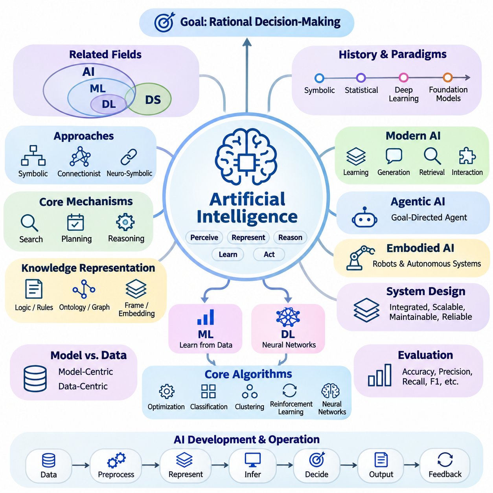
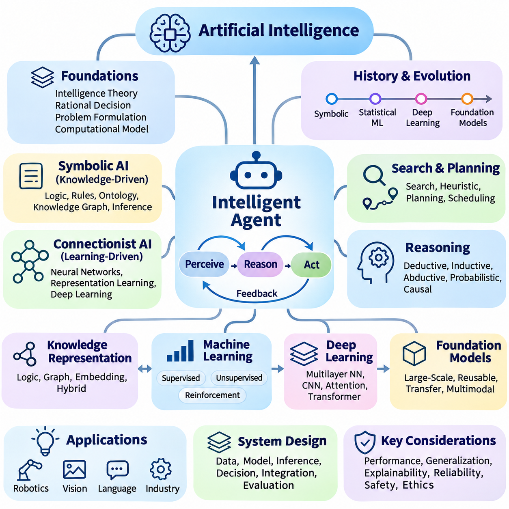
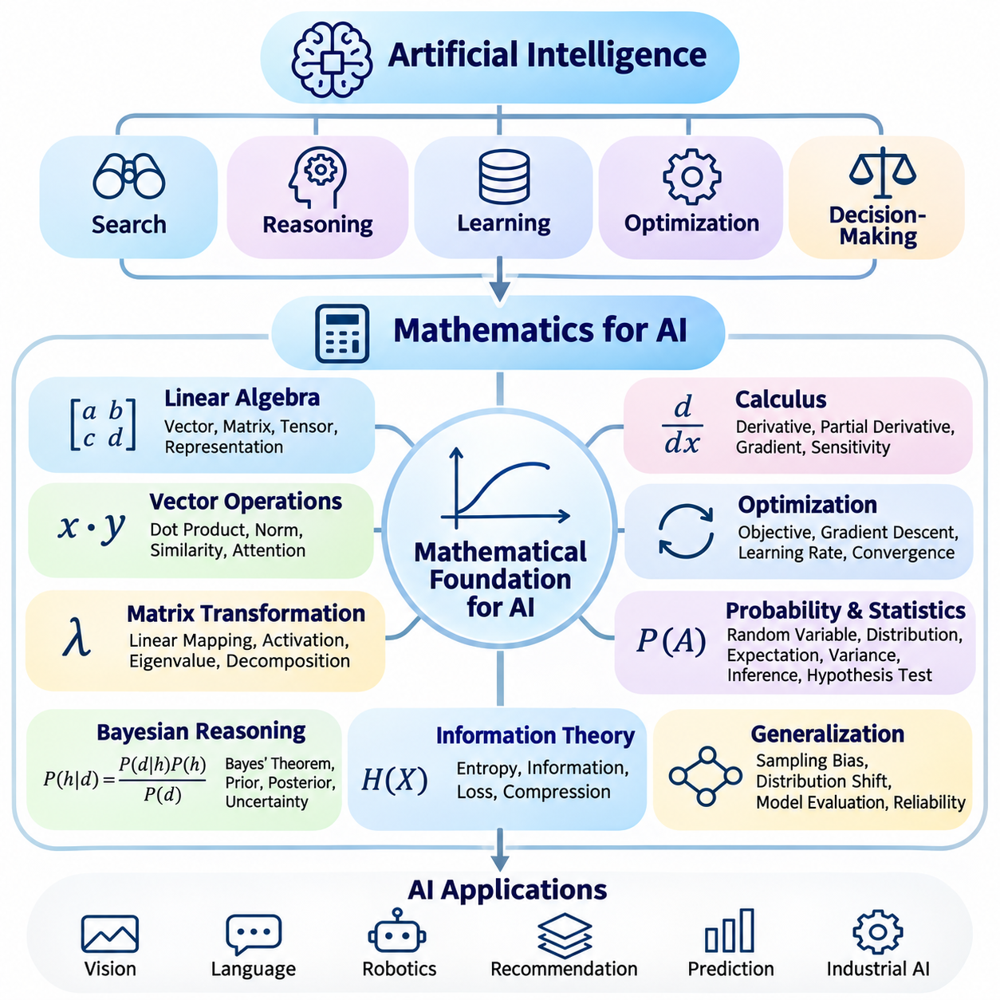
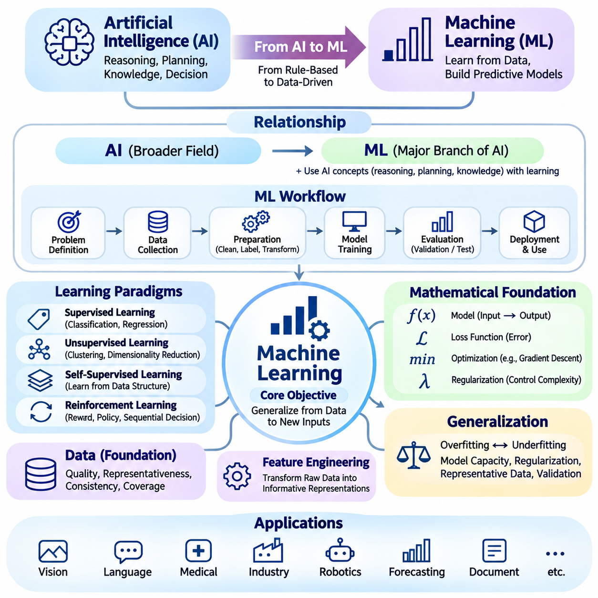
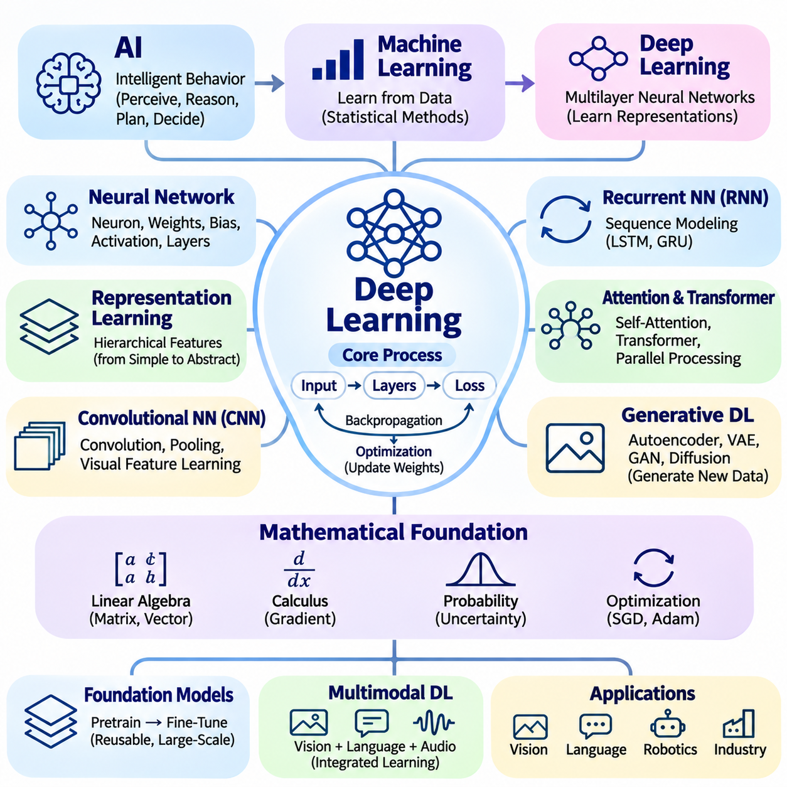
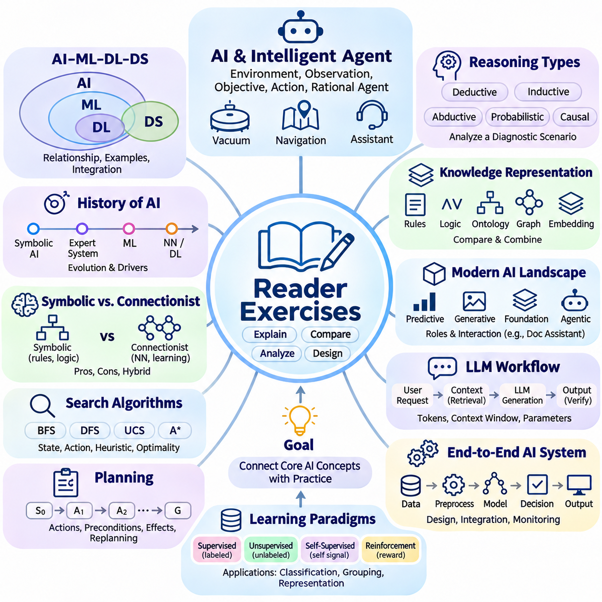
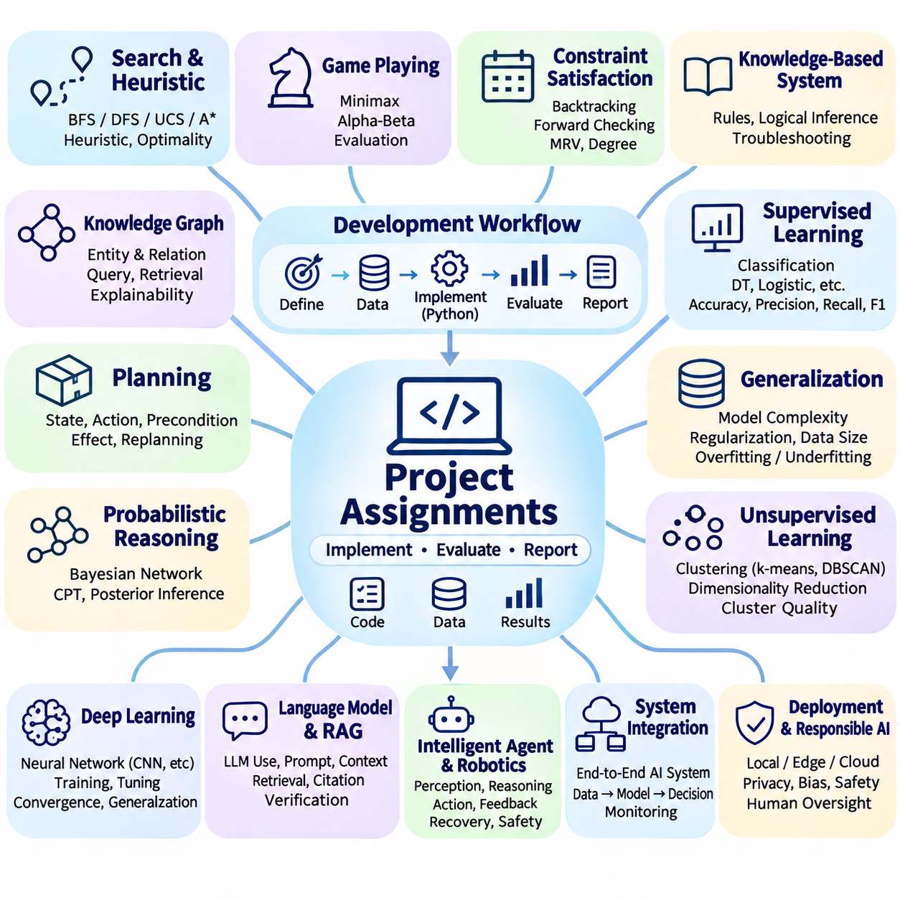

**Volume 04. Artificial Intelligence**

# 12. Summary and Next Steps

## 12.00 Key Takeaways

{width="7.268055555555556in" height="7.268055555555556in"}

Artificial intelligence is best understood as the study and engineering of systems that perceive information, represent knowledge, reason about alternatives, learn from experience, and select actions toward defined objectives. Its central purpose extends beyond reproducing human behavior to constructing computational agents capable of making rational decisions under uncertainty, resource limitations, and changing environmental conditions.

The distinction between artificial intelligence, machine learning, deep learning, and data science establishes an essential conceptual foundation. Artificial intelligence represents the broader discipline, while machine learning develops methods that improve through data. Deep learning uses multilayer neural networks to learn representations, whereas data science combines statistical analysis, computation, and domain knowledge to extract useful insights from information.

The historical development of artificial intelligence demonstrates that progress emerges through successive advances in theory, algorithms, computing infrastructure, and available data. Early symbolic systems emphasized explicit reasoning and logical manipulation, while statistical learning introduced data-driven inference. Deep learning and foundation models subsequently expanded the scale, adaptability, and diversity of tasks that computational intelligence can address.

Symbolic artificial intelligence and connectionism provide complementary approaches to intelligent computation. Symbolic methods represent concepts through logical structures, rules, and relationships, supporting explicit inference and interpretable decisions. Connectionist methods learn distributed representations from examples, enabling flexible pattern recognition. Neuro-symbolic approaches seek to combine these strengths within integrated reasoning and learning systems.

Search, planning, and reasoning remain fundamental mechanisms of artificial intelligence regardless of the underlying computational architecture. Search algorithms explore possible states and actions, while heuristic functions prioritize promising alternatives. Planning methods organize actions toward desired outcomes, and reasoning mechanisms derive conclusions from available evidence. Together, these capabilities transform information into purposeful decision-making.

Knowledge representation determines how an intelligent system organizes facts, concepts, relationships, and contextual information. Logical expressions, production rules, ontologies, knowledge graphs, frames, and vector embeddings offer different ways to structure knowledge. Their effectiveness depends on the intended reasoning process, required interpretability, computational constraints, and the complexity of relationships within the application domain.

Modern artificial intelligence increasingly combines learning, reasoning, generation, retrieval, and interaction within unified computational workflows. Foundation models provide reusable representations across tasks, while large language models support natural language understanding and generation. Multimodal systems integrate diverse information sources, and retrieval-augmented generation connects model capabilities with externally maintained knowledge.

Agentic artificial intelligence extends conventional prediction systems by introducing goal-directed interaction with tools, external services, and operational environments. An intelligent agent can interpret objectives, construct intermediate plans, execute permitted operations, evaluate results, and revise subsequent actions. Reliable agent behavior requires controlled execution, explicit constraints, state management, error recovery, and appropriate human supervision.

Embodied artificial intelligence demonstrates the importance of connecting computational intelligence with physical environments. Robots and autonomous systems must interpret sensor measurements, estimate environmental states, plan feasible movements, and control physical actions. Their performance depends not only on learning algorithms but also on perception accuracy, timing constraints, actuator capabilities, environmental uncertainty, and operational safety.

Artificial intelligence system design requires a broader perspective than selecting an individual model or algorithm. Effective systems integrate data acquisition, preprocessing, knowledge representation, inference, decision logic, output generation, and feedback mechanisms. Architectural decisions must consider scalability, maintainability, computational efficiency, reliability, and the relationship between system behavior and actual operational requirements.

The distinction between model-centric and data-centric development highlights the importance of information quality throughout the artificial intelligence lifecycle. Improving model architecture cannot compensate for every limitation caused by incomplete, inconsistent, biased, or unrepresentative data. Dataset design, labeling consistency, distribution analysis, and continuous data refinement are therefore essential elements of dependable intelligent systems.

Core algorithms provide the computational building blocks underlying advanced artificial intelligence applications. Optimization methods adjust parameters or select favorable solutions, classification algorithms assign categories, and clustering methods identify structures in unlabeled observations. Reinforcement learning develops action policies through interaction, while neural networks construct representations that support increasingly complex prediction and generation tasks.

Artificial intelligence evaluation must reflect the actual objectives and operating conditions of the system being examined. Accuracy, precision, recall, and F1 score characterize different aspects of classification performance, but no single metric captures every requirement. Search efficiency, planning quality, reasoning consistency, generation reliability, computational latency, and robustness require additional evaluation methods appropriate to their respective tasks.

Benchmark design introduces important methodological considerations concerning dataset representativeness, experimental reproducibility, statistical uncertainty, and realistic operating conditions. Strong benchmark results do not automatically establish dependable real-world performance. Evaluation should therefore include representative scenarios, failure analysis, distribution shifts, resource consumption, and comparisons against meaningful baselines before deployment decisions are made.

Responsible artificial intelligence requires safety, fairness, transparency, privacy, and accountability to be incorporated throughout system development. Bias can arise from datasets, modeling assumptions, and deployment contexts, while opaque decisions may complicate verification and oversight. Governance mechanisms, risk assessments, human intervention procedures, and continuous monitoring help align intelligent systems with organizational responsibilities and societal expectations.

Practical case studies reveal how theoretical concepts become operational capabilities through engineering integration. Expert systems illustrate explicit knowledge-based reasoning, search applications demonstrate systematic exploration, and knowledge graphs organize connected information. Computer vision, language models, robotics, and industrial applications further demonstrate how algorithm selection must respond to domain-specific constraints and measurable objectives.

A recurring lesson across artificial intelligence applications is that successful deployment depends on coordinated system behavior rather than isolated algorithmic sophistication. A highly accurate model may provide limited practical value when its latency, memory requirements, maintenance burden, or failure characteristics conflict with operational needs. Engineering tradeoffs must therefore be evaluated against the complete system and its intended environment.

Human participation remains essential in defining objectives, interpreting uncertain outcomes, evaluating consequences, and maintaining accountability. Human-in-the-loop architectures can combine automated computation with expert judgment during data annotation, decision verification, exception handling, and operational supervision. The appropriate degree of autonomy depends on task complexity, potential consequences, system reliability, and the availability of effective safeguards.

The next stage of artificial intelligence study requires deeper mathematical understanding of the mechanisms introduced throughout this volume. Linear algebra explains vector representations and neural computation, calculus supports gradient-based optimization, and probability provides a foundation for reasoning under uncertainty. Statistics, information theory, and numerical methods further establish the analytical tools needed to understand learning behavior and computational performance.

Machine learning extends these foundations into systematic methods for extracting predictive structures from data. Supervised learning, unsupervised learning, reinforcement learning, and representation learning introduce distinct approaches to acquiring useful computational behavior. Understanding their assumptions, optimization objectives, generalization properties, and evaluation procedures provides the foundation for progressing toward more sophisticated artificial intelligence architectures.

Deep learning builds upon machine learning through hierarchical representation learning and large-scale parameter optimization. Neural networks, convolutional architectures, sequence models, attention mechanisms, and transformers provide specialized computational structures for different information types. Their practical effectiveness depends on training procedures, architecture design, regularization, computational resources, and careful experimental validation.

The most important outcome of studying artificial intelligence is the ability to connect conceptual understanding with disciplined system development. Intelligent behavior emerges through the coordinated interaction of representation, learning, reasoning, planning, action, and evaluation. By understanding these relationships, practitioners can progress from isolated demonstrations toward reliable, adaptive, and maintainable artificial intelligence systems that address meaningful real-world problems.

## 12.01 Concept Map of AI

{width="7.268055555555556in" height="7.268055555555556in"}

A concept map of artificial intelligence provides a unified perspective on how fundamental theories, computational mechanisms, learning methods, and practical applications relate to one another. Rather than treating artificial intelligence as a collection of isolated technologies, the conceptual map organizes its components into an interconnected framework. This perspective helps explain how intelligent behavior emerges from coordinated processes involving perception, representation, reasoning, learning, planning, and action.

At the center of the conceptual framework is the intelligent agent, a computational entity that observes its environment, interprets available information, and selects actions according to defined objectives. The agent operates through a continuous perception, reasoning, and action cycle. Environmental feedback influences subsequent decisions, allowing the system to respond to changing conditions while maintaining consistency with its goals, operational constraints, and available computational resources.

The foundational layer of artificial intelligence includes theories of intelligence, rational decision-making, problem formulation, and computational representation. These concepts establish what an intelligent system should accomplish and how its behavior can be evaluated. Rational agent models connect objectives with actions, while problem formulation defines states, available operations, transition rules, and success conditions. Together, these foundations provide a systematic basis for designing intelligent systems.

Historical developments form another dimension of the conceptual map, explaining how different approaches to intelligence emerged and evolved. Symbolic artificial intelligence introduced explicit knowledge manipulation, logical inference, and rule-based decision-making. Statistical machine learning shifted attention toward patterns extracted from data, while deep learning enabled increasingly complex representation learning. Foundation models subsequently expanded the reuse of learned capabilities across diverse tasks.

Symbolic artificial intelligence occupies the knowledge-driven branch of the conceptual framework. Its primary mechanisms include logic, production rules, ontologies, knowledge graphs, and structured reasoning procedures. These representations allow systems to express relationships, enforce constraints, and derive conclusions through explicit operations. Symbolic approaches are particularly valuable when decisions require traceability, formal consistency, or clearly defined domain knowledge.

Connectionist artificial intelligence represents the learning-driven branch, where computational models acquire useful representations through parameter adjustment. Artificial neural networks transform input signals through interconnected processing units, allowing statistical relationships to be encoded within learned parameters. Deep learning extends this principle through hierarchical architectures capable of processing images, language, audio, and other complex information without requiring every relevant feature to be manually specified.

Search and planning connect knowledge representation with purposeful action. Search algorithms explore alternative states or candidate solutions, while heuristic functions guide exploration toward promising possibilities. Planning systems construct sequences of actions that satisfy goals and operational constraints. These mechanisms apply to navigation, scheduling, game playing, automated problem solving, and robotic task execution, demonstrating their importance across symbolic and learning-based architectures.

Reasoning forms a conceptual bridge between stored knowledge, observed evidence, and decision-making. Deductive reasoning derives conclusions from established premises, while inductive reasoning identifies general patterns from observations. Abductive reasoning proposes plausible explanations, probabilistic reasoning manages uncertainty, and causal reasoning examines relationships between interventions and outcomes. Each approach addresses a different aspect of intelligent inference.

Knowledge representation provides the structural foundation connecting symbolic reasoning with modern learning systems. Logic-based representations support explicit relationships and inference, while vector representations encode statistical similarities in continuous spaces. Knowledge graphs organize entities and relationships, and embeddings enable efficient semantic comparison. Hybrid architectures can combine these representations to support both structured reasoning and flexible pattern recognition.

Machine learning introduces adaptive mechanisms that allow systems to improve through experience rather than relying exclusively on predefined instructions. Supervised learning uses labeled examples to estimate predictive relationships, while unsupervised learning discovers structures within unlabeled data. Reinforcement learning develops action policies through interaction and feedback. These paradigms connect statistical modeling, optimization, evaluation, and environmental adaptation within the broader artificial intelligence framework.

Deep learning provides a major architectural connection between machine learning and modern foundation models. Multilayer neural networks learn progressively abstract representations, while convolutional architectures support spatial processing and attention mechanisms capture relationships across information elements. Transformers extend these capabilities to language, vision, and multimodal processing. Their effectiveness depends on optimization procedures, training data, computational resources, and generalization behavior.

Foundation models occupy an increasingly important position within the modern artificial intelligence landscape because they provide reusable capabilities developed through large-scale training. Large language models process and generate natural language, while multimodal models combine textual, visual, auditory, and other information. Generative artificial intelligence produces new content from learned distributions, extending intelligent computation beyond classification and prediction into synthesis and interactive assistance.

Retrieval-augmented generation connects learned model representations with externally maintained information sources. Retrieval mechanisms identify relevant documents or knowledge records, and generation models incorporate retrieved context when producing responses. This relationship illustrates how statistical learning can be integrated with structured information management. Effective implementations require retrieval quality assessment, context selection, source validation, and mechanisms for handling incomplete or conflicting evidence.

Agentic artificial intelligence connects language understanding, reasoning, planning, memory, and external tool execution within goal-directed workflows. An agent can interpret instructions, decompose objectives into subtasks, select appropriate operations, and evaluate intermediate outcomes. Its effectiveness depends on coordination among model inference, environmental observations, tool interfaces, and execution controls. Human supervision and operational safeguards remain essential when actions produce consequential external effects.

Embodied artificial intelligence extends the conceptual framework into physical interaction through robotics and autonomous systems. Sensors provide observations, perception algorithms estimate environmental conditions, and planning mechanisms identify feasible actions. Control systems translate decisions into physical movement while receiving feedback from the environment. This integration connects machine learning, reasoning, state estimation, real-time computation, and safety engineering within a unified operational cycle.

Artificial intelligence system architecture organizes these conceptual components into practical computational workflows. Input interfaces collect information, processing modules transform data, models generate predictions or representations, and decision mechanisms select responses. Output interfaces deliver results or control actions, while monitoring systems capture feedback for evaluation and improvement. Effective architectures must coordinate functionality with reliability, scalability, latency, resource availability, and maintainability.

Evaluation and benchmarking form a cross-cutting dimension that connects every component of the conceptual map to measurable performance. Classification metrics assess predictive behavior, while planning metrics examine solution quality and computational efficiency. Generative systems require assessments of factual reliability, relevance, and consistency. Robustness testing, distribution analysis, and reproducible experiments establish whether observed capabilities remain dependable under realistic operating conditions.

Ethics, safety, and governance surround the entire artificial intelligence framework rather than functioning as isolated technical subjects. Fairness concerns influence data collection and model behavior, while privacy requirements shape information processing and storage. Transparency supports meaningful oversight, and safety engineering addresses foreseeable failures and misuse. Responsible system development integrates these considerations into design decisions, evaluation procedures, deployment controls, and ongoing monitoring.

Practical applications demonstrate how different branches of artificial intelligence converge around domain-specific requirements. Industrial inspection combines perception, classification, and operational decision-making, while autonomous robotics integrates localization, planning, and control. Language-based assistants combine foundation models, retrieval, and interaction mechanisms. These examples illustrate that effective applications typically depend on multiple coordinated capabilities rather than a single algorithm.

The conceptual map ultimately reveals artificial intelligence as a layered and interconnected engineering discipline. Mathematical foundations support algorithms, algorithms enable representations and learning, and these mechanisms contribute to reasoning, planning, and intelligent action. System architecture integrates the components, evaluation measures their effectiveness, and governance establishes responsible operating boundaries. Understanding these connections prepares readers for deeper study of mathematics, machine learning, deep learning, and advanced intelligent systems.

## 12.02 From AI to Mathematics for AI

{width="7.268055555555556in" height="7.268055555555556in"}

Artificial intelligence becomes more understandable when its computational mechanisms are connected to the mathematical principles that support them. Search, reasoning, learning, optimization, and decision-making all rely on formal structures that describe information and relationships. Mathematics provides a precise language for expressing these mechanisms, analyzing their behavior, and determining the conditions under which intelligent systems can operate reliably.

The transition from artificial intelligence to mathematics begins with the recognition that intelligent behavior must be represented computationally. Environmental observations become numerical measurements, knowledge relationships become structured representations, and decisions become mathematical operations. This transformation allows abstract concepts such as similarity, uncertainty, preference, and optimality to be examined through explicit models rather than informal descriptions.

Linear algebra provides the fundamental language for representing information in modern artificial intelligence. Vectors describe numerical features, matrices organize transformations and relationships, and tensors extend these structures to higher-dimensional data. Images, text embeddings, sensor measurements, and neural network parameters can all be represented through linear algebraic structures, enabling efficient computation across diverse artificial intelligence applications.

Vector operations explain how intelligent systems compare and transform information. Dot products measure alignment between representations, vector norms characterize magnitude, and matrix multiplication combines multiple numerical relationships. These operations appear in similarity search, recommendation systems, attention mechanisms, and neural network inference. Understanding their mathematical properties reveals how complex computational behaviors emerge from relatively simple numerical procedures.

Matrix transformations connect input representations with learned computational structures. A neural network layer commonly applies a linear transformation followed by a nonlinear activation function, allowing information to be progressively reorganized. Eigenvalues, eigenvectors, and matrix decompositions provide additional tools for understanding structural relationships, dimensionality reduction, and numerical behavior. These concepts establish an essential foundation for representation learning.

Calculus introduces the mathematical tools required to analyze how computational outputs change when inputs or parameters vary. Derivatives describe local sensitivity, while partial derivatives extend this concept to functions with multiple variables. Gradients combine partial derivatives into directions of change, allowing learning algorithms to identify how model parameters influence prediction errors. These ideas form the mathematical basis of gradient-driven optimization.

The chain rule connects calculus directly to neural network training. Multilayer models contain sequences of transformations, and the effect of an individual parameter must be traced through subsequent operations. Backpropagation applies the chain rule efficiently to calculate gradients throughout a computational graph. This process enables neural networks to adjust large numbers of parameters according to an objective function without independently recomputing every derivative.

Optimization transforms mathematical sensitivity into systematic improvement. An objective function defines the quantity to minimize or maximize, while optimization algorithms determine how candidate solutions should change. Gradient descent iteratively updates parameters in directions intended to reduce loss. Learning rates, convergence behavior, local minima, and numerical stability influence the effectiveness of this process and explain many practical challenges encountered during model training.

Probability theory provides a formal framework for reasoning under uncertainty. Intelligent systems frequently operate with incomplete observations, ambiguous evidence, and unpredictable outcomes. Random variables represent uncertain quantities, probability distributions describe possible outcomes, and conditional probabilities express relationships between events. These concepts allow artificial intelligence systems to estimate uncertainty rather than treating every observation or prediction as completely certain.

Bayesian reasoning demonstrates how prior knowledge and new evidence can be combined mathematically. Bayes\' theorem updates beliefs about hypotheses when additional observations become available. This principle supports probabilistic diagnosis, sensor fusion, classification, and state estimation. It also connects classical reasoning approaches with statistical learning by representing uncertainty through explicit probability relationships.

Statistics extends probability theory into the analysis of observed data. Descriptive statistics summarize distributions, while statistical inference estimates properties of larger populations from limited samples. Concepts such as expectation, variance, covariance, confidence intervals, and hypothesis testing help characterize model behavior and experimental results. These tools are essential for distinguishing meaningful performance improvements from random variation.

Statistical thinking also explains why training performance does not automatically guarantee reliable predictions on unseen data. Sampling bias, distribution shifts, measurement noise, and limited dataset coverage can distort conclusions. Generalization requires understanding how observed samples relate to the broader population of possible inputs. Statistical methods therefore connect dataset construction, model evaluation, uncertainty estimation, and experimental reproducibility.

Information theory provides a mathematical perspective on uncertainty, information content, and representation efficiency. Entropy measures uncertainty within a probability distribution, while cross-entropy compares predicted probabilities with observed outcomes. Kullback--Leibler divergence quantifies differences between probability distributions, and mutual information characterizes statistical dependence. These concepts appear in classification objectives, generative modeling, and representation learning.

Information-theoretic principles also help explain how intelligent systems compress and preserve useful information. A representation should retain features relevant to a task while reducing unnecessary complexity when appropriate. This perspective connects feature extraction, dimensionality reduction, communication efficiency, and learned embeddings. It also provides conceptual foundations for understanding how models balance information preservation with computational constraints.

Numerical methods connect mathematical theory with executable artificial intelligence algorithms. Real computers operate with finite precision, limited memory, and bounded processing capacity. Numerical approximation makes it possible to solve problems that lack convenient analytical solutions, while iterative methods support large-scale computation. Understanding approximation error, conditioning, convergence, and floating-point behavior is essential for implementing reliable algorithms.

Numerical stability becomes particularly important when artificial intelligence models involve repeated transformations or extreme numerical values. Poorly conditioned calculations can amplify small errors, while inappropriate precision can produce overflow, underflow, or inaccurate gradients. Stable mathematical formulations, normalization techniques, and suitable numerical representations help maintain computational reliability during training and inference.

The mathematical foundations of artificial intelligence are closely interconnected rather than independent subjects. Linear algebra represents data and transformations, calculus describes sensitivity, and optimization determines parameter updates. Probability and statistics characterize uncertainty and evidence, while information theory analyzes distributions and representations. Numerical methods ensure that these mathematical operations can be implemented effectively on computational hardware.

A practical learning progression begins by connecting mathematical concepts to familiar artificial intelligence operations. Vector similarity can be studied through embedding comparisons, derivatives through simple optimization problems, and probability through uncertain classification. Statistical evaluation can be explored using prediction results, while information theory can be connected to classification losses. Such examples transform mathematical notation into observable computational behavior.

The purpose of mathematical study is not merely to memorize equations but to understand the assumptions, limitations, and consequences of computational methods. Mathematical reasoning helps explain why an algorithm converges, when a model becomes unstable, how uncertainty affects decisions, and whether experimental evidence supports a conclusion. This understanding enables more systematic debugging, algorithm selection, and architectural design.

Mathematics for artificial intelligence therefore serves as the bridge between conceptual intelligence and rigorous computational engineering. It transforms representations, learning mechanisms, and reasoning procedures into analyzable mathematical systems. Mastery of linear algebra, calculus, probability, statistics, information theory, and numerical methods prepares readers for deeper study of optimization, machine learning, neural networks, and advanced intelligent systems.

## 12.03 From AI to Machine Learning

{width="7.268055555555556in" height="7.268055555555556in"}

The transition from artificial intelligence to machine learning represents a fundamental shift from explicitly programmed intelligence toward systems that acquire useful behavior through data and experience. Traditional artificial intelligence often relies on predefined rules, search procedures, and structured knowledge, while machine learning develops computational models by identifying patterns in observations. Both approaches pursue intelligent behavior, but they differ in how knowledge is acquired, represented, and improved.

Machine learning is a major branch of artificial intelligence rather than a replacement for its broader principles. Reasoning, planning, knowledge representation, and decision-making remain essential concepts, while learning algorithms provide mechanisms for adapting to unfamiliar situations. This relationship explains why intelligent systems frequently combine learned predictions with symbolic constraints, optimization procedures, and domain-specific decision rules.

The central objective of machine learning is to construct models that generalize beyond the examples used during development. A model receives observations, identifies statistical relationships, and produces predictions, classifications, or actions for new inputs. Successful learning therefore requires more than memorizing training samples. It involves discovering meaningful regularities that remain useful when the system encounters previously unseen conditions.

Data forms the operational foundation of machine learning because the information available during training determines what relationships a model can discover. Structured records, images, language, audio, and sensor measurements provide different forms of learning evidence. Data quality, representativeness, consistency, and coverage directly influence model performance. Poorly collected or biased datasets can produce unreliable behavior even when sophisticated learning algorithms are employed.

A typical machine learning workflow begins with problem definition and data preparation. Developers identify the intended prediction task, determine appropriate inputs and outputs, and establish evaluation criteria. Data collection is followed by cleaning, labeling when necessary, transformation, and partitioning into development and evaluation subsets. These activities connect the conceptual objectives of artificial intelligence with measurable learning procedures.

Supervised learning develops predictive models using examples associated with known target values. Classification assigns observations to categories, while regression estimates continuous quantities. During training, the model compares its predictions with reference targets and adjusts its parameters to reduce error. Supervised learning supports applications such as defect detection, medical image analysis, demand forecasting, and automated document classification.

Unsupervised learning investigates structures within data without requiring predefined target labels. Clustering groups observations according to similarity, dimensionality reduction constructs compact representations, and density estimation characterizes underlying data distributions. These methods help reveal previously unknown relationships and organize complex information. They are especially useful for exploratory analysis, anomaly detection, and representation discovery.

Self-supervised learning creates training objectives from the internal structure of available data rather than depending entirely on manually assigned labels. Models may learn by predicting missing information, comparing related observations, or reconstructing transformed inputs. This approach supports the acquisition of reusable representations from large datasets and provides an important foundation for modern language, vision, and multimodal learning systems.

Reinforcement learning connects machine learning with sequential decision-making and intelligent agent behavior. An agent interacts with an environment, observes consequences, and receives reward signals that evaluate its actions. Learning algorithms seek policies that maximize expected cumulative rewards rather than simply matching predetermined target outputs. This framework supports robotics, adaptive control, resource allocation, and autonomous planning.

The mathematical formulation of machine learning connects data, model parameters, objective functions, and optimization algorithms. A model transforms input variables into estimated outputs, while a loss function quantifies discrepancies between predictions and desired behavior. Optimization adjusts parameters to improve the objective. Regularization and model constraints help control complexity, illustrating how mathematical foundations become practical mechanisms for learning.

Generalization is one of the most important concepts connecting machine learning theory with reliable artificial intelligence. Overfitting occurs when a model adapts excessively to training examples, including incidental noise, while underfitting occurs when the model cannot capture meaningful relationships. Appropriate model capacity, regularization, representative datasets, and careful validation help balance learning flexibility with performance on unseen observations.

Training, validation, and testing serve different purposes within the machine learning lifecycle. Training data supports parameter estimation, validation data guides model selection and development decisions, and test data provides a final assessment on held-out examples. Maintaining separation between these datasets reduces misleading conclusions. Cross-validation and carefully designed experimental protocols can further improve the reliability of performance estimates.

Feature engineering connects domain knowledge with statistical learning by transforming raw observations into informative model inputs. Traditional methods often depend on manually designed features, while representation learning allows models to discover useful transformations automatically. Feature selection, normalization, categorical encoding, and dimensionality reduction influence computational efficiency and predictive performance. These operations demonstrate the importance of representation quality.

Model evaluation requires metrics aligned with the intended task and its operational consequences. Accuracy may summarize classification performance, but precision, recall, and F1 score provide additional information when errors have different costs. Regression tasks use measures such as mean absolute error and mean squared error. Calibration, robustness, latency, and resource consumption extend evaluation beyond predictive correctness toward practical system reliability.

Machine learning also introduces important challenges involving uncertainty, distribution shifts, and dataset bias. A model trained under one set of conditions may behave differently when deployed in unfamiliar environments. Changes in sensor characteristics, user behavior, operating procedures, or input distributions can reduce predictive reliability. Monitoring, uncertainty estimation, periodic evaluation, and controlled model updating help address these challenges.

Deep learning extends machine learning through multilayer neural networks that learn hierarchical representations from data. Convolutional networks, recurrent architectures, transformers, and other neural structures support complex perception and sequence-processing tasks. However, machine learning also includes decision trees, support vector machines, probabilistic models, and ensemble methods. Understanding this broader landscape prevents the mistaken assumption that all machine learning requires deep neural networks.

The relationship between machine learning and knowledge-based artificial intelligence is increasingly complementary. Learned models provide flexible pattern recognition and prediction, while symbolic representations support explicit constraints, structured relationships, and interpretable reasoning. Hybrid systems may combine neural perception with rule-based verification or probabilistic inference with planning algorithms. Such integration can improve system adaptability while preserving operational control.

Practical machine learning development extends beyond training an algorithm. Data pipelines, experiment tracking, version control, deployment interfaces, monitoring, and reproducibility procedures determine whether a model can operate consistently in production. Machine learning operations, commonly called MLOps, coordinate these activities throughout the system lifecycle. Reliable deployment requires attention to data drift, performance degradation, security, and maintenance responsibilities.

Responsible machine learning requires careful consideration of fairness, privacy, transparency, and accountability. Training data may encode historical biases, while complex models can make decisions difficult to interpret. Sensitive information requires appropriate protection, and consequential predictions should be evaluated for potential harm. Human oversight, documented limitations, and risk-based validation connect technical performance with responsible artificial intelligence practice.

The transition from artificial intelligence to machine learning therefore establishes a progression from general theories of intelligent behavior toward systematic methods for acquiring capabilities from experience. Data representation, learning paradigms, mathematical optimization, generalization, evaluation, and deployment form the essential foundation. Mastering these relationships prepares readers to study deep learning, foundation models, reinforcement learning, and increasingly autonomous intelligent systems.

## 12.04 From AI to Deep Learning

{width="7.268055555555556in" height="7.268055555555556in"}

The transition from artificial intelligence to deep learning represents a progression from general theories of intelligent behavior toward computational architectures capable of learning complex representations directly from data. Artificial intelligence establishes the objectives of perception, reasoning, planning, and decision-making, while machine learning introduces adaptive statistical methods. Deep learning extends these methods through multilayer neural networks that progressively transform information into useful representations.

Deep learning is a specialized branch of machine learning rather than an independent replacement for artificial intelligence. Traditional machine learning frequently depends on manually designed features, while deep neural networks can learn multiple levels of representation through optimization. This capability supports complex tasks involving images, language, audio, and sensor measurements. Nevertheless, successful intelligent systems still require appropriate objectives, reliable data, evaluation procedures, and operational constraints.

Artificial neural networks provide the computational foundation of deep learning. Each processing unit combines numerical inputs with learned weights and biases before applying an activation function. Multiple units form layers, and connected layers construct progressively more expressive transformations. The resulting architecture can approximate complex nonlinear relationships, allowing models to capture patterns that are difficult to describe through explicit rules or simple statistical equations.

Representation learning explains why network depth is important. Early layers may identify relatively simple patterns, while deeper layers combine intermediate features into increasingly abstract descriptions. In image processing, these representations may progress from local visual structures toward object-related features. In language processing, they can encode contextual relationships and semantic information. Such hierarchies reduce dependence on manually specifying every relevant characteristic.

The mathematical foundation of deep learning combines linear algebra, calculus, probability, and optimization. Matrix multiplication performs transformations between layers, nonlinear functions introduce expressive capacity, and objective functions quantify prediction errors. Gradients describe how parameter changes influence the objective, while optimization algorithms adjust weights to improve performance. These mathematical connections transform neural network architectures into trainable computational systems.

Backpropagation is the central mechanism for calculating gradients in multilayer neural networks. During forward propagation, input information passes through successive layers to produce an output. A loss function evaluates the difference between predictions and desired results. Backpropagation applies the chain rule to propagate gradient information backward through the computational graph, enabling efficient parameter updates across complex architectures.

Optimization determines how effectively neural networks learn from available data. Stochastic gradient descent and adaptive optimizers iteratively update parameters using gradient estimates. Learning rates influence update magnitude, while batch sizes affect computational efficiency and gradient variability. Training stability also depends on initialization, normalization, regularization, and numerical precision. These factors demonstrate that successful deep learning requires coordinated mathematical and engineering decisions.

Convolutional neural networks introduced specialized operations for learning spatial relationships in structured data. Convolutional filters process local regions while sharing parameters across positions, supporting efficient visual feature extraction. Pooling and hierarchical transformations can reduce spatial resolution while preserving task-relevant information. These architectures have supported image classification, object detection, semantic segmentation, and numerous industrial vision applications.

Sequential information requires architectures capable of representing dependencies across observations. Recurrent neural networks maintain hidden states that summarize preceding inputs, while long short-term memory and gated recurrent units introduce mechanisms for managing information over longer sequences. These approaches have been applied to language modeling, speech recognition, and time-series prediction, although their limitations motivated the development of alternative sequence-processing architectures.

Attention mechanisms enable neural networks to determine which information elements are most relevant when constructing a representation. Self-attention models relationships among elements within the same sequence, allowing contextual dependencies to influence processing. Transformers combine attention operations with feedforward transformations and positional information. Their parallelizable architecture has become a foundation for modern language models and many vision and multimodal systems.

Generative deep learning extends neural networks beyond discriminative prediction into the creation of new content. Autoencoders learn compressed representations, variational autoencoders introduce probabilistic latent structures, and generative adversarial networks use competing networks to model data distributions. Diffusion models learn processes for generating samples through iterative denoising. These approaches support image synthesis, data augmentation, simulation, and creative applications.

Foundation models demonstrate how large-scale deep learning can produce reusable capabilities across multiple tasks. Pretraining develops general representations from extensive datasets, while fine-tuning adapts models to specific objectives. Transfer learning reduces the need to train every application from the beginning. Parameter-efficient adaptation methods further support customization under limited computational resources, connecting large-scale model development with practical deployment requirements.

Multimodal deep learning integrates information from different sensory or symbolic sources. Vision-language models connect image representations with textual descriptions, while audio-language systems combine speech and linguistic processing. Robotic learning may integrate camera observations, proprioceptive measurements, language instructions, and action sequences. Such systems demonstrate how learned representations can support increasingly integrated perception, reasoning, and interaction.

Deep reinforcement learning combines neural representation learning with sequential decision-making. Neural networks can approximate value functions, action policies, or environmental models when state spaces are too complex for explicit tables. Agents improve through interaction and reward-based feedback, enabling adaptive behavior in simulated and physical environments. Practical applications require attention to exploration, sample efficiency, safety constraints, and transfer from training conditions to deployment.

Data quality remains a fundamental determinant of deep learning performance. Large datasets may improve representation learning, but their value depends on diversity, relevance, annotation quality, and distributional coverage. Data augmentation can introduce useful variations, while preprocessing establishes consistent numerical inputs. Poorly represented operating conditions can produce systematic failures, emphasizing the importance of data-centric development alongside architectural innovation.

Generalization and robustness determine whether deep learning models remain useful beyond their training environments. Overfitting occurs when networks capture incidental training patterns rather than transferable relationships. Regularization, early stopping, appropriate validation, and representative testing help control this problem. Distribution shifts, adversarial perturbations, and unfamiliar environmental conditions require additional evaluation because strong benchmark performance does not guarantee operational reliability.

Computational infrastructure strongly influences deep learning development. Graphics processing units and specialized accelerators support parallel tensor operations, while distributed training enables larger models and datasets. Memory capacity, communication bandwidth, numerical precision, and energy consumption affect achievable performance. Techniques such as mixed-precision computation, quantization, pruning, and knowledge distillation can improve efficiency for deployment on constrained hardware.

Deep learning system engineering extends beyond model architecture and training accuracy. Reliable deployment requires data pipelines, experiment tracking, version control, inference optimization, monitoring, and controlled updates. Edge devices may prioritize latency and energy efficiency, while cloud systems emphasize scalability and throughput. These considerations connect neural network research with maintainable artificial intelligence services and autonomous systems operating under real-world constraints.

Responsible deep learning requires attention to interpretability, privacy, fairness, security, and safety. Complex neural representations can make individual predictions difficult to explain, while training data may contain biases or sensitive information. Evaluation should examine failure modes and potential consequences rather than relying exclusively on aggregate accuracy. Human oversight, documented limitations, and operational safeguards remain necessary when models influence consequential decisions.

The progression from artificial intelligence through machine learning to deep learning establishes a coherent path from conceptual intelligence to advanced representation learning. Artificial intelligence defines intelligent objectives, machine learning develops methods for acquiring behavior from experience, and deep learning provides scalable architectures for complex information processing. Understanding these relationships prepares readers to investigate transformers, foundation models, generative systems, and embodied intelligence in greater depth.

## 12.05 Reader Exercises

{width="7.268055555555556in" height="7.268055555555556in"}

Reader exercises provide an opportunity to consolidate the fundamental concepts of artificial intelligence through explanation, comparison, analysis, and practical reasoning. Rather than memorizing isolated definitions, readers should demonstrate how different AI mechanisms contribute to intelligent behavior. Each exercise encourages connections among perception, knowledge representation, search, planning, learning, evaluation, and responsible system design.

Begin by explaining artificial intelligence in terms of intelligent agents, environmental observations, objectives, and actions. Describe how a rational agent differs from a system that merely follows fixed instructions. Consider a robotic vacuum cleaner, a navigation application, and an automated customer assistant. Identify their environments, available observations, possible actions, and performance objectives, then explain which capabilities make their behavior intelligent.

Examine the relationships among artificial intelligence, machine learning, deep learning, and data science. Explain why machine learning is a subset of artificial intelligence and why deep learning represents a specialized family of learning methods. Identify an application that uses explicit rules without statistical learning and another that relies on learned representations. Discuss how both approaches can contribute to a larger intelligent system.

Review the historical development of artificial intelligence by connecting major research approaches with their underlying assumptions. Compare symbolic reasoning, expert systems, statistical machine learning, and neural network methods. Explain how changes in computing resources, available datasets, and algorithmic techniques influenced their development. Consider why contemporary AI increasingly combines capabilities that originated in different research traditions.

Compare symbolic artificial intelligence with connectionist approaches by examining how each represents knowledge and produces conclusions. Describe the advantages of explicit logical rules when transparency and formal constraints are important. Explain why neural networks are effective for complex pattern recognition. Propose a hybrid application in which learned perception supplies information to a symbolic reasoning component.

Investigate search algorithms by defining states, actions, transition rules, initial conditions, and goal conditions for a simple navigation problem. Compare breadth-first search, depth-first search, uniform-cost search, and A\\\* search in terms of exploration strategy and computational requirements. Explain how heuristic functions guide informed search and identify the conditions under which A\\\* can guarantee an optimal solution.

Explore planning by describing a task that requires several coordinated actions, such as warehouse item delivery or robotic inspection. Identify the initial state, desired goal, available actions, preconditions, and effects. Explain how a planning system constructs a valid action sequence and why changing environmental conditions may require replanning. Discuss the relationship between planning, search, and execution monitoring.

Analyze deductive, inductive, abductive, probabilistic, and causal reasoning through a common diagnostic scenario. Consider a machine that unexpectedly stops operating and produces several sensor warnings. Explain how each reasoning approach would interpret the available evidence and what conclusions it could support. Distinguish logically guaranteed conclusions from plausible explanations and statistically supported predictions.

Examine knowledge representation by selecting a domain containing entities, attributes, and relationships. Explain how the same information could be represented through production rules, logical statements, ontologies, knowledge graphs, or vector embeddings. Compare these approaches in terms of expressiveness, interpretability, flexibility, and computational efficiency. Identify situations where combining structured knowledge with learned representations would be beneficial.

Investigate the modern AI landscape by comparing predictive models, generative models, foundation models, and agentic systems. Explain how their objectives, inputs, outputs, and interaction patterns differ. Consider an intelligent document assistant that retrieves technical references, summarizes information, and performs authorized operations. Identify which components require retrieval, language generation, planning, external tools, and human supervision.

Study the conceptual workflow of a large language model application. Describe how a user request becomes model input, how contextual information influences generation, and how the resulting output is delivered. Explain the role of tokens, context windows, inference parameters, and application interfaces. Discuss why external knowledge retrieval and output verification may be necessary even when a language model produces fluent responses.

Design a simple end-to-end artificial intelligence system for a practical application such as visual defect detection or automated document classification. Identify data sources, preprocessing requirements, model components, decision logic, output interfaces, and monitoring mechanisms. Explain how information moves through the system and where errors might occur. Consider how system reliability depends on interactions among components rather than model accuracy alone.

Compare supervised learning, unsupervised learning, self-supervised learning, and reinforcement learning. For each paradigm, describe the information available during training and the objective that guides improvement. Select an appropriate method for product classification, customer grouping, language representation learning, and robotic navigation. Explain why the characteristics of the problem determine the most suitable learning strategy.

Investigate the mathematical foundations underlying machine learning and deep learning. Explain how vectors and matrices represent information, how derivatives support optimization, and how probability distributions describe uncertainty. Consider a classification model trained through gradient descent and describe the relationships among inputs, parameters, predictions, loss functions, and updates. Identify which mathematical concepts are required to understand each stage.

Evaluate an artificial intelligence classifier using a hypothetical confusion matrix containing true positives, false positives, true negatives, and false negatives. Explain how accuracy, precision, recall, and F1 score capture different aspects of performance. Consider an application where false negatives have serious consequences and another where false positives are expensive. Discuss why evaluation metrics must reflect operational objectives and error costs.

Examine the difference between benchmark performance and real-world reliability. Consider a model that performs well on a controlled dataset but encounters unfamiliar lighting, sensor noise, or changing user behavior after deployment. Explain how distribution shifts can affect predictions and why validation datasets may not represent every operating condition. Propose evaluation procedures involving robustness testing, error analysis, reproducibility, and continuous monitoring.

Analyze ethical and societal considerations in artificial intelligence by examining fairness, privacy, transparency, accountability, and safety. Select an application involving consequential decisions and identify potential sources of bias or harm. Explain how dataset selection, model design, evaluation, and deployment policies influence responsible behavior. Discuss when human oversight should be required and how limitations should be communicated to users.

Compare several artificial intelligence applications to identify shared computational principles and domain-specific requirements. Examine search engines, recommendation systems, industrial inspection platforms, autonomous robots, and conversational assistants. Explain how perception, knowledge representation, reasoning, learning, and decision-making appear in different combinations. Identify why an algorithm suitable for one environment may be inappropriate for another.

Develop a conceptual comparison between cloud-based AI, edge AI, and hybrid deployment architectures. Explain how computational capacity, communication latency, privacy, availability, and energy consumption influence architectural decisions. Consider an autonomous mobile robot that performs local obstacle avoidance while receiving fleet-level assignments from a central service. Discuss which functions should remain local and which may benefit from centralized coordination.

Conclude the exercises by constructing a coherent explanation of how artificial intelligence connects to mathematics, machine learning, and deep learning. Describe the progression from formal problem representation to statistical learning and advanced neural architectures. Identify the knowledge required to design, evaluate, and deploy an intelligent system responsibly. Use this synthesis to determine which mathematical, algorithmic, and engineering topics require further study.

## 12.06 Project Assignments [w/Code]

{width="7.268055555555556in" height="7.268055555555556in"}

Project assignments transform foundational artificial intelligence concepts into practical engineering activities that integrate problem formulation, algorithm design, implementation, evaluation, and documentation. Each assignment should demonstrate how intelligent behavior emerges from coordinated computational components rather than isolated algorithms. Readers are encouraged to construct reproducible systems, analyze design decisions, and explain the relationship between theoretical principles and observed results.

Begin by establishing a consistent project development environment using Python and appropriate scientific computing libraries. Organize source code, configuration files, datasets, experiments, and documentation into clearly separated directories. Record software versions, random seeds, and execution requirements to support reproducibility. Each project should include a concise problem statement, implementation instructions, evaluation criteria, and a discussion of limitations.

Develop a state-space search application that solves navigation problems within a two-dimensional grid environment. Represent traversable locations, obstacles, initial positions, and destination states using explicit data structures. Implement breadth-first search, depth-first search, uniform-cost search, and A\\\* search. Compare their solution paths, explored states, execution times, and memory requirements under different environmental configurations.

Extend the navigation project by investigating heuristic design and search efficiency. Implement Manhattan distance and Euclidean distance heuristics, then examine how their suitability depends on permitted movement and path costs. Compare uninformed and informed search methods across increasingly complex maps. Explain admissibility, consistency, optimality, and the relationship between heuristic quality and computational performance.

Construct a game-playing agent for a deterministic, turn-based environment such as tic-tac-toe or a simplified board game. Implement minimax search to evaluate possible actions and select strategically favorable moves. Introduce alpha-beta pruning to reduce unnecessary exploration without changing the minimax result. Measure the number of evaluated states and investigate how search depth and evaluation functions affect computational efficiency.

Create a constraint satisfaction application for scheduling, resource allocation, or map coloring. Define variables, domains, and constraints using a structured representation. Implement backtracking search and introduce techniques such as forward checking, minimum remaining values, and degree-based variable selection. Compare the number of search steps required under different configurations and explain how constraint propagation improves solution efficiency.

Develop a symbolic knowledge-based system that represents domain facts and decision rules explicitly. A technical troubleshooting application may describe equipment conditions, observed symptoms, and possible faults. Implement rule evaluation or logical inference to derive conclusions from available evidence. Test the system with consistent, incomplete, and conflicting inputs, then analyze the strengths and limitations of explicit knowledge representation.

Extend the knowledge-based application by integrating a graph representation of entities and relationships. Define nodes for equipment, components, symptoms, and maintenance actions, with edges describing meaningful connections. Implement queries that retrieve related information or identify possible diagnostic paths. Compare graph-based retrieval with rule-based reasoning and discuss how structured relationships support explainability and knowledge maintenance.

Construct a planning application for a simplified warehouse or robotic task. Define an initial state, goal conditions, available actions, preconditions, and action effects. Implement a state-transition planner that identifies a valid sequence of operations. Introduce environmental changes or unavailable resources and examine how the system responds. Evaluate plan validity, execution length, computational cost, and the need for replanning.

Implement a probabilistic reasoning project using a small Bayesian network. Represent uncertain relationships among events such as equipment failures, sensor observations, and environmental conditions. Define conditional probability tables and calculate posterior probabilities after receiving evidence. Compare predictions under different observations and explain how probabilistic inference differs from deterministic rule evaluation.

Develop a supervised machine learning application using a publicly available classification dataset. Perform data inspection, preprocessing, training-validation-test partitioning, and model training. Compare a decision tree, logistic regression, and another suitable classifier under consistent experimental conditions. Evaluate accuracy, precision, recall, F1 score, and confusion matrices, then interpret differences in predictive behavior.

Extend the classification project by investigating generalization and experimental reliability. Vary model complexity, regularization strength, and training dataset size while keeping evaluation procedures consistent. Compare training and validation performance to identify overfitting or underfitting. Repeat experiments with controlled random seeds and summarize variability, emphasizing why a single favorable result is insufficient evidence of reliable performance.

Create an unsupervised learning project that discovers structure within unlabeled observations. Apply clustering methods such as k-means or density-based clustering to a suitable dataset. Use dimensionality reduction to examine relationships among observations and compare alternative parameter settings. Evaluate cluster quality where meaningful and explain why discovered groups do not automatically correspond to objectively correct categories.

Implement a compact neural network for image or tabular classification using a deep learning framework. Define input transformations, network layers, activation functions, a loss function, and an optimization procedure. Train the model while recording learning curves and validation results. Investigate the effects of learning rate, batch size, network depth, and regularization on convergence, generalization, and computational requirements.

Develop a conceptual language model application using an accessible pretrained model or language model interface. Design a workflow that accepts user requests, constructs contextual inputs, generates responses, and records relevant execution information. Compare outputs produced with different instructions and contextual materials. Evaluate factual consistency, response relevance, latency, and limitations, without assuming that fluent language guarantees correctness.

Extend the language application with retrieval-augmented generation using a small collection of technical documents. Divide source material into retrievable segments, construct a searchable index, and retrieve relevant passages for each question. Supply the retrieved context to the language model and compare responses with those generated without retrieval. Examine citation accuracy, unsupported statements, retrieval failures, and the importance of source verification.

Construct a simple intelligent agent that combines observation, reasoning, action selection, and feedback. A simulated mobile robot may receive position estimates and obstacle information before selecting movement commands. Implement explicit decision rules or a planning algorithm to determine actions. Introduce unexpected obstacles and evaluate whether the agent can recover, revise its plan, and continue toward its objective without violating safety constraints.

Integrate several previously developed components into a small end-to-end artificial intelligence system. Combine data acquisition, preprocessing, inference, decision logic, user interaction, and monitoring through clearly defined interfaces. Record intermediate outputs to support debugging and traceability. Evaluate how failures propagate between components and determine whether overall system behavior satisfies the original functional requirements.

Conduct a comparative deployment study involving local execution, edge-oriented inference, and a simulated cloud service. Measure or estimate computational latency, memory usage, communication requirements, and operational dependencies under documented assumptions. Investigate how model size, input frequency, and network conditions influence architectural choices. Explain why the most accurate model may not be the most appropriate solution for a resource-constrained system.

Evaluate responsible artificial intelligence practices within one completed project. Identify potential privacy risks, dataset biases, misleading outputs, unsafe decisions, and limitations in explainability. Define realistic failure scenarios and introduce safeguards such as input validation, confidence thresholds, human review, or restricted actions. Document remaining risks and explain how responsible deployment requires continuing evaluation rather than a single successful experiment.

Conclude the project assignments by preparing a reproducible technical report that connects theoretical foundations with implementation evidence. Present the problem definition, architecture, algorithms, experimental setup, quantitative results, limitations, and proposed improvements. Compare alternative design choices using measurable criteria and clearly distinguish observed results from assumptions. This final synthesis establishes a practical foundation for advanced studies in machine learning, deep learning, and autonomous intelligent systems.
